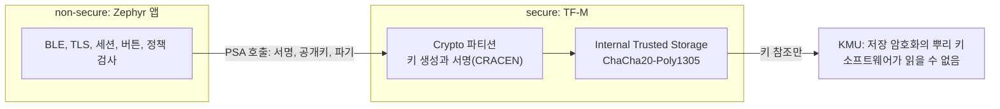

# 대여 보드의 보안 영역 키 보관, 공장 초기화, 소유자 대기 광고

작성 2026-11-27. 상태: 설계 제안과 첫 구현. 보드에는 아무것도 기록하지 않았고 전류도 재지 않았다. 확정되지 않은 항목은 "결정 필요"로 표시하고 8장에 모았다.

대상은 화면 없는 결제용 프로필(`CONFIG_NU54_SPENDING_PROFILE`, [설계](spending-wallet.md))이다. 이 문서의 파일과 줄 번호는 2026-11-27 `feat/board-secure-key-advertising` 브랜치 기준이다.

## 1. 요구사항과 지금 상태

제품 책임자의 요구사항(2026-11-27) 네 가지를 코드와 대조했다. "확인"은 이 저장소의 코드나 로컬 빌드 결과를 직접 본 것이고, 보드에서 본 것은 하나도 없다.

| 요구사항 | 지금 코드 | 판정 |
|---|---|---|
| 1. 공장 초기화를 버튼으로도, 앱으로도 | 버튼: SW2+SW3 5초 → PIN → 10초 안에 SW1 길게(`app/src/device_pilot.c:583-619`). 앱: 명령 `0x7c`에 SW1과 PIN(`:521-580`). 운영자 서명 초기화 `0x7d`·`0x7e`(`:489-519`) | 있음. 버튼 경로에 PIN이 필요한 점은 6장 |
| 2. 초기화 뒤 이전 사용자 기록이 없고 섞이지 않는다. 개인키는 Arm TrustZone 보안 영역에 있고 지워져 있다 | 지우는 것과 세대 증가는 있다(4장). 그러나 빌드 타깃이 TF-M 없는 `nu54v_dk/nrf54l15/cpuapp`이다(`scripts/fw.py:65`). 키는 앱과 같은 영역의 Zephyr secure storage에 있다(`app/prj.conf:8`의 주석, 생성 설정 `CONFIG_SECURE_STORAGE_ITS_IMPLEMENTATION_ZEPHYR=y`) | **[치명] 미충족.** 보안 영역이 없다 |
| 3. 초기화 뒤 스스로 페어링 준비를 하고, 전력을 아끼는 방식으로 광고하며, 3시간 이상 버틴다 | 초기화는 재시작만 했고 광고는 SW4를 길게 눌러야 120초 동안 나갔다(`app/src/main.c`, 간격 30~60 ms `BT_LE_ADV_CONN_FAST_1`) | 이번에 구현(5장). 전류는 추정값 |
| 5. 개인키를 보드가 무작위로 만들고 사용자도 모른다. 주소가 그 키에서 나왔는지 검증한다 | `psa_generate_key`로 만들고 내보내기 권한이 없다(`app/src/device_spending.c:66-79`). 서명 시험 `0x79`가 계정 키와 보드 식별 키로 서명한다(`device_pilot.c:923-945`) | 있음. 형식과 digest는 이 문서에서 바꾸지 않는다 |

요구사항 5의 서명 시험은 서버가 주문의 지급자 확인에도 쓴다([공통 규격](spending-wallet-wire.md)의 `payer.enroll`). 그래서 `NU54_ACCOUNT_PROOF_OP`의 요청·응답 크기와 digest는 그대로 둔다. 보안 영역으로 옮겨도 앱이 부르는 PSA 호출이 같아서 형식이 바뀔 이유가 없다.

결제용 프로필이 만드는 주소는 EVM 주소 하나다. "네트워크별 주소"가 EVM이 아닌 체인까지 뜻한다면 [결제용 하드월렛 설계](spending-wallet.md) 3장 6번의 seed 파생이 먼저 필요하고, 이 문서의 범위 밖이다.

## 2. 결정 요약

| 결정 | 이유 | 치르는 값 |
|---|---|---|
| 지갑 키는 TF-M의 암호화된 Internal Trusted Storage에 둔다. KMU 슬롯에 직접 두지 않는다 | NCS v3.4.2의 KMU가 받는 키 종류에 secp256k1이 없다(3.3) | 키가 RRAM에 암호문으로 남는다. 지우는 보장은 4장 |
| 보안 영역 빌드는 별도 프로필 `--secure-key`로 추가하고 지금 빌드는 그대로 둔다 | 플래시 배치가 달라 설치된 보드에 갱신으로 넣을 수 없고, 보드에서 한 번도 돌려 보지 않았다 | 두 프로필을 한동안 같이 유지한다 |
| `--secure-key` 이미지는 release manifest를 만들지 않고 `fw.py flash`가 거절한다 | 호스트에서만 확인한 이미지를 설치 절차가 받아들이면 안 된다 | 보드 인수를 통과한 뒤 이 차단을 푸는 변경이 한 번 더 필요하다 |
| 설치된 보드는 옮기지 않고 다시 설치한다(결정 필요: 설치된 보드) | 키가 내보내기 불가라 옮길 방법이 없고, 옮기는 경로를 만들면 그것이 추출 경로가 된다 | 사용자는 잔액을 돌려보낸 뒤 새 주소를 받는다 |
| 소유자가 없는 보드는 스스로 광고한다. 30초는 100~150 ms, 그 뒤 3시간까지 1~1.2 s 간격 | 스캔 중인 휴대전화는 곧바로 찾고, 나머지 시간은 전류를 20분의 1 수준으로 낮춘다 | 느린 구간에서는 휴대전화가 찾는 데 몇 초 걸릴 수 있다 |
| 스스로 하는 것은 광고뿐이다. 설치 창(SW4), 승인(SW1), PIN은 그대로 버튼에 둔다(결정 필요: 설치 창) | 광고와 연결만으로는 아무 권한도 열리지 않는다. 설치 창까지 3시간 열어 두면 "보드 앞에 사람이 있다"는 조건이 사라진다 | 운영자가 허가를 넣을 때는 여전히 SW4를 누른다 |
| 소유자 대기 중에는 LED를 켜지 않는다(결정 필요: 대기 중 LED) | LED가 광고보다 전류를 더 쓴다 | 보드가 광고 중인지 눈으로 알 수 없다 |
| 반납 때의 초기화는 지금 있는 운영자 서명 초기화를 쓴다. PIN 없는 버튼 초기화는 만들지 않는다(6장) | PIN 없이 버튼만으로 지워지면 보드를 잠깐 만진 사람이 남의 잔액을 없앨 수 있다 | 반납 창구에 서명 도구와 허가가 필요하다 |

## 3. 키를 TrustZone 보안 영역으로 옮기기

### 지금 구조가 요구사항에 못 미치는 이유

지금 이미지는 한 덩어리다. 앱, 블루투스 스택, TLS, PSA Crypto, 키 저장소가 같은 권한으로 돈다. 키는 "내보내기 불가" 정책을 갖지만 그 정책을 지키는 코드와 키 암호문을 푸는 코드가 앱과 같은 주소 공간에 있다. 앱의 메모리 오류 하나가 곧 키 저장소 접근이다.

저장도 같은 문제를 갖는다. 생성 설정을 보면 키는 settings(ZMS) 위의 Zephyr secure storage에 AES-256-GCM으로 저장되고, 암호화 키는 HUK 라이브러리가 항목 번호로 파생한다(`CONFIG_SECURE_STORAGE_ITS_STORE_IMPLEMENTATION_SETTINGS=y`, `..._AEAD_KEY_PROVIDER_HUK_LIBRARY=y`). 이 `storage` 파티션은 앱이 읽고 쓰는 영역이다. 결제용 프로필은 공식 채널이 아니라서 디버그 포트도 열려 있다(`CONFIG_NRF_APPROTECT_DISABLE=y`, `fw.py`가 `--spending --official`을 거절).

### 목표 구조

앱은 `nu54v_dk/nrf54l15/cpuapp/ns` 타깃으로 빌드되어 non-secure 영역에서 돈다. `app/src/device_spending.c`가 부르는 `psa_generate_key`, `psa_sign_hash`, `psa_export_public_key`, `psa_destroy_key`는 그대로이고, 이 호출들이 TF-M의 Crypto 파티션으로 넘어간다. 키 재료와 서명 연산은 보안 영역 안에만 있다. 그래서 앱 소스는 바꾸지 않았다. 바뀐 것은 빌드 타깃, 설정, 메모리 배치다.

### KMU에 둘 것인가, ITS에 둘 것인가 (결정 필요: 키 보관 위치)

nRF54L15의 KMU는 키를 CRACEN 전용 RAM으로만 밀어 넣을 수 있어서 가장 강한 보관소다. 그러나 고정한 SDK의 KMU 문서(`nrf/doc/nrf/app_dev/device_guides/kmu_guides/kmu_psa_crypto_api_prog_model.rst`의 지원 키 표)에는 AES, ChaCha20-Poly1305, secp256r1, secp384r1, Ed25519, X25519, HMAC만 있고 secp256k1이 없다. EVM 서명 키는 secp256k1이라 KMU 슬롯에 직접 넣을 수 없다.

| 후보 | 고르면 달라지는 것 | 단점 |
|---|---|---|
| ITS(추천, 이번 구현) | SDK가 지원하는 경로다. 키는 보안 영역 RRAM에 파일별 키로 암호화되어 있고, 그 뿌리 키만 KMU에 있다 | 암호문이 플래시에 있다. 초기화 뒤 잔여물은 블록 지우기에 기댄다(4장) |
| KMU에 대여 회차별 포장 키를 두고, 지갑 키는 그 키로 한 번 더 싼다 | 초기화 때 KMU 슬롯 하나를 지우면 남은 암호문이 영영 풀리지 않는다 | 전용 보안 파티션을 직접 만들어야 한다. KMU 슬롯 지우기가 이 SoC에서 어떻게 동작하는지 확인 안 됨 |

추천: ITS로 시작하고, 포장 키는 보드에서 ITS 잔여물 시험(7장)이 실패할 때 올린다.

### non-secure 앱이 할 수 있는 일

| 동작 | 가능 여부 | 근거 |
|---|---|---|
| 지갑 키로 32바이트 digest에 서명 | 가능 | 키 정책이 `PSA_KEY_USAGE_SIGN_HASH`뿐이다(`device_spending.c:74`) |
| 공개키 읽기 | 가능 | 주소 계산에 필요하다 |
| 키 파기 | 가능 | 공장 초기화가 쓴다 |
| 키 재료 읽기, 복사 | 불가 | 정책에 EXPORT·COPY가 없고, 재료가 앱의 주소 공간에 없다 |

한계를 분명히 적는다. 이 구조에서 보안 영역은 **무엇에 서명하는지 모른다.** 앱이 뚫리면 공격자는 키를 꺼내지는 못해도 임의 digest에 서명을 받을 수 있다. 한도, 가맹점 서명 확인, SW1, PIN은 모두 앱 쪽 코드다. "앱이 뚫려도 한도 밖 서명은 안 된다"까지 가려면 정책 검사와 버튼 입력을 보안 파티션으로 옮겨야 하고, 이것은 남은 단계다(3장 끝). TF-M 격리 수준도 1이라 보안 파티션끼리는 서로 격리되지 않는다(`CONFIG_TFM_ISOLATION_LEVEL=1`).

### 플래시와 RAM 예산

2026-11-27 로컬 NCS v3.4.2로 두 프로필을 같은 소스에서 빌드한 값이다. 서명 키와 등록 기관 키는 버리는 시험용이다.

| 이미지 | 지금(`--release --spending`) | 보안 영역(`--release --spending --secure-key`) |
|---|---|---|
| MCUboot | 41,632 B / 62 KB | 41,680 B / 62 KB |
| TF-M 보안 이미지 | 없음 | 78,068 B / 126 KB, RAM 44,036 B / 64 KB(67.2%) |
| 앱 | 347,588 B, RAM 157,648 B / 252 KB(61.1%) | 297,976 B / 1,273,696 B, RAM 155,600 B / 188 KB(80.8%) |
| 코드 합계(MCUboot 제외) | 347,588 B | 376,044 B(+28,456 B) |

RRAM 1,524 KB의 배치는 `app/secure-key.overlay`에 있다: MCUboot 62 KiB, 결합 슬롯 1,372 KiB(보안 128 KiB + non-secure 1,244 KiB), non-secure settings 32 KiB, TF-M ITS 32 KiB, OTP 8 KiB, PS 16 KiB. SRAM은 보안 64 KiB, non-secure 188 KiB, 보드가 리셋 뒤에도 유지하는 4 KiB다.

- **RAM이 빠듯하다.** non-secure 80.8%는 링크 시점의 정적 합계다. 스택과 힙의 최고 수위는 보드에서만 잴 수 있다.
- **ITS 자산 수.** TF-M의 기본 최대 자산 수는 10이다. 결제용 프로필은 키 9개와 기록 35개로 최대 44개를 쓰므로 그대로 두면 실행 중에 저장이 실패한다. 64로 올렸다(`app/secure-key.conf`). 메타데이터 블록 하나(4 KiB)에 60바이트짜리 항목이 64개까지 들어간다는 것은 TF-M 소스에서 계산한 값이다(`its_flash_fs.c`의 `its_flash_fs_validate_config`). 넘치면 빌드가 아니라 **부팅 때** 저장소가 실패한다.
- **Kconfig 경고는 빌드를 멈추지 않는다.** 처음에 자산 수 64가 적용되지 않고 10으로 남았는데 빌드는 성공했다. 그래서 `fw.py`가 생성된 설정을 다시 읽어 확인한다(`secure_key_evidence`).

### MCUboot와 서명

- TF-M과 앱은 하나의 서명 이미지가 된다(`zephyr.signed.bin` 429,256 B). MCUboot는 지금처럼 Ed25519 서명 하나를 확인하고, 유선 serial recovery가 그 한 슬롯을 쓴다.
- 결합 이미지는 부모 슬롯에서 시작하므로 `CONFIG_NCS_MCUBOOT_IMGTOOL_SET_ROM_FIXED_ADDRESS=n`이 필요하다. W27 실험 프로필(`app/owner-limits-tfm.conf`)과 같은 이유다.
- 하드웨어 보안 카운터(`--security-counter`)는 두 슬롯 배치가 필요해서 이 프로필에서는 거절한다. `--approtect`도 거절한다. 보안 영역 디버그 잠금(`SECURE_APPROTECT`)을 보드에서 확인한 적이 없기 때문이다.
- release manifest, 복구 배치 검사(`verify_recovery_layout.py`), TLS 구성 증거는 이 프로필에서 만들지 않는다. 서명 검증만 한다.
- TF-M의 보안 콘솔이 UART30에 켜져 있다(`CONFIG_TFM_SECURE_UART30=y`, 로그 수준 INFO). 보드의 non-secure 기본 설정이 "로그 끔은 아직 지원하지 않는다(NCSDK-31930)"고 적고 있다. 출시 이미지에서는 이 출력과 핀을 따로 검토해야 한다.

### CI

- 이번 변경은 CI 워크플로를 건드리지 않았다. `scripts/test_fw_secure_key.py`(8건)는 `make test`에 들어가므로 기존 호스트 시험 작업에서 돈다. 툴체인 없이 타깃, 설정 파일, 거절 조합, 증거 검사, flash 거절을 확인한다.
- 지금 CI의 보드 빌드 작업은 개발 이미지와 `--release --approtect --security-counter=2`만 빌드한다(`.github/workflows/ci.yml`의 `p01-board-build`). 결제용 프로필은 기존 타깃도 CI에서 빌드하지 않는다.
- 제안: 같은 작업에 `fw.py build --release --spending --secure-key` 한 단계를 더한다. 버리는 서명 키와 시험용 등록 기관 공개키면 된다. 빌드 시간은 로컬에서 재지 않았다. 이 단계는 워크플로 파일 변경이라 별도 승인을 받아 넣는다.

### 이미 설치된 보드 (결정 필요: 설치된 보드)

지금 보드의 키는 non-secure `storage` 파티션에 있고 새 프로필의 키는 TF-M ITS에 있다. 플래시 배치도 다르다. 새 이미지를 올리면 보드는 예전 키를 찾지 못한다. 키는 내보낼 수 없으므로 옮겨 적을 수도 없다.

| 후보 | 고르면 달라지는 것 | 단점 |
|---|---|---|
| 다시 설치(추천) | 앱에서 반납으로 잔액을 원래 지갑에 돌려보낸다 → 공장 초기화 → 유선으로 전체를 지우고 새 이미지를 설치 → 운영자 허가와 소유자 등록을 다시 한다 | 주소가 바뀐다. 보드마다 손이 간다 |
| 옮기기 | 주소가 유지된다 | 키를 한 번 내보내는 코드가 필요하다. 그 코드가 곧 추출 경로다. 예전 암호문도 `storage`에 남는다 |

전체를 지우는 것이 중요하다. 예전 이미지의 키 암호문은 `storage` 파티션에 있고, 새 배치에서는 그 주소가 앱 슬롯 안이다. 덮어쓰지 않은 부분에 남을 수 있다. 결제용 프로필은 8283 시험망 전용이고 백업이 없으므로 다시 설치하는 쪽의 손실은 주소 변경뿐이다.

### 확인한 것과 가정한 것

| 항목 | 상태 | 근거 |
|---|---|---|
| 고정 SDK가 NCS v3.4.2, manifest `f0b8ad4c…`이고 로컬 SDK가 같은 커밋이다 | 확인 | `.github/inputs.json`, 로컬 `nrf` 저장소의 HEAD |
| `nu54v_dk/nrf54l15/cpuapp/ns`로 결제용 프로필이 빌드되고 서명 검증을 통과한다 | 확인(빌드만) | `fw.py build --release --spending --secure-key`, `imgtool` 검증 2건 |
| 서명 코드가 보안 이미지에만 있다 | 확인(링크 맵) | `tfm_s.map`에 `cracen_ecdsa_sign_digest_deterministic`, 앱 `zephyr.map`에 `cracen_` 0건 |
| nRF54L에서 TF-M ITS 암호화가 기본으로 켜진다 | 확인 | `nrf/modules/trusted-firmware-m/Kconfig:234-237`, 생성 설정 `CONFIG_TFM_ITS_ENCRYPTED=y` |
| KMU가 secp256k1 키를 받지 않는다 | 확인(문서) | 위 KMU 문서의 지원 키 표 |
| NCS v3.4.2는 minimal이 아닌 TF-M 구성을 실험 단계로 표시한다 | 확인 | 같은 Kconfig `:447-450`, 빌드 경고 `Experimental symbol TFM_EXPERIMENTAL` |
| Nordic이 TF-M 지원 타깃으로 적은 것은 `nrf54l15dk/nrf54l15/cpuapp/ns`다. `nu54v_dk`는 제조사 보드 패키지의 변형이다 | 확인 | `nrf/doc/nrf/security/tfm/tfm_building.rst`, `boards/nucode/nu54v_dk/board.yml` |
| 이 보드에서 TF-M이 부팅한다 | 가정 | 실행한 적 없음 |
| TF-M 옆에서 블루투스 컨트롤러와 TLS가 지금처럼 동작한다 | 가정 | 실행한 적 없음. PSA 호출마다 영역 전환이 들어가 TLS 핸드셰이크 시간이 달라질 수 있다 |
| 보안 영역의 CRACEN이 secp256k1 결정적 ECDSA 서명을 실제로 만든다 | 가정 | 코드가 링크된 것까지만 확인 |
| ITS가 자산 64개 설정으로 초기화된다 | 가정 | 소스에서 계산 |
| 첫 부팅이 저장 암호화의 뿌리 키를 KMU에 만든다. 이 값은 전체 지우기 전에는 바뀌지 않는다 | 가정 | 생성 설정 `CONFIG_HW_UNIQUE_KEY_RANDOM=y`, `CONFIG_CRACEN_IKG_SEED_KMU_SLOT=183`에서 추론 |
| 64 KiB / 188 KiB SRAM 경계가 이 SoC의 보호 단위에 맞는다 | 가정 | W27 실험 배치와 같은 경계지만 그것도 보드에서 돌린 적 없음 |

### 남은 단계

1. 개발 보드 한 대에서 `--secure-key` 이미지 인수(7장 A). 통과하면 `fw.py flash`의 차단과 manifest 생략을 푼다.
2. 초기화 뒤 잔여물 시험(7장 B). 실패하면 KMU 포장 키로 간다.
3. 보안 영역 디버그 잠금과 보안 카운터가 있는 두 슬롯 배치. 디버그 잠금은 되돌릴 수 없어 따로 결정한다([결제용 하드월렛 설계](spending-wallet.md) 3장 11번).
4. 서명 정책을 보안 파티션으로: 한도, 가맹점 서명 확인, 버튼과 PIN. W27의 전용 파티션(`app/experimental/w27_qualification`)이 만드는 방법의 선례다.
5. 격리 수준 2와 TF-M 로그 끄기.

## 4. 공장 초기화가 보장하는 것

### 지우는 것과 남기는 것

| 구분 | 내용 | 근거 |
|---|---|---|
| 지운다 | 지갑 키, PIN과 PIN 키, 주문 기록 16칸, 하루 누계, 반납 주소, 기록해 둔 주소 | `app/src/device_spending.c:81-90`, `device_order.c:70-78`, `device_recovery_pin.c:123-129` |
| 바꾼다 | 소유자를 0으로 지우고 세대를 1 올린다. 철회와 "소유자 없음" 표시를 켠다 | `core/src/nu54_vault.c:113-125` |
| RAM | 지운 뒤 4초 표시하고 콜드 리셋한다. 세션, 요청 기록, 허가는 RAM에만 있어 함께 사라진다 | `device_pilot.c:521-529` |
| 남긴다 | 보드 식별 키, 설치 키와 한 번만 쓰는 설치 표식, 시각·재전송 하한, 세대 번호 | [결제용 하드월렛 설계](spending-wallet.md) 4장 |
| 전원이 끊기면 | 초기화 표식을 먼저 쓰고 시작한다. 다음 부팅이 남은 삭제를 마친 뒤에만 진행한다 | `device_spending.c:86`(표식 먼저), `:92-97`(부팅 때 이어서) |

### 이전 사용자와 섞이지 않는 이유

- **세대가 올라간다.** 운영자 허가, 휴대전화의 소유자 인증, 주문 서명은 모두 세대 번호에 묶인다. 이전 사용자의 휴대전화나 허가는 세대가 맞지 않아 거절된다. 세대는 줄어들지 않는다.
- **키가 새로 생긴다.** 재시작 뒤 보드는 새 무작위 키를 만들고 주소가 달라진다. 이전 주소로 온 주문은 지급자 주소가 맞지 않는다.
- **기록해 둔 주소가 있는데 키가 없으면 멈춘다.** 저장 오류를 "새 지갑"으로 오해해 조용히 새 키를 만드는 일을 막는다(`device_spending.c:101-105`).

확인이 더 필요한 것이 둘 있다.

1. 새 키는 재시작 직후, 다음 소유자가 등록하기 전에 만들어진다. "초기화된 보드에는 키가 없다"를 글자 그대로 요구한다면 키 생성을 소유자 등록 시점으로 미뤄야 한다(결정 필요: 키 생성 시점).
2. 결제용 프로필이 쓰지 않는 기록 칸(영수증 16칸 `0x5490`대, 거절 4칸 `0x5530`대, 개인 서명 요청 4칸)은 초기화가 지우지 않는다. 이 프로필에서는 쓰는 코드가 컴파일되지 않는 것을 확인했지만(`device_pilot.c:1747-1797`의 전처리 분기), 다른 프로필 이미지를 쓰던 보드를 결제용으로 바꾸는 경우에는 남는다. 프로필을 바꿀 때는 전체 지우기를 절차에 넣는다.

### 플래시에 남는 것

지금 구조에서는 "지웠다"가 "플래시에서 사라졌다"를 뜻하지 않는다.

- 저장소가 ZMS다. 항목을 지우면 삭제 표시가 추가되고, 예전 암호문은 그 구역이 정리될 때까지 플래시에 남는다. 이것은 ZMS의 일반 동작에서 추론한 것이고 이 보드의 덤프로 확인하지 않았다.
- 그 암호문을 푸는 키는 초기화로 바뀌지 않는다. HUK에서 항목 번호로 파생하기 때문이다. 그래서 "키를 버려 암호문을 못 쓰게 만든다(crypto-shredding)"는 주장이 지금은 성립하지 않는다.
- 결론: 지금 이미지에서는 보드에서 코드를 실행하거나 디버그 포트로 플래시를 읽을 수 있는 사람이 초기화 전의 키 암호문을 복구할 가능성을 배제할 수 없다.

보안 영역 프로필에서는 세 가지가 달라진다.

1. 암호문이 non-secure 코드가 읽을 수 없는 TF-M 영역에 있다.
2. TF-M ITS는 파일을 지울 때 남은 데이터를 예비 블록으로 옮기고 예전 블록을 지운다(`its_flash_fs_mblock.c`의 `its_flash_fs_mblock_meta_update_finalize`: "Erase meta block and current scratch block"). 소스를 읽은 것이고 보드에서 확인하지 않았다.
3. 그래도 파일 암호화 키는 KMU의 뿌리 키와 파일 번호에서 파생되므로 초기화로 바뀌지 않는다. 블록 지우기가 실패하거나 건너뛰는 경우까지 막으려면 3장의 KMU 포장 키가 필요하다.

초기화가 성공을 보고하기 전에 키가 정말 없는지 다시 묻는 확인(`psa_get_key_attributes`가 "없음"을 돌려주는지)은 아직 없다. 지금은 삭제 호출의 반환값을 믿는다. 작은 변경이지만 `device_spending.c`의 전원 차단 시험과 함께 고쳐야 해서 이번에는 넣지 않았다.

## 5. 초기화 뒤의 소유자 대기 광고

### 동작

소유자가 없는 상용 보드(새 보드, 또는 공장 초기화로 재시작한 보드)는 부팅이 끝나면 스스로 광고한다. 구현은 `core/src/nu54_adv_schedule.c`(순수 로직)와 `app/src/ble_links.c:217-334`다.

| 구간 | 기본값 | 설정 |
|---|---|---|
| 빠른 구간 | 30초, 간격 100~150 ms | `CONFIG_NU54_OWNER_WAIT_FAST_SECONDS`, `..._FAST_INTERVAL_MIN/MAX` |
| 느린 구간 | 시작부터 3시간까지, 간격 1~1.2 s | `CONFIG_NU54_OWNER_WAIT_TOTAL_SECONDS`, `..._SLOW_INTERVAL_MIN/MAX` |
| 끝난 뒤 | 광고하지 않는다. SW4를 길게 누르면 처음부터 다시 | 총 시간을 0으로 두면 끝나지 않는다 |

- 간격 기본값은 Bluetooth Core의 GAP 권장 타이머(빠른 구간 30초, 100~150 ms, 느린 간격 1~1.2 s)를 그대로 썼다.
- 광고 내용은 SW4 창과 같다. 연결 가능, 일반 검색 가능, 소유자 서비스 UUID 하나, 이름 없음(`ble_links.c`의 `ad_pilot`). 주소는 15분마다 바뀌는 비공개 주소다(`CONFIG_BT_PRIVACY=y`).
- 휴대전화가 연결해 있는 동안에는 광고하지 않는다. 끊기면 그 시각의 구간으로 돌아간다. 구간 시계는 연결 때문에 다시 시작하지 않는다.
- SW4 창(120초, 30~60 ms)이 열려 있으면 그것이 우선이고, 끝나면 대기 광고로 돌아간다.
- 소유자가 등록되면 멈춘다(`main.c:176-180`). 소유자가 있는 보드는 전과 똑같이 버튼을 눌러야만 광고한다.
- 켜지는 조건: `CONFIG_NU54_OWNER_WAIT_ADV`, 결제용 프로필에서만 기본으로 켜진다. 개발 빌드, 대여 v1 빌드, HD 복구 프로필은 바뀌지 않는다.

### 광고가 열어 주는 것과 열지 않는 것

광고와 연결만으로는 권한이 생기지 않는다. 연결한 쪽이 TLS를 시작하려면 그 부팅에서 운영자가 넣은 허가가 있어야 하고(`device_pilot.c`의 `receive_bytes`), 허가를 넣는 설치 창은 여전히 SW4로만 열린다. 소유자 등록에는 SW1과 새 PIN이 필요하다. 즉 재시작 직후의 보드는 "찾을 수 있고 연결할 수 있는" 상태이고, 운영자가 SW4를 눌러 허가를 넣어야 다음 사용자가 등록할 수 있다.

이 점이 요구사항 3의 "기기 연결 준비"에 충분한지는 제품 책임자가 정한다(결정 필요: 설치 창). 설치 창까지 스스로 열면 운영자가 버튼을 누를 필요가 없지만, 등록 기관의 서명만 있으면 3시간 동안 누구나 허가를 넣을 수 있게 된다.

### 3시간 전력 예산

**아래 숫자는 모두 추정이다. 재기 전에는 요구사항 3을 충족했다고 쓰지 않는다.**

전원: 보드 패키지의 주석에 따르면 충전 IC는 BQ25186(1셀 리튬 충전기), 배터리 전압은 1.47 MΩ 분압으로 읽고, SoC는 DC/DC 인덕터 실장 여부를 몰라 LDO 모드로 둔다(`boards/nucode/nu54v_dk/nu54v_dk_nrf54l15_cpuapp.dts:82-99, 157-162`). 그래서 전원은 USB로 충전하는 1셀 리튬 전지로 가정한다. **전지 용량은 저장소 어디에도 없다**(결정 필요: 전원과 전지 용량).

SoC 값의 출처는 Nordic의 nRF54L15 제품 페이지다(2026-11-27 조회): 송신 4.8 mA(0 dBm, 3 V), 수신 3.4 mA(3 V), 절전 0.7~2.9 μA(3 V). 이 값들은 DC/DC 기준으로 본다. LDO 모드의 값은 그 페이지에 없어서 2.3배로 가정했다. 송신 출력은 0 dBm이다(`CONFIG_BT_CTLR_TX_PWR_0=y`).

광고 한 번(세 채널)의 전하:

| 항목 | 계산 | DC/DC |
|---|---|---|
| 송신 | 37바이트 = 296 μs, 세 채널 0.89 ms × 4.8 mA | 4.3 μC |
| 연결 요청 듣기 | 채널마다 약 0.35 ms(가정), 1.05 ms × 3.4 mA | 3.6 μC |
| 발진기 기동, 전환, CPU | 약 1.5 ms × 3 mA(가정) | 4.5 μC |
| 합계 | 12.4 μC, 여유를 두어 | 15 μC |

LDO 모드는 15 μC × 2.3 ≈ 35 μC로 둔다. 광고 사이의 전류는 SoC 절전 2.9 μA에 분압 저항 2.9 μA(4.2 V ÷ 1.47 MΩ)를 더하고, PMIC와 나머지 부품은 모르므로 DC/DC 3 μA, LDO 5 μA를 최소 가정으로 쓴다.

| 경우 | 빠른 구간 평균 | 느린 구간 평균 | 3시간 소비 | 100 mAh 전지 대비 | CR2032(225 mAh) 대비 |
|---|---|---|---|---|---|
| DC/DC, 15 μC, 대기 3 μA | 153 μA | 18 μA | 0.055 mAh | 0.06% | 0.02% |
| LDO(지금 보드 설정), 35 μC, 대기 5 μA | 355 μA | 40 μA | 0.123 mAh | 0.12% | 0.05% |
| 절전에 들어가지 못함, 대기 1.5 mA | 1.85 mA | 1.54 mA | 4.61 mAh | 4.6% | 2.0% |

세 줄의 3시간 값은 호스트 시험이 같은 식으로 다시 계산한다(`test/test_adv_schedule.c`의 `budget`, `nu54_adv_plan_charge_nah`). 식은 간격의 최솟값으로 횟수를 세므로 위쪽 추정이다.

읽는 법:

- 광고 자체는 3시간에 0.1 mAh 수준이라 어떤 전지로도 문제가 되지 않는다. USB 전원이면 예산이 필요 없다.
- **결과를 정하는 것은 광고가 아니라 보드가 광고 사이에 실제로 잠드는지다.** 셋째 줄이 그 경우다. 개발 이미지는 콘솔 UART와 즉시 로그를 켜 두므로 이 줄에 가깝다. release 이미지는 콘솔과 로그를 끄지만(`app/release.conf`) UART 드라이버는 남아 있고(`CONFIG_SERIAL=y`), 장치 전원 관리 설정이 없다. 잠드는지는 재 봐야 안다.
- 셋째 줄이어도 3시간은 4.6 mAh다. 50 mAh 전지의 9%다. 요구사항의 "3시간"은 넉넉히 넘을 것으로 보지만, 며칠 단위의 대기는 잠들지 못하면 불가능하다.
- 동전 전지라면 평균이 아니라 순간 전류가 문제다. LDO 모드 송신은 10 mA를 넘을 수 있고 CR2032는 그 정도 펄스에서 전압이 내려간다. 보드가 동전 전지를 쓴다면 DC/DC 확인과 완충 커패시터가 먼저다.
- LED는 예산에 없다. 대기 광고 중에는 켜지 않는다. 결제 모드 표시처럼 2초마다 0.1초 켜면 LED 전류의 5%가 평균에 더해진다. LED 전류가 2 mA면 100 μA로, 느린 광고의 2.5배다.

## 6. 반납 때 PIN이 필요한 버튼 초기화

검토에서 나온 지적: 버튼 초기화가 PIN을 요구하므로, 사용자가 PIN을 알려 주지 않고 떠나면 반납 창구는 버튼으로 보드를 지울 수 없다.

PIN을 없애지 않는 이유부터 적는다. 보드에는 백업이 없어서 초기화는 곧 잔액 손실이다. 버튼만으로 지워지면 보드를 잠깐 만진 사람이 남의 잔액을 없앨 수 있다. 초기화된 보드는 운영자 허가 없이는 쓸 수 없으므로 훔친 사람이 얻는 것은 없지만, 피해는 생긴다.

| 후보 | 고르면 달라지는 것 | 단점 |
|---|---|---|
| A. 운영자 서명 초기화(추천, 이미 구현됨) | 창구 도구가 보드의 일회용 값을 받아 등록 기관 키로 서명하고, 직원이 SW1을 누른다. 서명은 보드 식별값, 세대, 일회용 값에 묶인다(`device_pilot.c:489-519`, `core/src/nu54_spending.c`의 `nu54_spend_operator_statement`) | 그 부팅의 운영자 허가와, 같은 CA의 소유자 인증서를 가진 휴대전화가 필요하다. 남은 잔액은 잃는다 |
| B. 반납 확정 뒤에만 PIN 없는 버튼 초기화 | 사용자가 앱에서 반납(`0x7b`, SW1과 PIN)을 마치면 보드가 "반납됨"을 저장한다. 그 상태에서는 SW2+SW3 5초와 SW1 길게만으로 지운다. PIN 승인을 반납 때 이미 받았기 때문이다 | 새 저장 상태와 시험이 필요하다. 반납 서명이 체인에서 확정됐는지 보드는 모른다. 반납 뒤 다시 입금하면 그 잔액은 PIN 없이 지워질 수 있다 |
| C. PIN 없는 버튼 초기화 | 창구에서 가장 간단하다 | 위에 적은 피해. 2026-11-23 결정(PIN 요구)을 뒤집는다 |

추천: A를 반납 절차의 기본으로 쓴다. 반납 창구의 순서는 잔액 반납 확정 확인 → 운영자 서명 초기화 → 재시작한 보드가 스스로 광고(5장) → 다음 대여 때 SW4로 허가 설치다. B는 창구에서 A가 번거롭다는 것이 실제로 확인되면 만든다. 이번에는 A와 B 어느 쪽도 코드를 바꾸지 않았다.

A에 남은 운영 위험: 등록 기관 키 하나가 초기화 서명도 한다. 창구마다 그 키를 두면 안 되고, 서명 요청을 받아 주는 운영 서버와 두 사람 승인이 필요하다. 이 부분은 운영 웹과 서버의 설계 범위다.

## 7. 검증 계획

이번에 실행한 것은 호스트 시험과 빌드뿐이다(9장). 아래는 보드가 있어야 하는 것들이다. 디버그 잠금과 OTP는 어느 단계에서도 쓰지 않는다.

### A. 보안 영역 이미지 인수 (개발 보드 1대, 디버그 포트 열림)

| 확인 | 방법 | 통과 기준 |
|---|---|---|
| 부팅 | 전체 지우기 뒤 `--secure-key` 이미지 기록, 보안 콘솔과 앱 로그 | TF-M과 앱이 모두 뜬다. ITS 초기화 오류 0건 |
| 키 생성과 서명 | 서명 시험 `0x79`를 20회 | 20/20에서 복원한 주소가 보드 주소와 같다 |
| 저장 용량 | 주문 16건을 채우고 PIN, 반납 주소까지 저장 | 저장 실패 0건 |
| 기존 기능 | 소유자 등록, 주문 결제, 반납, 세 가지 초기화 | 지금 타깃에서와 같은 결과 |
| TLS 시간 | 핸드셰이크 20회 | 120초 세션 제한 안에서 실패 0건. 지금 타깃과 시간 비교를 기록 |
| RAM | 스택과 힙 최고 수위 | 각 스택 여유 20% 이상 |
| 격리 | non-secure 코드에서 보안 영역 주소(ITS 파티션, 보안 RAM)를 읽는 시험 이미지 | 읽기마다 SecureFault |

### B. 초기화 뒤 잔여물

1. 키를 만든 직후 디버그 포트로 `tfm-its` 파티션을 덤프해 지갑 키 항목의 암호문 바이트를 기록한다.
2. 공장 초기화를 한다(버튼, 앱, 운영자 서명 각각. 한 번은 삭제 도중 전원을 끊는다).
3. 재시작 뒤 RRAM 전체를 덤프한다.

통과 기준: 1에서 기록한 암호문이 전체 덤프에 0건. 지금 타깃(`storage` 파티션)에서도 같은 시험을 해서 4장의 추론을 확인한다. 지금 타깃에서 1건 이상 나오면 그것이 보안 영역으로 옮겨야 하는 측정 근거가 된다.

### C. 소유자 대기 광고와 전류

장비: Nordic PPK2. 전지 단자에 소스 미터로 3.7 V를 넣거나, 실제 전지와 직렬로 전류계 모드를 쓴다. USB는 뺀다. 이미지는 `--release --spending`(콘솔과 로그 꺼짐)이다. 개발 이미지로 잰 값은 쓰지 않는다.

| 확인 | 방법 | 통과 기준 |
|---|---|---|
| 스스로 시작 | 세 가지 초기화 각각 뒤에 버튼을 누르지 않고 휴대전화로 스캔 | 재시작 뒤 10초 안에 소유자 서비스 광고가 보인다(각 3회, 9/9) |
| 광고 한 번의 전하 | 100 kHz로 광고 20회를 적분 | 평균을 기록한다. 35 μC보다 크면 표를 고친다 |
| 구간별 평균 | 빠른 구간 30초, 느린 구간 10분 | 빠른 구간 0.5 mA 이하, 느린 구간 0.1 mA 이하 |
| 3시간 연속 | 3시간 10분 기록 | 3시간 누적 1 mAh 이하. 3시간 0분(±5초)에 광고가 멈추고 그 뒤 평균 20 μA 이하 |
| 끝까지 연결 가능 | 0분, 10분, 1시간, 2시간 59분에 연결 | 4/4 연결 성공 |
| 찾는 시간 | 휴대전화 2종으로 구간마다 20회 | 빠른 구간 2초 이하, 느린 구간 95%가 10초 이하 |
| 실제 전지 | 잔량 20%인 전지로 3시간 | 리셋 0회. 송신 순간의 전압 강하를 기록 |
| 소유자 있는 보드 | 등록된 보드를 재시작 | 버튼 없이는 광고 0건(10분 스캔) |

"느린 구간 0.1 mA"와 "3시간 1 mAh"는 LDO 추정(40 μA, 0.123 mAh)에 여유를 둔 값이다. 넘으면 보드가 잠들지 못하는 것이므로 UART, 장치 전원 관리, PMIC 설정을 먼저 본다.

## 8. 제품 책임자가 정할 것

| 주제 | 질문 | 후보 | 추천과 이유 |
|---|---|---|---|
| 전원과 전지 용량 | 대여 보드의 전원과 전지 용량은? | 1셀 리튬(용량 미정) / 동전 전지 / USB 상시 | 회로에 리튬 충전 IC가 있으므로 리튬으로 가정했다. 용량 값을 알려 주면 표의 백분율을 확정한다. 동전 전지라면 순간 전류 검토가 먼저다 |
| 키 보관 위치 | 지갑 키를 ITS에 둘까, KMU 포장 키까지 갈까? | ITS / ITS + KMU 포장 키 | ITS. SDK가 지원하는 경로이고 지금 빌드된다. 포장 키는 잔여물 시험이 실패할 때 |
| 설치된 보드 | 설치된 보드를 옮길까, 다시 설치할까? | 다시 설치 / 옮기기 | 다시 설치. 옮기려면 키를 내보내는 코드가 필요하다 |
| 광고를 멈추는 시점 | 소유자 대기 광고는 언제 멈출까? | 3시간 뒤 멈춤(지금 기본값) / 24시간 / 멈추지 않음 | 전류를 잰 뒤 정한다. 느린 구간이 추정대로 40 μA면 100 mAh 전지로 100일이라 "멈추지 않음"이 낫다. 잠들지 못하면 3시간에서 멈추는 지금 값이 전지를 지킨다 |
| 설치 창 | 초기화 뒤 설치 창도 스스로 열까? | 광고만(지금 구현) / 설치 창도 열기 | 광고만. 설치 창은 "사람이 보드 앞에 있다"는 조건이고 SW4 한 번이면 된다 |
| 대기 중 LED | 대기 광고 중 LED를 켤까? | 끔(지금 구현) / 10초마다 짧게 한 번 | 끔. 켠다면 10초마다 20 ms 정도여야 광고보다 적게 쓴다 |
| 키 생성 시점 | 새 키를 언제 만들까? | 재시작 직후(지금) / 소유자 등록 때 | 소유자 등록 때. 초기화된 보드에 키가 아예 없게 된다. 등록 흐름의 호스트 시험을 고쳐야 한다 |
| 디버그 포트 잠금 | 대여 보드의 디버그 포트를 잠글까? | 잠금(되돌릴 수 없음) / 열어 둠 | 실사용 전에는 잠근다. 열려 있으면 보안 영역이 있어도 포트로 읽힌다. 보드가 1대뿐인 동안에는 미룬다 |
| 반납 초기화 경로 | 반납 때의 초기화 경로는? | 운영자 서명 초기화 / 반납 확정 뒤 PIN 없는 버튼 / PIN 없는 버튼 | 운영자 서명 초기화(6장) |

광고를 멈추는 시점, 설치 창, 대기 중 LED는 Kconfig 값이나 몇 줄의 변경으로 되돌릴 수 있어서 기본값을 정해 구현했다. 키 보관 위치, 설치된 보드, 키 생성 시점, 디버그 포트 잠금은 답을 받기 전에는 진행하지 않는다.

## 9. 구현 상태 (2026-11-27)

| 항목 | 상태 | 위치 |
|---|---|---|
| 광고 일정(순수 로직)과 전하 추정 | 구현, 호스트 시험 통과 | `core/src/nu54_adv_schedule.c`, `test/test_adv_schedule.c` |
| 소유자 대기 광고 | 구현, 두 타깃에서 컴파일. 보드에서 실행한 적 없음 | `app/src/ble_links.c`, `app/src/main.c`, `app/src/device_pilot.c`, `app/Kconfig` |
| 보안 영역 빌드 프로필 | 구현, 빌드와 서명 검증 통과. 보드에서 실행한 적 없음 | `scripts/fw.py --secure-key`, `app/secure-key.conf`, `app/secure-key.overlay`, `app/secure-key-mcuboot.overlay` |
| 프로필의 호스트 시험 | 구현, 통과 | `scripts/test_fw_secure_key.py` |
| 초기화 뒤 키 부재 재확인, 키 생성 시점 변경, 반납 뒤 초기화, 보안 파티션의 서명 정책 | 설계만 | 3장, 4장, 6장 |
| 전류 측정, 잔여물 덤프, 보드 인수 | 하지 않음 | 7장 |

관련 문서: [결제용 하드월렛 설계](spending-wallet.md) · [공통 규격](spending-wallet-wire.md) · [무선·키·코드 경계](security.md) · [펌웨어 README](../../../../products/p01-device-firmware/README.md)
