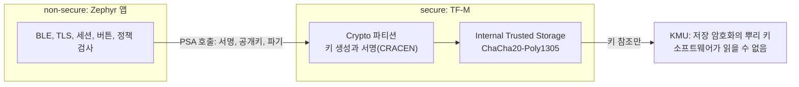

# 대여 보드의 보안 영역 키 보관, 공장 초기화, 소유자 대기 광고

작성 2026-11-27. 같은 날 독립 검토의 지적과 제품 책임자의 결정을 세 차례 반영해 고쳤다. 상태: 설계와 구현. 보드에는 아무것도 기록하지 않았고 전류도 재지 않았다. 정해진 것은 9장의 결정 표에, 아직 정해지지 않은 것은 9장의 남은 질문에 모았다.

대상은 화면 없는 결제용 프로필(`CONFIG_NU54_SPENDING_PROFILE`, [설계](spending-wallet.md))이다. 이 문서의 파일과 줄 번호는 2026-11-27 `feat/board-secure-key-advertising` 브랜치 기준이다.

## 1. 요구사항과 지금 상태

제품 책임자의 요구사항(2026-11-27) 네 가지를 코드와 대조했다. "확인"은 이 저장소의 코드나 로컬 빌드 결과를 직접 본 것이고, 보드에서 본 것은 하나도 없다.

| 요구사항 | 지금 코드 | 판정 |
|---|---|---|
| 1. 공장 초기화를 버튼으로도, 앱으로도 | 버튼: SW2+SW3 5초 → PIN → 10초 안에 SW1 길게(`device_pilot_button_reset`, `app/src/device_pilot.c:613`). 앱: 명령 `0x7c`에 SW1과 PIN(`spending_button`, `:561`). 운영자 서명 초기화 `0x7d`·`0x7e`(`spending_request`, `:507`) | 있음. 반납 창구는 운영자 서명 초기화를 쓴다(6장) |
| 2. 초기화 뒤 이전 사용자 기록이 없고 섞이지 않는다. 개인키는 Arm TrustZone 보안 영역에 있고 지워져 있다 | 지우는 것, 세대 증가, 키가 없다는 재확인은 있다(4장). 그러나 설치된 이미지의 빌드 타깃은 TF-M 없는 `nu54v_dk/nrf54l15/cpuapp`이다(`scripts/fw.py:71`). 키는 앱과 같은 영역의 Zephyr secure storage에 있다(`app/prj.conf:8`의 주석, 생성 설정 `CONFIG_SECURE_STORAGE_ITS_IMPLEMENTATION_ZEPHYR=y`). 보안 영역 프로필 `--secure-key`는 빌드까지만 확인했다(3장) | **[치명] 설치된 이미지는 미충족.** 보안 영역이 없다 |
| 3. 초기화 뒤 스스로 페어링 준비를 하고, 전력을 아끼는 방식으로 광고하며, 3시간 이상 버틴다 | 소유자가 없는 보드는 스스로 광고한다(5장). 전에는 SW4를 길게 눌러야 120초 동안 나갔다 | 구현. 전류는 추정값이고, 보드가 광고 사이에 잠드는지는 재지 않았다 |
| 5. 개인키를 보드가 무작위로 만들고 사용자도 모른다. 주소가 그 키에서 나왔는지 검증한다 | `psa_generate_key`로 만들고 내보내기 권한이 없다(`create_key`, `app/src/device_spending.c:70`). 만드는 시점은 소유자 등록이다(4장). 서명 시험 `0x79`가 계정 키와 보드 식별 키로 서명한다(`NU54_ACCOUNT_PROOF_OP`, `device_pilot.c:954`) | 있음. 형식과 digest는 이 문서에서 바꾸지 않는다 |

요구사항 5의 서명 시험은 서버가 주문의 지급자 확인에도 쓴다([공통 규격](spending-wallet-wire.md)의 `payer.enroll`). 그래서 `NU54_ACCOUNT_PROOF_OP`의 요청·응답 크기와 digest는 그대로 둔다. 보안 영역으로 옮겨도 앱이 부르는 PSA 호출이 같아서 형식이 바뀔 이유가 없다.

결제용 프로필이 만드는 주소는 EVM 주소 하나다. "네트워크별 주소"가 EVM이 아닌 체인까지 뜻한다면 [결제용 하드월렛 설계](spending-wallet.md) 3장 6번의 seed 파생이 먼저 필요하고, 이 문서의 범위 밖이다.

## 2. 결정 요약

제품 책임자가 2026-11-27에 정한 것을 포함한다. 결정의 원문과 근거는 9장에 있다.

| 결정 | 이유 | 치르는 값 |
|---|---|---|
| 지갑 키는 TF-M의 암호화된 Internal Trusted Storage에 둔다. KMU 슬롯에 직접 두지 않는다. KMU 포장 키는 잔여물 시험(8장 B)이 실패할 때만 더한다 | NCS v3.4.2의 KMU가 받는 키 종류에 secp256k1이 없다(3장) | 키가 RRAM에 암호문으로 남는다. 지우는 보장은 4장 |
| 보안 영역 빌드는 별도 프로필 `--secure-key`로 추가하고 지금 빌드는 그대로 둔다 | 플래시 배치가 달라 설치된 보드에 갱신으로 넣을 수 없고, 보드에서 한 번도 돌려 보지 않았다 | 두 프로필을 한동안 같이 유지한다 |
| TF-M 이미지는 release manifest를 만들지 않고 `fw.py flash`가 거절한다 | 호스트에서만 확인한 이미지를 설치 절차가 받아들이면 안 된다 | 보드 인수를 통과한 뒤 이 차단을 푸는 변경이 한 번 더 필요하다 |
| 설치된 보드는 옮기지 않고 다시 설치한다 | 키가 내보내기 불가라 옮길 방법이 없고, 옮기는 경로를 만들면 그것이 추출 경로가 된다 | 사용자는 잔액을 돌려보낸 뒤 새 주소를 받는다 |
| 지갑 키는 소유자가 등록할 때 만든다. 공장 초기화된 보드와 새 보드에는 지갑 키가 없다 | "초기화된 보드에는 키가 없다"를 글자 그대로 지킨다 | 등록 전에는 주소가 없다. 상태 응답은 0으로 채운 주소를 돌려준다(4장) |
| 소유자가 없는 보드는 스스로 광고한다. 30초는 100~150 ms, 그 뒤 3시간까지 1~1.2 s 간격 | 스캔 중인 휴대전화는 곧바로 찾고, 나머지 시간은 평균 전류를 빠른 구간의 약 9분의 1로 낮춘다(추정, 5장 표: LDO 355 → 40 μA) | 느린 구간에서는 휴대전화가 찾는 데 몇 초 걸릴 수 있다 |
| 3시간에 광고를 멈추는 것은 임시 값이다 | 보드가 잠들지 못할 때 전지를 지킨다. 제품은 훨씬 오래 기다려야 하고, 목표는 전류를 잰 뒤 정한다 | 3시간이 지난 보드는 SW4를 눌러야 다시 보인다 |
| 스스로 하는 것은 광고뿐이다. 설치 창(SW4), 승인(SW1), PIN은 그대로 버튼에 둔다 | 광고와 연결만으로는 아무 권한도 열리지 않는다. 설치 창까지 스스로 열면 "보드 앞에 사람이 있다"는 조건이 사라진다 | 운영자가 허가를 넣을 때는 여전히 SW4를 누른다 |
| 소유자가 없는 보드는 아무것도 시작하지 않는 연결을 30초 뒤 끊는다 | 보드가 받는 연결은 두 개다. 가만히 연결만 해 둔 기기 둘이 보드를 가릴 수 있었다 | 연결해 두고 30초 넘게 기다리는 도구는 다시 연결해야 한다. 일부러 방해하는 기기는 막지 못한다(5장) |
| 소유자 대기 중에는 LED를 켜지 않는다 | LED가 광고보다 전류를 더 쓴다 | 보드가 광고 중인지 눈으로 알 수 없다 |
| 반납 때의 초기화는 지금 있는 운영자 서명 초기화를 쓴다. PIN 없는 버튼 초기화는 만들지 않는다(6장) | PIN 없이 버튼만으로 지워지면 보드를 잠깐 만진 사람이 남의 잔액을 없앨 수 있다 | 반납 창구에 서명 도구와 허가가 필요하다 |
| 디버그 포트는 실제 대여 전에 잠근다. 개발과 시연 동안에는 열어 둔다 | 열려 있으면 보안 영역이 있어도 포트로 읽힌다. 잠금은 되돌릴 수 없다 | 출시 조건이 하나 늘어난다. 이번에는 되돌릴 수 없는 것을 아무것도 하지 않았다 |
| 운영자 허가는 재시작 뒤에도 유지된다. 최장 31일이고, 보드는 저장한 시각에서 이어 간다 | 전원이 한 번 꺼졌다고 운영자를 다시 불러야 하면 대여 기간 동안 쓸 수 없다 | 구현했다(7장). 보드의 시계가 꺼져 있던 시간만큼 늦고, 늦은 시계는 정직한 요청을 거절한다 |
| 늦은 시계는 등록된 소유자의 휴대전화가 인증된 연결에서 알려 주는 시각으로 맞춘다. 앞으로만, 허가의 끝 전까지만 | 운영자와 통신망 없이 재시작한 보드를 다시 쓸 수 있어야 한다 | 보드 쪽을 구현했다(7장). 소유자의 휴대전화와 PIN을 가진 사람은 날짜를 앞당겨 하루 한도를 허가 기간의 하루마다 한 번 다시 열 수 있다. 휴대전화의 시계가 앞서 있으면 보드도 앞서고, 새 허가를 그만큼 받지 못한다(9장의 남은 질문) |

## 3. 키를 TrustZone 보안 영역으로 옮기기

### 지금 구조가 요구사항에 못 미치는 이유

지금 이미지는 한 덩어리다. 앱, 블루투스 스택, TLS, PSA Crypto, 키 저장소가 같은 권한으로 돈다. 키는 "내보내기 불가" 정책을 갖지만 그 정책을 지키는 코드와 키 암호문을 푸는 코드가 앱과 같은 주소 공간에 있다. 앱의 메모리 오류 하나가 곧 키 저장소 접근이다.

저장도 같은 문제를 갖는다. 생성 설정을 보면 키는 settings(ZMS) 위의 Zephyr secure storage에 AES-256-GCM으로 저장되고, 암호화 키는 HUK 라이브러리가 항목 번호로 파생한다(`CONFIG_SECURE_STORAGE_ITS_STORE_IMPLEMENTATION_SETTINGS=y`, `..._AEAD_KEY_PROVIDER_HUK_LIBRARY=y`). 이 `storage` 파티션은 앱이 읽고 쓰는 영역이다. 결제용 프로필은 공식 채널이 아니라서 디버그 포트도 열려 있다(`CONFIG_NRF_APPROTECT_DISABLE=y`, `fw.py`가 `--spending --official`을 거절).

### 목표 구조

앱은 `nu54v_dk/nrf54l15/cpuapp/ns` 타깃으로 빌드되어 non-secure 영역에서 돈다. `app/src/device_spending.c`가 부르는 `psa_generate_key`, `psa_sign_hash`, `psa_export_public_key`, `psa_destroy_key`, `psa_get_key_attributes`는 그대로이고, 이 호출들이 TF-M의 Crypto 파티션으로 넘어간다. 키 재료와 서명 연산은 보안 영역 안에만 있다. 프로필을 위해 앱 소스를 바꾼 것은 없다. 바뀐 것은 빌드 타깃, 설정, 메모리 배치다.

### 정정: 첫 구현은 키를 저장하지 않았다 (2026-11-27)

첫 구현의 `app/secure-key.conf`는 `CONFIG_MBEDTLS_PSA_CRYPTO_STORAGE_C=n`이었다. 앱 쪽에 키 저장소를 두지 않으려는 뜻이었지만, 이 옵션은 TF-M의 Crypto 파티션이 영구 키를 저장할지를 정한다.

- SDK는 이 옵션이 꺼져 있으면 TF-M을 `-DCRYPTO_STORAGE_DISABLED=ON`으로 빌드한다(`nrf/modules/trusted-firmware-m/CMakeLists.txt:95`). 옵션의 기본값은 TF-M 빌드에서 켜짐이다(`nrf/subsys/nrf_security/Kconfig.psa:42-47`).
- 첫 구현의 빌드 결과에서 확인했다: TF-M의 `CMakeCache.txt`에 `CRYPTO_STORAGE_DISABLED:UNINITIALIZED=ON`이 있었다.
- 그래서 그 이미지에서는 지갑 키가 ITS에 저장되지 않았다. 이 문서가 그때 "키가 암호화된 ITS에 있다"고 적은 것은 그 이미지에 맞지 않았다. 재시작하면 키가 없어졌을 것이다. 보드에서 돌려 본 적이 없어서 드러나지 않았다.

고친 것:

1. `app/secure-key.conf`에서 옵션을 켰다.
2. `scripts/fw.py`의 증거 검사가 `CONFIG_MBEDTLS_PSA_CRYPTO_STORAGE_C=y`를 요구한다(`secure_key_evidence`, `:429`).
3. `app/Kconfig`의 `NU54_SECURE_KEY`가 이 옵션에 의존한다.
4. 고친 뒤 다시 빌드해 TF-M의 `CMakeCache.txt`에 `CRYPTO_STORAGE_DISABLED`가 없는 것을 확인했다.
5. 보드 인수 목록에 "키 생성 → 재시작 → 서명"을 넣었다(8장 A). 설정만으로는 키가 재시작을 넘기는지 알 수 없다.

### KMU에 둘 것인가, ITS에 둘 것인가

결정(2026-11-27): ITS에 둔다. KMU 포장 키는 잔여물 시험(8장 B)이 실패할 때만 더한다.

nRF54L15의 KMU는 키를 CRACEN 전용 RAM으로만 밀어 넣을 수 있어서 가장 강한 보관소다. 그러나 고정한 SDK의 KMU 문서(`nrf/doc/nrf/app_dev/device_guides/kmu_guides/kmu_psa_crypto_api_prog_model.rst`의 지원 키 표)에는 AES, ChaCha20-Poly1305, secp256r1, secp384r1, Ed25519, X25519, HMAC만 있고 secp256k1이 없다. EVM 서명 키는 secp256k1이라 KMU 슬롯에 직접 넣을 수 없다.

| 후보 | 고르면 달라지는 것 | 단점 |
|---|---|---|
| ITS(결정) | SDK가 지원하는 경로다. 키는 보안 영역 RRAM에 파일별 키로 암호화되어 저장되고, 그 뿌리 키만 KMU에 있다 | 암호문이 플래시에 있다. 초기화 뒤 잔여물은 블록 지우기에 기댄다(4장) |
| KMU에 대여 회차별 포장 키를 두고, 지갑 키는 그 키로 한 번 더 싼다 | 초기화 때 KMU 슬롯 하나를 지우면 남은 암호문이 영영 풀리지 않는다 | 전용 보안 파티션을 직접 만들어야 한다. KMU 슬롯 지우기가 이 SoC에서 어떻게 동작하는지 확인 안 됨 |

### non-secure 앱이 할 수 있는 일

| 동작 | 가능 여부 | 근거 |
|---|---|---|
| 지갑 키로 32바이트 digest에 서명 | 가능 | 키 정책이 `PSA_KEY_USAGE_SIGN_HASH`뿐이다(`device_spending.c:78`) |
| 공개키 읽기 | 가능 | 주소 계산에 필요하다 |
| 키 파기, 키가 있는지 묻기 | 가능 | 공장 초기화가 쓴다 |
| 키 재료 읽기, 복사 | 불가 | 정책에 EXPORT·COPY가 없고, 재료가 앱의 주소 공간에 없다 |

한계를 분명히 적는다. 이 구조에서 보안 영역은 **무엇에 서명하는지 모른다.** 앱이 뚫리면 공격자는 키를 꺼내지는 못해도 임의 digest에 서명을 받을 수 있다. 한도, 가맹점 서명 확인, SW1, PIN은 모두 앱 쪽 코드다. "앱이 뚫려도 한도 밖 서명은 안 된다"까지 가려면 정책 검사와 버튼 입력을 보안 파티션으로 옮겨야 하고, 이것은 남은 단계다(3장 끝). TF-M 격리 수준도 1이라 보안 파티션끼리는 서로 격리되지 않는다(`CONFIG_TFM_ISOLATION_LEVEL=1`).

### 플래시와 RAM 예산

2026-11-27 로컬 NCS v3.4.2로, 위 정정과 이 문서의 다른 변경(허가 저장 포함)을 넣은 소스에서 두 프로필을 빌드한 값이다. 서명 키와 등록 기관 키는 버리는 시험용이다.

| 이미지 | 지금(`--release --spending`) | 보안 영역(`--release --spending --secure-key`) |
|---|---|---|
| MCUboot | 41,632 B / 62 KB | 41,680 B / 62 KB |
| TF-M 보안 이미지 | 없음 | 79,380 B / 126 KB(61.5%), RAM 44,036 B / 64 KB(67.2%) |
| 앱 | 353,752 B / 728,928 B, RAM 157,976 B / 252 KB(61.2%) | 304,140 B / 1,273,696 B, RAM 155,928 B / 188 KB(81.0%) |
| 코드 합계(MCUboot 제외) | 353,752 B | 383,520 B(+29,768 B) |

TF-M 이미지는 키 저장을 켜기 전 78,068 B였다. 켠 뒤 1,312 B 늘었다. 허가 저장과 두 번째 검토의 수정으로 앱은 기본 프로필에서 1,840 B, 보안 영역 프로필에서 1,856 B 늘었다. 위 표의 앱 크기는 독립 감사의 수정과 24시간 규칙까지 넣고 다시 빌드한 값이다. 그 수정들로 앱은 기본 프로필과 보안 영역 프로필에서 1,244 B, `--standby`에서 1,260 B 늘었고 RAM은 세 빌드 모두 64 B 늘었다(수정 전 352,508 B, 302,896 B, 351,500 B). `--standby` 앱은 352,760 B, 개발 빌드는 296,428 B(4 B 줄었다)다. MCUboot와 TF-M 이미지는 그대로다.

RRAM 1,524 KB의 배치는 `app/secure-key.overlay`에 있다: MCUboot 62 KiB, 결합 슬롯 1,372 KiB(보안 128 KiB + non-secure 1,244 KiB), non-secure settings 32 KiB, TF-M ITS 32 KiB, OTP 8 KiB, PS 16 KiB. SRAM은 보안 64 KiB, non-secure 188 KiB, 보드가 리셋 뒤에도 유지하는 4 KiB다.

- **RAM이 빠듯하다.** non-secure 81.0%는 링크 시점의 정적 합계다. 스택과 힙의 최고 수위는 보드에서만 잴 수 있다.
- **ITS 자산 수.** TF-M의 기본 최대 자산 수는 10이다. 결제용 프로필은 키 9개와 기록 35개로 최대 44개를 쓰므로 그대로 두면 실행 중에 저장이 실패한다. 64로 올렸다(`app/secure-key.conf`). 메타데이터 블록 하나(4 KiB)에 60바이트짜리 항목이 64개까지 들어간다는 것은 TF-M 소스에서 계산한 값이다(`its_flash_fs.c`의 `its_flash_fs_validate_config`). 넘치면 빌드가 아니라 **부팅 때** 저장소가 실패한다. 허가 저장이 자산을 최대 15개 더 써서 59개가 된다(7장). 남는 자리는 5개다.
- **Kconfig 경고는 빌드를 멈추지 않는다.** 처음에 자산 수 64가 적용되지 않고 10으로 남았는데 빌드는 성공했다. 그래서 `fw.py`가 생성된 설정을 다시 읽어 확인한다(`secure_key_evidence`).

### MCUboot와 서명

- TF-M과 앱은 하나의 서명 이미지가 된다(`zephyr.signed.bin` 432,380 B). MCUboot는 지금처럼 Ed25519 서명 하나를 확인하고, 유선 serial recovery가 그 한 슬롯을 쓴다.
- 정정: `app/secure-key.conf`의 `CONFIG_NCS_MCUBOOT_IMGTOOL_SET_ROM_FIXED_ADDRESS=n`은 이 프로필에서 아무 효과가 없다. 이 옵션은 두 슬롯 모드에서만 존재하고(`nrf/subsys/bootloader/Kconfig:226`의 `depends on !MCUBOOT_BOOTLOADER_MODE_SINGLE_APP`), 이 프로필은 한 슬롯 모드다(`app/sysbuild-release.conf`). 생성된 앱 설정에 이 옵션이 아예 없고, 빌드 명령에 `--rom-fixed`가 없는 것을 확인했다. 전에 "필요하다"고 적은 것은 틀렸다. 두 슬롯 배치로 갈 때를 위해 줄은 남겼고 주석을 고쳤다.
- 하드웨어 보안 카운터(`--security-counter`)는 두 슬롯 배치가 필요해서 이 프로필에서는 거절한다. `--approtect`도 거절한다. 보안 영역 디버그 잠금(`SECURE_APPROTECT`)을 보드에서 확인한 적이 없기 때문이다.
- release manifest, 복구 배치 검사(`verify_recovery_layout.py`), TLS 구성 증거는 이 프로필에서 만들지 않는다. 서명 검증만 한다.
- TF-M의 보안 콘솔이 UART30에 켜져 있다(`CONFIG_TFM_SECURE_UART30=y`, 로그 수준 INFO). 보드의 non-secure 기본 설정이 "로그 끔은 아직 지원하지 않는다(NCSDK-31930)"고 적고 있다. 출시 이미지에서는 이 출력과 핀을 따로 검토해야 한다. 켜져 있는 UART는 대기 전류에도 영향을 줄 수 있다(5장).

### 호스트 검사와 flash 거절

`fw.py`가 `--secure-key` 빌드 뒤에 하는 검사(`secure_key_evidence`)와 `flash`의 거절을 독립 검토 뒤에 고쳤다.

- **링크 맵은 배치된 것만 본다.** 전에는 맵 파일 전체에서 이름을 찾았다. 맵의 앞부분에는 링커가 버린 섹션의 목록이 있어서, 버려진 서명 코드도 "있다"로 읽힐 수 있었다. 지금은 `Linker script and memory map` 뒤만 보고, `/DISCARD/`를 빼고, 주소와 크기가 0이 아닌 섹션이나 주소가 있는 심볼만 센다(`placed_in_image`, `scripts/fw.py:396`). 앞서 빌드한 실제 맵 두 개에서 결과가 맞는 것을 확인했다.
- **flash는 TF-M 빌드를 모두 거절한다.** 전에는 생성 설정의 `CONFIG_NU54_SECURE_KEY=y` 한 줄만 봤다. 그 옵션이 적용되지 않은 빌드, 곧 증거 검사가 실패한 빌드 디렉터리는 flash가 받아들였다. 지금은 `CONFIG_BUILD_WITH_TFM=y`, `CONFIG_TRUSTED_EXECUTION_NONSECURE=y`, `CMakeCache.txt`의 보드 타깃 `/ns`, TF-M 빌드 출력 `app/tfm`, MCUboot 설정의 `CONFIG_BASE_BOARD_IS_NON_SECURE=y` 가운데 하나만 있어도 거절한다(`trustzone_build`, `:473`).
- **flash는 올릴 이미지의 내용도 본다.** 두 번째 독립 검토의 지적: 위 검사는 모두 빌드 디렉터리의 부속 정보를 본다. TF-M 이미지의 hex를 기본 프로필의 설정 파일 옆에 놓으면 받아들였다. 지금은 올릴 hex마다 두 가지를 확인한다(`unqualified_image`, `:531`). 첫째, 보안 영역 진입 명령(SG, 바이트 `7f e9 7f e9`)이 짝수 주소에 하나라도 있으면 거절한다. TF-M 보안 이미지는 이 명령 없이 동작할 수 없고, 기본 프로필 이미지 9개에서는 0건이었다. 둘째, 이미지가 설치된 배치의 자기 영역(MCUboot `0x0`~`0xf800`, 서명 앱 `0x10000`~`0xc2000`, MCUboot 없는 단일 이미지 `0x0`~`0x174000`) 안에서 시작하고 끝나야 한다. 비어 있거나 읽을 수 없는 hex는 판단할 수 없으므로 거절한다. 주소 범위만으로는 두 배치를 가를 수 없었다. TF-M 서명 이미지도 `0x10000`에서 시작하고 기본 슬롯 안에 들어간다.
- **남는 틈.** 보안 영역 프로필의 MCUboot hex에는 내용으로 가를 표지가 없다. 그 hex를 기본 프로필의 MCUboot 설정 옆에 놓으면 받아들인다. 영역 상수는 NCS v3.4.2의 파티션 파일에서 옮겨 적은 값이라 SDK가 바뀌면 고쳐야 한다. SG 검사는 바이트 무늬를 보므로 데이터가 우연히 같은 무늬를 가지면 정상 이미지를 거절한다.
- **서명과 키 생성 호출이 어디서 왔는지 본다.** 전에는 앱의 링크 맵에 `cracen_`으로 시작하는 코드가 없다는 것만 봤다. 지금은 앱 맵에서 `psa_sign_hash`와 `psa_generate_key`를 정의한 입력 파일이 TF-M의 non-secure API 라이브러리(`modules/trusted-firmware-m/libtfm_api.a`) 하나뿐이어야 한다(`defined_by`, `:409`). 기본 프로필의 맵에서는 두 심볼이 `libpsa_core.a`에서 오고, 검사가 그것을 가려내는 것을 실제 맵 4개씩에서 확인했다.
- **생성 설정이 없는 빌드 디렉터리는 flash하지 않는다.** 설정 파일이 없으면 무엇을 올리는지 판단할 수 없다.
- **앱에 소프트웨어 서명 코드가 없는지는 이름 목록으로 본다.** `SOFTWARE_SIGNERS`(`scripts/fw.py`)는 앱의 링크 맵에 배치된 함수 이름을 정규식 하나와 견준다. libsecp256k1의 ECDSA·Schnorr 서명, Oberon의 ECDSA·Ed25519·Ed448 서명과 그 PSA 드라이버의 서명 함수, p256-m의 `p256_ecdsa_sign`, 흔한 Ed25519 이름(`ed25519_sign`, `crypto_sign`), micro-ecc, 예전 Mbed TLS ECDSA가 들어 있다. 독립 감사 뒤에 p256-m, Ed25519·Ed448, Schnorr, Oberon PSA 드라이버를 더했다. Oberon과 p256-m의 이름은 로컬 NCS v3.4.2의 헤더에서 확인했다. **이것은 이름 목록이고 코드의 성질을 보는 검사가 아니다.** 목록에 없는 이름의 서명 함수, 이름을 바꾼 것, 앱 소스에 직접 써넣은 것은 통과한다. 이 검사가 보여 주는 것은 "이 SDK와 이 저장소가 가져오는 서명 함수 가운데 앱에 링크된 것이 없다"까지다.

### CI

- 이번 변경은 CI 워크플로를 건드리지 않았다. `scripts/test_fw_secure_key.py`(22건)와 `scripts/test_fw_standby.py`(3건)는 `make test`에 들어가므로 기존 호스트 시험 작업에서 돈다. 툴체인 없이 타깃, 설정 파일, 거절 조합, 증거 검사, flash 거절을 확인한다.
- 지금 CI의 보드 빌드 작업은 개발 이미지와 `--release --approtect --security-counter=2`만 빌드한다(`.github/workflows/ci.yml`의 `p01-board-build`). 결제용 프로필은 기존 타깃도 CI에서 빌드하지 않는다.
- 제안: 같은 작업에 `fw.py build --release --spending --secure-key` 한 단계를 더한다. 버리는 서명 키와 시험용 등록 기관 공개키면 된다. 빌드 시간은 로컬에서 재지 않았다. 이 단계는 워크플로 파일 변경이라 별도 승인을 받아 넣는다.

### 이미 설치된 보드

결정(2026-11-27): 옮기지 않고 다시 설치한다.

지금 보드의 키는 non-secure `storage` 파티션에 있고 새 프로필의 키는 TF-M ITS에 있다. 플래시 배치도 다르다. 새 이미지를 올리면 보드는 예전 키를 찾지 못한다. 키는 내보낼 수 없으므로 옮겨 적을 수도 없다.

| 후보 | 고르면 달라지는 것 | 단점 |
|---|---|---|
| 다시 설치(결정) | 앱에서 반납으로 잔액을 원래 지갑에 돌려보낸다 → 공장 초기화 → 유선으로 전체를 지우고 새 이미지를 설치 → 운영자 허가와 소유자 등록을 다시 한다 | 주소가 바뀐다. 보드마다 손이 간다 |
| 옮기기 | 주소가 유지된다 | 키를 한 번 내보내는 코드가 필요하다. 그 코드가 곧 추출 경로다. 예전 암호문도 `storage`에 남는다 |

전체를 지우는 것이 중요하다. 정정: 전에는 예전 `storage` 파티션의 주소가 새 배치의 앱 슬롯 안이라고 적었는데 틀렸다. 예전 `storage`는 `0x174000`부터 `0x17d000`까지다(`zephyr/dts/vendor/nordic/nrf54l15_cpuapp_partition.dtsi`, 빌드가 만든 `zephyr.dts`에서 확인). 새 배치에서 이 범위는 TF-M ITS의 뒤쪽 12 KiB(`0x174000`~`0x177000`), TF-M OTP(`0x177000`~`0x179000`), TF-M PS(`0x179000`~`0x17d000`)와 겹친다. 지우지 않고 새 이미지를 올리면 예전 키 암호문이 보안 저장소 영역에 그대로 남고, TF-M이 그 내용을 자기 저장소로 읽으려다 초기화에 실패할 수 있다. 결제용 프로필은 8283 시험망 전용이고 백업이 없으므로 다시 설치하는 쪽의 손실은 주소 변경뿐이다.

### 확인한 것과 가정한 것

| 항목 | 상태 | 근거 |
|---|---|---|
| 고정 SDK가 NCS v3.4.2, manifest `f0b8ad4c…`이고 로컬 SDK가 같은 커밋이다 | 확인 | `.github/inputs.json`, 로컬 `nrf` 저장소의 HEAD |
| `nu54v_dk/nrf54l15/cpuapp/ns`로 결제용 프로필이 빌드되고 서명 검증을 통과한다 | 확인(빌드만) | `fw.py build --release --spending --secure-key`, `imgtool` 검증 2건 |
| TF-M의 Crypto 파티션이 영구 키 저장을 켠 채 빌드된다 | 확인(빌드만) | 생성 설정 `CONFIG_MBEDTLS_PSA_CRYPTO_STORAGE_C=y`, TF-M `CMakeCache.txt`에 `CRYPTO_STORAGE_DISABLED` 없음 |
| 서명 코드가 보안 이미지에만 있다 | 확인(링크 맵) | `tfm_s.map`의 메모리 맵에 `cracen_ecdsa_sign_digest_deterministic`이 주소와 크기를 갖고 있고, 앱 `zephyr.map`에 `cracen_`로 시작하는 배치된 섹션과 심볼이 0건 |
| nRF54L에서 TF-M ITS 암호화가 기본으로 켜진다 | 확인 | `nrf/modules/trusted-firmware-m/Kconfig:234-237`, 생성 설정 `CONFIG_TFM_ITS_ENCRYPTED=y` |
| KMU가 secp256k1 키를 받지 않는다 | 확인(문서) | 위 KMU 문서의 지원 키 표 |
| NCS v3.4.2는 minimal이 아닌 TF-M 구성을 실험 단계로 표시한다 | 확인 | 같은 Kconfig `:447-450`, 빌드 경고 `Experimental symbol TFM_EXPERIMENTAL` |
| Nordic이 TF-M 지원 타깃으로 적은 것은 `nrf54l15dk/nrf54l15/cpuapp/ns`다. `nu54v_dk`는 제조사 보드 패키지의 변형이다 | 확인 | `nrf/doc/nrf/security/tfm/tfm_building.rst`, `boards/nucode/nu54v_dk/board.yml` |
| 이 보드에서 TF-M이 부팅한다 | 가정 | 실행한 적 없음 |
| 만든 키가 재시작 뒤에도 남아 서명한다 | 가정 | 설정과 빌드만 확인. 실행한 적 없음 |
| TF-M 옆에서 블루투스 컨트롤러와 TLS가 지금처럼 동작한다 | 가정 | 실행한 적 없음. PSA 호출마다 영역 전환이 들어가 TLS 핸드셰이크 시간이 달라질 수 있다 |
| 보안 영역의 CRACEN이 secp256k1 결정적 ECDSA 서명을 실제로 만든다 | 가정 | 코드가 링크된 것까지만 확인 |
| ITS가 자산 64개 설정으로 초기화된다 | 가정 | 소스에서 계산 |
| 첫 부팅이 저장 암호화의 뿌리 키를 KMU에 만든다. 이 값은 전체 지우기 전에는 바뀌지 않는다 | 가정 | 생성 설정 `CONFIG_HW_UNIQUE_KEY_RANDOM=y`, `CONFIG_CRACEN_IKG_SEED_KMU_SLOT=183`에서 추론 |
| 64 KiB / 188 KiB SRAM 경계가 이 SoC의 보호 단위에 맞는다 | 가정 | W27 실험 배치와 같은 경계지만 그것도 보드에서 돌린 적 없음 |

### 남은 단계

1. 개발 보드 한 대에서 `--secure-key` 이미지 인수(8장 A). 통과하면 `fw.py flash`의 차단과 manifest 생략을 푼다.
2. 초기화 뒤 잔여물 시험(8장 B). 실패하면 KMU 포장 키로 간다.
3. 보안 영역 디버그 잠금과 보안 카운터가 있는 두 슬롯 배치. 디버그 잠금은 실제 대여 전에 해야 하는 출시 조건이고 되돌릴 수 없다([결제용 하드월렛 설계](spending-wallet.md) 3장 11번).
4. 서명 정책을 보안 파티션으로: 한도, 가맹점 서명 확인, 버튼과 PIN. W27의 전용 파티션(`app/experimental/w27_qualification`)이 만드는 방법의 선례다.
5. 격리 수준 2와 TF-M 로그 끄기.

## 4. 공장 초기화가 보장하는 것

### 지갑 키는 소유자 등록 때 생긴다

결정(2026-11-27): 키를 재시작 직후가 아니라 소유자 등록 때 만든다. 공장 초기화된 보드와 새 보드에는 지갑 키가 없다.

| 시점 | 보드가 하는 일 | 위치 |
|---|---|---|
| 부팅, 소유자 없음 | 키, 기록한 주소, PIN이 있으면 지운다. 키가 없다고 키 저장소가 답해야 부팅이 계속된다. 키를 만들지 않는다 | `device_spending_init`, `app/src/device_spending.c:127` |
| 부팅, 소유자 있음 | 키와 기록한 주소가 있고 서로 맞아야 한다. 하나라도 없으면 멈춘다. 키를 새로 만들지 않는다 | 같은 함수 |
| 첫 소유자 등록(SW1, 새 PIN 두 번) | PIN을 저장하고, 키를 만들고 주소를 기록한 다음, 저장소가 소유자를 받는다 | `device_spending_enroll`(`:155`), 부르는 곳 `app/src/device_pilot.c:1755-1761` |
| 등록이 끝나지 못함(요청 만료, 키 생성 실패, 저장소가 소유자를 받지 못함, PIN 입력 중 세션 종료) | 방금 만든 키와 방금 정한 PIN을 곧바로 지운다. 저장소가 쓰기 실패로 멈춘 경우에는 지우지 않고, 재시작이 플래시에 적힌 것을 보고 정한다 | `device_spending_withdraw`(`:168`), 부르는 곳 `device_pilot.c:1863` |
| 다른 휴대전화로 바꾸기, 분실 휴대전화 교체 | 키를 건드리지 않는다. 같은 지갑을 새 휴대전화가 쓴다 | `first_owner`가 거짓 |

**소유자가 없는 보드에는 PIN도 없다.** 두 번째 독립 검토가 찾은 결함이다. 등록은 PIN을 먼저 저장하고 그 뒤에 키와 소유자를 만든다. 뒤의 단계가 실패하면 PIN만 남았고, 다음 사람이 등록하려 하면 보드가 그 PIN을 물었다. 그 사람은 PIN을 알 수 없으므로 등록할 수 없었다. 한 번도 등록된 적 없는 보드는 초기화 경로도 없어서 풀 방법이 없었다. 지금은 세 곳에서 막는다. 등록이 끝나지 못한 모든 경로가 PIN과 키를 지운다. 소유자 없이 부팅하면 PIN을 지운다. 이 삭제가 실패하면 부팅을 계속하지 않는다. 호스트 시험이 등록의 모든 쓰기 지점(32개)에서 전원을 끊고, 다음 부팅 뒤에 "소유자와 그 PIN" 아니면 "소유자도 PIN도 없고 다른 PIN으로 등록할 수 있음"만 남는 것을 확인한다(`test_first_registration_with_pin_survives_power_loss`, `test_unowned_board_keeps_no_pin`). 결제용 프로필이 아닌 빌드의 같은 순서는 고치지 않았다(10장).

키를 소유자보다 먼저 만드는 이유: 그 사이에 전원이 끊기면 "소유자 없음, 키 있음"이 남고, 다음 부팅이 그 키를 지운다. 순서가 반대면 "소유자 있음, 키 없음"이 남는데, 이것은 키를 잃어버린 경우와 구별되지 않는다. 호스트 시험이 등록 도중의 모든 쓰기 지점에서 전원을 끊고, 다음 부팅이 "소유자도 키도 없음" 아니면 "소유자와 그 키"만 남기는 것을 확인한다(`test/test_spending_store.c`의 `test_registration_survives_power_loss`, 18개 지점).

소유자가 없는 보드가 받는 명령:

| 명령 | 소유자 없는 보드의 답 | 위치 |
|---|---|---|
| 소유자 상태와 주소(op 7) | 상태에 주소 자리 20바이트를 0으로 채워 답한다. 전에는 주소가 없으면 세션을 끊었다. 한 번도 등록된 적 없는 보드(세대 0)는 전과 같이 답하지 않는다. 소유자가 있는데 지갑이 없으면 0을 답하지 않고 거절한다 | `device_pilot.c:1133`, 규칙은 `nu54_spend_status_account` |
| 지갑 상태(`0x7f`) | 계정 주소를 0으로 채워 답한다. 앱은 0 주소를 지갑으로 받아들이지 않는다(`products/p02-user-app/src/wallet/ownerWire.ts`의 `readSpendingStatus`). 소유자가 있는데 지갑이 없으면 거절한다 | `device_pilot.c:921`, 같은 규칙 |
| 운영자 서명 초기화(`0x7d`, `0x7e`) | 초기화로 풀린 보드에서도 동작한다. 초기화 절차 전체를 다시 돈다. 정상이라면 키, PIN, 주문 기록은 이미 없다. 그 사이에 넣어 둔 운영자 허가와 저장된 시각은 이때 지워진다. 키가 없다는 것을 다시 확인한 뒤 재시작한다. 세대는 바뀌지 않는다. 세대 0인 보드는 일회용 값을 내주지 않는다 | `reset_of_released`, `device_pilot.c:502` |
| 반납 주소, 반납, 앱 초기화, 서명 시험, 주문 | 거절한다. 소유자와 지갑이 있어야 한다 | 전과 같음 |

### 지우는 것과 남기는 것

| 구분 | 내용 | 근거 |
|---|---|---|
| 지운다 | 지갑 키, PIN과 PIN 키, 주문 기록 16칸, 하루 누계, 반납 주소, 기록해 둔 주소, 저장된 운영자 허가와 저장된 시각(7장) | `device_spending_erase`(`app/src/device_spending.c:112`), `device_order.c:70-78`, `device_recovery_pin.c:123-129`, `device_install_forget`(`device_install.c:246`) |
| 바꾼다 | 소유자를 0으로 지우고 세대를 1 올린다. 철회와 "소유자 없음" 표시를 켠다 | `core/src/nu54_vault.c:113-125` |
| 다시 묻는다 | 지운 뒤 키 저장소에 키가 있는지 묻는다(`psa_get_key_attributes`). "없음"이라는 답을 받아야 초기화 표식을 지우고 성공을 알린다 | `key_absent`, `device_spending.c:86`, `:123` |
| RAM | 지운 뒤 4초 표시하고 콜드 리셋한다. 세션과 요청 기록은 RAM에만 있어 함께 사라진다. 허가는 저장소에서도 지운다(위) | `spending_erase_and_reboot`, `device_pilot.c:541` |
| 남긴다 | 보드 식별 키, 설치 키와 한 번만 쓰는 설치 표식, 시각·재전송 하한, 세대 번호 | [결제용 하드월렛 설계](spending-wallet.md) 4장 |
| 남는 secp256k1 키 | 설치 키 가운데 지급자 키(`INSTALL_PAYER`, `0x54b1`)는 secp256k1 키다. 첫 부팅 때 만들어지고, 그 주소가 설치 제안과 허가 묶음에 들어가 허가를 이 보드에 묶는다. 결제용 프로필에는 이 키로 서명하는 경로가 컴파일되지 않는다. "초기화된 보드에 키가 없다"는 지갑 키(`0x54b2`)에 대한 말이다 | `app/src/device_install.c:283`, `device_pilot.c`의 `sign`과 `payment_address` |
| 전원이 끊기면 | 초기화 표식을 먼저 쓰고 시작한다. 다음 부팅이 남은 삭제와 키 재확인을 마친 뒤에만 진행한다 | `device_spending.c:117`(표식 먼저), `:134-135`(부팅 때 이어서) |

키를 다시 묻는 것은 삭제 호출의 반환값만 믿지 않기 위해서다. 키 저장소가 "지웠다"고 답했는데 키가 남아 있으면 초기화는 실패로 끝난다. LED는 실패를 표시하고, 표식이 남아 있어서 다음 부팅이 같은 삭제와 확인을 다시 한다. 그 확인이 통과할 때까지 보드는 동작하지 않는다. 다음 사용자에게 키가 남은 보드를 내주지 않기 위해서다. 호스트 시험이 이 경우를 만든다(`test_reset_fails_while_the_key_is_there`). 초기화 도중 34개 지점에서 전원을 끊는 기존 시험은 초기화 뒤에 키도, 저장된 허가와 시각도 없다는 것까지 확인한다.

초기화 결과를 4초 표시하는 동안 잠금을 놓는다. 전에는 보드 상태의 잠금을 쥔 채 기다렸다. LED는 시스템 작업 큐에서 돌고, 초기화를 요청한 세션의 TLS 작업이 같은 큐에서 그 잠금을 기다리므로 큐가 멈춰 결과 표시가 진행되지 않을 수 있었다. 소스를 읽어 안 것이고 보드에서 본 것은 아니다. 지금은 표시하기 전에 새 세션, 설치, 창을 모두 막고 잠금을 놓는다(`spending_erase_and_reboot`). 호스트 시험이 기다리는 동안 잠금이 풀려 있는 것을 확인한다.

### 이전 사용자와 섞이지 않는 이유

- **세대가 올라간다.** 운영자 허가, 휴대전화의 소유자 인증, 주문 서명은 모두 세대 번호에 묶인다. 이전 사용자의 휴대전화나 허가는 세대가 맞지 않아 거절된다. 세대는 줄어들지 않는다.
- **키가 없다.** 초기화된 보드에는 지갑 키가 없다. 다음 소유자가 등록할 때 새 무작위 키가 생기고 주소가 달라진다. 이전 주소로 온 주문은 지급자 주소가 맞지 않는다.
- **소유자가 있는데 키가 없으면 멈춘다.** 저장 오류를 "새 지갑"으로 오해해 조용히 새 키를 만드는 일을 막는다(`device_spending.c:144-151`).

확인이 더 필요한 것이 하나 있다. 결제용 프로필이 쓰지 않는 기록 칸(영수증 16칸 `0x5490`대, 거절 4칸 `0x5530`대, 개인 서명 요청 4칸)은 초기화가 지우지 않는다. 이 프로필에서는 쓰는 코드가 컴파일되지 않는 것을 확인했지만(`device_pilot.c`의 `device_pilot_button`에 있는 전처리 분기), 다른 프로필 이미지를 쓰던 보드를 결제용으로 바꾸는 경우에는 남는다. 프로필을 바꿀 때는 전체 지우기를 절차에 넣는다.

### 플래시에 남는 것

지금 구조에서는 "지웠다"가 "플래시에서 사라졌다"를 뜻하지 않는다. 위의 키 재확인은 키 저장소가 키를 더 내주지 않는다는 것까지만 말한다.

- 저장소가 ZMS다. 항목을 지우면 삭제 표시가 추가되고, 예전 암호문은 그 구역이 정리될 때까지 플래시에 남는다. 이것은 ZMS의 일반 동작에서 추론한 것이고 이 보드의 덤프로 확인하지 않았다.
- 그 암호문을 푸는 키는 초기화로 바뀌지 않는다. HUK에서 항목 번호로 파생하기 때문이다. 그래서 "키를 버려 암호문을 못 쓰게 만든다(crypto-shredding)"는 주장이 지금은 성립하지 않는다.
- 결론: 지금 이미지에서는 보드에서 코드를 실행하거나 디버그 포트로 플래시를 읽을 수 있는 사람이 초기화 전의 키 암호문을 복구할 가능성을 배제할 수 없다.

보안 영역 프로필에서는 세 가지가 달라진다.

1. 암호문이 non-secure 코드가 읽을 수 없는 TF-M 영역에 있다.
2. TF-M ITS는 파일을 지울 때 남은 데이터를 예비 블록으로 옮기고 예전 블록을 지운다(`its_flash_fs_mblock.c`의 `its_flash_fs_mblock_meta_update_finalize`: "Erase meta block and current scratch block"). 소스를 읽은 것이고 보드에서 확인하지 않았다.
3. 그래도 파일 암호화 키는 KMU의 뿌리 키와 파일 번호에서 파생되므로 초기화로 바뀌지 않는다. 블록 지우기가 실패하거나 건너뛰는 경우까지 막으려면 3장의 KMU 포장 키가 필요하다.

## 5. 초기화 뒤의 소유자 대기 광고

### 동작

소유자가 없는 상용 보드(새 보드, 또는 공장 초기화로 재시작한 보드)는 부팅이 끝나면 스스로 광고한다. 구현은 `core/src/nu54_adv_schedule.c`(순수 로직)와 `app/src/ble_links.c`다.

| 구간 | 기본값 | 설정 |
|---|---|---|
| 빠른 구간 | 30초, 간격 100~150 ms | `CONFIG_NU54_OWNER_WAIT_FAST_SECONDS`, `..._FAST_INTERVAL_MIN/MAX` |
| 느린 구간 | 시작부터 3시간까지, 간격 1~1.2 s | `CONFIG_NU54_OWNER_WAIT_TOTAL_SECONDS`, `..._SLOW_INTERVAL_MIN/MAX` |
| 끝난 뒤 | 광고하지 않는다. SW4를 길게 누르면 처음부터 다시 | 총 시간을 0으로 두면 끝나지 않는다 |

- 간격 기본값은 Bluetooth Core의 GAP 권장 타이머(빠른 구간 30초, 100~150 ms, 느린 간격 1~1.2 s)를 그대로 썼다.
- 3시간은 임시 값이다. 보드가 잠들지 못하는 경우에 전지를 지키려고 둔다. 제품은 3시간보다 훨씬 오래 기다려야 하고, 전류를 잰 뒤 이 값을 다시 정한다(9장).
- 광고 내용은 SW4 창과 같다. 연결 가능, 일반 검색 가능, 소유자 서비스 UUID 하나, 이름 없음(`ble_links.c`의 `ad_pilot`). 주소는 15분마다 바뀌는 비공개 주소다(`CONFIG_BT_PRIVACY=y`).
- 연결 자리가 하나라도 비어 있으면 광고한다. 보드가 받는 연결은 두 개다. 끊기거나 구간이 바뀌면 그 시각의 구간으로 광고한다. 구간 시계는 연결 때문에 다시 시작하지 않는다.
- SW4 창(120초, 30~60 ms)이 열려 있으면 그것이 우선이고, 끝나면 대기 광고로 돌아간다.
- 소유자가 등록되면 멈춘다. 등록을 마치는 버튼 처리 코드가 직접 멈춘다(`device_pilot.c:1767`). 호스트 시험이 그 코드를 그대로 돌려, 첫 소유자 등록이 끝났을 때만 멈추는 것을 확인한다. 소유자가 있는 보드는 전과 똑같이 버튼을 눌러야만 광고한다.
- 켜지는 조건: `CONFIG_NU54_OWNER_WAIT_ADV`, 결제용 프로필에서만 기본으로 켜진다. 개발 빌드, 대여 v1 빌드, HD 복구 프로필은 스스로 광고하지 않는다. 다만 아래 3번과 4번(광고를 바꾸는 일의 직렬화, 실패한 시작의 재시도, 버튼 창 유지)은 모든 빌드에 적용된다. 버튼으로 연 창은 광고 시작이 실패해도 열린 채 남고, `ble_links_payment_mode`와 `ble_links_pairing_mode`는 그 경우에도 0을 돌려준다.
- 저장소가 쓰기 실패로 멈춘 보드는 "소유자 없음"으로 보지 않는다(`device_pilot_owner_absent`, `device_pilot.c:1875`). 누가 소유자인지 알 수 없는 상태에서 스스로 광고하지 않는다.

### 가만히 있는 연결이 보드를 가리지 못하게

독립 검토의 지적: 첫 구현은 연결이 하나도 없을 때만 대기 광고를 했다. 누군가 연결만 해 두면 광고가 멈췄다. 그런 기기가 둘이면 연결 자리가 없어서 SW4를 눌러도 광고가 나가지 않았고, 재시작 말고는 풀 방법이 없었다.

고친 것:

1. **자리가 비어 있으면 광고한다.** 연결이 하나 있어도 대기 광고가 계속된다. 고르는 규칙은 순수 함수로 꺼내 호스트에서 시험한다(`nu54_adv_select`): 자리가 없으면 광고하지 않고, 페어링 창, 결제 창, 소유자 대기 순서로 고른다.
2. **아무것도 시작하지 않는 연결은 끊는다.** 소유자가 없는 보드는 연결한 기기가 설치 티켓이나 TLS를 30초 안에 시작하지 않으면 끊는다(`CONFIG_NU54_OWNER_WAIT_IDLE_SECONDS`, 0이면 끊지 않는다). 시도가 끝나면 그때부터 다시 30초를 준다. 설치를 마친 운영자 도구나, 실패한 뒤 다시 시도하는 휴대전화를 응답 도중에 끊지 않기 위해서다. "시도 중"으로 세는 것은 셋이다: TLS 세션이나 설치를 쥔 연결(각각 120초, 30초에 스스로 끝난다), 대기 중인 요청을 확인하는 표시 장치 연결(세션과 함께 끝난다), 설치 티켓을 쓰기 시작한 연결(시작한 뒤 15초 동안만). 마지막 조건은 두 번째 검토 뒤에 넣었다. 전에는 티켓 조각 하나를 쓰고 가만히 있는 연결이 영영 "시도 중"으로 남았다. 구현은 `ble_links.c`의 `idle_guard`(`:364`)이고, 판정 규칙은 순수 함수 `nu54_owner_wait_engaged`와 `nu54_owner_wait_idle_verdict`(`core/src/nu54_adv_schedule.c`)다. 연결이 무엇을 하고 있는지는 `device_pilot_engaged`(`device_pilot.c:1885`)가 답한다. 3시간이 지나 광고 일정이 끝난 뒤에도 소유자가 없는 동안은 계속 적용된다. 소유자가 있는 보드에서는 어떤 연결도 끊지 않는다. 확인은 1초마다 하고, 이미 예약된 확인은 새 연결이 와도 시각을 미루지 않는다. 전에는 1초보다 자주 연결이 들어오면 확인이 계속 미뤄졌다.
3. **광고를 바꾸는 일을 한 번에 하나만 한다.** 블루투스 스레드(연결), 시스템 작업 큐(타이머), 메인 스레드(버튼)가 같은 상태를 바꾸고 있었다. 뮤텍스 하나로 묶었다(`adv_lock`, `ble_links.c:227`). 잠금을 쥔 쪽은 그 안에서 컨트롤러의 응답을 기다린다. 그때 시스템 작업 큐가 같은 잠금을 기다릴 수 있으므로, 블루투스 호스트가 명령을 보내는 데 그 큐를 쓰면 서로 기다리게 된다. 호스트가 자기 스레드로 보내는 설정(`CONFIG_BT_TX_PROCESSOR_THREAD`)이 꺼지면 빌드가 멈추게 했다. 네 빌드의 생성 설정에서 이 옵션이 켜져 있다.
4. **시작이 실패하면 다시 시도한다.** 연결이 끊긴 직후처럼 잠깐 실패하는 경우가 있다. 전에는 다음 사건(연결, 버튼, 구간 변경)까지 조용했다. 지금은 0.1초부터 두 배씩 늘려 다섯 번 다시 시도하고(합쳐 3.1초), 그래도 안 되면 다음 사건을 기다린다. 컨트롤러가 "이미 광고 중"이라고 답하면 멈추고 한 번 더 시작한다. SW4나 SW3으로 연 창은 첫 시작이 실패해도 닫지 않는다. 전에는 실패하면 창을 곧바로 닫았고, 예약된 재시도는 닫힌 창을 보고 아무것도 하지 않아서 버튼을 누른 것이 사라졌다.

이 변경이 하는 일을 정확히 적는다. **가만히 있는 연결을 끊는다. 일부러 방해하는 기기는 막지 못한다.** 블루투스 연결은 누구나 걸 수 있고, 아래 방법은 모두 지금도 연결 자리 둘을 차지할 수 있다. 얻는 권한은 없다(아래).

| 방해하는 방법 | 차지하는 시간 | 근거 |
|---|---|---|
| 끊기면 곧바로 다시 연결한다 | 계속 | 연결 자체를 거절하는 규칙이 없다 |
| TLS를 시작하고 첫 바이트 뒤에 멈춘다 | 시도마다 120초 | 세션 제한 `PILOT_TIMEOUT_MS`. 허가가 있는 보드에서만 TLS를 시작할 수 있다 |
| 설치 티켓의 첫 조각(위치 0)을 되풀이해 쓴다 | SW4 창이 열려 있는 동안(최대 120초), 그 뒤 15초와 30초 | 위치 0을 쓸 때마다 15초가 새로 시작된다. 창이 닫히면 쓰기가 거절된다 |

할 수 있는 다음 단계: 인증 전의 제한 시간을 줄인다(TLS 첫 응답까지의 시간, 티켓 전체에 대한 한 번의 기한). 같은 주소의 연결 횟수를 제한하는 것은 비공개 주소 때문에 효과가 작다. 어느 것도 하지 않았다.

운영 절차에 주는 영향: 연결해 놓고 30초 넘게 아무것도 하지 않는 도구는 끊긴다. `scripts/enroll_board.py`는 연결마다 30초 제한으로 일을 끝내므로 영향이 없다. 티켓을 쓰기 시작하고 15초 넘게 멈추는 도구는 그 뒤 30초에 끊긴다. 휴대전화 앱이 허가가 설치되기 전에 연결해 두고 기다리는지는 확인하지 않았다. 그렇다면 앱이 다시 연결해야 한다.

### 광고가 열어 주는 것과 열지 않는 것

광고와 연결만으로는 권한이 생기지 않는다. 연결한 쪽이 TLS를 시작하려면 운영자가 넣은 허가가 있어야 하고(`device_pilot.c`의 `receive_bytes`. 그 부팅에서 넣은 것이거나, 재시작 전에 넣어 저장된 것이다. 7장), 허가를 넣는 설치 창은 여전히 SW4로만 열린다. 소유자 등록에는 SW1과 새 PIN이 필요하다. 즉 재시작 직후의 보드는 "찾을 수 있고 연결할 수 있는" 상태이고, 운영자가 SW4를 눌러 허가를 넣어야 다음 사용자가 등록할 수 있다.

결정(2026-11-27): 설치 창은 SW4로만 연다. 설치 창까지 스스로 열면 운영자가 버튼을 누를 필요가 없지만, 등록 기관의 서명만 있으면 대기 시간 내내 누구나 허가를 넣을 수 있게 된다.

### 전력 예산

**아래 숫자는 모두 추정이다. 잰 값은 하나도 없다.**

결정(2026-11-27): 전원은 USB로 충전하는 1셀 리튬 전지다. 용량은 아직 모른다. 그래서 용량 칸은 비워 두고, 백분율은 100 mAh를 기준으로만 적는다. "3시간"은 시연의 통과선이다. 제품의 목표도 상한도 아니다. 제품은 훨씬 오래 기다려야 하고, 그 목표는 전류를 잰 뒤에 정한다.

회로: 보드 패키지의 주석에 따르면 충전 IC는 BQ25186(1셀 리튬 충전기), 배터리 전압은 1.47 MΩ 분압으로 읽고, SoC는 DC/DC 인덕터 실장 여부를 몰라 LDO 모드로 둔다(`boards/nucode/nu54v_dk/nu54v_dk_nrf54l15_cpuapp.dts`의 전원 주석).

SoC 값의 출처는 Nordic의 nRF54L15 제품 페이지다(2026-11-27 조회): 송신 4.8 mA(0 dBm, 3 V), 수신 3.4 mA(3 V), 절전 0.7~2.9 μA(3 V). 이 값들은 DC/DC 기준으로 본다. LDO 모드의 값은 그 페이지에 없어서 2.3배로 가정했다. 송신 출력은 0 dBm이다(`CONFIG_BT_CTLR_TX_PWR_0=y`).

광고 한 번(세 채널)의 전하:

| 항목 | 계산 | DC/DC |
|---|---|---|
| 송신 | 37바이트 = 296 μs, 세 채널 0.89 ms × 4.8 mA | 4.3 μC |
| 연결 요청 듣기 | 채널마다 약 0.35 ms(가정), 1.05 ms × 3.4 mA | 3.6 μC |
| 발진기 기동, 전환, CPU | 약 1.5 ms × 3 mA(가정) | 4.5 μC |
| 합계 | 12.4 μC, 여유를 두어 | 15 μC |

LDO 모드는 15 μC × 2.3 ≈ 35 μC로 둔다. 광고 사이의 전류는 SoC 절전 2.9 μA에 분압 저항 2.9 μA(4.2 V ÷ 1.47 MΩ)를 더하고, PMIC와 나머지 부품은 모르므로 DC/DC 3 μA, LDO 5 μA를 최소 가정으로 쓴다.

| 경우(모두 추정) | 빠른 구간 평균 | 느린 구간 평균 | 3시간 소비 | 100 mAh 대비 | 느린 구간만으로 100 mAh를 쓰는 시간 |
|---|---|---|---|---|---|
| DC/DC, 15 μC, 대기 3 μA | 153 μA | 18 μA | 0.055 mAh | 0.06% | 약 230일 |
| LDO(지금 보드 설정), 35 μC, 대기 5 μA | 355 μA | 40 μA | 0.123 mAh | 0.12% | 약 100일 |
| 절전에 들어가지 못함, 대기 1.5 mA | 1.85 mA | 1.54 mA | 4.61 mAh | 4.6% | 약 2.7일 |

세 줄의 3시간 값은 호스트 시험이 같은 식으로 다시 계산한다(`test/test_adv_schedule.c`의 `budget`, `nu54_adv_plan_charge_nah`). 식은 간격의 최솟값으로 횟수를 세므로 위쪽 추정이다. 마지막 열은 100 mAh를 느린 구간 평균으로 나눈 값이고, 전지의 자기 방전과 PMIC의 소비를 넣지 않았다.

읽는 법:

- 광고 자체는 3시간에 0.1 mAh 수준이다. 시연의 통과선인 3시간은 어느 줄에서도 넘는다. USB 전원이면 예산이 필요 없다.
- **오래 기다릴 수 있는지를 정하는 것은 광고가 아니라 보드가 광고 사이에 실제로 잠드는지다.** 첫 두 줄과 셋째 줄은 대기 시간이 수십 배 다르다. 어느 줄에 가까운지는 재 봐야 안다.
- LED는 예산에 없다. 대기 광고 중에는 켜지 않는다(결정). 결제 모드 표시처럼 2초마다 0.1초 켜면 LED 전류의 5%가 평균에 더해진다. LED 전류가 2 mA면 100 μA로, 느린 광고의 2.5배다.

### 보드가 광고 사이에 잠드는가

오래 기다리는 것이 실제 목표이므로, 결제용 release 이미지가 잠들 수 있는지를 소스와 생성 설정으로 조사했다. **전류는 재지 않았다. 아래는 읽어서 안 것이다.**

| 살펴본 것 | 본 것 | 판단 |
|---|---|---|
| 콘솔과 로그 | release 이미지는 끈다(`app/release.conf`의 `CONFIG_LOG=n`, `CONFIG_CONSOLE=n`, `CONFIG_UART_CONSOLE=n`) | 문제 없음 |
| UART 드라이버 | 꺼지지 않는다. 보드 기본 설정이 `CONFIG_SERIAL=y`이고 `uart20`이 켜져 있다. 생성 설정: `CONFIG_SERIAL=y`, `CONFIG_UART_NRFX_UARTE=y`, `CONFIG_UART_ASYNC_API`와 `CONFIG_UART_INTERRUPT_DRIVEN`은 꺼짐 | 아래 |
| UART 수신기 | 드라이버는 비동기 모드가 아니고 `disable-rx`가 없으면 시작할 때 수신을 켠다(`zephyr/drivers/serial/uart_nrfx_uarte.c:786-789`의 `NRF_UARTE_TASK_STARTRX`). 끄는 경로는 장치 전원 관리뿐인데 `CONFIG_PM_DEVICE`가 꺼져 있다 | **수신기가 계속 켜져 있다.** 켜진 수신기는 고주파 클록을 요구하므로 광고 사이에 절전으로 내려가지 못하게 할 수 있다. 크기는 재지 않았다 |
| 장치 전원 관리 | `CONFIG_PM_DEVICE` 꺼짐. 앱 코드에 장치를 재우는 호출이 없다 | UART를 재우는 것이 없다 |
| 시스템 전원 관리(`CONFIG_PM`) | 생성 설정에 없다 | 이 SoC는 할 일이 없으면 idle 스레드가 CPU를 재우고, 클록을 요구하는 장치가 없으면 낮은 전류로 내려간다고 본다. 확인 안 됨 |
| 주기적으로 깨우는 코드 | 버튼은 GPIO SENSE로 받고(`boards/nucode/nu54v_dk/nu54v_dk_nrf54l15_cpuapp.dts`), 누르는 동안에만 주기 확인을 한다(`app/src/board_io.c`). LED는 표시 중에만 타이머를 쓴다. 메인 루프는 할 일이 없으면 무기한 기다린다(`main.c:168`). TLS 작업과 연결 감시는 연결이 있을 때만 돈다 | 광고 말고 주기적으로 깨우는 것을 찾지 못했다 |
| 저주파 클록 | 수정 발진기 LFXO(`CONFIG_CLOCK_CONTROL_NRF_K32SRC_XTAL=y`) | 문제 없음 |
| 레귤레이터 | LDO 모드. DC/DC 인덕터 실장 여부를 모른다 | 무선 전류가 약 2배(가정). 회로 확인이 먼저다 |
| 보안 영역 프로필 | TF-M의 보안 콘솔이 UART30을 쓴다(`CONFIG_TFM_SECURE_UART30=y`) | 앱의 UART를 꺼도 이것이 남는다. 확인 안 됨 |
| 디버그 포트 | 측정 때 디버거가 붙어 있으면 디버그 영역 전원이 켜진다 | 측정은 디버거를 떼고 한다 |

그래서 옵션을 하나 만들었다. `fw.py build --release --spending --standby`는 앱 이미지에서 UART 드라이버를 뺀다(`app/standby.conf`의 `CONFIG_SERIAL=n`).

- MCUboot는 다른 이미지라서 유선 serial recovery용 UART를 그대로 갖는다.
- `--security-counter`와는 함께 쓸 수 없다. 그 갱신 경로가 앱의 UART로 SMP를 받는다(`app/src/device_update.c`).
- 빌드 뒤에 생성 설정을 다시 읽어 `CONFIG_SERIAL`, UARTE 드라이버, 콘솔, 로그가 꺼졌는지 확인한다(`standby_evidence`, `scripts/fw.py:375`).
- 기본 빌드는 바뀌지 않는다. 이 옵션이 전류를 얼마나 줄이는지는 모른다. 8장 C에서 두 이미지를 나란히 잰다.

재고 나서 더 볼 것: DC/DC 사용 가능 여부, PMIC(BQ25186)의 대기 전류와 ship mode, 분압 저항을 끊는 방법, TF-M 로그 끄기.

## 6. 반납 때의 초기화

결정(2026-11-27): 반납 창구의 초기화는 이미 있는 운영자 서명 초기화다. PIN 없는 버튼 초기화는 만들지 않는다. 코드를 바꾼 것은 한 가지다: 이미 초기화된 보드에서도 운영자 서명 초기화가 동작한다(4장).

검토에서 나온 지적은 이것이었다. 버튼 초기화가 PIN을 요구하므로, 사용자가 PIN을 알려 주지 않고 떠나면 반납 창구는 버튼으로 보드를 지울 수 없다.

PIN을 없애지 않는 이유: 보드에는 백업이 없어서 초기화는 곧 잔액 손실이다. 버튼만으로 지워지면 보드를 잠깐 만진 사람이 남의 잔액을 없앨 수 있다. 초기화된 보드는 운영자 허가 없이는 쓸 수 없으므로 훔친 사람이 얻는 것은 없지만, 피해는 생긴다.

| 후보 | 고르면 달라지는 것 | 단점 |
|---|---|---|
| A. 운영자 서명 초기화(결정) | 창구 도구가 보드의 일회용 값을 받아 등록 기관 키로 서명하고, 직원이 SW1을 누른다. 서명은 보드 식별값, 세대, 일회용 값에 묶인다(`spending_request`, `core/src/nu54_spending.c`의 `nu54_spend_operator_statement`) | 유효한 운영자 허가와 휴대전화가 필요하다. 소유자가 있는 보드에서는 등록된 휴대전화이거나, SW3 창(120초)을 연 뒤 같은 CA의 소유자 인증서를 가진 다른 휴대전화다. **이미 초기화된 보드에서는 허가에 소유자로 적힌 휴대전화만 된다.** SW3 창은 소유자가 있는 보드에서만 열린다(`device_pilot_recovery_window`). 남은 잔액은 잃는다 |
| B. 반납 확정 뒤에만 PIN 없는 버튼 초기화 | 사용자가 앱에서 반납(`0x7b`)을 마치면 그 뒤에는 버튼만으로 지운다 | 새 저장 상태가 필요하다. 반납 서명이 체인에서 확정됐는지 보드는 모른다. 반납 뒤 다시 입금하면 그 잔액은 PIN 없이 지워질 수 있다 |
| C. PIN 없는 버튼 초기화 | 창구에서 가장 간단하다 | 위에 적은 피해. 2026-11-23 결정(PIN 요구)을 뒤집는다 |

반납 창구의 순서: 잔액 반납 확정 확인 → 운영자 서명 초기화 → 재시작한 보드가 스스로 광고(5장) → 다음 대여 때 SW4로 허가 설치. 사용자가 미리 초기화해 온 보드에도 같은 서명 초기화를 쓸 수 있다. 다만 그 보드는 허가가 지워진 상태이므로 먼저 SW4로 허가를 넣어야 하고, 그 허가에 소유자로 적힌 휴대전화로만 초기화를 요청할 수 있다. 초기화는 절차 전체를 다시 돌아 방금 넣은 허가까지 지우고, 키가 없다는 확인을 한 번 더 한 뒤 성공으로 끝난다. 이미 초기화된 보드를 한 번 더 초기화할 필요가 있는지는 운영 절차가 정한다. 보드가 스스로 광고하고 있고 상태 응답의 주소가 0이면 이미 초기화된 것이다.

A에 남은 운영 위험: 등록 기관 키 하나가 초기화 서명도 한다. 창구마다 그 키를 두면 안 되고, 서명 요청을 받아 주는 운영 서버와 두 사람 승인이 필요하다. 이 부분은 운영 웹과 서버의 설계 범위다.

## 7. 운영자 허가를 재시작 뒤에도 유지하기

결정(2026-11-27, 확정): 운영자 허가는 재시작 뒤에도 남는다. 보호 저장소에 두고, 공장 초기화가 지우고, 세대에 묶인다. 재시작한 보드는 저장해 둔 시각에서 이어 가며 저장된 허가를 누구에게도 묻지 않고 곧바로 쓴다. 허가의 최장 기간은 31일이고, 실제 기간은 운영자가 허가에 적은 값이다.

결정(2026-11-27, 확정): 재시작한 보드의 늦은 시계는 등록된 소유자의 휴대전화가 인증된 소유자 연결에서 알려 주는 시각으로 맞춘다. 보드는 시계를 앞으로만, 저장된 허가의 끝 전까지만 옮긴다. 운영자도 통신망도 쓰지 않는다.

결정(2026-11-27, 확정): 보드가 마지막으로 시작한 뒤로 소유자의 휴대전화가 버튼 없이 시계를 앞으로 옮길 수 있는 양은 모두 합쳐 24시간이다. 메시지 하나가 아니라 그 부팅의 모든 메시지를 합친 값이다. 합이 24시간을 넘게 되는 이동은 보드의 SW1을 눌러야 한다. 나머지는 그대로다. 앞으로만, 허가의 끝 전까지만 옮기고, 시계에는 PIN을 묻지 않는다.

**독립 감사(2026-11-27)가 이 장의 구현에서 결함 아홉 가지를 찾았고, 이 판에서 고쳤다.** 고친 내용은 해당 절에 "독립 감사"라고 적었다. 승인된 주문의 잠금이 시계 이동과 재시작을 거치면 풀리던 것, 가장 늦은 시각이 한 번 넓어지면 다시 좁아지지 않던 것이 [중요] 두 건이다.

**구현했다. 호스트 시험과 네 가지 보드 빌드를 통과했고, 보드에서 실행한 적은 없다.** 결제용 프로필에서만 저장한다. 다른 프로필의 허가는 전처럼 RAM에만 있다. 그 프로필에는 저장된 허가를 지울 공장 초기화가 없기 때문이다. 최장 기간 31일은 모든 프로필에 적용된다.

**구현하면서 찾은 문제가 하나 있었고, 두 번째 결정으로 풀었다.** 보드의 시계는 꺼져 있던 시간만큼 늦고, 늦은 시계는 정직한 요청을 거절한다(아래 "늦은 시계가 요청을 거절한다"). 소유자의 휴대전화가 연결할 때마다 시각을 알려 주어 고친다(아래 "휴대전화가 시계를 맞춘다"). **휴대전화 쪽은 이 문서의 범위 밖이고 아직 구현되지 않았다. 그때까지는 전처럼 운영자가 새 허가를 넣어야 한다.**

### 저장하는 것

받아들인 묶음을 그대로 저장한다. 묶음에 등록 기관 서명이 들어 있어서 부팅 때 고정된 등록 기관 키로 다시 검증한다.

| 항목 | 내용 | 위치 |
|---|---|---|
| 길이 | 저장 항목 `0x5458`, 4바이트 | `app/src/device_install.c`의 `grant_store` |
| 묶음 | `0x5460`부터 128바이트 조각으로 최대 13개(묶음은 최대 1,600바이트). 128바이트는 기본 프로필의 저장 항목 한도와 정확히 같다(`CONFIG_SECURE_STORAGE_ITS_MAX_DATA_SIZE=128`). 여유가 0이어서, 한도가 조각보다 작은 설정은 빌드가 실패한다(`device_install.c`의 `_Static_assert`) | 같은 함수 |
| 시각 | `0x5459`, 32바이트(64비트 값 넷, 보드의 바이트 순서): 보드가 아는 "이 시각보다는 뒤", 가장 늦을 수 있는 시각이 그보다 몇 초 뒤인지, 이 허가에서 휴대전화가 알려 준 시각으로 날짜가 넘어간 횟수, 휴대전화가 시계를 옮길 때 열려 있던 주문을 언제까지 열린 것으로 볼지(보드 시각, 없으면 0) | `clock_store`, `device_install_keep_time`, `device_install_set_time` |
| 쓰는 순서 | 길이 → 조각 → 시각 → `floor`. `floor`가 전처럼 확정 지점이다 | `device_install_load`(`:402`) |
| 부팅 순서 | 설치 상태 읽기 → 중단된 공장 초기화 마치기 → 저장된 허가 되살리기 | `device_pilot_init`(`device_pilot.c:1950`) |
| 되살릴 때 | 조각을 모은다 → 등록 기관 서명 → 보드 식별 키와 지급자 주소 → `floor`와 개정 번호·시각·세대·digest·복구 키가 모두 같음 → 세대 규칙 → 보드 시계로 아직 끝나지 않음 → 인증서를 풀어 TLS 설정을 만든다. 하나라도 어긋나면 허가가 없는 것으로 본다 | `device_install_restore`(`:453`), `core/src/nu54_install.c`의 `nu54_install_restore` |

- **`floor`와 정확히 같아야 한다.** 예전 허가를 저장소에 되돌려 놓아도 받아들이지 않는다. 조각을 쓰다가 전원이 끊기면 저장된 것이 `floor`와 맞지 않아 허가가 없는 것이 된다.
- **허가 갱신 도중 전원이 끊기면** 새 허가(새 `floor`와 함께), 허가 없음, 손대지 않은 예전 허가(예전 `floor`와 함께) 가운데 하나가 남는다. 한 허가가 다른 허가의 `floor` 밑에 남는 일은 없다. 호스트 시험이 설치의 모든 쓰기 지점(36개)에서 확인한다(`test/test_install_store.c`의 `test_power_loss_while_installing`). 허가 없음이 되면 운영자가 다시 넣는다.
- **저장에 실패하면** 아무것도 확정하지 않는다. 쓰고 있던 허가는 그 부팅 동안 계속 쓰지만 저장된 사본은 상했으므로 재시작하면 없다.
- **읽을 수 없는 허가는 없는 것으로 본다.** 허가가 없으면 열리는 것이 없으므로 안전한 쪽이다.
- **시각 기록의 형식이 24바이트에서 32바이트로 바뀌었다(독립 감사).** 네 번째 값이 늘었다. 크기가 다른 기록은 시각으로 읽지 않으므로(`storage_found`), 이 브랜치의 앞선 빌드가 쓴 24바이트 기록을 가진 보드는 아래 "읽을 수 없으면"과 같은 길로 간다. 잃는 것은 저장된 허가와 저장된 시각이고, 운영자가 새 허가를 넣어야 한다. `floor`(허가 개정 번호, 발급 시각, 세대, 복구 키), 재전송 하한, 소유자, 지갑 키, 주문 기록, 하루 누계는 남는다. 승인된 주문은 시각이 없는 보드의 규칙대로 부팅 뒤 240초 동안 열린 것으로 본다. 24바이트 기록을 "붙잡는 시각 없음"으로 읽어 허가를 살리는 길은 넣지 않았다. 그 기록이 쓰인 부팅에서 RAM에만 있던 붙잡는 시각을 알 수 없고, 24바이트 형식을 쓰는 빌드는 이 문서의 기록으로는 보드에 올린 적이 없기 때문이다(이 장 머리의 "보드에서 실행한 적은 없다"). 호스트 시험 `test_saved_time_of_the_earlier_build`.
- **저장된 시각을 읽을 수 없으면 허가를 버리고 계속 시작한다.** 전에는 부팅을 멈췄고, 그러면 소유자가 없는 보드까지 멈춰 SW4 설치도 할 수 없었다(두 번째 독립 검토). 지금은 저장된 허가와 시각을 지우고, 남은 하한(`floor`의 시각과 재전송 하한)에서 허가 없이 시작한다(`clock_load`). 치르는 값: 그 뒤의 새 허가는 보드가 이미 도달했던 시각보다 앞선 시각을 가질 수 있다. `floor`의 시각보다 앞설 수는 없고, 등록 기관이 서명한 허가여야 한다. 하루 누계는 날짜가 뒤로 가도 새로 열리지 않는다(`nu54_order_charge`). 호스트 시험 `test_unreadable_saved_time`(`test/test_clock_sync.c`)이 소유자가 있는 보드와 없는 보드에서 확인한다.

### 세대, 초기화, 다시 설치와의 관계

- **세대.** 저장된 허가는 두 경우에만 되살린다. 소유자가 있으면 허가의 `payer_generation`이 지금 세대와 같아야 한다. 소유자가 없으면(새 보드, 초기화된 보드, 휴대전화가 철회된 보드) 지금 세대보다 정확히 1 커야 한다. 그 허가로 등록할 소유자가 받을 세대다. 초기화는 세대를 올리므로 초기화 전의 허가는 어느 쪽에도 맞지 않는다(`nu54_install_generation_current`).
- **공장 초기화.** 세 초기화 경로가 모두 `device_spending_erase`를 거치고, 그 안에서 저장된 허가와 저장된 시각을 지운다(`device_install_forget`). 길이를 먼저 지우므로 어디서 전원이 끊겨도 남은 조각은 허가가 아니다. 초기화 표식 안에서 하는 일이라 전원이 끊기면 다음 부팅이 마친 뒤에야 허가를 되살리는 단계로 간다. 호스트 시험이 초기화의 모든 쓰기 지점에서 확인한다(`test/test_spending_store.c`, `test/test_install_store.c`의 `test_reset_removes_it`). 지우는 것과 세대 규칙, 두 겹이다. 허가가 남으면 이전 소유자의 휴대전화가 그 허가로 초기화된 보드에 다시 등록할 수 있기 때문이다.
- **초기화가 남기는 것.** `floor`(허가 개정 번호, 허가가 발급된 시각, 세대, 복구 키)와 재전송 하한은 전처럼 남는다. 저장된 시각은 지운다. 그래서 초기화 뒤의 새 허가는 예전 허가의 발급 시각보다 앞설 수 없지만, 예전 대여 동안 흐른 시간만큼 더 뒤여야 한다는 조건은 없다. 초기화가 주문 기록과 하루 누계도 지우므로 그 시각에 기대는 것이 남지 않는다.
- **다시 설치(8283 결정).** 전체 지우기로 허가도 사라진다.
- **분실 휴대전화 교체.** 세대가 바뀌므로 저장된 허가는 되살아나지 않는다. 전처럼 새 허가가 필요하다.

### 시간

보드에는 전지로 가는 시계가 없다. 허가를 받은 순간의 시각에 그 뒤의 가동 시간을 더해 "지금"을 안다. 결정에 따라 이 값을 저장하고 재시작 뒤 거기서 이어 간다. 보드는 시각을 범위로 안다. "이 시각보다는 뒤"(가장 이른 시각)와 "이 시각보다는 앞"(가장 늦은 시각)이고, 둘의 차이를 이 문서에서 여유라고 부른다.

| 규칙 | 내용 | 위치 |
|---|---|---|
| 저장 | 허가가 유효한 동안 `CONFIG_NU54_CLOCK_SAVE_SECONDS`마다(기본 60분), 휴대전화가 시계를 옮긴 순간, 허가가 끝나는 시점에 한 번. 끝이 저장되면 더 쓰지 않는다 | `device_install_keep_time`, `device_install_set_time`, `nu54_install_clock_wait_ms` |
| 재시작 | 저장된 시각, `floor`의 시각, 재전송 하한 가운데 가장 늦은 것에서 이어 간다 | `nu54_install_resume` |
| 가장 이른 시각은 앞으로만 | 새 허가의 시각은 돌고 있는 시계, 재전송 하한, 저장된 시각 어느 것보다도 앞설 수 없다. 허가가 끝나 쓰지 않는 상태에서도 같다. 휴대전화가 알려 주는 시각도 보드의 가장 이른 시각보다 뒤여야 가장 이른 시각을 옮긴다 | `device_install_load`의 `minimum`, `nu54_install_clock_set` |
| 새 시각을 주는 쪽 | 등록 기관이 서명한 새 허가, 그리고 등록된 소유자의 휴대전화(허가의 끝 전까지). 가맹점이 보드의 시계를 움직이는 경로는 없다 | 아래 "휴대전화가 시계를 맞춘다" |
| 여유 | 새 허가: 제안을 읽고 허가를 넣기까지 걸린 시간(60초 미만). 휴대전화의 시각: 5초에 그 세션의 나이를 더한 값이고, 세션의 나이는 `CONFIG_NU54_CLOCK_SESSION_SECONDS`(기본 15초)까지만 받으므로 20초 이하다. 결제용 프로필에서는 새 허가와 휴대전화의 시각이 여유를 새로 정하고, 그 값은 전의 여유보다 작을 수 있다. 가장 늦은 시각이 뒤로 갈 수 있다는 뜻이다(아래 "가장 늦은 시각은 다시 내려온다"). 다른 프로필에서는 전처럼 한 부팅 안에서 뒤로 가지 않는다 | `device_install_load`, `nu54_install_clock_set` |

세지 않는 시간을 분명히 적는다.

- **꺼져 있던 시간은 세지 않는다.** 보드의 시계는 그만큼 늦는다.
- **마지막 저장 뒤의 시간도 세지 않는다.** 재시작할 때마다 최대 60분(저장 간격)을 잃는다. 저장 간격보다 자주 재시작하는 보드의 시계는 혼자서는 나아가지 않는다. 뒤로 가지는 않는다(호스트 시험: 연속 재시작).
- **휴대전화가 시각을 알려 주면 그때 따라잡는다.** 그 전까지는 늦은 채로 있다.
- 그래서 휴대전화 없이는 **허가 기간이 보드가 켜져 있던 시간으로 세어진다.** 달력으로는 적힌 끝보다 오래 남을 수 있다.
- **보드의 시계가 달력보다 앞설 수 있는 경우는 하나다.** 휴대전화가 달력보다 앞선 시각을 알려 주었을 때다. 그 밖에는 앞서지 않는다. 버튼 없이는 한 번 켜져 있는 동안 모두 합쳐 24시간까지만 앞선다.

**결제는 그래도 달력의 끝에서 멈춘다. 코드와 시험으로 확인했다.** 보드는 가맹점이 서명한 주문의 만료 시각이 허가의 끝을 넘으면 거절한다(`nu54_install_quote`, `core/src/nu54_install.c:170-179`의 마지막 조건). 결제용 프로필의 주문은 이 함수를 거친다(`order_request`, `device_pilot.c`). 가맹점 단말은 실제 시각으로 주문을 만들므로, 실제 시각이 허가의 끝을 지나면 정직한 단말의 주문은 보드의 시계가 얼마나 늦든 거절된다. 호스트 시험이 보드의 시계를 31일 늦게 두고도 거절되는 것을 확인한다(`test/test_install.c`의 `kept_grant_tests`. 이 검사가 읽는 필드만 채운 주문으로 본다). 남는 것은 가맹점 단말이 일부러 옛 시각으로 서명하는 경우다. 그 단말은 허가에 지정된 가맹점 키를 가진 쪽이다. 반납 서명(`0x7b`)은 가맹점을 거치지 않지만, 서명에 들어가는 유효 기한이 보드의 늦은 시계에서 600초 안이어야 하므로 체인에서는 이미 지난 서명이 된다.

**결제가 아닌 명령은 달력의 끝 뒤에도 동작할 수 있다.** 상태 조회, 반납 주소 지정, 초기화가 그렇다. 보드의 시계로 허가가 끝날 때까지다. 이 명령들은 돈을 보드 밖으로 내보내지 않는다. 휴대전화가 시각을 알려 주면 보드의 시계가 달력을 따라가므로 이 차이는 없어진다. 휴대전화의 시각이 허가의 끝이거나 그 뒤면 보드는 시계를 옮기지 않고 그렇다고 답한다. 그때 보드에 남은 차이는 새 허가가 올 때까지 그대로다.

### 늦은 시계가 요청을 거절한다

구현하면서 찾았다. 설계 때 "통신 없이 곧바로 쓸 수 있다"고 적은 것은 이 점을 빠뜨렸다.

보드는 두 가지를 받지 않는다. 너무 먼 미래에 끝나는 요청, 그리고 가맹점이 보드의 시각보다 뒤에 서명한 주문이다. 둘 다 보드의 시계가 맞다는 전제에 서 있다. 휴대전화와 가맹점은 실제 시각으로 요청을 만든다. 보드의 시계가 늦으면 정직한 요청이 "아직 오지 않은 시각의 것"으로 보인다.

아래 표의 "늦음"은 실제 시각에서 보드의 가장 늦은 시각을 뺀 값이다. 가장 이른 시각으로 재면 여유만큼 더 늦다.

| 요청 | 앱이 주는 시간 | 보드의 검사 | 이만큼 늦으면 거절 |
|---|---|---|---|
| 주문 | 견적 만료까지 최대 120초 | 보드의 가장 늦은 시각이 견적의 발급 시각보다 앞이면 거절한다(`nu54_v2_quote_verify`). 가장 이른 시각에서 견적 만료까지 180초를 넘어도 거절한다(`NU54_ORDER_MAX_SECONDS`) | 견적의 나이를 초과. 나이는 가맹점이 서명한 뒤 보드에 닿기까지의 시간이고 보통 몇 초다 |
| 서명 시험 `0x79`, 펌웨어 확인(`0x77`, `0x78`), `0x70`~`0x72`, `0x76` | 90초 | 가장 늦은 시각에서 95초(`NU54_PILOT_BRIEF_SECONDS`) | 5초 초과 |
| 반납 서명 `0x7b` | 170초. 서명에 들어가는 기한과 요청의 수명이 같다 | 전송 계층 300초. 가장 이른 시각에서 기한까지 600초 | 130초 초과 |
| 등록(1, 2), `0x7a`, `0x7c`, `0x7e` | 150초 | 전송 계층 300초 | 150초 초과 |
| 상태(3, 7), `0x7d`, `0x7f`, 주문 답 조회 | 90초 | 전송 계층 300초(`packages/protocol/c/src/nu54_transport_v2.c`의 `MAX_TTL`) | 210초 초과 |
| 시각 알림 `0x81`(전송 계층 명령 8) | 90초 | 요청의 만료가 보드의 가장 늦은 시각보다 뒤일 것. 위쪽 한도가 없다 | 늦어서 거절되는 일은 없다. 반대로 휴대전화가 보드의 가장 늦은 시각보다 90초 넘게 뒤면 답 없이 세션이 끝난다 |

**정정(두 번째 독립 검토).** 이 표는 전에 주문이 "60초 넘게 늦어야" 거절된다고 적었다. 180초 규칙만 읽은 값이고 틀렸다. 견적의 발급 시각 검사가 먼저 걸리고, 그 한도는 몇 초다. 보드의 가장 이른 시각으로 적으면 "늦음 > 여유 + 견적의 나이"다. 호스트 시험이 여유 2초와 60초, 나이 0·3·30초에서 경계를 확인한다(`test/test_install.c`의 `late_clock_order_tests`). 반납 서명 `0x7b`의 줄도 빠져 있었다.

앱이 주는 시간은 앱 코드에서 읽었다(`products/p02-user-app/src/wallet/ownerSession.ts:37`의 90·150초와 그 값을 쓰는 호출들, `boardReturn.ts:69`의 170초). 보드의 한도는 코드에서 읽었다. 전송 계층의 경계는 호스트 시험으로 확인했다(`test/test_install.c`의 `late_board_takes`: 210초 늦으면 받고 211초 늦으면 거절).

늦은 정도는 "마지막 저장 뒤 흐른 시간(0~60분) + 꺼져 있던 시간"이고, 시각을 새로 받을 때까지 줄어들지 않는다. 그래서 휴대전화가 시각을 알려 주지 않으면:

- 전원을 껐다가 곧바로 켜도 주문은 거의 언제나 거절된다. 마지막 저장 뒤 몇 초 안에 꺼진 경우만 예외다.
- 3분 30초 넘게 늦으면 시각 알림을 뺀 휴대전화의 요청이 모두 거절된다.
- 휴대전화의 인증서가 보드의 늦은 시각보다 뒤에 발급된 것이면 "아직 유효하지 않음"으로 거절된다(`device_tls_v2.c`의 `peer_pin`). 앱이 인증서를 얼마나 자주 새로 받는지는 확인하지 않았다.
- 거절은 안전한 쪽이다. 잘못된 서명이 나가는 일은 없다.

### 휴대전화가 시계를 맞춘다

결정(2026-11-27, 확정): 등록된 소유자의 휴대전화가 인증된 소유자 연결에서 지금 시각을 알려 주고, 보드는 시계를 앞으로만, 저장된 허가의 끝 전까지만 옮긴다. 받아들인 위험: 소유자의 휴대전화와 PIN을 가진 사람은 날짜를 앞당겨 하루 한도를 허가 기간의 하루마다 한 번(최대 31번) 다시 열 수 있다. 건당 한도, PIN, SW1은 그대로다.

결정(2026-11-27, 확정, 위 결정 뒤에 더함): 보드가 마지막으로 시작한 뒤로 휴대전화가 버튼 없이 옮길 수 있는 양은 모두 합쳐 24시간이다. 그것을 넘기는 이동은 SW1을 눌러야 한다. 그래서 위의 "날짜마다 다시 열기"는 버튼도 재시작도 없이는 한 부팅에 하루까지다(아래 "하루 한도").

**보드 쪽을 구현했다. 호스트 시험과 네 가지 보드 빌드를 통과했고 보드에서 실행한 적은 없다. 휴대전화 쪽(앱과 `packages/protocol/ts`)은 이 문서의 범위 밖이고 아직 없다.** 호스트 시험은 보드의 시계·저장·세션·주문 코드를 보드 소스에서 꺼내 실제 전송 계층, 실제 주문 검사, 가맹점이 서명한 공통 벡터의 주문으로 돌린다(`test/test_clock_sync.c`). TLS 핸드셰이크만 대역이고, 인증서 기간 판정은 고정된 Mbed TLS로 따로 확인했다(`test/test_mbedtls_peer.sh`).

**명령.**

| 항목 | 내용 |
|---|---|
| 전송 계층 명령 | `clock`, 코드 8(`NU54_V2_CLOCK`). 관리 경로(`nu54-v2-management`)에서 소유자만 보낸다 |
| 요청 본문 | `0x81`, 휴대전화의 시각(초, 8바이트, 빅엔디언). 9바이트 |
| 요청의 만료 | 본문의 시각을 `time`, 요청의 만료를 `expires`라 하면 `time < expires ≤ time + 95`. 앱은 `time + 90`을 준다. 이것과 별개로 전송 계층이 `expires`가 보드의 가장 늦은 시각보다 뒤일 것을 요구한다. 휴대전화가 그 시각보다 90초 넘게 뒤면 답 없이 세션이 끝난다 |
| 답 | `0x81`, 결과(1), 보드의 가장 이른 시각(8), 가장 늦은 시각(8), 허가의 끝(8), 휴대전화의 시각으로 날짜가 넘어간 횟수(4). 30바이트. 시각은 답을 보내는 순간의 값이다 |
| 결과 | 1 시각을 받았다(가장 이른 시각을 옮겼거나, 가장 늦은 시각만 내렸다). 2 앞이 아니다(보드가 이미 그 시각이거나 더 뒤이거나, 3초 미만 앞이면서 보드의 범위 안이다). 3 허가의 끝이거나 그 뒤다. 4 세션이 너무 오래된 뒤에 왔다. 5 SW1을 눌러야 한다. 2~5는 아무것도 바꾸지 않는다. 다섯 모두 답이고 오류가 아니다 |
| 답 없는 거절 | 형식이 틀린 요청(길이, 명령 번호, 만료), 알려 줄 자격이 없는 세션, 저장에 실패한 이동, 버튼을 기다리는 동안 온 메시지는 답 없이 세션을 끝낸다. 다른 명령의 거절과 같다 |
| 같은 본문을 다시 보내면 | 새 세션에서, 요청이 아직 끝나지 않았으면 결과 2다. 보드가 그 시각이거나 더 뒤이기 때문이다. 같은 세션에서 한도보다 늦게 보내면 결과 4다 |

명령 번호 `0x81`은 결제용 프로필의 `0x79`~`0x7f`와 송금 요청으로 잡아 둔 `0x80` 다음이다([공통 규격](spending-wallet-wire.md)). 공통 규격 문서에는 아직 적지 않았다. 전송 계층의 명령 코드는 [전송 규격](../../../../packages/protocol/v2/transport.md)에 적었다. 날짜가 넘어간 횟수를 지갑 상태(`0x7f`)의 답에 붙이지 않은 것은, 그 답의 끝이 `0x80`을 지원하는지 알리는 바이트 자리로 이미 잡혀 있기 때문이다.

**왜 전송 계층에 새 명령인가.** 전송 계층은 요청의 만료가 받는 쪽 시각에서 300초를 넘으면 세션을 닫는다. 210초 넘게 늦은 보드에는 관리 명령이 닿지 않으므로, 관리 명령 안에 시각 알림을 넣으면 정작 필요한 때 쓸 수 없다. 그래서 명령 코드를 하나 더하고 그 명령만 위쪽 한도에서 뺐다. "보드의 시각으로 이미 끝난 요청은 거절", 세션에 묶인 값, 순번, 역할 검사는 이 명령에도 그대로다. 다른 명령의 한도는 바뀌지 않았다. 같은 바이트를 관리 명령으로 보내면 211초 늦은 보드에서 전처럼 거절되는 것을 시험이 확인한다(`packages/protocol/c/test/test_transport_v2.c`의 `clock_reaches_a_late_board`). 만료가 아무리 멀어도 이 명령의 요청 기록은 다른 요청의 기록이 남을 수 있는 가장 긴 시간(600초)까지만 남는다. 그렇지 않으면 먼 만료를 실은 요청 몇 개로 요청 기록 자리를 채울 수 있다. 결제용 프로필이 아닌 빌드는 이 명령을 받으면 세션을 끝낸다.

**누가 알려 줄 수 있는가.** 아래가 모두 참일 때만 받는다(`device_pilot.c`의 `clock_request`). 하나라도 아니면 세션을 끝내고 시계는 그대로다.

- 보드에 소유자가 있다. 새 보드, 초기화된 보드, 소유자가 철회된 보드는 받지 않는다.
- 이 TLS 세션이 그 소유자의 키에 묶여 있다. 보드가 저장한 소유자 지문과 세션 상대의 지문이 같다.
- 이 세션이 소유자의 세션으로 묶였다. 곧 묶을 때 인증서의 유효 기간을 적어 두었다. 소유자가 없을 때 묶인 세션은 기간이 없으므로 시각을 받지 않는다(독립 감사 F4, 아래).
- 쓰고 있는 허가가 그 소유자의 세대의 것이다.
- 복구 창이 열려 있지 않고, 등록이 진행 중이 아니다.
- 보드가 버튼을 기다리고 있지 않다(주문, 반납, 초기화, 등록, 그리고 시각 알림 자신의 SW1 대기). 기다리는 동안 오는 메시지는 전처럼 세션을 끝낸다.

독립 감사 F4는 "소유자 없이 열린 세션에서 등록이 끝나면, 그 세션의 첫 시각 알림이 시계를 옮긴 뒤 세션이 끝난다"는 것이었다. 코드만 보면 맞다. 그 세션에는 유효 기간이 적혀 있지 않아서 시계를 옮긴 뒤의 인증서 재확인이 실패한다. 그러나 보드에서는 그 세션이 생기지 않는다. 등록이 끝나는 순간 버튼 처리 코드가 세션을 끝내기 때문이다(`device_pilot_button`의 "A changed generation retires the authenticated session"). 그래서 "세션을 이어 가게" 고치지 않고, 그런 세션에서는 시계를 옮기기 전에 거절하도록 했다. 호스트 시험 둘이 확인한다. `test/test_spending_led.c`의 `test_registration_ends_its_session`은 등록이 끝나면 세션이 끝난다는 전제를, `test/test_clock_sync.c`의 `test_a_session_from_before_the_owner`는 금고를 손으로 그 상태에 놓았을 때 아무것도 옮기지 않는다는 것을 본다.

**PIN은 묻지 않고, 버튼은 24시간을 넘길 때만 묻는다.** 결정이 "인증된 연결에서 알려 주는 시각"이다. 시각은 재시작 뒤 연결할 때마다, 다른 어떤 명령보다 먼저 맞춰야 한다. 그때마다 SW1이나 PIN을 요구하면 상태 조회 하나에도 보드를 손에 들어야 한다. 시계를 옮겨서 열리는 것은 하루 한도뿐이고, 그 한도 안의 결제 하나하나는 여전히 SW1과 PIN을 요구한다. 공격자가 이 명령을 쓰려면 소유자 휴대전화의 TLS 키와 그 인증서가 필요하다. 보드 가까이에서 블루투스로 연결할 수 있어야 하는 것은 다른 명령과 같다. 다만 그 휴대전화만 가진 사람이 보드에 손대지 않고 시계를 허가의 끝 직전까지 앞당길 수 있었으므로, 두 번째 결정이 버튼 없는 이동을 부팅마다 24시간으로 묶었다(아래 "24시간을 넘기는 이동은 SW1").

**시계를 옮기는 규칙**(`core/src/nu54_install.c`의 `nu54_install_clock_set`, `app/src/device_install.c`의 `device_install_set_time`).

| 규칙 | 내용 |
|---|---|
| 앞으로만 | 알려 준 시각이 보드의 가장 이른 시각보다 뒤여야 가장 이른 시각을 옮긴다. 같거나 앞이면 가장 이른 시각은 그대로다 |
| 3초 미만은 옮기지 않는다(독립 감사 F3) | 알려 준 시각이 가장 이른 시각보다 3초 미만 앞이고 보드의 가장 늦은 시각을 넘지 않으면 가장 이른 시각을 옮기지 않는다(`NU54_CLOCK_STEP_SECONDS`). 전에는 1초 앞선 메시지마다 시계를 옮기고 한 번씩 썼다(메시지 8개에 쓰기 8번). 3초는 휴대전화 시계의 오차 몫 5초보다 작게 잡았다. 그만한 차이는 어느 쪽 시계가 맞는지 말해 주지 않고, 옮기지 않아도 보드의 가장 늦은 시각이 휴대전화의 시각보다 3초 이상 위에 남는다(휴대전화가 정한 범위의 여유는 5초 이상이므로). 가장 늦은 시각을 넘는 시각은 3초 미만이어도 옮긴다. 그때는 보드가 늦은 것이고 지금 서명된 주문이 거절되기 때문이다. 가장 늦은 시각을 내리는 것도 3초 이상일 때만 한다 |
| 허가의 끝 전까지 | 알려 준 시각이 허가의 끝이거나 그 뒤면 결과 3으로 답하고 아무것도 바꾸지 않는다. 끝으로 당겨 놓지 않는다. 시계가 틀린 휴대전화 하나가 허가를 끝내지 못하게 하려는 것이다 |
| 요청 자신의 만료에 묶인다 | 요청은 자기가 실은 시각에서 95초 안에 끝나야 한다. 그래서 어떤 요청도 자기 만료 직전의 시각만 실을 수 있다. 붙잡아 둔 요청을 나중에 다시 보내면, 보드의 시각이 그 만료를 지났을 때는 전송 계층이 거절하고, 아직 지나지 않았을 때는 실린 시각이 보드의 시각보다 앞이 아니어서 결과 2다 |
| 여유 | 5초에 세션의 나이를 더한다. 휴대전화가 세션이 시작된 뒤에 시계를 읽었다면 실제 시각은 실린 시각보다 세션의 나이만큼까지만 뒤일 수 있고, 5초는 휴대전화 시계의 오차 몫이다(짧은 요청의 95초가 90초에 더한 5초와 같다). 보드는 세션의 첫 바이트부터 세므로 핸드셰이크 시간이 들어 있다. 가장 이른 시각을 옮기는 메시지는 범위를 통째로 정한다. 새 범위는 "실린 시각 ~ 실린 시각 + 세션의 나이 + 5초"이고, 전의 가장 늦은 시각이 그보다 뒤였으면 내려온다 |
| 세션의 나이 한도(독립 감사 F2) | 세션이 `CONFIG_NU54_CLOCK_SESSION_SECONDS`(1~60초, 기본 15초)보다 오래된 뒤에 온 메시지는 결과 4로 답하고 아무것도 바꾸지 않는다. 그런 메시지를 받으면 범위가 그 나이만큼 넓어진다. **기본값 15초는 보드에서 재지 않은 추정이다.** 블루투스 위의 TLS 핸드셰이크가 이보다 오래 걸리면 모든 시각 알림이 결과 4가 되어 재시작한 보드가 운영자의 새 허가 전까지 늦은 채로 남는다. 보드에서 첫 쓰기부터 시각 알림의 답까지 걸리는 시간을 재고 그 값에 여유를 더해 정해야 한다(8장 D) |
| 버튼 없이 24시간(두 번째 결정) | 부팅 뒤로 휴대전화가 버튼 없이 가장 이른 시각을 옮긴 양의 합이 `CONFIG_NU54_CLOCK_FREE_SECONDS`(기본 86,400초)를 넘게 되는 이동은 결과 5로 답하고 아무것도 바꾸지 않는다. 정확히 24시간까지는 받는다 |
| 곧바로 저장 | 옮긴 시각을 저장한 뒤에 쓴다. 저장에 실패하면 옮기지 않고 세션을 끝낸다. 재시작하면 옮긴 시각에서 이어 간다. 옮기지 않는 답(결과 2, 3)은 쓰지 않는다 |

여유가 5초 남짓이므로 휴대전화는 **핸드셰이크가 끝난 뒤에 시계를 읽고 시각 알림을 맨 먼저 보내야 한다.** 한도보다 오래된 세션에서 보내면 결과 4를 받고 시계는 그대로다.

**가장 늦은 시각은 다시 내려온다(독립 감사 F2).** 전에는 가장 늦은 시각이 어느 경우에도 뒤로 가지 않았다. 그래서 한 번 넓어진 범위가 좁아질 길이 없었다. 감사가 두 경로를 보였다. (가) 세션이 119초 된 뒤에 온 시각 알림이 여유를 124초로 만들었고, 그 뒤로는 90초짜리 정직한 요청이 다음 시각 알림까지 포함해 모두 "이미 끝남"으로 잘렸다. 한 시간 켜 두어도, 재시작해도, 새 허가를 넣어도 그대로였다. (나) 넣는 데 58초 걸린 허가가 여유 58초를 남겼고, 허가가 재시작 뒤에도 남게 되면서 이 여유가 허가의 끝까지(최대 31일) 남아 그보다 짧게 남은 견적을 모두 거절했다. 주문 흐름 시험이 이것을 피하려고 느린 허가가 끝나기를 기다리도록 늘어나 있었다. 두 경로를 다음처럼 고쳤다.

| 가장 늦은 시각을 정하는 신호 | 새 값 | 조건 |
|---|---|---|
| 운영자의 새 허가 | 허가의 시각 + 제안에서 허가까지 걸린 시간(60초 미만) | 등록 기관 서명, 보드가 방금 낸 일회용 값에 묶임, 허가의 시각이 보드의 가장 이른 시각보다 앞이 아님. 결제용 프로필에서만 전의 값을 물려받지 않는다 |
| 소유자 휴대전화의 시각, 가장 이른 시각을 옮기는 것 | 실린 시각 + 세션의 나이 + 5초 | 위 "누가 알려 줄 수 있는가", 세션의 나이가 한도 안, 24시간 규칙 |
| 소유자 휴대전화의 시각, 가장 이른 시각을 옮기지 않는 것 | 보드의 가장 이른 시각과 실린 시각 가운데 뒤의 것 + 세션의 나이 + 5초. 그렇게 해서 3초 이상 내려갈 때만 | 실린 시각이 보드의 가장 이른 시각보다 5초 넘게 앞이 아닐 것. 그보다 뒤처진 휴대전화는 보드와 어긋나므로 아무것도 내리지 못한다 |

세션이 오래된 메시지, 가맹점의 견적, 재시작은 가장 늦은 시각을 정하지 않는다. 재시작한 보드는 저장된 여유를 그대로 쓴다. (가)는 세션의 나이 한도로 처음부터 생기지 않고, (나)는 다음 시각 알림이나 다음 허가가 좁힌다.

**휴대전화가 운영자의 허가가 정한 위쪽 끝을 내려도 되는 이유.** 감사가 물은 것은 "넓힌 신호만큼 믿을 만한 신호만 좁힐 수 있어야 하는가"였다. 그렇게 하지 않았고, 근거는 넷이다.

1. **위쪽 끝이 지키는 것은 만료뿐이다.** 가장 늦은 시각을 쓰는 검사는 요청의 만료, 견적의 만료, 승인 대기의 만료, 인증서의 끝, 허가의 끝이다(`trusted_now`를 쓰는 곳). 하루 누계의 날짜, 주문의 180초 창, 승인된 주문의 잠금, 재전송 하한, "새 허가는 보드가 도달한 시각보다 앞이 아닐 것"은 모두 가장 이른 시각을 쓴다. 위쪽 끝을 내려서는 이 가운데 어느 것도 움직이지 않는다.
2. **내릴 수 있는 폭이 60초다.** 내린 뒤의 가장 늦은 시각은 가장 이른 시각 + 5초보다 아래일 수 없다. 정직한 신호가 정한 여유는 65초를 넘지 않는다(허가 60초 미만, 휴대전화 15 + 5초, Kconfig 상한으로는 60 + 5초). 그러므로 거짓말하는 휴대전화가 만들 수 있는 것은 "실제 시각보다 최대 60초 낮은 위쪽 끝"이다.
3. **그 60초로 얻는 것이 없다.** 휴대전화만 가진 쪽은 끝난 지 60초 안 된 것을 받아들이게 할 수 있다. 자기 요청(어차피 새로 만들 수 있다), 방금 끝난 견적(보드가 서명해도 토큰 계약이 `validBefore`로 거절한다. 치르는 것은 소유자 자신의 하루 누계다), 방금 끝난 인증서나 허가(60초 더 쓴다). 휴대전화와 PIN과 보드를 모두 가진 쪽도 같다. 끝난 견적을 받아도 체인에서 실행되지 않고, 주문 창을 다시 열지 못하고, 하루 누계의 날짜는 가장 이른 시각으로 세므로 바뀌지 않는다.
4. **같은 사람이 이미 훨씬 큰 것을 갖고 있다.** 보드를 가진 사람은 전원을 끄는 것만으로 두 끝을 모두 원하는 만큼 늦출 수 있다. 재시작한 보드의 위쪽 끝은 "저장된 시각 + 저장된 여유"이고 꺼져 있던 시간만큼 틀린 값이다. 60초를 막으려고 운영자만 좁힐 수 있게 하면 느린 허가 하나가 다음 허가까지 보드를 못 쓰게 만드는 값만 치른다.

한 번 저장된 허가의 끝은 내려서 되살릴 수 없다. 가장 늦은 시각이 허가의 끝에 닿은 보드는 세션을 열지 않으므로 시각 알림이 닿지 않는다.

**가장 늦은 시각이 내려갈 때 전송 계층.** 전송 계층은 받는 쪽 시각이 전에 본 시각보다 앞이면 "시계가 뒤로 갔다"고 보고 연결을 닫는다. 그래서 가장 늦은 시각이 내려간 순간 보드는 요청 기록을 비우고 그 시각 표시를 새로 시작한다(`journal_follow_time`). 결제용 프로필은 세션이 시작될 때마다 이미 요청 기록을 비우고, 두 번 일어나면 안 되는 일은 보호 저장소의 기록이 막으므로(`journal_new_session`의 설명) 이것으로 잃는 보호는 없다. 전송 계층의 코드와 규격은 바꾸지 않았다. 호스트 시험이 좁혀진 직후 같은 세션의 주문이 받아들여지는 것과, 넓은 범위를 본 세션 뒤에 빠른 허가를 넣고 연 세션이 받아들여지는 것을 확인한다(`test_the_latest_time_comes_down`).

**24시간을 넘기는 이동은 SW1(두 번째 결정).**

| 항목 | 내용 |
|---|---|
| 합계 | 부팅 뒤로 휴대전화가 버튼 없이 가장 이른 시각을 옮긴 초의 합. RAM에만 있고 부팅마다 0에서 시작한다(`device_install.c`의 `clock_moved`). 재시작은 버튼처럼 보드에 손을 대야 하는 일이어서 일부러 저장하지 않는다 |
| 한도 | `CONFIG_NU54_CLOCK_FREE_SECONDS`, 0~2,678,400초, 기본 86,400초. 0이면 모든 이동이 SW1을 요구한다 |
| 넘기는 메시지 | 결과 5로 답한다. 시계, 저장소, 합계는 그대로다. 보드는 다른 버튼 대기와 같은 방식으로 SW1을 기다린다. 버튼 표시를 걸고 대기 LED(0.2초 빠른 깜박임)를 켠다. 새 LED 무늬는 만들지 않았다 |
| 기다리는 시간 | 메시지가 자기 말로 끝나는 때까지다. 받은 순간부터 `만료 - 실린 시각`초이고 앱이 90초를 주므로 90초다. TLS 작업이 25 ms마다 보고, 지나면 세션을 끝낸다(`clock_wait_over`). 세션의 120초 한도도 그대로다 |
| SW1 | 메시지를 **도착한 순간의 것으로** 적용한다. 보드가 그 뒤로 켜져 있던 초를 실린 시각에 더하고, 여유는 도착했을 때의 값(도착 때의 세션 나이 + 5초)이다. 곧바로 적용했을 때 지금 가리킬 범위와 같다. 기다린 시간은 보드가 자기 수정 발진기로 잰 것이어서 낡은 시각이 들어오지 않고 범위가 넓어지지 않는다. 버튼으로 옮긴 양은 합계에 넣지 않는다 |
| SW2, 늦은 SW1 | 아무것도 옮기지 않고 세션을 끝낸다. 거절 LED(짧은 세 번) |
| SW1 때 다시 보는 것 | 연결이 살아 있고, 허가가 살아 있고, "누가 알려 줄 수 있는가"가 여전히 참일 것. 아니면 옮기지 않는다 |
| 휴대전화에 가는 것 | 결과 5가 전부다. SW1이 눌려도 보드는 아무것도 보내지 않는다. 휴대전화는 새 세션에서 시각을 다시 보내 확인한다(결과 1이나 2) |

"휴대전화가 버튼 뒤에 새 시각을 다시 보낸다"는 쪽을 고르지 않은 이유: 버튼을 누르는 데 걸리는 시간 때문에 다시 보낸 메시지는 세션의 나이 한도를 넘는다. 받으려면 한도를 풀어 범위를 넓히거나(F2로 되돌아간다), 새 세션의 메시지에 쓸 "버튼이 눌렸다"는 표시를 세션 밖에 남겨야 한다. 보드가 받아 둔 메시지에 자기가 잰 시간을 더하는 쪽은 둘 다 필요 없다.

다른 대기와의 관계: 보드는 한 번에 하나만 기다린다. 주문, 반납, 초기화, 등록이 버튼을 기다리는 동안 온 시각 알림은 세션을 끝낸다. 시각 알림이 SW1을 기다리는 동안 온 메시지도, 또 다른 시각 알림이나 주문을 포함해, 세션을 끝내고 대기를 지운다. 버튼으로 하는 공장 초기화는 이 대기 중에 시작되지 않는다. 시각 전용 세션(아래)에서 결과 5가 나오면 세션은 기다리는 동안 시각 전용인 채로 남고, SW1 뒤에 인증서를 새 시각으로 다시 본다.

호스트 시험: 규칙과 보드 동작은 `test/test_clock_sync.c`의 `test_the_phone_alone_moves_a_day`(정확히 24시간, 1초 초과, 작은 이동 22번의 합, 재시작 뒤 0, SW1, SW2, 대기의 끝, 대기 중의 메시지, SW1 때 달라진 보드 일곱 가지, 열린 주문), 버튼 처리와 LED는 `test/test_spending_led.c`의 `test_clock_at_the_button`, 대기가 세션과 함께 끝나는 것은 `test/test_pilot_session.c`의 `test_a_time_that_waits_for_the_button`이 본다.

**휴대전화의 인증서가 보드의 시각보다 뒤에 발급되었을 때.** 보드는 세션을 묶을 때 상대 인증서의 유효 기간을 자기 시각으로 본다. 꺼져 있는 동안 발급된 인증서는 늦은 보드에게 "아직 유효하지 않음"이고, 그대로면 시각을 알려 줄 세션조차 열리지 않는다. 그래서 한 가지 경우만 풀었다(`device_tls_v2.c`의 `peer_pin`, `device_pilot.c`의 `bind_session`).

- 관리 경로이고 고정할 상대가 **보드에 저장된 소유자**일 때만, 아직 유효하지 않은 인증서로도 세션을 묶는다. 인증서가 허가의 CA에 이어지는지, 역할, 고정된 키는 그대로 본다. 보드의 시각으로 이미 끝난 인증서는 전처럼 거절한다.
- 그렇게 열린 세션은 **시각 알림만** 받는다. 다른 명령이 오면 세션을 끝낸다(`nu54_install_session_admits`).
- 시각을 받은 뒤 보드는 인증서 기간을 새 시각으로 다시 본다. 유효하면 그 세션을 보통 세션으로 계속 쓴다. 아니면 답을 보내고 세션을 끝낸다. 시계가 건너뛰는 사이에 끝나 버린 인증서도 여기서 걸린다.
- 소유자가 없는 보드에 허가의 휴대전화가 등록하러 올 때, 결제 경로, 복구 창에는 적용하지 않는다.

남는 위험: 아직 유효하지 않은 인증서를 가진 쪽이 할 수 있는 일은 시각 알림 하나이고, 그 인증서는 허가의 CA가 소유자의 키에 발급한 것이어야 한다. 유효 기간의 시작을 보는 검사가 막던 것은 "미리 발급해 둔 인증서를 일찍 쓰는 일"인데, 그 인증서의 키는 어차피 소유자의 키다. Mbed TLS는 이 빌드에서 날짜를 보지 않는다(`CONFIG_MBEDTLS_HAVE_TIME_DATE` 꺼짐, 생성 설정에서 확인). 날짜는 보드의 코드만 본다.

**시계가 건너뛸 때 따라가는 것.** 시각에서 나오는 상태를 모두 적는다.

| 상태 | 건너뛴 뒤 | 확인 |
|---|---|---|
| 버튼을 기다리는 주문, 반납, 초기화, 등록 | 있을 수 없다. 기다리는 동안에는 시각 알림을 포함해 어떤 메시지든 세션을 끝낸다. 시각 알림 자신이 SW1을 기다리는 동안도 같다 | `test_who_may_tell`, `test_the_phone_alone_moves_a_day` |
| 하루 누계 | 날짜가 넘어가면 새 날의 누계가 열린다(받아들인 동작). 날짜는 가장 이른 시각으로 센다 | `test_a_later_day_opens` |
| 승인된 주문의 기록 | 앞당긴 시각이 주문을 일찍 닫지 못한다. 열려 있던 주문은 보드가 켜져 있던 시간으로 최대 180초(이번 부팅의 주문) 또는 부팅 뒤 240초(그 전의 주문)까지 열린 채로 둔다. 그동안 반납과 초기화는 기다린다. **재시작을 사이에 두어도 같다(독립 감사 F1, 아래)** | `test_open_orders`, `test_open_orders_through_restarts` |
| 재전송 하한 | 그대로다. 보드의 가장 이른 시각보다 뒤의 값은 여전히 받지 않는다 | 코드 변경 없음 |
| 전송 계층의 시각 표시와 요청 기록 | 가장 늦은 시각이 내려가면 요청 기록을 비우고 시각 표시를 새로 시작한다(위 "가장 늦은 시각이 내려갈 때 전송 계층"). 그 밖에는 앞으로만 간다 | `test_the_latest_time_comes_down` |
| 운영자 초기화의 일회용 값, PIN 대기, 복구 창, 소유자 대기 광고 | 보드가 켜져 있던 시간으로 센다. 시계와 무관하다 | 코드 변경 없음 |
| 다음 저장 시점, 허가의 끝 | 옮긴 순간 저장하고 다음 저장 시점을 다시 잡는다. 가장 늦은 시각이 허가의 끝에 닿으면 허가는 그 자리에서 끝난다 | `test_what_is_refused` |
| 세션의 인증서 | 새 시각으로 다시 본다(위) | `test_certificate_issued_while_off` |

**승인된 주문의 잠금이 재시작을 넘긴다(독립 감사 F1, [중요]).** 휴대전화의 시각은 달력보다 앞설 수 있으므로, 그 시각으로 "주문이 끝났다"고 판단하면 토큰 계약에서는 아직 실행될 수 있는 주문의 잠금이 풀린다. 그래서 시계를 옮길 때 열려 있던 주문을 붙잡아 둔다. 전에는 그 붙잡는 시각이 RAM에만 있었다. 감사가 보인 순서: 주문 승인(117초 남음) → 2초 뒤 200초 앞선 시각 알림(받아들여짐) → 전원을 껐다 켬 → 가동 5초에 주문이 닫힌 것으로 보여 반납(`0x7b`)과 초기화가 SW1과 PIN으로 가능했다. 실제로는 115초가 남아 있었다. 재시작 → 시각 알림 → 재시작도 같았다.

고친 방법: 붙잡는 시각을 시각 기록의 네 번째 값으로, **옮긴 시각과 같은 쓰기에** 저장한다. 값은 보드 시각이다(옮긴 시각 + 붙잡을 가동 시간). 재시작하면 "저장된 붙잡는 시각 − 이어 가는 시각"만큼, 길어야 부팅 뒤 240초까지 다시 붙잡는다(`resume_order_hold`, `device_order_resume`). 정기 저장은 이 값을 그대로 옮겨 적으므로 보드가 켜져 있던 만큼 남은 시간이 준다. 근거:

1. 시계를 옮기는 순간 열려 있는 주문은 옮기기 전의 가장 이른 시각으로 판정한다. 그 시각이 달력보다 앞이 아니었다면 주문의 실제 남은 시간은 180초(이번 부팅의 주문) 또는 "240초 − 지금까지의 가동 시간"(그 전의 주문)을 넘지 않는다. 붙잡는 시간이 그 값이다.
2. 재시작한 보드는 옮긴 시각이나 그 뒤에 저장된 시각에서 이어 가므로, 남은 붙잡는 시간은 전원이 나갔을 때 남아 있던 것보다 짧지 않다. 꺼져 있던 시간과 켜져 있던 시간은 모두 실제 시간이므로 주문이 끝나기 전에 풀리지 않는다.
3. 같은 쓰기에 들어 있으므로 쓰는 도중 전원이 나가면 "옮기기 전 시각(주문은 기록으로 열려 있음)" 또는 "옮긴 시각 + 붙잡는 시각" 둘 중 하나다. 호스트 시험이 두 경우를 모두 본다.
4. 옮긴 시각이 허가를 보드 시각으로 끝내서 재시작 뒤 허가가 되살아나지 않아도 붙잡는다. 붙잡는 시각은 허가가 아니라 저장된 시각 기록에서 읽는다.
5. 운영자의 새 허가는 붙잡는 시각을 0으로 쓴다. 허가의 시각은 등록 기관의 것이고 달력보다 앞서지 않으므로, 그 시각으로 끝난 주문은 실제로 끝난 것이다. 그 부팅 안에서는 RAM의 값이 계속 붙잡는다.

끝없이 붙잡지는 않는다. 재시작 한 번에 길어야 240초다. 저장 간격보다 자주 재시작을 되풀이하면 그때마다 다시 붙잡는데, 이것은 재시작 전의 승인된 주문에 전부터 있던 240초 규칙과 같은 성질이다. 남는 것: 시계를 옮긴 뒤에는 그 주문의 기록 자리가 새 주문에 다시 쓰일 수 있다(자리 16개가 다 찼을 때). 그러면 그 주문의 서명을 보드에서 다시 읽을 수 없다. 잠금과 하루 누계에는 영향이 없다.

**하루 한도.** 결정대로 구현했다. 앞으로 옮긴 시각이 날짜를 넘으면 새 날의 누계가 열린다. 한 번 옮길 때 여러 날을 건너도 열리는 누계는 하나다. 옮기는 방향이 앞뿐이고 허가의 끝 전에서 멈추므로, 날짜를 넘길 수 있는 횟수는 허가에 남은 날 수를 넘지 못한다. 두 번째 결정으로 **버튼도 재시작도 없이 휴대전화가 넘길 수 있는 날짜는 한 부팅에 하루다.** 버튼 없는 이동의 합이 24시간이어서, 보드가 스스로 도달했을 날짜보다 하루 넘게 앞설 수 없다. 그다음 날짜는 SW1을 한 번 누르거나 보드를 다시 켜야 열린다. 호스트 시험 `test_a_later_day_opens`가 본다. 자정을 넘긴 뒤 그다음 자정은 결과 5이고, 한 시간씩 쪼개 보내도 닿지 못하고, 재시작 뒤에는 정확히 24시간이 다시 받아들여지며, 허가의 남은 날을 하루씩 넘길 때 버튼 없이 넘어간 것은 1번이고 나머지는 모두 SW1이 필요했다. 보드는 이 허가에서 휴대전화의 시각으로 날짜가 넘어간 횟수를 시각과 함께 저장하고 시각 알림의 답에 싣는다. 버튼으로 넘긴 것도 센다. 정직하게 쓰는 보드에서도 이 수는 올라간다(밤새 꺼 두었다가 아침에 연결하면 1). 달력으로 지난 날 수보다 크면 날짜를 앞당긴 것이다. 새 허가는 이 수를 0으로 되돌린다.

한 가지를 덧붙인다. 보드의 시계가 달력보다 앞서면 실제 가맹점 단말의 주문은 "만료됨"으로 거절된다. 단말은 달력으로 만료를 서명하고, 보드는 가장 늦은 시각이 만료에 닿은 주문을 받지 않는다(`nu54_v2_quote_verify`, 호스트 시험 `late_clock_order_tests`의 마지막 단언). 그래서 날짜를 앞당겨 다시 연 한도로 돈을 내보내려면 미래 시각으로 주문에 서명해 주는 쪽, 곧 허가에 지정된 가맹점 키를 가진 쪽이 더 있어야 한다. 반납 서명은 하루 한도에 들지 않고 저장된 반납 주소로만 간다.

**공격자가 할 수 있는 일.**

| 가진 것 | 할 수 있는 일 | 할 수 없는 일 |
|---|---|---|
| 소유자의 휴대전화(TLS 키)만, 보드에는 손대지 못함 | 켜져 있는 보드의 시계를 **부팅마다 모두 합쳐 24시간까지** 앞당긴다. 그러면 (1) 실제 가맹점의 주문이 만료로 거절되고, (2) 허가가 보드의 시각으로 그만큼 일찍 끝나며, (3) 보드의 시각이 달력보다 앞선 동안 운영자의 새 허가가 거절된다. 새 허가의 시각은 보드가 저장한 시각보다 앞설 수 없기 때문이다. **켜 둔 보드는 이 상태에서 스스로 돌아오지 않는다.** 보드의 시계와 달력이 같은 속도로 가기 때문이다. 앞선 만큼(길어야 24시간) 꺼 두어야 달력이 따라잡는다. 재시작만으로는 시계가 돌아오지 않고, 재시작은 합계를 0으로 되돌리므로 그 휴대전화가 다시 24시간을 더 앞당길 수 있다. 전지가 바닥나 꺼졌다 켜지는 보드에서는 사람 손 없이도 재시작이 일어난다. 공장 초기화는 저장된 시각을 지우므로 이것을 풀지만 지갑 키와 남은 잔액을 잃는다. 휴대전화가 앞당긴 시각까지 재전송 하한도 올려 두었다면(소유자 상태 명령 7에 만료를 실어 보내는 형식) 그 하한은 초기화 뒤에도 남아, 달력이 따라잡을 때까지 기다리거나 보드를 다시 설치해야 한다. 그 밖에: 가장 늦은 시각을 60초까지 내린다(위 "휴대전화가 운영자의 허가가 정한 위쪽 끝을 내려도 되는 이유"). 3초 이상 옮길 때마다 저장소에 한 번 쓰게 한다(부팅마다 최대 28,800번, "플래시 수명"). 호스트 시험 `test_a_phone_that_is_ahead` | 24시간을 넘겨 앞당기는 일. 결제, 반납, 초기화. 모두 SW1과 PIN(또는 운영자 서명)이 필요하다. 시계를 뒤로 돌리는 일 |
| 휴대전화 + 보드(PIN 없음) | 위에 더해, SW1을 눌러 허가의 끝 직전까지 앞당긴다. 재시작으로 합계를 되돌린다. 그러면 위 (1)~(3)이 길어야 원래 허가의 끝까지(최대 31일) 이어진다 | 결제, 반납, 버튼 초기화(PIN 필요). 운영자 초기화(등록 기관 서명 필요) |
| 휴대전화 + PIN + 보드 | 위에 더해, 하루 한도 안의 결제를 승인한다. 날짜를 앞당겨 하루 한도를 허가에 남은 하루마다 한 번 다시 연다(받아들인 위험). 두 번째 날부터는 날마다 SW1이나 재시작이 필요한데, 이 사람은 보드를 갖고 있다. 다시 연 한도를 쓰려면 미래 시각으로 서명된 주문이 필요하다(위) | 건당 한도를 넘는 결제, 허가에 없는 가맹점·계약·토큰으로의 결제, 허가의 끝 뒤의 결제 |
| 붙잡아 둔 세션(TLS 안의 암호문, 또는 평문 메시지) | 없다. 다른 세션에서는 세션에 묶인 값이 달라 프레임이 거절되고, 같은 세션에서는 순번이 맞지 않는다. 메시지 자체를 다시 낼 수 있다고 쳐도 실린 시각은 과거의 것이어서 결과 2이거나 만료로 거절된다. 옮긴 시각은 곧바로 저장되므로 전원을 껐다 켜도 같다 | 붙잡은 것보다 뒤의 시각을 넣는 일 |

(3)은 첫 결정문이 꼽은 위험이 아니고 구현하면서 드러난 것이다. 정직한 휴대전화에서도 일어난다. 두 번째 결정 뒤로는 이렇다. 날짜가 며칠 앞으로 잘못 맞춰진 휴대전화가 연결하면 보드는 결과 5로 답하고 따라가지 않는다. 사용자가 앱의 안내대로 SW1을 누르면 따라간다. 24시간 안쪽으로 앞선 휴대전화는 버튼 없이 보드를 데려간다. 어느 쪽이든 따라간 보드는 앞선 만큼 꺼 두기 전에는 주문도 새 허가도 받지 못한다. 그래서 앱은 시각을 보내기 전에 자기 시계를 통신망 시각과 견주어야 한다(아래 목록). 9장의 남은 질문에 후보를 적었다.

**하지 않은 것.** 결정이 요구하지 않은 제한은 넣지 않았다. 필요하면 더할 수 있는 것들이다.

- 날짜를 넘기는 이동마다 SW1을 요구한다. 휴대전화만으로는 하루 한도를 한 번도 다시 열 수 없게 된다. 밤새 꺼 둔 보드는 아침마다 버튼을 한 번 눌러야 한다. 지금은 부팅마다 24시간까지는 버튼 없이 받으므로 하루는 열린다.
- 버튼 없는 이동의 합을 부팅이 아니라 허가 전체에 대해 센다. 전지가 꺼졌다 켜지는 것만으로 합계가 되돌아가는 일이 없어진다. 합계를 저장해야 하고, 정직하게 쓰는 보드도 며칠 뒤에는 날마다 버튼이 필요해진다.
- 등록 기관이 서명한 새 허가가 휴대전화가 앞당긴 시계를 등록 기관의 시각으로 되돌릴 수 있게 한다(9장).
- 서버가 보드의 일회용 값에 시각을 서명해 주는 방식(전의 후보 C). 실제 자금 단계에 맞다.

**휴대전화 쪽이 해야 하는 것과 하면 안 되는 것.** 전송 규격([transport.md](../../../../packages/protocol/v2/transport.md)의 "The `clock` command")에 같은 목록이 있다.

해야 한다.

1. 시각을 보내기 전에 자기 시계를 통신망 시각과 견준다. 5초 넘게 다르거나 견줄 수 없으면 보내지 않는다. 앞선 시계는 보드를 데려가고 보드는 돌아오지 않는다.
2. 핸드셰이크가 끝난 뒤에 시계를 읽고, 그 세션의 다른 어떤 요청보다 먼저, 한 번 보낸다. 전송 계층 명령 8, 새 요청 식별자, 만료는 읽은 시각 + 90초, 본문은 `0x81`과 읽은 시각 8바이트.
3. 답(같은 식별자와 만료, 30바이트)의 결과대로 한다.
   - 결과 1: 끝났다. 같은 세션에서 평소의 요청을 이어 간다.
   - 결과 2: 답에 실린 보드의 가장 이른 시각이 보낸 시각보다 2초 넘게 아래가 아니면 끝난 것이다. 보드가 이미 그 시각이거나 더 뒤다.
   - 결과 3: 허가가 휴대전화의 시각으로 끝났다. 운영자의 새 허가가 필요하다고 알린다.
   - 결과 4: 세션이 보드의 한도보다 오래되었다. 한 번 새로 연결해 맨 먼저 보낸다. 또 4면 보드의 한도가 핸드셰이크보다 짧은 것이고 보드 빌드의 문제다.
   - 결과 5: "보드의 버튼(SW1)을 누르세요"라고 보여 준다. 보드가 기다리는 동안 아무것도 보내지 않는다. 그 뒤 새로 연결해 시각을 다시 보낸다. 1이나 2면 끝난 것이고, 또 5면 버튼이 제때 눌리지 않은 것이다.
4. 답을 받은 뒤 세션이 끝나면 한 번 새로 연결한다. 인증서가 보드의 새 시각에 유효하지 않았던 것이고 이제는 유효할 수 있다. 또 끝나면 인증서가 만료되었거나 휴대전화의 시계가 인증서 발급 시각보다 앞이다.
5. 답 없이 세션이 끝나면: 이 명령을 모르는 펌웨어이거나(결제용 프로필이 아닌 보드, 이 변경 전의 펌웨어), 소유자가 아니거나, 등록·복구 중이거나, 보드가 버튼을 기다리고 있었거나, 휴대전화의 시계가 보드의 가장 늦은 시각보다 90초 넘게 뒤다. 다시 연결해 전처럼 진행한다.

하면 안 된다.

1. 세션이 열리기 전에 읽은 시각을 보내지 않는다.
2. 세션의 뒤쪽에서, 다른 요청 뒤에, 다시 보내지 않는다.
3. 보드가 버튼을 기다리는 동안(주문, 반납, 초기화, 등록, 결과 5의 대기), 등록 중이거나 복구 창이 열려 있는 동안, 소유자가 없는 보드에 보내지 않는다. 세션이 답 없이 끝난다.
4. 답의 "날짜가 넘어간 횟수"와 보드의 시각을 자기 시계로 삼거나 판정에 쓰지 않는다. 위 결과 2의 확인만 예외다. 표시와 점검에는 쓸 수 있다.

### 플래시 수명

**추정이다. 저장소 드라이버의 실제 쓰기를 이 작업에서 재지 않았다.** 아래 수치 가운데 "검토의 수치"라고 적은 것은 두 번째 독립 검토가 낸 것이고 다시 확인하지 않았다.

- **RRAM의 쓰기 수명은 모른다.** 전에 이 절은 "10,000회로 기억한다"고 적었다. 로컬 SDK 문서에서 그 숫자를 찾지 못했고 데이터시트로 확인하지도 못했으므로 근거가 없는 숫자다. 지웠다. 아래에서는 횟수만 적고 수명과 견주지 않는다. 데이터시트의 값이 필요하다.
- 쓰는 횟수(기본 저장 간격 60분): 하루 24번. 31일을 계속 켜 두면 744번이고 끝에서 한 번 더 쓴다. 휴대전화의 시각이 보드의 시각을 바꿀 때마다 한 번 더 쓴다. 가장 이른 시각을 3초 이상 옮기거나 가장 늦은 시각을 3초 이상 내릴 때다. 정직한 휴대전화라면 재시작 뒤의 첫 연결에서 한 번, 느린 허가 뒤의 첫 연결에서 한 번, 그 뒤로는 보드와 휴대전화의 시계가 3초 벌어질 때마다 한 번이다(보드의 발진기 오차는 재지 않았다). 전에 이 줄은 "재시작 뒤의 연결마다 한 번쯤"이라고 적었는데, 그때의 코드는 1초 앞선 메시지마다 썼다. 상한은 정직하지 않은 휴대전화가 정한다. 버튼 없는 이동의 합이 부팅마다 24시간이고 한 번에 3초 이상이어야 하므로 부팅마다 28,800번을 넘지 못한다. 세션 하나에서 시각을 받는 시간은 15초뿐이어서 그만큼 쓰게 하려면 수천 번 연결해야 한다. 더 줄이는 장치(예: 분당 쓰기 수 제한)는 넣지 않았다. 허가를 넣을 때는 최대 16번(길이 1, 조각 13, 시각 1, `floor` 1)이다. 허가가 없거나 끝난 보드는 시각을 쓰지 않는다.
- 기본 프로필(ZMS 위의 settings): 시각 저장 한 번이 약 64바이트다(검토의 수치, 16바이트 기록 기준. 기록이 24바이트가 되어 8바이트쯤 늘었을 것이다). 31일에 약 50 KB이고, 36 KiB 저장 영역을 한두 번 도는 양이다.
- 보안 영역 프로필(TF-M ITS): 파일을 고칠 때마다 메타데이터 블록을 예비 블록에 새로 쓰고 둘을 맞바꾼다(`its_flash_fs_mblock.c`). 그 두 블록은 시각 저장뿐 아니라 **ITS에 쓰는 모든 쓰기**(주문 기록, 하루 누계, PIN 횟수, 허가)에서 번갈아 쓰인다. 한 번의 저장이 4바이트 단위의 쓰기 여러 번으로 나가 횟수가 4배가 될 수 있다는 것이 검토의 지적이고, 확인하지 않았다. 시각 저장만 세면 31일에 블록마다 약 370번, 4배라면 약 1,500번이다. 이 프로필은 아직 보드에 올리지 않는다(3장).

**저장 간격을 10분에서 60분으로 늘렸다**(`CONFIG_NU54_CLOCK_SAVE_SECONDS`, 60~86,400초, 기본 3,600). 근거와 치르는 값:

1. 저장 간격이 정하던 것은 "재시작 때 잃는 시간"이었다. 휴대전화가 시계를 맞추게 되면서 이 값은 결제가 되느냐를 정하지 않는다. 10분이든 60분이든 재시작한 보드는 휴대전화의 시각을 받아야 주문을 받는다(늦음이 몇 초를 넘으면 거절이므로).
2. 쓰기가 6분의 1로 준다. 수명을 모르는 저장 소자에서는 줄이는 쪽이 안전하다.
3. 시계가 건너뛸 때와 허가가 끝날 때는 간격과 무관하게 곧바로 저장한다. 휴대전화가 맞춘 시각은 잃지 않는다.
4. 치르는 값: 휴대전화 없이 재시작을 되풀이하는 보드는 재시작마다 최대 60분을 잃는다. 그만큼 허가 기간이 보드 시계로 늘어난다. 결제는 그래도 달력의 끝에서 멈춘다(위 "시간"). 60분보다 자주 재시작을 되풀이하면 보드의 시계가 혼자서는 나아가지 않는다(전에는 10분).

24시간까지 늘릴 수 있지만 기본값으로 삼지 않았다. 재시작마다 하루를 잃으면 "허가가 보드 시계로 끝난다"는 규칙이 휴대전화 없이는 거의 작동하지 않는다.

### 저장 자산 예산

| 프로필 | 한도 | 허가 저장 전 | 허가 저장이 더 쓰는 것 | 합계 |
|---|---|---|---|---|
| 기본(Zephyr secure storage, settings, ZMS) | 항목 수 한도 없음. 항목 하나는 128바이트까지. 저장 영역 36 KiB | — | 최대 1,628바이트와 항목 15개의 머리 정보 | 영역에 견주어 작다(추정) |
| 보안 영역(TF-M ITS) | 자산 64개, 자산마다 512바이트(`CONFIG_TFM_ITS_NUM_ASSETS=64`) | 최대 44개 | 최대 15개(길이 1, 조각 13, 시각 1) | 최대 59개 |

보안 영역 프로필에서 조각을 512바이트로 키우면 자산이 6개로 줄지만, 두 프로필의 코드가 갈라진다. 지금은 128바이트로 같게 두었다. 기본 프로필에서 이 128바이트는 항목 한도와 정확히 같아 여유가 없다. 한도가 조각보다 작아지는 설정은 빌드에서 걸린다(`_Static_assert`). 조각을 키우는 변경은 기본 프로필에서 한도도 함께 올려야 한다. 실제 묶음은 인증서 크기에 따라 1,200~1,400바이트쯤이어서 조각 10~11개를 쓴다(추정).

### 되돌리기와 남는 한계

| 시도 | 결과 | 확인 |
|---|---|---|
| 예전 허가의 조각을 저장소에 되돌려 놓는다 | `floor`와 맞지 않아 허가 없음 | 호스트 시험 `test_storage_put_back` |
| 저장된 조각의 한 바이트를 바꾼다 | 등록 기관 서명이 맞지 않아 허가 없음 | 같은 시험 |
| 다른 세대의 허가가 남아 있다 | 되살리지 않는다 | `test_bound_to_the_generation` |
| 끝난 허가를 재시작으로 되살린다 | 끝난 시각이 저장되어 있어 되살아나지 않는다 | `test_the_end_is_kept` |
| 끝나기 직전에 재시작한다 | 마지막 저장 뒤의 시간(최대 60분)만큼 더 쓴다 | 같은 시험(시험은 간격 10분으로 돌린다) |
| 저장된 시각을 예전 값으로 되돌려 놓는다 | `floor`의 시각과 재전송 하한 밑으로는 내려가지 않는다. 그 위에서는 되돌린 만큼 시계가 늦어지고, 보드 시계로 센 허가 기간이 그만큼 늘어난다. 휴대전화가 연결하면 다시 맞춰진다 | 같은 시험 |
| 저장 간격보다 자주 재시작을 되풀이한다 | 보드의 시계가 혼자서는 나아가지 않아 허가가 보드 시계로는 끝나지 않는다. 휴대전화가 연결하면 맞춰진다 | `test_kept_through_a_restart` |
| **저장소 전체**(`floor`, 조각, 길이, 시각, 재전송 하한)를 예전 상태로 되돌려 놓는다 | **예전 허가가 운영자 없이 되살아난다.** `floor`와 조각이 서로 맞으므로 보드는 구별하지 못한다. 그 허가가 그 뒤에 새 허가로 바뀌었거나 보드 시계로 끝났더라도 같다. 세대는 소유자 기록에 있으므로 소유자 기록까지 함께 되돌려야 초기화 전의 허가가 맞는다 | 호스트 시험 `test_whole_storage_put_back`(`test/test_clock_sync.c`)이 이 한계를 그대로 확인한다 |
| 붙잡아 둔 시각 알림을 다시 보낸다 | 받아들여지지 않거나 아무것도 옮기지 않는다 | `test_replay`(`test/test_clock_sync.c`) |

저장소를 되돌리는 세 줄이 남는 한계다. 셋 다 저장소에 쓸 수 있어야 하고, 디버그 포트가 열려 있는 지금은 가능하다(3장). 전체를 되돌리는 경우에도 결제는 위에서 적은 달력의 끝에 묶여 있고, 반납 서명은 체인에서 이미 지난 기한을 갖는다. 디버그 포트를 잠그는 것이 출시 조건인 까닭 가운데 하나다. 보드 안에서 이것을 막으려면 되돌릴 수 없는 카운터가 필요하다(KMU나 OTP). 이 문서의 범위 밖이다.

**운영 규칙: 소유자가 없는 보드에 넣은 허가.** 소유자가 없는 보드(새 보드, 초기화된 보드)에 넣은 허가는 "다음 소유자"의 세대를 적은 것이고, 그 휴대전화가 등록할 때까지 저장소에 남아 재시작마다 되살아난다. 누구도 등록하지 않으면 보드 시계로 허가의 끝까지, 곧 길게는 31일의 가동 시간 동안 열려 있다. 전에는 전원을 끄면 허가가 사라졌다.

**재시작한 소유자 없는 보드는 사실상 등록되지 않는다(독립 감사 F5).** 전에 이 문단은 "그동안 허가에 적힌 휴대전화는 SW1과 새 PIN으로 등록할 수 있다"고 적었다. 재시작하지 않은 보드에서만 맞다. 재시작한 보드에서는 세 가지가 막는다.

- 등록 요청은 만료 150초를 싣는다. 전송 계층은 보드의 가장 늦은 시각에서 300초 넘게 뒤에 끝나는 요청을 거절한다. 그래서 가장 늦은 시각이 달력보다 150초 넘게 늦은 보드는 등록 요청에 답 없이 세션을 끝낸다.
- 시각 알림은 등록된 소유자의 것만 받는다. 소유자가 없는 보드의 시계는 휴대전화로 맞출 수 없다.
- 휴대전화의 인증서가 보드의 늦은 시각보다 뒤에 발급된 것이면 세션도 열리지 않는다. "아직 유효하지 않은 인증서"를 받아 주는 길은 등록된 소유자에게만 있다.

저장 간격이 60분이므로 껐다가 곧바로 켠 보드도 마지막 저장 뒤 흐른 만큼, 평균 30분 늦다. 꺼져 있던 시간이 그 위에 더해진다. 150초 안쪽으로 늦은 채 다시 켜지는 경우는 저장 직후 150초 안에 꺼졌다가 곧 켜진 때뿐이다. **그러므로 소유자 없이 재시작한 보드는 운영자가 허가를 다시 넣어야 등록된다.** 저장된 허가가 이 보드에 주는 것은 "운영자의 새 허가 없이도 세션이 열린다"까지이고, 그 세션에서 통하는 요청은 만료가 짧은 조회뿐이다. 거절은 안전한 쪽이다.

고치는 방법은 모두 누가 무엇을 할 수 있는지를 바꾸는 것이어서 이번에는 넣지 않았다. 후보와 값은 9장의 남은 질문에 있다. 그때까지의 운영 규칙은 아래 첫 줄에 "재시작했으면 다시 넣는다"를 더한 것이다.

- 보드를 내주기 직전에 허가를 넣고, 기간은 대여 기간만큼만 적는다. 등록 전에 보드가 재시작했으면(전원을 껐다 켰거나 전지가 떨어졌으면) 허가를 다시 넣는다.
- 넣었는데 쓰지 않게 된 허가는 운영자 서명 초기화로 지운다. 한 번이라도 소유자가 있었던 보드(세대 1 이상)에서는 된다.
- **한 번도 소유자가 없었던 보드(세대 0)는 운영자 서명 초기화를 받지 않는다**(`spending_request`가 세대를 요구한다). 그런 보드의 허가는 지울 수 없고 새 허가로 덮어쓸 수만 있다. 덮어쓰는 허가는 끝을 가깝게 적으면 된다.

### 24시간을 전제하던 곳

| 곳 | 바꾼 것 |
|---|---|
| `core/include/nu54_install.h`의 `NU54_INSTALL_MAX_LEASE` | 86,400 → 31 × 86,400 |
| `scripts/enroll_board.py`의 발급 검사 | 86,400 → `MAX_LEASE_SECONDS`(31일). 호스트 시험이 헤더의 값과 같은지 확인한다 |
| 허가 묶음의 CA 인증서와 보드 인증서 | 코드는 바꾸지 않았다. 보드와 발급 도구가 이미 "허가의 끝까지 유효"를 요구한다(`adopt`, `enroll_board.py`). 31일짜리 허가에는 31일 넘게 유효한 인증서를 넣어야 한다 |
| 휴대전화의 소유자 인증서 | 보드가 세션마다 유효 기간을 본다. 대여 기간보다 짧으면 그 뒤로 세션이 열리지 않는다. 인증서를 발급하는 쪽은 이 문서의 범위 밖이고 확인하지 않았다 |
| 초 단위 계산 | 모두 64비트다(`nu54_install_accept`, `device_install_load`). 호스트 시험이 64비트 끝 값에서도 31일 한도가 맞는 것을 확인한다 |
| 다른 제품(운영 서버, 앱)의 발급·표시 | 보지 않았다. 24시간을 전제한 곳이 있으면 따로 고쳐야 한다 |

## 8. 검증 계획

호스트 시험과 빌드로 한 것은 10장에 있다. 아래는 보드가 있어야 하는 것들이다. 디버그 잠금과 OTP는 어느 단계에서도 쓰지 않는다.

### A. 보안 영역 이미지 인수 (개발 보드 1대, 디버그 포트 열림)

| 확인 | 방법 | 통과 기준 |
|---|---|---|
| 부팅 | 전체 지우기 뒤 `--secure-key` 이미지 기록, 보안 콘솔과 앱 로그 | TF-M과 앱이 모두 뜬다. ITS 초기화 오류 0건 |
| 키가 재시작을 넘긴다 | 소유자 등록으로 키 생성 → 주소 기록 → 전원을 껐다 켬 → 서명 시험 `0x79`. 5회 되풀이 | 5/5에서 재시작 뒤 보드가 같은 주소를 알리고, 서명에서 복원한 주소가 그 주소와 같다. 3장의 정정이 실제로 고쳐졌는지 보는 시험이다 |
| 키 생성과 서명 | 서명 시험 `0x79`를 20회 | 20/20에서 복원한 주소가 보드 주소와 같다 |
| 초기화 뒤 키 없음 | 세 가지 초기화 각각 뒤 재시작, 상태 조회 | 3/3에서 주소가 0으로 온다. 소유자 등록 전에는 서명 시험이 거절된다 |
| 저장 용량 | 주문 16건을 채우고 PIN, 반납 주소까지 저장 | 저장 실패 0건 |
| 기존 기능 | 소유자 등록, 주문 결제, 반납, 세 가지 초기화 | 지금 타깃에서와 같은 결과 |
| TLS 시간 | 핸드셰이크 20회 | 120초 세션 제한 안에서 실패 0건. 지금 타깃과 시간 비교를 기록 |
| RAM | 스택과 힙 최고 수위 | 각 스택 여유 20% 이상 |
| 격리 | non-secure 코드에서 보안 영역 주소(ITS 파티션, 보안 RAM)를 읽는 시험 이미지 | 읽기마다 SecureFault |

### B. 초기화 뒤 잔여물

1. 소유자를 등록해 키를 만든 직후 디버그 포트로 `tfm-its` 파티션을 덤프해 지갑 키 항목의 암호문 바이트를 기록한다.
2. 공장 초기화를 한다(버튼, 앱, 운영자 서명 각각. 한 번은 삭제 도중 전원을 끊는다).
3. 재시작 뒤 RRAM 전체를 덤프한다.

통과 기준: 1에서 기록한 암호문이 전체 덤프에 0건. 지금 타깃(`storage` 파티션)에서도 같은 시험을 해서 4장의 추론을 확인한다. 지금 타깃에서 1건 이상 나오면 그것이 보안 영역으로 옮겨야 하는 측정 근거가 된다. 보안 영역 타깃에서 1건 이상 나오면 KMU 포장 키를 더한다(결정).

### C. 소유자 대기 광고와 전류

장비: Nordic PPK2. 전지 단자에 소스 미터로 3.7 V를 넣거나, 실제 전지와 직렬로 전류계 모드를 쓴다. USB와 디버거는 뺀다. 이미지는 `--release --spending`과 `--release --spending --standby` 둘이다. 개발 이미지로 잰 값은 쓰지 않는다.

| 확인 | 방법 | 통과 기준 |
|---|---|---|
| 스스로 시작 | 세 가지 초기화 각각 뒤에 버튼을 누르지 않고 휴대전화로 스캔 | 재시작 뒤 10초 안에 소유자 서비스 광고가 보인다(각 3회, 9/9) |
| 연결이 있어도 광고 | 기기 하나를 연결해 둔 채 다른 기기로 스캔 | 광고가 보인다(5/5) |
| 가만히 있는 연결 | 기기 둘을 연결하고 아무것도 하지 않는다 | 둘 다 30초(±2초)에 끊긴다. 그 뒤 SW4를 누르면 광고가 나가고 설치가 된다(3/3) |
| 설치 도중에는 끊지 않음 | `enroll_board.py`로 설치 10회 | 10/10 성공. 보드 쪽에서 먼저 끊은 것 0건 |
| 광고 한 번의 전하 | 100 kHz로 광고 20회를 적분 | 평균을 기록한다. 35 μC보다 크면 표를 고친다 |
| 구간별 평균 | 빠른 구간 30초, 느린 구간 10분. 두 이미지 모두 | 값을 기록한다. 시연 통과선: 빠른 구간 0.5 mA 이하, 느린 구간 0.1 mA 이하 |
| 잠드는가 | 느린 구간의 광고 사이 전류를 두 이미지에서 비교 | 값을 기록한다. `--standby`가 낮으면 UART가 원인이었다는 것이고, 같으면 다른 원인을 찾는다 |
| 3시간 연속 | 3시간 10분 기록 | 시연 통과선: 3시간 누적 1 mAh 이하. 3시간 0분(±5초)에 광고가 멈춘다 |
| 끝까지 연결 가능 | 0분, 10분, 1시간, 2시간 59분에 연결 | 4/4 연결 성공 |
| 찾는 시간 | 휴대전화 2종으로 구간마다 20회 | 빠른 구간 2초 이하, 느린 구간 95%가 10초 이하 |
| 실제 전지 | 잔량 20%인 전지로 3시간 | 리셋 0회. 송신 순간의 전압 강하를 기록 |
| 소유자 있는 보드 | 등록된 보드를 재시작 | 버튼 없이는 광고 0건(10분 스캔) |

"느린 구간 0.1 mA"와 "3시간 1 mAh"는 시연의 통과선이고, LDO 추정(40 μA, 0.123 mAh)에 여유를 둔 값이다. 제품의 대기 목표는 이 측정이 끝난 뒤에 정한다. 그때 광고를 멈추는 시점(지금 3시간)도 다시 정한다.

### D. 휴대전화가 맞추는 시계 (보드 1대, 시각 알림을 보내는 휴대전화나 시험 도구)

호스트 시험이 본 것은 보드의 코드와 실제 전송 계층까지다. 블루투스, TLS 핸드셰이크, 버튼, LED, 실제 저장소는 대역이었다. 보드에서 봐야 하는 것:

| 확인 | 방법 | 통과 기준 |
|---|---|---|
| 세션의 나이 | 첫 쓰기부터 시각 알림의 답까지 걸린 시간을 20회 잰다. 기본 프로필과 보안 영역 프로필 각각 | 가장 긴 값 + 여유가 `CONFIG_NU54_CLOCK_SESSION_SECONDS`(기본 15초) 안이다. 아니면 그 값을 올린다(상한 60). 결과 4가 0건 |
| 시계가 맞춰진다 | 허가를 넣고 1시간 뒤 전원을 5분 끊었다 켬 → 연결 → 시각 알림 → 주문 | 결과 1, 주문이 받아들여진다. 답의 두 시각 차가 세션의 나이 + 5초다 |
| 느린 허가 뒤 | 제안에서 허가까지 50초 넘게 걸리게 넣음 → 재시작 → 시각 알림 → 남은 시간 40초짜리 주문 | 시각 알림 전에는 거절, 뒤에는 받아들여진다 |
| 24시간 | 허가를 넣고 25시간 넘게 꺼 둠(또는 시험 도구로 25시간 앞선 시각을 보냄) → 시각 알림 | 결과 5, 대기 LED가 깜박인다. SW1 → 눌림 LED 0.6초 → 새로 연결해 시각 알림이 결과 2. 24시간 미만으로 꺼 둔 보드는 버튼 없이 결과 1 |
| 대기의 끝 | 결과 5 뒤 SW1을 누르지 않음, SW2를 누름, 90초 뒤에 SW1을 누름 | 셋 다 시계가 그대로이고 세션이 끝난다. 90초에 LED가 꺼진다 |
| 재시작 뒤 합계 | 24시간을 다 쓴 뒤 3초 앞선 시각 → 결과 5. 재시작 뒤 같은 시각 | 재시작 뒤에는 결과 1 |
| 주문의 잠금 | 주문 승인 직후 200초 앞선 시각을 보내고 전원을 껐다 켬 → 반납 요청 | 가동 180초가 지나기 전에는 반납이 거절된다 |
| 저장 | 시각 알림 100회(시각을 3초씩 앞당겨) | 저장 실패 0건. 재시작 뒤 마지막 시각에서 이어 간다 |
| 형식이 바뀐 기록 | 이 판 전의 빌드가 쓴 24바이트 시각 기록이 있는 보드에 이 판을 올림(그런 보드가 있을 때만) | 허가 없이 시작하고, 새 허가를 넣으면 동작한다 |

## 9. 제품 책임자의 결정과 남은 질문

### 결정 (2026-11-27)

| 주제 | 결정 | 반영 |
|---|---|---|
| 키 생성 시점 | 재시작 직후가 아니라 소유자 등록 때 만든다. 공장 초기화된 보드에는 지갑 키가 없다. 초기화가 성공을 알리기 전에 키가 정말 없는지 다시 묻는다. 전원이 끊겨 이어서 하는 경우도 같다 | 구현(4장). 등록 흐름의 기존 호스트 시험을 고쳤다(10장) |
| 반납 초기화 경로 | 이미 있는 운영자 서명 초기화. PIN 없는 버튼 초기화는 만들지 않는다 | 문서(6장). 이미 초기화된 보드에서도 동작하게 한 것 말고는 코드 변경 없음 |
| 전원과 전지 용량 | USB로 충전하는 1셀 리튬 전지. 용량은 모른다. 백분율은 100 mAh 기준으로만 적는다. "3시간"은 시연 통과선이고 제품 목표도 상한도 아니다. 제품은 훨씬 오래 기다려야 하고 목표는 전류를 잰 뒤 정한다 | 문서(5장, 8장 C) |
| 광고를 멈추는 시점 | 3시간에 멈춘다. 보드가 잠들지 못할 때 전지를 지키는 임시 값이다. 측정 뒤 다시 정한다 | 기본값 그대로(`CONFIG_NU54_OWNER_WAIT_TOTAL_SECONDS=10800`) |
| 설치 창 | SW4로만 연다 | 그대로 |
| 디버그 포트 | 실제 대여 전에 잠근다. 개발과 시연 동안에는 열어 둔다 | 출시 조건으로 적었다(3장). 되돌릴 수 없는 것은 하지 않았다 |
| 키 보관 위치 | TF-M ITS. KMU 포장 키는 플래시 잔여물 시험이 실패할 때만 더한다 | 구현은 ITS(3장). 시험은 8장 B |
| 설치된 보드 | 옮기지 않고 다시 설치한다 | 문서(3장) |
| 대기 중 LED | 켜지 않는다 | 그대로 |
| 운영자 허가 | 재시작 뒤에도 남는다. 보호 저장소에 두고, 운영자가 허가에 적은 대여 기간까지 유효하고, 공장 초기화가 지우고, 지금처럼 세대에 묶인다 | 구현(7장) |
| 재시작 뒤의 시간 | 보드가 시각을 저장하고, 재시작하면 마지막 저장 시각에서 이어 간다. 저장된 허가를 누구에게도 묻지 않고 곧바로 쓴다 | 구현(7장). 저장 간격은 10분에서 60분으로 늘렸다(7장 "플래시 수명") |
| 늦은 시계 | 등록된 소유자의 휴대전화가 인증된 소유자 연결에서 지금 시각을 알려 주고, 보드는 앞으로만, 저장된 허가의 끝 전까지만 옮긴다. 운영자도 통신망도 쓰지 않는다. 받아들인 위험: 소유자의 휴대전화와 PIN을 가진 사람은 날짜를 앞당겨 하루 한도를 허가 기간의 하루마다 한 번(최대 31번) 다시 열 수 있다. 건당 한도, PIN, SW1은 그대로다 | 보드 쪽 구현(7장 "휴대전화가 시계를 맞춘다"). 휴대전화 쪽은 아직 없다 |
| 휴대전화가 버튼 없이 옮기는 폭 | 보드가 마지막으로 시작한 뒤로 모두 합쳐 24시간. 메시지마다가 아니라 합계다. 넘기는 이동은 SW1. 나머지(앞으로만, 허가의 끝 전까지, 시계에 PIN 없음)는 그대로 | 보드 쪽 구현(7장 "24시간을 넘기는 이동은 SW1"). 한도는 `CONFIG_NU54_CLOCK_FREE_SECONDS`, 합계는 RAM. 휴대전화 쪽 안내("보드의 버튼을 누르세요")는 아직 없다 |
| 허가의 최장 기간 | 31일. 실제 기간은 운영자가 허가에 적은 값 | 구현(7장) |
| 오래 기다리기 | 실제 목표는 긴 대기다. release 이미지가 광고 사이에 잠들 수 있는지 조사한다 | 조사와 `--standby` 옵션(5장). 측정은 하지 않았다 |

### 남은 질문

| 질문 | 후보 | 추천과 이유 |
|---|---|---|
| 휴대전화의 시계가 달력보다 앞서 있어 보드가 따라간 뒤, 운영자의 새 허가를 어떻게 받게 할까? (7장 "공격자가 할 수 있는 일"의 (3)) | A. 그대로 둔다. 앞선 만큼 꺼 두거나(버튼 없이는 길어야 24시간, SW1을 눌렀으면 길어야 원래 허가의 끝까지) 다시 설치한다. 켜 둔 보드는 스스로 돌아오지 않는다 / B. 등록 기관이 서명한 새 허가는 휴대전화가 앞당긴 시계를 등록 기관의 시각으로 되돌릴 수 있게 한다. 보드는 "휴대전화 없이 도달한 시각"을 따로 저장하고 새 허가와 재전송 하한에는 그 값만 쓴다 | **B.** ① 24시간 규칙 뒤에도, 24시간 안쪽으로 시계가 앞선 휴대전화 하나가 PIN도 버튼도 없이 운영자의 복구 수단(새 허가)을 막고, 그 보드는 꺼 두기 전에는 돌아오지 않는다. ② 등록 기관은 휴대전화보다 더 믿는 쪽이므로 그 시각으로 되돌리는 것은 믿음의 순서에 맞다. ③ 24시간 규칙은 폭을 줄였을 뿐 같은 일이 남는다. 단점: B는 가장 이른 시각이 뒤로 가는 경로를 하나 만든다. 그때 하루 누계(새로 열리지 않는다), 승인된 주문의 기록과 붙잡는 시각, 저장 형식을 함께 고치고 시험해야 한다. 그래서 이번에는 하지 않았다 |
| 소유자 없이 재시작한 보드를 운영자 없이 등록할 수 있게 할까? (7장 "재시작한 소유자 없는 보드는 사실상 등록되지 않는다") | A. 그대로 둔다. 재시작했으면 운영자가 허가를 다시 넣는다 / B. 허가에 적힌 휴대전화가 소유자 없는 보드에도 시각을 알릴 수 있게 한다. 언제나 SW1을 요구하고, 그 휴대전화의 "아직 유효하지 않은 인증서"도 시각 전용 세션으로 받는다 / C. 소유자 없는 보드에서는 등록 요청(관리 명령 1, 2)을 전송 계층의 300초 한도에서 뺀다 / D. 소유자가 없는 동안 시각을 2분마다 저장한다 | **실제 대여 전에는 A, 앱이 시각 알림을 보내게 될 때 B.** ① A는 코드가 없고 운영 규칙 한 줄이다. 단점: 허가 유지가 소유자 없는 보드에는 쓸모가 거의 없고, 내준 보드의 전지가 한 번 떨어지면 창구로 돌아와야 한다. ② B는 이미 있는 장치(시각 알림, SW1 대기, 시각 전용 세션)를 한 사람에게 더 여는 것이고 등록 자체가 SW1과 새 PIN을 요구하므로 버튼이 늘지 않는다. 단점: 아직 소유자가 아닌 휴대전화가 보드 앞에서 시계를 허가의 끝까지 앞당길 수 있다. 세대 0인 보드는 운영자 초기화를 받지 않으므로 그렇게 앞선 보드는 꺼 두거나 다시 설치해야 한다. "누가 시각을 알릴 수 있는가"는 첫 결정이 "등록된 소유자"로 정한 것이어서 결정이 필요하다. ③ C는 인증서 문제를 풀지 못하고 전송 규격에 예외를 하나 더 만든다. 등록 뒤에도 시계는 늦은 채다. ④ D는 꺼져 있던 시간이 2분 안쪽일 때만 돕고 하루 720번을 쓴다. RRAM의 쓰기 수명을 모르는 동안은 권하지 않는다 |
| 세션의 나이 한도는 몇 초인가? (7장 "시계를 옮기는 규칙") | 15초(지금 기본값, 추정) / 보드에서 잰 값 + 여유 | **8장 D의 측정 뒤에 정한다.** 짧으면 모든 시각 알림이 결과 4로 거절되어 재시작한 보드를 쓸 수 없고, 길면 그만큼 범위가 넓어져 남은 시간이 짧은 견적이 거절된다. 상한은 60초다 |
| 보안 영역 프로필에서 시각을 얼마나 자주 저장할까? (7장 "플래시 수명") | 60분(지금 기본값) / 프로필마다 다른 간격 / 닳는 정도가 고른 기록 방식 | **보드 인수 전에 다시 정한다.** RRAM의 쓰기 수명을 데이터시트에서 확인하고 ITS의 실제 쓰기 횟수를 잰 뒤다. 휴대전화가 시계를 맞추므로 간격을 더 늘려도 결제에는 지장이 없다 |
| 초기화된 보드에 설치용 지급자 키(secp256k1)가 남는 것을 그대로 둘까? | 그대로 둔다 / 결제용 프로필에서는 만들지 않는다 | **그대로 둔다.** 이 프로필에서 그 키로 서명하는 코드가 없고, 사용자가 아니라 보드에 속한 키다. 없애려면 허가 묶음과 발급 도구가 지급자 주소 없이 동작하도록 함께 바꿔야 한다. 단점: 초기화된 보드에 secp256k1 키가 하나도 없다고는 말할 수 없다 |
| 대기 시간 목표와 광고를 멈추는 시점 | 전류를 잰 뒤 | 지금은 정할 근거가 없다. 8장 C의 느린 구간 값과 전지 용량이 나오면 정한다 |

휴대전화 쪽이 시각 알림을 보내게 되기 전에는, 재시작한 보드가 저장된 허가를 되살리더라도 전처럼 운영자가 새 허가를 넣어야 주문을 받는다.

## 10. 구현 상태 (2026-11-27)

| 항목 | 상태 | 위치 |
|---|---|---|
| 광고 일정, 광고 선택, 재시도 간격, 연결 대기 한도와 "시도 중" 판정(순수 로직), 전하 추정 | 구현, 호스트 시험 통과 | `core/src/nu54_adv_schedule.c`, `test/test_adv_schedule.c` |
| 소유자 대기 광고, 가만히 있는 연결 끊기, 광고 직렬화와 재시도, 버튼 창 유지 | 구현, 네 빌드에서 컴파일. 보드의 광고·연결 코드를 꺼내 가짜 컨트롤러 위에서 돌리는 호스트 시험 통과. 보드에서 실행한 적 없음 | `app/src/ble_links.c`, `app/src/main.c`, `app/src/device_pilot.c`, `app/Kconfig`, `test/test_owner_wait_links.c` |
| 소유자 등록 때 키 생성, 초기화 뒤 키 부재 재확인, 소유자 없는 보드에 PIN을 남기지 않기 | 구현, 호스트 시험 통과, 네 빌드에서 컴파일. 보드에서 실행한 적 없음 | `app/src/device_spending.c`, `app/src/device_pilot.c`, `test/test_spending_store.c`, `test/test_spending_led.c` |
| 보안 영역 빌드 프로필 | 구현, 빌드와 서명 검증 통과. 보드에서 실행한 적 없음 | `scripts/fw.py --secure-key`, `app/secure-key.conf`, `app/secure-key.overlay`, `app/secure-key-mcuboot.overlay` |
| 긴 대기 옵션 | 구현, 빌드와 설정 확인. 전류를 잰 적 없음 | `scripts/fw.py --standby`, `app/standby.conf` |
| 프로필의 호스트 시험, flash의 이미지 내용 검사 | 구현, 통과 | `scripts/fw.py`, `scripts/test_fw_secure_key.py`, `scripts/test_fw_standby.py` |
| 운영자 허가 유지(저장, 되살리기, 초기화 때 삭제, 세대 규칙, 시각 저장, 최장 31일) | 구현, 호스트 시험 통과, 네 빌드에서 컴파일. 보드에서 실행한 적 없음 | `app/src/device_install.c`, `core/src/nu54_install.c`, `scripts/enroll_board.py`, `test/test_install_store.c`, `test/test_install.c` |
| 휴대전화가 시계를 맞춘다(보드 쪽: 전송 계층 명령 8, 명령 `0x81`, 아직 유효하지 않은 소유자 인증서로 여는 시각 전용 세션, 곧바로 저장, 날짜 넘김 횟수) | 구현, 호스트 시험 통과, 네 빌드에서 컴파일. 보드에서 실행한 적 없음. 휴대전화 쪽 없음 | `packages/protocol/c/src/nu54_transport_v2.c`, `core/src/nu54_install.c`, `app/src/device_install.c`, `app/src/device_tls_v2.c`, `app/src/device_pilot.c`, `test/test_clock_sync.c`, `test/test_mbedtls_peer.c` |
| 독립 감사의 수정(주문의 잠금을 시각과 함께 저장, 가장 늦은 시각이 다시 내려옴, 세션의 나이 한도와 결과 4, 3초 미만은 쓰지 않음, 소유자 없이 묶인 세션의 시각 거절, 서명 함수 이름 목록, `device.paymentMode`의 답, 빠져 있던 시험) | 구현, 호스트 시험 통과, 네 빌드에서 컴파일. 보드에서 실행한 적 없음 | `core/src/nu54_install.c`, `app/src/device_install.c`, `app/src/device_order.c`, `app/src/device_pilot.c`, `app/src/ble_links.c`, `app/src/pay_link.c`, `app/Kconfig`, `scripts/fw.py`, `test/test_clock_sync.c`, `test/test_install_store.c`, `test/test_pilot_session.c`, `test/test_tls_bind.c` |
| 버튼 없는 이동은 부팅마다 24시간, 넘기면 SW1(결과 5) | 구현, 호스트 시험 통과, 네 빌드에서 컴파일. 보드에서 실행한 적 없음. 버튼과 LED는 대역으로만 봤다(8장 D). 휴대전화 쪽 없음 | `core/src/nu54_install.c`, `app/src/device_install.c`, `app/src/device_pilot.c`, `app/Kconfig`, `test/test_clock_sync.c`, `test/test_spending_led.c`, `test/test_pilot_session.c` |
| 두 번째 독립 검토의 수정(승인된 주문이 초기화와 반납을 붙잡는 시간의 상한, 읽을 수 없는 저장 시각, 등록 중 저장 실패 뒤의 소유자 대기, v1 `device.paymentMode`의 답, `fw.py`의 경로와 이미지 판정) | 구현, 호스트 시험 통과 | `app/src/device_order.c`, `app/src/device_install.c`, `app/src/device_pilot.c`, `app/src/ble_links.c`, `app/src/pay_link.c`, `scripts/fw.py` |
| 반납 확정 뒤 초기화, 보안 파티션의 서명 정책, KMU 포장 키 | 만들지 않음 | 3장, 6장 |
| 전류 측정, 잔여물 덤프, 보드 인수 | 하지 않음 | 8장 |

### 고친 기존 호스트 시험

키 생성 시점을 옮기면서 등록 흐름의 기존 시험을 고쳤다. 제품 책임자가 승인한 예외이고, 필요한 만큼만 바꿨다.

| 파일 | 바꾼 것 | 이유 |
|---|---|---|
| `test/test_spending_store.c` | 지갑을 쓰기 전에 소유자 등록 단계를 거친다. 초기화 뒤와 첫 부팅 뒤의 기대를 "새 키가 있다"에서 "키가 없다"로 바꿨다. 반납 주소 시험이 등록 뒤의 주소로 "자기 자신에게는 안 된다"를 본다 | 전에는 부팅만으로 키와 주소가 생긴다고 가정했다 |
| `test/test_spending_led.c` | 버튼 처리 코드가 부르는 키 생성과 철회를 대역으로 받는다. 저장소가 소유자를 받는 호출을 센다 | 버튼 처리 코드가 등록 때 키 생성을 부르게 되었다 |
| `test/spending_operator_host.c` | 지갑 주소가 없는 경우를 만들 수 있게 대역을 바꾸고, 이미 초기화된 보드에서 운영자 서명 초기화가 받아들여지는 것을 더했다 | 초기화된 보드에는 주소가 없다 |
| `test/CMakeLists.txt` | 시험이 보드 소스에서 꺼내 쓰는 함수 목록에 두 함수를 더했다 | 꺼내 쓰는 코드가 그 함수들을 부른다 |

두 번째 독립 검토의 수정과 허가 유지를 넣으면서 더 고친 기존 시험:

| 파일 | 바꾼 것 | 이유 |
|---|---|---|
| `test/test_spending_led.c` | 키 생성이 실패한 첫 등록에서 "철회를 부르지 않는다"던 기대를 "한 번 부른다"로 바꿨다. 초기화의 재시작을 `longjmp`로 받고, 잠금을 쥔 횟수를 센다. 초기화 뒤 표시 함수의 대역을 없애고 보드의 함수를 꺼내 쓴다 | PIN이 먼저 저장되므로 그 경우에도 PIN을 지워야 한다. 초기화 결과 표시 동안 잠금이 풀려 있는지 보려면 보드의 함수를 그대로 돌려야 한다 |
| `test/test_spending_store.c` | 지갑을 쓰는 준비 단계가 저장된 허가와 시각도 만들고, 초기화 뒤 그것이 없는지 본다. 전원 차단 지점이 22개에서 34개가 되었다 | 공장 초기화가 저장된 허가를 지운다 |
| `test/test_operator_reset.py` | `test_a_grant_is_for_one_boot`의 이름을 `test_a_grant_cannot_be_installed_again`으로 바꿨다. 검사 내용은 같다. 인증서를 만드는 준비 코드가 유효 기간을 받는다 | 허가가 한 부팅용이 아니게 되었다. 31일 허가에는 그만큼 유효한 인증서가 필요하다 |
| `test/test_runtime_enrollment.py` | 인증서를 만드는 함수가 유효 기간을 인자로 받는다. 기본값은 전과 같은 2시간이다 | 위 시험이 쓴다 |
| `scripts/test_fw_secure_key.py` | 시험용 링크 맵과 hex 파일을 실제 형식으로 바꿨다. 단언은 빼거나 느슨하게 하지 않았다 | 빈 hex와 예전 맵은 새 검사를 통과할 수 없다 |
| `test/extract_c.py`, `test/CMakeLists.txt` | 반환형이 `int`·`bool`·`void`가 아닌 함수도 꺼낸다. 꺼내 쓰는 함수 목록과 새 시험 대상을 더했다 | 보드의 광고·저장 코드를 호스트에서 돌린다 |

그 표의 첫 줄 가운데 한 가지는 기존 시험의 **기대를 뒤집은 것**이므로 따로 적는다. `test/test_spending_led.c`는 전에 "키 생성이 실패한 첫 등록에서는 철회(`device_spending_withdraw`)를 부르지 않는다"를 단언했다. 지금은 "한 번 부른다"를 단언한다(`test_first_owner_makes_the_key`의 `enroll_fails` 경우, `!keys_withdrawn`에서 `keys_withdrawn == 1`로). 첫 등록이 PIN을 키보다 먼저 저장하므로, 키가 만들어지지 않은 경우에도 이미 저장된 PIN을 지워야 한다는 수정(소유자 없는 보드에 PIN을 남기지 않기)에서 나온 변경이다. 단언을 느슨하게 한 것이 아니라 반대 동작을 요구하도록 바꾼 것이다. 뒤집힌 단언은 이 브랜치의 앞선 커밋(키 생성 시점 변경)이 넣은 것이고 `main`에는 없던 경우다.

휴대전화의 시각과 두 번째 독립 검토의 수정을 넣으면서 더 고친 기존 시험:

| 파일 | 바꾼 것 | 이유 |
|---|---|---|
| `test/test_install_store.c` | 가짜 플래시와 허가 준비 코드를 `test/install_store_fixture.h`로 옮겼다. 단언은 그대로다. 저장 간격을 시험 빌드에서 600초로 고정했다 | 새 시험(`test/test_clock_sync.c`)이 같은 준비 코드를 쓴다. 기본 간격이 60분이 되었고 이 시험의 수치는 10분 기준이다 |
| `test/test_spending_led.c` | 소유자 기록을 받는 대역이 "저장에 실패해 멈춘 상태"도 만들 수 있게 했다. 그 경우 소유자 대기 광고를 멈추는지 보는 단언을 더했다 | 등록 중 저장 실패 뒤에도 소유자 대기가 계속되던 것을 고쳤다 |
| `test/test_owner_wait_links.c` | 꺼내 쓰는 함수에 `ble_links_advertising`(지금 이름은 `ble_links_payment_advertising`)과 `pay_link.c`의 `platform_payment_mode`를 더하고 시험을 하나 더했다. 기존 단언은 그대로다 | v1 `device.paymentMode`가 광고가 시작되지 않았는데도 성공으로 답하던 것을 고쳤다 |
| `test/test_mbedtls_peer.c`, `test/test_mbedtls_peer.sh` | 세션을 묶는 함수의 인자가 하나 늘었다. 보드의 시각을 인자로 받는 경우를 더했다. `core/src/nu54_install.c`를 함께 컴파일한다 | 인증서 기간 판정이 그 파일로 옮겨졌다 |
| `scripts/test_fw_secure_key.py` | 시험용 MCUboot 이미지에 설치된 슬롯을 가리키는 플래시 맵 항목을 넣었다 | `flash`가 MCUboot 이미지의 플래시 맵을 본다. 그 항목이 없는 이미지는 이제 거절된다 |
| `packages/protocol/c/test/test_transport_v2.c` | 시각 알림 명령의 시험을 더했다. 기존 단언은 그대로다 | 전송 계층 명령 8 |

`test/test_adv_schedule.c`, `test/test_owner_wait_links.c`, `test/test_install_store.c`, `test/test_clock_sync.c`, `scripts/test_fw_secure_key.py`는 이 브랜치에서 만든 시험이다.

**주문 흐름의 호스트 보드.** `products/p05-operations-backoffice/test/order-flow/board`는 `device_pilot.c`와 `device_install.c`의 함수를 꺼내 호스트용 보드를 만든다(`scripts/test_order_flow.py`가 쓴다). 전에 이 문단은 "이 브랜치에서는 빌드되지 않고, 그쪽 파일은 범위 밖이어서 고치지 않았다"고 적었다. 그 뒤의 커밋들이 그 보드를 지금 펌웨어에 맞췄고, 지금은 펌웨어 호스트 시험(`make -C products/p01-device-firmware test`)이 그 보드를 함께 빌드하고 재시작 시험(`board/restart_test.py`)을 돌린다. 꺼내 쓰는 함수가 바뀌면 여기서 걸린다. 이번 수정도 그 보드에 따라 넣었다. 허가를 넣는 대역(`give_grant`)이 가장 늦은 시각을 물려받지 않고, 시각 알림의 SW1 대기와 그 끝이 들어 있고, 버튼 없는 이동의 합계가 부팅마다 0에서 시작한다. 주문 흐름의 앱 쪽은 시각 알림을 보내지 않는다(앱과 `packages/protocol/ts`에 아직 없다). 그래서 호스트 보드에서 소유자가 있는 시각 알림은 주문 흐름으로 지나가지 않고, 같은 소스를 꺼내 쓰는 `test/test_clock_sync.c`가 본다. 재시작 시험은 소유자 없는 보드가 시각 알림을 받지 않는 것까지 본다.

독립 감사의 수정과 24시간 규칙을 넣으면서 바꾼 기존 시험. **기대를 뒤집은 것**이 있어 따로 적는다. 뒤집힌 기대는 모두 감사가 결함이라고 한 동작이나 새 결정이 바꾼 동작을 단언하던 것이다.

| 파일 | 바꾼 것 | 이유 |
|---|---|---|
| `test/test_clock_sync.c`의 `test_the_rule` | "가장 늦은 시각은 뒤로 가지 않는다"(여유 60초인 보드에 10초 앞선 시각 → 여유 50초)를 "범위가 휴대전화의 것이 된다"(여유 5초)로 뒤집었다. "1초 앞선 시각은 옮긴다"를 "3초 미만은 옮기지 않는다, 3초는 옮긴다"로 뒤집었다. 허가의 끝 직전으로 10일을 건너뛰는 경우와 3일을 건너뛰는 경우는 "옮긴다"에서 "결과 5, SW1이 있으면 옮긴다"가 되었다 | F2, F3, 24시간 규칙 |
| 같은 파일의 `test_session_age` | 나중 세션의 답에서 가장 늦은 시각이 "앞 세션의 7초를 물려받은 값"이던 단언을 "그 세션이 보증하는 값(5초)으로 내려온다"로 뒤집었다 | F2 |
| 같은 파일의 `test_replay` | 같은 세션에서 50초 뒤에 다시 보낸 요청의 결과가 2에서 4가 되었다. 아무것도 옮기지 않는다는 단언은 그대로이고, 새 세션에서 다시 보내면 결과 2라는 단언을 더했다 | 세션의 나이 한도 |
| 같은 파일의 `test_orders_work_again`, `test_what_is_refused`, `test_who_may_tell`, `test_certificate_issued_while_off`, `test_a_phone_that_is_ahead` | 보드가 24시간 넘게 늦은 경우마다 "결과 1" 앞에 "결과 5 → SW1"이 들어갔다. 그 뒤의 단언은 그대로다. 24시간 안쪽으로 늦은 보드의 같은 경우를 더했다 | 24시간 규칙 |
| 같은 파일의 `test_a_later_day_opens` | 다시 썼다. "허가에 남은 날마다 한 번, 20번 넘게" 버튼 없이 날짜를 넘기던 것이 "버튼 없이는 한 부팅에 한 번, 나머지는 SW1"이 되었다. "여러 날을 건너도 누계는 하나", "횟수는 재시작을 넘긴다", "새 허가가 횟수를 되돌린다"는 그대로 본다 | 24시간 규칙 |
| `test/install_store_fixture.h` | 가짜 저장소가 쓰기를 거절할 수 있다. 허가가 도착하는 데 걸린 시간을 인자로 받는다. 재시작이 등록 기관 키를 다시 들이고 버튼 없는 이동의 합계를 0으로 한다 | F8, F2, 24시간 규칙 |
| `test/test_spending_led.c` | 버튼 처리 코드가 보는 SW1 대기 상태와 그 처리 함수의 대역을 더했다. 기존 단언은 그대로다 | 버튼 처리 코드가 시각의 SW1 대기를 알게 되었다 |
| `test/test_owner_wait_links.c` | 함수 이름이 `ble_links_payment_advertising`이 되었다. 기존 단언은 그대로이고, 페어링 광고가 나가는 동안의 답을 더했다 | F7 |
| `test/test_mbedtls_peer.c` | 고정할 상대 없이 묶는 경우를 더했다. 기존 단언은 그대로다 | F8 |
| `scripts/test_fw_secure_key.py` | 거절해야 하는 이름과 남겨야 하는 이름을 더했다 | F6 |
| `products/p05-operations-backoffice/test/order-flow/board/restart_test.py` | "재시작 뒤의 빠른 허가가 가장 늦은 시각을 되돌리지 못한다(여유 58초 이상)"를 "되돌린다(여유 4초)"로 뒤집었다 | F2 |
| `products/p05-operations-backoffice/test/order-flow/app/orderFlow.test.tsx` | 느린 허가가 끝나기를 기다리던 우회(커밋 `1b87bf2`)를 빼고 전의 짧은 순서로 되돌렸다. 느린 허가 → 재시작 → 빠른 허가 뒤에 여유가 4초인 것을 단언한다. 전체 흐름 20개가 이 순서로 통과한다 | F2 |

`test/test_pilot_session.c`와 `test/test_tls_bind.c`는 이번에 만든 시험이다.

### 두 번째 독립 검토에서 고치지 않은 것

- **결제용 프로필이 아닌 빌드의 PIN 순서.** 첫 등록이 PIN을 먼저 저장하는 순서는 다른 프로필에도 있다. 그 프로필에는 PIN을 지우는 함수가 없고 검토의 지적도 결제용 프로필에 대한 것이어서 고치지 않았다.
- **상태 응답을 부르는 곳.** 주소 규칙 자체는 호스트 시험이 있는 순수 함수다. 두 명령이 그 함수를 부른다는 것은 컴파일로만 확인된다.
- **방해하는 기기.** 5장의 표.

관련 문서: [결제용 하드월렛 설계](spending-wallet.md) · [공통 규격](spending-wallet-wire.md) · [무선·키·코드 경계](security.md) · [펌웨어 README](../../../../products/p01-device-firmware/README.md)
