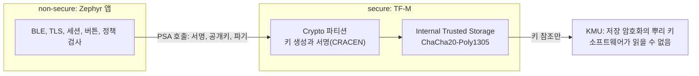

# 대여 보드의 보안 영역 키 보관, 공장 초기화, 소유자 대기 광고

작성 2026-11-27. 같은 날 독립 검토의 지적과 제품 책임자의 결정을 반영해 고쳤다. 상태: 설계와 구현. 보드에는 아무것도 기록하지 않았고 전류도 재지 않았다. 정해진 것은 9장의 결정 표에, 아직 정해지지 않은 것은 9장의 남은 질문에 모았다.

대상은 화면 없는 결제용 프로필(`CONFIG_NU54_SPENDING_PROFILE`, [설계](spending-wallet.md))이다. 이 문서의 파일과 줄 번호는 2026-11-27 `feat/board-secure-key-advertising` 브랜치 기준이다.

## 1. 요구사항과 지금 상태

제품 책임자의 요구사항(2026-11-27) 네 가지를 코드와 대조했다. "확인"은 이 저장소의 코드나 로컬 빌드 결과를 직접 본 것이고, 보드에서 본 것은 하나도 없다.

| 요구사항 | 지금 코드 | 판정 |
|---|---|---|
| 1. 공장 초기화를 버튼으로도, 앱으로도 | 버튼: SW2+SW3 5초 → PIN → 10초 안에 SW1 길게(`app/src/device_pilot.c:599-636`). 앱: 명령 `0x7c`에 SW1과 PIN(`spending_button`, `:547-597`). 운영자 서명 초기화 `0x7d`·`0x7e`(`spending_request`, `:502-533`) | 있음. 반납 창구는 운영자 서명 초기화를 쓴다(6장) |
| 2. 초기화 뒤 이전 사용자 기록이 없고 섞이지 않는다. 개인키는 Arm TrustZone 보안 영역에 있고 지워져 있다 | 지우는 것, 세대 증가, 키가 없다는 재확인은 있다(4장). 그러나 설치된 이미지의 빌드 타깃은 TF-M 없는 `nu54v_dk/nrf54l15/cpuapp`이다(`scripts/fw.py:71`). 키는 앱과 같은 영역의 Zephyr secure storage에 있다(`app/prj.conf:8`의 주석, 생성 설정 `CONFIG_SECURE_STORAGE_ITS_IMPLEMENTATION_ZEPHYR=y`). 보안 영역 프로필 `--secure-key`는 빌드까지만 확인했다(3장) | **[치명] 설치된 이미지는 미충족.** 보안 영역이 없다 |
| 3. 초기화 뒤 스스로 페어링 준비를 하고, 전력을 아끼는 방식으로 광고하며, 3시간 이상 버틴다 | 소유자가 없는 보드는 스스로 광고한다(5장). 전에는 SW4를 길게 눌러야 120초 동안 나갔다 | 구현. 전류는 추정값이고, 보드가 광고 사이에 잠드는지는 재지 않았다 |
| 5. 개인키를 보드가 무작위로 만들고 사용자도 모른다. 주소가 그 키에서 나왔는지 검증한다 | `psa_generate_key`로 만들고 내보내기 권한이 없다(`app/src/device_spending.c:67-80`). 만드는 시점은 소유자 등록이다(4장). 서명 시험 `0x79`가 계정 키와 보드 식별 키로 서명한다(`device_pilot.c:940-961`) | 있음. 형식과 digest는 이 문서에서 바꾸지 않는다 |

요구사항 5의 서명 시험은 서버가 주문의 지급자 확인에도 쓴다([공통 규격](spending-wallet-wire.md)의 `payer.enroll`). 그래서 `NU54_ACCOUNT_PROOF_OP`의 요청·응답 크기와 digest는 그대로 둔다. 보안 영역으로 옮겨도 앱이 부르는 PSA 호출이 같아서 형식이 바뀔 이유가 없다.

결제용 프로필이 만드는 주소는 EVM 주소 하나다. "네트워크별 주소"가 EVM이 아닌 체인까지 뜻한다면 [결제용 하드월렛 설계](spending-wallet.md) 3장 6번의 seed 파생이 먼저 필요하고, 이 문서의 범위 밖이다.

## 2. 결정 요약

제품 책임자가 2026-11-27에 정한 것을 포함한다. 결정의 원문과 근거는 9장에 있다.

| 결정 | 이유 | 치르는 값 |
|---|---|---|
| 지갑 키는 TF-M의 암호화된 Internal Trusted Storage에 둔다. KMU 슬롯에 직접 두지 않는다. KMU 포장 키는 잔여물 시험(8장 B)이 실패할 때만 더한다 | NCS v3.4.2의 KMU가 받는 키 종류에 secp256k1이 없다(3장) | 키가 RRAM에 암호문으로 남는다. 지우는 보장은 4장 |
| 보안 영역 빌드는 별도 프로필 `--secure-key`로 추가하고 지금 빌드는 그대로 둔다 | 플래시 배치가 달라 설치된 보드에 갱신으로 넣을 수 없고, 보드에서 한 번도 돌려 보지 않았다 | 두 프로필을 한동안 같이 유지한다 |
| TF-M 이미지는 release manifest를 만들지 않고 `fw.py flash`가 거절한다 | 호스트에서만 확인한 이미지를 설치 절차가 받아들이면 안 된다 | 보드 인수를 통과한 뒤 이 차단을 푸는 변경이 한 번 더 필요하다 |
| 설치된 보드는 옮기지 않고 다시 설치한다 | 키가 내보내기 불가라 옮길 방법이 없고, 옮기는 경로를 만들면 그것이 추출 경로가 된다 | 사용자는 잔액을 돌려보낸 뒤 새 주소를 받는다 |
| 지갑 키는 소유자가 등록할 때 만든다. 공장 초기화된 보드와 새 보드에는 지갑 키가 없다 | "초기화된 보드에는 키가 없다"를 글자 그대로 지킨다 | 등록 전에는 주소가 없다. 상태 응답은 0으로 채운 주소를 돌려준다(4장) |
| 소유자가 없는 보드는 스스로 광고한다. 30초는 100~150 ms, 그 뒤 3시간까지 1~1.2 s 간격 | 스캔 중인 휴대전화는 곧바로 찾고, 나머지 시간은 평균 전류를 빠른 구간의 약 9분의 1로 낮춘다(추정, 5장 표: LDO 355 → 40 μA) | 느린 구간에서는 휴대전화가 찾는 데 몇 초 걸릴 수 있다 |
| 3시간에 광고를 멈추는 것은 임시 값이다 | 보드가 잠들지 못할 때 전지를 지킨다. 제품은 훨씬 오래 기다려야 하고, 목표는 전류를 잰 뒤 정한다 | 3시간이 지난 보드는 SW4를 눌러야 다시 보인다 |
| 스스로 하는 것은 광고뿐이다. 설치 창(SW4), 승인(SW1), PIN은 그대로 버튼에 둔다 | 광고와 연결만으로는 아무 권한도 열리지 않는다. 설치 창까지 스스로 열면 "보드 앞에 사람이 있다"는 조건이 사라진다 | 운영자가 허가를 넣을 때는 여전히 SW4를 누른다 |
| 소유자가 없는 보드는 아무것도 시작하지 않는 연결을 30초 뒤 끊는다 | 보드가 받는 연결은 두 개다. 가만히 연결만 해 둔 기기 둘이 보드를 가릴 수 있었다 | 연결해 두고 30초 넘게 기다리는 도구는 다시 연결해야 한다 |
| 소유자 대기 중에는 LED를 켜지 않는다 | LED가 광고보다 전류를 더 쓴다 | 보드가 광고 중인지 눈으로 알 수 없다 |
| 반납 때의 초기화는 지금 있는 운영자 서명 초기화를 쓴다. PIN 없는 버튼 초기화는 만들지 않는다(6장) | PIN 없이 버튼만으로 지워지면 보드를 잠깐 만진 사람이 남의 잔액을 없앨 수 있다 | 반납 창구에 서명 도구와 허가가 필요하다 |
| 디버그 포트는 실제 대여 전에 잠근다. 개발과 시연 동안에는 열어 둔다 | 열려 있으면 보안 영역이 있어도 포트로 읽힌다. 잠금은 되돌릴 수 없다 | 출시 조건이 하나 늘어난다. 이번에는 되돌릴 수 없는 것을 아무것도 하지 않았다 |
| 운영자 허가는 재시작 뒤에도 유지되어야 한다 | 전원이 한 번 꺼졌다고 운영자를 다시 불러야 하면 대여 기간 동안 쓸 수 없다 | 설계만 했다. 정해야 할 것이 둘 남아 구현하지 않았다(7장) |

## 3. 키를 TrustZone 보안 영역으로 옮기기

### 지금 구조가 요구사항에 못 미치는 이유

지금 이미지는 한 덩어리다. 앱, 블루투스 스택, TLS, PSA Crypto, 키 저장소가 같은 권한으로 돈다. 키는 "내보내기 불가" 정책을 갖지만 그 정책을 지키는 코드와 키 암호문을 푸는 코드가 앱과 같은 주소 공간에 있다. 앱의 메모리 오류 하나가 곧 키 저장소 접근이다.

저장도 같은 문제를 갖는다. 생성 설정을 보면 키는 settings(ZMS) 위의 Zephyr secure storage에 AES-256-GCM으로 저장되고, 암호화 키는 HUK 라이브러리가 항목 번호로 파생한다(`CONFIG_SECURE_STORAGE_ITS_STORE_IMPLEMENTATION_SETTINGS=y`, `..._AEAD_KEY_PROVIDER_HUK_LIBRARY=y`). 이 `storage` 파티션은 앱이 읽고 쓰는 영역이다. 결제용 프로필은 공식 채널이 아니라서 디버그 포트도 열려 있다(`CONFIG_NRF_APPROTECT_DISABLE=y`, `fw.py`가 `--spending --official`을 거절).

### 목표 구조

앱은 `nu54v_dk/nrf54l15/cpuapp/ns` 타깃으로 빌드되어 non-secure 영역에서 돈다. `app/src/device_spending.c`가 부르는 `psa_generate_key`, `psa_sign_hash`, `psa_export_public_key`, `psa_destroy_key`, `psa_get_key_attributes`는 그대로이고, 이 호출들이 TF-M의 Crypto 파티션으로 넘어간다. 키 재료와 서명 연산은 보안 영역 안에만 있다. 프로필을 위해 앱 소스를 바꾼 것은 없다. 바뀐 것은 빌드 타깃, 설정, 메모리 배치다.

### 정정: 첫 구현은 키를 저장하지 않았다 (2026-11-27)

첫 구현의 `app/secure-key.conf`는 `CONFIG_MBEDTLS_PSA_CRYPTO_STORAGE_C=n`이었다. 앱 쪽에 키 저장소를 두지 않으려는 뜻이었지만, 이 옵션은 TF-M의 Crypto 파티션이 영구 키를 저장할지를 정한다.

- SDK는 이 옵션이 꺼져 있으면 TF-M을 `-DCRYPTO_STORAGE_DISABLED=ON`으로 빌드한다(`nrf/modules/trusted-firmware-m/CMakeLists.txt:95`). 옵션의 기본값은 TF-M 빌드에서 켜짐이다(`nrf/subsys/nrf_security/Kconfig.psa:42-47`).
- 첫 구현의 빌드 결과에서 확인했다: TF-M의 `CMakeCache.txt`에 `CRYPTO_STORAGE_DISABLED:UNINITIALIZED=ON`이 있었다.
- 그래서 그 이미지에서는 지갑 키가 ITS에 저장되지 않았다. 이 문서가 그때 "키가 암호화된 ITS에 있다"고 적은 것은 그 이미지에 맞지 않았다. 재시작하면 키가 없어졌을 것이다. 보드에서 돌려 본 적이 없어서 드러나지 않았다.

고친 것:

1. `app/secure-key.conf`에서 옵션을 켰다.
2. `scripts/fw.py`의 증거 검사가 `CONFIG_MBEDTLS_PSA_CRYPTO_STORAGE_C=y`를 요구한다(`secure_key_evidence`, `:395`).
3. `app/Kconfig`의 `NU54_SECURE_KEY`가 이 옵션에 의존한다.
4. 고친 뒤 다시 빌드해 TF-M의 `CMakeCache.txt`에 `CRYPTO_STORAGE_DISABLED`가 없는 것을 확인했다.
5. 보드 인수 목록에 "키 생성 → 재시작 → 서명"을 넣었다(8장 A). 설정만으로는 키가 재시작을 넘기는지 알 수 없다.

### KMU에 둘 것인가, ITS에 둘 것인가

결정(2026-11-27): ITS에 둔다. KMU 포장 키는 잔여물 시험(8장 B)이 실패할 때만 더한다.

nRF54L15의 KMU는 키를 CRACEN 전용 RAM으로만 밀어 넣을 수 있어서 가장 강한 보관소다. 그러나 고정한 SDK의 KMU 문서(`nrf/doc/nrf/app_dev/device_guides/kmu_guides/kmu_psa_crypto_api_prog_model.rst`의 지원 키 표)에는 AES, ChaCha20-Poly1305, secp256r1, secp384r1, Ed25519, X25519, HMAC만 있고 secp256k1이 없다. EVM 서명 키는 secp256k1이라 KMU 슬롯에 직접 넣을 수 없다.

| 후보 | 고르면 달라지는 것 | 단점 |
|---|---|---|
| ITS(결정) | SDK가 지원하는 경로다. 키는 보안 영역 RRAM에 파일별 키로 암호화되어 저장되고, 그 뿌리 키만 KMU에 있다 | 암호문이 플래시에 있다. 초기화 뒤 잔여물은 블록 지우기에 기댄다(4장) |
| KMU에 대여 회차별 포장 키를 두고, 지갑 키는 그 키로 한 번 더 싼다 | 초기화 때 KMU 슬롯 하나를 지우면 남은 암호문이 영영 풀리지 않는다 | 전용 보안 파티션을 직접 만들어야 한다. KMU 슬롯 지우기가 이 SoC에서 어떻게 동작하는지 확인 안 됨 |

### non-secure 앱이 할 수 있는 일

| 동작 | 가능 여부 | 근거 |
|---|---|---|
| 지갑 키로 32바이트 digest에 서명 | 가능 | 키 정책이 `PSA_KEY_USAGE_SIGN_HASH`뿐이다(`device_spending.c:75`) |
| 공개키 읽기 | 가능 | 주소 계산에 필요하다 |
| 키 파기, 키가 있는지 묻기 | 가능 | 공장 초기화가 쓴다 |
| 키 재료 읽기, 복사 | 불가 | 정책에 EXPORT·COPY가 없고, 재료가 앱의 주소 공간에 없다 |

한계를 분명히 적는다. 이 구조에서 보안 영역은 **무엇에 서명하는지 모른다.** 앱이 뚫리면 공격자는 키를 꺼내지는 못해도 임의 digest에 서명을 받을 수 있다. 한도, 가맹점 서명 확인, SW1, PIN은 모두 앱 쪽 코드다. "앱이 뚫려도 한도 밖 서명은 안 된다"까지 가려면 정책 검사와 버튼 입력을 보안 파티션으로 옮겨야 하고, 이것은 남은 단계다(3장 끝). TF-M 격리 수준도 1이라 보안 파티션끼리는 서로 격리되지 않는다(`CONFIG_TFM_ISOLATION_LEVEL=1`).

### 플래시와 RAM 예산

2026-11-27 로컬 NCS v3.4.2로, 위 정정과 이 문서의 다른 변경을 넣은 소스에서 두 프로필을 빌드한 값이다. 서명 키와 등록 기관 키는 버리는 시험용이다.

| 이미지 | 지금(`--release --spending`) | 보안 영역(`--release --spending --secure-key`) |
|---|---|---|
| MCUboot | 41,632 B / 62 KB | 41,680 B / 62 KB |
| TF-M 보안 이미지 | 없음 | 79,380 B / 126 KB(61.5%), RAM 44,036 B / 64 KB(67.2%) |
| 앱 | 348,856 B / 728,928 B, RAM 157,792 B / 252 KB(61.2%) | 299,244 B / 1,273,696 B, RAM 155,744 B / 188 KB(80.9%) |
| 코드 합계(MCUboot 제외) | 348,856 B | 378,624 B(+29,768 B) |

TF-M 이미지는 키 저장을 켜기 전 78,068 B였다. 켠 뒤 1,312 B 늘었다.

RRAM 1,524 KB의 배치는 `app/secure-key.overlay`에 있다: MCUboot 62 KiB, 결합 슬롯 1,372 KiB(보안 128 KiB + non-secure 1,244 KiB), non-secure settings 32 KiB, TF-M ITS 32 KiB, OTP 8 KiB, PS 16 KiB. SRAM은 보안 64 KiB, non-secure 188 KiB, 보드가 리셋 뒤에도 유지하는 4 KiB다.

- **RAM이 빠듯하다.** non-secure 80.9%는 링크 시점의 정적 합계다. 스택과 힙의 최고 수위는 보드에서만 잴 수 있다.
- **ITS 자산 수.** TF-M의 기본 최대 자산 수는 10이다. 결제용 프로필은 키 9개와 기록 35개로 최대 44개를 쓰므로 그대로 두면 실행 중에 저장이 실패한다. 64로 올렸다(`app/secure-key.conf`). 메타데이터 블록 하나(4 KiB)에 60바이트짜리 항목이 64개까지 들어간다는 것은 TF-M 소스에서 계산한 값이다(`its_flash_fs.c`의 `its_flash_fs_validate_config`). 넘치면 빌드가 아니라 **부팅 때** 저장소가 실패한다. 허가를 저장하면 자산이 15개 더 든다(7장).
- **Kconfig 경고는 빌드를 멈추지 않는다.** 처음에 자산 수 64가 적용되지 않고 10으로 남았는데 빌드는 성공했다. 그래서 `fw.py`가 생성된 설정을 다시 읽어 확인한다(`secure_key_evidence`).

### MCUboot와 서명

- TF-M과 앱은 하나의 서명 이미지가 된다(`zephyr.signed.bin` 430,524 B). MCUboot는 지금처럼 Ed25519 서명 하나를 확인하고, 유선 serial recovery가 그 한 슬롯을 쓴다.
- 정정: `app/secure-key.conf`의 `CONFIG_NCS_MCUBOOT_IMGTOOL_SET_ROM_FIXED_ADDRESS=n`은 이 프로필에서 아무 효과가 없다. 이 옵션은 두 슬롯 모드에서만 존재하고(`nrf/subsys/bootloader/Kconfig:226`의 `depends on !MCUBOOT_BOOTLOADER_MODE_SINGLE_APP`), 이 프로필은 한 슬롯 모드다(`app/sysbuild-release.conf`). 생성된 앱 설정에 이 옵션이 아예 없고, 빌드 명령에 `--rom-fixed`가 없는 것을 확인했다. 전에 "필요하다"고 적은 것은 틀렸다. 두 슬롯 배치로 갈 때를 위해 줄은 남겼고 주석을 고쳤다.
- 하드웨어 보안 카운터(`--security-counter`)는 두 슬롯 배치가 필요해서 이 프로필에서는 거절한다. `--approtect`도 거절한다. 보안 영역 디버그 잠금(`SECURE_APPROTECT`)을 보드에서 확인한 적이 없기 때문이다.
- release manifest, 복구 배치 검사(`verify_recovery_layout.py`), TLS 구성 증거는 이 프로필에서 만들지 않는다. 서명 검증만 한다.
- TF-M의 보안 콘솔이 UART30에 켜져 있다(`CONFIG_TFM_SECURE_UART30=y`, 로그 수준 INFO). 보드의 non-secure 기본 설정이 "로그 끔은 아직 지원하지 않는다(NCSDK-31930)"고 적고 있다. 출시 이미지에서는 이 출력과 핀을 따로 검토해야 한다. 켜져 있는 UART는 대기 전류에도 영향을 줄 수 있다(5장).

### 호스트 검사와 flash 거절

`fw.py`가 `--secure-key` 빌드 뒤에 하는 검사(`secure_key_evidence`)와 `flash`의 거절을 독립 검토 뒤에 고쳤다.

- **링크 맵은 배치된 것만 본다.** 전에는 맵 파일 전체에서 이름을 찾았다. 맵의 앞부분에는 링커가 버린 섹션의 목록이 있어서, 버려진 서명 코드도 "있다"로 읽힐 수 있었다. 지금은 `Linker script and memory map` 뒤만 보고, `/DISCARD/`를 빼고, 주소와 크기가 0이 아닌 섹션이나 주소가 있는 심볼만 센다(`placed_in_image`, `scripts/fw.py:378`). 앞서 빌드한 실제 맵 두 개에서 결과가 맞는 것을 확인했다.
- **flash는 TF-M 빌드를 모두 거절한다.** 전에는 생성 설정의 `CONFIG_NU54_SECURE_KEY=y` 한 줄만 봤다. 그 옵션이 적용되지 않은 빌드, 곧 증거 검사가 실패한 빌드 디렉터리는 flash가 받아들였다. 지금은 `CONFIG_BUILD_WITH_TFM=y`, `CONFIG_TRUSTED_EXECUTION_NONSECURE=y`, `CMakeCache.txt`의 보드 타깃 `/ns`, TF-M 빌드 출력 `app/tfm` 가운데 하나만 있어도 거절한다(`trustzone_build`, `:431`).
- **생성 설정이 없는 빌드 디렉터리는 flash하지 않는다.** 설정 파일이 없으면 무엇을 올리는지 판단할 수 없다.

### CI

- 이번 변경은 CI 워크플로를 건드리지 않았다. `scripts/test_fw_secure_key.py`(15건)와 `scripts/test_fw_standby.py`(3건)는 `make test`에 들어가므로 기존 호스트 시험 작업에서 돈다. 툴체인 없이 타깃, 설정 파일, 거절 조합, 증거 검사, flash 거절을 확인한다.
- 지금 CI의 보드 빌드 작업은 개발 이미지와 `--release --approtect --security-counter=2`만 빌드한다(`.github/workflows/ci.yml`의 `p01-board-build`). 결제용 프로필은 기존 타깃도 CI에서 빌드하지 않는다.
- 제안: 같은 작업에 `fw.py build --release --spending --secure-key` 한 단계를 더한다. 버리는 서명 키와 시험용 등록 기관 공개키면 된다. 빌드 시간은 로컬에서 재지 않았다. 이 단계는 워크플로 파일 변경이라 별도 승인을 받아 넣는다.

### 이미 설치된 보드

결정(2026-11-27): 옮기지 않고 다시 설치한다.

지금 보드의 키는 non-secure `storage` 파티션에 있고 새 프로필의 키는 TF-M ITS에 있다. 플래시 배치도 다르다. 새 이미지를 올리면 보드는 예전 키를 찾지 못한다. 키는 내보낼 수 없으므로 옮겨 적을 수도 없다.

| 후보 | 고르면 달라지는 것 | 단점 |
|---|---|---|
| 다시 설치(결정) | 앱에서 반납으로 잔액을 원래 지갑에 돌려보낸다 → 공장 초기화 → 유선으로 전체를 지우고 새 이미지를 설치 → 운영자 허가와 소유자 등록을 다시 한다 | 주소가 바뀐다. 보드마다 손이 간다 |
| 옮기기 | 주소가 유지된다 | 키를 한 번 내보내는 코드가 필요하다. 그 코드가 곧 추출 경로다. 예전 암호문도 `storage`에 남는다 |

전체를 지우는 것이 중요하다. 정정: 전에는 예전 `storage` 파티션의 주소가 새 배치의 앱 슬롯 안이라고 적었는데 틀렸다. 예전 `storage`는 `0x174000`부터 `0x17d000`까지다(`zephyr/dts/vendor/nordic/nrf54l15_cpuapp_partition.dtsi`, 빌드가 만든 `zephyr.dts`에서 확인). 새 배치에서 이 범위는 TF-M ITS의 뒤쪽 12 KiB(`0x174000`~`0x177000`), TF-M OTP(`0x177000`~`0x179000`), TF-M PS(`0x179000`~`0x17d000`)와 겹친다. 지우지 않고 새 이미지를 올리면 예전 키 암호문이 보안 저장소 영역에 그대로 남고, TF-M이 그 내용을 자기 저장소로 읽으려다 초기화에 실패할 수 있다. 결제용 프로필은 8283 시험망 전용이고 백업이 없으므로 다시 설치하는 쪽의 손실은 주소 변경뿐이다.

### 확인한 것과 가정한 것

| 항목 | 상태 | 근거 |
|---|---|---|
| 고정 SDK가 NCS v3.4.2, manifest `f0b8ad4c…`이고 로컬 SDK가 같은 커밋이다 | 확인 | `.github/inputs.json`, 로컬 `nrf` 저장소의 HEAD |
| `nu54v_dk/nrf54l15/cpuapp/ns`로 결제용 프로필이 빌드되고 서명 검증을 통과한다 | 확인(빌드만) | `fw.py build --release --spending --secure-key`, `imgtool` 검증 2건 |
| TF-M의 Crypto 파티션이 영구 키 저장을 켠 채 빌드된다 | 확인(빌드만) | 생성 설정 `CONFIG_MBEDTLS_PSA_CRYPTO_STORAGE_C=y`, TF-M `CMakeCache.txt`에 `CRYPTO_STORAGE_DISABLED` 없음 |
| 서명 코드가 보안 이미지에만 있다 | 확인(링크 맵) | `tfm_s.map`의 메모리 맵에 `cracen_ecdsa_sign_digest_deterministic`이 주소와 크기를 갖고 있고, 앱 `zephyr.map`에 `cracen_`로 시작하는 배치된 섹션과 심볼이 0건 |
| nRF54L에서 TF-M ITS 암호화가 기본으로 켜진다 | 확인 | `nrf/modules/trusted-firmware-m/Kconfig:234-237`, 생성 설정 `CONFIG_TFM_ITS_ENCRYPTED=y` |
| KMU가 secp256k1 키를 받지 않는다 | 확인(문서) | 위 KMU 문서의 지원 키 표 |
| NCS v3.4.2는 minimal이 아닌 TF-M 구성을 실험 단계로 표시한다 | 확인 | 같은 Kconfig `:447-450`, 빌드 경고 `Experimental symbol TFM_EXPERIMENTAL` |
| Nordic이 TF-M 지원 타깃으로 적은 것은 `nrf54l15dk/nrf54l15/cpuapp/ns`다. `nu54v_dk`는 제조사 보드 패키지의 변형이다 | 확인 | `nrf/doc/nrf/security/tfm/tfm_building.rst`, `boards/nucode/nu54v_dk/board.yml` |
| 이 보드에서 TF-M이 부팅한다 | 가정 | 실행한 적 없음 |
| 만든 키가 재시작 뒤에도 남아 서명한다 | 가정 | 설정과 빌드만 확인. 실행한 적 없음 |
| TF-M 옆에서 블루투스 컨트롤러와 TLS가 지금처럼 동작한다 | 가정 | 실행한 적 없음. PSA 호출마다 영역 전환이 들어가 TLS 핸드셰이크 시간이 달라질 수 있다 |
| 보안 영역의 CRACEN이 secp256k1 결정적 ECDSA 서명을 실제로 만든다 | 가정 | 코드가 링크된 것까지만 확인 |
| ITS가 자산 64개 설정으로 초기화된다 | 가정 | 소스에서 계산 |
| 첫 부팅이 저장 암호화의 뿌리 키를 KMU에 만든다. 이 값은 전체 지우기 전에는 바뀌지 않는다 | 가정 | 생성 설정 `CONFIG_HW_UNIQUE_KEY_RANDOM=y`, `CONFIG_CRACEN_IKG_SEED_KMU_SLOT=183`에서 추론 |
| 64 KiB / 188 KiB SRAM 경계가 이 SoC의 보호 단위에 맞는다 | 가정 | W27 실험 배치와 같은 경계지만 그것도 보드에서 돌린 적 없음 |

### 남은 단계

1. 개발 보드 한 대에서 `--secure-key` 이미지 인수(8장 A). 통과하면 `fw.py flash`의 차단과 manifest 생략을 푼다.
2. 초기화 뒤 잔여물 시험(8장 B). 실패하면 KMU 포장 키로 간다.
3. 보안 영역 디버그 잠금과 보안 카운터가 있는 두 슬롯 배치. 디버그 잠금은 실제 대여 전에 해야 하는 출시 조건이고 되돌릴 수 없다([결제용 하드월렛 설계](spending-wallet.md) 3장 11번).
4. 서명 정책을 보안 파티션으로: 한도, 가맹점 서명 확인, 버튼과 PIN. W27의 전용 파티션(`app/experimental/w27_qualification`)이 만드는 방법의 선례다.
5. 격리 수준 2와 TF-M 로그 끄기.

## 4. 공장 초기화가 보장하는 것

### 지갑 키는 소유자 등록 때 생긴다

결정(2026-11-27): 키를 재시작 직후가 아니라 소유자 등록 때 만든다. 공장 초기화된 보드와 새 보드에는 지갑 키가 없다.

| 시점 | 보드가 하는 일 | 위치 |
|---|---|---|
| 부팅, 소유자 없음 | 키와 기록한 주소가 있으면 지운다. 키가 없다고 키 저장소가 답해야 부팅이 계속된다. 키를 만들지 않는다 | `device_spending_init`, `app/src/device_spending.c:123-148` |
| 부팅, 소유자 있음 | 키와 기록한 주소가 있고 서로 맞아야 한다. 하나라도 없으면 멈춘다. 키를 새로 만들지 않는다 | 같은 함수 |
| 첫 소유자 등록(SW1, 새 PIN 두 번) | 키를 만들고 주소를 기록한 다음, 저장소가 소유자를 받는다 | `device_spending_enroll`(`:150-161`), 부르는 곳 `app/src/device_pilot.c:1743-1748` |
| 저장소가 소유자를 받지 못함 | 방금 만든 키를 곧바로 지운다. 저장소가 쓰기 실패로 멈춘 경우에는 지우지 않고, 재시작이 플래시에 적힌 것을 보고 정한다 | `device_spending_withdraw`(`:163-174`) |
| 다른 휴대전화로 바꾸기, 분실 휴대전화 교체 | 키를 건드리지 않는다. 같은 지갑을 새 휴대전화가 쓴다 | `first_owner`가 거짓 |

키를 소유자보다 먼저 만드는 이유: 그 사이에 전원이 끊기면 "소유자 없음, 키 있음"이 남고, 다음 부팅이 그 키를 지운다. 순서가 반대면 "소유자 있음, 키 없음"이 남는데, 이것은 키를 잃어버린 경우와 구별되지 않는다. 호스트 시험이 등록 도중의 모든 쓰기 지점에서 전원을 끊고, 다음 부팅이 "소유자도 키도 없음" 아니면 "소유자와 그 키"만 남기는 것을 확인한다(`test/test_spending_store.c`의 `test_registration_survives_power_loss`, 18개 지점).

소유자가 없는 보드가 받는 명령:

| 명령 | 소유자 없는 보드의 답 | 위치 |
|---|---|---|
| 소유자 상태와 주소(op 7) | 상태에 주소 자리 20바이트를 0으로 채워 답한다. 전에는 주소가 없으면 세션을 끊었다. 한 번도 등록된 적 없는 보드(세대 0)는 전과 같이 답하지 않는다 | `device_pilot.c:1119` |
| 지갑 상태(`0x7f`) | 계정 주소를 0으로 채워 답한다. 앱은 0 주소를 지갑으로 받아들이지 않는다(`products/p02-user-app/src/wallet/ownerWire.ts`의 `readSpendingStatus`) | `device_pilot.c:907` |
| 운영자 서명 초기화(`0x7d`, `0x7e`) | 초기화로 풀린 보드에서도 동작한다. 지울 것은 없고, 키가 없다는 것을 다시 확인한 뒤 재시작한다. 세대는 바뀌지 않는다. 세대 0인 보드는 일회용 값을 내주지 않는다 | `reset_of_released`, `device_pilot.c:497` |
| 반납 주소, 반납, 앱 초기화, 서명 시험, 주문 | 거절한다. 소유자와 지갑이 있어야 한다 | 전과 같음 |

### 지우는 것과 남기는 것

| 구분 | 내용 | 근거 |
|---|---|---|
| 지운다 | 지갑 키, PIN과 PIN 키, 주문 기록 16칸, 하루 누계, 반납 주소, 기록해 둔 주소 | `app/src/device_spending.c:109-121`, `device_order.c:70-78`, `device_recovery_pin.c:123-129` |
| 바꾼다 | 소유자를 0으로 지우고 세대를 1 올린다. 철회와 "소유자 없음" 표시를 켠다 | `core/src/nu54_vault.c:113-125` |
| 다시 묻는다 | 지운 뒤 키 저장소에 키가 있는지 묻는다(`psa_get_key_attributes`). "없음"이라는 답을 받아야 초기화 표식을 지우고 성공을 알린다 | `key_absent`, `device_spending.c:83-89`, `:119` |
| RAM | 지운 뒤 4초 표시하고 콜드 리셋한다. 세션, 요청 기록, 허가는 RAM에만 있어 함께 사라진다 | `device_pilot.c:536-545` |
| 남긴다 | 보드 식별 키, 설치 키와 한 번만 쓰는 설치 표식, 시각·재전송 하한, 세대 번호 | [결제용 하드월렛 설계](spending-wallet.md) 4장 |
| 전원이 끊기면 | 초기화 표식을 먼저 쓰고 시작한다. 다음 부팅이 남은 삭제와 키 재확인을 마친 뒤에만 진행한다 | `device_spending.c:114`(표식 먼저), `:130-131`(부팅 때 이어서) |

키를 다시 묻는 것은 삭제 호출의 반환값만 믿지 않기 위해서다. 키 저장소가 "지웠다"고 답했는데 키가 남아 있으면 초기화는 실패로 끝난다. LED는 실패를 표시하고, 표식이 남아 있어서 다음 부팅이 같은 삭제와 확인을 다시 한다. 그 확인이 통과할 때까지 보드는 동작하지 않는다. 다음 사용자에게 키가 남은 보드를 내주지 않기 위해서다. 호스트 시험이 이 경우를 만든다(`test_reset_fails_while_the_key_is_there`). 초기화 도중 22개 지점에서 전원을 끊는 기존 시험은 초기화 뒤에 키가 없다는 것까지 확인하도록 고쳤다.

### 이전 사용자와 섞이지 않는 이유

- **세대가 올라간다.** 운영자 허가, 휴대전화의 소유자 인증, 주문 서명은 모두 세대 번호에 묶인다. 이전 사용자의 휴대전화나 허가는 세대가 맞지 않아 거절된다. 세대는 줄어들지 않는다.
- **키가 없다.** 초기화된 보드에는 지갑 키가 없다. 다음 소유자가 등록할 때 새 무작위 키가 생기고 주소가 달라진다. 이전 주소로 온 주문은 지급자 주소가 맞지 않는다.
- **소유자가 있는데 키가 없으면 멈춘다.** 저장 오류를 "새 지갑"으로 오해해 조용히 새 키를 만드는 일을 막는다(`device_spending.c:139-145`).

확인이 더 필요한 것이 하나 있다. 결제용 프로필이 쓰지 않는 기록 칸(영수증 16칸 `0x5490`대, 거절 4칸 `0x5530`대, 개인 서명 요청 4칸)은 초기화가 지우지 않는다. 이 프로필에서는 쓰는 코드가 컴파일되지 않는 것을 확인했지만(`device_pilot.c`의 `device_pilot_button`에 있는 전처리 분기), 다른 프로필 이미지를 쓰던 보드를 결제용으로 바꾸는 경우에는 남는다. 프로필을 바꿀 때는 전체 지우기를 절차에 넣는다.

### 플래시에 남는 것

지금 구조에서는 "지웠다"가 "플래시에서 사라졌다"를 뜻하지 않는다. 위의 키 재확인은 키 저장소가 키를 더 내주지 않는다는 것까지만 말한다.

- 저장소가 ZMS다. 항목을 지우면 삭제 표시가 추가되고, 예전 암호문은 그 구역이 정리될 때까지 플래시에 남는다. 이것은 ZMS의 일반 동작에서 추론한 것이고 이 보드의 덤프로 확인하지 않았다.
- 그 암호문을 푸는 키는 초기화로 바뀌지 않는다. HUK에서 항목 번호로 파생하기 때문이다. 그래서 "키를 버려 암호문을 못 쓰게 만든다(crypto-shredding)"는 주장이 지금은 성립하지 않는다.
- 결론: 지금 이미지에서는 보드에서 코드를 실행하거나 디버그 포트로 플래시를 읽을 수 있는 사람이 초기화 전의 키 암호문을 복구할 가능성을 배제할 수 없다.

보안 영역 프로필에서는 세 가지가 달라진다.

1. 암호문이 non-secure 코드가 읽을 수 없는 TF-M 영역에 있다.
2. TF-M ITS는 파일을 지울 때 남은 데이터를 예비 블록으로 옮기고 예전 블록을 지운다(`its_flash_fs_mblock.c`의 `its_flash_fs_mblock_meta_update_finalize`: "Erase meta block and current scratch block"). 소스를 읽은 것이고 보드에서 확인하지 않았다.
3. 그래도 파일 암호화 키는 KMU의 뿌리 키와 파일 번호에서 파생되므로 초기화로 바뀌지 않는다. 블록 지우기가 실패하거나 건너뛰는 경우까지 막으려면 3장의 KMU 포장 키가 필요하다.

## 5. 초기화 뒤의 소유자 대기 광고

### 동작

소유자가 없는 상용 보드(새 보드, 또는 공장 초기화로 재시작한 보드)는 부팅이 끝나면 스스로 광고한다. 구현은 `core/src/nu54_adv_schedule.c`(순수 로직)와 `app/src/ble_links.c`다.

| 구간 | 기본값 | 설정 |
|---|---|---|
| 빠른 구간 | 30초, 간격 100~150 ms | `CONFIG_NU54_OWNER_WAIT_FAST_SECONDS`, `..._FAST_INTERVAL_MIN/MAX` |
| 느린 구간 | 시작부터 3시간까지, 간격 1~1.2 s | `CONFIG_NU54_OWNER_WAIT_TOTAL_SECONDS`, `..._SLOW_INTERVAL_MIN/MAX` |
| 끝난 뒤 | 광고하지 않는다. SW4를 길게 누르면 처음부터 다시 | 총 시간을 0으로 두면 끝나지 않는다 |

- 간격 기본값은 Bluetooth Core의 GAP 권장 타이머(빠른 구간 30초, 100~150 ms, 느린 간격 1~1.2 s)를 그대로 썼다.
- 3시간은 임시 값이다. 보드가 잠들지 못하는 경우에 전지를 지키려고 둔다. 제품은 3시간보다 훨씬 오래 기다려야 하고, 전류를 잰 뒤 이 값을 다시 정한다(9장).
- 광고 내용은 SW4 창과 같다. 연결 가능, 일반 검색 가능, 소유자 서비스 UUID 하나, 이름 없음(`ble_links.c`의 `ad_pilot`). 주소는 15분마다 바뀌는 비공개 주소다(`CONFIG_BT_PRIVACY=y`).
- 연결 자리가 하나라도 비어 있으면 광고한다. 보드가 받는 연결은 두 개다. 끊기거나 구간이 바뀌면 그 시각의 구간으로 광고한다. 구간 시계는 연결 때문에 다시 시작하지 않는다.
- SW4 창(120초, 30~60 ms)이 열려 있으면 그것이 우선이고, 끝나면 대기 광고로 돌아간다.
- 소유자가 등록되면 멈춘다(`main.c:179`). 소유자가 있는 보드는 전과 똑같이 버튼을 눌러야만 광고한다.
- 켜지는 조건: `CONFIG_NU54_OWNER_WAIT_ADV`, 결제용 프로필에서만 기본으로 켜진다. 개발 빌드, 대여 v1 빌드, HD 복구 프로필은 바뀌지 않는다.
- 저장소가 쓰기 실패로 멈춘 보드는 "소유자 없음"으로 보지 않는다(`device_pilot_owner_absent`, `device_pilot.c:1851`). 누가 소유자인지 알 수 없는 상태에서 스스로 광고하지 않는다.

### 가만히 있는 연결이 보드를 가리지 못하게

독립 검토의 지적: 첫 구현은 연결이 하나도 없을 때만 대기 광고를 했다. 누군가 연결만 해 두면 광고가 멈췄다. 그런 기기가 둘이면 연결 자리가 없어서 SW4를 눌러도 광고가 나가지 않았고, 재시작 말고는 풀 방법이 없었다.

고친 것:

1. **자리가 비어 있으면 광고한다.** 연결이 하나 있어도 대기 광고가 계속된다. 고르는 규칙은 순수 함수로 꺼내 호스트에서 시험한다(`nu54_adv_select`): 자리가 없으면 광고하지 않고, 페어링 창, 결제 창, 소유자 대기 순서로 고른다.
2. **아무것도 시작하지 않는 연결은 끊는다.** 소유자가 없는 보드는 연결한 기기가 설치 티켓이나 TLS를 30초 안에 시작하지 않으면 끊는다(`CONFIG_NU54_OWNER_WAIT_IDLE_SECONDS`, 0이면 끊지 않는다). 시도가 끝나면 그때부터 다시 30초를 준다. 설치를 마친 운영자 도구나, 실패한 뒤 다시 시도하는 휴대전화를 응답 도중에 끊지 않기 위해서다. 구현은 `ble_links.c`의 `idle_guard`(`:358`)이고, 연결한 기기가 무엇을 하고 있는지는 `device_pilot_engaged`(`device_pilot.c:1861`)가 답한다. 3시간이 지나 광고 일정이 끝난 뒤에도 소유자가 없는 동안은 계속 적용된다.
3. **광고를 바꾸는 일을 한 번에 하나만 한다.** 블루투스 스레드(연결), 시스템 작업 큐(타이머), 메인 스레드(버튼)가 같은 상태를 바꾸고 있었다. 뮤텍스 하나로 묶었다(`adv_lock`, `ble_links.c:221`).
4. **시작이 실패하면 다시 시도한다.** 연결이 끊긴 직후처럼 잠깐 실패하는 경우가 있다. 전에는 다음 사건(연결, 버튼, 구간 변경)까지 조용했다. 지금은 0.1초부터 두 배씩 늘려 다섯 번 다시 시도하고(합쳐 3.1초), 그래도 안 되면 다음 사건을 기다린다. 컨트롤러가 "이미 광고 중"이라고 답하면 멈추고 한 번 더 시작한다.

막지 못하는 것: 계속 다시 연결하거나 TLS 시도를 되풀이하는 기기는 자리를 차지할 수 있다. 블루투스 연결은 누구나 걸 수 있어서, 가까이에서 적극적으로 방해하는 기기는 이 방법으로 막을 수 없다. 얻는 권한은 없다(아래).

운영 절차에 주는 영향: 연결해 놓고 30초 넘게 아무것도 하지 않는 도구는 끊긴다. `scripts/enroll_board.py`는 연결마다 30초 제한으로 일을 끝내므로 영향이 없다. 휴대전화 앱이 허가가 설치되기 전에 연결해 두고 기다리는지는 확인하지 않았다. 그렇다면 앱이 다시 연결해야 한다.

### 광고가 열어 주는 것과 열지 않는 것

광고와 연결만으로는 권한이 생기지 않는다. 연결한 쪽이 TLS를 시작하려면 그 부팅에서 운영자가 넣은 허가가 있어야 하고(`device_pilot.c`의 `receive_bytes`), 허가를 넣는 설치 창은 여전히 SW4로만 열린다. 소유자 등록에는 SW1과 새 PIN이 필요하다. 즉 재시작 직후의 보드는 "찾을 수 있고 연결할 수 있는" 상태이고, 운영자가 SW4를 눌러 허가를 넣어야 다음 사용자가 등록할 수 있다.

결정(2026-11-27): 설치 창은 SW4로만 연다. 설치 창까지 스스로 열면 운영자가 버튼을 누를 필요가 없지만, 등록 기관의 서명만 있으면 대기 시간 내내 누구나 허가를 넣을 수 있게 된다.

### 전력 예산

**아래 숫자는 모두 추정이다. 잰 값은 하나도 없다.**

결정(2026-11-27): 전원은 USB로 충전하는 1셀 리튬 전지다. 용량은 아직 모른다. 그래서 용량 칸은 비워 두고, 백분율은 100 mAh를 기준으로만 적는다. "3시간"은 시연의 통과선이다. 제품의 목표도 상한도 아니다. 제품은 훨씬 오래 기다려야 하고, 그 목표는 전류를 잰 뒤에 정한다.

회로: 보드 패키지의 주석에 따르면 충전 IC는 BQ25186(1셀 리튬 충전기), 배터리 전압은 1.47 MΩ 분압으로 읽고, SoC는 DC/DC 인덕터 실장 여부를 몰라 LDO 모드로 둔다(`boards/nucode/nu54v_dk/nu54v_dk_nrf54l15_cpuapp.dts`의 전원 주석).

SoC 값의 출처는 Nordic의 nRF54L15 제품 페이지다(2026-11-27 조회): 송신 4.8 mA(0 dBm, 3 V), 수신 3.4 mA(3 V), 절전 0.7~2.9 μA(3 V). 이 값들은 DC/DC 기준으로 본다. LDO 모드의 값은 그 페이지에 없어서 2.3배로 가정했다. 송신 출력은 0 dBm이다(`CONFIG_BT_CTLR_TX_PWR_0=y`).

광고 한 번(세 채널)의 전하:

| 항목 | 계산 | DC/DC |
|---|---|---|
| 송신 | 37바이트 = 296 μs, 세 채널 0.89 ms × 4.8 mA | 4.3 μC |
| 연결 요청 듣기 | 채널마다 약 0.35 ms(가정), 1.05 ms × 3.4 mA | 3.6 μC |
| 발진기 기동, 전환, CPU | 약 1.5 ms × 3 mA(가정) | 4.5 μC |
| 합계 | 12.4 μC, 여유를 두어 | 15 μC |

LDO 모드는 15 μC × 2.3 ≈ 35 μC로 둔다. 광고 사이의 전류는 SoC 절전 2.9 μA에 분압 저항 2.9 μA(4.2 V ÷ 1.47 MΩ)를 더하고, PMIC와 나머지 부품은 모르므로 DC/DC 3 μA, LDO 5 μA를 최소 가정으로 쓴다.

| 경우(모두 추정) | 빠른 구간 평균 | 느린 구간 평균 | 3시간 소비 | 100 mAh 대비 | 느린 구간만으로 100 mAh를 쓰는 시간 |
|---|---|---|---|---|---|
| DC/DC, 15 μC, 대기 3 μA | 153 μA | 18 μA | 0.055 mAh | 0.06% | 약 230일 |
| LDO(지금 보드 설정), 35 μC, 대기 5 μA | 355 μA | 40 μA | 0.123 mAh | 0.12% | 약 100일 |
| 절전에 들어가지 못함, 대기 1.5 mA | 1.85 mA | 1.54 mA | 4.61 mAh | 4.6% | 약 2.7일 |

세 줄의 3시간 값은 호스트 시험이 같은 식으로 다시 계산한다(`test/test_adv_schedule.c`의 `budget`, `nu54_adv_plan_charge_nah`). 식은 간격의 최솟값으로 횟수를 세므로 위쪽 추정이다. 마지막 열은 100 mAh를 느린 구간 평균으로 나눈 값이고, 전지의 자기 방전과 PMIC의 소비를 넣지 않았다.

읽는 법:

- 광고 자체는 3시간에 0.1 mAh 수준이다. 시연의 통과선인 3시간은 어느 줄에서도 넘는다. USB 전원이면 예산이 필요 없다.
- **오래 기다릴 수 있는지를 정하는 것은 광고가 아니라 보드가 광고 사이에 실제로 잠드는지다.** 첫 두 줄과 셋째 줄은 대기 시간이 수십 배 다르다. 어느 줄에 가까운지는 재 봐야 안다.
- LED는 예산에 없다. 대기 광고 중에는 켜지 않는다(결정). 결제 모드 표시처럼 2초마다 0.1초 켜면 LED 전류의 5%가 평균에 더해진다. LED 전류가 2 mA면 100 μA로, 느린 광고의 2.5배다.

### 보드가 광고 사이에 잠드는가

오래 기다리는 것이 실제 목표이므로, 결제용 release 이미지가 잠들 수 있는지를 소스와 생성 설정으로 조사했다. **전류는 재지 않았다. 아래는 읽어서 안 것이다.**

| 살펴본 것 | 본 것 | 판단 |
|---|---|---|
| 콘솔과 로그 | release 이미지는 끈다(`app/release.conf`의 `CONFIG_LOG=n`, `CONFIG_CONSOLE=n`, `CONFIG_UART_CONSOLE=n`) | 문제 없음 |
| UART 드라이버 | 꺼지지 않는다. 보드 기본 설정이 `CONFIG_SERIAL=y`이고 `uart20`이 켜져 있다. 생성 설정: `CONFIG_SERIAL=y`, `CONFIG_UART_NRFX_UARTE=y`, `CONFIG_UART_ASYNC_API`와 `CONFIG_UART_INTERRUPT_DRIVEN`은 꺼짐 | 아래 |
| UART 수신기 | 드라이버는 비동기 모드가 아니고 `disable-rx`가 없으면 시작할 때 수신을 켠다(`zephyr/drivers/serial/uart_nrfx_uarte.c:786-789`의 `NRF_UARTE_TASK_STARTRX`). 끄는 경로는 장치 전원 관리뿐인데 `CONFIG_PM_DEVICE`가 꺼져 있다 | **수신기가 계속 켜져 있다.** 켜진 수신기는 고주파 클록을 요구하므로 광고 사이에 절전으로 내려가지 못하게 할 수 있다. 크기는 재지 않았다 |
| 장치 전원 관리 | `CONFIG_PM_DEVICE` 꺼짐. 앱 코드에 장치를 재우는 호출이 없다 | UART를 재우는 것이 없다 |
| 시스템 전원 관리(`CONFIG_PM`) | 생성 설정에 없다 | 이 SoC는 할 일이 없으면 idle 스레드가 CPU를 재우고, 클록을 요구하는 장치가 없으면 낮은 전류로 내려간다고 본다. 확인 안 됨 |
| 주기적으로 깨우는 코드 | 버튼은 GPIO SENSE로 받고(`boards/nucode/nu54v_dk/nu54v_dk_nrf54l15_cpuapp.dts`), 누르는 동안에만 주기 확인을 한다(`app/src/board_io.c`). LED는 표시 중에만 타이머를 쓴다. 메인 루프는 할 일이 없으면 무기한 기다린다(`main.c:168`). TLS 작업과 연결 감시는 연결이 있을 때만 돈다 | 광고 말고 주기적으로 깨우는 것을 찾지 못했다 |
| 저주파 클록 | 수정 발진기 LFXO(`CONFIG_CLOCK_CONTROL_NRF_K32SRC_XTAL=y`) | 문제 없음 |
| 레귤레이터 | LDO 모드. DC/DC 인덕터 실장 여부를 모른다 | 무선 전류가 약 2배(가정). 회로 확인이 먼저다 |
| 보안 영역 프로필 | TF-M의 보안 콘솔이 UART30을 쓴다(`CONFIG_TFM_SECURE_UART30=y`) | 앱의 UART를 꺼도 이것이 남는다. 확인 안 됨 |
| 디버그 포트 | 측정 때 디버거가 붙어 있으면 디버그 영역 전원이 켜진다 | 측정은 디버거를 떼고 한다 |

그래서 옵션을 하나 만들었다. `fw.py build --release --spending --standby`는 앱 이미지에서 UART 드라이버를 뺀다(`app/standby.conf`의 `CONFIG_SERIAL=n`).

- MCUboot는 다른 이미지라서 유선 serial recovery용 UART를 그대로 갖는다.
- `--security-counter`와는 함께 쓸 수 없다. 그 갱신 경로가 앱의 UART로 SMP를 받는다(`app/src/device_update.c`).
- 빌드 뒤에 생성 설정을 다시 읽어 `CONFIG_SERIAL`, UARTE 드라이버, 콘솔, 로그가 꺼졌는지 확인한다(`standby_evidence`, `scripts/fw.py:366`).
- 기본 빌드는 바뀌지 않는다. 이 옵션이 전류를 얼마나 줄이는지는 모른다. 8장 C에서 두 이미지를 나란히 잰다.

재고 나서 더 볼 것: DC/DC 사용 가능 여부, PMIC(BQ25186)의 대기 전류와 ship mode, 분압 저항을 끊는 방법, TF-M 로그 끄기.

## 6. 반납 때의 초기화

결정(2026-11-27): 반납 창구의 초기화는 이미 있는 운영자 서명 초기화다. PIN 없는 버튼 초기화는 만들지 않는다. 코드를 바꾼 것은 한 가지다: 이미 초기화된 보드에서도 운영자 서명 초기화가 동작한다(4장).

검토에서 나온 지적은 이것이었다. 버튼 초기화가 PIN을 요구하므로, 사용자가 PIN을 알려 주지 않고 떠나면 반납 창구는 버튼으로 보드를 지울 수 없다.

PIN을 없애지 않는 이유: 보드에는 백업이 없어서 초기화는 곧 잔액 손실이다. 버튼만으로 지워지면 보드를 잠깐 만진 사람이 남의 잔액을 없앨 수 있다. 초기화된 보드는 운영자 허가 없이는 쓸 수 없으므로 훔친 사람이 얻는 것은 없지만, 피해는 생긴다.

| 후보 | 고르면 달라지는 것 | 단점 |
|---|---|---|
| A. 운영자 서명 초기화(결정) | 창구 도구가 보드의 일회용 값을 받아 등록 기관 키로 서명하고, 직원이 SW1을 누른다. 서명은 보드 식별값, 세대, 일회용 값에 묶인다(`spending_request`, `core/src/nu54_spending.c`의 `nu54_spend_operator_statement`) | 그 부팅의 운영자 허가와, 같은 CA의 소유자 인증서를 가진 휴대전화가 필요하다. 남은 잔액은 잃는다 |
| B. 반납 확정 뒤에만 PIN 없는 버튼 초기화 | 사용자가 앱에서 반납(`0x7b`)을 마치면 그 뒤에는 버튼만으로 지운다 | 새 저장 상태가 필요하다. 반납 서명이 체인에서 확정됐는지 보드는 모른다. 반납 뒤 다시 입금하면 그 잔액은 PIN 없이 지워질 수 있다 |
| C. PIN 없는 버튼 초기화 | 창구에서 가장 간단하다 | 위에 적은 피해. 2026-11-23 결정(PIN 요구)을 뒤집는다 |

반납 창구의 순서: 잔액 반납 확정 확인 → 운영자 서명 초기화 → 재시작한 보드가 스스로 광고(5장) → 다음 대여 때 SW4로 허가 설치. 사용자가 미리 초기화해 온 보드에도 같은 절차를 그대로 쓴다. 지울 것이 없어도 초기화가 성공으로 끝나고, 키가 없다는 확인이 한 번 더 된다.

A에 남은 운영 위험: 등록 기관 키 하나가 초기화 서명도 한다. 창구마다 그 키를 두면 안 되고, 서명 요청을 받아 주는 운영 서버와 두 사람 승인이 필요하다. 이 부분은 운영 웹과 서버의 설계 범위다.

## 7. 운영자 허가를 재시작 뒤에도 유지하기

결정(2026-11-27): 운영자 허가는 재시작 뒤에도 남아야 한다. 보호 저장소에 두고, 운영자가 허가에 적은 대여 기간까지 유효하며, 공장 초기화가 지우고, 지금처럼 세대에 묶인다.

**설계만 했고 구현하지 않았다.** 제품 책임자가 정해야 하는 것이 둘 남아 있다(이 장 끝, 9장). 그 답에 따라 저장하는 내용과 부팅 때의 규칙이 달라진다.

### 지금 동작

- 허가는 운영자가 서명한 묶음이다(`N54Q`, 최대 1,600바이트): 정책 355바이트, CA 인증서, 보드 인증서, 등록 기관 서명(`core/src/nu54_install.c`의 `nu54_install_accept`).
- 받아들인 정책, 인증서, TLS 설정은 RAM에만 있다(`app/src/device_install.c`의 `policy`, `active`, `device_pilot.c`의 `tls_banks`). 재시작하면 사라지고, 운영자가 SW4부터 다시 해야 한다.
- 플래시에 남는 것은 하한 기록이다(`floor`, `device_install.c:329`): 허가 개정 번호, 허가가 발급된 시각, 세대, 정책 digest, 복구 키. 그리고 재전송 하한(`replay_floor`, `:199`, `:269`).
- 허가 기간은 길어야 24시간이다(`NU54_INSTALL_MAX_LEASE`, `core/include/nu54_install.h`).

### 저장하는 것

받아들인 묶음을 그대로 저장한다. 묶음에 등록 기관 서명이 들어 있어서, 부팅 때 고정된 등록 기관 키로 다시 검증할 수 있다. 정책만 따로 풀어 저장하면 그 검증을 잃는다.

| 항목 | 내용 |
|---|---|
| 형식 | 머리 기록 1개(길이, 조각 수)와 128바이트 조각 최대 13개. 지금 프로필의 저장 항목 한도가 128바이트다(`CONFIG_SECURE_STORAGE_ITS_MAX_DATA_SIZE=128`) |
| 시각 기록 | 1개. 보드가 아는 가장 늦은 "이 시각보다는 뒤"와 허용 오차. 아래 B를 고르면 주기적으로 쓴다 |
| 자산 수 | 최대 15개. 보안 영역 프로필의 한도는 64개이고 지금 44개를 쓴다. 59개가 된다 |
| 부팅 때 | 조각을 모은다 → 등록 기관 서명 확인 → 보드 식별 키와 지급자 주소 일치 → digest와 개정 번호가 `floor`와 일치 → 세대 확인 → 인증서를 풀어 TLS 설정을 만든다. 하나라도 어긋나면 허가가 없는 것으로 본다 |
| 쓰는 순서 | 조각을 먼저 쓰고 `floor`를 마지막에 쓴다. `floor`가 지금처럼 확정 지점이다. 그 사이에 전원이 끊기면 digest가 맞지 않아 허가가 없는 것이 되고, 운영자가 다시 넣는다 |

`floor`에 묶기 때문에 예전 허가를 플래시에 되돌려 놓아도 받아들이지 않는다. `floor`의 개정 번호와 시각은 줄어들지 않는다.

### 세대, 초기화, 다시 설치와의 관계

- **세대.** 저장된 허가는 그 허가의 `payer_generation`이 지금 세대와 같거나(소유자가 그 허가로 등록했다), 지금 세대보다 1 크고 소유자가 없을 때만(허가는 넣었고 등록을 기다린다) 받아들인다. 초기화는 세대를 올리므로, 초기화 전의 허가는 이 조건에서 걸러진다.
- **공장 초기화.** 세 초기화 경로 모두 저장된 허가를 지운다. 지우는 일은 초기화 표식 안에서 하고, 전원이 끊기면 다음 부팅이 마친다. 이것은 보안에 필요하다. 지금은 허가가 RAM에만 있어서 초기화의 재시작이 함께 없앤다. 허가가 남으면 이전 소유자의 휴대전화가 그 허가로 초기화된 보드에 다시 등록할 수 있다. 세대 조건과 삭제, 두 겹으로 막는다.
- **다시 설치(8283 결정).** 전체 지우기로 허가도 사라진다.
- **허가 갱신.** 운영자가 새 허가를 넣으면 조각을 덮어쓴다. 도중에 전원이 끊기면 예전 허가도 잃는다. 운영자가 그 자리에 있으므로 다시 넣는다.
- **분실 휴대전화 교체.** 세대가 바뀌므로 지금처럼 새 허가가 필요하다. 바뀌지 않는다.

### 전원이 꺼진 동안의 시간

보드에는 전지로 가는 시계가 없다. 지금은 허가를 받은 순간의 시각(`floor.time`)에 그 뒤의 가동 시간을 더해 "지금"을 안다(`device_install_earliest`, `device_install_now`). 전원이 꺼지면 얼마가 지났는지 알 수 없다. 재시작한 보드가 아는 것은 "저장된 시각보다는 뒤"뿐이다.

만료를 판정하려면 "지금이 만료 시각보다 앞"이라는 것을 알아야 한다. 과거의 서명된 시각은 아무리 모아도 "그보다는 뒤"만 말해 준다. "앞"을 말해 줄 수 있는 것은 보드가 낸 일회용 값에 믿을 수 있는 쪽이 지금 시각을 서명해 돌려주는 것뿐이다. 그래서 후보는 둘로 갈린다.

| 후보 | 재시작 뒤 보드가 하는 일 | 얻는 것 | 치르는 값 |
|---|---|---|---|
| A. 새 시각을 받기 전에는 쓰지 않는다 | 저장된 허가를 잠재워 둔다. 소유자 휴대전화가 보드의 일회용 값을 운영 서버에 보내 서명된 시각을 받아 오면 깨운다 | 보드가 달력 시간으로 만료를 지킨다 | 휴대전화가 온라인이어야 한다. 서버에 시각 서명 기능과 그 키가 필요하다. 등록 기관 키를 온라인에 둘 수 없으므로 허가가 시각 서명 키를 따로 지정해야 하고, 묶음 형식이 바뀐다. 앱과 서버를 함께 고쳐야 한다. 가게에서 전지가 꺼졌다 켜지면 통신이 될 때까지 결제하지 못한다 |
| B. 저장된 시각에서 이어 간다 | 저장된 "이 시각보다는 뒤"에서 시계를 다시 돌린다. 가동 중에는 10분마다 그 값을 저장한다 | 통신 없이 곧바로 쓸 수 있다. 서버와 묶음 형식이 바뀌지 않는다 | 허가 기간이 "켜져 있던 시간"으로 세어진다. 꺼 둔 시간만큼 보드의 시계가 늦는다. 관리 명령(상태, 반납, 초기화)은 달력으로 만료가 지나도 받는다 |
| C. 지금처럼 재시작마다 운영자가 다시 넣는다 | — | 가장 단순하다 | 2026-11-27 결정과 맞지 않는다 |

B에서도 **결제는 달력의 만료 시각에 멈춘다.** 보드는 가맹점이 서명한 주문의 만료 시각이 허가의 만료 시각을 넘으면 거절한다(`nu54_install_quote`, `core/src/nu54_install.c:135-144`). 가맹점 단말은 실제 시각으로 주문을 만든다. 실제 시각이 허가의 만료를 지나면 정직한 단말이 만든 주문은 보드의 시계가 늦어도 모두 거절된다. 남는 것은 가맹점 단말이 일부러 옛 시각으로 서명하는 경우다. 그 단말은 허가에 지정된 가맹점 키를 가진 쪽이다.

B의 시각 기록이 플래시를 닳게 하는 정도: 10분마다 한 번이면 하루 144번이다. 닳는 정도는 계산하지 않았다. 구현 전에 저장소의 쓰기 수명과 대조한다.

### 정해야 할 것

1. **재시작한 보드가 믿을 수 있는 새 시각을 받지 못했을 때.** 후보는 위 표의 A와 B다. 추천은 9장에 있다.
2. **허가의 최장 기간.** 지금 코드는 24시간이 한도다. 대여 기간이 하루를 넘으면 허가를 저장해도 하루 뒤에 만료된다. 한도를 올리려면 보드의 상수와 허가를 발급하는 쪽을 함께 바꿔야 하고, 묶음의 인증서도 그 기간 동안 유효해야 한다. 값은 대여 상품의 기간이 정한다.

## 8. 검증 계획

호스트 시험과 빌드로 한 것은 10장에 있다. 아래는 보드가 있어야 하는 것들이다. 디버그 잠금과 OTP는 어느 단계에서도 쓰지 않는다.

### A. 보안 영역 이미지 인수 (개발 보드 1대, 디버그 포트 열림)

| 확인 | 방법 | 통과 기준 |
|---|---|---|
| 부팅 | 전체 지우기 뒤 `--secure-key` 이미지 기록, 보안 콘솔과 앱 로그 | TF-M과 앱이 모두 뜬다. ITS 초기화 오류 0건 |
| 키가 재시작을 넘긴다 | 소유자 등록으로 키 생성 → 주소 기록 → 전원을 껐다 켬 → 서명 시험 `0x79`. 5회 되풀이 | 5/5에서 재시작 뒤 보드가 같은 주소를 알리고, 서명에서 복원한 주소가 그 주소와 같다. 3장의 정정이 실제로 고쳐졌는지 보는 시험이다 |
| 키 생성과 서명 | 서명 시험 `0x79`를 20회 | 20/20에서 복원한 주소가 보드 주소와 같다 |
| 초기화 뒤 키 없음 | 세 가지 초기화 각각 뒤 재시작, 상태 조회 | 3/3에서 주소가 0으로 온다. 소유자 등록 전에는 서명 시험이 거절된다 |
| 저장 용량 | 주문 16건을 채우고 PIN, 반납 주소까지 저장 | 저장 실패 0건 |
| 기존 기능 | 소유자 등록, 주문 결제, 반납, 세 가지 초기화 | 지금 타깃에서와 같은 결과 |
| TLS 시간 | 핸드셰이크 20회 | 120초 세션 제한 안에서 실패 0건. 지금 타깃과 시간 비교를 기록 |
| RAM | 스택과 힙 최고 수위 | 각 스택 여유 20% 이상 |
| 격리 | non-secure 코드에서 보안 영역 주소(ITS 파티션, 보안 RAM)를 읽는 시험 이미지 | 읽기마다 SecureFault |

### B. 초기화 뒤 잔여물

1. 소유자를 등록해 키를 만든 직후 디버그 포트로 `tfm-its` 파티션을 덤프해 지갑 키 항목의 암호문 바이트를 기록한다.
2. 공장 초기화를 한다(버튼, 앱, 운영자 서명 각각. 한 번은 삭제 도중 전원을 끊는다).
3. 재시작 뒤 RRAM 전체를 덤프한다.

통과 기준: 1에서 기록한 암호문이 전체 덤프에 0건. 지금 타깃(`storage` 파티션)에서도 같은 시험을 해서 4장의 추론을 확인한다. 지금 타깃에서 1건 이상 나오면 그것이 보안 영역으로 옮겨야 하는 측정 근거가 된다. 보안 영역 타깃에서 1건 이상 나오면 KMU 포장 키를 더한다(결정).

### C. 소유자 대기 광고와 전류

장비: Nordic PPK2. 전지 단자에 소스 미터로 3.7 V를 넣거나, 실제 전지와 직렬로 전류계 모드를 쓴다. USB와 디버거는 뺀다. 이미지는 `--release --spending`과 `--release --spending --standby` 둘이다. 개발 이미지로 잰 값은 쓰지 않는다.

| 확인 | 방법 | 통과 기준 |
|---|---|---|
| 스스로 시작 | 세 가지 초기화 각각 뒤에 버튼을 누르지 않고 휴대전화로 스캔 | 재시작 뒤 10초 안에 소유자 서비스 광고가 보인다(각 3회, 9/9) |
| 연결이 있어도 광고 | 기기 하나를 연결해 둔 채 다른 기기로 스캔 | 광고가 보인다(5/5) |
| 가만히 있는 연결 | 기기 둘을 연결하고 아무것도 하지 않는다 | 둘 다 30초(±2초)에 끊긴다. 그 뒤 SW4를 누르면 광고가 나가고 설치가 된다(3/3) |
| 설치 도중에는 끊지 않음 | `enroll_board.py`로 설치 10회 | 10/10 성공. 보드 쪽에서 먼저 끊은 것 0건 |
| 광고 한 번의 전하 | 100 kHz로 광고 20회를 적분 | 평균을 기록한다. 35 μC보다 크면 표를 고친다 |
| 구간별 평균 | 빠른 구간 30초, 느린 구간 10분. 두 이미지 모두 | 값을 기록한다. 시연 통과선: 빠른 구간 0.5 mA 이하, 느린 구간 0.1 mA 이하 |
| 잠드는가 | 느린 구간의 광고 사이 전류를 두 이미지에서 비교 | 값을 기록한다. `--standby`가 낮으면 UART가 원인이었다는 것이고, 같으면 다른 원인을 찾는다 |
| 3시간 연속 | 3시간 10분 기록 | 시연 통과선: 3시간 누적 1 mAh 이하. 3시간 0분(±5초)에 광고가 멈춘다 |
| 끝까지 연결 가능 | 0분, 10분, 1시간, 2시간 59분에 연결 | 4/4 연결 성공 |
| 찾는 시간 | 휴대전화 2종으로 구간마다 20회 | 빠른 구간 2초 이하, 느린 구간 95%가 10초 이하 |
| 실제 전지 | 잔량 20%인 전지로 3시간 | 리셋 0회. 송신 순간의 전압 강하를 기록 |
| 소유자 있는 보드 | 등록된 보드를 재시작 | 버튼 없이는 광고 0건(10분 스캔) |

"느린 구간 0.1 mA"와 "3시간 1 mAh"는 시연의 통과선이고, LDO 추정(40 μA, 0.123 mAh)에 여유를 둔 값이다. 제품의 대기 목표는 이 측정이 끝난 뒤에 정한다. 그때 광고를 멈추는 시점(지금 3시간)도 다시 정한다.

## 9. 제품 책임자의 결정과 남은 질문

### 결정 (2026-11-27)

| 주제 | 결정 | 반영 |
|---|---|---|
| 키 생성 시점 | 재시작 직후가 아니라 소유자 등록 때 만든다. 공장 초기화된 보드에는 지갑 키가 없다. 초기화가 성공을 알리기 전에 키가 정말 없는지 다시 묻는다. 전원이 끊겨 이어서 하는 경우도 같다 | 구현(4장). 등록 흐름의 기존 호스트 시험을 고쳤다(10장) |
| 반납 초기화 경로 | 이미 있는 운영자 서명 초기화. PIN 없는 버튼 초기화는 만들지 않는다 | 문서(6장). 이미 초기화된 보드에서도 동작하게 한 것 말고는 코드 변경 없음 |
| 전원과 전지 용량 | USB로 충전하는 1셀 리튬 전지. 용량은 모른다. 백분율은 100 mAh 기준으로만 적는다. "3시간"은 시연 통과선이고 제품 목표도 상한도 아니다. 제품은 훨씬 오래 기다려야 하고 목표는 전류를 잰 뒤 정한다 | 문서(5장, 8장 C) |
| 광고를 멈추는 시점 | 3시간에 멈춘다. 보드가 잠들지 못할 때 전지를 지키는 임시 값이다. 측정 뒤 다시 정한다 | 기본값 그대로(`CONFIG_NU54_OWNER_WAIT_TOTAL_SECONDS=10800`) |
| 설치 창 | SW4로만 연다 | 그대로 |
| 디버그 포트 | 실제 대여 전에 잠근다. 개발과 시연 동안에는 열어 둔다 | 출시 조건으로 적었다(3장). 되돌릴 수 없는 것은 하지 않았다 |
| 키 보관 위치 | TF-M ITS. KMU 포장 키는 플래시 잔여물 시험이 실패할 때만 더한다 | 구현은 ITS(3장). 시험은 8장 B |
| 설치된 보드 | 옮기지 않고 다시 설치한다 | 문서(3장) |
| 대기 중 LED | 켜지 않는다 | 그대로 |
| 운영자 허가 | 재시작 뒤에도 남는다. 보호 저장소에 두고, 운영자가 허가에 적은 대여 기간까지 유효하고, 공장 초기화가 지우고, 지금처럼 세대에 묶인다 | 설계(7장). 아래 두 질문 때문에 구현하지 않았다 |
| 오래 기다리기 | 실제 목표는 긴 대기다. release 이미지가 광고 사이에 잠들 수 있는지 조사한다 | 조사와 `--standby` 옵션(5장). 측정은 하지 않았다 |

### 남은 질문

| 질문 | 후보 | 추천과 이유 |
|---|---|---|
| 재시작한 보드가 믿을 수 있는 새 시각을 받지 못했을 때 저장된 허가를 쓰게 할까? | A. 새 서명 시각을 받기 전에는 쓰지 않는다 / B. 저장된 시각에서 이어 간다(10분마다 저장) | **B.** ① 가게에서 전지가 꺼졌다 켜져도 통신 없이 결제가 된다. 결정의 목적이 이것이다. ② 결제는 B에서도 달력의 만료 시각에 멈춘다. 가맹점이 서명한 주문의 만료가 허가의 만료를 넘으면 보드가 거절하기 때문이다(7장). ③ A는 서버, 앱, 묶음 형식, 새 서명 키를 함께 바꿔야 한다. 단점: B에서는 관리 명령이 달력 만료 뒤에도 켜져 있던 시간만큼 더 동작하고, 가맹점 단말이 옛 시각으로 서명하는 경우를 보드 혼자서는 막지 못한다. 실제 자금을 다루는 단계에서는 A가 낫다 |
| 허가의 최장 기간을 얼마로 할까? | 24시간(지금) / 대여 상품의 최장 기간에 맞춤 | **대여 상품의 최장 기간에 하루를 더한 값.** 24시간이면 허가를 저장해도 이틀째에 운영자를 다시 불러야 해서 결정의 효과가 없다. 값 자체는 대여 상품의 기간이 정하므로 여기서 숫자를 고르지 않는다. 단점: 기간이 길수록 잃어버린 보드의 허가가 오래 남는다. 보드는 여전히 PIN과 SW1을 요구한다 |
| 대기 시간 목표와 광고를 멈추는 시점 | 전류를 잰 뒤 | 지금은 정할 근거가 없다. 8장 C의 느린 구간 값과 전지 용량이 나오면 정한다 |

첫 두 질문에 답이 오면 7장을 구현한다. 그 전에는 허가가 지금처럼 재시작 때 사라진다.

## 10. 구현 상태 (2026-11-27)

| 항목 | 상태 | 위치 |
|---|---|---|
| 광고 일정, 광고 선택, 재시도 간격, 연결 대기 한도(순수 로직)와 전하 추정 | 구현, 호스트 시험 통과 | `core/src/nu54_adv_schedule.c`, `test/test_adv_schedule.c` |
| 소유자 대기 광고, 가만히 있는 연결 끊기, 광고 직렬화와 재시도 | 구현, 두 타깃에서 컴파일. 보드에서 실행한 적 없음 | `app/src/ble_links.c`, `app/src/main.c`, `app/src/device_pilot.c`, `app/Kconfig` |
| 소유자 등록 때 키 생성, 초기화 뒤 키 부재 재확인 | 구현, 호스트 시험 통과, 두 타깃에서 컴파일. 보드에서 실행한 적 없음 | `app/src/device_spending.c`, `app/src/device_pilot.c`, `test/test_spending_store.c`, `test/test_spending_led.c` |
| 보안 영역 빌드 프로필 | 구현, 빌드와 서명 검증 통과. 보드에서 실행한 적 없음 | `scripts/fw.py --secure-key`, `app/secure-key.conf`, `app/secure-key.overlay`, `app/secure-key-mcuboot.overlay` |
| 긴 대기 옵션 | 구현, 빌드와 설정 확인. 전류를 잰 적 없음 | `scripts/fw.py --standby`, `app/standby.conf` |
| 프로필의 호스트 시험 | 구현, 통과 | `scripts/test_fw_secure_key.py`, `scripts/test_fw_standby.py` |
| 운영자 허가 유지 | 설계만. 남은 질문 둘 | 7장 |
| 반납 확정 뒤 초기화, 보안 파티션의 서명 정책, KMU 포장 키 | 만들지 않음 | 3장, 6장 |
| 전류 측정, 잔여물 덤프, 보드 인수 | 하지 않음 | 8장 |

### 고친 기존 호스트 시험

키 생성 시점을 옮기면서 등록 흐름의 기존 시험을 고쳤다. 제품 책임자가 승인한 예외이고, 필요한 만큼만 바꿨다.

| 파일 | 바꾼 것 | 이유 |
|---|---|---|
| `test/test_spending_store.c` | 지갑을 쓰기 전에 소유자 등록 단계를 거친다. 초기화 뒤와 첫 부팅 뒤의 기대를 "새 키가 있다"에서 "키가 없다"로 바꿨다. 반납 주소 시험이 등록 뒤의 주소로 "자기 자신에게는 안 된다"를 본다 | 전에는 부팅만으로 키와 주소가 생긴다고 가정했다 |
| `test/test_spending_led.c` | 버튼 처리 코드가 부르는 키 생성과 철회를 대역으로 받는다. 저장소가 소유자를 받는 호출을 센다 | 버튼 처리 코드가 등록 때 키 생성을 부르게 되었다 |
| `test/spending_operator_host.c` | 지갑 주소가 없는 경우를 만들 수 있게 대역을 바꾸고, 이미 초기화된 보드에서 운영자 서명 초기화가 받아들여지는 것을 더했다 | 초기화된 보드에는 주소가 없다 |
| `test/CMakeLists.txt` | 시험이 보드 소스에서 꺼내 쓰는 함수 목록에 두 함수를 더했다 | 꺼내 쓰는 코드가 그 함수들을 부른다 |

`test/test_adv_schedule.c`와 `scripts/test_fw_secure_key.py`는 이 브랜치에서 만든 시험이고, 독립 검토의 지적에 따라 고치고 늘렸다.

관련 문서: [결제용 하드월렛 설계](spending-wallet.md) · [공통 규격](spending-wallet-wire.md) · [무선·키·코드 경계](security.md) · [펌웨어 README](../../../../products/p01-device-firmware/README.md)
