# 상용 데이터 스키마 ERD

검증용 PostgreSQL에 적용된 테이블·PK·FK와 널 허용 여부에서 생성했다. 왼쪽은 부모, 오른쪽은 자식이다. 실선은 외래 키 전체가 자식 기본키에 포함된 식별 관계, 점선은 비식별 관계다. 조건부 유일 인덱스와 서비스 전이 조건은 [DDL과 도메인 설계](README.md)에 있다. 다른 소유자의 불투명 참조에는 FK 선을 긋지 않는다. 보드 NVM·모바일 로컬 저장소는 [지갑 논리 ERD](wallet.md), 공개 계약의 상태 키·이벤트는 [체인 상태 사전](ledger.md)에 정의했다.

## chainview

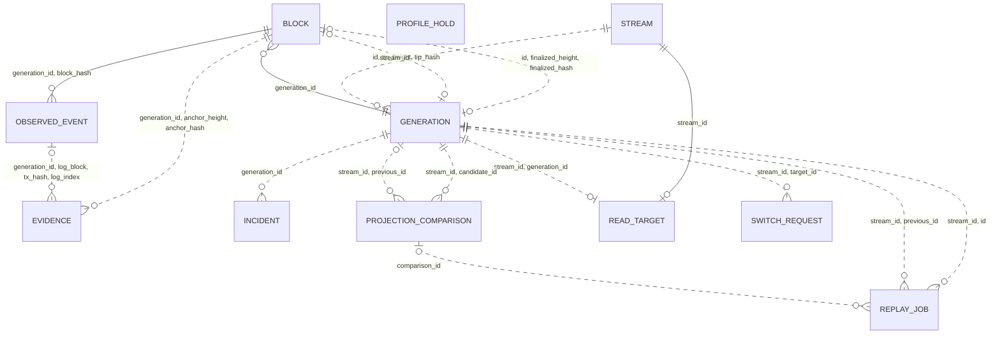

| 테이블 | 기본키 | 필드와 형식 (물음표는 선택값) |
|---|---|---|
| block | generation_id, block_hash | `generation_id uuid`, `block_hash text`, `height bigint`, `parent_hash text`, `block_time timestamp with time zone`, `canonical boolean` |
| evidence | id | `id uuid`, `generation_id uuid`, `merchant_key text`, `order_key text`, `kind text`, `anchor_height bigint`, `anchor_hash text`, `policy_ref text`, `expires_at timestamp with time zone?`, `coverage_start bigint?`, `state_proof_ref text?`, `log_block text?`, `tx_hash text?`, `log_index integer?`, `created_at timestamp with time zone` |
| generation | id | `id uuid`, `stream_id uuid`, `base_height bigint`, `tip_height bigint?`, `tip_hash text?`, `finalized_height bigint?`, `finalized_hash text?`, `fence bigint`, `lease_until timestamp with time zone?`, `state text` |
| incident | id | `id uuid`, `generation_id uuid`, `disputed_height bigint`, `old_hash text`, `new_hash text`, `opened_at timestamp with time zone`, `resolved_at timestamp with time zone?`, `notified_at timestamp with time zone?` |
| observed_event | generation_id, block_hash, tx_hash, log_index | `generation_id uuid`, `block_hash text`, `tx_hash text`, `log_index integer`, `kind text`, `receipt_success boolean`, `recipient_ref text?`, `signer_nonce text?`, `merchant_key text`, `order_key text`, `refund_key text?`, `asset_ref text?`, `amount numeric?` |
| profile_hold | stream_id, generation_id | `stream_id uuid`, `generation_id uuid`, `chain_ref text`, `contract_ref text`, `version smallint`, `asset_ref text`, `abi_hash text?`, `base_height bigint?`, `reason text`, `observed_at timestamp with time zone` |
| projection_comparison | id | `id uuid`, `stream_id uuid`, `candidate_id uuid`, `previous_id uuid?`, `expected_revision bigint`, `anchor_height bigint`, `anchor_hash text`, `compared_at timestamp with time zone` |
| read_target | stream_id | `stream_id uuid`, `generation_id uuid`, `revision bigint` |
| replay_job | id | `id uuid`, `stream_id uuid`, `previous_id uuid`, `expected_revision bigint`, `anchor_height bigint`, `anchor_hash text`, `state text`, `reason text?`, `comparison_id uuid?`, `requested_at timestamp with time zone`, `finished_at timestamp with time zone?`, `differing_logs bigint?`, `paid_delta numeric?`, `refund_delta numeric?` |
| stream | id | `id uuid`, `chain_ref text`, `contract_ref text`, `abi_hash text`, `manifest_ref text` |
| switch_request | id | `id uuid`, `stream_id uuid`, `target_id uuid`, `expected_revision bigint`, `operator_ref uuid`, `compare_ref uuid`, `requested_at timestamp with time zone`, `applied_at timestamp with time zone?` |

W10의 가스 후원은 기존 주문과 견적의 1:1 관계에 묶인다. P05는 지점·원주문·고객 권한을 확인한 뒤 `quote_work.gas_sponsor_digest`에 최초 약속 지문 32바이트만 기록한다. 이미 서명된 과거 견적의 새 필드는 비어 있으며 원문을 다시 쓰지 않는다. 지문은 견적과 같은 보유 규칙을 따르고 별도 후원 원문·고객 정보는 보관하지 않는다. [090 배포 DDL](../../../../products/p05-operations-backoffice/internal/store/migrations/090_merchant_gas_sponsorship.sql)

X06은 기존 `stream` → `read_target` → `generation` → `block` 관계에서 연속 확정 범위를 읽는다. P05의 기존 `sale`과 `quote_work`에서 서명을 검증한 원 견적은 지점 권한을 확인한 뒤 mTLS로 전달한다. 두 소유자의 관계는 요청 시 대조하며 새 영속 열이나 외래 키를 추가하지 않는다. [배포 DDL과 읽기 범위](../../../../products/p10-platform/database/README.md#p05p07-견적-마감-대사-투영)

W19 회차 조회는 P05의 `invoice`, `subscription`, `sale`, `quote_work`, `sale_resolution`에서 읽기 시점에 상태를 계산한다. 지점과 가입자가 일치하는 회차에 한해 목록은 대사 상태를, 상세는 회차·원약관·납기와 기존 서명 견적의 참조 및 기한을 전달한다. 고객 표시를 위해 새 데이터 필드를 저장하지 않는다. [회차 상태 SQL](../../../../products/p05-operations-backoffice/internal/store/migrations/045_subscription_invoice_status.sql)

## kiosk

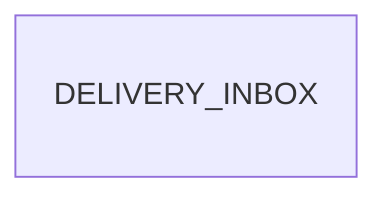

| 테이블 | 기본키 | 필드와 형식 (물음표는 선택값) |
|---|---|---|
| delivery_inbox | event_ref | `event_ref uuid`, `terminal_ref uuid`, `order_ref uuid`, `action text`, `effect_key uuid`, `received_at timestamp with time zone`, `acknowledged_at timestamp with time zone?` |

## ledger

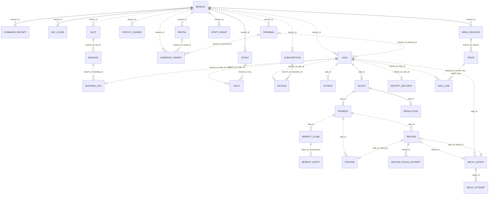

| 테이블 | 기본키 | 필드와 형식 (물음표는 선택값) |
|---|---|---|
| benefit_claim | id | `id uuid`, `sale_id uuid`, `subject_scope uuid`, `rule_version text`, `fulfillment_ref uuid`, `source_evidence_ref uuid`, `environment text` |
| benefit_entry | id | `id uuid`, `claim_id uuid`, `environment text`, `source_event_ref uuid`, `kind text`, `delta integer`, `recorded_at timestamp with time zone` |
| booking | id | `id uuid`, `branch_id uuid`, `slot_id uuid`, `customer_scope uuid`, `request_key uuid`, `held_at timestamp with time zone`, `hold_until timestamp with time zone`, `policy_version text`, `cancel_cutoff_at timestamp with time zone`, `no_show_rule text`, `released_at timestamp with time zone?`, `seats integer`, `price_version text`, `asset_ref text`, `total ledger.units`, `deposit ledger.units`, `state text` |
| booking_leg | booking_id, leg | `branch_id uuid`, `booking_id uuid`, `leg text`, `origin text`, `asset_ref text`, `amount ledger.units`, `sale_id uuid` |
| branch | id | `id uuid`, `tenant_ref uuid`, `timezone text`, `close_local time without time zone` |
| campaign_target | campaign_id, target_key | `campaign_id uuid`, `target_key uuid`, `branch_id uuid`, `terminal_id uuid?`, `rental_id uuid?`, `release_ref uuid`, `supported_revision text`, `last_ack_revision bigint?`, `state text` |
| command_receipt | branch_id, scope_ref, operation, request_key | `branch_id uuid`, `scope_ref uuid`, `operation text`, `request_key uuid`, `intent_digest bytea`, `result_ref uuid`, `created_at timestamp with time zone`, `retire_after timestamp with time zone` |
| day_close | branch_id, business_day, asset_ref, revision | `branch_id uuid`, `business_day date`, `asset_ref text`, `revision bigint`, `evidence_cutoff_ref uuid`, `discrepancy numeric`, `submitted_by uuid?` |
| hold | sale_id, sku | `branch_id uuid`, `sale_id uuid`, `sku text`, `quantity bigint`, `state text` |
| invoice | branch_id, schedule_ref, cycle_key | `branch_id uuid`, `schedule_ref uuid`, `cycle_key text`, `due_at timestamp with time zone`, `sale_id uuid` |
| menu_release | branch_id, version | `branch_id uuid`, `version bigint`, `published_at timestamp with time zone` |
| outbox | event_id | `event_id uuid`, `sale_id uuid`, `event_type text`, `source_ref uuid`, `revision bigint`, `delivered_at timestamp with time zone?` |
| payment | sale_id | `sale_id uuid`, `evidence_ref uuid`, `principal ledger.units`, `committed_refunds ledger.units` |
| payout_change | id | `id uuid`, `branch_id uuid`, `domain_ref text`, `payout_ref text`, `ownership_proof_ref uuid`, `requested_by uuid`, `first_approver uuid?`, `second_approver uuid?`, `effective_at timestamp with time zone?` |
| posting | id | `id uuid`, `sale_id uuid`, `refund_id uuid?`, `evidence_ref uuid`, `booked_at timestamp with time zone`, `business_day date`, `asset_ref text`, `amount ledger.units`, `account_ref text` |
| price | branch_id, version, sku, option_key | `branch_id uuid`, `version bigint`, `sku text`, `option_key text`, `label text`, `asset_ref text`, `unit_price ledger.units` |
| quote | sale_id | `sale_id uuid`, `claim_digest bytea`, `domain_ref text`, `merchant_ref text`, `chain_order_key text`, `signer_nonce text`, `asset_ref text`, `amount ledger.units`, `payout_ref text`, `signed_payload_enc bytea`, `issued_at timestamp with time zone`, `expires_at timestamp with time zone` |
| receipt_delivery | sale_id | `sale_id uuid`, `branch_id uuid`, `business_day date`, `pickup_no integer`, `receipt_ref uuid` |
| refund | id | `id uuid`, `sale_id uuid`, `request_key uuid`, `amount ledger.units`, `route_ref uuid`, `requester uuid`, `approver uuid?`, `state text`, `reason_code text?`, `decision_path text`, `review_revision bigint`, `rejection_code text?`, `rejected_at timestamp with time zone?`, `treasury_actor uuid?`, `treasury_submitted_at timestamp with time zone?` |
| refund_failed_attempt | refund_id, review_revision | `refund_id uuid`, `review_revision bigint`, `tx_hash text`, `sender text`, `nonce numeric`, `block_hash text`, `height bigint`, `checker uuid`, `treasury uuid`, `recorded_at timestamp with time zone` |
| relay_attempt | intent_id, attempt | `intent_id uuid`, `attempt integer`, `tx_hash text`, `tx_ciphertext bytea`, `result text` |
| relay_intent | id | `id uuid`, `sale_id uuid`, `refund_id uuid?`, `chain_ref text`, `sender_ref text`, `tx_nonce numeric`, `intent_digest bytea` |
| rental | id | `id uuid`, `branch_id uuid`, `device_ref uuid`, `slot_generation bigint`, `account_ref text`, `return_route_ref uuid`, `deployment_ref text`, `state text`, `return_evidence_ref uuid?` |
| resolution | sale_id | `sale_id uuid`, `kind text`, `evidence_ref uuid`, `recorded_at timestamp with time zone` |
| sale | id | `id uuid`, `branch_id uuid`, `terminal_id uuid?`, `origin text`, `origin_ref uuid`, `revision bigint`, `state text` |
| sale_line | sale_id, line_no | `branch_id uuid`, `sale_id uuid`, `line_no integer`, `version bigint`, `sku text`, `option_key text`, `quantity bigint` |
| slot | id | `id uuid`, `branch_id uuid`, `starts_at timestamp with time zone`, `ends_at timestamp with time zone`, `capacity integer`, `available integer` |
| staff_grant | branch_id, subject_ref, role_code, valid_from | `branch_id uuid`, `subject_ref uuid`, `role_code text`, `valid_from timestamp with time zone`, `revoked_at timestamp with time zone?` |
| stock | branch_id, sku | `branch_id uuid`, `sku text`, `available bigint` |
| subscription | id | `id uuid`, `branch_id uuid`, `customer_scope uuid`, `terms_version text`, `terms_digest bytea`, `accepted_at timestamp with time zone`, `cadence_ref text`, `asset_ref text`, `amount ledger.units`, `next_due_at timestamp with time zone?`, `cancelled_at timestamp with time zone?`, `revision bigint` |
| terminal | id | `id uuid`, `branch_id uuid`, `credential_ref uuid`, `desired_mode text`, `desired_rev bigint`, `ack_rev bigint?`, `handoff_ref uuid?`, `revoked_at timestamp with time zone?` |

## market

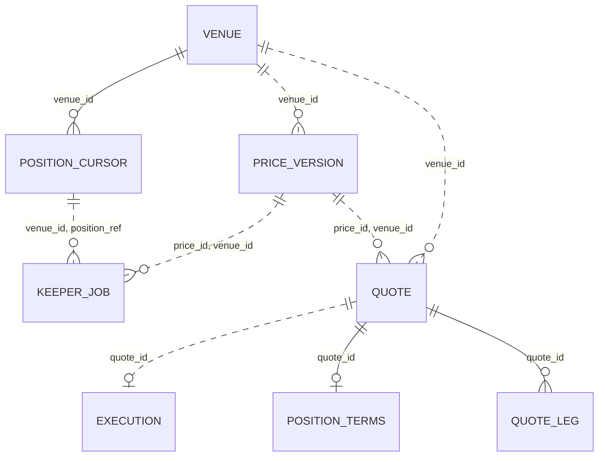

| 테이블 | 기본키 | 필드와 형식 (물음표는 선택값) |
|---|---|---|
| execution | execution_id | `execution_id uuid`, `quote_id uuid`, `chain_ref text`, `tx_hash text`, `state text`, `result_ref text?`, `created_at timestamp with time zone` |
| keeper_job | job_id | `job_id uuid`, `venue_id uuid`, `position_ref text`, `kind text`, `period_key text`, `expected_revision bigint`, `price_id uuid`, `chain_ref text`, `tx_hash text`, `state text`, `created_at timestamp with time zone` |
| position_cursor | venue_id, position_ref | `venue_id uuid`, `position_ref text`, `revision bigint`, `funding_cursor bigint`, `state text` |
| position_terms | quote_id | `quote_id uuid`, `direction text`, `margin_asset_ref text`, `margin_units market.uint78`, `position_units market.uint78`, `liquidation_policy_ref text`, `funding_policy_ref text` |
| price_version | price_id | `price_id uuid`, `venue_id uuid`, `source_ref text`, `base_asset_ref text`, `quote_asset_ref text`, `price_numerator market.uint78`, `price_denominator market.uint78`, `observed_at timestamp with time zone`, `valid_until timestamp with time zone`, `state text` |
| quote | quote_id | `quote_id uuid`, `venue_id uuid`, `price_id uuid`, `subject_ref text`, `operation text`, `input_asset_ref text`, `output_asset_ref text`, `input_units market.uint78`, `limit_units market.uint78`, `fee_units market.uint78`, `fee_asset_ref text`, `route_ref text?`, `expires_at timestamp with time zone`, `approved_at timestamp with time zone?`, `state text`, `created_at timestamp with time zone` |
| quote_leg | quote_id, leg_no | `quote_id uuid`, `leg_no smallint`, `asset_ref text`, `direction text`, `quantity_units market.uint78`, `limit_units market.uint78` |
| venue | venue_id | `venue_id uuid`, `chain_ref text`, `contract_ref text`, `kind text`, `test_only boolean` |

## platform

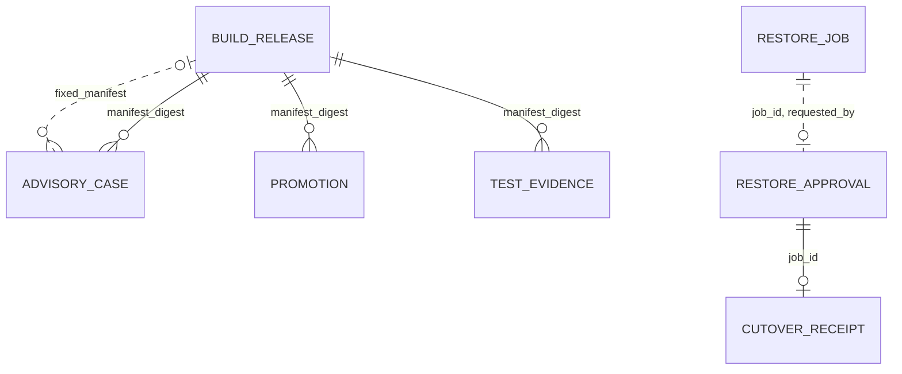

| 테이블 | 기본키 | 필드와 형식 (물음표는 선택값) |
|---|---|---|
| advisory_case | advisory_ref, manifest_digest, component_ref | `advisory_ref uuid`, `manifest_digest platform.digest32`, `component_ref text`, `owner_role text`, `next_review_at timestamp with time zone`, `decision text`, `evidence_digest platform.digest32?`, `fixed_manifest platform.digest32?` |
| build_release | manifest_digest | `manifest_digest platform.digest32`, `product smallint`, `version text`, `channel text`, `trust_root platform.digest32`, `spec_digest platform.digest32`, `sbom_digest platform.digest32`, `provenance_digest platform.digest32` |
| cutover_receipt | job_id | `job_id uuid`, `target_result_digest platform.digest32`, `applied_revision bigint`, `applied_at timestamp with time zone` |
| promotion | manifest_digest, combination_digest | `manifest_digest platform.digest32`, `combination_digest platform.digest32`, `evidence_set_digest platform.digest32`, `prepared_by uuid`, `approved_by uuid`, `published_receipt platform.digest32`, `published_at timestamp with time zone` |
| restore_approval | job_id | `job_id uuid`, `requested_by uuid`, `verified_by uuid`, `proof_digest platform.digest32`, `approved_at timestamp with time zone`, `expires_at timestamp with time zone`, `measured_rto_seconds integer`, `measured_rpo_seconds integer` |
| restore_job | job_id | `job_id uuid`, `target_scope_ref uuid`, `snapshot_ref uuid`, `expected_revision bigint`, `requested_by uuid`, `requested_at timestamp with time zone`, `goal_rto_seconds integer`, `goal_rpo_seconds integer` |
| test_evidence | manifest_digest, combination_digest, test_kind, report_digest | `manifest_digest platform.digest32`, `combination_digest platform.digest32`, `test_kind text`, `report_digest platform.digest32`, `passed boolean`, `tested_at timestamp with time zone` |

## privacy_ops

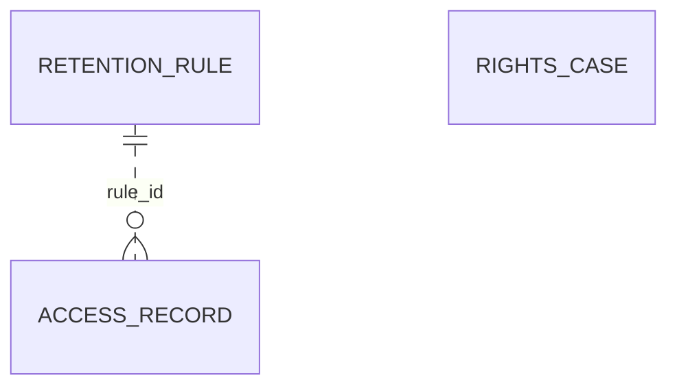

| 테이블 | 기본키 | 필드와 형식 (물음표는 선택값) |
|---|---|---|
| access_record | access_id | `access_id uuid`, `system_ref uuid`, `actor_ref uuid`, `occurred_at timestamp with time zone`, `source_locator_cipher bytea`, `task_code text`, `outcome text`, `subject_scope_receipt uuid?`, `affects_subject boolean`, `downloaded boolean`, `rule_id uuid`, `keep_until timestamp with time zone` |
| retention_rule | rule_id | `rule_id uuid`, `class_code text`, `version integer`, `purpose_code text`, `basis_ref text`, `owner_role text`, `trigger_event text`, `period_ref text`, `disposal_method text`, `effective_at timestamp with time zone` |
| rights_case | case_id | `case_id uuid`, `service_scope uuid`, `local_claim_ref uuid`, `request_type text`, `authorized_scope_digest bytea`, `received_at timestamp with time zone`, `due_at timestamp with time zone`, `state text`, `basis_ref text?`, `result_receipt uuid?`, `notice_at timestamp with time zone?` |

## travel

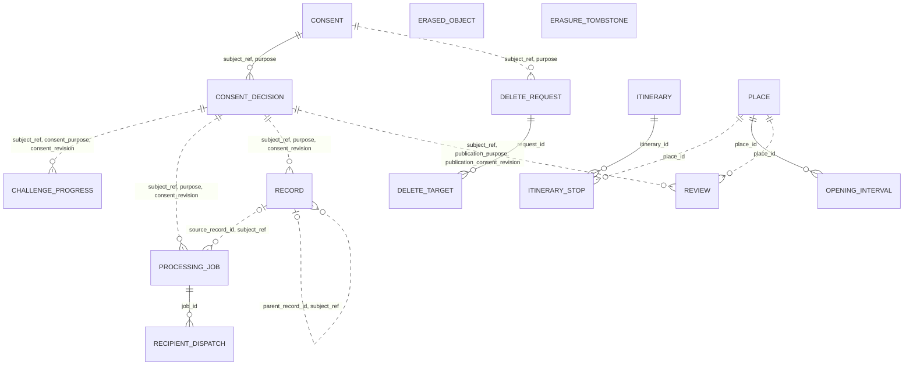

| 테이블 | 기본키 | 필드와 형식 (물음표는 선택값) |
|---|---|---|
| challenge_progress | challenge_ref, subject_ref, evidence_ref | `challenge_ref text`, `subject_ref text`, `evidence_ref text`, `consent_purpose text`, `consent_revision bigint`, `state text`, `reward_ref text?`, `updated_at timestamp with time zone` |
| consent | subject_ref, purpose | `subject_ref text`, `purpose text`, `revision bigint`, `policy_version text`, `provider_ref text?`, `granted boolean`, `decided_at timestamp with time zone`, `expires_at timestamp with time zone?` |
| consent_decision | subject_ref, purpose, revision | `subject_ref text`, `purpose text`, `revision bigint`, `policy_version text`, `provider_ref text?`, `granted boolean`, `decided_at timestamp with time zone`, `expires_at timestamp with time zone?`, `evidence_ref text` |
| delete_request | request_id | `request_id uuid`, `subject_ref text`, `purpose text`, `through_revision bigint`, `selection text`, `requested_at timestamp with time zone`, `state text` |
| delete_target | request_id, target_kind, target_ref | `request_id uuid`, `target_kind text`, `target_ref text`, `state text`, `attempted_at timestamp with time zone?`, `completed_at timestamp with time zone?`, `reason_code text?` |
| erased_object | object_kind, object_token | `object_kind text`, `object_token uuid`, `erased_at timestamp with time zone`, `retain_until timestamp with time zone` |
| erasure_tombstone | subject_ref, purpose | `subject_ref text`, `purpose text`, `through_revision bigint`, `erased_at timestamp with time zone`, `retain_until timestamp with time zone` |
| itinerary | itinerary_id | `itinerary_id uuid`, `subject_ref text`, `revision bigint`, `created_at timestamp with time zone`, `delete_after timestamp with time zone` |
| itinerary_stop | itinerary_id, ordinal | `itinerary_id uuid`, `ordinal integer`, `place_id uuid`, `planned_at timestamp with time zone?` |
| opening_interval | place_id, weekday, opens | `place_id uuid`, `weekday smallint`, `opens time without time zone`, `closes time without time zone`, `timezone text`, `source_updated_at timestamp with time zone` |
| place | place_id | `place_id uuid`, `kind text`, `name text`, `region text`, `address_text text?`, `latitude_e6 integer?`, `longitude_e6 integer?`, `merchant_location_ref text?`, `source_ref text`, `source_updated_at timestamp with time zone` |
| processing_job | job_id | `job_id uuid`, `subject_ref text`, `purpose text`, `consent_revision bigint`, `source_record_id uuid?`, `state text`, `created_at timestamp with time zone`, `finished_at timestamp with time zone?` |
| recipient_dispatch | job_id, recipient_ref | `job_id uuid`, `recipient_ref text`, `recipient_handle text`, `fence_revision bigint`, `state text`, `prepared_at timestamp with time zone`, `finished_at timestamp with time zone?`, `deleted_at timestamp with time zone?` |
| record | record_id | `record_id uuid`, `subject_ref text`, `purpose text`, `consent_revision bigint`, `kind text`, `parent_record_id uuid?`, `object_ref text`, `created_at timestamp with time zone`, `delete_after timestamp with time zone`, `state text` |
| review | review_id | `review_id uuid`, `subject_ref text`, `place_id uuid`, `evidence_issuer_ref text`, `evidence_ref text`, `publication_consent_revision bigint`, `evidence_class text`, `badge_state text`, `publication_purpose text`, `publication_state text`, `body_object_ref text`, `created_at timestamp with time zone`, `delete_after timestamp with time zone` |

## wallet_mpc

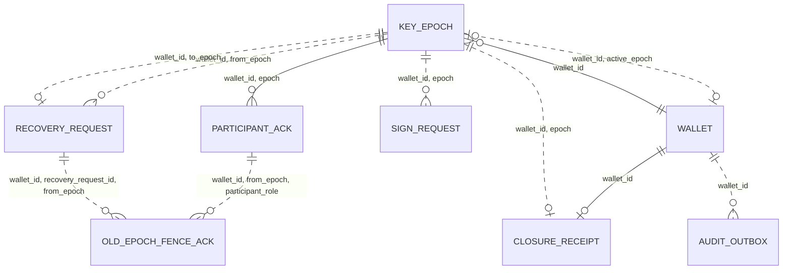

| 테이블 | 기본키 | 필드와 형식 (물음표는 선택값) |
|---|---|---|
| audit_outbox | event_id | `event_id uuid`, `wallet_id uuid`, `event_kind text`, `reason_code text?`, `created_at timestamp with time zone`, `published_at timestamp with time zone?` |
| closure_receipt | wallet_id | `wallet_id uuid`, `request_ref uuid`, `epoch bigint`, `accepted_at timestamp with time zone` |
| key_epoch | wallet_id, epoch | `wallet_id uuid`, `epoch bigint`, `state text`, `created_at timestamp with time zone`, `expires_at timestamp with time zone` |
| old_epoch_fence_ack | wallet_id, recovery_request_id, participant_role | `wallet_id uuid`, `recovery_request_id uuid`, `from_epoch bigint`, `participant_role character(1)`, `fence_evidence_hash bytea`, `fenced_at timestamp with time zone` |
| participant_ack | wallet_id, epoch, participant_role | `wallet_id uuid`, `epoch bigint`, `participant_role character(1)`, `participant_ref uuid`, `activation_evidence_hash bytea?`, `ready_at timestamp with time zone?`, `ready_public_key_hash bytea?` |
| recovery_request | wallet_id, request_id | `wallet_id uuid`, `request_id uuid`, `from_epoch bigint`, `to_epoch bigint`, `intent_hash bytea`, `approval_evidence_ref uuid?`, `state text`, `created_at timestamp with time zone`, `not_before timestamp with time zone`, `expires_at timestamp with time zone` |
| sign_request | wallet_id, request_id | `wallet_id uuid`, `request_id uuid`, `epoch bigint`, `purpose text`, `intent_hash bytea`, `approval_ref uuid`, `state text`, `result_ref uuid?`, `result_digest bytea?`, `result_expires_at timestamp with time zone?`, `created_at timestamp with time zone`, `expires_at timestamp with time zone` |
| wallet | wallet_id | `wallet_id uuid`, `subject_ref uuid`, `create_request_id uuid`, `create_intent_hash bytea`, `profile_ref text`, `policy_ref text`, `public_key bytea?`, `active_epoch bigint?`, `state text`, `created_at timestamp with time zone` |

배포 005는 지갑마다 종료 접수 한 건을 허용한다. 재인증한 본인은 같은 요청 참조로 접수 시각과 원세대의 은퇴 여부를 조회한다. 완료는 해당 세대의 처리 결과에서 계산하며 부분 확인에서는 접수 상태를 유지한다. 보유 규칙은 `P03-ACCOUNT-EVIDENCE`다. [배포 스키마](../../../../products/p03-cloud-mpc-wallet/migrations/005_closure_receipt.sql) · [지갑 데이터 수명](wallet.md)

W21의 이관 006은 논리 `sign_request`를 구현하는 `wallet_mpc.operation`에 서명 전용 `refused` 상태를 추가한다. 지갑 FK와 `(wallet_id, request_ref)` 유일 제약으로 원래 고객 요청을 조회하고, `operation_id`에 결합한 기존 지문과 세대로 거절을 검증한다. 같은 작업 행을 잠그는 트랜잭션에서 한 번만 상태를 바꾸고 해당 작업의 `sign_refused` 감사 이벤트 한 건을 기록한다. 부분 유일 인덱스가 해당 유형의 이벤트를 작업당 한 건으로 제한한다. 기존 행의 상태를 이관에서 변경하지 않으며 새 컬럼이나 새 테이블은 추가하지 않는다. [구현 DDL 006](../../../../products/p03-cloud-mpc-wallet/migrations/006_sign_refusal.sql) · [지갑 데이터 수명](wallet.md)

W24의 참여자 상태 조회는 등록된 참여자에게 상태만 요청한다. 복구 담당자의 지갑 바인딩을 확인하고 신고를 수락하면 같은 트랜잭션에서 `wallet.state`를 보호 상태로 바꾸고, 진행 중인 해당 작업을 정리하고, `audit_outbox`에 `incident_hold`를 남긴다. 원래 사건을 다시 읽을 때도 해당 지갑의 운영 권한을 확인한다. 운영자 브라우저 세션은 만료되는 서버 메모리에 두며 기존 감사 기록을 통해 과거 키 노출 가능성을 표시한다. [상태와 사건 처리](../../../../products/p03-cloud-mpc-wallet/internal/wallet/incidents.go) · [운영자 세션](../../../../products/p03-cloud-mpc-wallet/internal/operatorui/console.go)

## 지점의 게시 메뉴와 원주문 옵션

아래는 P05 마이그레이션 064 시점의 메뉴·재고·주문 관계다. 설계 스키마의 `sale_line`은 배포 DB의 `ledger.order_line`에 대응한다. 상품은 같은 지점 안에서 SKU로 식별한다. 같은 SKU의 따뜻한 옵션과 차가운 옵션은 서로 다른 게시 가격과 옵션 재고를 가질 수 있다.

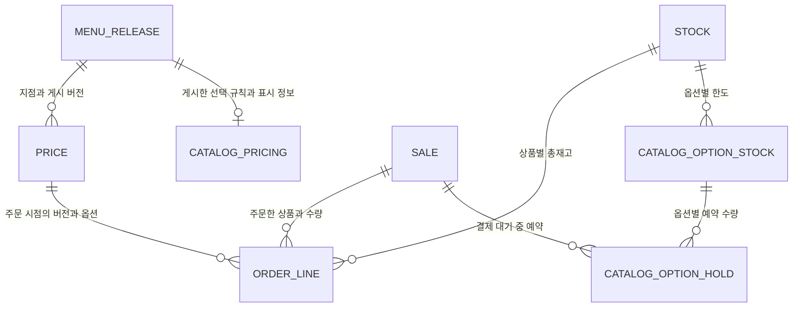

| 관계 | 현재 키와 조회 범위 | 이행 시 지킬 조건 |
|---|---|---|
| 게시 메뉴 | `price(branch_id, version, sku, option_key)`에 담긴 가격과 같은 게시 버전의 `catalog_pricing.breakdown`에서 품명·옵션 설명과 점주 신고 성분을 읽는다. | 필수 선택 그룹과 교차접촉 성분도 원래 지점·버전에 귀속한다. 새 버전의 문구로 이미 접수한 주문 설명을 바꾸지 않는다. |
| 주문 줄 | 064의 `order_line(sale_id, sku)`는 주문 한 건에 한 SKU의 옵션 하나를 기록한다. 각 줄은 같은 지점의 가격과 SKU 재고를 참조한다. | 서로 다른 옵션을 동시에 주문하려면 기본 키에 `option_key`를 포함한다. 기존 주문 금액, 줄 수량, 요청 지문, 영수증은 원자료와 대조한다. |
| 옵션 예약 | 064의 `catalog_option_hold(sale_id, sku)`는 해당 주문에서 잡은 옵션별 수량을 참조한다. 확정·미지급 만료 시 이 수량으로 예약을 해제한다. | 주문 줄과 같은 복합 키로 이행한다. 상품 재고는 같은 SKU의 줄을 합산하고 옵션 재고는 옵션마다 차감·복원한다. 고객·기기 식별정보의 새 사본은 필요하지 않다. |

065를 새 PostgreSQL에 적용한 독립 검수에서 주문 줄과 옵션 예약의 기본 키는 모두 `(sale_id, sku, option_key)`였다. 두 테이블은 각각 원매출을 참조한다. 주문 줄은 게시 가격·상품 재고를, 옵션 예약은 옵션 재고를 참조한다. 주방의 품목 조회는 원주문의 지점·게시 버전·SKU·옵션으로 가격 행을 찾고 SKU·옵션 키 순서로 표시한다. 실제 mTLS 주문의 고객 상태·수령 조회는 확정 금액 11 TestUSDC와 같은 영수증 번호를 반환했다. 고객 응답에는 품목 배열이 없다. 등록 주방에서 같은 주문을 두 번 조회해 최초 게시 품명과 따뜻한 옵션 1개·아이스 2개를 같은 순서로 확인했다. 지급 확정과 수령 ACK에는 로컬 합성 증거를 사용했다. 064의 원주문·예약·요청 지문·영수증 바이트 보존, 역순 재전송, 옵션 재고 경쟁, 만료 및 미지급 복원까지 065에서 검수했다. 고객 화면에 품목별 영수증을 제공하려면 원지급자 범위의 조회 응답과 화면을 함께 보완해야 한다. [주문·가격 외래 키](../../../../products/p05-operations-backoffice/internal/store/migrations/003_commerce.sql) · [옵션 재고와 예약](../../../../products/p05-operations-backoffice/internal/store/migrations/028_option_inventory.sql) · [게시 메뉴 조회 함수](../../../../products/p05-operations-backoffice/internal/store/migrations/064_public_option_rule.sql) · [옵션 이행과 완료 기준](ledger.md#공용-메뉴-조회와-옵션-선택)

066은 기존 권한을 검사한 게시 메뉴 조회에 상품 전체 재고를 추가한다. 응답의 `skuAvailable`은 지점·SKU의 상품 재고이고, 기존 `available`은 그 상품과 선택 옵션으로 주문할 수 있는 최대 수량이다. 옵션별 수량을 합쳐도 상품 전체 재고를 넘을 수 없다. 옵션 재고를 따로 관리하지 않는 품목은 상품 재고로 제한한다. 지점의 현재 재고에서 읽는 값이므로 고객별 재고나 고객 이력을 저장할 필요가 없다. 양쪽 앱은 게시된 같은 SKU의 각 옵션을 독립적인 장바구니 줄로 유지하고 최종 재고 차감은 065의 단일 DB 거래가 담당한다. 이전 응답에서 전체 재고를 알 수 없으면 두 번째 옵션의 동시 주문 가능 수량을 추정할 수 없다. [066 게시 조회](../../../../products/p05-operations-backoffice/internal/store/migrations/066_public_sku_stock.sql) · [앱 공통 수량 검토](../../../../packages/protocol/ts/src/commerce-cart-review.ts)

### 메뉴 게시 버전의 카테고리 설계

K01의 카테고리는 O03의 메뉴 게시와 함께 확정된다. 아래 데이터 관계는 P05 069에서 적용한다. `menu_release`의 동일 지점·버전에 속한 SKU 전체가 한 분류를 공유하며, 온도나 크기 옵션을 바꿔도 상품의 분류가 유지된다.

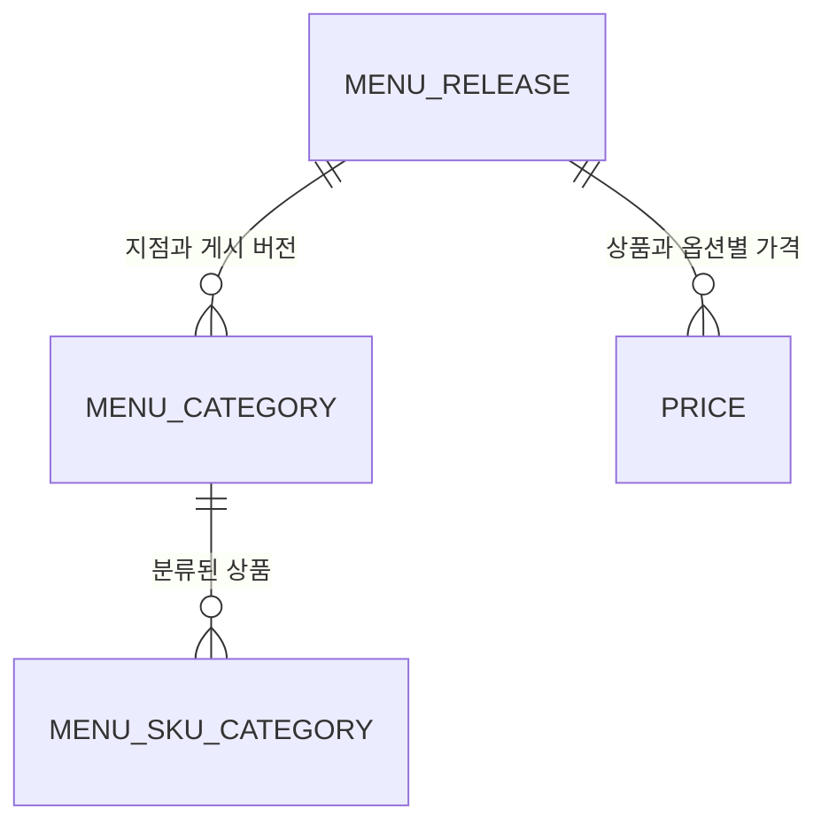

| 논리 데이터 | 식별과 검증 | 공개 범위와 수명 |
|---|---|---|
| `menu_category` | `(branch_id, version, category_key)`가 한 분류를 식별한다. 점주가 표시 순서와 지역화 이름을 입력한다. 순서가 같으면 키를 기준으로 정렬해 단말 사이 표시 순서를 맞춘다. | 해당 게시 버전과 같은 기간 보유한다. 운영자가 새 버전에서 이름을 바꿔도 이전 게시 내용은 그대로 조회된다. |
| `menu_sku_category` | `(branch_id, version, sku)`당 최대 한 행이다. 이 행의 분류 키는 같은 지점·버전의 분류를 참조하고, SKU가 같은 게시 요청의 가격 행에 있는지 확인한다. | 미분류 상품은 연결 행 없이 ‘전체’에서 보인다. 한국어·영어 이름은 분류에서 읽고 상품별 사본을 저장하지 않는다. |

게시 권한이 있는 점주의 한 요청에서 가격, 분류, 상품 연결을 함께 확정한다. 알 수 없는 분류, 다른 지점의 연결, 같은 SKU에 모순되는 연결이 있으면 버전 전체를 취소한다. 같은 요청 키·같은 내용의 재전송은 최초 게시 결과를 돌려주고, 가격이 같아도 분류를 바꾼 재전송은 충돌로 처리한다. 기존의 분류 없는 게시 요청과 저장된 지문은 다시 열 수 있어야 한다.

게시 API는 분류 정의를 `categories`에, SKU 연결을 `categoryBindings`에 받는다. 한 분류에는 안정적인 `key`, 표시 순서 `sortOrder`, 이름 `labels.ko`와 `labels.en`이 있다. SKU 연결은 `sku`와 `categoryKey`를 받는다. 069에서는 게시당 최대 분류 50개·상품 연결 150개를 지원한다. 주문 요청과 주문 지문은 기존 SKU·옵션 기준을 사용한다. [점주 카탈로그 처리](../../../../products/p05-operations-backoffice/internal/commerce/operator_catalog.go) · [정의·연결·공개 조회 DDL](../../../../products/p05-operations-backoffice/internal/store/migrations/069_menu_categories.sql)

공개 조회는 인증 범위 안의 같은 게시 버전에 있는 이름·순서·상품 관계만 전달한다. SDK는 여러 페이지를 읽다가 버전이 바뀌면 혼합 결과를 버린다. 화면에서 선택한 분류와 언어는 단말 상태로 관리한다. 고객의 선택 이력, 지갑 주소, 구매자 식별자를 이 모델에 추가하지 않는다. 인수 때에는 두 지점에서 같은 분류 키를 사용하고, 50번째 행을 넘는 상품과 구형 미분류 상품을 포함해 게시·재조회·언어 변경·장바구니 복구를 대조한다. [메뉴 카테고리의 동선과 조건](ledger.md#점주가-게시한-메뉴-카테고리) · [공용 메뉴 화면](../screens/specs/K.md#k01--공용-메뉴) · [P05 카테고리 DDL과 게시 계약](../../../../products/p05-operations-backoffice/internal/store/migrations/069_menu_categories.sql)

### 공용 장바구니의 취소와 재시도

071은 단말이 예약 응답을 받기 전에 손님이 화면을 닫은 경우도 기록한다. 이때 원주문이 아직 없을 수 있으므로 종료 기록의 필수 외래 키는 지점이다. 단말·세션·요청 키는 단말의 예약 명령과 대조한다. [071 마이그레이션](../../../../products/p05-operations-backoffice/internal/store/migrations/071_public_menu_cancel.sql)

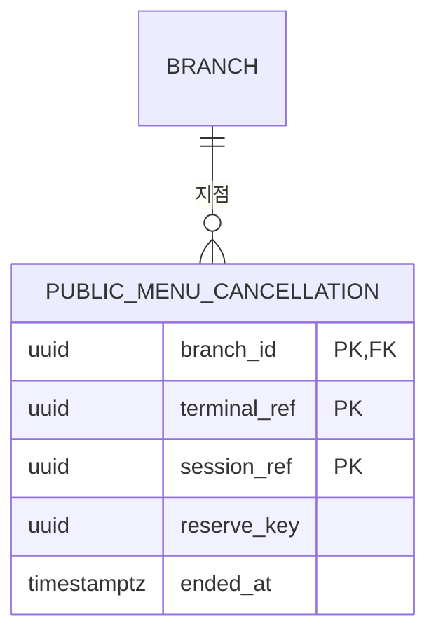

같은 지점·단말의 예약 요청 키도 유일하다. 취소가 먼저 기록되면 뒤늦은 예약 명령의 원주문과 재고 차감은 함께 롤백된다. 예약이 먼저 완료됐다면 실제 원주문과 발행 기록, 고객 폰의 결합 여부를 잠금 안에서 확인한다. 미결합·미서명 미리보기만 재고를 복원해 닫고, 폰에 인계한 원주문은 유지한다. 종료 기록에는 고객 계정, 주소, QR 원문이나 주문 항목을 복제하지 않는다. 원주문·명령의 재실행 가능 기간과 해당 기록의 보존 의무가 끝난 뒤 삭제한다. [필드 목적·파기 조건](../../../../products/p10-platform/database/field-purpose.json) · [K09 인수 유즈케이스](../products/p04-merchant-kiosk/use-cases.md#고객이-화면을-닫는-시점별-인수-조건)

### 근거리 예약의 최초 결과와 보유기한

087의 `menu_reservation_outcome`은 같은 지점·요청 주체·요청 키로 처음 판정한 결과를 다시 찾는다. 예약 성공에는 원판매 참조가 있고, 확정 거절에는 사유와 원래 장바구니에서 확인한 품목·옵션만 있다. 호출자가 응답을 받았는지는 이 판정을 바꾸지 않는다. 원주문 참조와 정규 요청 지문은 요청 대조에, 고객 참조는 해당 고객의 인증된 근거리 주문 조회에 쓴다.

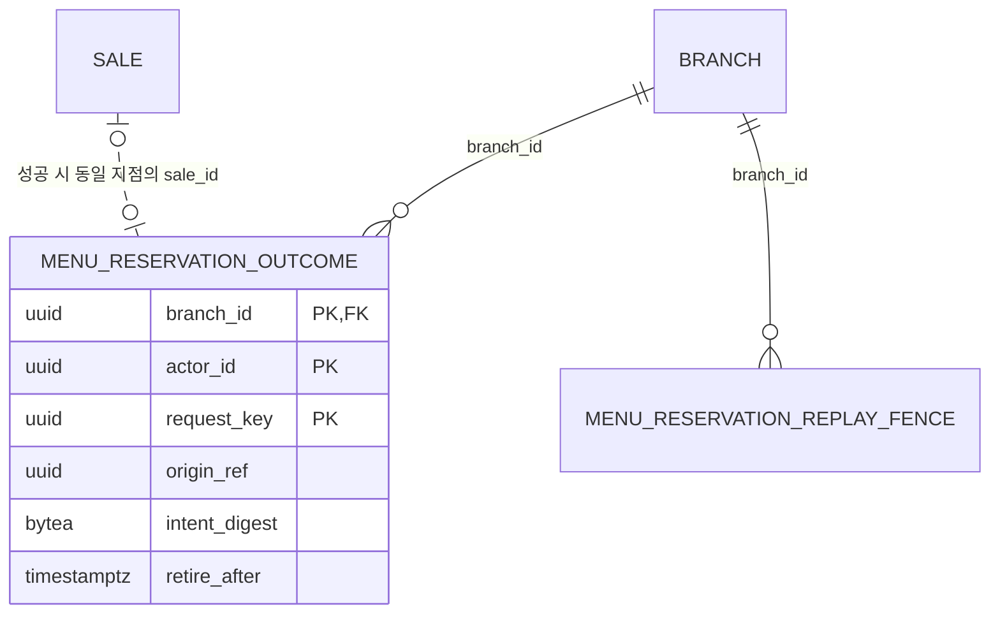

거절 결과의 재조회 기간이 끝나면 원결과 행을 삭제한다. 재실행 방지 표에는 지점과 두 지문만 남는다. 하나는 요청 주체·키, 다른 하나는 원주문 참조를 대조한다. 지점을 삭제하면 이 표도 함께 지워진다. 성공 결과는 같은 지점의 원판매에 종속되어 판매 삭제 시 함께 지워진다. 인수 시험에서는 회수 뒤에도 과거 요청이 다시 판매를 만들지 않는지, 원판매에 대한 고객 조회 권한이 만료되는지 각각 확인한다. [087 스키마와 폐기 동작](../../../../products/p05-operations-backoffice/internal/store/migrations/087_menu_reservation_outcome.sql) · [근거리 장바구니의 데이터 흐름](ledger.md#근거리-장바구니의-거절과-재조회)

## 지급 주소 변경과 대여 기기의 개설 검토

운영 DB에서 지급 주소를 검토하는 O08은 지점과 변경 요청을, 대여 개설을 검토하는 O09는 지점·기기·등록 세대를 조회 기준으로 사용한다. 아래 선은 실제 외래 키다. 이미 발급한 견적과 주소 변경 사이의 관계는 제안 당시 발급 프로필 버전 또는 동결된 견적 다이제스트로 조회한다. [주소 변경 DDL](../../../../products/p05-operations-backoffice/internal/store/migrations/018_payout_change.sql) · [대여 DDL](../../../../products/p05-operations-backoffice/internal/store/migrations/019_managed_rental.sql)

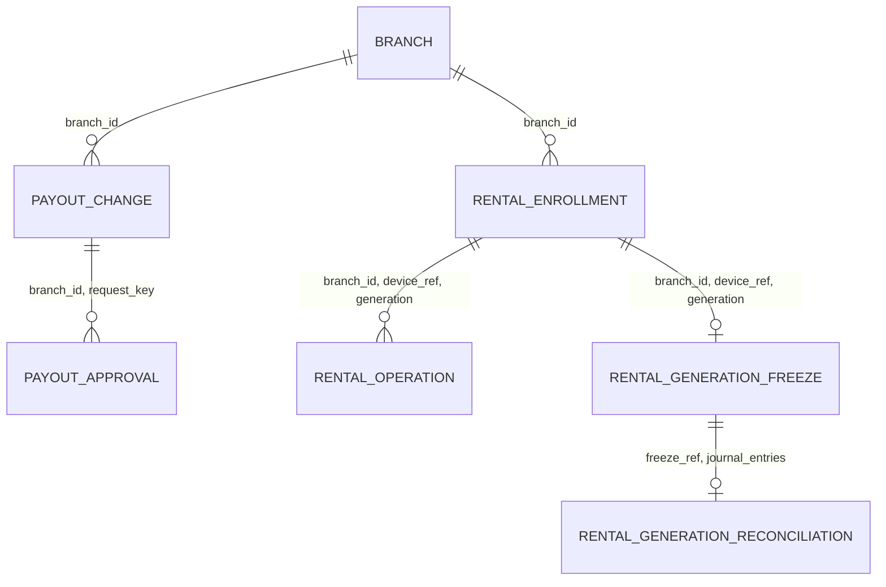

| 필드 | 기록·조회 조건 | 보유 종료 |
|---|---|---|
| `payout_change.predecessor_profile_version` | 변경 제안 시 활성 발급 프로필에서 읽는다. 구버전 요청은 확인 가능한 프로필이나 보관된 견적 다이제스트만 연결하며 근거가 없으면 추적 불가로 표시한다. | 지점의 정산·감사 보유기간이 끝나면 해당 변경 기록과 함께 폐기한다. |
| `payout_change.activated_at` | 확정 블록을 검증한 워커가 실제 효력 시각을 기록한다. 예정 시각은 기존 `ready_at`이다. 실제 시각이 없는 과거 기록은 값을 비워 둔다. | 변경 기록과 같은 기한을 적용한다. |
| `rental_enrollment.attested_at` | 등록 장비의 검증 시각이 기록된 경우에만 저장하며 `attested_until`보다 빨라야 한다. 열린 검토가 보여 준 등록 세대·계정·반환 주소·인증 근거가 제출 때도 일치해야 한다. 구등록의 인증 시각이 비어 있으면 원래 유효 기한을 표시한다. | 대여 등록 종료 또는 반납 및 감사 보유기간 경과 후 등록 증거와 함께 폐기한다. |

057·058 이관에서 추가한 필드는 위 세 개다. 견적 본문, 고객 식별정보, 기기 인증 원문은 기존 자료에서 필요한 범위만 조회한다. [P05 057](../../../../products/p05-operations-backoffice/internal/store/migrations/057_payout_registry_review.sql) · [P05 058](../../../../products/p05-operations-backoffice/internal/store/migrations/058_rental_opening_review.sql)

068의 두 테이블은 새 대여 세대를 반납할 때 필요한 근거를 구분한다. `rental_generation_freeze`는 등록 결속과 보드 동결 영수증의 다이제스트, 최초·다음 nonce와 종류별 항목 수를 보존한다. `rental_generation_reconciliation`은 같은 동결과 항목 수에 결속된 P07 수집 세대, 확정 블록과 대사 다이제스트·범위·검증 기한을 보존한다. 각각 지점의 대여 대사와 승인된 회계·nonce 감사 보유기간이 끝나면 대사→동결 순으로 파기한다. 기기에서 아직 사용할 수 있는 지급 서명은 이 두 테이블에 저장하지 않는다. 인증 수집 경로를 연결하기 전 두 행의 수치만으로 미결 건수를 제공할 수 없다. [P05 068](../../../../products/p05-operations-backoffice/internal/store/migrations/068_rental_generation_evidence.sql) · [필드 목적과 보유 정책](../../../../products/p10-platform/database/field-purpose.json) · [검증 시점별 미결 표시 기준](../../../../products/p05-operations-backoffice/O09-GENERATION-EVIDENCE.md)

070은 어느 등록 권위에서 받은 증거인지 기록하고, 072는 그 세대의 수집기와 운영 주체를 연결한다. 073은 증거를 제출한 요청을, 074는 등록 권위를 조회할 서비스를 현재 등록에 연결한다. 아래 관계는 이관에 정의된 외래 키이며 088의 원발급 참조와 미결 지급 증인 관계도 포함한다. 등록된 보드 서명 주소와 측정값을 저장하고, 운영 사용자에게는 검증된 지급 미결과 한도 변경 미결을 구분해 표시하도록 설계했다. [P05 070](../../../../products/p05-operations-backoffice/internal/store/migrations/070_rental_generation_source.sql)

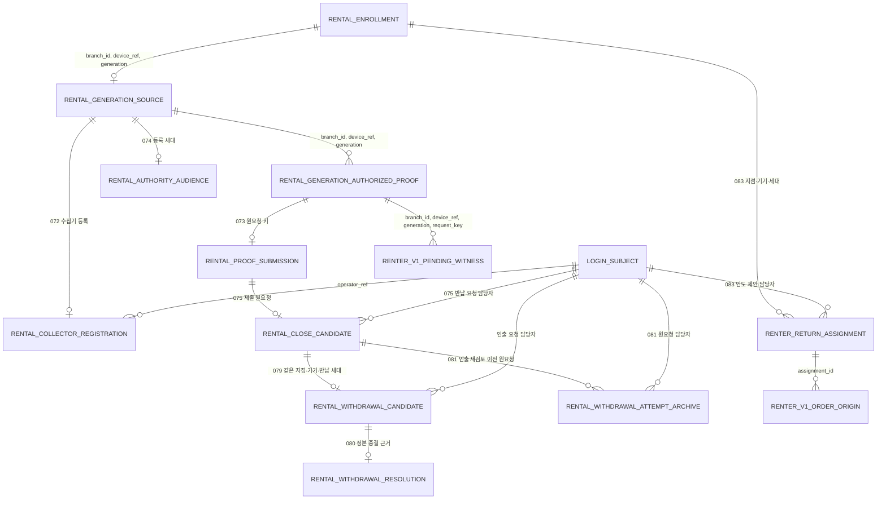

| 테이블 | 식별과 사용 | 파기 순서 |
|---|---|---|
| `rental_generation_source` | 지점·기기·세대별로 보드 등록, 결제 배포, P07 수집 세대, 허용한 서비스 계정과 기한을 결속한다. 보드에 발급한 도전값은 갱신과 재사용을 구분하는 근거다. | 대여 대사와 보유 의무가 끝난 뒤 하위 증거를 먼저 파기한다. |
| `rental_generation_authorized_proof` | 같은 지점·기기·세대 아래 요청 키로 재호출을 식별한다. 동결 영수증·공개 저널·대사 결과의 다이제스트, 확정 블록, 종류별 미결 수와 유효기한을 저장한다. | 승인된 보유기간이 지나면 요청별 증거를 서비스 등록보다 먼저 파기한다. |
| `rental_collector_registration` | 072에서 지점·기기·세대마다 최대 한 수집기를 지정한다. 운영 주체 참조, 인증서 지문, 7바이트 BLE 피어, 최초 nonce, 등록 증명·권위의 다이제스트와 만료 시각을 관리한다. 등록 증명이 없는 동안 동결 서명을 발급할 수 없다. | 세대 종료 및 승인된 보유기간 경과 후 수집기 결속을 상위 세대 소스보다 먼저 파기한다. |
| `rental_proof_submission` | 지점·기기·세대·요청 키마다 인증한 제출 내용의 다이제스트 한 개를 저장한다. 원문과 서명은 검증 중에만 사용한다. 동일 키의 재시도는 현재 권한과 본문 지문을 확인한 뒤 기존 결과로 연결한다. | 상위 증거가 파기되면 함께 삭제된다. |
| `rental_authority_audience` | 세대별로 허용된 DB 조회 계정, 조회용 및 원 대사 요청용 인증서 지문, 등록 권위 다이제스트와 기한을 둔다. P07이 최초 대사 요청자의 인증서 지문을 보내면 P05가 실제 mTLS 조회자의 지문과 원 요청자의 지문을 074 행 및 현재 072 등록에 대조한다. | 조회 권한 철회 시 해당 등록을 제거한다. 원천 등록 만료 시 승인한 감사기간을 적용하고 070 원천 등록 삭제 시 함께 파기한다. |
| `rental_close_candidate` | 075에서 지점·기기·세대당 한 행을 원증거 제출과 담당자에 연결한다. 요청 키, 검토·권위 다이제스트, 대여 계정, 서명자·nonce, 거래 해시로 재시도와 다른 요청을 구분한다. 전송 중에는 시도 기한을 기록한다. 재전파용 서명 거래는 인증 암호화하며 지점·담당자·세대·요청과 거래 해시를 결속한다. | 설계상 정본 블록에서 원거래 종결 또는 같은 nonce의 다른 거래 확정이 확인될 때 암호문을 지운다. 노드의 단순 수신, 응답 유실 또는 원해시 조회 장애 중에는 재시도를 위해 보존한다. 확정 nonce의 증가만으로 어떤 거래가 종결됐는지 식별할 수 없다. 지점 대사·감사 보유기간이 지나면 행을 원증거 제출보다 먼저 삭제한다. |
| `rental_withdrawal_candidate` | 079는 한 지점·기기·세대의 확정 반납에 인출 후보를 최대 한 건 연결한다. 담당자·원요청 키·검토 참조·서명자·nonce·거래 해시로 재시도를 식별한다. 최초 송신 전 중단돼도 원거래를 복구하도록 서명 원문을 인증 암호화하며, 동시 송신을 제어하는 시도 기한을 기록한다. | 정본 실행이 확인되면 암호문을 파기하고, 승인된 감사 보유기간이 지나면 원 반납 후보를 지우기 전에 인출 참조를 파기한다. 수취 직후 사용자가 더 이상 제출하지 않는 경우의 파기 실행은 별도 검증 대상이다. |
| `rental_withdrawal_resolution` | 080의 전용 작업자가 확정 블록과 근거 거래를 원인출에 연결한다. 082에서 `executed`는 근거가 원거래와 일치할 때만 허용한다. 다른 거래가 같은 지급 의무를 이행하면 `settled_other`로 기록하고 원거래의 실패나 동일 순번 소비가 뒤늦게 확정되면 판정을 갱신한다. | 지급 의무의 이행 또는 원거래의 종결 근거를 기록하는 트랜잭션에서 서명 암호문을 지운다. 082는 상태 제약과 판정 규칙을 변경하며 새 식별자를 수집하지 않는다. 감사 보유기간 후 원인출보다 먼저 판정 행을 지운다. |
| `rental_withdrawal_attempt_archive` | 081에서 새 승인이 실제로 저장된 경우 이전 원요청과 정본 실패 근거를 보존한다. 이전 요청 키는 확정된 동일 응답에 연결한다. | 승인된 보유기간 후 관련 원반납보다 먼저 제거한다. 서명 원문은 보관하지 않는다. |
| `renter_return_assignment` | 083의 인도 제안은 등록된 지점·기기·세대·계정·등록 지문에 결속한다. 제안한 운영자와 수락 대상 고객의 기존 참조, 만료·수락·철회 시각을 저장한다. 미철회 제안은 해당 세대에 하나다. | 제안 만료·철회와 대여 감사 보유기간 종료 후 등록 행보다 먼저 제거한다. 이름·연락처·개인 지갑 목록은 수집하지 않는다. |
| `renter_v1_order_origin` | 088의 원발급 행은 수락된 인도 한 건을 `assignment_id`로 참조한다. 예약 때 v1 배포·가맹점·체인 주문 키, 등록 단말, 가맹점 요청 다이제스트(`merchant_digest`), 금액·자산, 서버 예약 시각(`reserved_at`)과 승인 기한(`authorization_until`)을 기록한다. 원승인 검증 전에는 `approval_digest`와 `nonce`가 모두 NULL이다. 검증 후에는 두 값이 함께 채워진다. | 원주문 또는 대여 인도의 보유기간 중 먼저 끝나는 시점에 원발급 참조를 제거한다. 원서명은 저장하지 않는다. |
| `renter_v1_pending_witness` | 088의 지급 증인은 기존 대사 기록의 지점·기기·세대·요청 키를 외래 키로 사용한다. 현재 미결 지급의 논스·가맹점·체인 주문 키·승인 다이제스트를 결속한 값만 보존한다. | 관련 원거래 연결과 대사의 보유기간 종료 뒤 대사 행보다 먼저 제거한다. |

083과 088에서 인도 권한을 철회하면 대여자 조회가 차단되는 것을 검증했다. 위 세 대여자 테이블의 보유 기한별 자동 파기는 인수 대기다. 배포별 보유 정책에서 원주문·인도·대사의 기한을 각각 판정하고, 미결 대사나 유효한 보존 예외가 걸려 있는지를 확인해야 한다. 파기 작업의 인수 조건은 두 지점 중 만료된 행만 삭제하고, 예외 해제 후 재실행하면 해당 행도 제거되며, 작업이 중단된 뒤 재시도해도 미결 대사와 다른 지점의 증거를 조회할 수 있는 것이다. 감사 영수증에는 정책 버전·실행 시각·테이블별 처리 건수를 기록한다. [집행 입력·권위 의존성과 합성 인수](../../../../products/p05-operations-backoffice/O09-GENERATION-EVIDENCE.md#대여자-자료-보유종료-집행-설계) · [088 원발급과 증인의 관계](../../../../products/p05-operations-backoffice/internal/store/migrations/088_renter_v1_order_origin.sql) · [데이터별 보유 근거](../../../../products/p10-platform/database/field-purpose.json)

대여자의 조회는 같은 테넌트에서 해당 고객이 원계정으로 수락한 제안에 한정한다. 만료·철회, 운영 권한 만료, 기기 등록 변경 또는 후속 세대 발급 후에는 그 제안으로 조회할 수 없다. 기기 정리 확인과 결제 장부는 각자의 원증거를 사용한다. 인도 수락만으로 미결 건수나 슬롯 종료를 확정할 수 없다. [083의 관계와 접근 함수](../../../../products/p05-operations-backoffice/internal/store/migrations/083_renter_return_assignment.sql) · [필드별 처리 목적](../../../../products/p10-platform/database/field-purpose.json)

091의 `renter_credential_scope`는 현행 수락 인도·등록·별도 사설 수집 권위로부터 조회 시점에만 증거 범위를 계산한다. 반납 대사용 동결 정본과 독립이며 테이블·외래 키·수집 필드를 추가하지 않는다. 이 범위와 조회 결과의 서명·난수는 영속화하지 않으며 고객 응답에는 검증된 자격 종료 및 단기 증거 종료 시각만 선택적으로 추가한다. [091 조회 함수](../../../../products/p05-operations-backoffice/internal/store/migrations/091_renter_credential_scope.sql)

084는 기존 제안에서도 등록 증명이 시작됐고 아직 만료되지 않았는지 수락·조회 때 다시 확인한다. 085는 대여자의 수락, 같은 세대의 원 대사 증거, 수집기와 기록자 권한을 읽어 한시적인 조회 결과를 만든다. 앱에는 검증에 쓴 내부 지점·기기 식별자와 인증서가 필요하지 않다. 이 조회를 위해 추가로 수집하는 고객 정보나 영속 테이블은 없다. 085의 `pendingCount`는 지급과 한도 변경의 합계다. 086은 이 합계를 유지하면서 원증거의 `pendingPayments`와 `pendingLimits`를 각각 전달한다. 기준 블록을 재확인할 수 없거나 권한이 만료되면 둘 다 확인 대기다. [084 등록 재검증](../../../../products/p05-operations-backoffice/internal/store/migrations/084_renter_return_live_attestation.sql) · [085 증거 조회](../../../../products/p05-operations-backoffice/internal/store/migrations/085_renter_return_assessment.sql) · [086 건수 분리](../../../../products/p05-operations-backoffice/internal/store/migrations/086_renter_return_typed_assessment.sql) · [대여자 화면의 인수 기준](../products/p02-user-app/use-cases.md#대여자가-반납-상태를-확인하는-경우)

077은 기존 반납 후보를 읽는 함수를 추가한다. 별도 테이블이나 수집 필드는 없다. 현재 지점의 운영 권한을 확인한 뒤 전용 DB 역할에만 결과를 반환한다. 후보가 존재하면 상태와 거래 해시를 읽을 수 있고 원요청 키와 검토 참조는 요청을 시작한 담당자에게만 반환된다. HTTP 계층은 동료 담당자에게 이미 기록된 작업으로 표시한다. 서명 거래 암호문·인증서 지문·개인 프로필은 이 조회로 반환되지 않는다. 078은 보호 반납 검토값을 당시 승인 대상·수집기·기한 전체에 묶어, 최초 송신 전 권위가 갱신되면 다시 검토하게 한다. [077의 조회 투영과 역할](../../../../products/p05-operations-backoffice/internal/store/migrations/077_rental_close_operator_snapshot.sql) · [운영 HTTP 응답 구성](../../../../products/p05-operations-backoffice/internal/commerce/rental_close_operator.go) · [079의 인출 후보와 제한된 접근](../../../../products/p05-operations-backoffice/internal/store/migrations/079_rental_protected_withdrawal.sql)

수집기 인증서와 BLE 피어는 같은 기기를 식별할 수 있는 제한 데이터다. P05의 일반 상거래와 증거 쓰기 역할에는 이 테이블의 직접 조회 권한이 없다. 운영 권위는 등록된 지점·기기와 아직 유효한 권한을 대조한다. 설치한 펌웨어의 측정값·버전·카운터 확인에는 기존 설치 장부를 이용한다. [072의 실제 외래 키와 권한](../../../../products/p05-operations-backoffice/internal/store/migrations/072_rental_collector_authority.sql) · [필드별 처리 목적](../../../../products/p10-platform/database/field-purpose.json)

상용 반납에 이 증거를 사용하려면 현재 세대에 대한 등록·갱신과 기한 검사가 필요하다. 미결 지급을 기록한 후 거래가 확정됐을 때에는 같은 동결을 새 도전값으로 재검증해야 한다. 같은 동결과 정본 체인에서는 확정 높이가 앞으로 진행해도 이미 종결한 지급이나 한도 승인이 다시 미결이 될 수 없다. 서로 다른 종류의 건수가 같은 합계로 바뀐 경우도 별도로 검증한다. 과거 지급 건수·승인 다이제스트는 당시 기준점의 기록으로 보존한다. [필드별 목적과 보유기간 근거](../../../../products/p10-platform/database/field-purpose.json) · [운영 조회 조건](../../../../products/p05-operations-backoffice/O09-GENERATION-EVIDENCE.md)

## 여행 자격과 혜택의 구현 마이그레이션

P09의 `travel_private` 및 P05 `ledger`에서 이용 근거와 실제 혜택을 별도로 소유한다. `issuer, proof`는 두 서비스 사이의 목적 한정 불투명 조합이다. P09 고객 식별자를 P05 조회에 사용하지 않는다.

| 소유자와 테이블 | 기본키 | 화면에 쓰는 필드 |
|---|---|---|
| P09 `visit_evidence` | `issuer text, proof uuid` | P09 전용 이용자 참조 `subject_ref uuid`, 공개 장소 참조 `place_id text`, 실/시험 환경 `environment text`, 발급자 순번 `source_revision bigint`, 확정·환불·체인 재구성 `state text`, 확인 시각 `observed_at timestamptz`, 재조회 순서를 고정하는 `listed_at timestamptz` |
| P09 `visit_claim` | `issuer, proof, purpose text` | 목적별 동의 `consent_revision bigint`, 취소·삭제 요청에 쓰는 `claim_ref uuid`, 처음 반영한 `applied_at timestamptz` |
| P09 `visit_erasure_fence` | `issuer, proof, purpose text` | 이전 동의의 재실행과 복구를 제한하는 `through_revision bigint`. 근거 키는 `visit_evidence`의 외래 키 |
| P05 `visit_benefit_state` | `issuer, proof, campaign uuid` | 처리한 주장의 `assertion_revision bigint`, `classification text`, 지급 반영 `credited boolean`. 조정 효과 이력은 `visit_benefit_effect`에서 조회 |

후기 공개 투영은 공개 후기 ID·본문·배지 상태만 반환한다. 스탬프의 지급 및 조정 개수는 P05의 읽기 전용 투영으로 조회한다. 챌린지의 진척은 유효한 개별 반영 중 장소가 다른 건을 세며 별도 지급 원장을 만들지 않는다.

## 좌석 예약의 조건과 두 지급 단계

P05에서 공개 슬롯의 조건을 바꾸거나 취소해도 고객이 보류한 예약의 가격과 환불 조건은 원예약에 남는다. P05 060은 슬롯에 가격 버전, 노쇼 조건, 결제 체인을 추가한다. 예약은 이 세 값과 이용 시각을 보류 시점에 기록한다. 취소 기한과 지급 단계별 환불 비율은 기존 예약 필드에 있다. 예전 예약에서 확인할 수 없는 값은 비워 둔다. [최초 테이블과 키](../../../../products/p05-operations-backoffice/internal/store/migrations/015_travel_booking.sql) · [원예약 조건과 조회](../../../../products/p05-operations-backoffice/internal/store/migrations/060_travel_booking_review.sql)

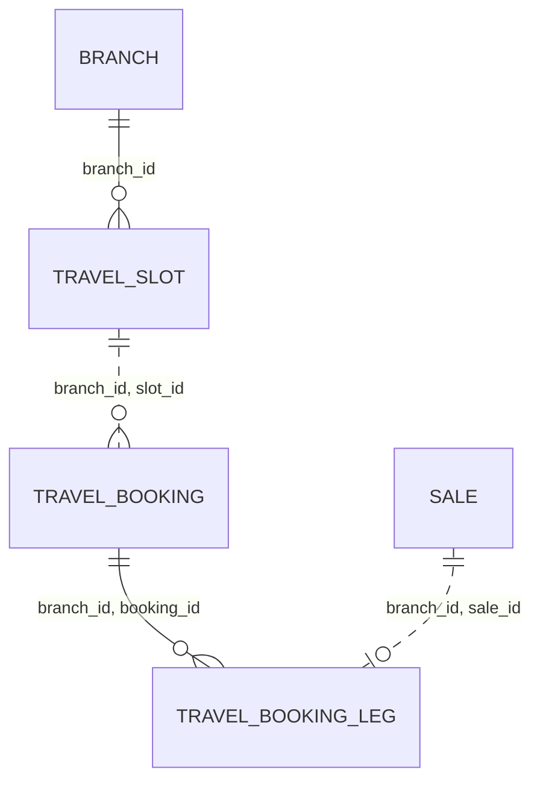

예약의 지급 단계 키는 `(branch_id, booking_id, kind)`다. 한 예약에는 예약금과 잔금이 각각 최대 한 건 존재하며 각 단계는 유일한 원주문을 참조한다. 결제 검토 중에는 지점·고객의 원예약을 읽는다. 잔금은 해당 예약금의 확정 상태를 대조한 뒤 연다. 가격·정책 필드의 보유와 폐기는 기존 지점 슬롯과 예약에 적용하는 기준을 따른다. P09에는 지급 단계 또는 고객의 결제 내역을 저장하지 않는다. [필드 목적 목록](../../../../products/p10-platform/database/field-purpose.json) · [예약 데이터 흐름](experience.md#상태-전이와-경쟁-조건)

## 좌석 없는 T06·T07 픽업 구현

| P05 테이블 | 기본키 | 역할과 필드 |
|---|---|---|
| `travel_pickup_window` | `branch_id uuid, id uuid` | `starts_at`, `ends_at`은 지점의 승인된 이용 시각. `capacity integer`는 픽업 처리 가능 주문 수, `active boolean`은 게시 상태 |
| `travel_pickup_order` | `sale_id uuid` | `branch_id uuid, window_id uuid`로 동일 지점 시간에 연결. `starts_at`은 장바구니에서 승인한 원시각. `(branch_id,sale_id)`는 원주문 외래 키 |
| `travel_pickup_terminal` | `branch_id uuid, actor_id uuid` | 등록된 지점 단말 권한에 픽업 준비·수령의 목적 한정 승인 연결 |
| `travel_pickup_progress` | `sale_id uuid` | 원지급 `pickup(sale_id)`에 연결. 카페와 여행이 같은 `state text, revision bigint, updated_at timestamptz`를 사용한다. 여행 이행 불가의 재무 요청은 기존 `refund_id uuid?`로 연결 |
| `travel_pickup_transition` | `sale_id uuid, actor_id uuid, request_key uuid` | 원지급 `pickup(sale_id)`에 연결. `revision bigint, target text`에 같은 요청의 제출 결과를 고정. 한 주문의 상태 버전당 한 건 |

픽업 처리 가능 수는 `travel_booking`과 좌석 슬롯을 사용하지 않는다. 매장 접수는 지급의 `fulfillment_outbox`와 `consumer_receipt`에서 확인한다. 고객 환불 증거는 별도의 `refund_confirmation`을 원주문과 연결해 반환한다. 권한과 필드 목적은 [런타임 필드 목록](../../../../products/p10-platform/database/field-purpose.json)에 있다.

098에서 P05는 **등록 고객에게 픽업 번호를 공개할 시점**을 기존 데이터로 판정한다. 원주문이 여행 픽업에 연결됐고 지급이 확정됐더라도, 같은 판매의 `paid` 이벤트와 그 이벤트의 이행 키가 일치하는 매장 접수 기록이 있어야 번호를 반환한다. 접수 대기 중에도 원래 지급 상태와 영수증은 조회할 수 있다. P09에 주문·지갑 정보를 복제하지 않는다. 097과 098의 실제 PostgreSQL 카탈로그 대조에서 원장 테이블 열 795개와 함수 293개의 서명·권한·검색 경로가 같았고, `commerce_order_view`와 `commerce_order_status`의 본문 두 개만 바뀌었다. [098 이관 정의](../../../../products/p05-operations-backoffice/internal/store/migrations/098_travel_pickup_receipt_acceptance.sql) · [기존 접수 근거](../../../../products/p05-operations-backoffice/internal/store/migrations/043_travel_pickup_fulfillment.sql)

## W12에서 읽는 실행 펌웨어

소유자가 기기 유지관리에서 현재 버전을 열면 P02는 등록 보드의 C1 세션으로 조회한다. 응답에는 소유 세대·보드 식별 다이제스트, MCUboot 버전 네 부분, 보호 영역의 보안 카운터와 실행 이미지 측정값이 있다. P01은 같은 활성 슬롯의 확인 상태를 읽기 전후에 대조한다. P02는 등록 보드와 세대를 확인한 결과만 현재 화면에 사용한다. 화면을 떠나거나 프로필을 바꾸거나 조회가 실패하면 이전 값을 지운다. 이 조회는 DB 쓰기, 펌웨어 배포 이력 추가 또는 기기 식별자의 외부 전송을 요구하지 않는다. [C1 필드와 수명](../../../../packages/protocol/v2/firmware-status.md) · [모바일 응답 해석](../../../../products/p02-user-app/src/wallet/firmwareStatusWire.ts)

| 사용자가 확인하는 값 | 근거 | 근거가 없을 때 |
|---|---|---|
| 현재 실행 버전·보안 카운터 | 확인된 활성 이미지의 헤더와 보호 TLV. 해당 조회 시점의 값이다. | 확인 불가로 표시하고 재조회를 제공한다. |
| 설치할 후보와 기기 전원 | 후보는 선택한 배포 채널의 서명·모델·리비전·최소 카운터를 대조한다. 전원은 보드에서 확인해야 한다. | 해당 항목을 확인 불가로 표시하고 준비를 보류한다. |
| 적용 후 결과 | 원래 캠페인의 설치 결과와 재부팅한 같은 보드에서 새로 읽은 실행 슬롯·버전을 대조한다. | 원캠페인과 미확인 결과를 유지하고 재조회한다. |

별도 명령 `0x78`은 사용자가 요청한 시점에 충전기 입력 조건을 읽는다. 현재 보드·소유 세대에 결속된 응답 한 건을 ‘미확인’, ‘조건 미충족’, ‘정상 범위’ 중 하나로 해석한다. 앱은 같은 화면에서 배터리 상태와 업데이트 허가를 별도로 표시한다. 원격 DB에 전압, 측정 시각의 이력 또는 기기별 전원 패턴을 축적하지 않는다. [전원 상태 응답 계약](../../../../packages/protocol/v2/firmware-power.md)

### 커스텀 업데이트 후보의 출처와 보유 범위

| 자료와 원본 책임자 | 연결하는 값 | 사용 목적과 수명 |
|---|---|---|
| 커스텀 배포 운영자가 앱 서명 전에 확인한 배포 설정 | 보드 지문·실물 리비전·채널, 게시자·검증 스테이션·MCUboot의 공개 키 | 설치된 앱이 신뢰하는 범위. 후보 파일로 이 값을 등록하거나 교체할 수 없다. |
| 릴리스 게시자가 서명한 배포 명세 | 후보 이미지 SHA-256·실행 측정값·버전·카운터·리비전·채널 | 스테이션이 원본 이미지와 MCUboot 서명을 확인하고, 앱이 명세의 게시자와 채널을 대조한다. 같은 명세는 해당 배포에 재사용한다. |
| 스테이션이 서명한 후보 확인서 | 원명세와 게시자 서명, 같은 보드·소유 세대·현재 측정값·카운터, 부트 공개 키 지문, 발급·만료 시각 | 현재 실행 이미지에 적용해 검토할 후보 한 건. 커스텀 발급 도구의 유효 시간은 120초다. |
| 앱의 후보 검토 결과 | 버전·후보 카운터·채널·유효 시간 | 사용자가 선택한 확인서를 읽고 등록 보드를 다시 조회해 대조한다. 결과는 해당 화면에서만 사용한다. 고객별 후보 원장이나 분석 이벤트를 만들지 않는다. |

게시자 서명은 배포 명세의 출처를, 스테이션 서명은 실제 이미지 검증과 원보드의 결합을 보증한다. 앱은 현재 소유 세대와 실행 측정값이 달라지거나 확인서가 만료되면 새로 확인해야 한다. 후보 검토와 설치 이력의 연결은 실제 캠페인이 시작된 뒤에만 성립한다. 공식 배포와 기기 전원·물리 승인은 각각 별도의 증거가 필요하다. [확인서 발급](../../../../products/p10-platform/release/fota_candidate.py) · [앱 검증기](../../../../products/p02-user-app/src/wallet/firmwareCandidate.ts) · [원래 캠페인의 실행 결과](../../../../packages/protocol/v2/firmware-status.md)

## W12 유지관리에서 읽는 원승인 상태

지갑에는 승인 결과를 잃었을 때 원거래를 대사할 로컬 기록이 있다. 이 기록만 남아 있으면 W12는 승인 여부를 미확인으로 표시하고 업데이트를 보류한다. 보드의 실시간 ‘승인 진행’ 표시는 현재 인증된 소유자 C1 세션에서 협상한 진행 알림으로 구분한다.

| 값 | 출처와 수명 | 상태 전이 |
|---|---|---|
| 기기·소유 세대·원요청 ID·기한 | 현재 TLS 세션과 기존 결제 요청에 결속된다. 진행 알림은 RAM에서만 소비한다. | 역할·세대·ID가 바뀌거나 기한이 지나면 실시간 표시를 끝낸다. |
| 진행 알림과 최종 응답 | 보드는 새 원요청을 실제로 승인 대기에 둔 뒤 한 번만 알린다. 기존 승인·거절 재조회는 보관한 최종 결과를 돌려준다. | 알림은 지급·서명·펌웨어 적용 기록을 생성하지 않는다. 최종 응답 또는 연결 종료 때 앱의 실시간 표시가 끝난다. |
| 유지관리 준비 상태 | 원승인을 끝낸 뒤 같은 등록 보드와 소유 세대를 새로 인증해 읽는다. | 이전 진행 알림이나 주소만으로 펌웨어 적용을 허용하지 않는다. |

이 동작에 새 원장 테이블이나 개인정보 수집 필드는 없다. [C1 전송 계약](../../../../packages/protocol/v2/transport.md#optional-owner-approval-progress) · [정상·중단 시나리오](../products/p02-user-app/use-cases.md#보드에서-지급-승인을-기다리는-동안-유지관리를-여는-경우)

## W10 매장 후원 원주문의 고객 조회와 접수

100 이관은 신규 수집 필드 없이 기존 주문을 읽는다. 매장 메뉴 픽업 주문에서 구독 청구·여행 예약·선주문을 제외하고, 현재 지점의 등록 구매자가 해당 원주문 영수증을 읽을 수 있을 때만 고객용 카페 결제 구분을 반환한다. 단말의 매장 조회와 구매자의 원주문 조회는 각자 기존 권한을 적용한다. [100 이관](../../../../products/p05-operations-backoffice/internal/store/migrations/100_customer_cafe_sponsorship.sql) · [기존 구매자 조회](../../../../products/p05-operations-backoffice/internal/store/migrations/051_customer_order_receipt.sql)

| 기능 | 기존 데이터와 처리 |
|---|---|
| 원견적 표시 | 원판매의 `quote_work`에 고정한 후원 지문을 사용한다. 구매자 결합 여부는 해당 주문·지점·구매자의 유효한 수령권에서 읽는다. |
| 신규 후원 접수 | 동일 판매 행의 잠금을 취한 뒤 현재 구매자와 원견적을 확인한다. 접수 여부는 `settlement_submission`에서 읽고, 새 후원 접수일 때 유효한 지문과 기한을 대조한다. |
| 같은 요청의 결과 조회 | 접수 기록과 원명령의 지점·주체·요청 키·의도 지문·판매 참조가 일치해야 기존 판매를 돌려준다. 신규 접수를 허가하는 판정과 기존 결과 조회를 구분한다. |

PostgreSQL 15의 099→100 적용 및 재적용에서 원장 열 795개, 관계 298개, 제약 736개, 인덱스 199개, 트리거 598개가 같았다. 기존 루틴 293개의 서명·소유권·실행 권한을 보존하고 기존 함수 본문 둘을 갱신했다. 추가한 두 함수 중 매장 분류는 내부 호출 전용이고 고객 접수는 소유자와 기존 상거래 역할에만 실행 권한이 있었다. 확인한 이관 지문은 `sha256:69e3b264db656914940bc5f372eb2bfd40914c80df80e2d9cb18decbf5d9fdbc`이다. 영수증·접수 단건성과 구형 데이터 승계는 별도의 동작 시험으로 검증한다.

### 매장 조회 권한과 대여 지급 배포

101은 고객이 원주문을 열 때 원영수증을 한 번 읽고, 매장 표시에는 기존 주문 조회 권한을 적용한다. 지급 완료 주문을 비교용으로만 조회한 고객에게 매장 정보를 추가로 공개하지 않는다. 같은 PostgreSQL 자료에서 100과 101의 직접 조회를 각각 60번 실행해 고객 JSON 6건, 단말 JSON 2건, SQL NULL 40건과 권한 거절 12건이 일치했다. 한편 권한이 응답 전에 만료된 원영수증은 앱에 전달되지 않았다. [조회 권한 이관](../../../../products/p05-operations-backoffice/internal/store/migrations/101_customer_cafe_review_scope.sql)

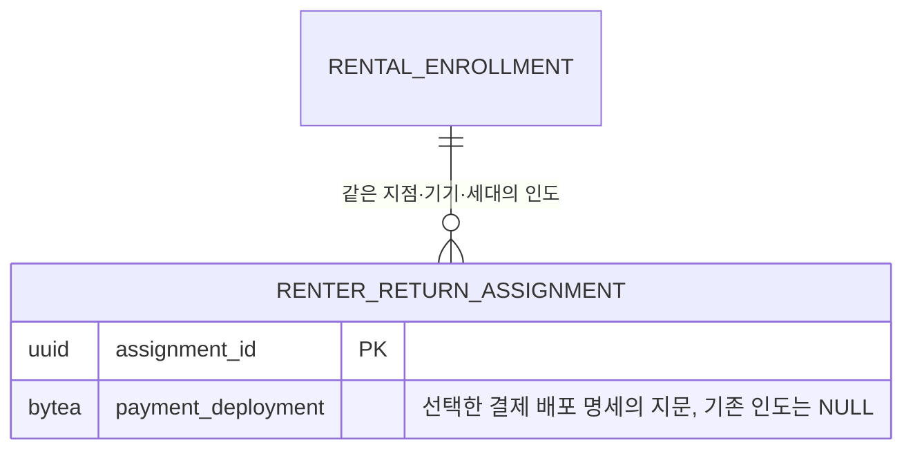

102의 `payment_deployment`는 운영자가 인도 시 선택한 v2 지급 배포의 32바이트 SHA-256이다. 붙어 있는 배포의 현재 대여 권한과 체인 확정 잔액을 원견적에 대조할 수 있는 출발점이다. 이 값만으로 앱이 예치금을 사용 가능하다고 표시할 수 없다. 예전 인도의 빈 필드는 그대로 두고, 지급 주소가 같아도 새 배포로 추정하지 않는다. 기기별 예치금 잔액·새 고객 식별자를 추가 저장하지 않으며 인도 기록과 함께 파기한다. 매장 단말과 고객의 새 접수는 같은 원거래의 배포·세대를 확인해야 하고, 이미 접수한 동일 요청의 결과는 원래 키로 조회한다. [이관 102](../../../../products/p05-operations-backoffice/internal/store/migrations/102_renter_payment_escrow.sql) · [필드의 목적과 파기 기준](../../../../products/p10-platform/database/field-purpose.json)

PostgreSQL 15에서 100→101→102를 순차 적용하고 각 단계를 재적용했다. 101은 기존 295개 루틴의 서명·권한을 보존하고 `menu_checkout_context` 본문만 바꿨다. 102에서 열은 795개에서 796개, 제약은 736개에서 737개로 늘었다. 관계 298개, 인덱스 199개, 트리거 598개는 동일했다. 이전 공개 함수 시그니처와 권한은 유지됐고 새 내부 전달 함수 두 개는 소유자만 실행할 수 있었다. 배포가 유효한지 확인하는 서비스 경로와 고객 앱·실물 보드의 인수는 각각 별도로 추적한다.

103은 기존 행의 기한으로 재원 표시와 신규 접수의 유효 시간을 계산한다. 같은 담당자·인도·지급자 등록의 현재성을 확인하고 원견적, 후원과 확정 블록 조회 근거의 유효 시간 안에서만 새 지급을 접수한다. 독립 PostgreSQL 시험에서는 지급자 등록의 남은 시간이 2초일 때 같은 종료 시각을 반환했고, 2.1초 뒤 행을 수정하지 않고 재조회하자 유효 시각이 사라졌다. 이미 접수한 동일 요청은 원래 영수증으로 돌아갔다. 시작 높이보다 이른 확정 블록이나 시작 높이에서 해시가 다른 블록은 잔액 표시에도 사용할 수 없다. [103 이관과 호환 경로](../../../../products/p05-operations-backoffice/internal/store/migrations/103_renter_escrow_authority_deadline.sql) · [등록 배포의 체인 조회](../../../../products/p05-operations-backoffice/internal/settlement/rental_escrow.go)

#### 대여 보드의 원견적 확인 자료

W10에서 고객 앱이 대여 보드의 검토 결과를 확인할 때는 위 인도 기록, 원주문, 등록 배포를 읽는다. 다음 자료는 PostgreSQL 테이블에 편입하지 않는다.

| 자료 | 발급자와 읽는 주체 | 목적과 보유 범위 |
|---|---|---|
| 보드 설치 허가서 `N54Q`와 배포 확인서 `N54V` | 설치 권위가 서명한다. P05가 운영자가 제공한 권한 파일에서 읽는다. | 기존 허가서 전체의 해시를 검토된 v2 배포 지문에 묶는다. P05가 보드 공개키·단말·지점·지급 세대·금액 한도와 기한을 검증한다. 운영자는 철회하거나 기한이 지난 허가서를 사용 중인 목록에서 제거한다. 앱·단말에 이 목록을 배포하지 않는다. |
| 고객별 일회성 검토 권한 | P05가 원주문과 현재 인도 및 설치 허가를 대조하고 서명한다. 인증된 고객 앱과 해당 단말이 검증한다. | 원요청 16바이트, 고객이 새로 생성한 난수 32바이트, 보드·단말 공개키 지문과 검증용 보드 공개키를 사용한다. 서명 견적·권한·예치 근거가 모두 유효한 동안 같은 고객·주문에만 사용한다. |
| 보드 검토 확인서 `W10R` | 원견적을 받은 보드의 설치 키가 서명한다. 단말이 전달하고 고객 앱이 직접 검증한다. | 검토한 견적의 해시·주문·지급 세대와 요청·난수·인증 연결이 일치할 때만 화면을 갱신한다. 고객 앱은 보드 확인서를 주문 재개 기록에 저장하지 않는다. |

후속 SW1·SW2 설계에서 최종 결정은 같은 검토 확인서 전체의 지문을 참조한다. 승인에는 원견적에 대한 지급자 서명이 필요하고 거절에는 지급자 서명이 없어야 한다. 고객 앱이 보드의 결정과 현재 주문을 확인하고, 기존 제출 키로 지급 접수와 재조회를 담당한다. 단말은 결정 전달을 위해 고객별 영수증 원장을 새로 만들지 않는다. 결정을 받기 전에 연결을 잃었다면 이미 커밋된 원결정이나 원주문을 읽어야 한다. 단순 단절만으로 거절·승인·지급 완료 중 하나를 표시할 수 없다.

단말이 QR 원견적을 처음 받으면 P05의 고객 범위 서명과 지점의 현재 원주문을 대조한다. 임시 견적과 확인서는 현재 고객·연결에 한정하고 연결 종료·기한 만료·단말 중지 때 제거해야 한다. 두 고객의 연결을 각각 종료하는 경우와 마지막 요청 후 추가 트래픽 없이 만료되는 경우를 인수 시험에 포함한다. BLE 주소·고객 실명·인증서 원문·검토 난수·서명 원문은 주문 분석이나 진단 로그에 남기지 않는다. 재시작 후 참조하는 것은 기존 원주문과 지급 영수증이다. [와이어 형식](../../../../packages/protocol/v2/transport.md#rental-payment-review-c2-w10) · [대여 결제의 원주문 검증](../products/p02-user-app/use-cases.md#대여-예치금으로-승인한-매장-원주문의-정산-조회)

## K05 매장 원주문의 지급 확정과 픽업 가능 시각

점원이 해당 지점의 카페 주문 한 건을 열면 P05가 기존 원장에서 상세 응답을 조합한다. 099 이관은 응답에 선택 필드 `settlement`를 추가한다. 고객 주소나 거래 해시, 점원의 조회 이력을 보관하는 테이블은 추가하지 않는다. [099 매장 상세 조회](../../../../products/p05-operations-backoffice/internal/store/migrations/099_kiosk_cafe_pickup_detail.sql)

| 표시할 값 | 원본과 결합 조건 |
|---|---|
| 지급 원금과 자산 | 원주문과 같은 `ledger.payment`의 원금·자산이 주문과 일치한다. 같은 지점·주문·지급 근거의 원분개에서도 금액과 자산이 일치해야 한다. |
| 지급 확정 시각 | 위 원분개의 `ledger.journal.booked_at`. P05가 확정 근거를 원장에 기록한 시각이다. 블록에 처음 포함된 시각은 별도로 관리한다. |
| 픽업 가능 시각 | 같은 판매에서 현재 상태 버전까지 최초로 `ready`에 진입한 전이의 `ready_at`. 수령 처리 뒤에도 첫 준비 시각을 사용한다. 과거 전이에 시각이 없거나 지급 기록보다 이르면 상세 필드를 생략한다. |
| 매장 이행 | 판매의 `paid` 이벤트가 전달됐고 수신 이력의 이벤트·이행 키·내용 지문이 일치한다. 같은 판매에 픽업 번호가 발급돼 있고 상태가 준비 완료 또는 수령 완료여야 한다. |

위 값은 직원 권한을 확인한 지점의 개별 카페 주문에서 함께 제공한다. 지급이 미확정이거나 환불 금액이 예약·처리·확정된 주문에는 이 네 필드를 내보내지 않는다. 기존 대기열과 여행 픽업에 동일한 상세 정보가 노출되지 않도록 조회 범위를 제한한다. SDK가 받는 두 시각은 마이크로초 여섯 자리의 UTC 값이며, 화면은 해당 지점의 시간대로 표시한다. [SDK 응답 계약](../../../../packages/protocol/ts/src/commerce-pickup.ts) · [점원 상세 화면](../../../../products/p04-merchant-kiosk/src/kiosk/PickupKitchen.tsx)

실제 PostgreSQL에 098과 099를 순차 적용하고 재적용해 대조했다. `ledger` 열 795개와 루틴 293개의 서명·소유자·실행 권한·검색 경로가 같았고, 여섯 인자를 받는 `ledger.kiosk_pickup_queue` 함수 본문만 바뀌었다. 제약 736개·인덱스 199개·내부 트리거를 포함한 트리거 598개의 정의와 관계별 권한도 같았다. [이관 실행기](../../../../products/p10-platform/database/migrate.py)

## 회차·환불 조회와 격리 복원 작업의 데이터 관계

| 소유자와 관계 | 원본과 결합 조건 | 데이터 수명과 접근 |
|---|---|---|
| P05 회차 상태 조회 | `invoice.schedule_ref → subscription.id`로 동의했던 약관 버전을 찾고 같은 지점의 `invoice.sale_id → sale.id`로 원주문을 찾는다. 서명한 견적은 그 원주문과 가입 주체에 결속된다. 기한이 지나면 원견적을 대사하고, 닫힌 원주문에 적격 미소비 처리 기록이 있을 때 만료를 표시한다. | 045는 기존 원장에 대한 뷰와 고객 조회 함수다. 개인별 열람 이력이나 중복 청구 데이터를 저장하지 않는다. 고객 API는 현재 지점의 본인 회차만 반환한다. [회차 투영](../../../../products/p05-operations-backoffice/internal/store/migrations/045_subscription_invoice_status.sql) |
| P05 지점별 환불 조회 | 현재 인증 주체의 유효한 지점 재무 권한으로 원매출과 같은 매출의 지급·환불을 찾는다. 신청자·승인자와 현재 사용자의 관계, 완료하지 않은 제출 작업으로 다음 행동을 결정한다. 정렬 키는 환불 ID이며 응답은 페이지당 최대 50건이다. | 046은 읽기 함수다. 응답은 원주문·원환불 참조, 상태·금액·자산과 다음 행동을 담는다. 조회용 신원·지갑 사본을 보관하지 않는다. [대기열 함수](../../../../products/p05-operations-backoffice/internal/store/migrations/046_refund_queue.sql) |
| P10 SDK 공개 판정 | 공개 승인된 코호트와 활성 배포 작업에 속하는 대상별 설치 영수증에서 언어, 원본 벡터의 해시, 그 소비자가 실제 실행한 항목, 호스트 범위를 읽는다. | 012는 기존 영수증의 투영이다. 서명자의 개인정보와 키를 공개하지 않으며, 호스트 실행에서 실물 지원을 추정하지 않는다. [공개 설치 영수증](../../../../products/p10-platform/database/migrations/012_sdk_interop_disclosure.sql) |
| P10 격리 복원 작업 | `recovery_rehearsal.scope_ref → recovery_route.scope_ref`로 허용된 복원 범위를 결정한다. `job_id` 하나에 요청 주체·승인된 입력 프로필 지문·시도 ID·임대 만료·복원 단계·최종 결과 지문과 서명을 결속한다. 재조회와 중단은 원래 작업을 가리킨다. | 보고서 원문은 별도 제한 저장소에 두고, 상태 조회는 범위에 부여된 권한을 확인한다. 완료·중단 및 복구 감사 보유기한 종료 시 작업 행과 해당 보고서를 폐기하는 정책 참조는 `P10-RECOVERY-EVIDENCE`다. 키 자료와 고객별 거래 내역은 이 작업 행에 저장하지 않는다. [작업 원장](../../../../products/p10-platform/database/migrations/011_recovery_rehearsal.sql) · [필드 목적과 폐기 기준](../../../../products/p10-platform/database/field-purpose.json) |

### 배포 후보별 근거와 운영 보류

P10 013의 `fleet_verification`은 후보·산출물·검사 종류별 SBOM, 재검사, 회귀 또는 서명 결과를 보관한다. `fleet_advisory_hold`는 원 공지에 순번·요청 ID·담당 역할·사유·다음 검토 시각을 결속한다. `fleet_hold_enrollment`는 한시적인 DB 로그인·운영 주체·코호트·역할의 조합이다. 보류 사유와 내부 운영자 식별자는 권한이 있는 코호트의 담당자만 읽는다. 012의 기존 후보에 검증 자료가 없으면 미확인으로 표시한다. [P10 013](../../../../products/p10-platform/database/migrations/013_fleet_review_work.sql) · [필드별 수집·폐기 근거](../../../../products/p10-platform/database/field-purpose.json)

### 단말 전환과 인계된 원주문

배포 스키마 047에서 요청의 범위는 지점·단말·요청 참조다. 단말마다 동시에 대기할 수 있는 전환은 하나다. 전환 접수 시점의 원주문 참조를 고정하고 운영 인계와 지정 단말 확인을 각각 기록한다. 두 확인이 모일 때만 새 모드를 활성화한다. 점주는 인계 건수와 원주문 참조를 확인하고 구매자는 원래 주문의 권한으로 계속 조회한다. [전환 DDL과 권한 함수](../../../../products/p05-operations-backoffice/internal/store/migrations/047_terminal_mode_handoff.sql)

048에서는 기존 지점 권한 행의 `pickup_manage` 값으로 직원의 주방 업무를 지정한다. 전용 주방 단말의 등록 권한과 개인 직원 인증을 각각 검증한다. 환불·단말 설정·픽업 조회는 대상 지점에서 현재 유효한 역할 범위를 따르고 단말 인계 대상 조회는 기존 주문 참조를 사용한다. [직원 접근 범위와 인계 주문 조회](../../../../products/p05-operations-backoffice/internal/store/migrations/048_kiosk_staff_access.sql)

049의 통지 영향 검토는 기존 원주문·분개·이행 통지·재처리 접수·수신 영수증을 지점, 영업일, 자산, 사건 ID로 연결한다. 담당자 이력에는 본인이 등록한 요청 키를 사용하고 조회 권한과 재처리 권한을 구분한다. 마감 뒤 원래 사건을 다시 찾을 때에도 같은 수신 영수증을 사용한다. [사건 검토·접수 이력과 권한 함수](../../../../products/p05-operations-backoffice/internal/store/migrations/049_notification_review.sql)

050의 ‘내 결제’ 목록은 지점·등록 고객을 기준으로 원주문 생성자, 유효한 일시 클레임, 지급 완료된 서명 견적의 주체를 조회한다. 기존 주문 상세와 같은 권한 함수를 거치고 주문당 ID·상태·자산·최소 단위 금액을 반환한다. 임시 클레임만으로 허용한 행에는 접근 만료 시각이 있으며 서버가 전송 직전에, 모바일 SDK가 수신 시 다시 검사한다. 최대 50행씩 읽고 별도 고객 이력 테이블을 만들지 않는다. [읽기 함수와 인덱스](../../../../products/p05-operations-backoffice/internal/store/migrations/050_customer_order_list.sql)

051은 고객의 원주문 상세에 수락·릴레이 서명·전파·확정·미지급 단계를 표시한다. 인증된 고객이 서명 견적의 주체일 때 기존 지급 제출, 매출용 작업, 해당 작업의 단일 릴레이 시도, 확정 지급·종결 근거를 읽는다. 픽업은 확정 지급과 원래 픽업 번호가 있을 때만 연결한다. 임시 접근권을 가진 다른 고객은 허용된 주문 설명만 볼 수 있고 그 고객에게 결제 해시·수령 영수증을 노출하지 않는다. 지갑 주소, BLE 식별자, 별도 조회 이력은 저장하지 않는다. [원주문 결과 조회 함수](../../../../products/p05-operations-backoffice/internal/store/migrations/051_customer_order_receipt.sql)

052는 기존 출력 시도·직원 결정·직원 권한을 연결한다. 같은 출력 시도에서 결과 확인과 명시적인 사본 요청은 서로 다른 행동이며, 같은 행동에는 결정 하나만 기록한다. 기동 시 구성한 인증서와 직원 역할을 대조하고 지점 권한 행을 잠근 뒤 DB 현재 시각으로 만료를 확인한다. 기존 시도와 결정의 보유·파기 목적을 그대로 사용한다. 새 고객 필드는 없다. [출력 결정의 유일성 및 조회](../../../../products/p05-operations-backoffice/internal/store/migrations/052_print_staff_console.sql)

운영자 자격 회수(062)는 `operator_access_change.handoff_to`와 `review_digest`로 기존 지점 담당 참조와 검토한 원주문 집합을 결속한다. `operator_access_handoff(branch_id, access_key, sale_id)`는 같은 지점의 회수 요청 및 원주문에 연결하고 지정 담당자가 접수한 시각 `accepted_at`을 기록한다. 승인 전에는 담당자의 작업 큐에 나타나지 않는다. 두 자격 관리자가 승인할 때 지점 권한, 담당자 유효성, 원주문 집합을 다시 확인한다. 회수와 인계를 같은 트랜잭션에서 반영한다. 구매자 정보·지갑 주소·주문 본문은 복제하지 않으며 회수 감사와 원주문 보유기간이 끝나면 부모 행을 폐기하기 전에 이 연결을 제거한다. [회수 승인 및 인계 권한](../../../../products/p05-operations-backoffice/internal/store/migrations/062_access_order_handoff.sql) · [필드 목적](../../../../products/p10-platform/database/field-purpose.json)

053은 기존 `travel_pickup_progress.sale_id`와 `travel_pickup_transition.sale_id`의 외래 키를 공통 `pickup.sale_id`에 연결한다. 여행 예약과 일반 메뉴 주문은 같은 확정 지급에 대해 고객용 수령 번호 하나를 유지한다. 여행 주문은 지정 단말·환불 연결을 유지한다. 일반 주문은 소속 지점의 주방 직원이 수신 ACK 뒤 준비·전달을 기록한다. 상태 조회는 영수증의 기존 주문·지급자 범위를 따르며, 구매자 정보와 위치는 추가 저장하지 않는다. [카페 픽업의 외래 키와 권한](../../../../products/p05-operations-backoffice/internal/store/migrations/053_kiosk_cafe_pickup.sql)

054는 여행 픽업 전용 단말의 최종 응답 시점에 지점의 단말 사용 권한과 기존 픽업 지정 행을 함께 잠가 확인한다. 기본 단말 인증이 유효해도 지정을 회수하면 조회가 404로 끝난다. 권한을 다시 부여해야 같은 원주문을 읽을 수 있다. 수집 항목과 지급·픽업 식별자는 기존 자료를 사용한다. [지정 권한의 응답 시점 재확인](../../../../products/p05-operations-backoffice/internal/store/migrations/054_pickup_assignment_authority.sql)

055는 지점 운영자가 카페 주문을 명시해서 요청할 때만 기존 주문·지급·픽업·ACK를 함께 조회한다. 이전 단말의 여행 주문 필터를 목록 크기 제한보다 먼저 적용한다. 예전 고객 영수증은 대기 중에도 원래 형식을 유지하고 준비·픽업 가능·수령 시 기존 상태를 표시한다. 새 테이블 및 필드는 없다. [버전별 조회 함수](../../../../products/p05-operations-backoffice/internal/store/migrations/055_pickup_client_compatibility.sql)

P05 056과 P07 015는 기존 견적·릴레이 시도·지급·이행 및 체인 관측을 원주문으로 조회한다. P05는 지점과 담당자 범위를 먼저 검사한다. P07은 해당 스트림·가맹점·주문·견적 다이제스트·거래·배포·자산·금액이 일치하는 기존 근거에서 관측 및 확정 높이만 돌려준다. 체인 확정과 P05의 지급 기록을 구분하며 새 영속 필드는 만들지 않는다. [P05 원주문 투영](../../../../products/p05-operations-backoffice/internal/store/migrations/056_finance_original_order.sql) · [P07 높이 근거](../../../../products/p07-indexer/migrations/015_finance_order_observation.sql)

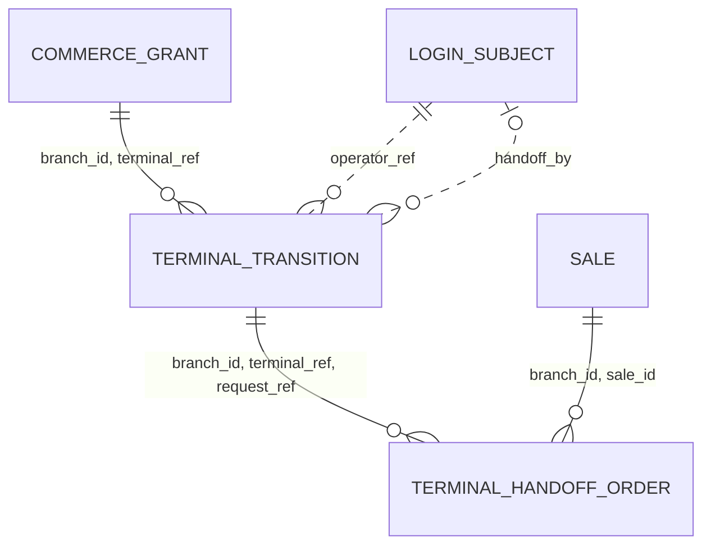

| 테이블과 기본키 | 최소 필드와 보유 종료 조건 |
|---|---|
| `terminal_transition(branch_id, terminal_ref, request_ref)` | 전환 요청 주체와 인계 확인 주체의 참조, 원버전, 요청 본문의 다이제스트, 요청·인계·ACK·활성 시각. 인계 시각과 확인 주체는 함께 기록한다. 단말 등록이 종료되고 미결 전환·인계·조사 보존이 해소되면 지점 정책에 따라 폐기한다. |
| `terminal_handoff_order(branch_id, terminal_ref, request_ref, sale_id)` | 전환과 원주문을 연결하는 참조 네 개. 구매자·수취인·메뉴·가격의 추가 사본을 수집하지 않는다. 전환과 원주문이 종결되고 보유기간이 끝나면 원주문 폐기 전에 연결을 지운다. |

격리 검증을 마친 작업은 독립 검토자가 전환을 승인할 때까지 기존 운영 경로를 유지한다. 복원 절차의 RPO는 원본과 복구 지점 사이의 손실 구간을 재고, 전체 운영 전환의 RTO는 승인과 경로 전환을 포함한 별도 측정에서 확정한다. [복원과 전환](../../../../products/p10-platform/recovery/README.md)

## 대여 정리 접수와 매장 픽업 영수증

P05의 대여 반납과 매장 주문은 서로 다른 수명주기를 가진다. 대여 정리 접수의 단위는 한 지점의 한 기기 세대다. 픽업 이행 기록의 단위는 한 번 확정된 원매출이다.

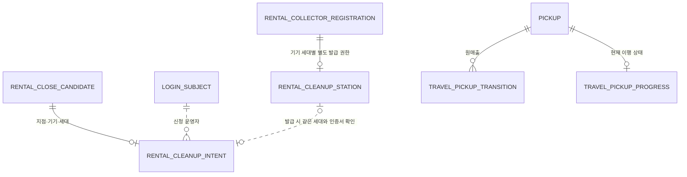

| 변경 | 원본과 재조회 | 보유·폐기 |
|---|---|---|
| 093 대여 정리 접수 | `rental_cleanup_intent`의 기본키는 `branch_id, device_ref, generation`이며 같은 조합의 반납 후보를 참조한다. 신청 주체·요청 키와 정산 처분 지문을 보관해 응답이 유실돼도 같은 세대에서 원접수를 식별한다. 보드의 세대별 키 폐기를 확인하려면 별도의 서명 영수증이 필요하다. | 항목은 기존 운영자·지점 권한으로 제한한다. 반납 대사와 승인된 재시도 기간이 끝나면 원반납 후보와 함께 폐기한다. [093 배포 SQL](../../../../products/p05-operations-backoffice/internal/store/migrations/093_rental_cleanup_intent.sql) |
| 094 고객 영수증의 시각 | P07에서 지급이 포함된 블록의 시각은 `payment.included_at`이다. 지갑의 지급 확정 시각은 같은 지급 증거로 P05가 매출 전표를 기록한 `journal.booked_at`이다. 픽업 가능 시각은 권한 있는 직원이 같은 원매출을 준비 완료로 전환할 때 기록한 `travel_pickup_transition.ready_at`이다. 수령 후에도 최초 준비 완료 시각을 조회한다. | 새 열은 nullable이다. 이관 전 전이에 원래 시각이 없으면 화면은 해당 시각을 생략한다. 재시도·원주문 대사 기간 뒤 전이 행을 폐기할 때 같이 지운다. [094 배포 SQL](../../../../products/p05-operations-backoffice/internal/store/migrations/094_nearby_pickup_receipt_times.sql) |
| 095 대여 정리 지시 발급 | 운영자의 원접수에 확정 블록 높이·해시를 기록한다. 발급 권한은 같은 지점·기기·세대의 수집기 등록에 연결하며, 해당 스테이션의 인증서 지문과 권한 만료 시각만 별도로 등록한다. 응답 유실 시 같은 요청을 확인할 수 있도록 최초 발급한 RCI1 181바이트를 원접수에 보관한다. | 정산 근거와 서명 지시는 원접수의 대사·재시도 보유 기준을 따른다. 지시의 실행 가능 기간은 별개다. 과거 접수의 확정 블록을 추정해 채우지 않는다. 스테이션 권한 철회·만료 시 해당 세대의 등록을 정리한다. [095 배포 SQL](../../../../products/p05-operations-backoffice/internal/store/migrations/095_rental_cleanup_issuance.sql) |
| 096 종료된 근거리 원주문 조회 | 기존 예약 결과의 근거리 고객, 서명 견적의 소유자, 같은 지점의 원주문 및 최종 미지급 근거를 결합한다. 재조회할 때 현재 고객 권한도 확인한다. | 추가 수집 열은 없다. 원주문과 예약 결과의 기존 보유 기간 안에서만 연결할 수 있다. 화면 표시를 위해 별도의 주문 이력이나 기기 식별자를 만들지 않는다. [096 배포 SQL](../../../../products/p05-operations-backoffice/internal/store/migrations/096_closed_nearby_receipt.sql) |

097 설계에서는 RCI1 발급 시점에 독립 등록된 보드의 증거 서명자 주소 20바이트(`intent_board_signer`)를 원지시와 같은 트랜잭션에서 고정한다. RCI1 원문만으로는 과거 세대의 보드 서명자를 확인할 수 없다. 095에서 발급한 지시는 보관된 최초 근거로 같은 서명자를 입증할 수 있을 때만 검증한다. 교체된 등록 키로 과거 행을 채우지 않는다. `rental_cleanup_intent.signed_receipt`는 같은 행의 RCI1을 지칭하는 109바이트 RCR1 원문이다. 스테이션은 첫 응답을 잃어도 같은 영수증을 다시 확인할 수 있어야 한다. 지시 만료 후 수신한 경우에도 원지시 유효 구간 안의 폐기 시각, 이미 발급한 지시의 지문과 해당 세대의 보드 증거 서명을 검증한다. 원지시에 서명한 운영 키는 해당 체인·계약의 원래 확정 블록에서 결제 계약의 불변 운영자 주소와 대조한다. 서버 시작 시에는 기존 운영 설정대로 서명 키를 구성하며, 과거 지시의 서명 검증에는 원블록에서 확인한 공개 주소를 사용한다. 스테이션의 현재 조회 권한은 수신 시점에 확인한다. 콘솔에는 확인 단계만 표시한다. 보드에서 새 세대를 열기 위한 기기 검증과 인계가 남아 있는 동안에는 재배정을 보류한다. 원반납 대사·보호 인계 재조회·승인된 복구 기간과 보존명령이 끝나면 원지시와 함께 폐기한다. [영수증의 서명 범위](../../../../packages/protocol/v2/transport.md#rental-slot-cleanup-proof-v1) · [097 배포 SQL](../../../../products/p05-operations-backoffice/internal/store/migrations/097_rental_cleanup_receipt.sql)

블록 생산자가 기록한 포함 시각과 가맹점 서버가 기록한 전표 시각은 다른 시계에서 온다. 같은 지급을 확인할 때에는 원매출과 지급 증거 ID를 대조한다. 블록 시계가 몇 초 앞서도 그 지급의 전표 시각은 그대로 표시한다. 준비 완료 시각은 같은 매장 원장에서 전표가 기록된 후의 전이에만 연결한다.

고객의 영수증 조회에는 원주문의 지급 권한 범위를 적용한다. 영수증을 다시 열어도 픽업 발번과 매출 전표는 원매출에서 한 번만 발생한다. [필드별 수집 목적과 폐기 기준](../../../../products/p10-platform/database/field-purpose.json)
