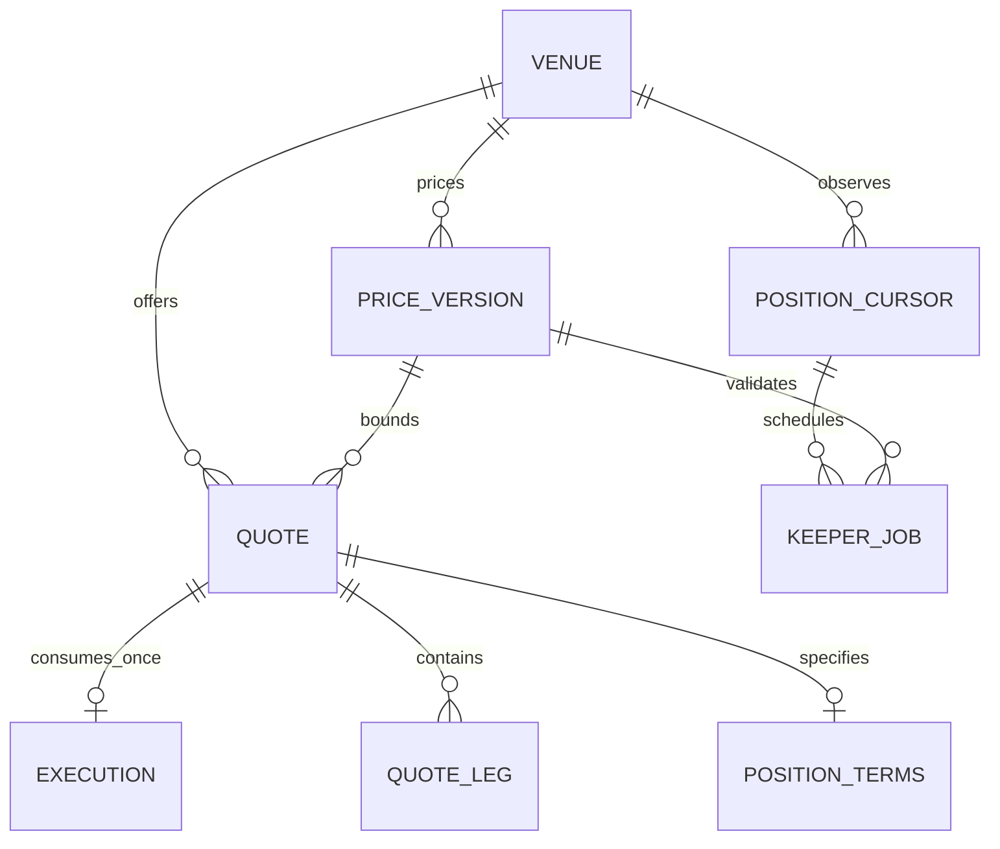
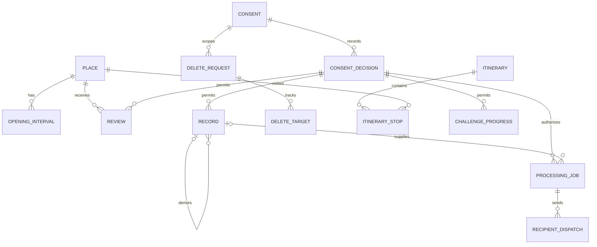
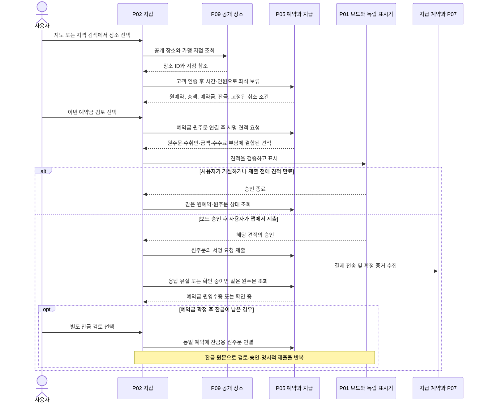
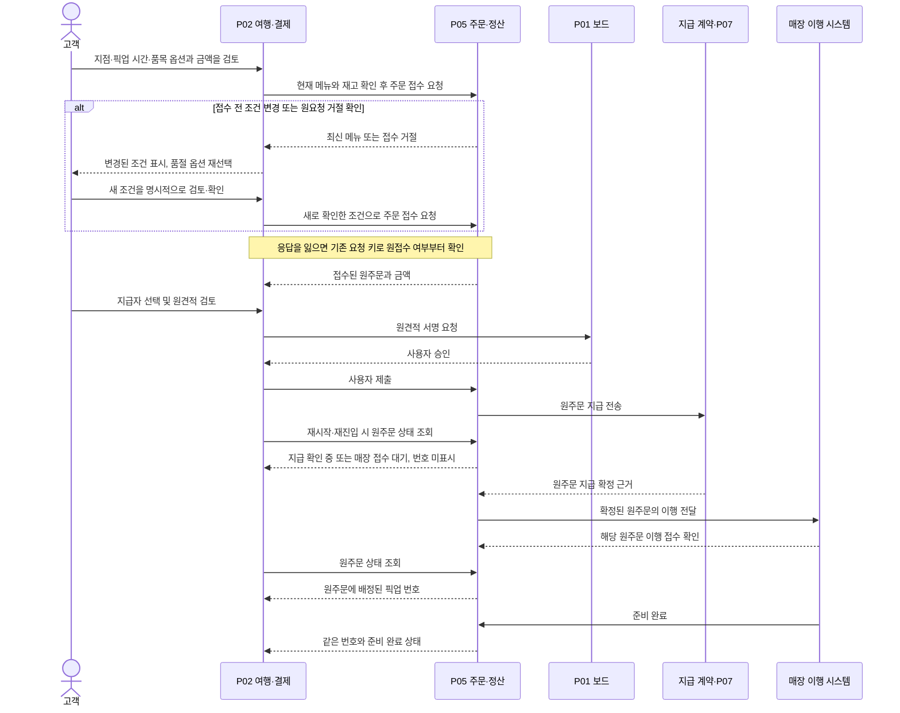
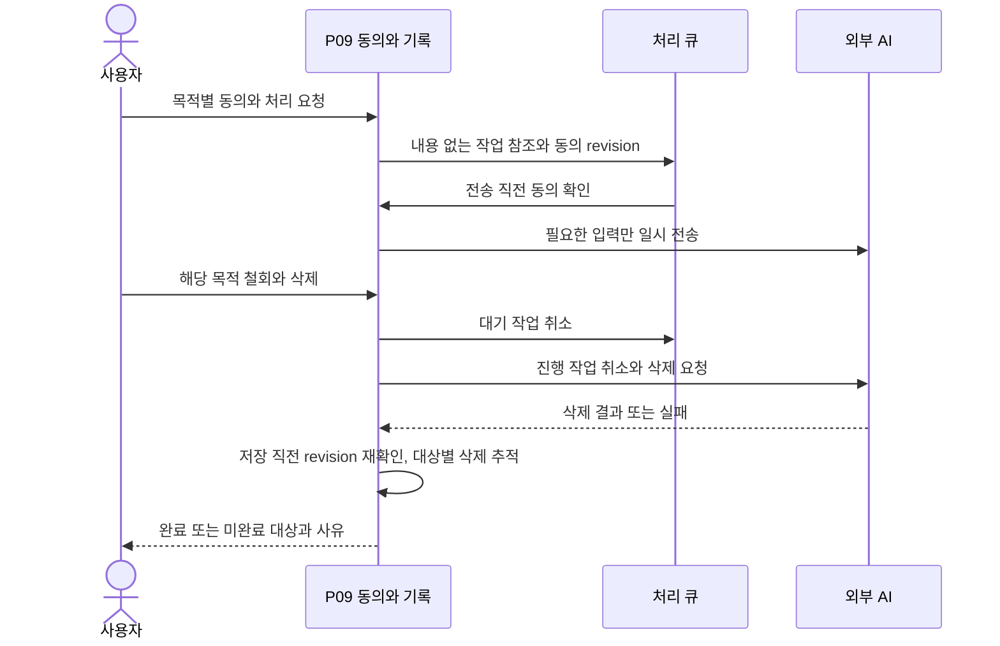
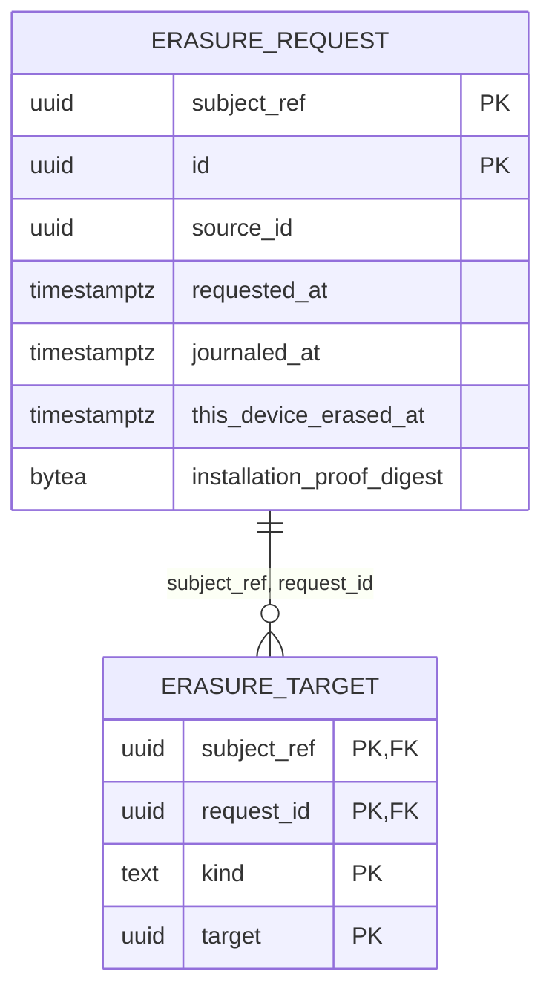

# P08 시장과 P09 여행: 데이터 우선 목표 설계

이 설계는 구현된 서비스가 아닌 상용 목표다. [실행 가능한 PostgreSQL 스키마](schema/experience.sql)는 각 소유 저장소의 논리 모델이며 두 schema를 한 서버에 배치하라는 뜻이 아니다. P08은 테스트넷 전용이고 매장 지급의 가용성 경로와 분리한다. P09는 장소·선택형 기록을 소유하며 예약·재고·가격·주문·환불 원본은 P05, 지급 확정은 P06/P07, 혜택 효과는 P05 혜택 원장에 있다. 서비스 간 `*_ref`는 발급자가 범위와 권한을 검증하는 불투명 참조이며 다른 저장소 FK나 지갑 주소를 뜻하지 않는다. 테이블과 제한은 SQL이 기준이다. 자산 수량과 수수료는 최소 단위 정수, 가격은 정수 분자/분모이며 자산 단위와 소수 자릿수는 발행 원본에서 확인한다.

## 데이터 모델과 책임

P08 `venue`는 테스트 체인·계약·상품 유형을 식별한다. `price_version`은 출처·기준/상대 자산·관측 및 만료 시각, 유효 상태를 갖는다. `quote`는 주체 범위, 방향, 입력·한도·수수료의 자산/최소 단위, 경로 참조, 만료, 동의 시각을 고정한다. `execution`은 견적당 하나의 체인·해시와 결과 참조를 보유한다. `position_cursor`는 계약 상태의 관측 커서이지 잔고 원장이 아니다. `keeper_job`은 포지션·종류·기간의 유일 키, 예상 revision, 가격 및 제출 전 해시를 보관한다. 수수료·경로 및 LP 지분 계산과 실제 결과는 계약/P07 증거를 조회한다. quote의 price와 venue, keeper의 price와 venue 일치 및 승인 시각·기한은 서비스 트랜잭션에서 확인해야 한다. 가격의 `valid` 표시는 시각 만료를 대체하지 않는다.

P08 20의 격리 학습 구현은 위 목표 모델에서 배포·keeper 작업만 PostgreSQL에 영속화한다. `market.venue`는 제네시스·계약·배포 해시로 세대를 식별하고 코드 해시를 고정한다. `market.keeper_job`은 세대·포지션·종류·기간의 단일 작업 키, `market.keeper_attempt`는 revision·가격 버전별 서명 바이트·원해시·확정 블록과 조정 상태를 소유한다. 사용자 견적·가격·실행·포지션은 계약과 P07 확정 증거에서 확인하며, 원해시 재개에 필요한 signed tx는 앱의 실습 전용 기록에 보관한다. P08 데이터베이스에는 지갑 비밀·고객 별칭·가맹점 원장 참조를 수집하지 않는다. [격리 프로필과 실행 범위](../../../../products/p08-market-services/README.md)

P09 `place`는 공개 장소명·지역·주소·좌표·출처와 갱신 시각, 선택적 P05 지점 참조를 갖는다. 지점 참조가 없는 명소에는 예약 버튼을 제공하지 않는다. `opening_interval`은 요일·현지 시간대별 공개 영업시간이다. 자정 넘김은 두 구간으로 나누고 휴무·예외는 원천 조회로 확인한다. 지도/목록은 같은 `place_id`를 쓴다. `consent`는 목적별 현재 정책 버전·제공자·결정·revision·만료를 관리한다. `record`는 암호화된 최소 콘텐츠의 별도 객체 참조와 삭제 기한만 가진다. 위치 원본, 음성, 전사 및 요약은 각각 독립 목적/수명으로 취급하며 기기 전용 기록은 서버에 콘텐츠나 객체 참조를 생성하지 않고 기기에서만 삭제한다. 사용자가 서버 공유를 별도로 선택한 기록만 `record`에 등록한다. P09는 예약, 결제, 영수증 원문, AI 입력 프롬프트나 공급자 응답의 그림자 사본을 만들지 않는다. AI 입력은 동의한 필요한 범위만 일시 전달하고 로그·큐에는 내용 대신 작업 ID와 범위만 둔다. `review`는 공개 본문 객체와 최소 자격 참조·배지 상태만 보유하고 주소는 게시하지 않는다. `itinerary`와 순서별 장소는 사용자가 적용한 결과만 저장한다. `challenge_progress`는 검증 근거와 혜택 원장 참조이며 보상 원장이 아니다.

`erasure_tombstone`은 복구 차단을 위한 독립 저장 기록이다.

## 상태 전이와 경쟁 조건

* 시장 견적은 offered → approved → submitted → confirmed/rejected이며 만료 시 expired다. 승인 시 가격·방향·수량·한도·기한을 재검사한다. 방향 또는 조건 변경은 새 quote와 새 승인이다. 제출 전 동일 트랜잭션에서 quote를 잠그고 execution을 생성해 해시를 기록한다. `UNIQUE(quote_id)`가 중복 실행을 차단한다. 응답 불명은 기존 해시를 조회하며 새 거래를 만들지 않는다. 정규 체인 재구성 시 reorged로 표시하고 P07 증거를 재대조한다.
* keeper는 신선한 가격, 정책, 포지션 revision 및 funding cursor를 확인하고 포지션 행을 잠근 뒤 기간별 job과 해시를 먼저 기록한다. 유일 키는 중복 작업을 막지만 최종 중복 방지는 계약의 기간 소비 및 revision 검사에 달려 있다. 사용자 종료와 청산 경합도 계약에서 하나만 성공한다. 오래된 가격은 위험 증가와 자동 청산을 막고 운영자가 복구 근거를 남긴 후 재개한다.
* P09는 공개 장소와 가맹 지점 참조를 제공한다. 여행자가 예약을 선택하면 P02가 등록된 고객 자격으로 P05에서 해당 지점의 슬롯·가격·취소 조건을 조회한다. 좌석 보류는 지점·고객·요청 키에 묶어 재고와 예약 조건을 한 트랜잭션에서 확정한다. 같은 좌석에 경쟁하면 남은 수량만 성공한다. 보류 응답이 유실되면 같은 키로 원예약을 조회한다. 보류 시 견적 발행·보드 서명·지급은 각각 0건이다.
* 예약금 검토 화면은 보류한 예약의 총액·예약금·잔금, 취소 기한·노쇼 조건, 가격·정책 버전과 결제 네트워크를 보여 준다. 여행자가 견적을 요청하면 P05는 원예약의 해당 지급 단계에 원주문 하나를 연결하고, 등록된 지급자에 결합한 견적을 발행한다. 서명 견적의 금액·망·수취인·수수료를 보드가 검증한 뒤 물리 승인을 받는다. 예약금 10과 잔금 20은 같은 예약에 속한 별도 지급이다. 예약금이 확정된 뒤에만 잔금 견적을 요청할 수 있다. 제출 응답이 유실되면 그 단계의 원주문과 거래를 조회한다. 취소·환불은 각 원지급에 귀속한다. 좌석 없는 선주문은 픽업 원주문을 조회한다. P09에는 예약 조건, 결제 원문, 영수증 사본을 저장하지 않는다. [예약 유즈케이스](../products/p09-travel-ai/use-cases.md#대표-흐름과-실패-분기)
* 취소 검토에서 P05는 같은 지점의 예약 소유자에게 이미 확정된 예약금과 잔금의 원주문별 예상 환불액을 반환한다. 수락한 환불 비율을 원지급액에 적용하고 최소 화폐 단위로 내린다. 원화 토큰은 다르다. 원 단위로 올리고, 그 값이 낸 금액을 넘으면 낸 금액으로 한다(2026-11-27 사용자 결정. 33,333원의 50%는 16,666.50원이 아니라 16,667원이다). 운영자가 신청하는 환불도 원 단위만 받으며, 여러 번 나눠 신청해도 합이 이 금액을 넘지 못한다. 손님에게 보이는 예상 환불액, 신청을 막는 한도, 예약을 끝내는 기준이 모두 같은 함수(`ledger.travel_refund_due`)를 쓴다. 미확정 지급에는 예상액을 표시하지 않는다. 취소 기한과 같은 시각부터 새 취소를 허용하지 않으며, 명시 제출 시 기한을 다시 검증한다. 예상액 조회는 예약과 재고를 변경하거나 환불을 접수하지 않는다. 조회 결과를 별도 저장하지 않는다. [예상액 조회 migration](../../../../products/p05-operations-backoffice/internal/store/migrations/092_travel_cancellation_preview.sql)
* 철회는 목적별 consent 행을 잠가 revision을 증가시키고 신규 수집·전송을 차단한다. 수집/AI 작업은 시작 전과 결과 저장 직전에 같은 revision, granted 및 만료를 확인한다. 철회와 저장은 같은 행 잠금/트랜잭션으로 직렬화한다. 이미 외부로 전달된 작업은 취소 요청과 공급자 삭제 확인을 별도로 추적한다. 공급자가 철회와 동시에 쓰기를 마칠 수 있으므로 작업별 전달·종료 시각과 삭제 확인을 내용 없이 기록하고, 처리 종료 확인 이후 삭제를 재요청한다. 공급자 종료 또는 삭제 확인이 없으면 완료로 표시하지 않는다. 삭제 요청은 기기·서버 원본/파생물·큐·공급자·백업 대상으로 분해하며 실패는 재시도 가능한 pending/failed로 유지한다. 백업은 접근 차단 후 만료 시 완료하며 기한과 예외를 사용자에게 표시한다. 다른 목적 동의나 주문 영수증은 자동 삭제하지 않는다.
* 후기 게시에는 독립 공개 동의 revision과 발행자 범위의 안정적인 증거 참조를 결합하고 본인·장소·이행 증거를 발행자에게 검증한다. 게시 직전에 해당 revision의 유효성을 검사한다. `UNIQUE(evidence_issuer_ref,evidence_ref)`와 원장 측 멱등 키로 중복 효과를 막는다. 테스트 증거로 실구매 배지 또는 실제 혜택을 부여하지 않는다. 환불/reorg는 자격과 배지·혜택의 보류/조정을 발행 원장에서 확인하고 후기 원문을 자동 삭제하지 않는다. 코스 생성 결과는 영업·이동·예산·출처를 검증하여 미확인을 표시한다. 적용은 사용자 확인 및 `UPDATE ... WHERE revision = :expected` 비교 후에만 수행하며 충돌은 비교 화면으로 보낸다. 생성 자체는 예약·지급을 일으키지 않는다.

## 데이터 흐름

### 좌석 없는 픽업의 조건 변경과 번호 발급

재조회는 원래 요청 키나 판매 ID로 한다. 가격·재고가 바뀐 뒤에도 이미 접수한 주문을 다시 만들지 않는다. 지급 확정과 이행 접수 사이에는 번호를 숨기고, 이행 접수와 준비 완료 사이에는 번호와 준비 상태를 함께 보여 준다. 좌석 원장에는 행을 만들지 않는다. [주문·이행 데이터 계약](../../../../products/p05-operations-backoffice/travel-pickup.md)

## 접근·보존·삭제 운영 기준

`subject_ref`는 P09 범위의 가명 식별자다. 본인 인증 및 대상 소유 검증 후에만 개인 기록을 읽고, 운영자는 권한과 사유에 따라 최소 메타데이터만 조회한다. 원본 객체는 암호화하고 키 접근을 분리하며 전송도 암호화한다. 로그·추적·오류에는 위치 궤적, 음성, 전사, 프롬프트, 후기 본문, 지갑 주소를 넣지 않는다. 외부 제공자에게 재학습 금지, 하위 처리자, 삭제 확인 및 국외 이전 조건을 계약으로 검증하고 미충족이면 기능을 열지 않는다. 열람·정정·삭제·동의 철회 요청과 이행 상태를 제공하고 접근·삭제 작업은 별도 변조 방지 감사 저장소에 내용 없는 사건 ID, 행위자 역할, 시각, 결과를 남긴다. 감사 저장소는 업무 DB 관리자와 분리하고 접근 및 보존을 독립 검토한다.

보존 기한은 확정 법정 기간이 아닌 출시 전 정책 결정값이다. 기본 제안: 견적·가격·keeper 운영 증거 90일, 선택형 기록은 아래 예시 정책의 목적별 상한, 적용 일정은 사용자 설정 기한(기본 30일), 삭제 작업 증거는 내용 없이 90일, 공개 후기는 철회/계정 삭제 또는 최대 1년 후 재동의, 장소 공개 데이터는 출처 계약에 따라 갱신·삭제한다. 법적 보존이나 분쟁 보전이 필요한 경우 해당 원본 소유자가 근거·범위·기한을 기록하고 접근을 제한한다. 만료 작업은 객체와 DB 행을 함께 삭제하고 백업 만료까지 추적한다. `delete_after`와 consent 만료는 배치 실행만 믿지 않고 읽기·처리 시에도 검사한다. 정책 확정 및 공급자 검증 전 출시하지 않는다.

## 요구사항과 검증 연결

| 범위 | 추적 | 주요 증거 |
|---|---|---|
| 시장 교환·LP·FX | [P08 UC1–2](../products/p08-market-services/use-cases.md), [L01–L04](../screens/specs/L.md) | 한도 밖 실행 0, 만료·방향 변경 시 새 승인, 견적당 한 실행 |
| 포지션·keeper | [P08 UC3](../products/p08-market-services/use-cases.md), [L05–L06](../screens/specs/L.md) | 오래된 가격 차단, 같은 기간 이중 정산 0, reorg 재조회 |
| 탐색·예약·픽업·환불 | [P09 UC1·UC4](../products/p09-travel-ai/use-cases.md), [T01–T07](../screens/specs/T.md) | 위치 거부 검색, 마지막 좌석 1건, 10+20, 좌석 없는 픽업, 취소 전 원주문별 예상 환불과 확정 환불 |
| 후기·혜택 | [P09 UC2](../products/p09-travel-ai/use-cases.md), [T08–T10](../screens/specs/T.md) | 테스트 배지/실혜택 0, 중복 0, 환불 후 자격 조정 |
| 동의·삭제·AI | [P09 UC3·UC5](../products/p09-travel-ai/use-cases.md), [T11–T14](../screens/specs/T.md) | 철회 후 저장/전송 0, 대상별 삭제 확인, 버전 충돌 시 덮어쓰기 0, 자동 지출 0 |

## 구체 정책과 처리 원장

T11/T13의 예시 정책의 보유기간 상한은 위치 30일, 음성 7일, 전사 30일, 외부 추천 14일이다. 각 만료 시각은 수집 시 표시한 정책에 따라 `delete_after`에 고정한다. 요약은 전사 목적, 외부 추천 결과는 추천 목적이며 챌린지 방문 근거는 `challenge_evidence`의 별도 동의를 사용한다. 공개 후기와 챌린지 동의는 각각 독립이다. 위 기간은 출시 전 법적 근거와 공급자 계약 검증이 필요한 설계값이며 사용자는 더 짧게 설정할 수 있다. 같은 정책에서 자동 연장하지 않는다. 철회와 독립 법적 보존은 각 목적과 근거에 따라 처리한다.

동의 변경은 현재 `consent`와 추가 전용 `consent_decision` 이력을 한 트랜잭션에 기록한다. 증거는 정책 버전·제공자·결정 시각·만료 및 내용 없는 증거 참조만 보유하고 DB 권한으로 수정/삭제를 금지한다. 목적마다 허용 수집 종류가 다르며 수집과 처리 시 해당 목적의 유효한 동의와 각 원본의 유효 기간을 모두 검증한다. `record.parent_record_id`로 원본과 파생물을 연결한다. 목적 전체 삭제 시 `through_revision`을 고정하고 그 revision 이하의 해당 목적과 원본에 의존하는 자손을 재귀적으로 찾아 접근과 처리를 차단하고 삭제 대상으로 등록한다. 이후 재동의로 생성된 독립 새 revision 기록은 오래된 삭제 작업이 지우지 않는다. 기존 원본에 의존하는 파생물은 생성 revision과 무관하게 삭제한다. 다른 목적의 독립 기록은 유지한다.

`processing_job`은 목적·동의 revision 및 원본 참조를 고정하며 `recipient_dispatch`는 수신자별 취소/삭제에 쓸 클라이언트 생성 핸들을 전송 전에 영속화한다. egress 직전 발송 워커는 해당 동의 행과 작업을 잠그고 revision, granted, 만료, 원본 유효성 및 tombstone을 확인해 dispatching으로 전이한다. 철회와 이 전이는 직렬화되며 철회 후 새 발송 전이는 불가능하다. 이미 발송 전이를 마친 요청은 전송 중일 수 있으므로 철회 즉시 취소 및 종료 후 삭제를 요구하고 수신 확인이 유실되어도 저장한 핸들로 조회·재시도한다. 공급자가 이 핸들로 조회·취소·삭제를 보장하지 않으면 제공을 개시하지 않는다. 원격 결과 저장 직전에도 동의와 원본 상태를 잠금 검사한다. `erasure_tombstone`은 삭제 revision을 내용 없이 백업 복구 가능 기간보다 오래 보존한다. 복구 시 일반 트래픽과 큐 재생을 막고 최신 별도 저장 tombstone을 먼저 적용해 삭제 대상과 파생물을 제거한 후 재개한다. 감사 및 tombstone 저장소도 복구 범위와 접근을 독립 검증한다.

시장 `uint78`은 정수 여부와 범위를 검사하는 무정밀 numeric 도메인으로 소수 반올림과 특수값을 거절한다. 체인 8283만 venue로 허용하며 가격과 견적/keeper의 venue 일치는 복합 FK로 검증한다. 체인과 계약 레지스트리의 테스트넷 확인은 배포 설정에서도 수행한다. `quote_leg`는 LP의 양쪽 자산 및 입출 방향·수량·한도를, `position_terms`는 방향·증거금·포지션 수량 및 펀딩/청산 정책 참조를 기록한다. 견적 헤더는 표시 요약이고 `quote_leg`가 자산별 수량의 기준이다. 두 값의 일치는 발행 트랜잭션에서 검증한다. 견적 발행 시 상품별 필수 leg 개수·방향·자산 단위, position terms, 수수료 자산 및 표시 합계가 서명할 계약 호출과 정확히 일치하는지 원자 검증한다. 스키마만으로 이 교차 행 규칙을 완결하지 않으므로 서비스 검증과 계약 검증이 출시 조건이다.

삭제 시 큐 취소 및 공급자 확인 후 job의 원본 참조를 null로 지우고 자손부터 record 행과 객체를 삭제한다. 작업 메타데이터에는 원본 내용을 남기지 않는다. 원본과 파생물은 동일 subject 복합 FK로 묶인다.

**일부 기록 삭제.** `delete_request.selection=selected`는 선택한 객체와 의존 파생물만 대상으로 고정한다. `delete_target`에 대상별 난수 참조를 열거하고 원본 백업 밖의 `erased_object`에 해당 객체 토큰을 남긴다. 같은 동의 세대에 남겨 둔 별개 음성·후기는 접근 가능해야 한다. 목적 전체를 지울 때에만 `erasure_tombstone.through_revision`을 단조 증가시킨다. 수집을 계속 허용한 경우 같은 트랜잭션에서 동일 권한의 새 결정 revision을 발급해 삭제 시점 뒤 새 기록을 분리한다. 단순 철회는 미래 수집을 막고, 기존 기록은 남은 적법한 근거·기간 확인 후 접근 제한이나 파기를 집행한다. 지울 원본에 의존하는 실행 중 작업도 전송·저장 전 재검사한다. 이 설계에서 기록 하나의 지속 가능한 원본 부모는 최대 한 개다. 여러 사적 원본을 한 파생 객체에 영구 합성하는 기능은 모든 부모의 범위를 추적하는 관계 모델을 갖춘 릴리스에서만 제공한다.

삭제 토큰은 최초 생성 시 정한 불변 복합 키 `(object_kind, object_token)`이다. 토큰 값은 record→record_id, review→review_id, itinerary→itinerary_id, job→job_id의 난수 UUID를 그대로 사용한다. 객체 저장소의 비공개 메타데이터와 기기 동기화 항목에도 같은 종류·UUID를 기록한다. 하위 stop은 itinerary 키, 공급자 임시본은 job 키와 recipient_dispatch의 수신자별 핸들을 따라간다. 상호 연관 가능성을 줄이기 위해 공급자에게 내부 토큰을 노출하지 않는다. 삭제 대상 확장 시 파생 record와 처리 job 각각의 키를 원 DB와 독립된 삭제 대장에 먼저 기록하고 ACK 후 대상별로 제거한다. 복원 시 보관된 종류와 PK로 대장을 대조해 동일 세대의 다른 녹음을 보존한다. 기기 전용으로 생성한 자료는 그 기기의 로컬 키와 로컬 파기·백업 제외 정책을 적용한다.

### 삭제 영수증을 다시 여는 경로

T12에서 창을 닫으면 현재 화면의 선택을 해제한다. 본인 인증으로 이력을 다시 열 때는 기존 `erasure_request`의 무작위 요청 참조와 요청 시각만 최신순으로 반환한다. 50개씩 표시하며 다음 페이지는 직전 페이지의 마지막 요청 참조가 같은 주체와 보유기간에 속해야 한다. 상세와 목록은 이미 생성됐던 요청에도 같은 90일 조회 기한을 적용한다. 상세 응답은 서버 접근 차단, 수탁자 처리 대기, 인증된 계정의 앱이 보고한 로컬 삭제 확인 및 백업 만료 예정일을 구분한다. 삭제된 객체·위치·음성·전사·상점 정보는 이 조회에 필요하지 않다. [이력 조회 스키마](../../../../products/p09-travel-ai/migrations/017_erasure_receipt_history.sql) · [P02 기록 화면](../../../../products/p02-user-app/src/travel/TravelPrivate.tsx)

마이그레이션 012 방식으로 발급된 영수증에는 계정이 보고한 확인(`subject-reported`)을 표시한다. 마이그레이션 018 이후 새 앱은 삭제 요청마다 32바이트 난수를 생성해 요청 키와 함께 기기 보호 저장소에 먼저 기록한다. P09는 인증된 요청의 난수를 SHA-256으로 요약해 같은 트랜잭션의 영수증에 저장한다. 앱이 사본을 삭제하고 다시 읽어 빈 값을 확인한 뒤 같은 난수로 처리 결과를 보고하면 `installation-reported`가 된다. 이는 해당 보호 저장소의 보고이며, 서비스가 기기 전체를 검사했다는 의미까지 갖지 않는다. [기기 확인과 복원 절차](../../../../products/p09-travel-ai/PRIVATE-TRAVEL.md) · [018 마이그레이션](../../../../products/p09-travel-ai/migrations/018_installation_erasure_proof.sql)

이 그림은 배포 스키마 `travel_private`의 선택 삭제에 해당한다. 요청의 `(subject_ref, source_id)`는 유일하다. `journaled_at`, `this_device_erased_at`, `installation_proof_digest`는 NULL을 허용한다. 첫 두 시각은 각각 독립 삭제 대장 반영과 앱의 보고를 나타낸다. 해시는 요청 사이에서 공유하지 않고, 원본 난수는 응답·영수증 목록에 포함하지 않는다. 영수증 조회 기한 90일 뒤에도 권한과 증명이 일치하면 미결 확인을 처리할 수 있다. iOS에서 같은 접근 그룹의 보호 저장소가 재설치 뒤 살아 있으면 원요청을 마칠 수 있다. 해당 저장소를 잃으면 설치 확인은 미결로 남는다. 수탁자 파기와 백업 만료는 별도로 추적한다. [테이블과 키](../../../../products/p09-travel-ai/migrations/012_scoped_erasure.sql) · [영수증 조회 기한](../../../../products/p09-travel-ai/migrations/017_erasure_receipt_history.sql)
