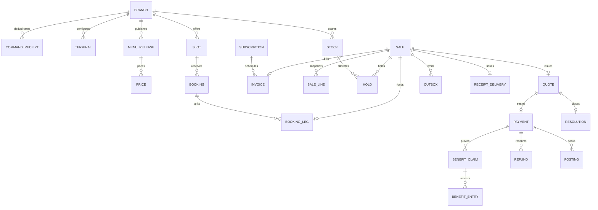
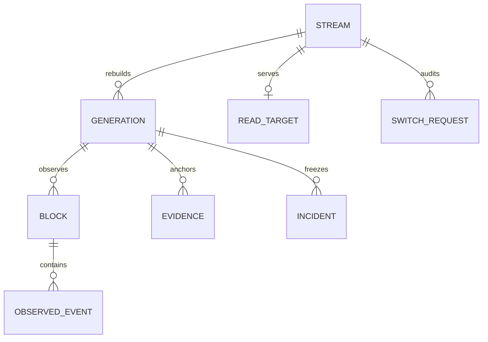

# 매장 주문에서 체인 증거·정산까지 · P04–P07

상용 목표 설계다. 재고를 잡은 시점, 서명 가능한 견적을 발급한 시점, 돈이 이동한 블록, 가맹점이 조리를 지시한 시점은 각각 다른 사실이다. 장애 후 같은 주문을 열면 이 네 가지를 따로 조회한다. [설계 SQL](schema/ledger.sql) · [영업 요구](../merchant-payments.md)

## 원본 데이터와 관계

| 원본/저장소 | 쓰는 주체와 키 | 저장 이유·한계 |
|---|---|---|
| P04 단말의 암호화된 로컬 DB | 실행기, `delivery_inbox.event_ref/effect_key` | 재부팅 후 출고 재개. SQL의 kiosk 영역은 관계 명세이며 독립 단말에서는 SQLite 등으로 같은 유일성을 구현한다. 공용 장바구니·BLE 후보는 세션 RAM에만 둔다. |
| P05 PostgreSQL ledger | 지점 권한을 확인한 주문·운영 서비스. branch → sale → quote → payment | 카탈로그·재고·좌석·예약·회차·지점 권한·재무 장부의 원본. POS 참조는 지점별 불투명 토큰. IdP의 로그인 원본과 P02의 로컬 일정은 각 소유자에 둔다. |
| P06 계약 상태·토큰 잔액·영수증 | 체인 합의, 배포 도메인·merchant·order 및 refundId | v1 예치·가맹점 적립·cashOut·대여 인출과 v2 직접 지급을 배포별로 조회한다. P05의 전표는 체인 잔액을 변경할 수 없다. |
| P07 PostgreSQL chainview | 수집기와 재생 작업, stream → generation → block → observed_event | 허용 manifest/ABI에 해당하는 블록·공개 이벤트와 읽기 기준점. 증거 ID로 P05에 전달한다. 고객·예약·내부 POS 키를 받아 저장할 필요가 없다. |
| 키 보관·증거·전달 | KMS 봉투 암호화, 접근 제한 증적 저장소, 재시도 가능한 메시지 브로커 | 서명 키는 KMS/HSM에 둔다. SQL의 proof/manifest/route_ref는 제한된 원본의 참조다. 큐는 운반 수단이다. 장애 시 outbox에서 재생한다. |

SQL은 독립된 빈 PostgreSQL DB에서 실행할 설계 표본이다. 스키마 사이에는 FK가 없다. 도메인 내부 지점 복합 FK는 다른 지점의 단말·좌석·주문 라인을 결합하지 못하게 한다. 모든 시각은 UTC 순간값으로 교환하고 영업일과 컷오프는 별도 보존한다. 자산별 양수 정수 최소 단위를 사용하며 표시 소수점은 manifest에서 읽는다. 지점 시간대는 등록 시 IANA 식별자를 검증한다.

### P05 운영 관계 사전

| 관계 | 키에서 따라갈 수 있는 사실 |
|---|---|
| branch, staff_grant, terminal | 지점과 tenant·영업일 규칙, 역할 부여/회수 이력, 단말 자격·설정 revision·인계와 ACK |
| menu_release, price, stock, sale_line, hold | 게시 버전별 SKU/옵션 가격, 가용 수량과 주문별 잠금 수량, 선택한 가격 버전과 주문 수량 |
| slot, booking, booking_leg | 회차별 정원·가용 좌석, 예약별 가격/취소 정책 버전·취소 마감·노쇼 규칙·해제 시각, 계약금/잔금별 자산·금액·주문 ID |
| subscription, invoice, sale, quote, resolution | 구독 동의·취소, 주기별 청구, 업무 주문과 발급 견적 원본, 확정 미소비/무효화 종료 근거 |
| payment, refund, posting, day_close | 지급의 원금·환불 예약 누계, 신청/승인/확정과 검증 경로, 최소단위 전표, 지점·영업일·자산별 마감 revision |
| benefit_claim, benefit_entry, receipt_delivery, outbox | 검증된 지급·이행 근거, 원 발생/보류/보정, 지점·영업일 픽업 번호와 영수증, 전달할 사건 키 |
| relay_intent, relay_attempt, payout_change | 주문·환불의 가스 계정 nonce 예약, 같은 의도 서명 바이트/해시와 제출 결과, 소유 증명·분리 승인·주소 발효 시각 |
| rental, campaign_target | 단말과 다른 대여 슬롯 세대·반환 경로·근거, 지점에 속하는 키오스크 또는 대여 슬롯 하나에 귀속된 릴리스 실행 상태 |
| stream, generation, block, observed_event | 배포/ABI 범위, 재생 세대와 tip·finalized·fence, 블록 정규성, 실제 수취·주문·nonce·지급/환불 로그 |
| evidence, read_target, switch_request, incident | 검증 기준점과 로그/미소비 증거, 활성 조회 세대, 전환 기대 revision·작업자·적용 시각, 확정 충돌 및 통지 |
| 배포 P05 고객용 `commerce_order_receipt` | 기존 sale·checkout·claim 범위에 원 지급 작업·접수·릴레이 시도·확정 지급·최종 미지급·픽업 진행을 선택적으로 연결한다. 원지급자의 기존 C3 조회로만 거래 증거를 반환하며 별도 지급 복제본은 없다. |
| kiosk.delivery_inbox | 단말이 적용할 event_ref·effect_key·acknowledged_at |

### 공용 메뉴 조회와 옵션 선택

K01·K07의 메뉴 원본은 점주가 해당 지점에 게시한 메뉴 버전이다. 카테고리와 옵션 선택 규칙은 SKU에, 언어별 품명·옵션명·가격·알레르기 표시·교차접촉 신고는 해당 게시 버전의 가격 행에 귀속한다. 운영자가 입력하지 않은 알레르기 정보는 미입력으로 표시한다. 번역을 생략한 기존 메뉴는 기존 품명·옵션 키를 표시하며 카테고리 정보 없이도 전체 메뉴에서 접근할 수 있어야 한다. [공용 메뉴와 옵션의 설계 상태](../screens/specs/K.md)

| 사용 흐름 | 읽고 쓰는 데이터 | 인수할 결과 |
|---|---|---|
| 메뉴 보기·언어 변경 | 같은 지점·게시 버전에서 카테고리를 필터링하고 표시 언어를 바꾼다. 초안의 수량과 선택 옵션은 공용 세션에만 둔다. | 보기 설정을 왕복하면 기존 수량과 옵션이 유지된다. 다음 고객에게 새 세션을 넘기면 이전 선택은 보이지 않는다. |
| 필수 옵션·베이커리 상세 | 필수 선택 항목은 사용자가 선택한 값으로만 채운다. 베이커리 품목은 게시된 성분·교차접촉 정보와 해당 수량의 소계를 함께 표시한다. | 필수 옵션이 없는 상태에서 담기를 누르면 수량을 보존하고 누락 항목으로 돌아간다. 저장된 장바구니·주문·재고 예약은 그대로다. 유효한 선택으로 다시 담으면 선택한 옵션·수량·가격이 일치한다. |
| 연결 단절·복구 | 단말이 인증한 지점의 마지막 게시 메뉴를 조회 전용으로 표시하고 마지막 조회 시각을 알린다. 고객, 장바구니, 승인·결제 자료는 메뉴 캐시에 저장하지 않는다. | 오프라인에서는 주문·견적·재고 쓰기가 0건이다. 복구 후 현재 게시 가격과 재고를 재조회하고 변경이 있으면 사용자에게 다시 확인받는다. 다른 지점의 캐시와 결제 전용 모드에는 메뉴를 노출하지 않는다. |

시나리오의 3.00 TestUSDC 크루아상과 커피 온도는 시험 지점이 게시하는 데이터다. 검수에서는 해당 지점의 게시 결과부터 시작해 공용 고객이 5분 동안 메뉴를 보는 사이 개인 고객의 주문·지급·영수증이 독립적으로 완료되는지도 대조한다.

필수 옵션이 있는 SKU에는 점주가 게시한 선택 항목명과 선택지 이름을 언어별로 연결한다. 예를 들어 온도를 비우면 누락된 항목을 이름으로 알리고 같은 수량에서 수정할 수 있게 한다. 제조 환경에서 접촉 가능한 성분은 실제 재료에 든 성분과 별도로 점주가 신고한다. 크루아상의 재료가 밀·우유·달걀이고 같은 설비에서 견과류를 취급한다고 신고했다면 두 내용을 구분하고 직원에게 제조 환경을 확인하는 방법을 표시한다. 구형 메뉴에서 구체 성분이나 항목명을 제공하지 않은 경우에는 일반 문구와 문의 방법을 제공한다. 표시용 정보가 바뀌어도 기존 주문의 게시 버전과 금액은 그대로 조회돼야 한다.

오프라인 메뉴는 등록한 단말의 지점·단말 식별자, 서버 주소·인증서 핀, 마지막으로 확인한 메뉴 모드 버전에 귀속한다. 모든 페이지가 같은 게시 버전으로 도착한 후에만 이전 사본을 교체한다. 단말이 확인한 권한 거절·등록 변경·모드 전환은 사본을 무효화한다. 연결 장애 중에는 단말이 마지막으로 조회한 시각을 표시한다. 현장에서는 서버가 그 뒤에 변경한 설정을 알 수 없으므로 신규 주문 세션을 열려면 온라인으로 모드와 메뉴를 재확인해야 한다. 공용 메뉴 사본은 주문 복구함과 별도로 보관한다.

같은 상품을 서로 다른 옵션으로 담을 때는 `(sku, option_key)`가 주문 한 줄을 식별한다. 같은 쌍의 수량만 합산한다. 재고 예약은 상품 전체의 한도와 각 옵션별 한도를 한 거래에서 함께 검사한다. 여러 줄은 SKU·옵션 키 순서로 처리하고 합산한 상품 수량을 한 번 차감한다. 재시도와 확정·만료는 원래 줄에 기록된 수량을 기준으로 처리한다. 단일 옵션인 기존 주문의 정규 본문과 요청 지문은 이행 전후 같아야 한다. 기존 원장을 읽는 단말에서 한 SKU에 여러 옵션을 담을 수 없을 때는 사용자가 명시적으로 교체를 승인할 때까지 먼저 담은 옵션과 수량을 보존한다.

검수 주문은 같은 차의 따뜻한 옵션 1개와 차가운 옵션 2개로 구성한다. 두 줄의 가격·수량을 원주문과 영수증에서 대조하고, 상품 재고 3개 및 각 옵션의 재고 1개·2개가 정확히 한 번 차감되는지 확인한다. 다른 고객에게 마지막 재고가 먼저 예약됐다면 주문 일부만 차감하는 일이 없어야 한다. [기존 SDK의 장바구니 인코딩](../../../../packages/protocol/ts/src/commerce-v2.ts) · [옵션 재고를 예약하는 원장](../../../../products/p05-operations-backoffice/internal/store/migrations/028_option_inventory.sql)

K07의 현재 전환 단계에서는 게시된 필수 선택 규칙이 공용 메뉴의 `metadata.optionRequired`로 전달된다. 기존 메뉴에서 이 값이 없으면 이전 방식으로 옵션을 선택할 수 있다. 장바구니는 아직 SKU당 한 줄만 쓰며, 다른 옵션을 담을 때 기존 옵션·수량을 유지하거나 교체를 명시적으로 승인할 수 있다.

복수 옵션 원장 이행은 다음 배포에서 함께 적용한다.

1. `order_line`과 `catalog_option_hold` 키를 `(sale_id, sku, option_key)`로 확장하고 기존 행의 키, 가격, 주문·견적 참조와 영수증을 보존한다.
2. 서버와 공유 SDK가 같은 SKU의 서로 다른 옵션을 지원한 뒤 단말 기능을 연다. 단일 옵션 주문의 기존 정규 JSON과 idempotency 지문을 보존하고 기존 고객 단말의 단일 줄 쓰기를 계속 처리한다.
3. 주문당 SKU 총량으로 상품 재고를 한 번 잠그고 옵션별 합산 수량으로 옵션 재고를 잠근다. 확정·만료·재시도에서 같은 줄과 수량을 사용한다. 처리 순서를 `sku, option_key`로 고정한다.
4. 기존 예약을 보존한 상태에서 따뜻한 옵션 1개와 차가운 옵션 2개, 경쟁 주문의 마지막 수량, 중간 실패 후 전부 롤백, 같은 요청의 중복 전달, 확정 영수증과 구형 주문 재현을 한 번에 검증한다.

설치 QA용 지점에서는 [K07 게시 fixture](../../../../products/p04-merchant-kiosk/test/fixtures/k07-publication.json)를 사용한다. 저장소 루트에서 `PYTHONPATH=scripts POSTGRES_BIN=/path/to/postgresql/bin python3 scripts/ios/scene-smoke/fixtures/p05_pickup_native.py --k07-menu --ready-file /tmp/k07-ready.json`를 실행하면 별도 PostgreSQL의 실제 게시 원장과 로컬 mTLS 단말 등록을 준비한다. 준비 파일의 임시 토큰으로 제어 엔드포인트 `POST /k07-proof`를 조회해 옵션 누락 상태에서는 주문 0건, 유효한 요청 뒤에는 원주문 ID, SKU·옵션·수량·단가와 상품·옵션 재고를 확인한다. [설치 XCTest 실행 스크립트](../../../../scripts/ios/scene-smoke/run-kiosk-k07.sh)에 전용 시뮬레이터, 고유 `com.nu54kiosk.k07.*` ID로 빌드한 Release 앱, 새 증거 디렉터리를 전달한다.

#### 점주가 게시한 메뉴 카테고리

K01에서 사용하는 카테고리는 지점과 메뉴 게시 버전에 속한다. 점주는 O03에서 카테고리의 안정적인 키·표시 순서·한국어와 영어 이름을 편집하고, 해당 버전에서 한 상품의 모든 옵션에 같은 분류를 적용한다. 이름이 바뀌어도 이전 게시 버전의 원주문이나 품목 설명을 수정하지 않는다. 구형 게시 메뉴의 미분류 상품은 ‘전체’에서 계속 주문할 수 있다. 상품명이나 SKU의 접두사로 카테고리를 추측하지 않는다.

모바일과 키오스크는 같은 게시 원본을 사용한다. 카테고리를 선택하면 지점의 그 버전에 속하는 상품을 조회한다. 사용 언어를 바꾸거나 메뉴 페이지를 넘겨도 장바구니의 상품·옵션별 수량을 유지한다. 품절 여부는 같은 상품·옵션 재고와 대조한다. 오프라인에서는 이미 받은 공개 메뉴 범위와 마지막 조회 시각을 표시한다. 카테고리 선택 이력이나 고객 신원을 서버에 추가 저장할 필요가 없다. 모바일에서는 확인한 매장 화면이 열린 동안 마지막 공개 메뉴를 유지한다. 연결 장애가 확인되면 조회 전용으로 전환하고, 다시 주문하기 전에 같은 지점과 현재 게시 메뉴를 온라인에서 확인한다. 공용 단말의 메뉴에서는 목록을 내려도 담은 수량·합계와 장바구니 진입을 표시한다. 장바구니를 열거나 메뉴로 돌아가는 동작은 주문을 접수하지 않는다.

설치 시험은 점주가 첫 페이지에 없는 상품을 분류·게시하는 시점부터 시작한다. 공개 단말에서 ‘전체 → 커피 → 베이커리 → 전체’와 언어 변경·재접속을 거쳐 같은 장바구니와 원주문을 확인한다. 자리에서 메뉴를 보는 고객과 개인 폰으로 주문하는 고객은 별도 세션을 사용한다. [공용 메뉴와 보기 설정](../screens/specs/K.md#k01--공용-메뉴) · [키오스크 탐색 구조](../products/p04-merchant-kiosk/ia.md)

### P06 체인 저장 구조

| 계약별 논리 키 | 값과 쓰기 조건 |
|---|---|
| deployment(chainId, contract, version) | codeHash·ABI·허용 자산·지급 방식·서명 도메인을 신뢰 manifest와 대조. 사용자 주문은 배포를 변경할 수 없다. |
| merchant(merchantId), deposit(payer, asset) | 등록 상태·payout·주소 버전 및 예치 가용액. v2 수취 주소 변경은 견적 버전과 실제 등록 정책을 함께 검증한다. |
| payment(merchantId, orderId), usedNonce(signer, nonce) | 소비 여부·지급자·토큰·원금·실수취 주소·환불 누계. 지정 도메인/만료·서명을 검사해 주문/nonce 소비와 실제 이전을 함께 커밋한다. |
| refund(merchantId, orderId, refundId) | 검증 반환 목적지·원금 내 금액·재원·소비 여부. Paid/Refunded 이벤트에 원 주문·자산·실제 지급액과 도메인별 식별자를 결합한다. |
| v1 merchantBalance(merchantId, token), rental(account, generation) | v1은 정산 시 가맹점 적립, cashOut 때 실제 이전. 예치·한도·인출 지연과 반납은 v1 배포 범위에서 보존한다. v2 직접 지급은 수취 순증을 검사하고 추가 가맹점 채권을 만들지 않는다. |

## 저장한 데이터로 작업하는 순서

| 책임 패키지 · 원자 작업 | 입력 → 읽기/쓰기 → 출력 | 실패·경합 처리 |
|---|---|---|
| P05 access · authorizeBranch | 세션 subject/행위/지점 → 현재 staff_grant, terminal 자격과 회수 시각 확인 → 해당 지점 범위 | API가 인증에서 지점을 결정한다. 모든 조회·변경·내보내기에 동일 범위를 적용하고 회수 후 신규 명령을 거부한다. 견적 조회는 단회 claim에 묶인 지급자, 영수증은 원 고객 세션 또는 해당 지점 역할만 허용한다. 대사 워커는 해당 배포 증거 수신·원 주문 반영, 단말은 자체 inbox 수신·ACK, CSV는 지점 재무 역할로 분리한다. 서비스 계정 외 테이블 직접 쓰기를 차단한다. |
| P05 catalog · publishMenu | 기대 버전·가격 라인 → branch 잠금, 최신 버전 비교, 동일 거래로 menu_release/price 삽입 → 공개 버전 | 동일 이전 버전의 편집 중 하나만 게시. 기존 가격 행은 불변이다. 미발급 주문은 새 가격을 표시하고 동의를 다시 받는다. |
| P05 commerce · reserveOrder | 권한·주문 원천 키·품목 → sale/stock/hold/sale_line → 주문 ID·revision | 같은 요청 키에 다른 품목/금액이면 충돌. 항상 주문을 먼저 잠그고 SKU 오름차순으로 available ≥ 수량인 행만 차감한다. 한 품목 실패 시 전체 롤백. 장바구니 탐색 중에는 예약하지 않는다. |
| P05 booking · reserveSlot / bindLeg / openCycle | 지점·좌석·요청키 → slot 조건 차감과 booking 동시 생성 → 예약 ID. deposit은 계약금, balance는 total−deposit. 회차는 schedule_ref/cycle_key → invoice와 sale 동시 생성 | 예약별 두 지급 단계는 다른 원주문·견적·환불 한도를 가진다. 예약행을 잠근 상태에서 단계 금액과 자산이 booking의 원 계약 및 sale.origin과 일치하는지 검사한다. 잔액 0이면 잔금 주문을 만들지 않는다. 취소/노쇼는 저장된 정책 버전·마감에 따라 결정하고 released_at이 비어 있을 때 좌석 반환과 해제 시각을 함께 기록한다. 발급 전 hold_until 경과 시 예약을 잠그고 released_at을 조건부 기록한다. 견적 발급 뒤에는 hold_until 경과만으로 좌석을 반환하지 않는다. 좌석을 해제할 때 예약을 잠그고 모든 발급 단계의 확정 상태·취소 정책을 판정한다. P09에는 버전이 있는 예약 투영만 전달한다. |
| P05 quotes · bindAndIssue | 주문 버전·단회 claim·검증한 지급자·가격/등록 payout·도메인 → sale 잠금, 모드와 재고 재검증, quote와 issued 상태를 함께 커밋 → 승리한 고객에게 암호화된 서명 가능 견적 전달 | QR/BLE 경합은 주문당 quote PK로 제한. 서명 준비가 외부라면 준비 중 다른 요청에 제공하지 않고 커밋 직전 revision 재검증. 유실 시 같은 claim에만 기존 견적 반환. 저장된 서명 페이로드에서 지급자·nonce·도메인·필드 일치 확인. |
| P05 relay · reserveNonce / recordAttempt / broadcast | 주문 또는 refundId → 가스 계정·체인 단위 nonce 예약 → 의도 해시와 서명 tx 저장·커밋 → 같은 바이트 방송 | 응답 유실은 기존 해시 조회. 수수료 재가격은 같은 nonce·의도에 새 attempt만 추가. 확정 revert 뒤 새 nonce가 필요한 경우 자동 재방송을 멈추고 별도 승인/대사한다. 고객 직접 가스 경로는 폰이 제출하고 관측 ID를 P05와 대조한다. |
| P06 settlement · verifyOrder / pay / refund | 허용 chain·계약·버전·토큰·만료·서명·등록 payout 검증 → 소비 키 표시, 재원 차감, 토큰 이전, 수취 전후 가용 잔액 차 확인 → 이벤트 | 한 체인 거래에서 모두 성공해야 한다. 거절 토큰·부족·중복·재진입 시 revert, 가스 별도. 환불은 원결제와 독립 refundId, 검증한 경로, 재원과 누적 한도를 검사한다. 구계약은 기존 주소·ABI·원주문 그대로 대사한다. |
| P07 ingest · appendBlock / issueEvidence | 신뢰 배포와 fence·tip → 부모와 높이 연속 확인, 블록·로그·커서를 같은 트랜잭션으로 기록 → 블록 해시/정책 기준 확정 증거 | 미확정 분기는 공통 조상까지 canonical 플래그와 커서를 한 번에 되돌린다. 조회는 활성 generation의 canonical 블록만 조인한다. 확정 구간 충돌은 동결과 incident를 커밋하고 incident ID로 P05 재통지. 자동 취소·역분개·재출고를 금지한다. |
| P07 reconcile · proveAbsence / switchReadTarget | 주문 도메인과 만료 → 배포 시작 또는 주문 유효 시작부터 만료 이후 확정 블록까지 누락 없는 정규 구간, 확정 주문 미소비 상태 대조 → evidence | 노드 불일치·누락이면 확인 중. 확정 로그 증거는 merchant/order/kind·canonical 포함 높이≤anchor와 정책을 검증한다. 격리 재생은 별도 generation에서 수행. 차이 0·운영 권한·대상·기대 revision을 검증한 뒤 read_target 갱신과 switch_request.applied_at을 함께 커밋한다. |
| P05 settlement · applyEvidence | 서명된 출처/증거 참조 → 원주문 잠금, quote의 도메인·상점·주문·수취·자산·금액·포함 시각 대조 → payment·posting·hold 소비·픽업 번호·outbox 동시 커밋 | 같은 증거는 기존 결과. 동일 주문에 모순되는 증거는 조사. 기한 전 포함 후 늦은 확정도 지급. 미발급 취소는 즉시 해제, 발급 후에는 확정 absence/invalidation만 resolution·예약 해제를 같은 거래로 기록한다. 주문 잠금 아래 payment와 resolution을 상호 배제한다. |
| P04 fulfillment · acceptEvent / acknowledgeEffect | eventId → 단말 inbox 중복 검사·작업 저장 → 같은 effect_key로 주방 전달 | 주방도 같은 키를 중복 제거해야 한다. 결과 불명 프린터는 영수증 ID를 재조회하고 직원이 재출력을 선택한다. 영수증 재출력은 별도 조리 명령을 만들지 않는다. |
| P05 refunds · reserve_refund / approve / finalize | 원 지급·요청키·금액·경로 → SQL 함수가 payment 잠금 아래 누적액과 신청을 함께 저장 → 재무 승인 후 재원 확인·방송 → 확정 시 refund/posting/outbox | 동일 키는 같은 입력이면 이전 ID 반환, 상이하면 충돌. 취소 가능한 미제출 환불만 잠금 아래 누계에서 한 번 차감. 지급 확정은 예약액을 다시 더하지 않는다. 신청자 본인 승인 금지. 대여 종료 후 사전 검증한 반환 경로만 허용한다. |
| P05 reports · closeDay | 지점·영업일·자산·마감 revision → 포함 시각을 지점 컷오프로 변환한 전표와 원본 증거·실제 주소별 증감을 대조 → day_close | 상점 입금·환불 재원 출금·가스를 별도 집계. 다음날 환불은 다음날 영업일 전표. 제출 직전 원장 기준점과 차이를 재검사, 늦은 증거는 다음 마감 revision에 조정한다. |
| P05 operations · requestMode / rotatePayout / returnRental / applyRelease | 지점 권한·기대 설정/슬롯 세대 → terminal·payout_change·rental·campaign_target 갱신 → 작업 ID/적용 증거 | 신규 주문 차단 후 기존 견적 인계와 단말 ACK를 확인. payout 소유 증명·독립된 두 승인·배포 적용 뒤 새 견적부터 사용. 대여는 인출/반납 확정 전 원 계정 유지. FOTA는 P10 릴리스 참조와 지원 리비전·기기 적용 증거를 대조한다. |

### 대여 반납 검토와 미결 지급

반납을 검토할 때 운영자가 선택한 지점·기기·대여 세대로 현재 등록과 v1 확정 계정을 다시 읽는다. 검토 화면에 원 계정, 세대, 검증한 반환 목적지, 미결 지급 상태를 함께 표시한다. 운영자가 화면을 닫으면 반납 명령과 체인 제출은 0건이어야 한다. 같은 반납의 성공 응답이 유실되면 기존 요청으로 돌아간다.

해당 세대의 전체 지급 대사에서 미결 없음이 확인되고 그 근거가 유효한 동안에만 ‘0건 확인’을 표시한다. 기존 등록의 `no_pending_until`은 운영자가 확인한 대사 기한이며 건수를 제공하지 않는다. 기한이 지났거나 값이 없으면 ‘대사 필요’로 표시한다. 새 세대의 미결 지급 수는 보드가 서명한 전체 동결 범위를 같은 P07 확정 블록까지 대조한 값이다. 서명은 유효하고 그 블록에서 미사용인 지급은 미결로 센다. 미결 한도 변경도 별도로 표시하며, 두 종류가 모두 종결돼야 반납할 수 있다. 일부 항목의 근거를 모르면 건수를 생략한다. 고객별 주문·결제 이력을 대여 등록에 복제하지 않는다. 확인과 제출 사이에 권한, 등록 세대·계정·목적지 또는 미결 증거가 바뀌면 새 반납 제출을 보류하고 최신 자료로 다시 검토한다. 인출 확정 후 정리 요청·기기의 확인 응답·재배정 가능 여부는 각각 구분해 표시한다. [세대별 귀속·만료와 표시 조건](../../../../products/p05-operations-backoffice/O09-GENERATION-EVIDENCE.md)

반납 검토에서 ‘미결 0건’을 표시하려면 그 세대에서 추가로 지급을 승인할 수 있는 경로가 닫혔고 기존 승인 전부가 대사 대상에 들어왔다는 근거가 필요하다. v1에는 기기가 서명한 뒤 아직 중계되지 않은 지급이 있을 수 있다. 계약의 승인 유효 기간과 인출 지연만으로 개별 서명의 발급과 전달 여부를 계산할 수 없다. 상용 구현의 검수는 다음 흐름을 따른다.

1. 인증된 등록 기기와 중계 주체에서 같은 계정·세대의 신규 승인 중단과 마지막 처리 위치를 확인한다. 응답 유실 시 같은 반납 요청으로 이 위치를 복구한다.
2. 해당 위치까지 발급·전달·수락한 승인과 기존 지급 참조를 맞춘다. 확정 지급과 최종 미지급 근거가 있는 승인만 미결에서 제외한다. 미전달·만료 미확정·불연속 색인·재구성 중인 범위는 확인 대기다.
3. 운영 화면은 전체 범위가 확인됐을 때만 수치를 표시한다. 검토 뒤 새 승인이나 체인 상태 변경이 생기면 기존 검토를 폐기한다. 원장에 이미 확인된 동일 인출의 결과는 기존 요청으로 조회한다. 비교에 필요한 최소 참조를 사용하고 반납을 위해 고객별 구매 내역을 새로 복제하지 않는다.

067에서 검토한 등록의 `no_pending_until`은 이전 운영자가 발급한 대사 유효기한이다. 발급·전달 승인 전체를 열거하는 자료는 포함하지 않는다. 현재 구현은 유효한 등록 근거와 온체인 확인을 이용한 기존 인출을 지원한다. 새 상용 반납의 전체 범위 확인과 미결 건수, 여러 중계 주체 중 하나가 응답하지 않은 경우의 차단은 별도 인수한다. [v1 결제 계약](../../../../products/p06-stablenet-contracts/src/PaymentSettlement.sol) · [반납 검토 권한과 기한](../../../../products/p05-operations-backoffice/internal/store/migrations/067_rental_return_review.sql)

[대여 등록 행과 작업 예약](../../../../products/p05-operations-backoffice/internal/store/migrations/058_rental_opening_review.sql) · [원계약 상태와 반환 증거](../../../../products/p05-operations-backoffice/internal/core/ops/managed_rental.go) · [운영 화면 기준](../screens/specs/O.md)

**회차 개설·해지.** P05 subscription이 동의 시각·약관 버전과 해시·자산과 금액·발행 주기·다음 납기·중지 revision을 보존한다. 약관 변경은 새 동의와 새 구독을 생성한다. 발행/해지는 같은 subscription 행을 먼저 잠근다. 취소가 먼저면 미래 invoice 생성 0건, 발행이 먼저면 미발급 주문을 닫고 기발급 견적은 원주문에서 계속 대사한다. 회차 하나의 지급과 다음 회차 약정은 독립이다. P02는 회차 조회 참조·알림 선택을 로컬에 보관하며 토큰 자동 인출 권한을 얻지 않는다. [회차 약관·취소 인수](../products/p02-user-app/use-cases.md)

**혜택 확정·보정.** P05 benefits.verifyClaim은 인증된 서비스에서 받은 원 지급·장소·서비스별 본인 참조·실제 이행 증거·정책 버전을 대조해 benefit_claim을 작성한다. 환경 값은 신뢰 배포에서 유도한다. 테스트 증거는 실혜택 entry FK와 결합할 수 없다. benefits.postEffect는 claim 잠금 아래 최초 grant 한 건을 기록하고 동일 전달 이벤트의 재시도는 기존 결과를 반환한다. 환불/분기 사고는 원본 grant를 유지하고 정책에 따른 hold 또는 adjust를 추가한다. 조정 전 누적 지급량·기소비분과 잔여 권리를 대조하고 회수 불가 시 조사 상태를 유지한다. 혜택 전표는 전용 삽입 권한으로만 쓰고 outbox와 함께 커밋한다. P09는 확정 상태를 투영하며 사용자가 작성한 후기와 확정 전 배지 상태를 독립 관리한다. [후기·혜택 UC2](../products/p09-travel-ai/use-cases.md)

DB 제약은 키·금액·상태 집합과 일부 승인 조건을 검사한다. 서비스 트랜잭션은 상태 전이, 권한, manifest 서명, 연속성, 영업일 계산 및 교차 행 합계를 검사한다. 리스 만료 후 작업은 단조 증가한 fence와 기대 revision을 조건으로 쓰며 이전 워커의 업데이트 행 수가 0이면 중단한다. 외부 RPC·BLE·승인 대기 동안 DB 잠금을 유지하지 않는다. 충돌 주입 시험의 예산은 락 2초·재시도 최대 3회·요청 총 8초다. 초과 시 조회 가능한 작업 ID를 반환한다. [거래·동시성 인수 조건](../products/p05-operations-backoffice/use-cases.md)

## 접근 범위·수명과 화면 인수

단말의 공용 화면 종료·만료·재시작 시 장바구니·후보·연결 표식·화면 캐시를 지운다. 다음 고객은 이전 주문 번호를 조회할 수 없다. 매장 영수증에는 서비스별 임의 참조, 상품·금액·영업일과 이행 상태만 표시한다. 공개 검색에는 공개 체인 사실만 제공한다. 식별 가능한 주소와 구매내역을 합친 검색, 지점 간 CSV, 이름·전화·GPS·BLE MAC·원문 로그를 이 기능용으로 수집하지 않는다. [공용 세션 인수](../products/p04-merchant-kiosk/use-cases.md) · [조회 권한](../products/p07-indexer/ia.md)

서명 가능 견적과 릴레이 서명 바이트는 암호화해 제출/복구 담당자만 읽는다. 만료·확정과 미결 조사 종료 후 재시도 목적이 끝나면 암호문 키를 폐기하고 증거 해시·금액·업무 시각만 승인된 보유표에 따라 유지한다. 운영자 참조는 지점별 최소 권한·분리 승인·접근 이력으로 통제한다. 보유기간 도래 시 원장 법정보존/분쟁 보류 범위를 분리하고 나머지 연결 식별자·단말 캐시·메시지·CSV를 파기한다. 지점 마감 보존기간과 백업 회전기간은 운영자가 실제 관할·자료 유형별 근거로 설정한다. 파기 로그에는 범위·수량·정책 버전·결과를 쓰고, 복원 후 삭제 대장을 재적용한다. 체인 기록은 공개·불변이므로 주문 ID에는 내부 고객번호나 연락처를 인코딩하지 않는다.

| 제품과 기존 UC | 화면 → 검증할 결과 |
|---|---|
| P04 UC1/2 | K01–K04, K07–K08, K10–K11 → 공용/폰 주문 분리, 마지막 SKU·QR/BLE 경합, 외부 주문당 하나의 견적 |
| P04 UC3/4 | K05–K06, K09, K12 → 재시작 후 같은 영수증·픽업 번호, 기존 견적 인계·버전 ACK, 공용 화면 비우기 |
| P05 UC1/2 | O02–O03, O07–O08, O12–O13 → 가격 기존/신규 분리, 예약금/잔금·회차 귀속, 지점 권한 회수 |
| P05 UC3/4 | O01, O04–O06 → 원금 30에 20+20 경합 시 한도 준수, 두 지점 내보내기 격리, 정상화 후 60초 내 장부/출고 수렴 |
| P05 UC5 | O09–O10 → 반납 운용 세대·검증 경로, 지원 기기 릴리스 적용 증거 |
| P06 UC1/2/3 | O14–O15, O05–O06, X01 → 수취 순증, 합산 환불 한도, v1 cashOut과 v2 지급·가스 대사 분리 |
| P07 UC1/2/3 | X01–X06 → 공개 범위, 분기 철회, 확정 충돌 동결, 격리 조회 전환과 만료 경계 이후 미소비 증명 |

[키오스크 화면](../screens/specs/K.md) · [운영 화면](../screens/specs/O.md) · [체인 관측 화면](../screens/specs/X.md) · [P06 계약 인수](../products/p06-stablenet-contracts/use-cases.md) · [P07 조회·분기 인수](../products/p07-indexer/use-cases.md)

**명령과 응답의 복구.** 채널 어댑터는 고객 세션·단말·직원의 허용 범위를 서버에서 확정한다. P05는 `command_receipt`의 지점·주체 범위·명령·요청키와 버전을 포함한 정규 본문 digest를 업무 변경·결과 참조·outbox와 같은 트랜잭션에 기록한다. 같은 키의 병행 요청은 UNIQUE 충돌 뒤 기존 행을 다시 읽고 digest가 같을 때만 현재 권한을 확인해 원 결과를 돌려준다. 다른 본문은 충돌이다. 실제 본문, QR, 광고 ID, 별도 고객 마스터는 필요 없다. 식별 가능 범위를 줄이기 위해 결과 재개 기한까지 보관하고 발급 권한이나 미결 재시도가 살아 있으면 만료를 연장한다. 짧은 응답 수명 뒤에도 예약·회차·체인의 고유 소비 키는 원장 정책으로 중복 효과를 막는다.

### 근거리 장바구니의 거절과 재조회

K10의 재고 예약에는 성공, 확정 거절, 결과 미확인이 있다. 원요청을 처리한 P05가 확정 거절 영수증을 저장한 뒤 호출자에게 품절 또는 게시 가격 변경을 반환한다. 여러 품목 중 마지막 줄에서 거절해도 상품·옵션의 재고, 주문, 견적에는 부분 변경이 없어야 한다. 원장에는 인증된 지점·요청 주체·명령과 요청 키, 정규 본문 지문, 결과 코드·처리 시각·유효 기한만 필요하다. 품목별 정보를 반환할 때에는 해당 고객이 보낸 장바구니 안에서 확인된 줄로 제한한다.

고객 폰은 원요청을 제출하기 전에 보관한다. 현재 P04는 단말과 인증 고객을 연결해 중계하고, 재입고·단말 재시작 뒤에도 P05에서 원키의 결과를 확인한다. 구버전의 미확정 주문과 확정 거절은 공용 복구 목록과 분리한다. 고객이 장바구니를 수정하면 새 요청 키를 발급한다. 다른 인증 고객 또는 변경된 본문으로는 원 결과를 조회할 수 없다.

게시 가격 변경 시험은 같은 원참조와 키로 거절을 다시 읽고, 그 키에 새 메뉴 버전을 붙이면 요청 충돌이 나며, 거절된 원참조에는 주문이 0건인지를 검사한다. 고객이 변경 가격을 명시적으로 확인하면 새 원참조와 키로 주문 한 건을 생성한다. 같은 새 요청을 반복하면 그 주문을 돌려준다. 이미 발급한 별도 6.50 TestUSDC 견적의 승인으로 새 7.00 TestUSDC 주문을 결제하려 하면 서명 검증에서 거절한다. [재견적 및 정산 시험](../../../../products/p05-operations-backoffice/internal/settlement/repriced_anvil_test.go)

P05는 거절 상세와 고객 연결을 지점의 영수증 보유기간과 5분 중 더 긴 기간이 지난 뒤 삭제한다. 성공 영수증은 원매출과 함께 폐기한다. 폐기 후에는 원요청과 원참조가 다시 주문을 만들지 않도록 지점별 지문 두 개만 지점의 주문 권한이 삭제될 때까지 보존한다. [근거리 주문 인수 조건](../products/p04-merchant-kiosk/use-cases.md#공용-세션-정리와-응답-유실-시험) · [필드 목적과 폐기](../../../../products/p10-platform/database/field-purpose.json)

### P07 브라우저 공개 범위와 만료 대사

X01·X02의 공개 조회는 한 배포와 공개 가맹점에서 체인 주문 키 또는 거래 해시·로그 인덱스로 찾는다. 원지급과 부분환불 누계는 확정 이벤트의 최소 단위 정수로 계산하고 배포 블록에서 검증한 단위만 환산한다. 수령인 확인은 체인·계약·거래·로그 위치에 결합된 SHA-256 값과 사용자가 원 견적에서 확인한 주소를 기기 안에서 대조한다. 설계 화면의 합성 수령 주소는 예시이며 제품의 공개 투영에는 수령·지급 주소, 내부 지점·고객 ID, 픽업·출고 정보가 없다. 기존 제한 대사 권한에서 실제 수령 주소를 확인한다. v1 기존 영수증 API와 화면의 기기 참조 표기 규약은 유지한다. v1 체인 화면에서 적립과 점주 인출은 별도 거래다. 조회 공백과 체인 관측 지연은 각각 표시하며 어느 쪽도 확정 미지급의 근거가 되지 않는다.

O04에서 선택한 통지의 원결제를 X02로 열 때는 지점 권한과 원결제의 서명·확정 근거를 먼저 확인한다. 공개 탐색기의 기존 조회 키인 배포 스트림, 공개 가맹점 키, 거래 해시와 로그 인덱스를 사용한다. 수취 주소 버전은 원 견적의 값을 가맹점 화면에서 비교한다. 사용자가 누른 통지 ID, 내부 매출·지점 ID, 지갑 주소, 인증값은 공개 링크에 넣지 않는다. 운영 화면이 가리키는 공개 탐색기 주소는 배포 설정에서 가져오며 공개 페이지에 운영 화면의 URL을 전달하지 않는다. 독립 근거가 미결이거나 배포 재검증이 실패한 경우 사용자는 같은 사건을 다시 조회한다. 근거 조회와 공개 탐색은 쓰기 없이 끝나야 한다. [가맹점 증거 비교](../screens/specs/O.md#o04--대사-차이와-이행-재처리) · [공개 탐색기의 기존 검색](../../../../products/p07-indexer/internal/chainview/web/explorer.js)

X03·X04·X06은 공개 서버와 분리된 mTLS 운영 서버에 배치한다. 운영 서버는 인증서 경로와 이용 기간을 요청마다 확인하고 인증서에 등록된 배포·가맹점 범위에서 조회한다. X06의 원주문 조회는 P05에서 기존 재무 운영자의 지점별 대사 읽기 권한을 다시 확인하고 원 견적의 서명과 주문 키를 검증한다. P07은 같은 배포의 활성 세대에서 배포 블록부터 마지막 확정 블록까지 연속성을 확인해 발급 마감과 함께 표시한다. 마감 이후까지 이어진 범위도 원 견적에 결합된 미소비 증거가 생길 때까지 보류한다. 지급은 원 견적과 동일한 해시 및 마감 전 포함 시각을 확인한다. 결제·환불·이행 결정은 가맹점 원장에서 한다. [배포 및 인수 시험](../../../../products/p07-indexer/chainview-v2.md#x06-original-quote-and-contiguous-coverage)

### 근거리 견적의 매장 가스 약속

고객이 원주문의 귀속을 증명하면 P05가 현재 배포·지점의 가스 후원을 확인하고 그 원견적에 최초 약속 지문을 결속한다. 단말은 고객과 독립적으로 P05에 mTLS로 연결해 기존 원견적을 읽는다. P05 경로가 끊긴 상태에서는 폰의 남은 유효 증거를 표시할 수 있지만 보드 준비·새 지급 접수는 보류한다. 다른 지점 또는 같은 지점의 새 약속은 이미 결속된 원견적의 약속을 바꾸지 못한다. 만료·철회는 새 접수 전에 차단한다. 철회 전에 접수한 지급은 동일 요청에서만 기존 접수를 복구하며 방송 여부는 이전 릴레이와 지급 원장에서 확인한다. 고객 접촉·위치 정보와 후원 원문은 추가 저장하지 않는다. [090 배포 SQL](../../../../products/p05-operations-backoffice/internal/store/migrations/090_merchant_gas_sponsorship.sql) · [운영 등록과 철회](../../../../products/p05-operations-backoffice/settlement-v2.md#merchant-gas-commitment-for-nearby-review)
