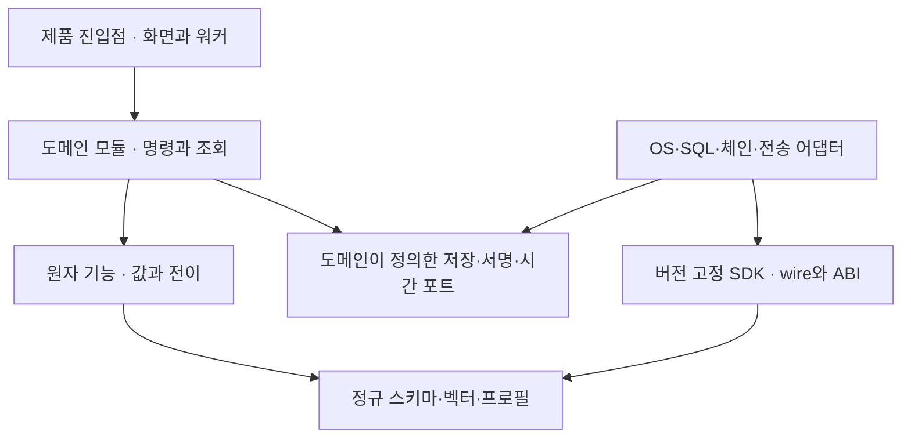

# 원자 기능에서 제품 패키지까지

원자 기능의 단위는 **한 입력을 검증해 한 결과나 한 상태 전이 의도를 반환하는 작업**이다. 코드 재사용의 단위와 DB 트랜잭션 단위는 다르다. 예를 들어 금액 검증은 순수 함수이고, 실제 환불 예약의 원자성은 P05가 원지급을 잠근 트랜잭션에서 보장한다. 이를 나누면 QR, BLE, POS, 예약, 구독이 같은 결제 규칙을 호출하면서도 지갑 키나 가맹점 DB를 서로 공유할 필요가 없다.

## 의존 방향과 배포 단위

스키마 저장소는 SDK의 생성 입력이다. 위의 화살표는 사용·의존 방향이다. 실제 프로그램 진입점에서 어댑터를 주입한다. UI에서 SQL·BLE 프레임·개인키에 직접 접근하거나 atom이 시간·난수·네트워크를 읽는 import는 빌드에서 거절한다. 서로 다른 언어의 직렬화 타입은 생성하고 동일 golden vector로 검증한다. 물리 승인이나 독립 삭제 권한처럼 구현 신뢰 수준이 다른 경계를 공통 SDK에 위임하지 않는다.

| 원자 기능과 계약 (설계 명칭) | 조합하는 도메인 모듈 | 패키지/소유자 → 소비자 |
|---|---|---|
| DecodeFrame(bytes, limits) → typed/error, MatchCapability(role, version, op) → decision, BindRequest(id, digest) → new/replay/conflict | 역할 협상·조각 재조립·요청 라우팅. 한도는 메모리 할당 전 확인 | 기존 [protocol](../../../../packages/protocol/README.md) 확장, P10 → P01·P02·P04·P05. C/TS/Go/Python SDK와 오류 벡터. OS 소켓·GATT 접근은 제품 어댑터 |
| ParseAsset(profile, bytes), CheckUnits(asset, amount), DigestIntent(canonical), ExtractDisplay(tx, profile) | 자산/체인 프로필, 신규 송금·DApp·PSBT 검토. 법정화폐 환산은 표시 전용 | 체인별 파서/벡터 패키지 → P01·P02·선택 P03. 서로 다른 런타임 구현은 서명 입력·표시·거절 벡터를 공유. 실제 서명권은 기기 또는 MPC 경계 |
| MatchGeneration(epoch), BindApproval(request, digest, expiry), CheckIndependentDisplay(risk, proof) | 소유자 등록·서명·복구. P03은 별도 정족수/구세대 펜스 모듈 | 지갑 정책 계약은 P01/P02, MPC 프로필은 P03. 입력 장치/보안 슬롯의 증명 발급은 기기 어댑터만 수행 |
| CheckQuote(domain, issuer, payer, terms), ValidateLeg(asset, units, phase), DecideFinality(observation, profile) | P05 주문·회차·예약, P06 도메인 소모 검사, P07 증거 투영. 같은 계약 의미를 각 신뢰 경계가 재검증 | 결제 명세·벡터/생성 ABI → P01·P02·P04·P05·P06·P07. [기존 ABI](../../../../packages/contracts-abi/README.md)와 SDK에서 import. SQL 모델과 개인 고객 DTO는 공유하지 않는다 |
| CompareVersion(expected, actual), ReserveQuantity(available, needed), BoundRefund(paid, reserved, requested), ClassifyEvidence(evidence) | P05 재고/예약·환불·마감·리워드. P07 증거가 확인될 때 원장 전이 | 가맹점 도메인 패키지 → P05 API/워커. P02·P04·P09는 API 클라이언트만 사용. P06은 독립 계약에서 누적 한도를 다시 검사 |
| Authorize(object, principal, branch, verb), ClaimCommand(key, hash), PlanDelivery(event, effectKey) | 분기별 접근, 멱등 명령, 발송·소비자 인계. DB 접근과 원자 커밋은 각 소유자 어댑터 | 서비스 계약·오류 타입 → 모든 서비스. 영수증 공개 projection은 별도 읽기 타입, 쓰기 권한 없음 |
| CheckPurpose(purpose, revision, time), SelectDisclosedFields(policy, input), SelectDescendants(scope, cutoff) | P09 외부 호출, 후기·방문 자격과 파기. P05에는 최소 혜택 주장만 전달 | 목적 정책 계약 → P02 고지 UI, P09 처리 워커. 보관 기한·수신자·정책 digest가 바뀌면 동의 화면과 같은 버전으로 갱신 |
| CheckFreshness(price, time), MatchVenue(profile, domain), BindPeriod(position, period) | P08 FX·LP·포지션/keeper. 사용자 명령과 keeper는 같은 원계약 소비 키·revision 사용 | 테스트 시장 패키지 → P08 및 P02의 실습 화면. P05 주문/정산에 대한 런타임 의존성 없음 |
| VerifyManifest(root, digest), CompareEvidence(expected, observed), CheckIndependentActor(requester, verifier) | P10 릴리스 게시·격리 복원 승인, 각 소유자 전환 실행 | 릴리스/검증 패키지 → P10, P01 설치, P05 FOTA, P07 조회 승격. 게시자·검증 키 및 조직 권한은 공통 패키지 밖에 둠 |

**패키지 선택 기준.** 두 소비자가 바이트·계약·불변식을 공유하면 버전 있는 공통 패키지로 올린다. 지점 마감처럼 한 서비스만 소유하는 업무는 그 서비스의 내부 모듈로 둔다. DTO·오류에 제품별 비밀 필드를 추가하지 않는다. 사용자 알림과 공개 지도처럼 배포·권한이 다른 기능을 재사용 목적으로 합치지 않는다. 브라우저/폰 SDK에는 관리자 grant, 서버 서명기·검증 우회 스위치를 포함하지 않는다.

## 명령 한 건을 조합하는 방법

| 처리 단계 | 승인된 입력 → 원자 기능 → 결과 | 실패 후 재개 |
|---|---|---|
| QR·BLE·POS 또는 폰 앱의 주문 | adapter가 입력을 한정된 DTO로 변환. 서버가 세션에서 지점/권한 확인 → 주문의 개념적 멱등 키와 canonical hash 대조 → 예약·가격 버전 확인 | 키 재사용+다른 본문은 conflict, 기존 요청은 같은 접근 범위에서 상태·기존 영수증만 반환 |
| P05의 주문 확정 트랜잭션 | sale/재고 잠금 → P07의 확정 증거를 견적의 도메인·주문·자산·금액·수취인·기한 내 포함 시각·원장 버전과 대조 → 지급·전표·픽업·outbox를 커밋. 잠금 안에서는 외부 네트워크 호출 금지 | 경쟁 시 제한된 재시도와 재조회. P07 reorg 사건은 대사/보류, 출고 자동 반복 금지 |
| P04의 효과 소비 | 서명된 이벤트·effectKey 확인 → local inbox 저장 → 같은 키로 주방에 전달하고 결과 조회 | 메시지는 여러 번 전달될 수 있다. 최종 주방/POS도 키를 소비해야 한 번의 업무 효과 보장. 결과를 확인할 수 없는 물리 출력은 직원 확인 |
| P09 외부 처리 | 목적·서비스·허용 필드 확인 → 작업별 수신자 참조 예약 → 전달 시점의 revision으로 허가 → 외부 전송 → 결과 저장 직전 다시 확인 | 전달 전 철회는 차단. 이미 허가된 전송은 도착을 되돌릴 수 없어 공급자 취소·종료·삭제를 확인할 때까지 대기 |
| P10 격리 복원 | 증거 집계 → 권한과 별도 검증자 검사 → 대상별 조건부 전환 → 전환 영수증 집계 | 재요청은 같은 작업 상태 조회. 증거가 달라지면 새로운 검증과 승인 |

**버전과 PoC 전환.** 패키지 SemVer·wire major·DB schema version·체인 배포 버전·기기 저장 세대는 따로 관리한다. 호환 필드는 읽기 우선 배포 → 생산자 전환 → 구 소비자 지원 종료 순서로 적용한다. 구버전이 이해하지 못하는 새 지급/복구 권한은 거절한다. 구 PoC 원장·단일 키·v1 계약은 읽기 어댑터와 고정 프로필을 통해서만 인수하고 불명 거래를 새 원장으로 자동 재제출하지 않는다. 합성/구형 벡터, 구 SDK↔신 SDK, 롤백과 이중 읽기 대사까지 통과한 단위부터 바꾼다. 상용 모델에서 제거된 개인정보 필드는 이관 대상에서 제외한다. [기존 코드와 차이](../README.md) · [릴리스 계약](platform.md)
