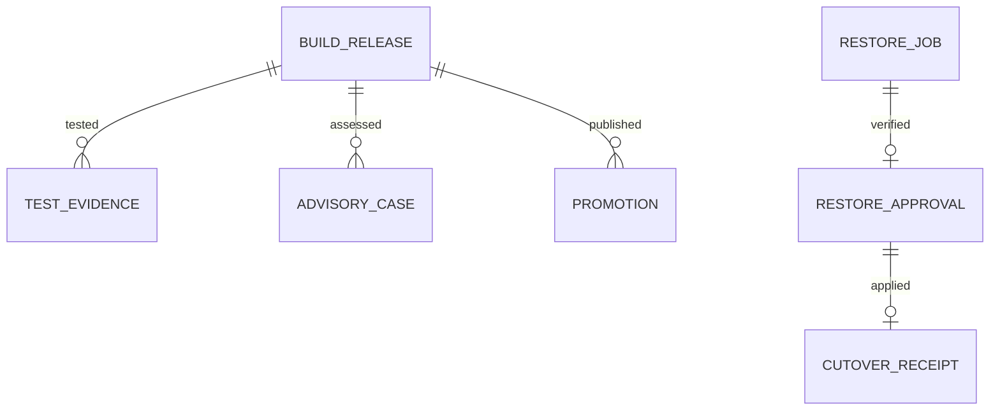
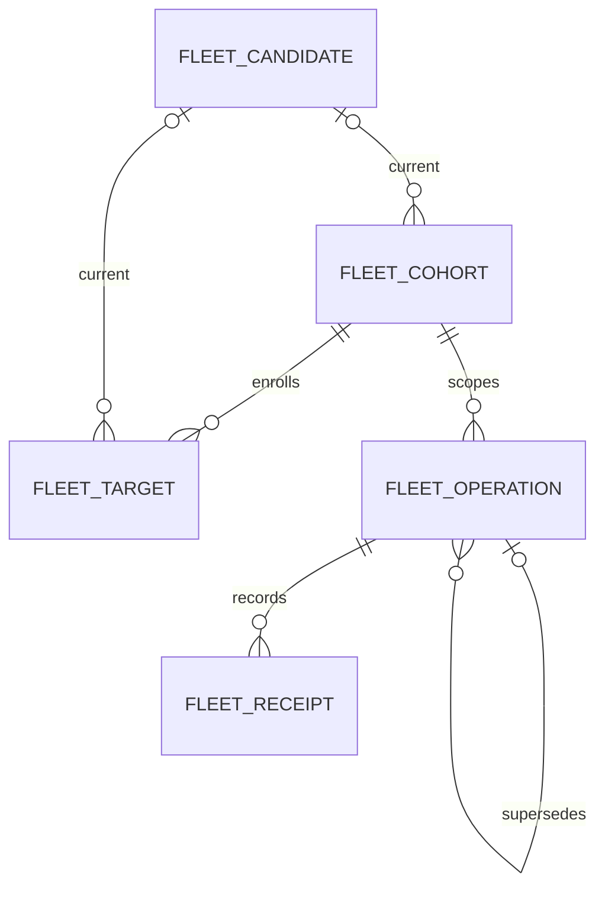

# P10의 릴리스 증거와 복원 승인

공개 SDK 계약은 고객 데이터베이스 없이 빌드할 수 있어야 한다. 유지보수자가 서명한 스키마·생성기·프로필·ABI·호환 조합을 버전으로 배포한다. 운영 중에만 필요한 증거의 색인은 [플랫폼 DDL](schema/platform.sql)에 정의했다. 요건과 화면은 [P10 PRD](../products/p10-platform/prd.md), [UC1~4](../products/p10-platform/use-cases.md), [D01~D06](../screens/specs/D.md)을 따른다.

| 소유 데이터 | 최소 필드와 보관 위치 | 읽는 사람과 해제 조건 |
|---|---|---|
| 스펙·프로필·도구체인 | 형상관리의 프로토콜 역할·wire major·스키마 해시, 생성기 버전, C/TS/Go/Python 벡터. 서명 manifest는 SDK/ABI/보드 리비전·핀맵·부트 루트·지원 네트워크·계약 조합을 결합 | 개발자/기기에서 공개키로 검증. 커스텀 루트는 같은 버전 이름이어도 독립 채널. 지원 종료 뒤에도 기존 계약 인출·검증용 공개물 유지 |
| 빌드와 결함 처리 | build_release와 test_evidence는 콘텐츠 해시로 불변 객체 참조. advisory_case는 구성 요소별 실제 영향, 담당 역할, 재검토, 완화 또는 수정 증거 | 공개 카탈로그에는 승인한 산출물만. 비공개 제보/조사 접근은 보안 담당. 증거는 합성 벡터 또는 실기 버전/결과만 공개하고 단말 시리얼·실사용 원문은 제거 |
| 승격과 복원 | promotion은 지원 조합별 발행 영수증. restore_job·restore_approval·cutover_receipt는 범위, 측정치, 검증 꾸러미와 타깃 전환 영수증 | 서비스별 별칭을 가진 작업자·독립 검증자. 접근/재해복구 훈련 기록의 보유기한은 통제 정책. 백업 본문·복호 키·개별 거래 내용을 이 저장소에 복제하지 않는다 |

**스키마에서 지원표로.** D01은 고정 스펙의 역할별 명령과 오류를 읽는다. D02·D03은 동일 manifest와 조합 해시의 벡터, 독립 설치 시험, 실물 증거를 각각 조회한다. D04에서 영향 빌드를 중단하고 수정본의 SBOM, 재현 빌드, 재스캔과 소비 제품 회귀를 검사한다. 게시 서비스는 승인자 권한·역할 분리, 증거의 서명·최신성·종류·성공 및 열린 차단 사유를 잠금 아래 재검증한다. 서명·게시 요청은 manifest와 조합 해시로 멱등 처리하고 레지스트리 영수증을 읽은 후에만 promotion을 기록한다. 게시 후 철회는 서명한 철회 목록에 덧붙이고 소비 시점에도 검사한다. 원본 서명 키는 HSM에 둔다. D05의 설치와 P05 FOTA는 기기 모델·루트·최소 버전을 재검사한다. 실물 증거가 없는 D03 조합은 지원 목록에서 보류한다.

**복원에서 전환까지.** D06은 격리 키·스토리지·네트워크에서 삭제 대장 고수위까지 재적용하고 외부 발송을 차단한 뒤, 업무 원장과 outbox·소비자 inbox·확정 체인을 대조한다. 차이·미해결 보류, 금액/건수 불일치, 삭제 재적용 누락, 목표 RPO나 RTO 초과가 있으면 승인할 수 없다. 검증자는 작업자와 다른 사람이며 IdP의 원 주체가 같은 두 계정을 별도 승인자로 인정하지 않는다. 검증된 결과에는 목표와 실측, 타깃, 백업, 체크포인트 해시, 기대 리비전, 증거 루트·만료가 함께 서명된다. 각 저장소 서비스는 짧은 트랜잭션에서 이 승인과 예상 revision을 확인하고 읽기 포인터/쓰기 리스를 전환한 영수증을 자체 원장에 커밋한다. 통신이 끊기면 같은 작업 ID로 이미 적용된 결과를 조회한다. 여러 저장소 전환 동안 서비스 입구의 쓰기 펜스를 유지하고 모든 타깃 영수증을 모아야 D06 완료를 연다. cutover_receipt 한 행은 전체 작업의 최종 영수증이다. target_result_digest는 대상별 (소유 영역, 이전 revision, 적용 revision, 증거 해시, 서명)의 정렬된 명세를 묶고 applied_revision은 서비스 입구 쓰기 펜스의 세대다. 각 저장소 revision은 서로 달라도 된다. 일부 실패하면 해당 작업을 보류하고 검증된 세대로 재개한다. X05의 P07 조회 포인터와 O05의 환불 권한은 각 소유자가 제어한다. [격리 재생](../screens/book.html#X05) · [독립 승인](../screens/book.html#D06/await)

**구현 인수.** 같은 사람이 다른 역할로 승인, 다른 범위/만료된 증거, 혼합 채널, 실물 결과 없는 게시, 복원한 과거 동의·삭제된 녹음의 재노출, 복원 중 출고/푸시 재발행은 모두 거절해야 한다. 두 번째 복원 요청이 첫 요청 뒤늦게 도착해도 이전 세대가 승격될 수 없다. DDL은 자료형·키·동일 행의 직무 분리를 검사한다. HSM, 실제 주체 대조, 승인 서명·TTL·타깃 확인, 이전 revision 대비 CAS, 도메인 간 정합성은 각 명령의 인수 항목이다.

[격리 복원 도구, 분리 승인·펜스·영수증 명령과 D06·X05 운영 화면](../../../../products/p10-platform/recovery/README.md)

## C1~C9의 데이터 계약

[C1~C9 레지스트리와 인증 서비스 SDK](../../../../packages/protocol/v2/SERVICE.md)

각 배포 조합에서 계약 ID·버전·역할·명령·입출력 스키마 digest·허용 길이·오류 집합과 종료 조건을 manifest로 고정한다. C3/C4/C8 등 인증된 서비스 API의 공통 요청 봉투는 작업별 난수 request ID, 도메인/객체 참조, schema version, 권한 증명, 유효기한과 변경 요청의 멱등 키를 갖는다. 테넌트는 검증한 자격에서 해석한다. 같은 소유 범위·명령·키에 같은 canonical 본문은 기존 결과, 다른 본문은 충돌이다. 리소스 공개 금지 오류는 존재 여부를 숨기고, 기한 초과·재시도 가능·결과 불명은 구분한다. TTL 뒤에 기발행 권한이 살아 있으면 기존 업무 원장의 소비 여부를 먼저 조회한다. 관측용 trace ID는 시도별·경계별 임의 참조이며 고객 식별자나 서명 입력으로 쓰지 않는다. 읽기 전용 작업에는 지불 멱등 키를 요구하지 않는다. BLE C1/C2, 체인 C5/C6와 공급자 C9에는 각자의 wire/tx 규격을 적용하고 어댑터에서 공통 오류·재개 의미만 대응시킨다. [원 인터페이스 목록](../../specifications/interface-contracts.md) · [C1~C9 연결 제품](../../planning/product-worklist-and-12week-wbs.md)

| 경계 | 발급→검증·필수 데이터 | 재시도·권한 경계 |
|---|---|---|
| C1 폰↔보드 | P02 등록 증명·역할·세대·요청 해시 → P01. 소유자 전용 키 관리·설정. 지원 조합의 SMP FOTA는 manifest·버전·오프셋, CTAP은 RP·challenge·사용자 확인, 선택 녹음은 별도 목적·동의 세대·객체 핸들 | 재연결할 때 역할·세대·작업을 다시 증명한다. FOTA는 같은 manifest의 저장 오프셋에서 재개한다. 오디오 지원 리비전은 같은 동의·녹음·스트림 세대에서 휴대전화가 저장을 확인한 마지막 구간 다음부터 버퍼에 남은 프레임을 전송한다. 패스키 승인은 새 challenge마다 다시 받는다. 녹음 동의 철회 시 전송을 중단하고 임시 데이터를 폐기한다. 오래된 본드 거절 |
| C2 키오스크↔보드 | P04 단말 위임·가맹점 서명 견적 → P01 지급 명령 | 단회 프로필/만료·nonce·가맹점 검증. 단말에 관리 명령 권한 없음 |
| C3 클라이언트↔서비스 API | P02/P04 세션·주문 참조·자산/수량·멱등 키 → gateway에서 P05 등 소유자에게 위임 | 지점·역할·주문별 소유 증명. 폰↔키오스크 근거리 경로도 P05와 같은 키 공간 |
| C4 앱↔MPC | P03 전용 사용자 별칭·키 세대·승인 참조·preimage 해시 | 독립 복구·참여자 검증, 결과 불명은 동일 세대로 조회 |
| C5 송신자↔체인 | 도메인·tx·수수료·nonce·만료 → P06/시장 계약 | 동일 원문 해시 조회. 가맹점 지급·시장 실습 분리 |
| C6 체인→P07 | manifest·높이·부모/블록 해시·로그 순번·ABI | 신뢰 RPC·정규성·깊이 검증. 재생·분기에서 세대와 체크포인트 결합 |
| C7 P07→도메인 reader | 범위가 제한된 타입별 증거와 관측 시각 → P05/P08/P09 등 허용 수신자 | 사건 ID로 중복 제거. 확정·철회·미관측 구분, 행위/업무 효과는 수신 소유자만 결정 |
| C8 앱↔시장/여행 | 목적별 intent·제한된 공개 필드·조회 참조 → P08/P09 | 테스트 지갑과 여행 별칭 독립. 예약·결제는 P05 신규 승인 흐름 |
| C9 공급자↔앱/서비스 | OIDC 대상 제한 별칭, 장소 조회·선택형 음성/추천별 허가와 작업 핸들 | 발급자·audience·제공자·목적·버전과 기한 검증, 철회·삭제 작업 재조회 |

### 설치가 일부 끝난 보드 배포의 재승인

같은 승인 정책과 배포 대상을 공유하는 단위를 코호트라고 한다. 후보는 서명된 manifest 지문으로 식별하고, 배포 계획 한 건은 코호트·이전 후보·기대 revision·목표 후보·대상 목록·승인 만료와 세 역할의 서명을 묶는다. 설치자 영수증의 기본키는 작업과 대상의 조합이다. 같은 대상의 재전송은 영수증 내용까지 일치해야 한다. 영수증 하나가 도착해도 전체 후보의 활성 revision은 모든 대상이 확인될 때까지 이전 값을 유지한다. [P10 배포 스키마](../../../../products/p10-platform/database/migrations/004_release_fleet.sql)

이전 작업의 `superseded_by`는 같은 코호트의 후속 작업을 가리키는 선택적 외래키다. 재승인 명령은 현재 대기 중인 선행 작업 하나를 지정한다. 승인 만료 후에는 같은 후보를 새 세 역할이 승인한다. 서명자가 철회됐을 때는 별도로 신뢰한 후보와 정책을 검증한다. 보드 대상에서는 기존 활성 후보와 중단된 후보 양쪽에 대해 고정된 부트키와 보안 카운터 하한을 지킨다. 영수증 응답이 유실된 보드도 실제로 더 높은 카운터를 받아들였을 수 있다. 새 작업은 앞선 영수증을 보존하고 자체 승인을 받은 대상의 영수증 세트를 새로 수집한다. 늦은 이전 응답, 다른 코호트의 참조, 낮은 카운터는 적용할 수 없다. [재승인 제약](../../../../products/p10-platform/database/migrations/008_fleet_reapproval.sql) · [배포 업무 전이](../../../../products/p10-platform/release/fleet.py)

D04·D05는 검토 권한과 범위에 따라 보류 사유, 책임 역할 및 재검토 시각을 표시한다. 현재 검증한 보드 증거는 호스트 슬롯에 쓴 ARM 이미지의 측정값과 부트키·카운터다. 실제 대상 보드가 부팅하고 카운터를 반영했다는 확인은 해당 기기의 별도 설치 영수증이 필요하다. 공개 재현 자료에는 펌웨어 서명 개인키와 고객별 설치 식별자를 넣지 않는다. [공개 증거 투영](../../../../products/p10-platform/database/migrations/007_board_disclosure.sql) · [보드 후보 실행](../../../../products/p10-platform/release/rehearse_board.py)
