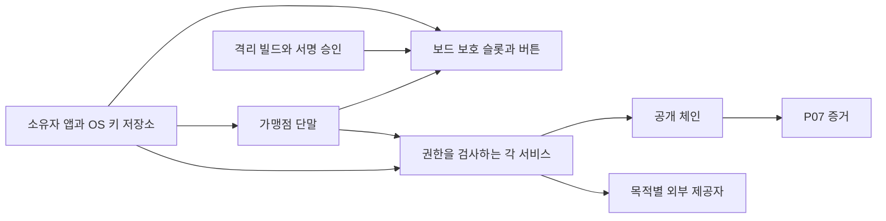

# BLE·키·서비스 경계의 방어 설계

[기존 보안 검토](../security-and-release.md), [역할별 프로토콜](../protocol.md), [보드·앱·MPC](wallet.md)의 목표를 구현 및 시험 경계로 구체화한다. 펌웨어는 C/Zephyr, 앱은 모바일 BLE·웹 브리지, 운영/인덱서는 Go·PostgreSQL, 계약은 Solidity, 개발 배포는 P10 CI가 신뢰 경계다. 보드·폰을 소유한 이용자, 무선권 안의 다른 단말, 인터넷 클라이언트, 권한 있는 직원·수탁자, 서명 전후의 CI 작업자를 구분한다. 설치 BOM 검증·물리 공급 경로와 백업 액세서리 검토는 [출시 게이트](../security-and-release.md)에 연결한다.

## BLE 구간별 공개·보호 데이터

| 구간 | 허용 데이터와 선행 조건 | 종료·관측 조건 |
|---|---|---|
| 광고·발견 | 서비스 종류, 제한된 기능, 회전식 난수 별칭만 허용. 가능 조합은 RPA, 등록 전에는 검증된 사적 주소 정책. 회전 전후 정적 제조 데이터·고정 별칭으로 재연결할 수 없게 한다 | 부팅·등록 창·모드별 광고 허용목록과 수명을 시험. 보드/지갑 식별자·BLE 본드 ID·주문·가격·계정·위치·연락처·잔액은 공개 광고에서 제외 |
| 소유자 등록/관리 | 명시적 물리 등록 창, 설치 시 확인한 기기 신원 지문과 앱 소유자 키 소유 증명, 사용자 검증을 수반하는 LE Secure Connections 또는 독립 등록 경로. Just Works, legacy/debug 키와 무인 재등록 거절 | 인증 상태와 역할을 양단에서 확인한 뒤에만 관리 명령 허용. 본드 생성 성공만으로 기존 지갑 소유권을 주지 않는다. 분실 시 등록 세대를 바꿔 이전 폰을 차단 |
| 단말↔보드 지급 | 비본딩 단말은 짧은 수명의 가맹점 자격·위임과 일회성 승인 견적. 검토된 종단 인증 키 교환과 방향별 AEAD 키로 보호. QR은 같은 견적에 대한 일시 참조 | 양단 신원·역할, 버전·기능 협상, 새 난수·임시 공개키와 도메인을 인증 transcript에 결합. 장기 식별자나 증명서는 인증된 암호화 경로에서 필요한 상대에게만 공개 |
| 폰↔단말 주문 | 카탈로그와 개인 주문 세션의 권한 분리. 공개 메뉴만 읽는 고객은 결제·메뉴관리 권한 없음. 주문 조회·개인 인계는 인증된 단말과 고객별 임시 세션 증명 요구 | 같은 근처 기기, 같은 표시명, RSSI, QR 사진은 신원 증명이 아니다. 연결 단절 시 새 연결 키로 같은 권한 있는 주문만 재조회 |

세션은 검토·상호운용된 인증 키 교환 및 AEAD 프로필을 버전으로 고정하고, ephemeral 키 교환·키 확인·전방향 비밀성·OS별 강등 거절을 검증한 조합만 승인한다. 암호 nonce는 방향별 단조 증가 및 키별 유일성을 만족한다. 카운터 한계·부팅·재연결·인증 실패 시 폐기하고 새 세션 키를 만든다. 태그 검증 완료 전 평문을 명령 처리기에 전달하지 않는다. 재생·조각 혼합·버전 변경·길이 초과·묵은 승인에 대한 거절 벡터를 C/TS/Go에서 공유한다. 민감 응답과 지갑/기기 추적 가능 필드는 인증·암호화 완료 뒤에만 반환한다. 데이터 평문이 보호돼도 전파의 존재, 송수신 시각·크기·근접 추정은 관찰 가능하다. [Bluetooth SIG 보안·프라이버시 지침](https://www.bluetooth.com/bluetooth-resources/bluetooth-security-and-privacy-best-practices-guide/) · [LE Security Manager](https://www.bluetooth.com/wp-content/uploads/Files/Specification/HTML/Core-62/out/en/host/security-manager-specification.html)

### 첫 설치와 독립 표시의 개인정보 경계

SW4 설치 창의 공개 BLE 조회는 버전과 창마다 바뀌는 난수만 반환한다. 등록기관은 이 난수와 설치자 단기 인증서 원문을 함께 서명한다. 빈 보드도 이 티켓을 확인해 TLS 1.3 클라이언트로 설치자 인증서를 검증하고, 전용 `nu54-install/1` 채널이 열린 뒤에만 TLS 공개키, 지급 주소, 기기 식별값을 포함한 서명 제안을 전송한다. 설치 도구는 TLS exporter에 결합된 보드 서명과 별도 유선 수집 지문을 확인하고, 같은 TLS 프로필에서 서명된 설치 번들을 보낸다. 갱신은 기존 키와 주소를 유지하면서 기존 발급 권한, 정책 버전 및 만료 검사를 적용한다.

카운터가 있는 설치용 앱은 같은 SW4 창에서 UART 전용 SMP 요청으로 보드 SPKI 지문과 기기 식별값만 제공한다. 최초 플래시 작업자가 케이블로 확인한 지문을 오프라인 QR로 인계한다. 사용자는 두 지문을 대조한 뒤 앱에서 별도로 발급된 등록서와 연결한다. 정상 모바일 설정에서 별도 PC 연결은 필요 없다. 호스트 시험은 프로토콜과 등록 정책을 재현하며 실제 UART, 블루투스 및 물리적 지문 대조는 기기 검증으로 남는다. [펌웨어 설치 절차](../../../../products/p01-device-firmware/README.md#install-and-enroll-a-runtime-board) · [RFC 8446](https://www.rfc-editor.org/rfc/rfc8446.html)

독립 표시용 공개 특성은 현재 시도에 대한 무작위 챌린지를 나누어 읽을 수 있다. 승인에 필요한 금액·주소·보드 신원·현재 정책은 인증된 검토 경로에 귀속한다. 새 제안과 원래 제안의 표시·승인 증명이 서로 바뀌지 않아야 하며, 만료·기기 교체·연결 종료 시 임시 검토 자료를 폐기한다. 설치와 정책 승인은 서로 다른 권한을 사용한다. [보드 정책 데이터와 승인 조건](wallet.md#수취인-허용목록의-저장과-변경)

## 위협, 영향과 확인 방법

| 위험 · 가능성/영향 | 보호해야 할 자산·방어 | 출시 전 합격 증거 |
|---|---|---|
| TM-001 무선 관찰·재생·역할 혼동 / 근거리에서 접근 가능·지급/개인정보 영향 큼 | 광고 최소화, 인증된 세션/키 수명, 견적 서명과 nonce·역할·지급자 결합, 단말 자격 회수, 발행자·시각 불명 시 보류 | 합성 거래로 세 역할의 승인된 실기 세션을 검사. 공개 구간에 민감 필드 0, 거절 벡터에서 승인/부작용 0, 재시작 후 이전 세션 복구 0. 운영 트래픽 원문 미수집 |
| TM-002 감염된 휴대폰·가짜 DApp의 잘못된 표시 / 앱 권한 획득 필요·자산 손실 큼 | 승인에 묶인 preimage를 보드가 파싱하고 앱이 표시한 내용과 독립 증거의 digest를 확인. 고위험 거래는 신뢰 표시가 없으면 거절. 버튼은 물리 의사표시 | 독립 표시 누락·해석 불가 호출·origin 불일치에서 서명 0, 기존 금액 승인 재사용 0. 거리·버튼만으로 받는 주소의 진위 주장 금지 |
| TM-003 자동화된 대량 요청·AI 합성 신원·권한 기만 / 공개 API·직원 대상 노출 큼 | 서비스별 인증, 행위/지점/객체별 인가, 서명된 계정 변경·환불 분리 승인, 단말/가맹점·세션별 자원 예산. AI 결과·텍스트·음성은 데이터 입력이며 권한 증명이 될 수 없음 | 타 지점 조회·중복 출고·자기 승인 거절. 합성 지원 요청만으로 복구/지급 주소 변경 0. 요청 한도 초과해도 정상 주문 상태 조회 가능 |
| TM-004 수집 확대·공급자 또는 복원 후 재노출 / 권한 있는 내부자·위탁자·유출 영향 큼 | 최소 송신, 필드 허용목록, 목적별 암호 키·접근, 권리 요청과 공급자 핸들, 작업 종료와 삭제 확인, 불변 접근감사 | T11/T12 & D06 재생 중 철회된 콘텐츠 노출 0. 조회·다운로드·보류 권한의 감사 표본 검증 |
| TM-005 파서/업데이트 결함·공급망 변경 / 서명 경로 도달 시 전체 사용자 영향 | 기기 버퍼 한정, 결정적 코덱, 신뢰 루트·버전 검증, SBOM·서명자 격리, 릴리스 evidence | 지원 매트릭스별 고정 빌드와 독립 재현·재스캔·물리 설치 회귀. 미승인 이미지·하위 버전·검증 없는 본드 승격 거절 |
| TM-006 체인 지연·재전달·환불 경합 / 일상 장애로도 발생·중복 지급 위험 큼 | 도메인/금액/증거 대조, 지점 잠금·멱등 키·outbox·수취인 잔액 검증 및 분기 시 보류 | 최종 지급과 통지·환불 발생을 분리해 대사. 중복 이벤트에서도 결제·조리 각 1회 |

## 구현 시 강제할 시큐어 코딩 계약

- **펌웨어/프로토콜**. 역할·버전·상태에 따른 allowlist, 인증 전 요청당·링크당 조각 수/총 바이트/중첩/시간 예산과 한 건의 승인 슬롯, 할당 전 길이 합산 오버플로 검사. 콜백 생명주기·재진입·타임아웃 소유자를 명시하고 실패 경로에서 승인·세션 비밀을 폐기한다. 디버그 키·로그·덤프 비활성화를 실제 release image에서 확인한다.
- **모바일·웹**. 허용 HTTPS origin과 브리지 메서드·체인·계정을 매 호출 검증한다. UI 입력 또는 AI/지도 결과를 실행 코드·임의 URL로 해석하지 않는다. 격리된 DApp 프레임과 지갑 승인 UI, OS 키 저장소, 웹 콘솔 CSP, 쿠키 세션의 CSRF 방어, HTML 이스케이프, 지갑·지원 데이터의 클립보드/백업 제외를 점검한다. 포그라운드 재진입 때 승인 digest와 세대를 다시 읽는다.
- **Go API·워커**. 준비된 SQL·타입 검증, 수치 범위·자산 단위, 바이트·헤더·기한/동시성 상한, 취소 가능한 I/O, 동일 트랜잭션 내 권한·리비전 검사, 공개 오류의 정보 최소화를 적용한다. 사용자 지정 RPC/웹훅은 허용 목적지·DNS 재검증·사설/메타데이터 주소 차단·리디렉션 제한과 자격 격리를 사용한다. 관리 진단은 내부 접근으로 제한한다.
- **체인·MPC**. 지원 프로필에 등록한 라이브러리와 엔진만 사용한다. 금액·정밀도·서명 도메인·재진입·환불 누계는 체인 자체에서 검증하고 임계 지분·복구 자격·앱 서명을 별도 영속 권한으로 분리한다. AI가 생성한 코드와 의존성도 같은 리뷰·적합성·릴리스 증거를 요구한다.
- **비밀·의존성·사고 대응**. 장애 진단·성능 텔레메트리는 오류 코드·개수·지연·합성 벡터 ID로 한정한다. 개인정보처리시스템의 접속기록은 [접근감사 정책](privacy.md)에 지정한 취급자·접속지·시각·대상 범위·업무를 독립 보호 저장소에 기록한다. 보안 담당은 도달 가능한 취약점의 수정 또는 보류 결정, 고정 잠금 파일, SBOM, 재스캔, 서명 빌드/실기 회귀를 동일 manifest에 묶는다. 기기·릴리스 키 이상 시 신뢰 철회와 미결 거래 대사를 따로 진행한다. 실제 패치 수준은 구현 빌드마다 검증한다. [출시 검증 기준](../security-and-release.md) · [공급망 증거](platform.md)

## W27 지출 정책의 저장과 승인

보드가 건별·일별 한도를 검사하려면 서명에 사용할 금액을 먼저 내구성 있게 예약하고, 재시작 뒤 그 예약이 과거 저장본으로 돌아갔는지 판별해야 한다. 같은 소유 세대·요청·원문의 재시도는 기존 결과에 연결한다. 일자나 기한이 지났을 때 미결 예약을 해제하려면 기존 서명이 여전히 지급될 수 있는지 판정할 근거가 필요하다. 범위 밖 저장본·신뢰 시각 불명·독립 확인 누락이면 서명을 보류한다. 실제 거절·재시작은 보드의 서명 진입점에서 확인한다. [키·저장 설계](wallet.md) · [W27 원본 상태](../screens/book.html#W27/limits)

현재 호스트 시험은 예약 전이를 재현한다. 공식 nRF54L15 DK의 TF-M 비보안 앱 타깃과 이 프로젝트의 `nu54v_dk` 보드 정의는 별도로 검증한다. 후보 빌드는 암호화된 Protected Storage, 롤백 방어 활성화, 플랫폼 NV 카운터 구현과 장치 수명 동안의 사용 가능 횟수를 대조한다. 호스트 모의 카운터 및 펌웨어 이미지 버전 카운터의 통과 결과만으로 지출 예약의 보호 수준을 선언하지 않는다. [설치된 NCS에 대응하는 보드 정의](../../../../products/p01-device-firmware/boards/nucode/nu54v_dk/board.yml) · [Nordic TF-M 빌드 안내](https://nrfconnectdocs.nordicsemi.com/ncs/latest/nrf/security/tfm/tfm_building.html) · [TF-M Protected Storage 통합 안내](https://tf-m.docs.trustedfirmware.org/en/latest/integration_guide/services/tfm_ps_integration_guide.html)
