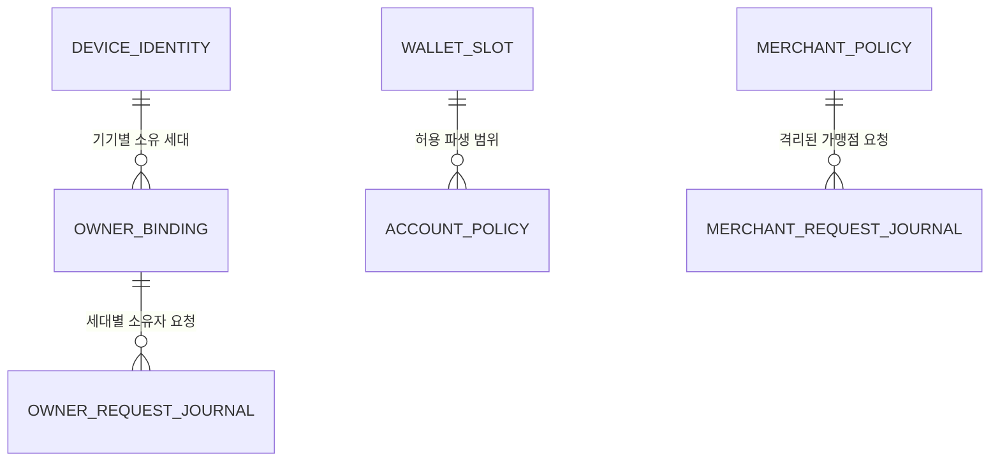
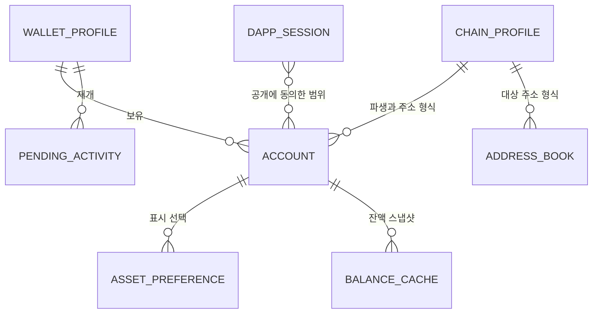
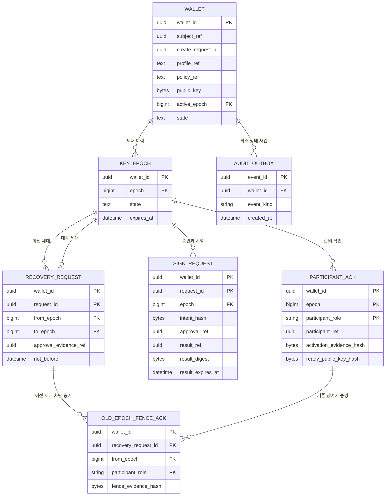
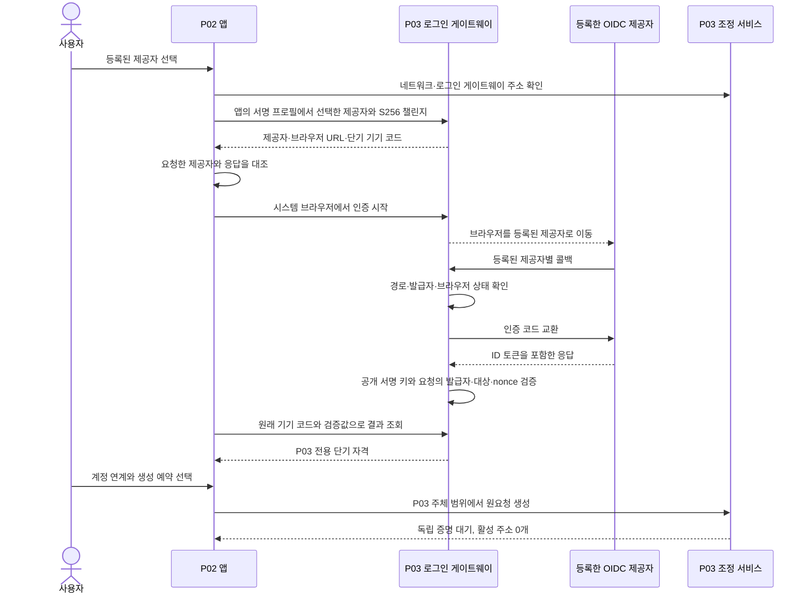
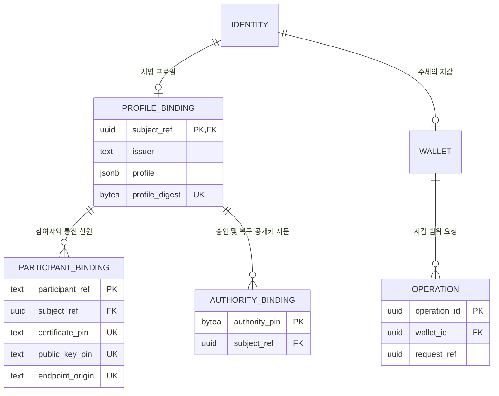
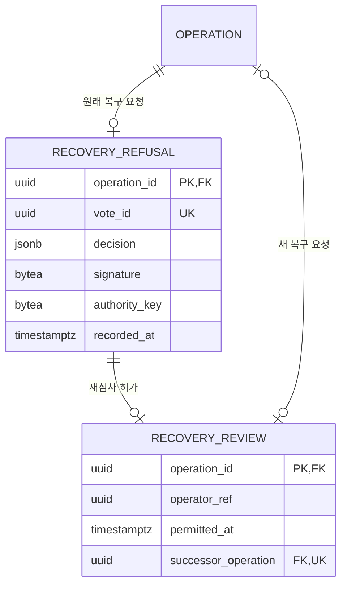

# 보드·모바일·클라우드 지갑 데이터 설계

[상용화 설계](../README.md) · [기존 지갑 요구사항](../wallet-and-mobile.md) · [프로토콜](../protocol.md) · [P03 검증용 PostgreSQL DDL](schema/wallet.sql)

개인 보드(P01), 소유자 앱(P02), 선택형 클라우드 지갑(P03)의 목표 설계다. 각 지갑의 키, 소유자 및 복구 상태를 해당 저장소가 결정한다. 다른 제품의 주문·회차·예약·영수증은 불투명 참조로 연결한다. v1 대여 계정은 해당 배포 버전과 기존 주소에 고정하고 잔액·미결 지급을 대사한 뒤 종료한다.

## P01 기기 저장소

원장 형식은 역할별로 분리하고 동일한 저널 레코드를 사용한다. 위 관계는 기기 내부 저장 경계를 나타낸다.

| 레코드 · 형식 | 키와 제약 | 소유 경계와 보관 |
|---|---|---|
| `boot_policy(model, revision, trust_profile, manifest_hash, min_version, active_slot)` | 부트 검증 계층 소유. 슬롯 전환 전 대상 모델·이미지 검증, 최소 버전 단조 정책. 신뢰 루트 변경은 별도 승인·초기화 흐름 | 제조/설치 초기화부터 수명 종료까지. 기기 신원·지갑 키 슬롯과 분리 |
| `device_identity(key_handle, public_key, attestation_ref?)` | 핸들은 보드 내부 전용. API는 공개키 증명만 반환. DIY는 사용자 설치 지문을 독립 경로에 기록 | 같은 보드를 식별하는 장기 공개키는 광고·중앙 고객 디렉터리에 넣지 않는다 |
| `owner_binding(generation, owner_public_key, bond_ref, recovery_verifier_ref, state)` | 활성 개인 소유 세대 하나. 소유자 앱 키 증명과 기기 신원·본드에 결합. NVM 커밋과 구세대 권한 검사를 동일 세대에 고정 | 활성 등록까지. 교체 커밋 후 본드와 복구 검증 자료의 구세대 정리. 서버 이전 없음 |
| `wallet_slot(local_id, mode, root_key_handle, root_format, profile_version, backup_state)` | `mode=personal/rental`의 키 접근 정책 분리. 현행 단일 대여 키는 기존 포맷으로 고정. 개인 슬롯은 루트 생성 커밋 및 복원 검증 후에만 주소 공유 허용 | 개인·대여 초기화는 다른 권한. 개인 루트·파생키 핸들은 기기 내부 전용 |
| `account_policy(slot_id, profile_ref, account_index, descriptor_hash?, descriptor?)` | 허용 네트워크·알고리즘·파생 범위의 버전 고정. Bitcoin 공동서명 등록은 임계치·참여 키·스크립트·외부/거스름돈 분기 검증 | 사용자가 관리할 때까지. 거래 원문이나 연락처를 보드에 저장할 필요 없음 |
| `pin_state(verifier_handle, failed_attempts, lock_state)` | 실패 기록은 응답 전 영속화. 시도 한도·복구 절차를 리셋 이후에도 적용. 버튼/LED 입력 세부정보는 휘발성 | 보드 내부 전용. 핀 숫자·길이 진행·버튼 이벤트를 BLE·앱·로그에 노출하지 않는다 |
| `request_journal(role_scope, generation, request_id, intent_hash, state, bounded_result_ref?, retirement_marker)` | 역할·세대·요청 ID 복합 키. 영속 예약 후 서명. 동일 키·다른 해시는 충돌. 발급 상태와 결과 보관은 다른 수명 | 유효기간/결제 대사 기준까지 최소 식별자 유지. TTL 뒤 원문·결과는 삭제. 안전한 재생 여부를 판단할 수 없는 요청은 `UNKNOWN_RESULT`와 원 요청 조회 |
| `merchant_policy(trust_profile, issuer_keys, revocation_snapshot, time_anchor)` | 운영 키는 가맹점/대여 목적만 수행. 시각·철회 정보의 검증 상태를 같이 보관 | 새 검증 배포에 따라 교체. 개인 단독 키 생성/주소 확인은 운영 시간 서버에 의존하지 않는다 |

보드 저장 포맷은 버전·무결성·실패 원자성을 갖춘 레코드 묶음으로 설계한다. 활성 커밋 전 전원 손실 시 미완료 슬롯에서 주소를 제공하지 않는다. 재연결은 보드의 공개 상태를 다시 확인한다. 구세대 활성 복구, 요청 원장 롤백 및 카운터 우회는 저장 내구성·롤백 방어 시험 대상이다. 보드 메모리에는 세션 키, 재조립 중인 원문, 표시 내용과 만료, 한 건의 물리 승인 대기만 유지한다. 잠금·연결 중단·재부팅 시 휘발성 승인 권한을 폐기한다.

### W27 보드 유휴 잠금과 원요청 재개

유휴 2분과 연결 해제 시 잠금은 보드가 집행한다. 보드는 현재 인증된 소유자 세션과 마지막 유효 활동의 단조 시각을 휘발성으로 관리한다. 앱이 보는 시계, BLE 광고, 인증 전 통신, 배경 조회만으로 유휴 기간을 연장할 수 없다. 실제 취소 또는 만료 시에는 세션 및 미사용 승인·표시 증명을 폐기한다. 다시 연결한 소유자는 저장된 원요청과 보드의 현재 정책을 조회하고, 새 서명이 필요하면 새 요청 범위에서 로컬 PIN·물리 승인 절차를 거친다. 보드에 커밋한 한도 변경·지출 예약과 영수증은 각자의 보존 조건을 따른다. 앱에는 현재 보드의 잠금 규칙과 확인 가능한 상태만 표시한다. 활동 시각을 서버 분석에 수집할 필요는 없다. [설정의 보호 정책](../screens/book.html#W27/limits)

11월 21일 C 회귀에서 소유 세션의 120초 유휴 경계, 조회로 유휴 시간이 연장되지 않는 동작, 연결 해제와 버튼 입력의 경합을 확인했다. 설치 앱은 인증한 보드가 보고한 규칙을 표시한다. 실물 BLE에서 120초 경과와 재연결 후 원주문·지출 예약의 재개는 후속 인수 대상이다. 한도 변경의 24시간 기한은 보드가 검증한 시각을 사용한다. [보드 연결과 승인 폐기](../../../../products/p01-device-firmware/app/src/device_pilot.c) · [보호 저장소 정책의 검증 범위](../../../../products/p01-device-firmware/W27-POLICY-PROGRESS.md)

### 수취인 허용목록의 저장과 변경

독립 표시 장치가 사용하는 공개 BLE 특성은 대기 중인 작업에서 새로 만든 32바이트 무작위 챌린지만 반환한다. 한도 변경·초기 등록·최종성 정책 등록·복수 수취인 변경에 같은 공개 규칙을 적용한다. 전체 주소, 보드 식별자, 자산·한도, TLS 바인딩은 인증된 검토 경로에서만 전달한다. 검토 장치는 사용자가 승인할 현재 값과 제안값을 직접 확인해 정확한 요청에 서명한다. 연결 해제, 만료, 프로필 변경 후에는 이전 검토로 승인할 수 없다. 나누어 읽는 경우에도 같은 공개 규칙을 따른다.

W25의 주소록은 사용자가 붙인 이름과 주소를 폰에 보관한다. W27의 서명 정책은 보드·소유 세대·체인·자산·정책 버전에 결속한 수취 주소 집합을 보드의 보호 저장소에 보관한다. 같은 수취인에게 붙인 이름이나 연락처, 앱의 조회 이력은 보드로 전송할 이유가 없다. 주소의 정규 표현은 체인이 정한다. 현재 EVM 정책은 20바이트 주소를 사용하며, 숫자 체인 ID와 토큰 주소가 다른 정책 사이에서 허용 권한을 공유하지 않는다. [주소록](../screens/book.html#W25/contacts) · [보호 정책](../screens/book.html#W27/limits)

| 전이 | 저장·표시하는 값 | 인수 기준 |
|---|---|---|
| 단일 수취인 기록 읽기·이행 | 기존 주소 한 개를 같은 범위의 원소 한 개로 해석한다. 건별·일별 한도와 소유 세대, 사용액, 미결 예약, 대기 중인 변경의 기한을 보존한다. | 중단 후 이전 유효 기록 또는 검증된 새 기록으로 재개한다. 구버전이 복수 주소를 한 주소로 오해하면 서명을 중지한다. 보호 저장소의 크기와 고정 길이 통신 프레임 한계를 실제 대상에서 검증한다. |
| 추가·제거 검토 | 같은 집합의 표현이 하나가 되도록 주소를 정렬하고 중복·잘못된 길이를 거절한다. 독립 표시가 현재·후보의 차이와 전체 주소, 체인·자산·한도를 확인한 뒤 보드가 같은 요청의 물리 승인을 받는다. | 인증 후 주소 하나를 바꾸거나 목록을 누락하면 이전 승인을 재사용할 수 없다. 빈 목록으로 정책을 표현할 경우 허용되는 신규 수취인은 0명이다. |
| 대기·활성화 | 현재와 대기를 버전으로 구분한다. 대기 동안 원래 목록이 유효하다. 기한과 소유 세대를 확인하고 새 버전을 원자적으로 적용한다. | A만 허용한 상태에서 B를 추가하고 재시작한다. 대기 중 B는 거절되며 유효 시각 이후 A와 B는 승인 가능하고 C는 계속 거절된다. A를 제거한 정책에서도 과거 영수증은 조회 가능하다. 미확정 예약 금액은 목록 변경으로 해제되지 않는다. |
| 업무 경로 소비 | 보드는 서명할 원문에서 체인·자산·수취인을 해석해 활성 정책과 대조한다. 앱은 확인한 정책 버전과 자산 단위를 표시한다. | 다른 자산의 같은 주소에 대한 거절, 정책 변경과 동시 서명, 중복 요청 및 응답 유실 때 서명·예약 최대 한 건을 확인한다. |

다중 수취인 형식으로 이행한 뒤에도 한도 조회와 변경이 가능해야 한다. 여러 주소가 허용된 상태에서 한도만 바꾸는 요청은 기존 전체 목록과 기존·제안 금액을 함께 독립 표시하고, 적용 후 주소·기존 사용액·미결 예약을 보존한다. 반대로 수취인만 바꾸는 요청은 금액을 그대로 둔다. 동시에 두 요청이 들어오면 먼저 승인된 revision 하나만 대기 상태에 둘 수 있다. 이전에 확인한 revision의 요청이 다시 도착하면 같은 요청의 결과를 재조회하거나 최신 상태를 다시 확인한다. 이미 대기하던 구형 한도 변경도 원래 기한에 적용할 수 있어야 한다. 구형 앱이 여러 주소를 표시할 수 없을 때에는 새 앱에서 재개하는 방법을 알린다.

새 버전의 C1 응답은 보드·소유 세대·체인·자산·정책 revision·활성 수취인·대기 변경 종류와 기한을 한 정책으로 식별한다. 지갑은 기존 단일 수취인 조회의 성공 여부만으로 새 기능 지원을 추정하지 않는다. 지원이 확인된 기기의 인증된 응답을 사용하고, 가용 상태를 알 수 없으면 키를 초기화하거나 빈 목록으로 간주하지 않는다. 분할 프레임 재조립, 응답 유실·재시작, UI가 보이는 목록과 실제 서명 허가 대상의 일치를 C·모바일 SDK·설치 앱에서 대조한다. [C1 관리 연산](../../../../packages/protocol/v2/owner-management.md)

### 키 생성·백업·키 저장 정책

| 종류 | 발급·사용·회수 |
|---|---|
| 부트/배포 서명 키 | 제품 빌드 서명 권한과 개인 보드 자가 서명 프로필 분리. 보드는 공개 신뢰 루트로 버전을 확인한다. 신뢰 변경은 물리 조작과 별도 재설정 |
| 기기 신원 키 | 설치 시 기기 안에서 생성·등록. 앱이 지문을 독립 확보. 기기 신원 키로 빈 등록 결과를 증명 |
| 앱 소유자·BLE 본드 키 | 앱 소유자 증명 키는 지원 OS 보안 저장소에 비추출 설정, 본드 키는 OS BLE 스택. 보드 교체·분실 시 세대 상승 후 이전 세션과 본드를 회수. 같은 소유 세대의 세션 재연결도 새 세션 키로 시작 |
| 보드 루트·파생 개인키 | 기기 내부 엔트로피와 적합한 검증 라이브러리로 생성. 서명은 내부 핸들에 한정. 일반 앱/SDK/진단에는 비공개. PIN·정책 및 각 플랫폼의 저장·읽기 보호를 검증한 펌웨어에서 제공 |
| 백업 복구 자료 | 루트 비추출 운용과 소유자 승인 백업은 별도 경계다. 복구문구 방식은 독립 입력·표시 액세서리에서 생성 시 기록·복원할 때만 복구 비밀을 다룬다. 폰, BLE 일반 API, USB 진단, 운영 저장소 경로를 금지한다. 등록형 독립 복구 장치는 소유자 분실·교체 시험이 완료된 조합만 제공 |
| 가맹점·대여 운영 키 | 전용 운영 권한으로 위임과 회수를 관리. 가맹점 인증·견적·대여 반납의 목적 구분과 지급 계약/덧씌움 방지 검증. 개인 슬롯의 서명·삭제 권한 없음 |

키 핸들만 두는 설계는 저장 정책이다. 칩·보드 리비전별 보호 구현, 부트·디버그 포트·물리 읽기 저항은 별도 검증한다. 복원 시험에서 기준 주소와 파생 정책 일치 전 메인넷 입금 안내를 보류한다. 같은 백업에서 복원한 구보드가 살아 있으면 같은 권한으로 서명할 수 있어 분실·도난 상태에 따라 새 루트로 자산 이전과 권한 철회를 안내한다.

## P02 앱 로컬 데이터

| 레코드 · 필드 | 주 키 및 검증 | 지속·외부 전송 |
|---|---|---|
| `wallet_profile(local_id, mode, device_identity_ref?, mpc_wallet_ref?, label, verified_recovery_state)` | personal/rental은 보드 참조, cloud는 P03 참조, watch는 공개 계정 범위. 모드별 쓰기와 서명 기능 제한 | 앱 암호화 로컬 DB. 라벨·기기 지문을 서버에 일괄 동기화하지 않는다 |
| `chain_profile(ref, version, network_id, genesis_ref, algorithm, path_template, address_codec, finality_rule, adapter_ref, asset_rules_ref)` | 동일 chainId만으로 같은 네트워크로 취급하지 않는다. 사용자 RPC 설정 검증 후 활성화. 승인 요청에 버전 포함 | 정적 서명 레지스트리와 로컬 사용자 설정 분리. RPC 비밀은 별도 키체인 핸들 |
| `account(account_id, local_wallet_id, chain_ref, account_index, path_policy, public_address, address_type, watch_range?, label, hidden)` | 지갑·체인·파생 식별자 유일. 주소는 해당 네트워크 포맷으로 검증. 복원 후 기준 주소 대조 | 앱 로컬. RPC 요청에 필요한 주소나 승인한 xpub 범위만 전송. xpub은 민감한 공개 추적 정보로 취급 |
| `asset_preference(account_id, asset_ref, favorite, hidden)` · `address_book(entry_id, chain_ref, normalized_address, destination_tag?, label)` | 자산 참조는 체인+네이티브/컨트랙트/mint/issuer 구분. 태그가 요구되는 수취인에 주소와 태그 함께 저장 | 사용자 의도 보존. 숨김/삭제는 확정 잔액·미결 지급과 독립. 주소록 서버 이관은 기본 비활성 |
| `balance_cache(account_id, asset_ref, amount_base, source, block_ref, observed_at, finality)` · `rate_cache(asset_ref, fiat, rate_decimal, source, observed_at)` | 금액은 체인 정의 최소 단위. XRPL 발행 자산은 정확한 정수 계수+스케일의 canonical 값. 환산용 decimal과 거래 금액은 별도 | 명시적 TTL과 조회 시각. 잔액·시세 캐시는 재구축 가능. 오프라인에서 캐시임을 표시하고 최신 지급 가능액 확정에 쓰지 않는다 |
| `dapp_session(session_id, transport, origin_binding, namespace, allowed_account_refs, allowed_chain_refs, allowed_methods, allowed_events, expires_at, revoked_at)` | 최상위 origin 또는 검증한 외부 연결에 결합. 원천이 지정한 문자열로 대체 금지. 세션 요청에는 채널·메서드·계정·체인 범위 검증 | 허용 범위·만료 장치에 보존. 비밀 세션 토큰은 키체인. 원문·쿠키·SIWE nonce 원본을 지갑 감사에 저장하지 않는다 |
| `billing_reminder(subscription_ref, period_ref, due_at, local_notification_ref?, revision, state, checked_at)` | 같은 회차는 알림 예약 하나. 앱은 구독/회차 원장을 재조회해 예약/취소/만료 상태를 갱신. 철회·기한 경과 시 OS 알림도 제거 | 기기 로컬 보조 상태. 알림 권한 거부·단말 교체 시 미결 회차는 원장 조회로 재구축. 푸시 본문에 금액·상점·주소를 넣지 않는다 |
| `maintenance_task(device_identity_ref, manifest_ref, requested_slot, state, observed_version?, checked_at)`, `support_draft(export_ref, selected_field_keys, expires_at)` | FOTA는 현 활성 슬롯·서명·전원·독점 승인 대기 확인 후 시작. 재부팅 후 기기 상태를 다시 읽어 완료 판정. 지원 자료는 항목 선택, 미리보기, 명시적 내보내기 | P02 로컬 진행 참조. 진단 자료는 임시 파일로 유지 후 만료 삭제. 키·PIN·주소록·거래 원문 및 Bluetooth 고유 식별자는 선택 항목에서 제외 |
| `pending_activity(local_wallet_id, request_id, route, chain_ref, intent_hash, order_ref?, quote_ref?, subscription_ref?, period_ref?, reservation_ref?, tx_ref?, state, expires_at, last_checked_at)` | 지갑+요청 유일. 같은 주문·회차·예약 재진입은 기존 참조를 읽는다. 결제 상태는 발급/제출/확정 권위에서 다시 읽음 | 기기/네트워크 재접속을 위한 최소 상태만 영속화. 원문이 필요한 경우 휘발성 또는 암호화 임시 저장 및 만료 삭제 |

생체인증은 앱 잠금과 별도 승인에 쓰며 보드 PIN을 대체하지 않는다. 앱 설치 복원 또는 키체인 손실 시 기존 앱 등록 성공을 추론하지 않고 보드 등록 상태부터 대조한다. OS 백업·클라우드 진단에서 키체인 후보와 민감 로컬 DB·덤프를 제외하며, 앱 삭제와 탈퇴는 외부 자산 이전을 실행하지 않는다.

### 체인별 원문·표시 계약

| 프로필 | 서명 전 파서 입력과 산출 값 |
|---|---|
| Ethereum | wire tx 타입과 chainId, nonce, 수취인, value, 최대 수수료. 허용 ERC-20의 데이터에서 수취인·계약·금액/승인 spender·한도 파싱. EIP-712는 검증된 구조와 도메인만 |
| Base | EVM의 독립 네트워크·도메인 프로필. L2 실행, L1 데이터 등 비용 출처·추정 상한 표시. 포함/안전/최종 상태를 구분 |
| StableNet | 가스 자산과 지급 토큰을 구분. 배포 manifest 버전과 chain/계약/코드·견적/가맹점 수령 주소 검증. v1 대여·v2 지급·일반 전송 목적을 독립 검증 |
| Bitcoin | 파생·descriptor, PSBT에서 검증한 prevout/스크립트/금액, 외부 출력 전체, 내부 거스름돈, 수수료와 수수료율, 허용 sighash. RBF나 출력 교체는 새 승인. Taproot·multisig는 시험된 범위만 |
| Solana | 버전·프로그램 ID, fee payer, 지시별 mint·수취인·금액, blockhash 유효성, 검증된 address lookup table. 만료 후에는 새 요청. 해석하지 못한 확장 지시는 거절 |
| XRPL | Destination/Tag, XRP drops 또는 currency/issuer+정확한 금액, Fee, Sequence/Ticket, LastLedgerSequence. 확정 후 validated·delivered_amount 확인. 초기 부분결제·경로 교환은 비활성 |

수수료 견적의 출처·조회 시각은 원문 바인딩과 구분한다. 표시 decimals는 검증한 자산 레지스트리에서 가져오고, 표시용 티커·DApp 텍스트의 경우 신뢰하지 않는다. 기기 파서가 실제 서명 preimage를 기반으로 필드를 계산한다. 동일한 화면에서 두 요청을 이어 쓰지 않도록 요청 식별자와 digest를 함께 고정한다.

## P03 클라우드 MPC 저장소

로컬 구현은 tss-lib/v4의 고정 리비전으로 A(폰), B(서비스), C(복구 참여자)의 2-of-3 키 생성·서명·세대 교체를 수행한다. 실운영 C를 맡을 독립 기관과 프로필별 상용 승인 근거는 출시 인수에서 확인한다. 개인·대여 루트는 해당 제품에 보관한다. [구현 버전](../../../../products/p03-cloud-mpc-wallet/go.mod) · [참여자 신뢰 계약](../../../../products/p03-cloud-mpc-wallet/PROTOCOL.md)

| 저장소 | 데이터/키 경계 | 수명과 삭제 |
|---|---|---|
| P03 조정 DB | DDL의 `wallet`은 IdP가 P03에만 발급한 pairwise 사용자 참조와 프로필만 보유. 소셜 제공자 원식별자와 토큰은 인증 경계가 통제한다. P10은 공통 인증 연동 규격을 제공한다. `key_epoch`와 `participant_ack`은 활성화 증거 digest/시각 및 불투명 참여자 참조만 보유 | 종료/법적 보존 정책에 따라 참조와 증거를 삭제 또는 분리. 임계 share는 이 DB에 기록하지 않는다 |
| A/B/C 격리 경계 | 각각의 `(wallet_ref, epoch, participant_role, engine_profile) → share_handle`. A는 테스트된 OS 격리, B는 격리 키 작업 실행 경계, C는 독립 운영자·자격·감사. 동일 관리 주체의 백업에 B/C 자료를 합치지 않는다 | 대상 세대의 준비·활성화가 끝나면 이전 share 사용 차단 뒤 폐기. 중단된 세대 예약과 nonce/preprocessing 사용 상태는 엔진 요구에 따라 폐기 또는 격리 |
| 단기 라운드/결과 저장소 | 원문·중간 암호 메시지는 참여자 경계의 제한된 저장소. `sign_request.result_ref`는 동일 승인 결과 전달용 서비스 내부 참조. 외부에는 호출자의 인증과 지갑 소유권으로 조회 승인 | 기한 경과·완료 후 라운드 자료 제거. 결과 참조는 결과가 만료되면 삭제하고 결과 유실 상태를 반환. 로그·outbox로 복사하지 않는다 |
| 감사 이벤트 | 시간·사건·사유 코드·업무 참조만 기록. 복구 승인 증빙 원본은 C 또는 근거 소유 서비스가 통제하고 P03은 불투명 참조로 연결 | outbox는 발행 확인 후 단기 정리. 법정·보안 목적의 보존은 감사 수신 저장소에서 목적·권한·만료 별도 승인 |

### W20 로그인과 계정 연계의 데이터 경계

휴대전화에 배포한 서명 프로필에는 네트워크와 로그인 제공자의 공개 식별자·표시명·발급자 주소가 들어간다. 게이트웨이는 제공자 계정을 찾아야 할 때 배포별 비밀키로 발급자·클라이언트·`sub`의 HMAC을 계산한다. 현재 구현은 이 값이 미리 등록된 경우에만 P03 전용 주체 UUID와 별도 자격 참조를 얻는다. 이 대응표는 게이트웨이 배포 설정에 둔다. 게이트웨이는 설정·대조 키·자격 발급 서명 키·제공자 비밀을 읽을 때 같은 열린 파일에서 자료형·접근 모드·크기를 확인한다. 제공자 비밀은 코드 교환마다 다시 읽으며 검사가 실패하면 교환 전 중단한다. 소유 UID와 상위 디렉터리 권한, TLS 리스너 개인키는 배포자가 관리한다. 조정 DB의 기존 `IDENTITY`와 `PROFILE_BINDING`에는 제공자 원식별자·이메일·브라우저 토큰 열을 추가하지 않는다. [게이트웨이의 식별자 처리](../../../../products/p03-cloud-mpc-wallet/internal/gateway/oidc.go) · [배포 프로필과 계정 등록](../../../../products/p03-cloud-mpc-wallet/README.md)

콜백 검증에서 제공자가 일치하지 않으면 코드를 교환하지 않는다. 독립 증명과 DKG가 완료돼야 주소를 활성화한다. 기기 로그인 조회와 이 요청에서 발급한 P03 자격은 요청 시작 후 최대 5분인 같은 시각에 만료된다. 앱은 만료 전까지 원래 검증값으로 결과를 다시 조회할 수 있다. 만료된 조회는 거절하며, 다음 유효한 요청을 만들 때 만료된 메모리 항목을 제거한다. 게이트웨이 재시작 후에는 새 로그인을 시작한다. [흐름·만료 처리](../../../../products/p03-cloud-mpc-wallet/internal/gateway/gateway.go) · [독립 증명과 재실행 검증](../screens/runtime-acceptance.md#등록한-인증-제공자로-클라우드-지갑-열기)

### 여러 사용자의 신뢰 프로필과 요청 식별

위의 논리 ERD에서 P03의 신뢰 프로필과 작업을 실제 PostgreSQL 이관 001·002에 연결한다. 가입 시 주체 행의 잠금을 잡고 서명 프로필, 참여자와 승인 키의 결속을 한 트랜잭션에 기록한다. 지갑 개설과 세대 변경은 각 요청에서 결속된 프로필을 사용한다. 가입이 진행 중이어도 공개 CSR 제출만으로 참여자 실행이나 지갑 서명을 시작할 수 없다. [구현 DDL 001](../../../../products/p03-cloud-mpc-wallet/migrations/001_wallet.sql) · [프로필 결속과 v1 이관 002](../../../../products/p03-cloud-mpc-wallet/migrations/002_profile_binding.sql) · [필드별 처리 목적](../../../../products/p10-platform/database/field-purpose.json)

이관 003은 `wallet.profile`의 값에 격리 시장 배포의 식별자 해시를 담을 수 있도록 제약을 확장한다. 기존 Sepolia 값을 그대로 읽는다. `wallet.subject_ref`의 유일성은 유지되므로 각 P03 주체가 가질 수 있는 지갑은 최대 하나다. 같은 지갑에서 다른 배포의 거래를 요청하면 서명을 거절한다. 시장 자격에 연결된 지갑을 처음 만들 때 프로필을 고정하고, 해당 배포와 지갑 주소·원문·기한을 대조한 뒤 독립 승인을 받는다. 시장 계약·수량·가격 검증 결과는 해당 승인 목적에서만 사용한다. 고객의 가맹점 주문이나 여행 기록을 결합하는 식별자는 추가하지 않는다. [시장 프로필 제약](../../../../products/p03-cloud-mpc-wallet/migrations/003_isolated_market_profile.sql) · [승인 전 원문 대조](../../../../products/p03-cloud-mpc-wallet/internal/wallet/market.go)

W21에서는 독립 승인 브라우저에서 거절한 원래 서명 요청을 `refused`로 종결한다. 최초 승인과 거절은 같은 지갑과 작업 행에서 순서를 결정한다. 거절이 먼저 접수되면 서명 라운드를 시작하지 않아 일회 자료와 서명 결과가 생기지 않는다. 승인이 먼저 접수되면 현재 상태를 조회하도록 안내하며, 단독 참여자 응답은 라운드 기한 내에 나머지가 확인되기까지 결과를 반환하지 않는다. 만료·불일치·복구 동결은 진행 중인 작업을 별도 실패 상태에서 종결한다. 새 요청에는 새 라운드와 새 독립 승인이 필요하다.

거절 조회 및 중복 방지를 위해 기존 작업의 상태와 감사 사건만 보존하며, 두 레코드에 `P03-ACCOUNT-EVIDENCE` 수명 규칙을 적용한다. 그 기간은 기존 승인된 계정 증거와 감사 전달 정책에 따른다. 거절 증명의 본문과 서명은 요청 처리 중에만 사용한다. 브라우저 코드는 만료가 정해진 인메모리 확인에 사용하고 원본 자격 입력은 인증 검증에만 사용한다. 전송 상세의 조회 가능 기간과 만료 후 정리에는 기존 작업의 보유 규칙을 적용한다. [구현 DDL 006](../../../../products/p03-cloud-mpc-wallet/migrations/006_sign_refusal.sql) · [필드별 처리 목적](../../../../products/p10-platform/database/field-purpose.json)

독립 복구 거절은 이관 004에서 기존 지갑 범위 작업에 연결한다. 검증한 거절, 해당 요청의 `denied` 상태, 최소 감사 이벤트를 함께 커밋한다. 표는 원래 작업, 세대와 목적에만 유효하다. 운영자 허가와 새 작업 연결은 원래 거절을 바꾸지 않는다. 원본 인증 비밀번호나 브라우저 토큰을 보유하지 않으며, 영수증·운영자 식별자의 보존과 파기는 복구 증거 정책을 적용한다. [구현 DDL 004](../../../../products/p03-cloud-mpc-wallet/migrations/004_recovery_refusal.sql) · [필드별 처리 목적](../../../../products/p10-platform/database/field-purpose.json)

이관 005의 `closure_receipt(wallet_id, request_ref, epoch, accepted_at)`는 지갑별 최대 한 행이며 `(wallet_id, epoch)`로 은퇴를 추적할 세대를 참조한다. 독립 승인 증명을 별도로 보관하지 않으며 같은 트랜잭션에서 서비스 서명을 차단하고 종료 사건을 기록한다. 참가자 펜스가 모두 끝나기 전에는 `key_epoch.retired_at`이 없으므로 접수 영수증에 완료 시각이 없다. 이전 종료 행에는 확인되지 않은 영수증을 소급 생성하지 않는다. [구현 DDL 005](../../../../products/p03-cloud-mpc-wallet/migrations/005_closure_receipt.sql) · [필드별 처리 목적](../../../../products/p10-platform/database/field-purpose.json)

같은 요청 UUID를 두 사용자가 선택할 수 있다. 클라이언트 재시도는 `(wallet_id, request_ref)` 유일 제약과 원문 지문으로 판정한다. 참여자에게 넘기는 내부 세션은 별도로 할당한다. 기존 행은 `request_ref=operation_id`로 채워 진행 중인 요청을 이어받는다. 같은 지갑에서 새 세대를 만들 때 이전 수신 주소와 교체 작업을 대조한다. 운영자 조회·복구는 대상 지갑의 권한을 다시 검사한다. 서비스 간에 재사용할 고객 식별자, 참여자 비밀키·지분, 브라우저 인증 원문은 프로필 필드에서 제외한다. [주체별 서명 프로필 검증](../../../../products/p03-cloud-mpc-wallet/internal/wallet/profiles.go)

### P03 트랜잭션과 동시성

1. **생성** — `(subject_ref, create_request_id)`를 예약하고 같은 키의 `create_intent_hash`를 대조한다. 분산 키 생성(DKG) 참여자 시작은 커밋 뒤 진행한다. 서버가 검증한 역할별 증거와 공개키 일치가 완료되면 `wallet` 행을 잠그고 `key_epoch`, `active_epoch`, `public_key`, outbox를 한 트랜잭션에서 활성화한다. 실패 스텝은 주소 공개 없이 기존 요청으로 조회한다.
2. **서명** — 승인은 계정·세대·목적·네트워크/프로필·원문 해시·만료에 결합한다. 지갑 행 잠금 뒤 현재 활성 세대, 정책, 참가자 및 단회 승인 참조 유일성을 검증하고 요청을 예약한다. 참여자 역시 시작·진행·결과 저장 시 세대와 차단 상태를 확인한다. 암호학적 결과를 검증하고 내부 요청 키와 세대로 정해지는 결과 객체 위치에 조건부로 저장한 뒤, 지갑 행과 요청 행 잠금 아래 활성 세대·차단 상태·승인 결합·기한·객체 digest 일치를 다시 확인하여 `signed`와 참조·digest를 함께 커밋한다. 객체만 남기고 중단되면 재시작 시 객체·digest·현재 권한을 대조해 같은 결과만 커밋하거나 객체를 폐기한다. 새 라운드를 자동 시작하지 않는다. 조회는 같은 잠금 순서로 권한·세대·만료·결과 참조를 확인한다. 발급의 선형화 시점은 DB 커밋으로 정하며 커밋 후 이동 중인 응답은 되돌릴 수 없다. TTL 작업은 먼저 참조를 끊고 객체를 파기하며 서명 상태·요청 해시·결과 digest를 대사 기간의 tombstone으로 남긴다. 파기 중 중단되면 같은 요청과 세대로 객체 위치를 다시 구해 삭제를 재시도한다. 각 시도의 라운드 ID·preprocessing/nonce 소비 상태는 임계 엔진의 검증된 경계에서 관리한다. 부분 라운드를 신규 시도에 재사용하지 않는다. 복구 차단 이후 진행 중 결과를 성공으로 커밋하거나 반환하지 않고, 차단 전 발급된 결과는 이미 외부 제출됐을 수 있으므로 원 거래를 확인한다. 검증된 동일 결과의 조회나 `unknown`을 반환하며 자동 재승인을 요구하지 않는다.
3. **복구** — 지갑 행 잠금 아래 신규 서명 차단, 기존 세대 및 복구 요청/대상 세대 예약. 독립 승인과 `not_before`를 검증한다. 대상 참여자 준비 ACK는 대상 epoch와 같은 공개키 commitment에 결합하고, 별도 `old_epoch_fence_ack`는 복구 요청·기존 epoch·참여자 역할 및 구세대 자료 사용을 영속 차단했다는 증거에 결합한다. 복구 프로필이 정한 필수 역할의 두 증거 집합과 같은 공개키를 확인한다. 분실한 A의 물리 삭제가 펜스 조건은 아니며 남은 정족수를 막는 서비스 독립 차단 경계의 증거가 필요하다. 이전 epoch 은퇴와 새 epoch 활성화, 포인터 갱신, 복구 완료 사건을 한 트랜잭션으로 커밋한다. 복구 보류·만료·ACK 누락 시 차단 상태를 유지하고 확인 경로를 제공한다. 실제 서비스·참여자의 펜스는 SQL FK 외 정책이다. 과거 정족수 유출은 외부 서명 가능성으로 다루며 별도 키로 이동·온체인 철회를 검토한다.
4. **종료** — 인증 경계의 인증수단 추가/해제와 P03 서명·계정 종료를 서비스 계약으로 구분한다. 마지막 인증수단 처리는 인증 소유 경계에서 직렬화한다. P03은 지갑 잠금으로 진행 중 라운드를 차단하고 종료를 커밋한다. 클라우드 종료 손실 가능성과 자산 이동 필요성을 사용자에게 확인하며 자동 이체는 실행하지 않는다.

## 공유 SDK에서 검증하는 레코드

| 레코드 | 입력과 제한 |
|---|---|
| 연결 발견 / `hello` | 회전 식별자, 지원 major/기능 미리보기, 조각 상한. 인증 세션에서 협상 결과 재확인 |
| 봉투 | `wireMajor,type,sessionId,requestId,seq,bodyLength`. 타입별 크기·깊이·중복 키를 검사하고 예약 전에 상한 확인. 결정적 CBOR와 체인 프로필의 정수 인코딩 사용 |
| 인증 세션 | 역할, 양측 난수·키, 인증 근거와 협상 버전/기능을 검토된 인증 키 교환의 transcript에 결합. 방향별 AEAD 키/시퀀스. 알고리즘·주입 키·정규 serialization은 독립 검토·상호운용 승인 단계에서 고정 |
| 일반 서명 | `chain_ref,profile_version,purpose,path,raw_length,raw_hash,chunk`. 보드가 원문과 digest 및 표시 파생. 결과 `requestId,account_ref,digest,signature` |
| 지급 견적 | 지급/배포 계약, 자금 원천, 주문·견적, 발급자·가맹점·단말 위임·payout 버전, 지급자, 토큰/최소단위 금액·만료, 정규 품목 해시 및 목적. 회차/예약 식별자와 약관/예약금 구분을 목적 필드에 결합 |
| 보드 확인 | `requestId,intent_hash,display_fields,expires_at`, 필요 시 독립 표시 확인 증거. 앱 전달 확인, 물리 승인 및 체인 확정은 별도 |
| 수명주기 | 역할·대상·세대·요청 해시·만료를 검증. 상태는 같은 요청 재조회. 업데이트와 초기화의 별도 권한 |

수동 도청에는 채널별 인증 키 교환 이후 애플리케이션 AEAD와 방향별 시퀀스를 적용한다. 소유자 본딩은 추가로 인증된 LE Secure Connections 설정을 검증한다. 비본딩 키오스크는 검증된 가맹점 위임과 애플리케이션 세션에 의존한다. 광고·패킷 시각·RSSI 등 메타데이터는 관찰될 수 있다. 능동 중간자·기기 바꿔치기에는 설치 때 확보한 기기 지문, 인증된 OS 페어링과 앱 키 증명, 실제 기기의 제한된 등록 창을 함께 요구한다. Just Works 단독 등록, 미확인 지문, 인증 실패, 협상 다운그레이드는 등록 거절이다. OS가 인증된 Passkey 및 보드 입력 조합을 지원하지 않으면 검증된 USB·독립 액세서리 경로를 제시한다. 근접 신호와 버튼 승인만으로 연결이 실제로 짧은 거리에 있었음을 입증할 수 없다. 키오스크 비본딩 세션은 운영자→가맹점→단말 위임을 검증하고 지급 목적만 허용한다. 해당 세션의 기기 응답은 원 견적에만 유효하다. 폰↔키오스크 카탈로그와 주문 세션은 종단이 다르며 비인가 페이지에 보드 권한을 연결하지 않는다.

버튼과 LED만 있는 보드는 앱이 실제로 무엇을 표시했는지 알 수 없다. 보드 원문 검증과 앱의 세션 무결성은 전송 변경을 줄이지만, 감염된 폰·가짜 오버레이는 사람에게 다른 금액 또는 주소를 보여 줄 수 있다. 고위험·주요 온체인 거래는 독립 표시를 제공한 조합에서만 활성화한다. 신뢰 표시 없는 거래 프로필의 허용 목적·금액·자산은 실기 인수 전까지 미확정이며 기본 거절한다. 사용자의 폰 키 보호와 독립 표시 증거가 같은 OS에만 의존하는 구성의 경우 독립 표시 인수를 통과할 수 없다. 정책은 주소·수수료·승인 한도·호출 의미를 확인할 수 없거나 신뢰 표시가 누락되면 거절한다. 화면 없는 모드에는 물리 버튼을 의미 확인의 증거로 기록하지 않는다.

프로토콜 패키지는 제품 저장소를 직접 열지 않는다. 공통 스키마/레지스트리 → C·TS·Go 코덱과 golden vectors → 제품 어댑터 순으로 배포한다. 메시지·세션 코덱과 OS BLE/QR/USB 전송, 펌웨어 HAL, 체인 파서를 별도 모듈로 둔다. 앱 P02의 DApp 브리지/지갑 로컬 저장소/회차 클라이언트, P03의 API 조정자/격리 참여자/감사 발행기는 독립 테스트와 교체 경계를 가진다. v1 정답 벡터를 보존하고 새 목적의 v1 또는 평문 다운그레이드를 거절한다.

## 화면과 원장 갱신 흐름

| 흐름과 요구사항 | 읽기 → 쓰기 → 재개 | 인수 증거 |
|---|---|---|
| [내 지갑 W01](../screens/book.html#W01) · [지갑 선택 W02](../screens/book.html#W02) · [P02 UC1](../products/p02-user-app/use-cases.md) | 로컬 프로필과 확인한 체인 조회 → 연습 단계 또는 지갑 선택을 저장 → 보드/클라우드 설정으로 전환. 연습 입력은 연습 전용 저장 상태에만 기록 | 연습 중 RPC·실서명 0건. 앱 재실행 후 같은 단계. 다른 망 잔액 합산 0건. 오프라인 시 캐시 시각 표시 |
| [설치 W03](../screens/book.html#W03) → [등록 W04](../screens/book.html#W04) → [백업 W05](../screens/book.html#W05) → [받기 W07](../screens/book.html#W07) · [P01 UC1](../products/p01-device-firmware/use-cases.md#uc1--처음-만든-보드로-수신하기-r1r4) | manifest·기기 지문 → 소유 세대와 슬롯 커밋 → 독립 백업 시험과 주소 일치 기록. 전원 손실 뒤 활성 슬롯만 복원 | 등록 창 중 전원 차단, 같은 이름 기기, 독립 복원 성공 및 실패, 지문 불일치에서 보류 |
| [복구 W06](../screens/book.html#W06) · [유지관리 W12](../screens/book.html#W12) · [P01 UC3](../products/p01-device-firmware/use-cases.md#uc3--폰-분실과-대여-반납-r4r5) | 물리 제어·독립 증명 → 원자적으로 소유 세대 변경 → 구본드 삭제. 대여 반납은 지급 대사 권위 확인 후 대여 슬롯 종료 | 삭제 지연이나 재부팅 후 구세대 서명 0건. 개인 계정 주소 동일. 대여·개인 슬롯 명령 교차 거절 |
| [송금 W08](../screens/book.html#W08) · [공동서명 W17](../screens/book.html#W17) · [원문 W28](../screens/book.html#W28) · [P01 UC2–4](../products/p01-device-firmware/use-cases.md) | 계정·체인·원문 읽기 → 기기 계산·신뢰 표시 → 일회 승인 후 요청 원장 상태 변경. 미확정 제출은 원 tx/주문을 조회 | 여섯 체인 독립 벡터와 실패 원문, 바뀐 목적지·메서드, 위장 change, 재부팅 중 승인 및 제출 불명 |
| [DApp W13–15](../screens/book.html#W13) · [P02 UC2](../products/p02-user-app/use-cases.md) | 최상위 HTTPS origin 또는 WalletConnect 권한 교집합 → 로컬 grant → SIWE의 도메인·URI·nonce·만료 대조 뒤 서비스 서버에서 일회 소비. 지출은 별도 기기 원문 요청. 앱 재시작/철회 시 세션 범위를 다시 검증 | 다른 origin·만료·nonce 재사용·미허용 체인에서 서명 창 0건. 연결 철회, 서비스 로그아웃, 온체인 승인 철회의 상태 독립 |
| [회차 W18–19](../screens/book.html#W18) · [P02 UC3](../products/p02-user-app/use-cases.md) | 약관과 회차를 주문 서비스에서 조회 → 발급된 견적 원본을 `pay.prepare`에 전달 → 동일 견적으로 서명/제출. 푸시는 불투명 참조만 전달. 지갑은 회차를 생성하지 않는다 | 알림 두 건·두 폰에서 동일 회차. 미승인 지급 0건. 해지 후 미래 회차 0건. 이미 발급된 회차는 만료·확정 대사를 유지 |
| [결제 W09–11](../screens/book.html#W09) · [P02 UC4](../products/p02-user-app/use-cases.md) | 키오스크 또는 앱의 가맹점 견적 읽기 → 보드에서 견적과 승인할 지급자 검증 → 같은 주문의 제출·확정 조회. 예약금·잔금은 별도 주문으로 원 예약에 연결 | 폰 오프라인·중복 알림·서명 응답 유실의 경우 기존 주문으로 재개. 취소/환불 상태와 체인 결과를 별도 표시 |
| [내보내기 W16](../screens/book.html#W16) · [계정 W25](../screens/book.html#W25) · [네트워크 W26](../screens/book.html#W26) · [P02 UC5–6](../products/p02-user-app/use-cases.md) | 복원 기준 주소와 체인 확인 → 계정·자산 환경설정 저장 → 기기 승인 후 지정한 공개정보 범위만 전달. RPC 설정 검증이 실패하면 이전 프로필 사용 | 숨김/재표시 전후 같은 확정/미결 참조. xpub 확인 거절 시 출력 0건. 진단의 키·PIN·주소록 원문 0건 |
| [지원 W27](../screens/book.html#W27) · [유지관리 W12](../screens/book.html#W12) · [P02 UC6](../products/p02-user-app/use-cases.md) | 서명된 manifest와 기기 실행 버전 조회 → 승인 완료/취소 후 물리 확인과 업데이트 → 재부팅 뒤 실제 슬롯과 미결 주문 경로 조회. 지원은 선택 항목으로 진단 초안 미리보기 | 업데이트 중단/기기 재부팅 후 실제 버전과 원 제출 참조 대조. 명시적 공유 전 외부 전송 0건 |
| [클라우드 W20–24](../screens/book.html#W20) · [P03 UC1–4](../products/p03-cloud-mpc-wallet/use-cases.md) | 별도 사용자 증명 → DKG 예약·활성 → 승인별 임계 서명 → 독립 증명에 의한 복구 펜스·세대 교체 → 종료 또는 사고 보류 | 같은 생성 요청의 활성 주소 1개. 단독 B·탈취 로그인·구세대·부분 ACK에서 서명 0건. 유출을 refresh로 종결하지 않는다 |
| [프로토콜 D01–03](../screens/book.html#D01) · [SDK 상호운용](../protocol.md#상호운용-수용-시험) | 스키마/지원표 읽기 → 빌드에서 버전 고정 → C/TS/Go가 같은 원문·해시·표시·오류를 증명. 보드·폰·키오스크의 연결 역할을 따로 검사 | 외부 설치 샘플 성공 및 v1 회귀, 조각 혼입, 다운그레이드, 악성 가맹점 역할, 키오스크·폰 동시 연결 |

## 독립 인수 준비

기기 팀과 다른 검토자가 저장 슬롯·업데이트·등록과 함께 전원 차단, 디버그 포트 및 민감 데이터의 무단 노출 여부를 확인한다. 앱 팀과 다른 검토자는 DApp 브리지에 허용한 메서드, 원격 로그·OS 백업·앱 종료 전후의 데이터 및 폐기 수명주기를 검사한다. P03은 운영자 권한, B/C 관리 독립성, 임계 엔진 선정, 복구 권한의 지갑별 적용과 실제 장애·의심 신고를 별도 검토한다. 법적 보존이 필요한 경우 P10 개인정보 정책에서 기간·목적·역할을 확정하고 TTL과 삭제 작업의 정상·재시도 결과를 증빙한다. 초기 수용 증거에는 체인별 벡터 ID, 폰 OS·보드·SDK 버전, 관측 결과, 시험 상태를 기록한다. 개인 시드·PIN·실제 계정 프로필·미결 거래 원문은 증거에 포함하지 않는다.
