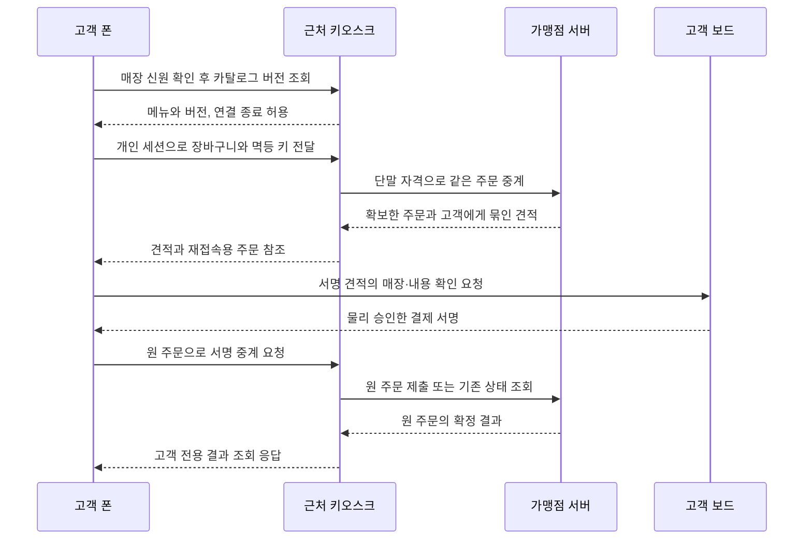
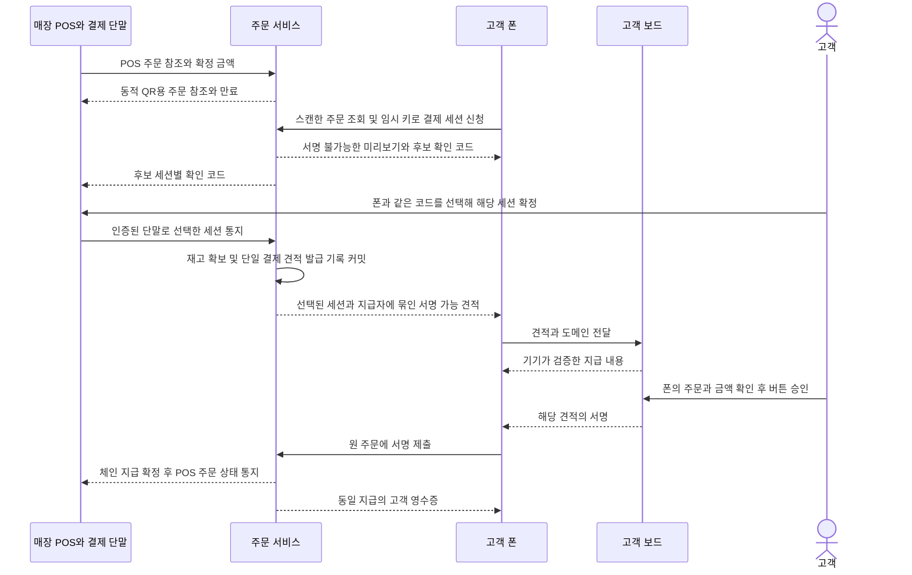
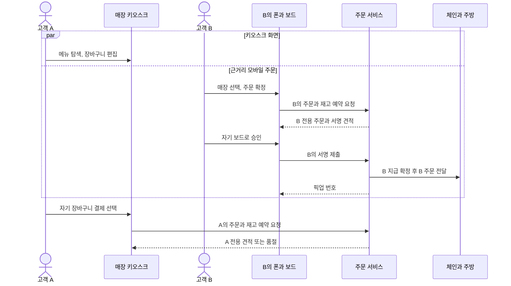
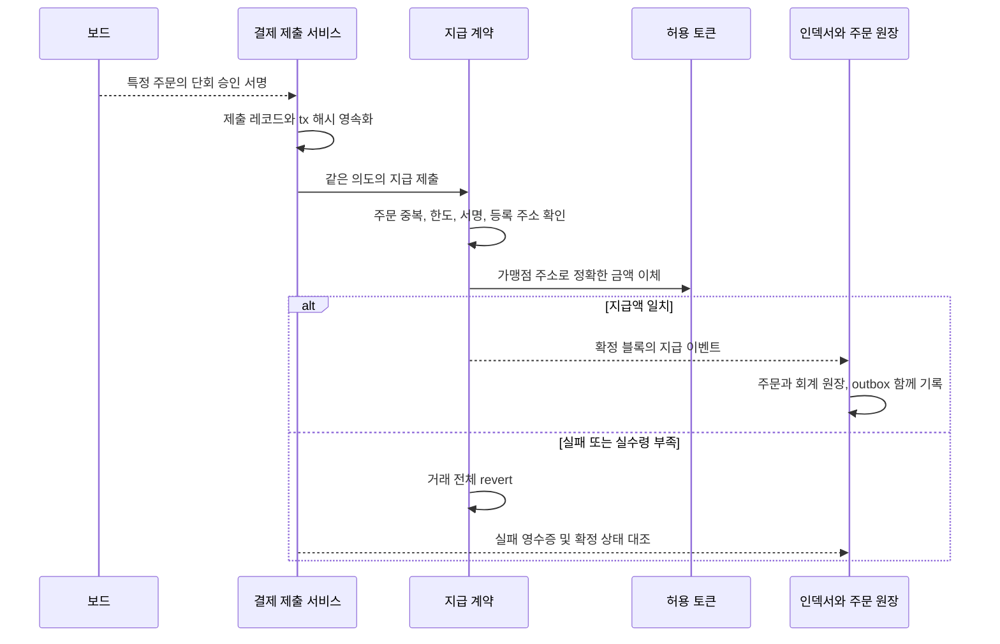
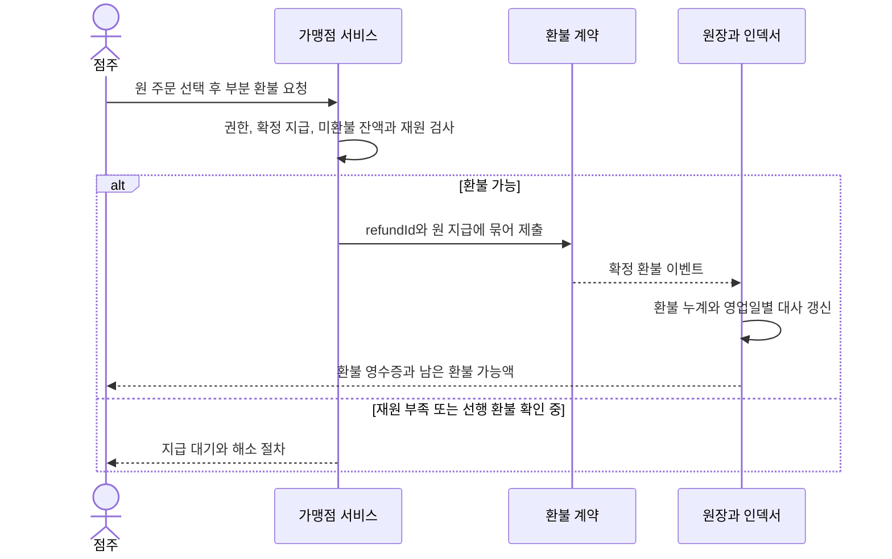
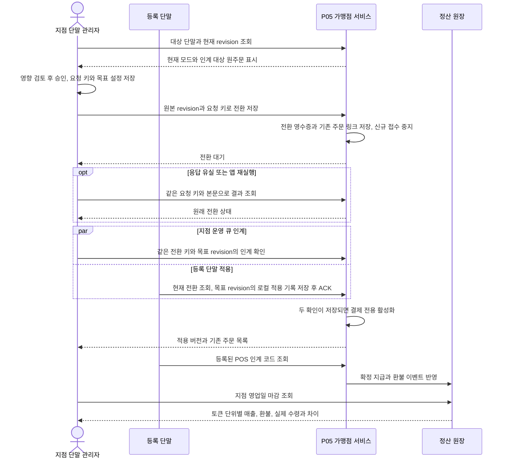

# 암호화폐 전용 키오스크, 근거리 주문과 가맹점 정산

[상용화 설계 목차](README.md) · 데모는 StableNet 테스트넷 8283과 지정된 TestUSDC 한 종으로 실행한다. 카드 번호, NFC 승인, VAN 라우팅, 원화 매입·지급은 결제 경로에 포함하지 않는다. 기존 PG에서 가맹점이 기대하는 결제 조회·멱등 처리·전체/부분 취소·정산 대사·장애 지원을 암호화폐의 확정·환불 의미에 맞춰 제공한다. [토스페이먼츠 결제·정산 API](https://docs.tosspayments.com/reference) · [취소 흐름](https://docs.tosspayments.com/guides/v2/cancel-payment)

## 매장과 단말에서 제공할 기능

| 사용자/모드 | 시작 조건과 주 흐름 | 예외 및 결과 |
|---|---|---|
| 가맹점주 · 개점 준비 | 사업장·지점·담당자 등록 → 지급 주소 소유 또는 계약 지갑 제어 증명 → 체인·허용 자산 지정 → 단말별 자격 발급 → 영업시간/언어/세금·영수증 설정 | 직원, 단말, 지급 주소의 권한 분리. 주소 변경은 이중 승인·대기시간·통지·취소 기회. 철회한 단말의 새 견적은 거절. 이미 발행한 견적은 주소 버전 확인 |
| 점장 · 키오스크 모드 | 메뉴·사진·옵션·필수 선택·알레르기·가격·세율·할인·품절·예약 가능 수량 게시 → 고객이 장바구니 확인 → QR/BLE 결제 → 주문 번호로 픽업 | 버전이 바뀐 상품은 이전 가격의 유효 견적 또는 재동의. 시각·상권별 가격과 통화 반올림 정책을 서버에서 버전 관리. 모든 합계는 최소 단위 정수 |
| 계산원/POS · 결제 모드 | 인증된 POS가 외부 주문 참조와 확정 금액 전송 또는 권한 있는 직원이 금액 입력 → 단말에 가맹점/주문/금액 표시 → 결제만 수행 | 메뉴 편집·임의 가격 수정은 역할로 제한. POS webhook 유실 시 외부 주문 참조로 조회. 모드 전환은 관리자 승인·미완료 주문 복구 후 적용 |
| 대기 고객 · 자기 폰 | 매장 BLE 광고·QR·매장 지도에서 정확한 지점 선택 → 자기 장바구니로 주문 → 자기 기기로 승인 → 주방 접수·대기 번호 수신 | 앞사람의 화면이나 장바구니에 영향이 없다. BLE 권한 거부, 연결 포화, 측정 미지원은 QR과 HTTPS 주문으로 이어간다. 잘못 찾은 지점은 결제 전 주소·이름으로 취소 |
| 매장 직원 · 제공/환불 | 주방 디스플레이나 프린터에서 접수 → 조리/준비/픽업. 주문 검색 → 품목별 전체/부분 환불 신청 → 권한 승인 → 원 거래에 연결해 상태 조회 | 프린터 장애는 작업 재시도와 화면 대체, 재인쇄 표시. 동일 주문 두 번 조리 방지. 체인 확정 후 환불은 별도 자금 이전이며 원 거래 기록 보존 |
| 회계/지원 · 마감 | 매장 현지 영업일 기준 일·주·월 주문, 총매출·할인·세금·환불·순매출, 체인별 수수료와 실수령액 확인. 영수증·정산 CSV 내려받기 | 자정/시간대, 환불이 다음 영업일인 경우 원 결제일과 환불일을 각각 보존. 대사 차이는 조사 큐에 배정하고 조정 내역을 감사 기록에 보존 |

매장 안내 QR와 BLE 광고는 여러 고객이 함께 본다. 결제 QR는 POS의 특정 주문과 금액을 가리키며, 가까운 단말이 여러 대면 화면에 지점·호출 번호·금액을 대조한다. 데모 QR 경로는 전용 지갑이 서명 견적을 열고 보드에서 같은 결제 권한에 서명하는 방식이다. 일반 지갑의 단순 주소 송금은 주문 ID·정확한 금액을 검증할 수 있는 별도 프로필을 설계한 뒤 지원한다.

**거리 기능.** 일반 BLE로 매장을 발견한 폰은 HTTPS 직접 연결 또는 BLE 단말 중계로 주문한다. 두 경로는 같은 주문 원장과 결제 규칙을 쓴다. BLE GATT 동시 연결 수가 적은 단말은 대기열·짧은 연결 시간·QR 전환을 적용한다. 매장 내에서 다수 고객이 물리 단말 하나에 동시에 연결돼야 하는 구조를 피한다. 양단 컨트롤러와 OS가 Channel Sounding 역할을 제공할 때에만 세부 거리 표시를 켠다. RSSI는 목록 정렬 보조값이며 고객 신원·근접 승인·청구 우선권 판단에 쓰지 않는다. [Bluetooth SIG의 Channel Sounding 설명](https://www.bluetooth.com/core-specification-6-feature-overview/)

### 폰 인터넷 없이 BLE로 주문하기

키오스크 모드의 단말은 고객 폰을 위한 **근거리 주문 서비스**와 하드월렛에 연결하는 **결제 링크**를 구분한다. 고객은 폰에 메뉴를 내려받고 연결을 끊은 상태에서 옵션을 고른다. 제출할 때만 단말이 짧게 연결해 고객별 주문을 가맹점 서버로 중계한다. 단말이 인터넷에 연결되어 있으면 폰에 데이터 연결이 없어도 주문·결제 결과를 조회할 수 있다. 단말도 서버에 닿지 않으면 주문 접수·지급 확정을 표시하지 않는다. POS 결제 전용 모드는 근거리 카탈로그·신규 메뉴 주문 권한을 제공하지 않는다.

단말은 고객별 짧은 세션에 순환 기회를 주고 메뉴 탐색·버튼 승인 대기 중 연결 슬롯을 반환한다. 공개 광고에는 장바구니·주문 참조·사용자 주소를 싣지 않는다. 고객은 자기 임시 키 소유를 증명한 뒤 결과를 조회한다. **시험**은 Channel Sounding 미지원, 폰 모바일 데이터 차단, 단말만 온라인에서 실시한다. 고객 A가 탐색 중 B가 BLE만으로 먼저 결제하고, B가 연결을 끊었다가 같은 주문을 조회해도 지급·주방 접수 각 1건이어야 한다.

### POS 결제 모드에서 동적 QR로 결제하기

인증 단말에서 선택한 고객만 자기 임시 키의 소유를 증명하고 해당 지급 계정에 묶인 견적을 받을 수 있다. 같은 코드를 한 단말의 활성 후보 둘에 배정하지 않는다. 미리보기 단계의 후보는 취소·재선택할 수 있다. 서명 가능한 견적을 발급한 뒤에는 [발급과 취소의 경계](#발급과-취소의-경계)를 따른다. 모바일 근거리 주문은 고객이 자기 장바구니를 생성하므로 공용 화면 선택 절차 없이 같은 견적 발급 단계로 들어간다.

## 저장 모델과 API 계약

| 레코드 | 식별자·불변 조건 | 단일 기록 책임 |
|---|---|---|
| 매장·단말·가격표 | 테넌트/매장/단말 키, 카탈로그 버전, 가격 스냅샷·토큰 자릿수·가맹점 payout 버전 | 점주 게시 후 견적이 참조. 영수증은 당시 스냅샷 사용 |
| 주문·재고 예약 | 내부 무작위 orderId, 별도 표시 번호, 매장+외부 POS 주문 ID unique, 수량 ≥ 0 | 주문 서비스의 짧은 DB 트랜잭션. 매장/영업일별 표시 번호는 DB 원자 증가 |
| 결제 견적·시도 | 서명된 quoteId 및 요청 해시, 만료, 체인·계약·토큰·액수·payout, 주문당 동시에 유효한 시도 제한 | 견적 발급 직전 가격과 확보 재고 검증. 발급된 견적의 유효성이 남으면 다른 계약·토큰으로 교체 금지 |
| 지급·회계 원장 | 계약의 `(merchant, orderId)` 단회 지급, 이벤트는 `(chain, contract, txHash, logIndex)` 유일. 내부 원장은 주문별 확정 지급 1개 | 체인 이벤트 검증기가 매출·토큰 수령과 상태 변경을 한 DB 트랜잭션으로 기록 |
| 환불·이벤트 전달 | 원 주문과 고유 refundId, 누적 환불 ≤ 실제 지급, 전달은 고유 eventId | 환불액 예약과 상태 전이 직렬화, outbox는 상태 변경과 함께 저장. 다운스트림은 inbox로 중복 제거 |

공통 API 제안은 카탈로그 조회, `POST /orders`, `POST /orders/{id}/quotes`, `POST /payment-attempts`, `GET /orders/{id}`, `POST /orders/{id}/refunds`, `GET /payouts`이다. 고객용 주문 접근 토큰·가맹점 서비스 자격·운영자 역할을 구분하고 서버에서 테넌트와 객체 권한을 확인한다. 쓰기 요청은 주체·작업에 한정한 Idempotency-Key와 정규 요청 해시를 저장한다. 같은 키와 본문에는 기존 응답, 다른 본문에는 충돌을 반환한다. 웹훅은 검증 가능한 서명·시각·재전송 ID를 담는다. 민감한 원문 서명, 위치 이력, 전체 고객 식별자를 공개 매출 조회에 싣지 않는다.

### 앞 고객을 기다리지 않는 주문

두 고객이 마지막 한 개를 동시에 주문하면 재고 서비스가 조건부 차감에 성공한 한 사람에게만 견적을 발급한다. 장바구니 탐색은 재고를 잠그지 않는다. 여러 SKU를 예약할 때는 테넌트·매장·SKU의 고정 순서로 잠근다. 고객·보드 간 승인, RPC·BLE·프린터 응답을 기다리는 동안 DB 락이나 매장 전체 뮤텍스를 유지하지 않는다. 동일 계층의 다른 경로(취소·환불·만료·운영 보정)도 같은 락 순서를 사용한다.

### 발급과 취소의 경계

이 규칙은 POS, 근거리 주문, 구독 회차, 예약금·잔금에 공통으로 적용한다. **발급**은 기기가 서명할 수 있는 매장 견적을 만들고 서비스가 그 사실을 영속 기록한 시점이다. 자격 있는 견적은 기록 커밋 뒤에만 전달한다. 발급과 취소는 같은 주문 버전에 조건부로 기록한다. 발급 응답을 잃으면 동일 견적을 조회한다.

| 서비스가 가진 증거 | 취소·시간 만료·앱 종료 시 처리 | 재고·좌석과 고객 표시 |
|---|---|---|
| 미리보기만 발행, 서명 가능 견적 발급 0건 | 주문 버전을 갱신해 취소하고 후속 발급 금지 | 임시 확보 즉시 해제. 고객에게 ‘취소 완료’ |
| 견적 발급됨, 지급 미확정 | 앱의 거절·단절은 새 승인을 중지. 이미 전달됐을 수 있는 서명은 계약에서 여전히 유효할 수 있다. 동일 주문/계약을 재조회 | 확보 유지, ‘취소 요청 · 결제 확인 중’. 다른 채널·계약·체인으로 중복 견적 발급 금지 |
| 만료 이후의 확정 블록까지 대상 계약의 주문 지급 부재가 검증됨 | 원 주문 종료. RPC 불일치나 인덱싱 지연만으로 종료하지 않는다 | 한 번만 해제. 이후의 새 시도는 새 유효 견적과 물리 승인 필요 |
| 기간 안에 지급이 포함되어 이후 확정됨 | 취소 요청이 있어도 지급을 먼저 기록. 미이행 주문은 매장 정책에 따라 원 지급에 연결해 환불 | 이행·환불 상태를 표시. 지급 전에 재고가 해제되는 경우 0건 |

한 번의 제출이 revert해도 동일한 유효 견적이 다른 트랜잭션으로 제출될 수 있다. 실패 영수증은 해당 **제출 시도**에 기록하고, **주문**의 최종 취소는 표의 증거로 판정한다. 계약 차원의 조기 무효화를 추가하는 경우에만 확정된 무효화 증거로 만료 대기를 줄일 수 있다.

**교착·충돌 처리.** 주문 행 상태는 version을 비교해 갱신한다. 불가피한 DB 교착 또는 직렬화 실패에서는 트랜잭션 전체를 롤백하고 같은 멱등 키로 제한 횟수만 재시도한다. 지속 충돌은 큐로 넘겨 영구 대기 없이 조회 가능한 상태를 반환한다. 워커 lease에 만료와 fencing 버전을 두고 중단된 워커가 나중에 결과를 덮어쓰지 못하게 한다. 같은 가스 계정을 쓰는 릴레이어는 체인·송신자별 nonce를 영속 예약하고 서명한 tx 바이트/해시를 먼저 기록한 뒤 방송한다. 재가격·재송신 시 동일 지급 의도를 보존한다. [PostgreSQL 잠금과 교착 처리](https://www.postgresql.org/docs/current/explicit-locking.html)

## 한 거래 안에서 가맹점 주소에 지급

현재 `settle`은 예치금 차감, 가맹점 미지급 잔액 증가, 이벤트 발행을 수행한다. `cashOut` 시점에 토큰이 등록 주소로 이동한다. 상용 요구는 **결제 트랜잭션 자체가 성공했을 때 등록 수령 주소의 사용 가능한 토큰 잔액이 정확히 증가하는 것**이다. 특히 데모 TestUSDC는 수취인 거절 모드에서 transfer가 성공을 반환해도 실수령이 보류될 수 있다. [기존 정산 코드](../../../products/p06-stablenet-contracts/src/PaymentSettlement.sol#L121) · [TestUSDC 수취 의미](../../../products/p06-stablenet-contracts/src/test-token/TestUSDC.sol#L7)

1. **자금 원천 선택.** 8283 데모는 예치형 모델을 사용한다. 신규 지급 계약에 별도 테스트 예치금을 준비하고 가맹점 측이 가스를 부담한다. 기존 계약의 잔액·서명을 새 계약이 사용할 수 없다. 상용 개인 지갑용 EVM 토큰 직접 지불의 제안은 소유자가 정확한 금액의 토큰 사용 한도와 대상을 먼저 확인하고, 보드에서 별도 매장 주문 트랜잭션을 승인하는 방식이다. 등록된 지급 계약이 지급자 본인이 호출한 주문만 처리하고 그 계정에서 등록 수령인에게 이체한다. 직접 지불의 가스는 고객 부담으로 표시한다. 승인만 성공하고 지급이 중단되면 남은 allowance와 철회 기능을 보여 준다. 토큰 사용 승인은 정산·구독 결제 완료로 기록하지 않는다. [ERC-20 승인·이체 규격](https://eips.ethereum.org/EIPS/eip-20)
2. **새 계약 검증.** 체인·새 계약 버전·지급 방식, 서명자, nonce, orderId, 만료, 가맹점 상태와 현재 payout, 자산과 금액을 검증한다. 과거 계약용 서명은 새 도메인에서 무효다. 보드·릴레이어와 계약이 같은 견적 해시/필드를 검증해야 한다.
3. **단일 트랜잭션 지급.** 재진입과 이중 사용을 차단하고 사용 가능 예치금·부채 총액을 차감한 후 지급한다. 허용 토큰에 대해 지급 전후 가맹점 실제 잔액 차이 = 견적 지급액을 확인한다. 수수료 차감형·리베이스·보류형 전달 등으로 조건이 깨지면 전체 revert한다. 동일 액수를 `merchantBalance`에도 적립하면 이중 청구가 되므로 새 지급에는 채권을 만들지 않는다. 데모 수수료 정책은 가맹점 수령액 = 결제액이다.
4. **외부 확인.** 성공 이벤트에는 merchant, payout, orderId, token, 실제 지급액과 nonce를 포함한다. 리시트 성공, 허용 계약 주소, 로그 내용, 해당 체인의 확정 블록을 대조해 `paid` 처리한다. 지급은 온체인 한 거래에서 원자적이다. DB·프린터·주방은 확정 근거와 outbox로 재처리한다.
5. **이전 계약 청산.** 신규 배포 주소/ABI/code hash를 SDK·인덱서·모바일 허용 manifest에 추가하고 기존 자금은 별도 장부로 대사한다. 기존 가맹점 적립금 인출과 대여자 인출 경로를 유지한다. 이전 확정 지급이 있는 주문을 새 계약으로 재제출하지 않도록 주문 소유 계약 버전을 고정한다. 전환 기간 이중 집계와 가맹점 주소 교체 중 미확정 주문을 시험한다.

### 보드 승인 전 원견적과 가스 부담 확인

W10의 8283 데모에서는 매장 키오스크의 등록된 릴레이 계정이 네트워크 수수료를 낸다. v2 견적이 서명하는 항목은 상품 대금과 수취 조건이다. 고객 앱은 그 견적과 매장의 수수료 부담 근거를 각각 확인한다. P05의 릴레이 설정에 가스 계정이 존재한다는 사실만으로 그 계정이 특정 지점의 원주문에 대해 비용을 부담하기로 했는지 알 수 없다. 이미 방송한 거래의 발신자는 사후 영수증에서 확인할 수 있다. [견적 발급](../../../products/p05-operations-backoffice/internal/commerce/quote.go) · [배포 검토](../../../products/p05-operations-backoffice/internal/settlement/operator_deployment.go) · [릴레이의 서명자 대조](../../../products/p05-operations-backoffice/internal/settlement/worker.go)

공용 키오스크의 QR로 시작해 W09 결제 목록에서 다시 열어도 주문 분류와 후원 조건의 원본은 같다. P05는 조회 중인 구매자의 지점·주문·서명 견적을 대조해 매장 주문인지 판정한다. 앱의 진입 경로나 QR 표시 문구만으로 이 조건을 정하지 않는다. 매장 부담을 약속한 원견적은 구매자가 직접 전달할 때도 릴레이 인계 직전에 같은 후원 근거가 그 견적에 유효한지 확인한다. 철회 또는 만료를 서명 후 인계 전에 발견하면 같은 원주문에서 보류 사유를 표시한다. 이미 인계한 요청을 재조회할 때는 기존 결과를 돌려주고 두 번째 지급을 만들지 않는다.

W10의 **결제 원천**과 **가스 부담 주체**는 서로 다른 근거에서 읽는다. 8283 데모의 대여 예치금은 `SettlementV2`의 해당 지급자·세대에 입금한 잔액이다. 앱은 현재 수락한 대여 인도·보드 슬롯 세대, 같은 배포의 활성 대여 지급자(`RENTER=2`), 원견적의 지급자·세대·예치금 모드(`ESCROW=1`)를 대조한다. 확정된 지급에서는 같은 세대의 예치금 차감과 등록 수취 주소의 실수령 증가를 확인한다. 구 v1 계약의 `depositFor`와 인출 기록은 구 배포에서 계속 조회한다. 개인 계정은 검증된 개인 지급 주소와 해당 견적의 재원을 표시한다. 여행 예약과 구독은 각자의 원주문 권한과 회차를 유지한다. [v2 예치·지급·환불](../../../products/p06-stablenet-contracts/src/SettlementV2.sol) · [v1 대여 예치](../../../products/p06-stablenet-contracts/src/PaymentSettlement.sol)

재원 확인에 쓰는 확정 블록은 검토한 배포의 시작 블록 높이 이상이어야 한다. P05는 같은 블록 해시에서 배포 코드·토큰·지급자 역할과 세대·예치금을 읽고 그 높이의 정본 해시를 다시 확인한다. 앱에 발급하는 재원 근거는 원견적, 현재 대여 인도, 해당 지급자 등록과 체인 조회의 유효 기간 가운데 가장 먼저 끝나는 시각까지만 쓸 수 있다. 등록 만료 직전의 조회가 긴 인도 기한을 상속하거나, 같은 코드가 있던 예전 세대의 블록을 새 인도의 근거로 쓰는 경우에는 신규 지급을 보류한다. [대여 인도와 지급 배포의 데이터 관계](architecture/erd.md#매장-조회-권한과-대여-지급-배포)

| 시점 | 표시와 행동을 허용하는 조건 |
|---|---|
| 견적을 다시 엶 | 앱은 원주문과 같은 서명 견적을 복구한다. 기기 연결 상태만으로 보드 검증 완료를 표시하지 않는다. |
| 가스 부담을 검토함 | 같은 지점·배포·원견적에 적용되는 후원 조건과 유효 기간을 등록된 권위로 검증한다. 고객의 데이터 연결이 끊겼어도 키오스크를 통한 전달과 검증이 가능해야 한다. 조건이 누락·만료됐거나 원견적이 바뀌면 이유를 표시하고 지급 승인을 보류한다. |
| 보드에서 확인함 | 개인 지갑은 등록한 소유자 세션에서, 대여 지갑은 현재 대여 세대에 허용된 결제 세션에서 보드가 같은 원요청·견적 바이트를 검증한 응답을 기다린다. 대여 경로에서 키오스크가 견적을 전송하기 전 보낸 화면 알림은 기기 검증의 근거로 사용할 수 없다. 세션이 바뀌면 기존 검토를 지우고 기기를 다시 확인한다. SW2 거절은 원주문의 조회를 유지하고 새 지급·릴레이를 만들지 않는다. |
| 재시작·교체 후 재조회함 | 새 견적이나 다른 배포의 후원 증거를 기존 원주문에 붙이면 거절한다. 동일 거래의 결과가 불명확할 때에는 원주문과 기존 승인·원장 상태부터 조회한다. |

인수 시험에서는 정상 후원 매장 한 곳과 다른 지점 한 곳을 함께 준비한다. 정상 매장의 고객에게만 매장 부담을 표시하고, 후원 중단·원견적 교체·보드 재연결 각각에서 이전 검증 결과로 승인할 수 없는지 확인한다. 최종 지급 후에는 가스 지출 거래와 고객의 상품 대금 변동을 원장과 대조한다. [W10 화면 계약](screens/specs/W.md) · [필수 종단 시나리오](implementation-plan.md)

### 환불·재예약·대사

즉시 지급 후 자금은 점주가 보유한다. 플랫폼이 임의로 매출을 되돌릴 수 없으므로 가맹점의 별도 환불 예치금 또는 점주 지갑의 회차별 승인이 필요하다. 파일럿은 **가맹점별 사전 충전 환불 재원**을 제안한다. 재원이 부족하면 ‘환불 접수·지급 대기’로 표시하고 고객에게 확정 환불 영수증을 먼저 발급하지 않는다. 환불 계약은 원 지급 증거·권한·수취인·고유 refundId와 누적 한도를 검증한다. 데모의 원천이 대여 예치금이면 약정한 원 계정에 복원하고 폐쇄 계정은 사전 등록한 인출 주소 정책을 따른다. 직접 지불은 검증된 원 지급자의 환불 주소를 쓴다. 고객지원이 채팅으로 받은 주소를 임의 대입할 수 없다.

## 운영과 인수 시험

주문 지급 상태는 미리보기 → 견적 발급 → 확인 중 → 지급 확정 또는 미지급 종료로 관리한다. 각 제출 시도의 서명 수신·방송·확정 성공·revert는 별도로 기록한다. 이행 상태는 재고 확보 → 주방 접수 → 준비 → 픽업/취소로 추적한다. 지급 뒤 인쇄가 실패해도 재결제시키지 않는다. 연결이 끊긴 매장에서는 캐시된 메뉴와 이미 확인한 주문을 조회하고 새 확정 지급 표시는 체인 확인 뒤로 미룬다. 현금·카드 오프라인 승인을 모사하지 않는다.

| 시험 | 제안한 파일럿 부하/장애 | 합격 조건 |
|---|---|---|
| 독립 주문과 재고 | 한 매장에서 100개 주문 동시 생성, 한 단말에서 메뉴 탐색 5분, 마지막 SKU 1개를 두 채널에서 경합 | 다른 고객이 먼저 완료. 재고 음수·같은 픽업 번호·타인 장바구니 변경·영구 대기 각 0건 |
| 중복과 교착 | 같은 주문 QR/BLE 제출을 20회 반복, 상반된 품목 순서와 동시에 환불·만료. DB 충돌과 워커 재시작 주입 | 지급·재고 차감·조리 각각 1회, 초과 환불 0건. API는 제한 시간에 결과/조회 ID를 반환, 정상화 뒤 모든 원장 대사 |
| 체인 경계 | tx 방송 직전/직후 프로세스 종료, RPC 유실·노드 간 일시 불일치, 만료 직전 포함·이후 finality, 가스 부족 | 기존 해시·로그부터 재조회. 불확실할 때 실패 확정이나 재청구 0건. 복구 후 paid/expired 중 하나로 수렴 |
| 지급·환불 | 주소 변경 도중, 수취 거절 모드, 잘못된 토큰, 두 부분 환불 합이 원금 초과, 구계약과 동시 인덱싱 | 성공은 실제 등록 주소에 정확히 한 번 입금. revert 시 해당 시도의 주문 사용 비트·예치금·토큰 이동은 원복되며 발생한 네트워크 가스비는 별도 기록. 일마감 차이 0 최소 단위 |
| 매장 운영 | POS webhook 중복·순서 역전, 주방 프린터 오프라인, 직원 퇴사·단말 분실, 백업으로 원장 복원 | 중복 제공 0건, 재전송 가능, 자격 철회 후 새 주문 불가. 주방·영수증·회계가 원 주문에서 추적 가능 |

### 단말 모드 전환과 점주 마감

화면 인수에서 공용 장바구니, 동시에 진행하는 근거리 개인 주문, 재가격한 주문은 각각의 지급자·견적·거래·픽업 ID를 끝까지 보존한다. 영업일 원장 화면의 고정 합계와 별도 병렬 부하·가격 변경 시나리오를 구분한다. 환불 신청 전송 직후에는 접수 여부를 조회하고 원금 예약과 신청 기록이 함께 커밋된 뒤에만 승인 대기열에 표시한다. [개인 주문](screens/book.html#K10/request) · [원금 예약 대기](screens/book.html#O05/submitPending) · [예약금·잔금의 부분 환불](screens/book.html#T07/paid_partial)

점주는 관리 화면에서 지점·영업일·결제 자산을 선택해 메뉴 v1을 게시한다. 옵션 두 개와 품절 품목을 포함한 장바구니의 가격을 검산하고 메뉴 v2를 게시한다. v1에서 이미 발급한 유효 견적은 약정가를 유지하고, 미리보기만 받은 고객에게는 v2를 보여 주고 다시 동의를 받는다. 가격·모드 변경은 직원 역할·단말 자격·버전과 함께 감사 기록에 남긴다.

**합격 예시.** 데모 수수료 0에서 10·20 TestUSDC 두 주문과 첫 주문의 3 TestUSDC 부분 환불을 만든다. 지급 주소에는 두 결제로 30이 들어오고 별도 환불 재원에서 3이 나간다. 보고서의 총매출 30, 환불 3, 순매출 27, 두 재원의 개별 증감·이벤트 대사 차이 0을 검사한다. 다음 영업일 환불이면 그날의 환불로 표시하고 원 주문으로 역추적한다. 모드 전환 중 재부팅해도 기존 지급 1건·영수증 1건을 유지한다. 결제 전용 단말의 메뉴 주문 명령과 직원의 무단 가격 변경은 서버에서도 거절한다.

**동시성 판정.** 정상 100개 동시 주문 시험에서는 DB 교착 감지 횟수·영구 대기 모두 0이어야 한다. 별도의 충돌 주입 시험에서는 락 대기 2초, 요청당 재시도 최대 3회, 누적 8초 안에 결과 또는 조회 ID 반환을 파일럿 목표로 둔다. 서버 정상화와 체인 확정 재개 후에는 마지막 처리 가능한 이벤트 수신부터 60초 안에 주문 원장·출고 지시가 수렴하는지 검사한다. 고객이 앞 단말을 5분 점유해도 폰 B의 완료 시각이 A의 결제 시작보다 앞서야 한다. 거리 측정·BLE 권한이 없는 기기에서도 QR로 같은 시나리오가 통과해야 한다.

관측치는 견적 발급·사용자 승인·브로드캐스트·체인 확정·주방 전달 소요 시간을 분리한다. 매장 부하의 초기 목표는 네트워크가 정상일 때 주문 생성 p95 1초 이내다. 기존 W12의 10초는 해당 StableNet 시나리오를 별도 측정하는 목표다. 체인 장애 시간에도 10초 정산을 약속하는 계약으로 사용하지 않는다.
