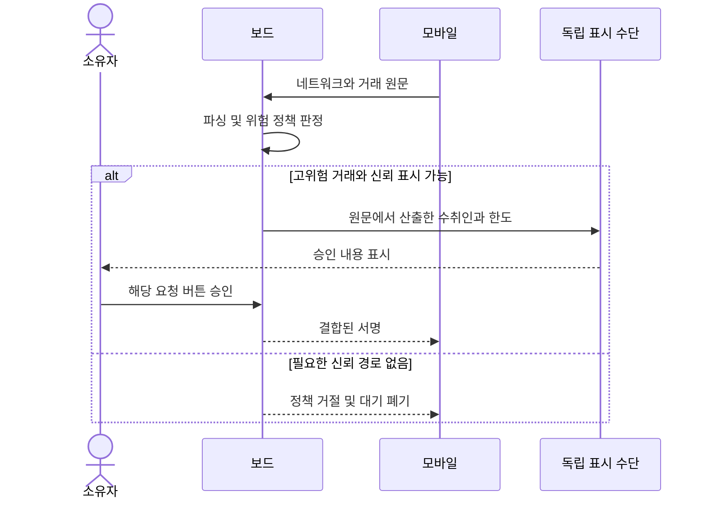

# P01 보드 펌웨어 · 유즈케이스

[제품별 설계 목차](../README.md) · [PRD](prd.md) · [기획](plan.md) · [유즈케이스](use-cases.md) · [정보구조](ia.md)

## 시나리오별 인수 시험

### UC1 · 처음 만든 보드로 수신하기 (R1·R4)

- **주체와 시작 조건** 제작자와 소유자, 지원 보드와 신뢰할 수 있는 이미지·복구 수단 보유.
- **정상 흐름** 이미지 확인 → 설치 → 기기 식별 키 등록 → 개인 루트 생성 → 백업·복원 확인 → 첫 주소 확인.
- **예외와 재개** 등록 도중 전원을 끄면 식별 키와 등록 상태부터 조회하고 미완료 루트는 활성화하지 않는다.
- **종료 상태** 복구가 확인된 계정만 입금 가능.
- **합격 증거** 재부팅 전후 등록 건수, 동일 파생 주소, 민감값이 없는 진단 자료.

### UC2 · 거래 승인 또는 거절 (R2·R3)

- **주체와 시작 조건** 소유자, 잠금 해제된 보드와 허용된 체인·표시 수단.
- **정상 흐름** 원문 해석 → 기기가 만든 요약 표시 → 수취인·수수료 확인 → 버튼 승인 → 서명 반환.
- **예외와 재개** 고위험 거래의 독립 표시가 없거나 알 수 없는 호출·만료·사용자 거부이면 승인 대기를 폐기한다.
- **종료 상태** 한 요청에 하나의 승인 결과.
- **합격 증거** 정상 여섯 전송과 수취인 변경·체인 불일치·거절 벡터에서 서명 수 대조.

### UC3 · 폰 분실과 대여 반납 (R4·R5)

- **주체와 시작 조건** 소유자가 기존 보드 제어와 독립 증명을 보유하거나 인증된 운영자가 대여 기기를 회수.
- **정상 흐름** 보드 PIN과 등록한 독립 복구 수단으로 새 앱 공개키를 확인한다. 소유 세대 증가와 이전 앱 권한·대기 승인 무효화를 한 번에 저장한 후 옛 BLE 본드를 정리한다. 반납은 대여 정산 상태 확인 후 대여 영역을 닫는다.
- **예외와 재개** 미결 대여 지급은 조회 대상으로 남기고 개인 영역 대상 운영 명령은 거절한다.
- **종료 상태** 개인 주소는 폰 교체 전후 동일하며 회수된 대여 권한은 종료.

상용 소유 세대 교체는 C1 TLS 자격을 교체한다. 상용 소유자 휴대전화는 BLE 본드를 맺지 않는다. 소유자 서비스는 링크 암호화를 요구하지 않고, 소유자는 C1 TLS 세대로 식별한다. 상용 모드에서는 레거시 세션과 페어링 모드가 열리지 않으므로 새 본드도 생기지 않는다. 따라서 BLE 본드 저장소에 남은 본드는 모두 상용 모드 이전의 레거시 결합이며, 특정 소유 세대에 속하지 않는다. 보드는 상용 모드로 부팅할 때와 소유자 등록·교체·폐기가 확정될 때 이 저장소 전체를 삭제한다. 소유자 상태 응답의 플래그 바이트 bit 1로 저장소가 비었는지 알리고, 앱은 이 값으로 이전 휴대전화의 BLE 연결 기록 정리 여부를 표시한다. 삭제가 실패하면 다음 소유자 변경이나 재부팅 때 다시 삭제하며, 그때까지 앱은 확인 대기로 표시한다.

같은 보드를 레거시 모드로 다시 쓰려면 휴대전화를 다시 페어링해야 한다. 본드 주소는 보드 밖으로 내보내지 않고, 상태 응답에는 저장소가 비었는지만 담는다. 소유자 휴대전화에 링크 계층 암호화를 추가하는 일은 이 결정과 별개 과제로 둔다.
- **합격 증거** 교체 커밋 직전/직후 전원 차단 및 옛 본드 삭제 실패를 주입한다. 재시작 후 활성 소유 세대는 하나이고 교체 완료 후 구세대 서명은 0건이다. 대여 종료 이력과 개인 슬롯 불변도 대조한다.

### UC4 · 읽기 전용 내보내기와 공동 서명 (R3·R6)

- **주체와 시작 조건** 소유자가 복구한 Bitcoin 계정과 등록한 multisig descriptor를 선택한다.
- **정상 흐름** 계정 범위와 주소 연결 가능성을 확인하고 xpub 내보내기를 승인한다. 읽기 전용 앱의 PSBT를 가져와 입력·외부 출력·자기 거스름돈·공동서명 정책·수수료를 기기에서 검증하고 해당 서명만 반환한다.
- **예외와 재개** 알 수 없는 descriptor·서명자·change를 거절한다. EVM 권한 조회와 철회는 별도 메서드로 spender·잔여 한도·체인과 철회 거래를 확인한다.
- **종료 상태** 읽기 전용 프로필은 잔액 조회만 가능하고 공동서명 완료 여부는 체인별 임계치에 따른다.
- **합격 증거** 독립 구현의 파생 주소 대조, 위장 change 거절, DApp 연결 해제 뒤에도 기존 온체인 allowance가 유지되고 철회 거래 확정 후에만 줄어드는 기록.

### W27 보호 프로필에서 DApp 사용 권한 부여

W27의 수취 주소·건별·일별 지출 한도를 활성화한 설치판에서는 토큰 사용 권한의 별도 인수가 필요하다. ERC-20의 spender는 나중에 `transferFrom`으로 수취 주소를 선택할 수 있다. 기기는 승인 원문에 적힌 spender와 실제 출금 수취인을 구분하고, 기존 정책이 어느 범위까지 강제되는지 먼저 확인해야 한다.

| 사용자 행동 또는 복구 지점 | W27 보호 프로필의 완료 기준 |
|---|---|
| 등록된 사이트에 유한 한도 부여 요청 | 원본의 체인·계정·nonce·토큰·spender·수량을 확인한다. 수취인 정책과 호환되는 지출 경로만 허용하고 서명 전에 기존 건별·일별 한도와 미결 예약을 원자적으로 검사한다. |
| 승인 거래 확정 후 앱 재시작 또는 날짜 변경 | 원거래와 권한 예약을 복구한다. 승인 성공은 지출권 활성화로 기록하고, 실제 지출 또는 남은 노출액이 확인되기 전 예약을 이중 사용하지 않는다. |
| 승인 이후 잔여량이 0이거나 회수 거래가 확정됨 | 잔여량, 실제 지급 및 회수를 원래 계정·토큰·spender에 연결한 확정 근거로 대사한다. 이미 사용한 금액을 일일 가용 한도로 복원하지 않는다. 범위·정본이 미확인이면 기존 보호 상태를 유지한다. |

일반 지갑의 명령 36과 W27 전용 프로필의 검증 범위는 펌웨어 명세에서 구분한다. [펌웨어 명령과 보호 저널](../../../../../products/p01-device-firmware/README.md#사이트의-유한-erc-20-사용-권한-부여)

### 대여 반납 지시를 받고 연결이 끊긴 경우

등록 스테이션이 같은 대여 기기·세대의 RCI1 원문을 제시한다. 보드는 수집기 연결 권한, 등록된 운영자 서명, 원지시 유효기간, 동결된 로컬 저널과 검증된 최종 정산 근거를 대조한다. 미결 지급·한도 변경이 모두 0이고 원요청 및 처분 지문까지 일치하면 해당 세대에 정리 대기를 한 번 기록한다. 정리 대기 응답을 받은 스테이션은 이 단계에서 보드 폐기 영수증을 게시할 수 없다. [지시·영수증의 바이트 규약과 대기 기록](../../../../../packages/protocol/v2/transport.md#rental-slot-cleanup-proof-v1)

| 상황 | 인수할 결과 |
|---|---|
| 응답을 잃고 재연결했거나 보드가 재시작됨 | 새 연결에서 수집기 권한을 확인하고 정확히 같은 원요청의 대기 기록을 다시 읽는다. 일반 지급 서명을 다시 열지 않는다. |
| 스테이션 권한이나 지시 기한이 지나 처음 도착함 | 새 대기 기록과 키 쓰기가 0건이다. 과거 대기 기록을 읽는 과정에서 새 폐기를 실행하지 않는다. |
| 다른 세대·요청·운영자, 검증할 수 없는 시각·정산 근거 | 입력을 거절하고 동결 저널, 개인 키와 다른 세대의 상태를 보존한다. |
| 실제 보호 키 폐기를 완료하고 똑같은 증거를 복구할 수 있음 | 해당 세대의 보드 증거 키로 원지시를 가리키는 RCR1을 발급한다. 서버의 영수증 확인과 기기 인계까지 대조한 후에만 다음 세대를 열 수 있다. 이 행은 출시 보드에서 별도 인수한다. |

## 대표 흐름과 실패 분기

