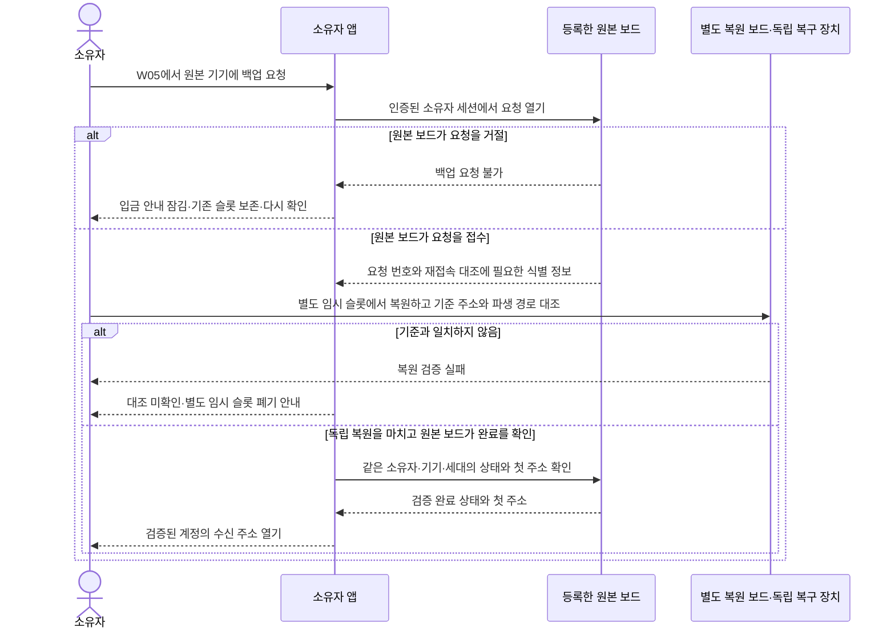
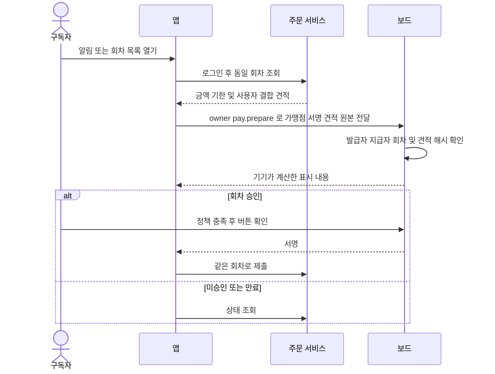
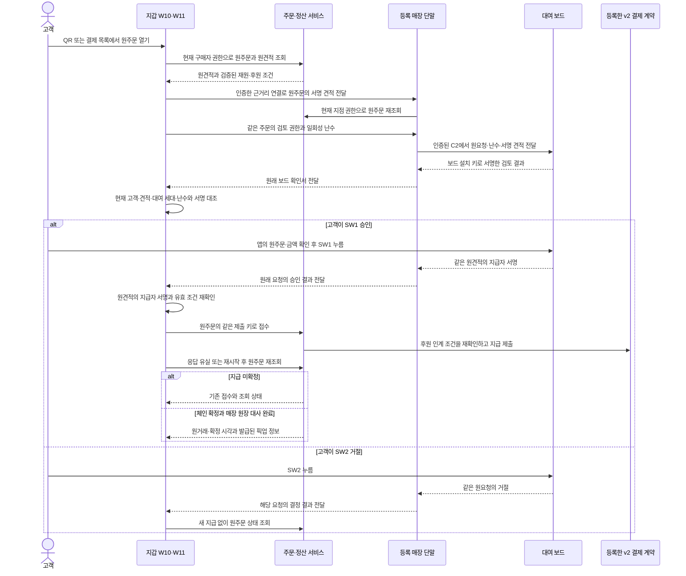
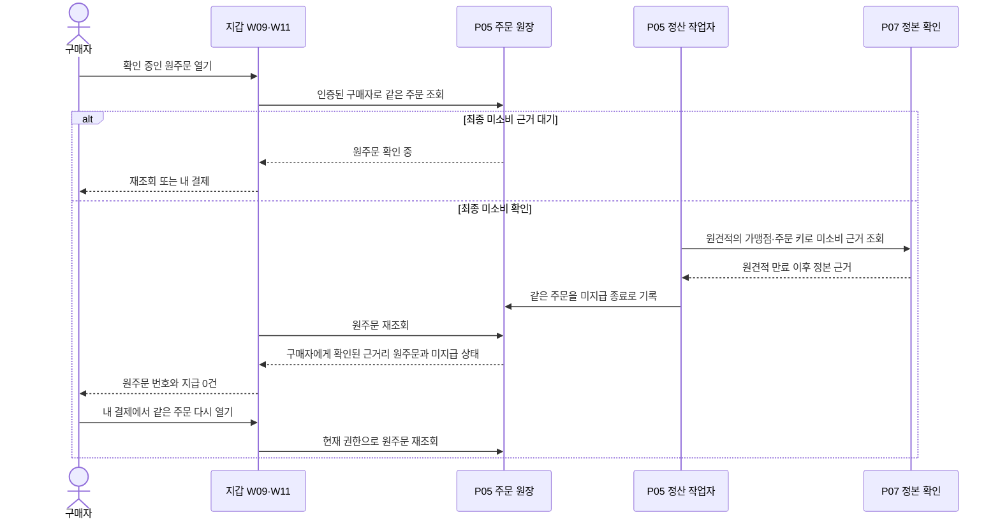

# P02 소유자 모바일 앱 · 유즈케이스

[제품별 설계 목차](../README.md) · [PRD](prd.md) · [기획](plan.md) · [유즈케이스](use-cases.md) · [정보구조](ia.md)

## 시나리오별 인수 시험

### UC1 · 초기 설정과 네트워크 전환 (R1·R2·R3·R7)

- **주체와 시작 조건** 보드 소유자, 앱 첫 실행 또는 대여 앱 업데이트.
- **정상 흐름** 프로필 선택 → 튜토리얼 → 보드 등록 → 보드 PIN → 복구 확인 → 체인·자산 선택 → 수신 주소 확인.
- **예외와 재개** BLE 권한 거부 시 설명 후 설정으로, 미지원 커스텀 체인은 저장 전 되돌린다.
- **종료 상태** 검증한 체인의 계정 화면, 미완료는 재개 단계.
- **합격 증거** 기기 교체·테스트넷 전환 화면 및 6체인 수신 벡터.

설정에서 연습을 다시 열 때도 처음 사용한 사람과 같은 주문을 검토할 수 있어야 한다. 다음 행동은 W27과 W02·W09의 인계 기준이다. [접근성 설정](../../screens/book.html#W27/access)

| 사용자 행동 | 확인할 결과 |
|---|---|
| 글자를 200%로 보고 동작을 줄인 상태에서 연습 주문 읽기 | 금액 전체와 단위, 수취인, 연습 체인, 취소 버튼을 읽거나 스크롤해 선택한다. 보드 버튼 위치 안내는 움직임 없이 이용할 수 있다. |
| 화면 읽기에서 다음 항목으로 이동하고 안내 다시 듣기 | 연습 출처 뒤에 금액·수취인·체인·수수료·가상 확인·취소를 안내한다. 반복해도 같은 연습 자료를 사용한다. |
| 큰 글씨 또는 화면 읽기에서 연습 거절, 이후 재시작 | W02의 거절 결과를 열고 연습 다시 보기와 실물 보드 등록을 선택할 수 있다. 해당 연습으로 인한 보드 서명과 RPC 제출은 각각 0건이다. |
| 잠금 화면 알림 예시를 확인하고 OS 알림 권한을 끈 뒤 앱 복귀 | 일반 알림 문구만 표시하고 주소·금액·가맹점명을 가린다. 운영체제 권한을 다시 읽은 다음 해당 사용자의 미결 목록을 열 수 있다. 원청구의 금액과 만료 시각은 유지된다. |

#### 분실한 기기에 맞는 복구 경로 선택

새 휴대전화에서 지갑을 되찾는 사람과 기존 휴대전화에 새 보드를 연결하는 사람은 보유한 증거가 다르다. W06의 첫 화면에서 보유한 기기와 지갑 종류를 확인한 뒤 아래 경로를 선택한다. 선택은 탐색 동작이다. 스캔, 새 소유 세대 등록, 복구 요청 생성은 각 경로에서 사용자가 다음 동작을 선택할 때 시작한다.

| 사용자가 보유한 것 | 열리는 경로 | 확인할 결과 |
|---|---|---|
| 원래 보드와 독립 복구 수단 | 잃어버린 휴대전화 교체 | 기존 보드, 보드 PIN, 등록한 복구 장치를 안내한다. 새 보드에 지갑을 쓰기 위한 입력란은 열리지 않는다. |
| 새 보드와 검증된 백업 | 분실한 보드 복원 | 원본·교체 기기와 독립 검증자의 지문을 대조하는 절차로 이동한다. 실제 복원과 원주소 대조는 별도 승인으로 진행한다. |
| 클라우드 지갑 계정 | W22 클라우드 휴대전화 복구 | 지원 배포에서는 기존 P03 계정 인증과 복구 자격 확인을 거친다. 미지원 배포에서는 이용 가능 여부를 표시하고 원래 선택 화면으로 돌아올 수 있다. |

설치 앱에서 각 경로에 진입한 뒤 복구 작업을 시작하기 전에 돌아와 다른 경로를 고른다. 새 휴대전화에서 로컬 개인 보드 등록이 없어도 복구 방법을 찾을 수 있어야 한다. 선택·돌아가기만 한 뒤 보드 명령, 계정 생성, 복구 접수, 서명은 모두 0건이고 기존 지갑 상태는 같다. 선택한 분실 사유를 서버나 진단 로그에 남길 필요가 없다. [W06의 경로와 전이](../../screens/specs/W.md#w06--분실교체-복구)

#### 폰 교체가 끝났지만 이전 BLE 연결 기록 정리가 지연되는 경우

교체 커밋 직후 새 휴대전화가 현재 소유 세대와 같은 수신 주소를 조회할 수 있다. 옛 휴대전화는 본드가 남아 있어도 이전 권한으로 원장 조회나 서명을 진행할 수 없다. 보드가 제공하는 정리 상태를 새 소유자가 인증된 세션에서 조회하고, 보드가 실제 정리 결과를 확인한 뒤 안내를 닫는다. 통신 단절이나 구형 보드에서 결과를 읽지 못하면 확인 대기로 표시한다. 휴대전화에 주변 기기의 BLE 주소 목록을 전달하지 않는다.

| 실행 조건 | 인수 증거 |
|---|---|
| 교체 커밋 뒤 본드 정리 실패, 이어서 신규 소유자 조회 | 같은 주소와 새 세대를 표시한다. 정리 작업은 대기로 남고, 구세대 요청에 대한 서명은 0건이다. |
| 정리가 중단된 채 같은 보드 재시작 | 새 세대가 유지된다. 정리를 다시 실행해 대상 본드가 해제됐음을 확인한 뒤 완료를 표시한다. 조회·재시도로 소유 세대나 지갑 키가 다시 바뀌지 않는다. |
| 교체 전 거절 또는 중단 | 원래 소유자가 유효하고 기존 연결을 정리하지 않는다. 다른 보드나 과거 세대의 정리 완료 응답이 현재 상태를 바꾸지 않는다. |

[펌웨어의 소유 세대 완료 조건](../p01-device-firmware/use-cases.md#uc3--폰-분실과-대여-반납-r4r5) · [상태별 증거 등록표](../../screens/runtime-states.md)

#### 첫 주소 대조를 마치기 전에 백업 요청이 거절되는 경우

개인 보드 등록을 마쳤지만 첫 주소를 확인하지 않은 소유자가 W05에서 백업을 시작한다. 원본 보드가 인증된 채널에서 요청을 거절하면 앱은 기존 활성 슬롯이 보존됐고 주소 대조는 미확인임을 표시한다. 소유자는 등록한 원본 보드와 독립 복구 장치를 확인한 뒤 다시 시도할 수 있다. 거절 응답에는 주소가 불일치했는지 판단할 상세 사유가 없다.

| 인수 시점 | 확인할 결과 |
|---|---|
| 거절 또는 독립 복원 미완료 후 앱 재시작 | 주소 공유와 송금을 계속 잠근다. 휴대폰에 복구 단어나 개인키를 입력하는 경로가 없다. |
| 별도 보드에서 다른 루트로 대조 | 원본 개인 슬롯과 첫 주소가 보존되고, 잘못 복원한 대상 슬롯은 검증된 지갑으로 활성화되지 않는다. |
| 같은 원본 보드에서 재시도 | 독립 복원과 원본 확인을 마친 후 등록 기기·소유자·세대와 일치하는 첫 주소만 공개한다. |

[W05 화면 상태](../../screens/specs/W.md#w05--백업과-첫-주소-검증) · [백업 요청과 재조회](../../../../../products/p02-user-app/src/wallet/ownerSession.ts)

### UC2 · DApp 접속·로그인·지출 (R2·R4·R7)

- **주체와 시작 조건** 사용자, DApp 출처와 요청 계정 확인.
- **정상 흐름** 브라우저 → 연결 범위 동의 → 로그인 내용 검토 → 별도 지출 요청·보드 승인 → 영수증 조회.
- **예외와 재개** 세션 만료·출처 변경·보드 정책 거절 시 원인과 해제 메뉴 제공.
- **종료 상태** 접속 권한과 승인 결과를 각각 기록.
- **합격 증거** 연결만으로 서명 0건, 철회 뒤 서명 0건.

브라우저와 외부 지갑 연결은 동일한 출처·계정·체인·메서드 권한 검사와 보드 정책을 사용한다. 아래 5 DEMO는 소수 6자리인 시험 토큰에서 5,000,000 최소 단위를 뜻한다. [요청 검사](../../../../../products/p02-user-app/src/wallet/dapp/gate.ts) · [W14 검토 화면](../../screens/book.html#W14/spend)

| 행위와 시작 조건 | 사용자가 확인할 결과 | 합격을 가르는 관측 |
|---|---|---|
| W13에서 만료된 연결을 열고 재연결 | 출처, 계정, 체인, 허용 메서드와 새 만료를 다시 선택한다. | 이전 세션 요청을 거절한다. 사용자가 다시 허용하기 전 서명·제출 0건. |
| W14에서 로그인 메시지를 검토 | 출처, 계정, 체인, 서비스가 발급한 nonce와 만료 시각을 보고 취소하거나 서명한다. 현재 지갑·보드 프로필은 영문·숫자 8~32자리의 nonce를 지원한다. | 승인한 원문과 서비스가 받은 서명의 계정을 대조한다. nonce 재사용·만료를 거절한다. 로그인 서명의 온체인 제출은 0건이다. [SIWE 메시지 규격](https://eips.ethereum.org/EIPS/eip-4361#message-format) · [앱·보드 공통 시험 예제](../../../../../products/p01-device-firmware/test/evm_vectors.go) |
| W14에서 등록된 서비스가 5 DEMO 지출권을 요청 | 토큰과 체인, 사용을 허용할 주소, 한도, 최대 수수료, 요청 기한을 앱에서 읽고 보드의 신뢰 가능한 확인 수단으로 검토한다. | 서명 대상은 소유자 계정의 해당 토큰 계약과 정확한 spender·수량이다. 표시 불일치, 미등록 주소, 무제한·상한 초과, 승인 전 연결 종료·만료 시 서명·제출 0건. |
| 승인 직후 응답 유실 또는 앱 재시작 | W15에서 원거래 해시와 미확정 상태를 확인한다. | 같은 요청으로 새 거래를 만들지 않는다. 원거래 영수증의 정본 확정을 확인한다. 현재 잔여 한도는 영수증 높이 이상의 확정 블록 해시에 고정해 같은 계정·토큰·spender로 재조회한다. 승인 뒤 일부를 사용했다면 그 잔여량을 표시한다. 실패·재구성·RPC 장애 중에는 요청한 5를 실한도로 표시하지 않는다. |
| W15에서 연결을 해제한 뒤 등록된 지출권 철회 | 남아 있는 지출권과 해당 spender를 확인하고 별도의 0 한도 거래를 검토한다. | 연결 해제 즉시 새 DApp 요청을 차단한다. 철회 취소 시 체인 한도 유지, 승인 시 원래 토큰·spender의 확정 한도 0을 확인한다. |

### UC3 · 회차 알림과 해지 (R5)

- **주체와 시작 조건** 구독자, 약관에 동의했고 납기 전 청구서가 존재.
- **정상 흐름** 미결 목록 또는 알림 → 회차·상점 확인 → 가맹점 서명 견적 원본을 소유자 세션의 `pay.prepare`로 중계 → 지급자·회차·견적 해시 검증과 보드 승인 → 거래 조회 → 다음 회차 해지.
- **예외와 재개** 알림 중복·앱 재시작은 같은 회차로 복귀, 이미 발급된 견적은 P05 만료/확정 절차로 추적한다.
- **종료 상태** 한 회차 영수증과 미래 회차 해지 상태.
- **합격 증거** 두 폰·알림 거부·기한 경과와 미승인 지급 0건.

### UC4 · 여행지 예약·디파짓·픽업 (R6·R7)

- **주체와 시작 조건** 여행자, 수동 지역 검색 또는 위치 동의.
- **정상 흐름** 지도 → 장소 → 시간·재고 → 총액/취소 조건 → 디파짓 승인 → 예약 상세에서 잔금·픽업 확인.
- **예외와 재개** 좌석 경쟁은 새 시간을 선택한다. 제출 전 보드 거절은 원주문에서 확인하고, 제출 응답을 잃으면 같은 원주문의 확정을 조회한다. 위치 권한을 거절하면 지역을 직접 검색한다.
- **종료 상태** 같은 예약 아래 디파짓과 잔금의 영수증 표시.
- **합격 증거** 총액 30에서 10+20 대사, 취소 결과와 실제 환불 상태를 각각 표시.

## 대표 흐름과 실패 분기

### 대여 예치금으로 승인한 매장 원주문의 정산 조회

고객은 매장의 QR이나 W09 결제 목록으로 같은 주문을 연다. 대여 예치금과 매장 후원 조건이 원견적에 유효하고, 현재 대여 세대의 보드가 그 원요청과 견적을 검증했다는 응답을 받으면 W10에 결제 원천·수취 주소·금액·가스 부담 주체를 표시한다. 검토 중 연결이 끊기면 승인 여부를 미확인으로 표시한다. 모바일에 보관한 같은 원주문으로 W11에서 지급 상태와 이미 접수된 원영수증을 다시 조회한다. 연결 복구가 새 보드 승인 요청을 보내지는 않는다.

키오스크와 보드가 서로 인증한 경로를 이용할 때, 지갑에 전달되는 검토 결과도 지갑이 검증할 수 있어야 한다. 지갑은 현재 수락한 인도의 대여 세대와 배포, 이번 검토의 원요청 ID·서명 견적 지문·기한을 대조한다. 키오스크의 화면 표시 통지나 매장의 후원 확인서만 도착한 경우에는 아직 보드 검증 대기로 표시한다. 고객에게 검토 결과를 보여주는 단계의 지급 서명·릴레이는 0건이며, 실제 승인은 사용자가 원주문을 확인하고 실물 버튼을 누른 뒤에만 진행한다.

QR로 직접 발급받은 고객의 견적은 키오스크의 근거리 주문 목록에 한 번도 올라오지 않았을 수 있다. 이 고객이 근거리 단말에 연결하거나 W09에서 같은 주문을 다시 열 때, 단말을 방금 재시작한 상태에서도 현재 구매자·지점·단말 권한·서명 견적을 원장과 대조해 검토를 시작한다. 양성 시험은 비어 있는 단말의 주문 캐시로 시작한다. 다른 구매자의 같은 주문번호, 타 지점 단말, 만료한 견적은 보드에 전달하기 전에 거절한다. 이 과정에서 새 주문·근거리 예약·견적·지급은 생성되지 않는다.

설치 시험에서는 주문을 누가 만들었는지도 구분한다. 공용 단말이 만든 주문을 고객이 QR로 결합한 경우에는 해당 단말의 기존 조회 권한으로 원주문을 대조한다. 고객이 자기 휴대전화에서 만든 주문을 W09로 열면 단말의 일반 주문 조회 권한이 없을 수 있다. 이때는 현재 고객이 해당 지점 단말의 보드 검토를 요청했다는 서비스 근거로, 바로 그 서명 견적과 주문의 유효 여부만 확인해야 한다. 검토가 끝나도 단말은 고객의 다른 주문이나 결제 목록을 조회할 수 없다. 두 경우 모두 실제 P05 권한으로 시험한다.

W10/start와 W11/start·paid의 인수는 같은 설치판·원주문을 사용한다. 승인 시 보드 서명·릴레이 인계·체인 지급은 각 1건이어야 한다. 종료 후 W09에서 다시 열었을 때 같은 확정 해시와 금액이 보여야 하며, 준비 전후의 픽업 표시는 실제 매장 이행 단계와 일치해야 한다. 거절 시에는 인계·지급이 각각 0건이어야 한다. [재원·후원 검증 조건](../../merchant-payments.md#보드-승인-전-원견적과-가스-부담-확인) · [결제와 영수증 화면](../../screens/specs/W.md#w11--매장-주문-영수증)

### 근거리 매장 주문의 픽업 영수증

**최종 미지급.** 고객이 서명을 제출한 뒤 결과를 기다리다가 앱을 닫을 수 있다. W11은 같은 원주문·금액·자산을 대조한다. 견적 기한이 지나거나 단말 연결이 끊긴 시점에는 같은 주문을 계속 조회한다. P05가 원견적의 미소비를 검증하고 해당 고객의 미지급을 확정하면 원주문 번호와 지급 0건을 표시한다. W09로 돌아갔다가 다시 열어도 두 번째 승인이나 새 지급을 요청하지 않는다. 비교용 임시 접근이 만료된 후의 조회에는 원예약 고객·서명 견적의 지급자·현재 고객 권한이 모두 필요하다. [근거리 미지급 화면](../../screens/book.html#W11/blePendingclosed) · [구매자 조회 범위](../../../../../products/p05-operations-backoffice/internal/store/migrations/096_closed_nearby_receipt.sql)

보드 승인이 접수됐지만 지급 확정이 남으면 고객은 같은 원주문의 금액·자산과 지점을 읽고, 같은 주문을 다시 조회하거나 W09 결제 목록을 열 수 있다. 대기 중 재조회는 서명·릴레이를 추가하지 않는다. 지점명은 기존 승인 범위의 지점 참조로 확인해 현재 화면에서만 사용한다. 조회가 실패하면 해당 지점 참조를 표시한다. 다른 주문으로 이동한 뒤 도착한 지점명은 폐기한다. 근거리 단말이 완료를 알려도 구매자 권한의 원장 응답에서 같은 주문·금액·자산을 대조할 때까지 보관 중인 승인 기록을 유지한다. [확인 중 화면과 원주문 재조회](../../../../../products/p02-user-app/src/merchant/CustomerOrders.tsx)

고객이 근거리 매장에서 결제한 뒤 W09 결제 목록에서 원주문을 누르면 W11이 열린다. 고객 권한으로 금액·확정 거래·픽업 번호를 다시 읽는다. 지급 확정 시각은 가맹점이 원결제의 매출 전표를 기록한 때다. 매장에서 준비 완료를 처리하면 최초 준비 시각과 번호를 함께 표시한다. 수령한 뒤에는 최초 준비 시각을 보관하고 현재 수령 안내를 거둔다. 이전 주문의 준비 시각이 기록되지 않았다면 시각을 생략한다. 양성 시험에서는 다른 고객의 조회 거절과 앱 재시작 후 같은 원주문 복구도 확인한다. [설치 앱과 가맹점의 인수 결과](../../screens/runtime-acceptance.md#근거리-주문의-지급-시각과-픽업-영수증-복구) · [두 시각의 원장 출처](../../architecture/erd.md#대여-정리-접수와-매장-픽업-영수증)

### UC5 · 계정 재발견과 공개 범위 검토 (R2·R8)

- **주체와 시작 조건** 소유자가 개인 지갑을 복원했고 원래 계정의 기준 주소를 보유한다.
- **정상 흐름** 숨긴 계정 재발견 → 네트워크·주소 유형·계정 범위 선택 → 기준 주소 대조 → 계정 표시 → 같은 체인·계약의 자산을 즐겨찾기하고 숨긴 뒤 재표시 → 환산 시세의 통화·출처·시각 확인 → 읽기 전용 내보내기의 외부·거스름돈 범위 동의 → 기기 확인.
- **예외와 재개** 오프라인에서는 마지막 시세의 캐시 시각과 기존 거래 참조를 표시한다. 주소가 다르면 파생 범위 선택으로 돌아간다. 공개 범위 동의나 기기 확인을 거절하면 내보내기를 종료한다.
- **종료 상태** 선택 계정 하나가 다시 표시되며 승인한 공개 범위만 내보낸다.
- **합격 증거** 복원 전후 주소 일치, 숨김 전후 확정 잔액·미결 참조 동일, 오프라인 환산 표시의 예시값·캐시 시각, 거절 시 공개정보 전달 0건, 읽기 전용 프로필 서명 0건.

### UC6 · 업데이트 중단과 진단 자료 확인 (R7·R9)

- **주체와 시작 조건** 소유자가 등록 보드와 서명된 업데이트 이미지를 보유한다.
- **정상 흐름** 설정 → 기기 → 실행 버전·배포 서명·전원 확인 → 독점 작업 종료 → 기기 물리 확인 → 재부팅 후 버전 대조 → 진단 항목 미리보기.
- **예외와 재개** 버튼이 승인 작업에 쓰이면 업데이트를 보류한다. 중단 후 실제 부트 슬롯과 실행 버전을 읽고 기존 세션으로 복귀한다.
- **종료 상태** 실행 버전과 미결 지급 조회 경로가 표시되고 사용자가 선택한 진단 항목만 공유 대상으로 남는다.
- **합격 증거** 재부팅 후 실행 버전, 원래 미결 주문 조회 키, PIN·시드가 없는 공유 미리보기를 대조한다.

#### 업데이트 준비 중 현재 실행 버전을 확인하는 경우

현재 실행 버전을 확인할 때에는 같은 등록 보드에서 받은 값으로 버전과 보안 카운터를 함께 보여준다. 아직 확정되지 않은 시험 부팅, 조회 실패, 보드 변경 또는 프로필 전환 뒤에는 앞서 읽은 값을 지운다. 후보 서명이나 전원이 미확인인 상태에서는 실제 버전을 읽었어도 준비를 보류한다. 재부팅 후에는 같은 보드에서 다시 읽어 원래 적용 요청과 대조한다. [데이터 출처와 수명](../../architecture/erd.md#w12에서-읽는-실행-펌웨어)

#### 보드에서 지급 승인을 기다리는 동안 유지관리를 여는 경우

소유자가 원거래 승인 도중 설정에서 같은 보드의 펌웨어 페이지를 연다. 보드가 현재 소유자·기기·세대에 속한 진행 중 승인을 증명하면 W12는 승인 진행과 업데이트 보류를 표시한다. 휴대전화에 마지막 요청만 남았거나 보드와 인증된 상태 조회를 할 수 없으면 ‘승인 진행 또는 결과 미확인’으로 안내한다. 등록 요청이 보류된 상태도 지급 승인과 구분한다.

| 재현할 사건 | 완료 기준 |
|---|---|
| 원승인 대기 중 유지관리 조회 | 원승인 세션과 물리 버튼의 용도를 유지한다. 펌웨어 적용 증거 발급과 업데이트 적용은 각각 0건이다. |
| 기기 교체·소유 세대 변경 후 이전 기기 응답 도착 | 새 화면에 이전 승인 상태를 표시하지 않는다. 인증 전 광고나 다른 사용자의 조회로 승인 여부를 알 수 없다. |
| 원승인이 완료 또는 취소된 후 다시 조회 | 같은 보드를 다시 인증해 현재 상태를 읽는다. 유지관리로 돌아간 뒤 업데이트 적용에는 별도의 검증과 물리 승인이 필요하다. |

#### 대여자가 반납 상태를 확인하는 경우

대여자는 현재 계정으로 인도 제안을 수락한 후 W12를 연다. 앱은 대여자 인증으로 P05에 조회한다. P05는 지점·기기·세대·계정과 등록 증거의 유효기간을 확인하고 같은 세대의 확정 블록과 대사 증거를 검증한다. 앱은 그 시점의 미결 지급과 한도 변경을 각각 표시한다. 지급 상세는 해당 세대의 검증된 지급 항목과 원거래의 배포·결제 계약·가맹점·체인 주문 키를 대조하고, 현재 대여자의 고객 조회 권한도 일치할 때만 연다. 한도 변경 항목은 원지급 목록에서 제외한다. 집계는 검증됐지만 원거래가 하나로 특정되지 않으면 그 건의 상세 조회를 보류한다. 근거 자체가 만료되면 수치도 지우고 재조회 경로를 제공한다. [세대별 지급 항목의 검증](../../../../../products/p07-indexer/internal/chainview/generation_journal.go) · [고객 원거래 조회의 접근 조건](../../../../../products/p05-operations-backoffice/internal/store/migrations/051_customer_order_receipt.sql)

패스키 기한은 해당 고객이 수락한 현재 인도와 보호 슬롯의 발급·종료 증거가 함께 검증될 때만 표시한다. 인도 중 철회나 새 세대를 확인하면 이전 기한을 지운다. 국소적인 수집 장애나 자격 만료는 기한 확인 불가로 표시하며, 별도 근거가 유효한 미결 지급과 원거래는 계속 읽을 수 있다. 운영 수집 경로가 연결되기 전에는 확인 불가 상태로 남는다.

| 시나리오 | 설치 앱에서 확인할 결과 |
|---|---|
| 유효한 대사에서 지급 0건·한도 변경 1건, 또는 각각 1건 | 첫 경우에는 지급 0건과 한도 변경 1건을 각각 읽을 수 있다. 두 번째 경우에는 지급 1건에서 그 대여의 원지급만 열린다. |
| 대사 기준이 만료되거나 백그라운드에서 다른 고객·프로필로 교체 | 이전 계정의 입력값·건수·상세 링크를 지운다. 조회 실패는 확인 대기로 표시하고 자동 지급·반납을 일으키지 않는다. |
| 두 건수가 모두 0인 상태에서 기기가 응답하지 않음 | 대사 시각과 기기 확인 대기를 표시한다. 대여 슬롯 종료 및 패스키 만료는 각각의 권위 있는 근거를 읽어 표시한다. |
| 서버가 반납 증거를 접수한 뒤 완료 응답 또는 기기 ACK 전달이 유실됨 | 동일 반납 작업을 조회해 ACK를 다시 전달한다. 서버가 기기의 정리 증명을 확인하기 전에는 재대여가 열리지 않는다. |

현재 세대 대사는 v1 결제 계약의 가맹점 주소를 사용하고 P05의 v2 견적은 별도의 32바이트 가맹점 ID를 사용한다. 원거래 연결을 검증할 때에는 거래 버전과 배포도 함께 비교한다. 두 체계에서 주문 키가 같거나 주소를 같은 길이로 변환할 수 있어도 그 사실만으로 고객 주문을 열 수 없다. 양성 인수에는 정상 발급된 동일 버전의 지급과 고객 주문 양쪽의 근거가 필요하다. [대여 대사의 계약 판정](../../../../../products/p07-indexer/internal/chainview/generation_journal.go) · [견적 발급의 가맹점 식별](../../../../../products/p05-operations-backoffice/internal/commerce/quote.go)

[반납·정리 증명의 발급 주체와 복구 순서](../../../specifications/return-route-contracts.md) · [W12 화면별 기준](../../screens/specs/W.md)
