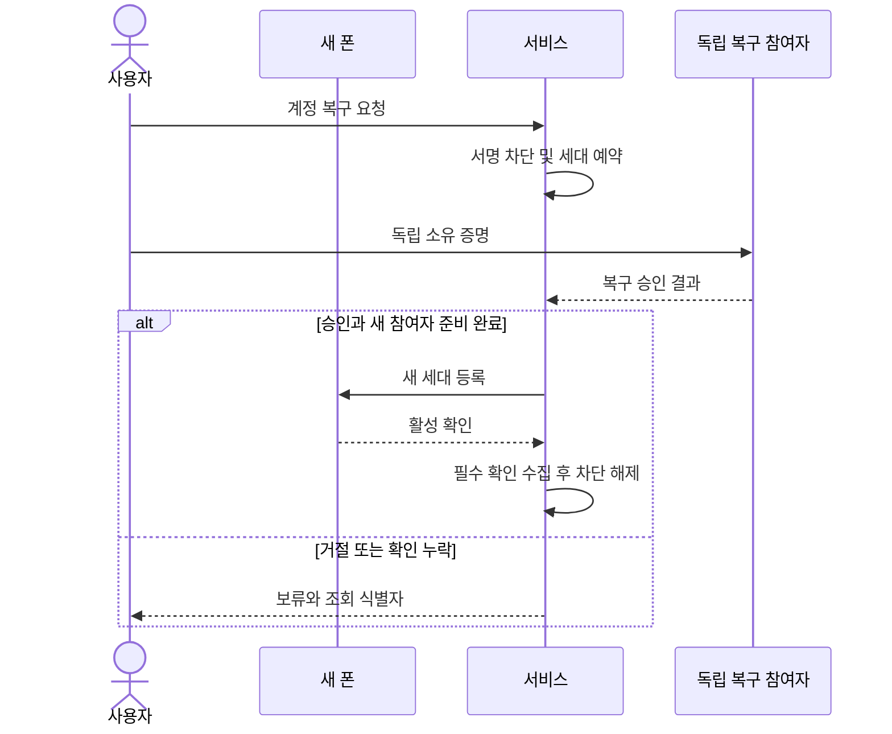

# P03 클라우드 MPC 지갑 · 유즈케이스

[제품별 설계 목차](../README.md) · [PRD](prd.md) · [기획](plan.md) · [유즈케이스](use-cases.md) · [정보구조](ia.md)

## 시나리오별 인수 시험

### UC1 · 클라우드 계정 만들기 (R1·R4)

- **주체와 시작 조건** 사용자가 로그인하고 별도 클라우드 지갑 생성을 선택.
- **정상 흐름** 독립 인증 → 생성 요청 저장 → 참여자 DKG → 공개키 대조 → 계정 표시.
- **예외와 재개** 타임아웃이면 같은 요청을 조회한다. 미완료 share로 주소를 노출하지 않는다.
- **종료 상태** 활성 공개 계정 하나 또는 재개 가능한 생성 상태.
- **합격 증거** 중복 요청 두 건에 원 계정 수와 활성 주소 수 대조.

### UC2 · 거래 서명 (R2)

- **주체와 시작 조건** 활성 계정, 인증된 모바일 참여자와 사용 가능한 서비스 참여자.
- **정상 흐름** 앱에서 원문·수수료 검토 → 개별 승인 → A/B 라운드 → 결과 서명 검증 → 제출자 반환.
- **예외와 재개** 세대 변경·기한 초과·단독 B 요청을 거부하고 라운드를 폐기한다.
- **종료 상태** 동일 의도에 묶인 서명 또는 사유 코드.
- **합격 증거** 공개키로 서명 검증, 탈취 로그인만 주어진 시험에서 서명 0건.

### UC3 · 분실 휴대폰 교체 (R3·R4)

- **주체와 시작 조건** 소유자, 승인된 독립 복구 수단과 새 폰.
- **정상 흐름** 복구 접수 → 새 서명 차단 → 독립 승인 → 참여자 교체 → 새 세대 활성 확인 → 잠금 해제.
- **예외와 재개** 일부 ACK가 없으면 차단을 유지한다. 분실 단말의 물리적 삭제를 성공 조건으로 삼지 않는다.
- **종료 상태** 기존 주소와 새 세대를 보유한 계정.
- **합격 증거** 서비스 참여자가 구세대 라운드를 거절한 기록, 새 폰으로 1회 서명, 감사 기록.

### UC4 · 서비스 중단 또는 정족수 유출 (R2·R3)

- **주체와 시작 조건** 복구 담당자가 B 장애 또는 기존 정족수 자료 유출 신고를 접수한다.
- **정상 흐름** 장애와 침해를 분류하고 A+C의 독립 경로를 미리 채택·인수한 조합에서만 그 정책으로 복구한다. 미검증 조합은 서비스 복구 대기와 마지막 확인 상태를 제공한다.
- **예외와 재개** 과거 정족수가 유출됐다면 share refresh와 서비스의 세대 차단으로 외부 서명 능력을 회수할 수 없다. 별도 키 생성·사용자 동의하 자산 이전과 기존 권한 회수 가능성을 평가한다.
- **종료 상태** 서비스 가용성, 기존 키의 위험과 이전 여부를 분리해 표시한다.
- **합격 증거** B 중단 시 검증되지 않은 A+C 서명 0건, 침해 신고를 일반 refresh 성공으로 종결한 사례 0건.

## 대표 흐름과 실패 분기

