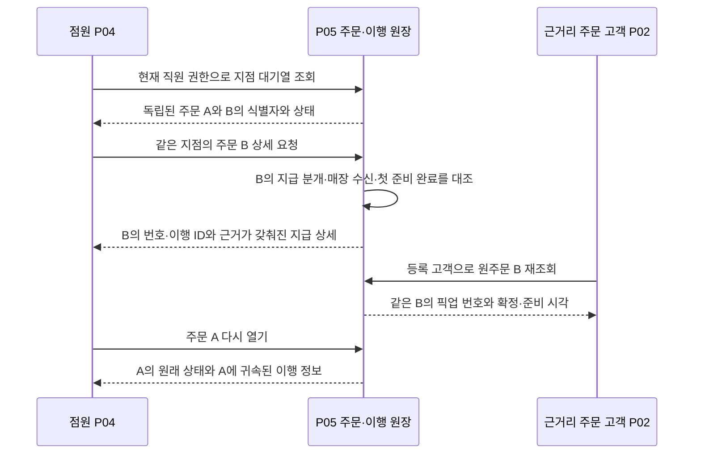
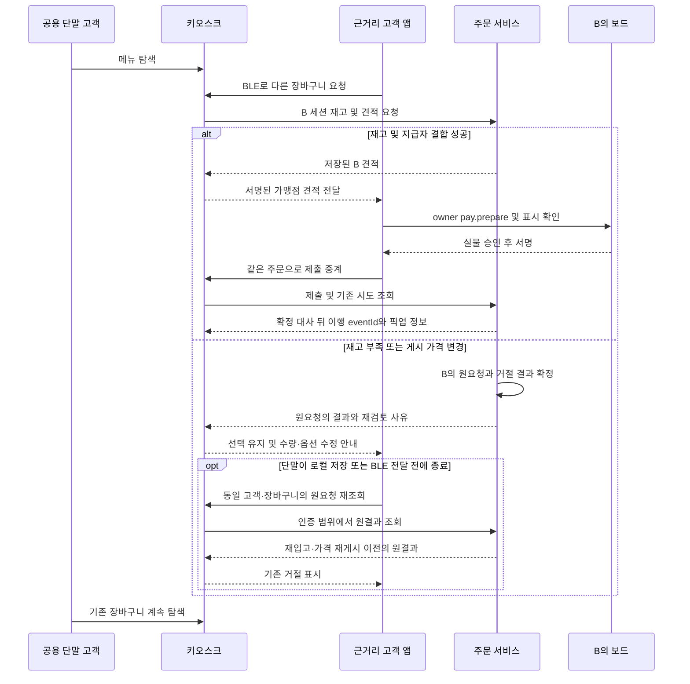
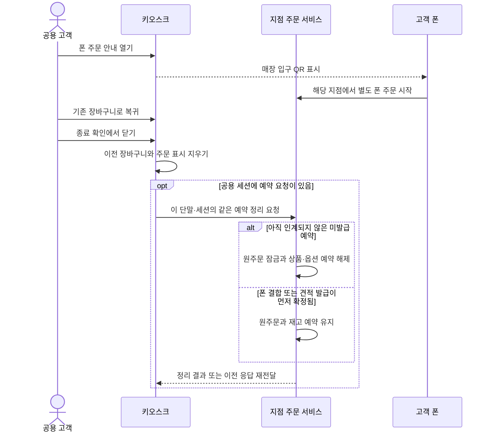

# P04 가맹점 키오스크 · 유즈케이스

[제품별 설계 목차](../README.md) · [PRD](prd.md) · [기획](plan.md) · [유즈케이스](use-cases.md) · [정보구조](ia.md)

## 시나리오별 인수 시험

### UC1 · 공용 단말과 근거리 고객 동시 주문 (R1·R2·R4)

- **주체와 시작 조건** A가 공용 화면 탐색 중, B는 근처에서 모바일 데이터를 끔. 단말은 온라인.
- **정상 흐름** B가 매장 선택 → BLE로 메뉴 조회 → B 재고 예약 → 개별 견적 승인 → B 픽업 번호 발급. A는 탐색 계속.
- **예외와 재개** 마지막 SKU 소진 시 해당 고객에게 재선택을 안내, 다른 세션은 유지.
- **종료 상태** 독립 주문과 픽업 상태.
- **합격 증거** 100개 주문 부하에서 소유자·재고·번호 대조, A보다 B가 먼저 완료.

대여 보드의 화면 역할은 고객의 지갑 앱이 맡는다. 키오스크가 서명 견적을 보드에 보내기 전에는 단말에서 요청 준비 상태를 표시한다. 원견적을 검증한 보드의 응답을 고객 앱이 같은 요청으로 대조하면, 고객은 앱에서 매장·금액을 확인하고 보드의 SW1 또는 SW2로 결정한다. 키오스크의 승인 표시는 해당 보드가 반환한 지급 서명을 검증한 뒤, 지급 완료 표시는 원거래의 확정 후에 각각 바뀐다. [고객 앱의 원주문 검토](../p02-user-app/use-cases.md#대여-예치금으로-승인한-매장-원주문의-정산-조회)

두 고객이 각각 대여 보드를 들고 있으면 같은 서비스 이름의 기기가 두 대 발견될 수 있다. 단말은 현재 주문에서 확인한 보드 공개키 지문과 인증 결과가 일치한 기기에만 견적을 보낸다. 연결 자리가 모자라면 고객은 자기 원주문의 대기·만료와 재조회 방법을 확인할 수 있어야 한다. 검수 시 검색 결과 순서를 바꾸고 한 고객이 결정을 보류하거나 창을 닫는다. 다른 보드에 해당 견적을 전달한 건수는 0건이고, 다른 고객의 장바구니·견적·승인과 영수증이 유지돼야 한다. [다수 고객과 BLE 연결 수](../../merchant-payments.md)

공용 고객 A가 품목의 수량을 2로 올린 뒤 필수 온도를 선택하지 않고 담으면, 앱은 온도 선택으로 안내하며 수량 2와 기존 바구니를 보존한다. 이 단계에서 주문·견적·재고 차감은 0건이어야 한다. 베이커리 상세에서는 점주가 게시한 원재료와 설비 교차접촉 정보를 따로 읽을 수 있어야 한다. A가 선택 중인 동안 B의 개인 주문은 독립적으로 확정된다. [공용 메뉴 데이터와 검증 주문](../../architecture/ledger.md#공용-메뉴-조회와-옵션-선택)

### UC2 · 결제 전용 POS의 QR/BLE 경쟁 (R1·R3·R5)

- **주체와 시작 조건** 등록된 POS가 외부 주문 참조와 금액 전달.
- **정상 흐름** 단말이 QR 미리보기 표시 → 고객 후보 접속 → 지급자 한 명 선택 → 서버가 서명 가능 견적을 먼저 기록 → 해당 폰/보드 승인.
- **예외와 재개** 다른 고객 claim과 중복 QR/BLE는 기존 결과나 선택 실패를 반환, 미지원 토큰 거절.
- **종료 상태** 외부 주문 참조에 결제 1건 이하.
- **합격 증거** 20회 중복 제출과 데모 허용목록 외 토큰 시험.

#### 같은 POS 주문에 두 고객이 연결한 경우

| 관측 시점 | 직원과 고객의 동작 | 인수 기준 |
|---|---|---|
| 선택을 전송하고 P05 기록이 끝나기 전 | 직원이 K11에서 매장·금액과 고객의 표식을 확인하고 선택한다. 서버의 기록 응답을 지연시킨 상태에서 K11의 처리 중 표시와 두 고객의 화면을 각각 읽는다. | 처리 중인 단말은 원주문을 조회할 수 있다. 두 고객 모두 보드 승인으로 진입할 수 없고 처리 중 다른 주문은 계속 접수된다. |
| 지급자와 견적이 기록된 후 | 선택된 고객은 자기 폰에서 원견적을 열고 직원은 K11의 고객 승인 대기 상태에서 K04 원주문으로 돌아간다. 성공 응답을 잃은 뒤에도 같은 주문을 조회한다. | 서버의 주문·지급자·nonce·견적은 한 결합을 가리킨다. 두 번째 고객에게는 승인 가능한 견적이 제공되지 않는다. 단말을 다시 열어도 원견적을 조회한다. |
| 다른 지급자 선택이 먼저 기록된 경우 | 같은 POS 주문에 허용된 서로 다른 후보 선택을 동시에 요청하고, 나중에 처리된 요청의 K11 충돌 안내를 읽는다. | 충돌 안내에서 원주문을 조회할 수 있다. 두 번째 견적·지급·주방 접수는 0건이다. 별개 주문의 처리와 재고는 영향을 받지 않는다. |

QR의 고객 인증과 BLE의 지점·고객 세션 인증은 같은 원주문·고객 후보를 가리킨다. 등록 단말의 BLE 중계는 P05에서 후보를 조회하거나 열린 원주문에 등록한다. 단말의 명시적 선택 뒤에만 해당 고객의 청구권을 재조회할 수 있고, 저장된 견적이 있어야 폰에 승인 자료를 반환한다. 표식은 35초 이내 비교에 사용하며, 같은 표식이라도 다른 주문이나 다른 고객의 결합 권한으로 사용할 수 없다.

이전 버전에서 한 POS 원주문에 여러 청구권이 기록됐다면, 커밋한 원견적은 기존 고객 귀속과 nonce를 유지한다. 저장된 견적이 없는 주문은 운영자 확인 대기로 표시한다. 기존 청구권과 준비 기록은 보존하며 새 견적이나 저장 전의 서명을 발급하지 않는다.

화면 인수는 K11에서 눌렀던 액션과 두 고객에게 보인 결과를 같은 원주문의 서버 기록과 대조한다. 실제 무선 거리와 두 실기기의 BLE 접속은 별도 현장 인수에 기록한다. [세 가지 선택 상태](../../screens/book.html#K11/locking) · [현재 설치 시험의 범위](../../screens/runtime-acceptance.md#결제-전용-단말의-pos-원주문과-지급자-선택)

### UC3 · 제출 결과 유실 뒤 영업 재개 (R4)

- **주체와 시작 조건** 단말이 서명을 제출한 직후 재시작.
- **정상 흐름** 저장한 주문·해시 조회 → P05/P07 대사 결과 조회 → P05가 원장과 함께 커밋한 이행 eventId 수신 → 단말 inbox에서 중복 제거 후 조리/영수증 전달.
- **예외와 재개** RPC 불일치 시 확인 중 유지. 프린터 장애는 같은 영수증 재출력.
- **종료 상태** 확정된 주문만 조리, 재시도로 결제 추가 발생 없음.
- **합격 증거** 재시작 전후 거래·조리 ID 대조.

#### 점원이 공용 주문과 근거리 주문의 픽업을 구별하는 경우

점원이 같은 지점에서 공용 단말의 주문 A와 휴대폰으로 접수한 주문 B를 처리한다. B가 먼저 준비되면 점원은 대기열에서 B를 선택해 원주문·픽업 번호·이행 ID·지급 원금과 자산·지급 확정 시각·픽업 가능 시각을 확인한다. 두 시각은 지점 현지 시간으로 표시한다. B의 고객이 자기 지갑에서 확인한 번호와 두 시각이 B의 매장 상세와 일치해야 한다. A를 다시 열면 A의 진행 상태와 번호가 유지돼야 한다. [근거리 픽업 화면](../../screens/book.html#K05/bleReady)

대기열에서 상세를 다시 조회할 때에는 마지막으로 선택한 원주문과 지점을 기준으로 응답을 표시한다. 대기열에 상세 지급 필드를 싣지 않는다. 직원 권한이 철회되거나 지점이 바뀌면 이전 상세를 닫는다. 구형 서버·원분개 누락·매장 수신 근거 불일치·과거 준비 시각 누락 시 기존 주문 상태는 읽을 수 있으나, 근거가 없는 금액이나 시각을 만들어 표시하지 않는다. [금액과 시각의 출처](../../architecture/erd.md#k05-매장-원주문의-지급-확정과-픽업-가능-시각)

### UC4 · 관리자 모드 전환과 점주 환불 (R1·R6)

- **주체와 시작 조건** 점주가 지점을 인증했고 전환할 단말에 발급 완료된 견적이 있다.
- **정상 흐름** 신규 메뉴 주문을 차단하고 기존 주문 ID·조회 담당 인계를 확인한다. 관리자가 결제 전용 설정을 배포하고 단말의 설정 버전 ACK 뒤 전환 완료로 표시한다. 점주는 지급된 원주문에서 환불을 신청하고 P05의 접수·확정 결과를 조회한다.
- **예외와 재개** 미결 인계/ACK 실패는 전환 대기로 복구한다. 결제 모드에서 캐시된 폰이 메뉴 주문을 보내도 서버가 모드 오류로 거절한다. 재원이 부족한 환불은 대기다.
- **종료 상태** 구 견적은 원주문에 귀속되고 새 세션에는 새 모드만 적용된다.
- **합격 증거** 모드 전환 도중 재기동 후 지급 누락 0건, 과거 영수증 조회 가능, 권한 없는 환불 0건.

## 대표 흐름과 실패 분기

## 공용 세션 정리와 응답 유실 시험

K10에서 마지막 재고를 두 고객이 요청하면 한 고객만 예약할 수 있다. 품절을 확정한 뒤 P04의 저장 직전 또는 응답 직전에 단말을 중단한다. 재입고한 뒤 원래 고객이 같은 요청을 열었을 때 기존 거절이 표시되고, 그 키로 만든 주문·견적·지급은 모두 0건이어야 한다. 고객이 수량이나 옵션을 직접 수정해 다시 승인하면 새 주문으로 진행할 수 있다. 재고를 확인할 수 없는 동안에는 원요청 조회를 제공한다. 품절 줄을 특정할 원자료가 없으면 선택 목록을 보여주고 최신 재고로 재검토한다.

공용 화면의 장바구니를 유지한 채 개인 고객 100명을 처리한다. 품절·가격 변경 응답이 반복된 뒤에도 다음 개인 고객과 공용 고객이 새 재고를 주문할 수 있어야 한다. 원결과를 P05에서 되살릴 수 있는지와 미확정 요청이 끝까지 보존되는지를 함께 확인한다. 단말 재시작 후 다른 고객과 다른 지점에서 이전 주문 내용을 조회할 수 없어야 한다. [명령 영수증과 재시도](../../architecture/ledger.md#근거리-장바구니의-거절과-재조회)

UC1과 UC3에서 이전 화면 닫기, 자동 만료, 단말 재시작 뒤 브라우저 뒤로 가기까지 확인한다. 다음 고객에게 이전 장바구니·연결 표식·픽업 상태가 노출되면 실패다. 원래 고객과 담당 직원의 원주문 조회는 계속 가능해야 한다. UC2에서는 지급자 결합 커밋 직전·직후에 네트워크를 끊고, QR과 BLE 후보가 다시 들어올 때 기존 결과를 조회한다. 저장 전 폰 검토 진입과 결합하지 않은 후보의 견적 수신은 모두 실패해야 한다.

### 고객이 화면을 닫는 시점별 인수 조건

| 닫기 직전의 상태 | P04의 행동 | P05에서 확인할 결과 |
|---|---|---|
| 수량·옵션만 고른 장바구니 | 종료 확인에서 계속 주문하면 선택을 보존한다. 종료하면 화면을 지운다. | 어느 쪽도 원주문이나 재고 예약을 만들지 않는다. |
| 예약 응답 수신 전 또는 미인계 미리보기 | 이전 장바구니·주문 QR을 즉시 지운다. 응답을 잃었거나 연결이 끊기면 단말이 같은 예약 요청을 기준으로 정리를 재시도한다. | 예약과 닫기 중 어느 쪽이 먼저 도착해도 마지막에는 활성 예약이 없다. 상품과 옵션 재고가 각각 처음 수량으로 돌아간다. 중복 닫기는 추가 입고를 만들지 않는다. |
| 고객 폰의 결합이 커밋됐거나 견적이 발급됨 | 공용 화면을 지우고 다음 손님을 받는다. | 기존 원주문과 예약을 유지한다. 인계받은 고객만 그 폰에서 원주문을 계속 확인한다. |
| 닫기와 폰의 결합이 경합 | 다음 고객에게 이전 고객의 주문 번호·QR을 다시 표시하지 않는다. | 먼저 확정된 동작 하나만 유효하다. 해제된 예약에 결합하거나 인계된 주문의 재고를 돌려놓지 않는다. 다른 세션·단말의 예약에는 영향이 없다. |

입구 QR을 읽은 폰과 특정 원주문의 QR을 읽어 결합한 폰은 서로 다른 경우다. 입구 QR에는 고객의 주문 참조를 넣지 않는다. 통신 복구용 단말 기록에는 같은 요청을 재확인하는 데 필요한 참조만 남기고, 세션을 닫은 뒤에는 공용 UI로 복원하지 않는다. [K09 페이지 설계](../../screens/specs/K.md#k09--공용-화면-인계와-종료)
