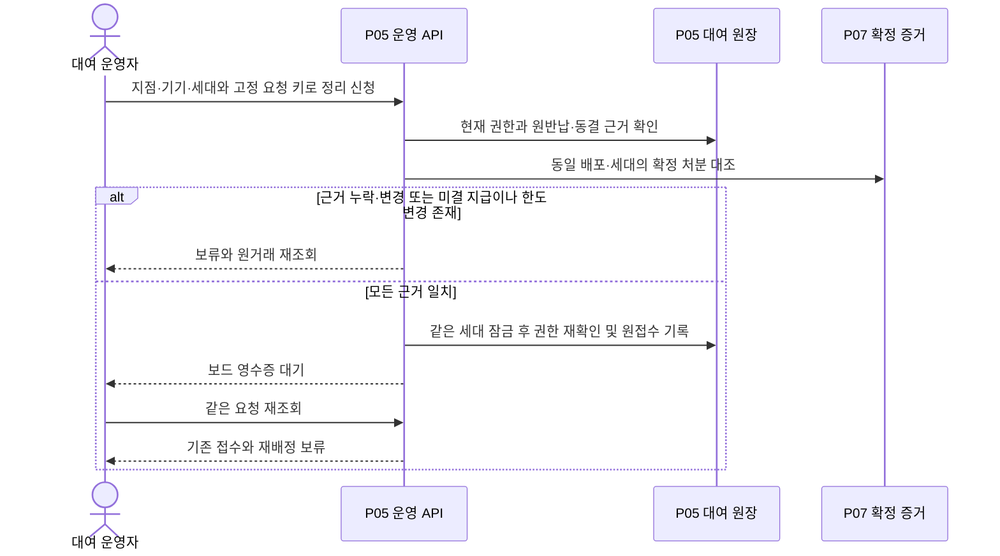
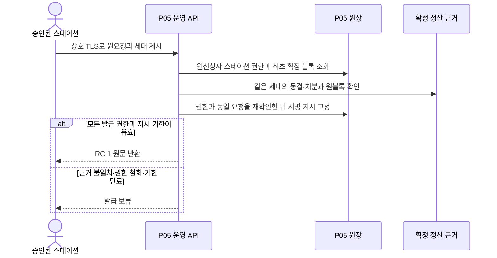
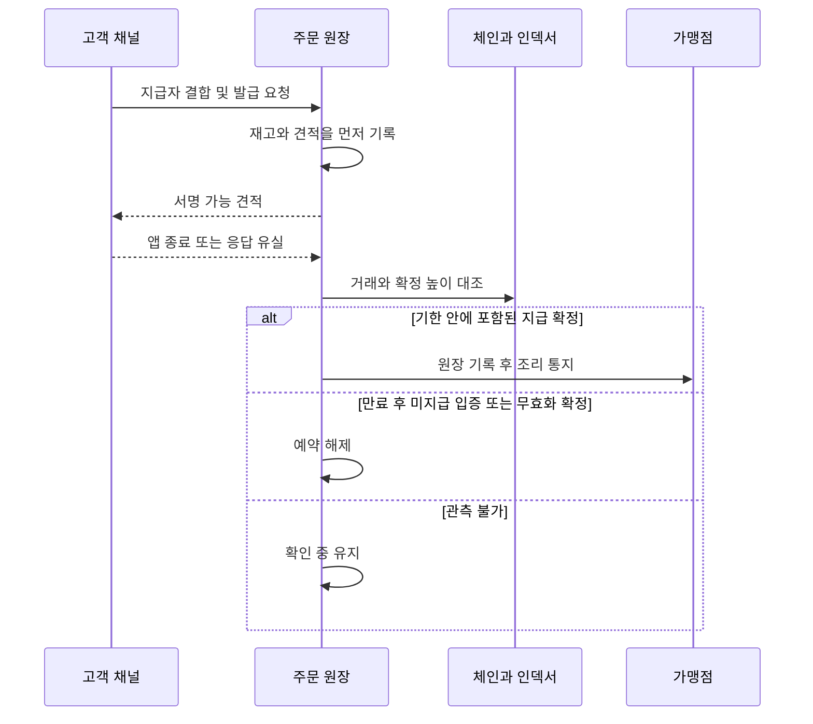

# P05 가맹점 운영·정산 백오피스 · 유즈케이스

[제품별 설계 목차](../README.md) · [PRD](prd.md) · [기획](plan.md) · [유즈케이스](use-cases.md) · [정보구조](ia.md)

## 시나리오별 인수 시험

### UC1 · 가격 게시와 지점 운영 (R1·R2·R6)

- **주체와 시작 조건** 권한 있는 점장, 기존 공개 메뉴와 주문이 있음.
- **정상 흐름** 편집본 생성 → 옵션·합계 검증 → 버전 게시 → 새 주문에 반영. 지급 주소 변경은 소유 증명과 두 승인 후 예약.
- **예외와 재개** 다른 지점 수정·권한 부족은 거절, 미발급 가격 변경은 고객 재확인.
- **종료 상태** 이전 견적 및 새 메뉴 버전을 독립 조회.
- **합격 증거** 두 지점·두 메뉴 버전의 합계와 감사 이력. 점장이 한 지점의 음료에 필수 항목명 ‘온도’와 선택지 ‘아이스·따뜻하게’를 게시하고, 베이커리에 원재료 ‘밀·우유·달걀’ 및 설비에서 접촉 가능한 성분 ‘견과류’를 별도로 신고한다. 해당 지점의 고객 화면과 다른 지점의 독립 메뉴를 각각 조회한다. 다음 게시에서 선언을 바꿔도 앞서 접수된 주문 금액·메뉴 버전은 유지돼야 한다.

### UC2 · 예약·회차 견적 후 고객 이탈 (R2·R3·R4)

- **주체와 시작 조건** 여행 예약 또는 구독 청구서, 지급자 선택 완료.
- **정상 흐름** 재고/회차 예약 → DB에서 견적 저장 → 폰 전달 → 기존 주문 조회 → 확정 결과 반영.
- **예외와 재개** 발행 전 취소는 즉시 해제. 발행 후 늦은 거래는 추적하고 만료 이후 미지급 확정 증거 확인 전 재발급 금지.
- **종료 상태** 지급·확정 만료·검증된 무효화 중 하나에 수렴.
- **합격 증거** 방송 응답 유실 및 만료 직전 포함 시험에서 이중 재고·지급 0건.

### UC3 · 부분 환불과 일마감 (R5·R6)

- **주체와 시작 조건** 재무 담당자, 이미 직접 지급된 원결제와 검증한 환불 목적지.
- **정상 흐름** 누적 가능액 예약 → 승인·재원 확인 → 환불 제출 → 확정 관측 → 장부·영수증 반영.
- **예외와 재개** 두 환불 경합은 한도 초과 거절, 해시 불명은 재조회, 종료된 대여 슬롯에는 임의 지급 금지.
- **종료 상태** 원금과 환불이 연결되고 순액과 주소별 실지급 일치.
- **합격 증거** 원금 30에서 20+20 경합 시 최대 30, 중복 통지에도 같은 환불 ID.

### UC4 · 지점 마감과 동시성 복구 (R2·R3·R5·R6)

- **주체와 시작 조건** 재무 담당자가 영업일·시간대를 지정한다. 마지막 SKU 및 두 날짜에 걸친 지급/환불이 있다.
- **정상 흐름** 주문 100개 동시 처리 → 확정 지급·환불을 실제 발생 영업일별 집계 → 권한 있는 지점만 CSV 내보내기 → P07 증거·등록 주소 잔액과 대조.
- **예외와 재개** 정상 부하 교착·영구 대기 0건. 별도 충돌 주입 시 2초 락 대기·요청당 재시도 3회·8초 예산 안에 결과/조회 ID를 반환한다. 장애 해소·체인 확정 재개 후 마지막 처리 가능한 이벤트 수신부터 60초 내 원장·출고가 수렴해야 한다.
- **종료 상태** 다음 날 부분 환불은 환불 발생일에 기록하고 원 매출 영업일을 보존한다. 미해결 차이는 조사 상태다.
- **합격 증거** 두 지점의 접근·CSV 합계, 다음날 환불 일자, 중복 이행 0건과 부하/복구 시간 기록.

### UC5 · 대여 개설·반납과 FOTA 캠페인 (R7)

- **주체와 시작 조건** 대여 운영자가 가맹점 자격과 별도 운영 권한으로 기기를 검사한다.
- **정상 흐름** 기기 확인 → 대여 전용 계정 개설·예치/한도/시각 확인 → 미결 지급 대사 → 반납/인출 상태 확정 → 대여 기기 정리. 캠페인은 지원 리비전에만 배포하고 적용 전 승인 대기를 정리한다.
- **예외와 재개** 늦은 지급·인출 지연·미확정 상태는 원 계정과 조회 참조를 유지한다. 반납 상태가 불명확하거나 펌웨어 적용이 중단되면 재조회한다.
- **종료 상태** 대여 수명주기와 반납 후 환불 목적지가 보존되고 개인 프로필에 접근하지 않는다.
- **합격 증거** 대여 계약 입출금 합계·반납 세대·미결 주문 대조, 지원 외 모델 업데이트 거절. [반납 경로](../../../specifications/return-route-contracts.md)

#### 개설·반납 전에 대여 기기를 확인하는 경우

운영자가 O09에서 지점·기기 참조·대여 세대를 선택해 조회한다. 화면에는 조회에 성공한 기기의 리비전, v1 대여 계정, 검증이 기록된 시각을 함께 표시한다. 제품 모델명은 등록 리비전이 보드 배포 목록과 일치할 때 표시한다. 미등록 리비전에 알려진 모델명을 붙이거나, 구형 등록에 비어 있는 인증 시각을 조회 시각이나 만료 시각으로 채우지 않는다. 이 화면에서 개인 지갑 주소나 인증서 원문을 추가로 수집할 필요가 없다. [보드 모델과 리비전의 기준](../../../../../products/p10-platform/release/board-reference.json) · [대여 등록 조회 계약](../../../../../products/p05-operations-backoffice/internal/store/migrations/067_rental_return_review.sql)

| 콘솔에서 수행할 동작 | 화면과 원장에서 대조할 결과 |
|---|---|
| 미개설 기기를 조회하고 개설 검토를 열었다가 취소 | 조회한 지점·기기·세대, 등록 계정, 모델·리비전과 실제 인증 시각이 일치한다. 개설 명령과 예치는 0건이다. |
| 개설한 같은 기기를 다시 조회하고 반납 검토로 진입 | 같은 등록 계정과 세대로 반납 검토가 열린다. 검토만 열고 나가면 반납·인출·정리 명령은 0건이다. |
| 참조를 변경하거나 새 조회가 권한·등록 만료로 거절됨 | 직전 기기의 결과와 실행 버튼을 지운다. 다시 유효한 등록을 직접 조회한 뒤 해당 기기의 작업을 계속한다. |

#### 보호 세대 반납 이후의 인수 기준

| 조건 | 운영자와 지갑에서 확인할 결과 | 완료 근거 |
|---|---|---|
| 원 반납이 확정됐고 인출 요청액이 양수 | 같은 세대·등록 목적지와 인출 가능 시각을 표시한다. 지연 중 재접속하면 원거래로 돌아온다. | 확정 체인 시각이 조건을 충족한 뒤에만 인출한다. 확정 인출과 목적지의 실제 수취를 연결한다. 토큰이 보류되면 수취 승인까지 대기한다. |
| 원 반납 시 인출 요청액이 0 | 해당 대여의 지급 의무가 0이었던 근거로 원 반납 거래를 보여준다. | 같은 정본 반납 영수증의 인출 요청액 0, 계정·배포·세대·등록 목적지와 미결 지급을 확인한다. 별도 지급 거래 수는 0건이다. |
| 뒤늦게 지급이 관측되거나 정본·현재 권위를 확인할 수 없음 | 권한이 있는 사용자는 원요청을 다시 조회한다. 불일치가 해소될 때까지 정리와 재배정을 보류한다. | 추가 송금·새 세대 발급·기기 소거는 모두 0건이다. 다른 지점이나 사용자에게 복구 키와 대여 내역이 노출되지 않는다. |
| 금액과 거래 참조를 표시한 뒤 같은 탭에서 지점 권한이 철회됨 | 다음 조회가 거절되면 이전 금액·거래 해시·승인 창·전송 버튼을 화면에서 즉시 지운다. | 같은 탭에서 권한 있는 조회 성공, 철회, 조회 거절을 차례로 관측한다. 거절 이후 이전 기록 노출과 추가 쓰기는 0건이다. |
| 원인출 요청자가 앱을 종료한 뒤 원거래가 종결됨 | 대사 작업자가 기존 세대와 등록 목적지에 결속된 정본 근거를 확인한다. 이후 권한 있는 사용자는 판정 사유와 근거를 조회한다. | 원거래 실패, 같은 서명자·순번의 다른 거래 확정, 실제 지급을 구분한다. 지급액·등록 목적지·보류 수취까지 대조한다. 판정 기록과 암호문 파기는 한 DB 트랜잭션으로 완료하며 재기동·중복 작업으로 두 번째 지급이 발생하지 않는다. |
| 원거래가 실패했거나 다른 거래가 순번을 사용했고 지급 의무가 남음 | 현재 권한을 다시 확인한 담당자가 미지급액과 등록 목적지를 새로 검토하고 명시적으로 승인한다. 기존 요청 키로 이전 결과도 조회할 수 있다. | 정본 근거와 미지급액이 모두 일치할 때에만 새 후보를 수락한다. 다른 당사자가 이미 지급한 경우, RPC 장애, 재편성 또는 중복 승인에서는 자동 재서명과 추가 지급이 0건이다. |
| 체인 정산 완료 후 보드 연결이 끊김 | O09와 W12에서 기기 정리 확인 대기를 표시한다. 재접속 후 동일 작업·세대의 증거를 조회한다. | 기기의 해당 대여 슬롯 정리 증명과 서버의 확인이 모두 일치한 뒤에만 재배정할 수 있다. 개인 키·개인 본딩과 이전 주문의 환불 목적지는 보존된다. |

거래를 조회하는 권한, 대기 거래를 대사하는 권한, 새 거래를 승인하는 권한을 분리한다. 대사 작업자는 제한된 배포의 후보와 정본 근거를 처리한다. 조회·대사로 거래를 서명하거나 송신할 수 없다. 보존하는 판정 정보는 원거래·근거 거래·확정 블록·결과·시각과 이미 등록된 세대 참조로 한정한다. [대사 데이터와 보유기간](../../architecture/erd.md) · [필드별 수집 목적](../../../../../products/p10-platform/database/field-purpose.json)

**정리 접수와 운영자 교대.** 같은 세대의 원반납과 확정 인출 또는 인출 의무 0을 대조한 뒤, 운영자가 정리를 신청한다. 응답이 유실되면 원신청자는 같은 요청 키로 결과를 복구한다. 같은 지점에서 권한을 넘겨받은 운영자는 해당 세대에 정리 요청이 접수됐는지 확인한다. 교대자에게는 원신청자의 요청 키와 처분 지문을 제공하지 않는다. 지점 권한이 없는 운영자는 해당 세대의 접수 여부도 조회할 수 없다.

반납 확정 뒤 보드 증명의 유효 시간이 지나면 같은 동결 기록에 새 챌린지를 발급할 수 있다. 서버는 같은 지점·보드·세대에서 등록 지문, 저널 루트, 양끝 nonce, 항목별 건수와 동결 시각이 원반납과 같고 현재 미결 지급·한도 변경이 모두 0인지 확인한다. 이 경우 최초 반납에 기록한 동결 지문으로 접수를 계속한다. 하나라도 달라지면 운영자에게 보류 상태를 돌려준다. [접수 시 대조하는 보호 원장](../../../../../products/p05-operations-backoffice/internal/store/migrations/093_rental_cleanup_intent.sql)

운영 API를 먼저 배포해 DB가 아직 077인 경우에도 담당자는 기존 반납을 조회하고 같은 키로 원요청을 재개할 수 있다. 최초 세대는 선행 세대가 없어 기존 조건으로 신규 개설을 접수한다. 후속 세대의 새 개설과 새 정리 신청은 보호 근거를 대조할 수 있는 093 적용까지 보류한다. 이관이 끝나면 실행 중인 API가 해당 함수를 확인한다. 권한이 갱신된 원반납은 새 검토를 거쳐야 같은 봉인 원거래를 전송할 수 있다. [구형 원장과 새 원장의 실제 전환 시험](../../../../../products/p07-indexer/internal/chainview/generation_close_rollover_test.go)

정리 접수와 키 폐기는 별도 단계다. 운영자 교대나 서버 재시작 뒤에도 새 기기 세대를 배정하려면 원세대의 보드 서명 영수증을 검증해야 한다. [정리 요청의 데이터 관계](../../architecture/erd.md#대여-정리-접수와-매장-픽업-영수증) · [보드 증거 규약](../../../../../packages/protocol/v2/transport.md#rental-slot-cleanup-proof-v1)

**등록 스테이션에서 원지시 복구.** 원신청자의 지점 권한과 해당 기기 세대용 스테이션 권한이 유효할 때만 지시를 발급한다. 정산 완료가 어떤 블록에서 입증됐는지 다시 대조할 수 있어야 한다. 스테이션이 첫 응답을 잃고 유효 시간 안에 재조회하면 같은 서명 바이트를 받는다. 유효 시간이 지난 뒤에는 같은 요청으로 지시를 연장할 수 없다. 콘솔은 기기가 폐기 영수증을 반환하고 검증이 끝날 때까지 반납 완료와 재배정을 보류한다. [스테이션 발급 인터페이스](../../../../../products/p05-operations-backoffice/O09-GENERATION-EVIDENCE.md#qualified-station-cleanup-intent-issuance)

**폐기 영수증을 뒤늦게 받은 경우.** 지시가 만료된 뒤에 스테이션이 다시 연결될 수 있다. P05는 스테이션의 현재 권한을 확인하고 원지시에 결속된 보드의 서명, 지시 유효기간 안의 폐기 시각과 원래 정산 근거를 검증한다. 응답을 잃은 스테이션은 같은 영수증을 다시 받는다. 같은 원지시에 다른 영수증이 도착하면 최초 기록을 유지한다. 운영자는 ‘영수증 확인·인계 대기’를 확인할 수 있다. 새 세대의 배정에는 보호된 기기 인계의 증거가 더 필요하다. [영수증 등록 및 재조회](../../../../../products/p05-operations-backoffice/O09-GENERATION-EVIDENCE.md#authenticated-station-receipt)

077 감독형 API의 시험 범위는 원 반납의 접수와 복구까지다. 후속 인출과 기기 정리는 각각 독립적인 완료 기준을 가진다. [보호 세대 상태 전이](../../protocol.md#보호-세대의-반납-이후-상태) · [기기 정리·재대여의 기존 설계](../../../specifications/return-route-contracts.md)

## 대표 흐름과 실패 분기

## 권한과 작업 경계 시험

UC1에서 기발급 견적을 유지한 상태로 지점 카탈로그 두 편집자가 동시에 게시하고 패배한 편집본의 비교와 재검증을 확인한다. 회수된 단말은 신규 요청이 거절되어야 하며 이미 발급된 원주문은 지정 운영자에게 남는다. UC3에서 동일 계정으로 신청과 승인을 시도하고, 승인 뒤 재원 부족 및 제출 응답 유실을 주입한다. 충분한 재원이 확인되기 전 지급이 일어나거나 같은 환불 ID의 거래를 새로 만드는 경우 실패다. UC4에서 마감 검토 이후 새 차이가 발견되면 제출을 보류하고 조사 이동 경로를 확인한다.
