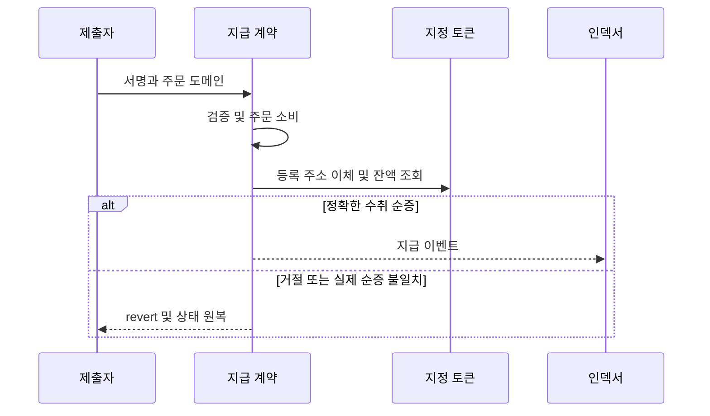

# P06 StableNet 결제 계약 · 유즈케이스

[제품별 설계 목차](../README.md) · [PRD](prd.md) · [기획](plan.md) · [유즈케이스](use-cases.md) · [정보구조](ia.md)

## 시나리오별 인수 시험

### UC1 · 지정 상점으로 지급 (R1·R2)

- **주체와 시작 조건** 등록 상점과 테스트 재원, 올바른 도메인의 승인 거래.
- **정상 흐름** 도메인·만료·잔액 검사 → 주문 소비 → 등록 주소 이전 → 순증 검증 → 지급 이벤트.
- **예외와 재개** 거절 모드 또는 가용 잔액 순증 불일치 시 전체 revert. 해당 시도 가스는 별개다.
- **종료 상태** 한 지급 이벤트와 정확한 수취 잔액 증가 또는 결제 상태 원복.
- **합격 증거** 호출 전후 주문 사용 여부, 지급자·수취인 잔액, 이벤트 수.

### UC2 · 두 부분 환불 (R3)

- **주체와 시작 조건** 확정된 원결제·검증된 목적지·승인된 환불 재원.
- **정상 흐름** 서로 다른 refundId 제출 → 원금/누계 검증 → 금액 반환 → 환불 이벤트.
- **예외와 재개** 동일 refundId 재시도, 잔액 부족·누계 초과 시 추가 환불 방지.
- **종료 상태** 지급과 환불을 별도 거래로 조회.
- **합격 증거** 원금 30의 10+20 허용, 다음 1 거절. 환불 재원과 수취 잔액 대조.

### UC3 · v1/v2 공존 (R4·R1)

- **주체와 시작 조건** 이전 적립금을 가진 점주, P05 신규 v2 주문이 개설됨.
- **정상 흐름** v1 대여 개설·예치·한도·지연 인출·반납 및 기존 가맹점 cashOut 대조 → 별도 v2 테스트 예치와 가맹점 가스 확인 → 등록된 새 도메인에서 새 주문 지급.
- **예외와 재개** 이전 서명을 v2에서 거절, 기존 주문을 새 도메인에 다시 발행하지 않는다.
- **종료 상태** 구계약 잔액·신규 지급을 각각 추적.
- **합격 증거** 구·신 계약 주소별 동일 기간 대사와 주문 중복 검사.

## 대표 흐름과 실패 분기

## 배포 선택과 재진입 시험

UC1에서 신뢰 manifest 변조, 지원 토큰 불일치, 수취 효과 불일치를 차례로 주입한다. 앞의 두 경우 직접 지급 제출을 보류하고 계약 실행 거절은 상태 원복과 별도 가스를 표시해야 한다. UC3에서 기존 적립 인출의 응답을 잃으면 같은 cashOut 요청과 기존 v1 계약을 재조회한다. 계약 버전을 바꿔 다시 발행하거나 v2 재원을 이동시키면 실패다.
