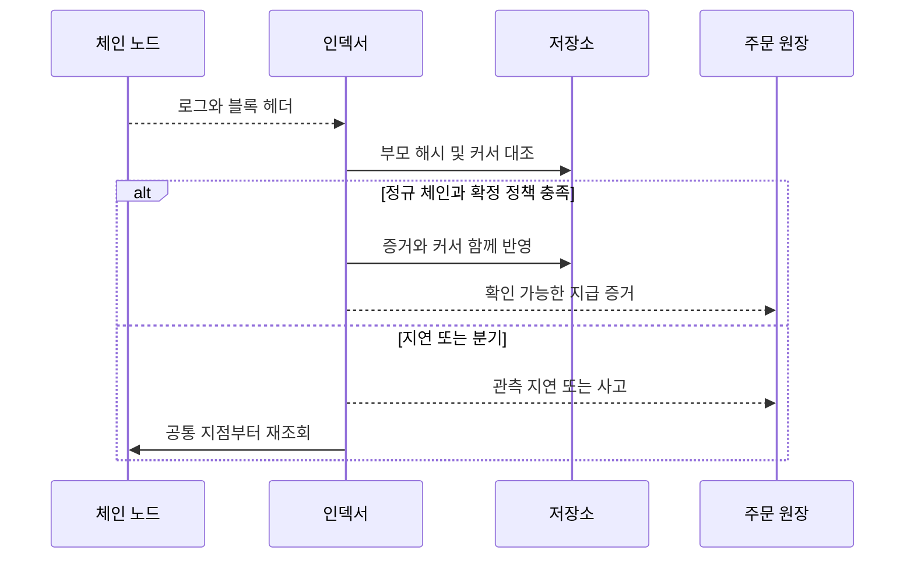

# P07 체인 인덱서·영수증 조회 · 유즈케이스

[제품별 설계 목차](../README.md) · [PRD](prd.md) · [기획](plan.md) · [유즈케이스](use-cases.md) · [정보구조](ia.md)

## 시나리오별 인수 시험

### UC1 · 지급·환불 내역 찾기 (R1·R3)

- **주체와 시작 조건** 앱 또는 가맹점, 체인·주문·상점 식별자 보유.
- **정상 흐름** 지급 로그 수집 → 확정 정책 확인 → 대응 환불 연결 → 조회 결과와 높이 반환.
- **예외와 재개** 수집 중이면 조회 시점과 확인 중 사유를 반환, 타 매장 비공개 데이터는 차단.
- **종료 상태** 정확한 버전의 원거래와 누적 환불.
- **합격 증거** 두 매장 같은 주문 ID와 부분 환불 벡터.

### UC2 · 분기와 노드 장애 복구 (R1·R2)

- **주체와 시작 조건** 운영자, 저장 커서와 새 부모 해시가 다름.
- **정상 흐름** 수집 보류 → 공통 블록 조회 → 미확정 투영 철회 → 새 분기 재생 → 확정 결과 비교.
- **예외와 재개** 이미 확정으로 제공한 증거와 충돌하면 P05에 사고 통지하고 자동 소급 이행을 중단한다.
- **종료 상태** 조회 가능한 안정 구간과 사고/회복 상태.
- **합격 증거** 제거된 블록 로그 0건, 중복 확정 0건, 재개 커서 기록. 조회 전환 도중 응답을 잃으면 같은 작업 ID로 결과를 조회하고, 실제 대상·기대 revision·감사 주체가 일치하기 전에 ‘전환 완료’를 표시하지 않는다.

### UC3 · 늦은 지급 재대사 (R3·R4)

- **주체와 시작 조건** P05에 기한 지난 견적이 남고 노드 지연 중.
- **정상 흐름** 원 계약·주문으로 조회 → 만료 경계를 포함하는 확정 범위까지 동기화 → 포함 시각과 확정 증거 전달.
- **예외와 재개** 구간이 비어 있거나 RPC 불일치면 미상으로 남기고 재조회한다.
- **종료 상태** P05가 지급 반영 또는 미지급 판단에 쓸 검증 근거 확보.
- **합격 증거** 만료 직전 포함·이후 확정이 만료로 분류되는 사례 0건.

## 대표 흐름과 실패 분기

