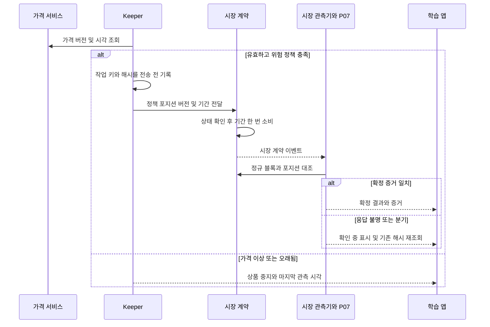

# P08 테스트넷 시장 서비스 · 유즈케이스

[제품별 설계 목차](../README.md) · [PRD](prd.md) · [기획](plan.md) · [유즈케이스](use-cases.md) · [정보구조](ia.md)

## 시나리오별 인수 시험

### 학습 지갑 등록 전 시장 홈 탐색

학습자는 일반 홈이나 학습 복귀 링크로 L01을 연다. StableNet 테스트넷과 테스트 자산 안내를 본 뒤 교환·유동성·TEST FX·모의 포지션의 연습 안내를 각각 열 수 있다. 견적·서명·제출은 지갑을 연결하고 해당 기능의 검토를 마친 뒤에만 시작한다. 여행으로 이동했다가 돌아오면 마지막으로 선택한 학습 주제가 남는다. 운영 화면을 열 때에는 설치한 배포의 운영자 주소 설정과 별도 인증을 사용한다. [설치 앱 인수](../../screens/runtime-acceptance.md#학습-시장에서-네-주제를-둘러보고-여행에서-돌아오기)

### UC1 · 교환·LP 입출금 (R1)

학습자가 유동성 메뉴를 열면 등록된 테스트 풀의 주소와 자기 지갑의 LP 지분을 확인한다. 추가와 회수 입력은 같은 풀에서 별도로 시작한다. 입력 도중 취소하면 같은 풀 선택으로 복귀하며, 취소만으로 견적이나 서명을 요청하지 않는다. [Android 풀 선택과 복귀](../../screens/runtime-acceptance.md#검증된-유동성-풀-선택과-입력-취소)

- **주체와 시작 조건** 학습자, 테스트 지갑·검증 풀 보유.
- **정상 흐름** 예상 수령/지분 검토 → 한도·기한 동의 → 지갑 승인 → 실행 → 실제 수령·지분 확인.
- **예외와 재개** 풀 가격이 한도 밖이면 새 견적을 제안하고, 제출 응답이 불명확하면 같은 거래 조회.
- **종료 상태** 확정 거래와 자산/LP 잔액 변동.
- **합격 증거** 슬리피지 범위와 LP 추가·제거 전후 잔액 대조.

### UC2 · 모의 환전 재견적 (R2)

- **주체와 시작 조건** 테스트 FX 사용자, 통화쌍·금액 입력.
- **정상 흐름** 방향·기준 가격 확인 → 유효 견적 승인 → 결과 수량 확인.
- **예외와 재개** 기한이 지났으면 새 가격과 차이를 먼저 표시한다. 기존 승인을 새 견적에 재사용하지 않는다.
- **종료 상태** 원 견적 만료 또는 한 번의 실행.
- **합격 증거** 역방향·소수점·만료·중복 벡터.

### UC3 · 펀딩·청산 경합 (R3·R4)

- **주체와 시작 조건** 포지션 보유자와 keeper, 가격 업데이트 도착.
- **정상 흐름** 가격·정책·포지션 revision과 펀딩 cursor 확인 → 작업 키와 제출할 해시 영속화 → 시장 계약 제출 → 계약에서 동일 기간/포지션 상태 한 번 소비 → 정규 체인 이벤트와 포지션 대조.
- **예외와 재개** 가격이 오래됐으면 판단을 보류한다. 방송 결과 불명 또는 reorg에는 기존 해시와 포지션을 재조회하고 같은 정산을 중복 실행하지 않는다.
- **종료 상태** 현재 증거금·미결 상태·정산 이력 일치.
- **합격 증거** 동일 keeper 작업 두 번과 사용자 동시 종료 시 이중 정산 0건.

일반 앱의 조건 검토는 등록한 시장의 두 자산, 체인에서 검증한 기준 가격·관측 시각, 포지션 방향·크기·증거금, 다음 펀딩 시각·비율과 예상 청산 조건을 함께 보여준다. L05의 수치는 8283의 LAB/LAQ 학습 배포 예시다. 1 LAB을 1.20 LAQ에 매도하고 12 LAQ를 격리하면 펀딩 전 기준 가격 12.00에서 평가액 1.20 LAQ와 유지증거금 1.20 LAQ가 일치한다. 1.20 LAQ의 명목 금액에 10bp를 적용하면 첫 펀딩의 예상 수령은 0.0012 LAQ다. 갱신된 가격·펀딩·증거금으로 달라진 예상치와 체인에서 확정한 실적을 구분한다. [시장 정책과 단위](../../../../../products/p08-market-services/README.md) · [모의 포지션 화면](../../screens/specs/L.md#l05--모의-무기한-포지션)

가격 근거가 만료되어도 원래 포지션과 확정 이력은 조회할 수 있다. 이 상태에서는 새 위험을 늘리는 승인과 자동 청산을 보류하고, 다시 받은 두 가격과 체인 상태가 일치할 때 새 조건을 제시한다. 기존 견적은 자동 제출하지 않는다. 화면 검수에서는 오래된 가격 전후의 포지션 번호·상태·정산 이력과 학습 지갑의 거래 순번을 대조한다.

## 대표 흐름과 실패 분기

