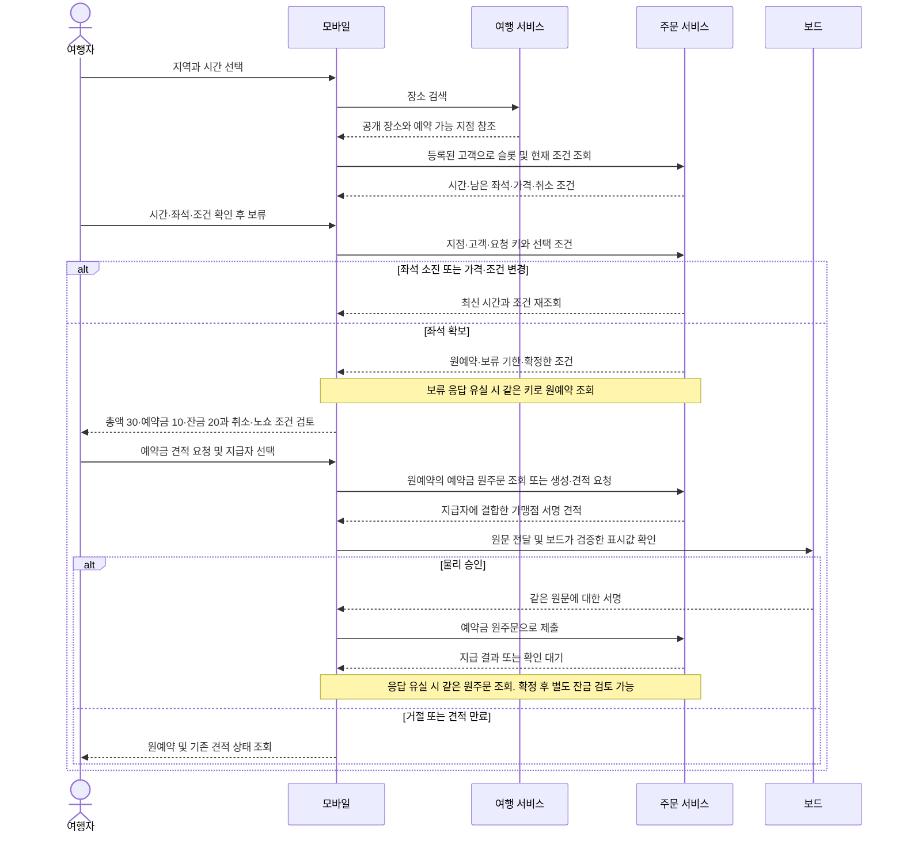

# P09 여행 탐색·여행 기록 · 유즈케이스

[제품별 설계 목차](../README.md) · [PRD](prd.md) · [기획](plan.md) · [유즈케이스](use-cases.md) · [정보구조](ia.md)

## 시나리오별 인수 시험

### UC1 · 위치 거부 후 명소 예약 (R1·R2)

- **주체와 시작 조건** 여행자가 위치 권한 없이 날짜·지역을 직접 선택.
- **정상 흐름** 지도 또는 목록 검색 → 같은 장소 상세 → 시간·인원 선택 → P05 가격/취소 조건 확인 → P02에서 디파짓 승인 → 예약 상세 복귀.
- **예외와 재개** 재고 소진이면 대체 시각을 제안한다. 보드에서 거절하거나 제출 전에 견적이 만료되면 같은 원예약과 원주문을 조회한다. 제출 응답 유실 시 같은 지급 단계의 확정 여부를 조회한다.
- **종료 상태** 등록된 시간대와 예약금/잔금 내역.
- **합격 증거** 마지막 한 자리 동시 예약 및 총액 30 중 10 결제 결과.

### UC2 · 영수증 후기와 스탬프 (R3)

- **주체와 시작 조건** 여행자가 공개 후기 작성을 선택하고 본인 확정 영수증으로 자격 입증.
- **정상 흐름** 증거의 장소·본인·유형을 확인해 일반/테스트 후기와 실구매 배지를 구분한다. 실구매 배지에는 검증된 실제 지급과 이용·이행 근거가 필요하다. 사용자가 게시에 동의하면 챌린지 조건을 확인하고 혜택 원장의 확정 효과를 조회한다.
- **예외와 재개** 중복 제출은 기존 결과를 반환한다. 환불·reorg 시 근거가 바뀐 배지·혜택만 보류/조정하고 사용자가 쓴 후기와 독립 동의에 따른 위치 기록은 별도 관리한다.
- **종료 상태** 후기와 스탬프를 각 1건까지 조회.
- **합격 증거** 테스트넷 영수증의 실구매 배지·실혜택 0건, 혜택 확정 전 보류, 환불 후 조정 기록, 공개 후기에서 지갑 주소 배제.

### UC3 · 여행 기록 삭제 (R4)

- **주체와 시작 조건** 발자취 및 음성 요약을 선택했던 사용자, 전사 작업 일부 대기.
- **정상 흐름** 목적별 철회 → 신규 수집 차단 → 원본·전사·추천 파생물 삭제 요청 → 처리 상태 확인.
- **예외와 재개** 진행 중 작업은 저장 전 동의를 재검사한다. 제공자 실패 시 삭제 대기와 재시도를 표시한다.
- **종료 상태** 삭제 영수증 또는 남은 대상과 사유 조회.
- **합격 증거** 철회 시점 이후 생성 0건, 기기·서버·공급자 삭제 결과와 주문 영수증 분리.

### UC4 · 좌석 예약 없이 미리 주문하기 (R1·R2)

- **주체와 시작 조건** 여행자가 매장에서 픽업할 메뉴와 시간을 고른다. 좌석 예약 없이 시작한다.
- **정상 흐름** 지점·시간·옵션 선택 → 현재 메뉴 조건 확인과 P05 주문 접수 → 원견적 검토·보드 승인·사용자 제출 → P07 지급 확정 확인 → 매장 이행 접수 → 원주문의 픽업 번호 표시.
- **예외와 재개** 접수 전 메뉴 버전·옵션·가격·재고 변경은 새 조건 검토와 명시적인 확인이 필요하다. 응답이 끊기면 기존 요청 키로 접수 결과를 확인한다. 이미 접수한 주문의 품목과 금액은 이후 메뉴 개정에도 유지한다. 지도 장애면 결제 탭에서 원래 픽업을 조회한다. 픽업 목록 응답이 지연되는 동안 등록 고객·지점이 바뀌거나 앱이 백그라운드로 가면 이전 고객의 시간과 상태를 화면에서 제거한다. 복귀 후 사용자가 목록을 다시 열면 현재 자격으로 조회한다. 지급 후 이행이 불가능하면 P05가 고객에게 알리고 취소·별도 보상 환불을 추적한다.
- **종료 상태** 주문당 픽업 번호 하나 또는 취소와 환불 대기/확정 영수증을 제공한다.
- **합격 증거** 좌석 예약 0건, 조건 변경 재동의 전 신규 접수·지급 0건, 원주문 재조회에 추가 지급 0건. 지급 확정과 매장 접수 전 번호 미표시, 앱 재시작·지도 장애 뒤 동일 번호, 이행 불가 시 원주문에 연결된 환불 증거.

### UC5 · AI 코스 적용과 따라하기 (R3·R4·R5)

- **주체와 시작 조건** 이용자가 허용한 입력과 날짜·예산으로 코스 생성을 요청한다.
- **정상 흐름** 후보와 출처 조회 → 영업시간·이동·예산 검사 → 미확인 장소 표시 → 사용자가 후보를 자신의 일정에 적용 → 선택한 챌린지에서 검증된 방문 진척 확인.
- **예외와 재개** 생성 후 사용자가 편집한 일정과 버전이 다르면 비교 후 직접 적용한다. 원격 생성 중 동의 철회시 저장·노출을 중단한다. 예약과 지출은 별도 UC1/UC4를 거쳐야 한다.
- **종료 상태** 사용자가 선택한 일정 버전과 챌린지 진척을 남긴다.
- **합격 증거** 휴무·예산 초과 후보 표시, 뒤늦은 결과의 편집본 덮어쓰기 0건, 자동 예약·지출 0건.

## 대표 흐름과 실패 분기

### 탐색·취소·동의 추가 인수

- 위치 거부나 지도 장애 시 지역 직접 검색과 목록을 이용하고 맛집·명소 필터의 검색 결과 0건에서 조건을 바꾸어 재검색한다. 지도와 목록에서 같은 장소 ID가 열려야 한다.
- 예약 가맹점 상세에는 지점 연결을 표시하고, 가맹점이 아닌 명소에는 예약 CTA를 제공하지 않는다. 예약 검토와 취소 화면에서 같은 가격·정책 버전, 취소 기한과 노쇼 조건을 확인한다.
- 목적별 보유기간·제공자를 확인하고 추천 제공만 철회했을 때 독립적으로 동의한 위치 수집과 기록이 유지되는지 검증한다. 위치 기록을 삭제할 때는 사용자의 별도 선택을 받는다.
