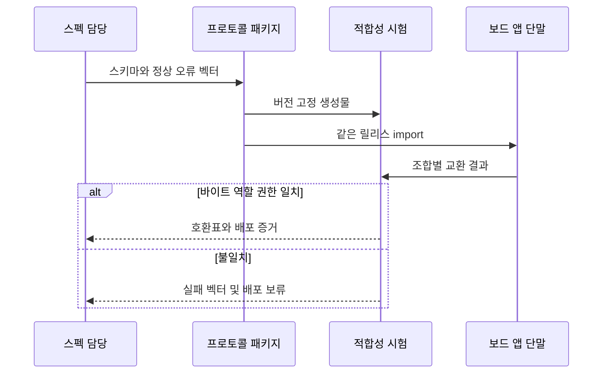

# P10 공통 플랫폼·통신 프로토콜 · 유즈케이스

[제품별 설계 목차](../README.md) · [PRD](prd.md) · [기획](plan.md) · [유즈케이스](use-cases.md) · [정보구조](ia.md)

## 시나리오별 인수 시험

### UC1 · 프로토콜 변경과 교차 제품 import (R1·R2·R4)

- **주체와 시작 조건** SDK 유지보수자, 호환성 영향이 있는 스키마 후보.
- **정상 흐름** 필드·기능 협상 정의 → 생성 → 벡터 비교 → 소비자 버전 고정 → 보드/앱/단말 양방향 시험.
- **예외와 재개** 구버전에는 명시적 미지원 상태를 반환하고 위험 기능의 자동 강등을 차단한다.
- **종료 상태** 배포 가능한 조합과 거절 조합이 명시된 릴리스.
- **합격 증거** 세 역할 링크와 교차 언어 바이트 비교표. 소유자 앱 중계·단말 직접 `pay.prepare`에 같은 견적을 넣어 지급자·회차·해시 일치와 변경 거절을 확인한다. v1 대여 기기는 기존 v1 업무만 허용하고 개인 지갑/직접 정산 요청은 강등 없이 거절한다.

### UC2 · 보안 수정 출시 (R3·R4)

- **주체와 시작 조건** 릴리스 담당, 사용 중 종속성에 보안 공지가 연결됨.
- **정상 흐름** SBOM 영향 범위 → 수정 버전 고정 → 전이 관계 확인 → 재스캔 → 회귀·서명 → 배포 공지.
- **예외와 재개** 패치 미제공·회귀 실패면 영향을 받는 배포를 보류하고 다음 검토 책임·시점을 지정한다.
- **종료 상태** 기존/수정 버전과 대상 제품, 취약점 처리 결과를 조회.
- **합격 증거** 재스캔 결과·SBOM diff·릴리스 해시·실기 회귀 증거.

### UC3 · 직접 제작·커스텀 업데이트 (R5·R3)

- **주체와 시작 조건** 제3자 제작자, 보드와 공개 빌드 자료 보유.
- **정상 흐름** 모델/BOM 확인 → 소스/도구 고정 → 깨끗한 환경에서 빌드 비교 → 의도한 신뢰 루트로 설치 → P02에서 버전 확인.
- **예외와 재개** 로트·서명·보드 ID 불일치는 중단한다. 커스텀에서 공식으로 복귀할 때 키·백업 정책을 확인한다.
- **종료 상태** 재현한 이미지·사용한 신뢰 루트·지원 조합을 확인.
- **합격 증거** 독립 환경 빌드 비교와 빈 보드 설치/중단 재개 기록.

### UC4 · 서비스 원장 복구와 계약 재생 (R6)

- **주체와 시작 조건** 운영자가 P05/P07 격리 복구 환경과 검증할 백업·확정 체크포인트를 준비한다.
- **정상 흐름** 권한 있는 서비스로 복원 → 체크포인트 재생 → 동일 멱등 키·본문 재시도 → 원장·outbox·조회 결과와 추적 ID 대조.
- **예외와 재개** 같은 키의 다른 본문은 충돌, 타 테넌트 조회는 정보 노출 없이 거절한다. 원장과 확정 증거가 어긋나면 서비스를 승격하지 않는다.
- **종료 상태** 담당자가 복구 시간·손실 구간과 사전 합의한 복구 목표를 대조한 후 전환한다.
- **합격 증거** 중복 출고·지급 0건, 권한 오류에 타인 정보 0건, 재생 차이와 복구 소요시간 보고. [서비스 계약 목록](../../../specifications/interface-contracts.md)

## 대표 흐름과 실패 분기

