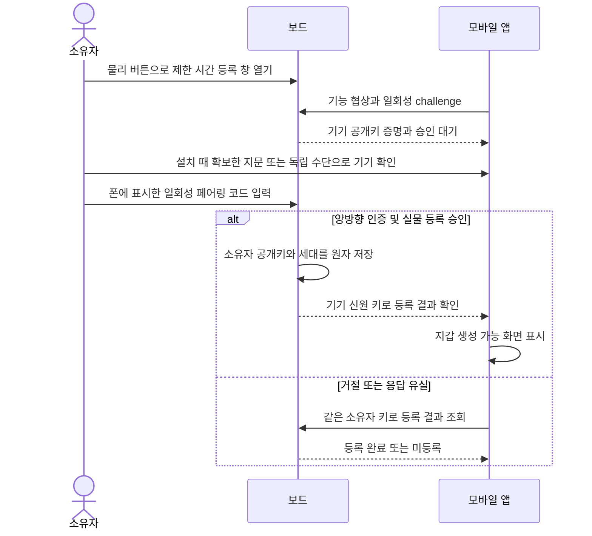
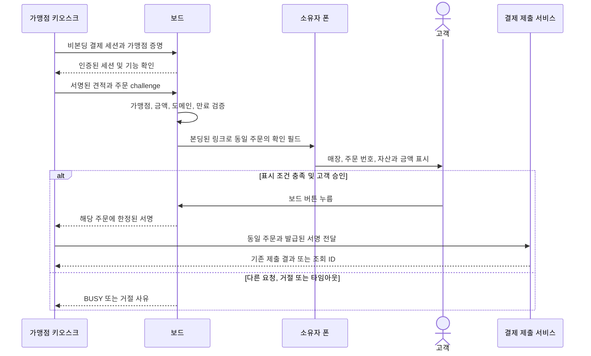
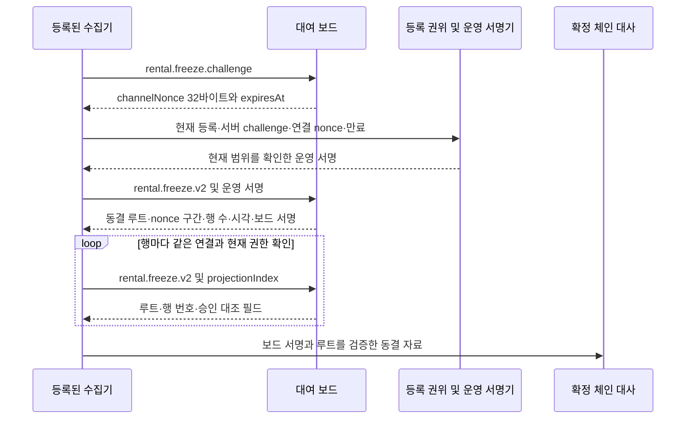
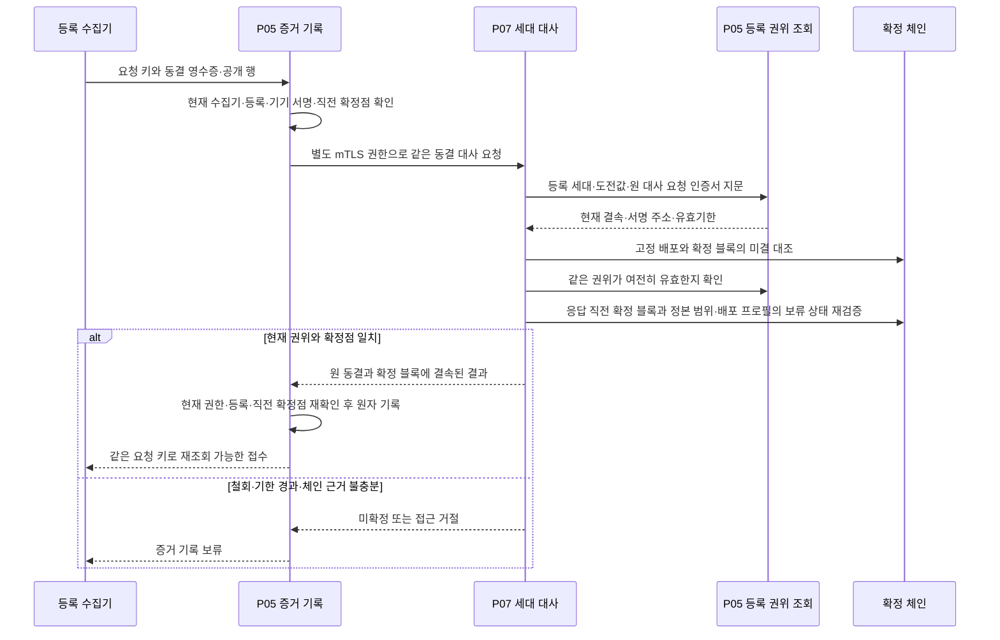
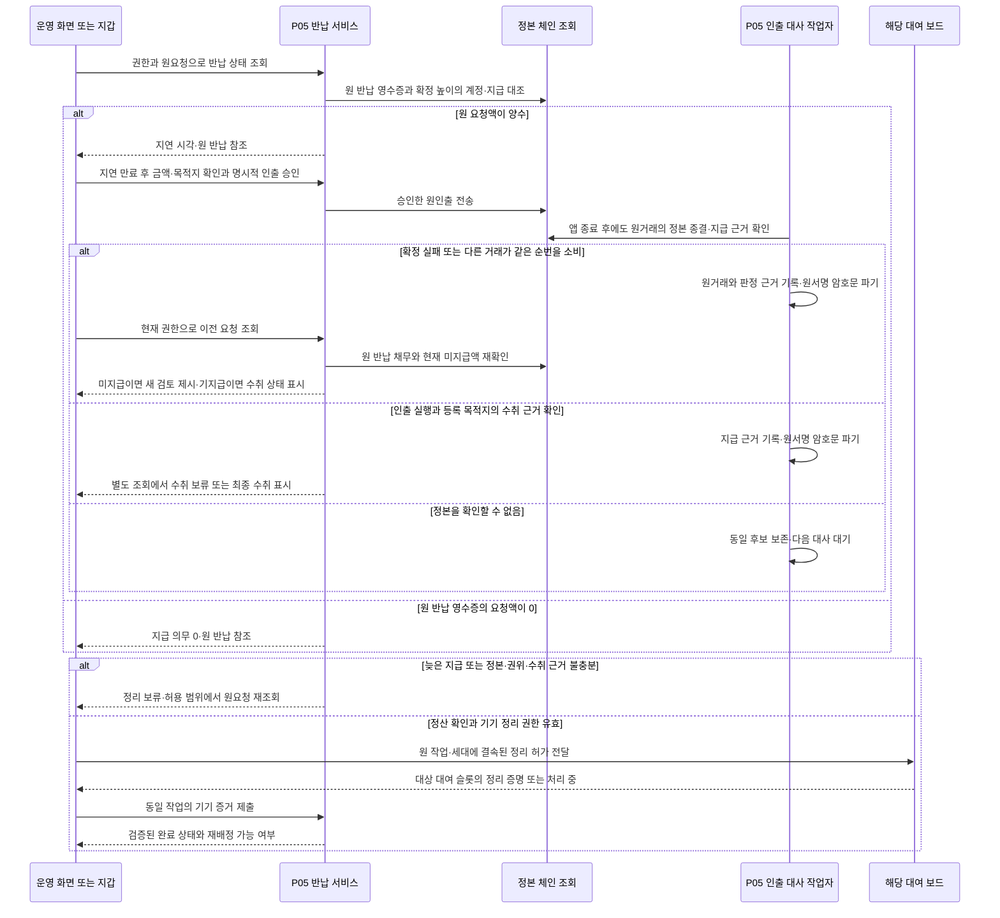

# 보드·모바일·키오스크 공유 프로토콜

[상용화 설계 목차](README.md) · 아래 v2 이름과 메시지는 제안이다. 현재 v1은 CBOR, BLE 조각화, 방향별 시퀀스, 가맹점 인증 세션, EIP-712 결제 벡터를 갖고 있다. v1의 스키마와 고객 자금이 걸린 배포 계약은 버전별로 보존한다. [v1 규격](../specifications/protocol/payment-protocol.md) · [현재 SDK](../../../packages/protocol/README.md)

## 별도 프로젝트의 산출물

기존 `packages/protocol`을 독립 릴리스·라이선스·호환성 표·변경 기록을 가진 프로젝트로 승격한다. 첫 단계는 모노레포 안에서 독립 설치를 입증하는 것이다. 이후 별도 Git 저장소로 배포해도 소비자의 공개 API와 버전 정책은 같다.

| 산출물 | 소비자와 인터페이스 | 공개 전 검사 |
|---|---|---|
| 버전별 원본 스키마·레지스트리 | 목적·필드 번호/필수성·타입·최대 크기·오류·서명 대상, 체인 어댑터 capability, BLE 서비스와 특성, QR 명세 | 코드와 문서를 함께 생성. 과거 릴리스에서 필드 번호·명령 의미 재사용 금지 |
| C 라이브러리와 Zephyr 모듈 | 펌웨어는 버전 고정된 CMake target으로 프레임·정규 인코딩·검증기 사용. 키·버튼·시계·NVM은 기기의 HAL 뒤에 유지 | 펌웨어 로컬 코덱을 벡터로 대조한 후 한 기능씩 이동. 독립 최소 C 프로젝트가 공개 헤더와 라이브러리만으로 빌드 |
| TypeScript SDK | 모바일·키오스크는 버전 고정 패키지를 import. Core는 codec/session/error, 어댑터는 Android/iOS BLE, QR/deep link | React Native 양 플랫폼과 호스트의 동일 벡터, 패키징한 tarball을 모노레포 밖 샘플에서 설치 |
| Go 모듈·벤치 도구 | 가맹점 서명·운영 CLI·서버, Python 기준 인코더와 기기 시뮬레이터 | 다중 언어가 같은 원문·digest·오류를 생성. 암호 라이브러리 호출과 메시지 코드 분리 |

배포 파일마다 버전·커밋·해시·빌드 출처를 붙인다. 앱/펌웨어/키오스크의 최소·최대 wire 버전과 지원 기능을 기계 판독 가능한 표로 낸다. SDK SemVer와 wire major는 별도 값이다. 먼저 앱과 키오스크가 v1/v2를 읽도록 배포하고 보드가 v2를 광고한다. v1 대여 기기는 지정된 v1 계약과 기존 목적만 수행한다. 개인용 세션·새 정산·새 서명 흐름에서 호환을 이유로 v1이나 평문으로 자동 전환하지 않는다.

## 세션과 메시지 계약

| 채널/메시지(제안) | 호출 권한 | 필수 입력과 결과 |
|---|---|---|
| 발견 · `hello / capabilities` | 주변 단말에게 최소 공개 | 짧게 회전하는 식별자, 지원 major·기능 비트, MTU/조각 상한. 기기 소유자의 지갑 주소·계정·PIN은 광고에서 제외. 등록 모드는 명시적 물리 조작과 타이머로 종료 |
| 소유자 · `owner.enroll / replace / revoke` | 등록 창이 열린 기기+물리 확인, 교체에는 기존 소유 증명 또는 복구 | 앱 ephemeral key, 보드 등록 지문, challenge, 본드와 애플리케이션 키 바인딩. 성공 후 소유자 역할, 이전 세션 폐기. 최초 Just Works만으로 소유권을 부여하지 않는다 |
| 설정 · `wallet.create / account.derive / network.select` | 인증된 소유자와 필요시 버튼. 대여 운영은 별도 capability | 소유 모드, 프로필 ID/버전, 허용 경로·계정 번호. 공개 주소·지원 기능·실패 사유 반환. 공개키 대량 열거는 별도 권한 |
| 지갑 · `sign.begin / chunk / review / result` | 소유자 세션 + 체인별 정책 | chain/network, purpose, path, 원문 길이·해시, 조각. 보드가 원문으로 digest와 표시 필드를 계산. 완료 결과는 requestId·계정·digest와 함께 반환 |
| 가맹점 · `pay.open / quote / prepare / result` | 인증된 가맹점 단말 또는 가맹점 견적을 전달하는 인증된 소유자 앱. 가맹점 자격·주문 서명·정산 프로필 필요 | store/terminal, orderId, 견적 버전, 자산·정수 금액·payout·expiry·challenge. 기기는 등록 가맹점, 도메인, 서명을 검사하고 선택한 주문 한 건만 승인 |
| 폰 표시 · `review.show / acknowledged / dismissed` | 현재 소유자 세션 | 보드가 산출한 금액·주소·수수료·가맹점·intent digest. 표시 확인과 사용자 물리 승인, 체인 확정은 별도 상태. 보호 UI가 필요할 때에는 서명된 표시 증명도 검증 |
| 상태 · `status / cancel` | 해당 세션 소유자와 같은 요청 | 보드에서 대기 중인 서명을 취소하거나 기존 발급 결과를 조회한다. 매장 주문 취소·재고 해제는 서비스가 견적 발급 이력과 체인 확정 증거로 판정한다 |
| 수명주기 · `rental.return / owner.wipe / update` | 대여 운영 서명 / 개인 물리 승인 / 업데이트 서명 | 키 종류·대상 기기·소유 세대·명령 범위·만료를 검사한다. 대여 반납은 계정 종료 확정 후 진행. 개인용 초기화는 별도 소유 절차 |

**역할과 서명 입력.** v2 매장 견적에는 체인·지급 계약/버전·자금 원천, 가맹점·단말 위임·등록 payout/버전, 주문·견적 ID, 승인 가능한 지급자, 토큰·정수 금액·만료, 정규화된 품목 해시를 결합한다. 구독은 구독 ID·회차·약관 버전, 예약은 예약 ID·예약금/잔금 구분을 목적 필드에 넣는다. 기기와 지급 계약은 같은 견적 해시와 유효한 발급자 서명을 검증한다. 예치형 보드 승인에는 그 해시와 기기 nonce를, 직접 지불에는 동일 견적을 인자로 받는 계약 호출과 고객 가스 조건을 결합한다. QR의 미리보기나 등록용 challenge는 지급용 서명 입력이 될 수 없다.

키오스크가 보드와 직접 연결하면 가맹점 자격으로 `pay.prepare`를 호출한다. QR·근거리 폰 주문·구독·예약에서는 인증된 소유자 앱이 **변경 없이 전달한 가맹점 서명 견적**을 소유자 세션의 `pay.prepare`로 보낸다. 두 경로 모두 기기가 가맹점, 지급자, 목적을 다시 검증한다. 폰이 가맹점 키를 대신 보유하거나 키오스크가 소유자용 일반 서명을 요청할 수 없다. 두 전송의 공통 결과는 견적 해시 기준으로 조회한다. 세션 ID와 암호 nonce는 연결마다 다르다.

**근거리 주문의 별도 종단.** 고객 폰↔키오스크의 BLE 카탈로그·주문·상태 조회는 키오스크가 제공한다. SDK는 `catalog.read / order.create / order.status / payment.forward`의 요청 ID·멱등 키·오류를 HTTP 경로와 공유한다. 카탈로그 버전과 페이지별 길이를 제한하고 큰 응답은 페이지 단위로 재개한다. 해당 명령을 보드에 보내면 미지원으로, 결제 전용 단말에 메뉴 주문을 보내면 모드 오류로 거절한다. 지급 서명은 여전히 보드↔인증된 소유자/가맹점 링크에서만 발급한다. [폰 인터넷 없는 BLE 주문 시퀀스](merchant-payments.md#폰-인터넷-없이-ble로-주문하기)

**인코딩.** 바깥 봉투에는 `wireMajor, type, sessionId, requestId, seq, bodyLength`를 둔다. 재조립된 본문은 결정적 CBOR이며, 최대 길이를 예약 전에 검사한다. 메시지마다 허용 타입·필드 집합·길이·중복 키·중첩 깊이를 생성 명세로 제한한다. 금액은 최소 단위 부호 없는 정수, 큰 수의 고정 인코딩·엔디언·최대 비트 수는 체인 프로필에 둔다. 부동소수점·로캘 숫자·앱이 준 ticker를 서명 판단에 쓰지 않는다. 견적의 상품/옵션·단가·수량·세금·합계·통화·버전은 정규화해 해시하고 주문에 결합한다. [CBOR RFC 8949](https://www.rfc-editor.org/rfc/rfc8949)

**인증과 재전송.** 가맹점의 자격에는 운영 서명자, 매장, 단말 공개키 또는 위임, 수령 주소, 체인과 계약, 만료가 포함된다. 세션은 검토된 인증 키 교환과 AEAD를 사용한다. 협상한 버전·역할·기능·양측 키·양측 난수·인증 내용을 transcript에 묶고 방향별 키/시퀀스를 분리한다. 재연결은 새 세션 키로 시작한다. 세션의 암호 nonce, 결제 권한 nonce, 가스 지불 계정의 트랜잭션 nonce는 각각 다른 수명주기를 가진다. 앱 재시작 후에도 해당 주문의 승인 여부를 조회할 수 있게 하고 서명 본문을 보존하는 저장소는 접근권과 만료를 둔다.

**시간과 원문.** 대여 결제는 인증된 시각이 유효할 때만 요청을 받는다. RTC 리셋, 오래된 TimeAnchor, 철회 캐시 갱신 실패 시 복구 안내를 반환하고 최종 철회는 계약에서도 확인한다. 일반 개인 지갑의 로컬 키 생성·주소 확인은 특정 운영자 시간 서버에 종속시키지 않는다. 체인 원문을 스트리밍할 때는 요청 길이와 해시, 파서가 해석한 필드와 서명 preimage의 동일성을 검증한다. 원시 digest만 보내는 범용 서명 API를 가맹점이나 DApp에 공개하지 않는다.

**오류와 자원 예산.** 최소 오류 집합은 `UNSUPPORTED_VERSION, UNSUPPORTED_CAPABILITY, BAD_FRAME, UNAUTHORIZED_ROLE, STALE_QUOTE, BUSY, USER_REJECTED, TIMEOUT, UNKNOWN_RESULT`다. 명세는 오류별 재시도 주체와 원래 주문 재조회 가능 여부를 포함한다. 시작 설계값은 연결당 재조립 중 요청 1개, 보드 전체에서 물리 승인 대기 1개다. 긴 PSBT는 스트리밍 한도, 타임아웃, 총 byte/필드/입출력 수 상한을 보드 실측으로 정하고 초과 시 서명 전에 거절한다. 조각 순서 오류·중복·혼입에는 해당 요청만 폐기하고 버퍼를 해제한다.

### 빈 기기와 소유자 폰 등록

빈 지갑에는 계정 키가 없으므로 등록 결과는 설치 때 확인한 **기기 신원 키**로 확인한다. 앱은 OS의 인증된 BLE 링크 위에서 앱 소유자 키의 소유 증명과 기기 키 challenge를 같은 등록에 묶는다. 모바일 단독 설정 후보는 지원 폰에 OS가 표시한 일회성 LE Secure Connections Passkey를 보드 버튼으로 입력하는 방식이다. 기기 PIN과 페어링 코드는 용도·입력 시기·화면을 분리한다. 협상 결과가 인증을 제공하지 않으면 등록을 중단한다. OS별 역할 지원·보드 입력성은 실측 전까지 미확정이다. 대체 경로는 신뢰하는 모바일 USB 또는 독립 액세서리를 통한 등록이다. 지갑 생성 후에만 계정 키 소유를 별도로 검증한다. [Bluetooth SIG 보안 관리자 명세](https://www.bluetooth.com/wp-content/uploads/Files/Specification/HTML/Core-60/out/en/host/security-manager-specification.html)

**복구와 재연결.** 기존 폰을 잃으면 보드 PIN과 설정 시 등록한 독립 복구 수단으로 새 소유자 공개키를 승인한다. 한 번의 저장으로 소유 세대를 올리고 이전 앱 권한·진행 중 승인을 폐기한다. BLE 본드 삭제가 늦어져도 이전 세대의 요청은 거절해야 한다. 결과 조회는 현재 역할·소유 세대·요청 해시와 대조한다. 미등록 응답에는 타인의 소유 정보가 없다. 서명 발급 기록은 요청의 영속 ID로 먼저 예약하며, 같은 ID와 다른 원문은 충돌로 거절한다. 전원 손실 후 안전하게 동일 결과를 돌려줄 수 없는 경우 `UNKNOWN_RESULT`를 반환하고 원 주문을 대사한다. 사용자가 같은 버튼을 다시 누르도록 자동 재요청하지 않는다.

### 키오스크 비본딩 결제와 폰 표시

근거리 모바일 주문과 QR에서는 고객 앱이 견적을 가져와 자기 보드에 전달할 수 있다. 가맹점 서명·회차·금액·수령 주소와 최종 지급 규칙은 동일하다. 동적 QR에는 짧은 만료의 HTTPS 링크, 주문별 불투명 참조와 challenge를 넣는다. 공개 QR 사진만으로 타인의 주문을 바꾸거나 영수증을 열 수 없게 고객의 임시 세션 키에 청구 권한을 묶는다. 단순 매장 안내 QR은 카탈로그만 연다. BLE 광고·RSSI·QR 자체는 결제 권한을 부여하지 않는다.

## 대여 기기의 반납 전 동결과 행 조회

보호 저널을 활성화한 v1 대여 기기는 O09에서 반납할 때 지급과 한도 변경의 원래 승인 범위를 제시한다. 이때 사용하는 `rental.freeze.v2`는 v1 CBOR 관리 명령이며 8바이트의 0인 `sessionId`를 쓴다. 수집 전제는 현재 대여 세대와 피어에 대한 등록 권한, 본딩된 현재 연결, 유효한 기기 시계다. Zephyr 구현은 현재 연결에서 `BT_SECURITY_L4`와 Secure Connections 플래그를 모두 확인한 뒤 피어와 연결 세대를 결속한다. 관리자는 다른 세대나 다른 연결에서 받은 권한으로 행을 읽을 수 없다. [펌웨어 명령 처리](../../../products/p01-device-firmware/core/src/nu54_session_setup.c) · [연결 보안 수준 검사](../../../products/p01-device-firmware/app/src/ble_links.c) · [수집 클라이언트](../../../products/p05-operations-backoffice/internal/ble/session.go)

| 단계 | 수신자가 확인할 조건 |
|---|---|
| 연결 확인 | 보드는 별도 난수로 연결 nonce를 발급한다. 기기 시계 기준 최대 120초다. 난수 생성 실패, 모두 0이거나 직전과 같은 출력이면 기존 조회 권한도 무효화한다. 재연결 후에는 새 nonce와 운영 서명이 필요하다. |
| 동결 요청 | 운영 키는 해당 체인과 계약 도메인의 `RentalFreezeRequestV2(bytes32 binding,bytes32 challenge,bytes32 channelNonce,uint64 expiresAt)`에 서명한다. `binding`은 등록 결속 데이터의 Keccak-256이다. 기기는 같은 피어·연결 세대·nonce, 현재 시각과 운영 서명을 확인한다. 서명 만료는 연결 nonce의 만료 이내여야 한다. |
| 동결 영수증 | 보드의 증거 전용 키가 결속값, 서버 challenge, 루트, 최초·다음 nonce, 행 수, 동결·만료 시각을 서명한다. 수집자는 등록된 보드 키와 대조한다. 동일한 최초 동결을 새 challenge로 재확인할 수 있다. |
| 행 조회와 대사 | 응답 행에는 종류·상태·nonce·만료·가맹점·주문 식별자·승인 다이제스트가 들어간다. 수집자는 응답의 행 번호와 루트, 전체 행 집합의 루트를 확인한다. 지급과 한도 변경의 미결 수는 P07의 확정 원장 대사로 각각 산출한다. |

호스트 인수 조건은 다른 피어, 만료된 권한, 재연결 전 nonce, 수집 중 권한 회수 및 이전 요청 형식의 거절이다. 응답 조각은 수신 시점의 연결에만 보낸다. 공유 벡터는 RFQ2 운영 요청, RFR1 보드 영수증, RJP1 공개 저널의 원문과 다이제스트를 고정한다. 운영에서 이 경로를 열려면 설치된 보드의 측정값, 증거 전용 키, 활성 대여 세대, 수집기 권한을 검증하는 등록 절차가 필요하다. [RFQ2](../../../packages/protocol/v2/testdata/rfq2.vectors) · [RFR1](../../../packages/protocol/v2/testdata/rfr1.vectors) · [RJP1](../../../packages/protocol/v2/testdata/rjp1.vectors) · [등록과 확정 대사의 인수 근거](../../../products/p05-operations-backoffice/O09-GENERATION-EVIDENCE.md)

### 대여 슬롯 정리 요청과 영수증 v1

정리 증거의 독립 레코드 형식으로 `RCI1`과 `RCR1`을 할당한다. 체인에서 확정된 원거래의 출금 또는 영 잔액 처분은 보드 슬롯이 폐기됐다는 증거가 아니다. 등록된 운영 키의 정리 의도와 등록된 보드 증거 전용 키의 영수증을 함께 확인한다. [바이트와 복구 규약](../../../packages/protocol/v2/transport.md#rental-slot-cleanup-proof-v1) · [공유 호스트 벡터](../../../packages/protocol/v2/testdata/rental-cleanup.vectors)

### 수집 증거 기록과 대사 권한 재조회

수집기는 073 기록 모드에서 기기 동결 서명과 공개 행을 P05로 전달한다. 아래는 P05와 P07의 운영 명령을 모두 연결할 때의 인수 순서다. 기기와 체인의 기준점, 등록 권한을 모두 검증한 결과만 운영 화면에서 사용할 수 있다. [P05 전용 기록·권위 조회](../../../products/p05-operations-backoffice/O09-GENERATION-EVIDENCE.md) · [원문 보관 범위와 ERD](architecture/erd.md#지급-주소-변경과-대여-기기의-개설-검토)

증거 기록만 성공한 시점에는 새로운 반납을 승인할 수 없다. 반납 직전의 확정점과 등록 권위를 다시 검증하는 단계가 필요하다. 증거 접수 응답이 유실되면 수집기는 같은 요청 키와 동일한 제출 본문을 다시 보낸다. P05는 현재 권한과 저장한 제출 지문을 확인한 뒤 기존 증거의 접수 결과를 돌려준다. [반납 화면 인수 근거](screens/runtime-acceptance.md#등록-세대의-미결-수와-반납-검토)

P07의 전용 `close-anchor`는 보관한 평가의 블록이 현재 해당 배포의 정본 조상인지 검사한다. P05에서 받은 평가 다이제스트는 같은 요청을 식별하는 데 쓴다. 해당 평가가 미결 0건임을 입증할 책임은 원증거를 가진 P05에 있다. 새 확정 높이가 앞서더라도 원래 블록이 정본이면 확인할 수 있다. 중간에 권한이 철회되거나, 예전 높이의 해시를 확인할 수 없거나, 수집 공백·미해결 사고·프로필 보류가 생기면 건수 없이 종료한다. 이 결과만으로 보드의 대여 슬롯을 지우거나 자산을 반환할 수 없다. [실제 P07 데몬과 정본 검사](../../../products/p07-indexer/chainview-v2.md) · [확인 메시지](../../../packages/protocol/go/rentalv1/close_anchor.go)

### 보호 세대의 반납 이후 상태

아래 순서는 O09 운영 화면과 W12 지갑이 공유할 인수 기준이다. 운영자의 재조회는 거래를 보내지 않는다. 수취 증거에는 원 반납의 배포·기기 계정·세대와 등록 목적지가 일치해야 한다. 체인과 보드의 완료 시점은 각각 기록한다.

기기 응답이 유실되면 같은 세대의 증거를 복구한다. 개인 키나 개인 본딩 정보는 이 메시지에 넣지 않는다. 원대여의 환불 목적지와 가맹점 영수증 조회는 이후 세대에서도 유지한다. [운영 유즈케이스](products/p05-operations-backoffice/use-cases.md#보호-세대-반납-이후의-인수-기준) · [기기 증거와 재시도 설계](../specifications/return-route-contracts.md)

## 상호운용 수용 시험

| 축 | 입력과 조합 | 합격 기준 |
|---|---|---|
| 바이트 호환 | v1 보존 벡터와 v2 양성/거절 벡터를 C·TS·Go·기준 인코더에 투입 | hash·서명 원문·표시 의미·오류 동일. 신규 SDK가 v1 기존 정답 전체 재현 |
| 링크 | ATT MTU 23/185/247, 앱 종료·OS 백그라운드·전원 손실, 두 보드와 두 폰 | 세션 간 조각 혼입 0건. 재연결 후 오래된 버튼/승인 무효. 키오스크와 본딩 폰 동시 연결 확인 |
| 권한 | 키오스크의 관리 명령, 이전 폰의 서명 요청, 다른 가맹점이나 버전에 묶인 견적 | 해당 요청 거절, 키·서명·개인 계정 목록 공개 0건. 구형 기기 UI에 지원되지 않는 작업을 숨김 |
| 릴리스 | 현재 및 이전 지원 릴리스, 잘못된 시계, 만료된 SDK·자격, 오프라인 설치 번들 | 지원표대로 협상. 불명확한 상태는 주문 조회로 복원. 재시도해도 새 청구나 중복 서명이 생성되지 않음 |

**소비자 인수.** 같은 SDK 릴리스로 모노레포 외부의 C 펌웨어 예제와 TypeScript 모바일·키오스크 예제를 깨끗한 환경에서 빌드한다. 각 결과에 실제 import 버전·스키마 해시·보드/앱 빌드를 남긴다. C와 TS 양쪽에서 동일 주문의 견적 해시와 표시 금액이 같고, 수령 주소·회차 중 하나라도 바뀐 입력은 두 경로 모두 승인 전 거절해야 한다. v1 전용 보드와 v2 앱의 기존 대여 흐름, v2 보드와 v1 단말의 새 명령 거절을 별도 벡터로 확인한다.

[전송 구간별 데이터 노출과 실기 인수](architecture/security.md) · [SDK와 소비 제품의 패키지 경계](architecture/packages.md)
