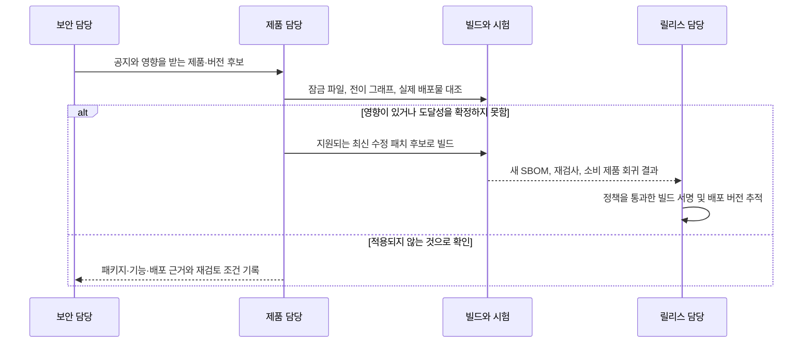
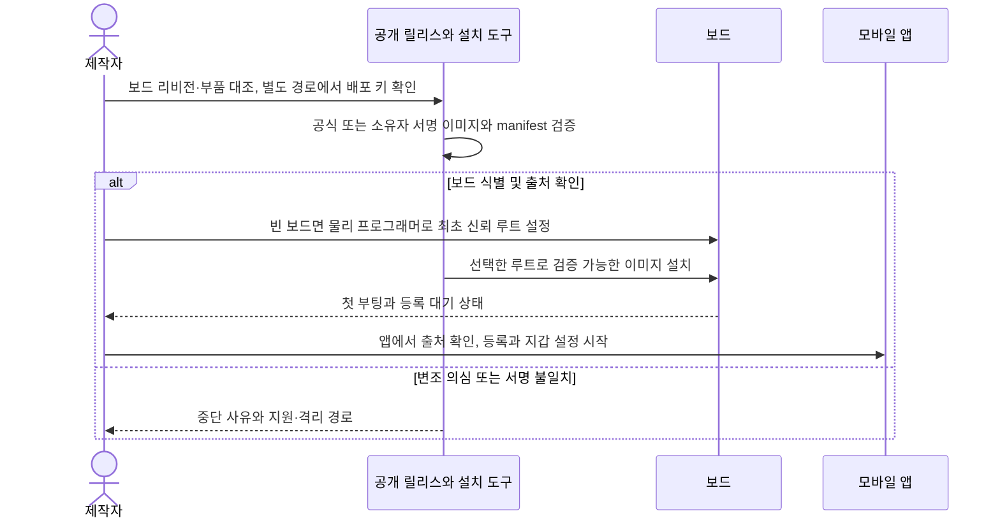
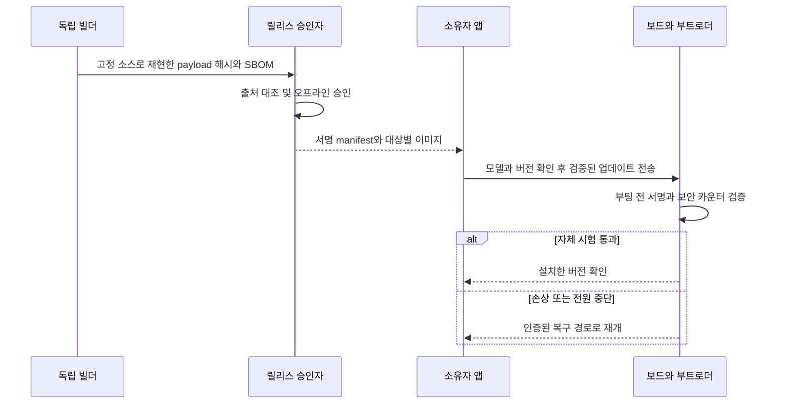

# 보안 검토, 자가 설치와 출시 판정

[상용화 설계 목차](README.md) · 2026-11-20 · 소스 기준 `4ca2e59`

상용 배포 전 가장 먼저 막아야 할 경로는 **디버그 서명 앱이 공식 배포물로 나가는 것**, **보드 PIN이 폰에 전달되는 것**, **폰에 표시된 수취인·금액을 신뢰할 수 없는 상태에서 개인 자금에 서명하는 것**이다. 다음은 소스, 구성 파일, 기존 실기 기록과 공개 공지를 대조한 결과다. 바이너리 전체 감사·의존성 전수 스캔·보드 물리 보안 검증은 출시 작업에 포함한다.

## 공급망 위협과 보호 범위

2026년 11월 18일 Ledger는 유통 경로에서 일부 정품 단말이 개조됐으며 확인된 변조가 초기 설정 중 복구 문구를 노렸다고 발표했다. 피해 인원이나 총손실은 이 설계의 전제로 두지 않는다. 공개 회로도와 재현 가능한 펌웨어는 구매자가 검증할 정보를 늘린다. 둘만으로 배송된 보드·디버거·부속 회로가 모두 명세와 일치한다는 사실을 증명할 수는 없다. [Ledger 조사 업데이트](https://support.ledger.com/article/Update-on-the-Hardware-Implant-Incident-Investigation)

| 경계 | 지킬 자산·실패 결과 | 상용 통제와 잔여 위험 |
|---|---|---|
| 제조·배송·중고 재판매 | 키 생성 과정, 복구 매체, 버튼·통신 경로. 변조품으로 시작하면 정상 펌웨어도 입력 경로를 보증하지 못함 | 공개 회로 리비전·부품표·앞뒷면 고해상도 사진·검사점·조달 기록·대조 절차. 수상한 제품 격리와 로트 추적. 온보드 디버거 펌웨어·외부 모듈도 검증 범위. 정품 증명은 권한 있는 제조 루트가 있는 조합만 |
| 소스·빌드·앱 스토어 | 서명된 악성 펌웨어·앱, 탈취된 배포 키 | 독립 빌더 재현, 고정 소스와 잠긴 도구, 서명된 출처, 오프라인/HSM 릴리스 키와 이중 승인, 앱 서명 지문. 같은 배포 서버가 해시·이미지를 함께 바꿀 수 있어 별도 신뢰 채널 확보 |
| 폰·브라우저·BLE | 원문과 다른 결제 화면, 이전 폰의 권한, 개인정보 노출 | 기기에서 원문 파싱과 한도 적용, 보드 버튼·표시 증명·독립 복구, 본드 세대 폐기, WebView 격리. 일반 폰 OS 침해가 남는 프로필은 지원 범위와 한도를 축소 |
| 키오스크·운영자·RPC | 수령 주소 변경, 다른 가맹점 정보 열람, 지급 미확정인데 상품 제공 | 가맹점·단말별 최소 권한과 폐기 가능 키, 지급 주소 이중 승인/대기, 보호된 가스 키·잔액 상한, 독립 RPC·확정 이벤트 대조. 특정 RPC만 실패하면 확인 중 유지 |
| 지도·푸시·주방/POS | 주소와 여행 이력 결합, 거짓 청구 알림·중복 조리 | 지갑 공개 주소와 위치 식별자 분리, 짧은 보관 기간·목적별 동의·삭제, 푸시에 금액·위치·서명 미포함, webhook 인증과 inbox 중복 제거 |

## 코드에서 확인한 우선순위

표는 기준 커밋 `4ca2e59`에서 발견한 출시 위험과 원래 해소 기준을 보존한다. 이후 코드·실험 빌드·설치판에서 확인한 통제는 제품별 진행 장부에 연결했다. [기준선](../../../products/p10-platform/baseline/v1.json) · [구현과 독립 검수](implementation-progress.md)

| 순위 | 관찰과 근거 | 구현 작업 | 해소 판정 |
|---|---|---|---|
| 1 · 출시 차단 | 대여자 앱과 키오스크 모두 release에 `signingConfigs.debug`를 선택한다. 이 설정으로 만든 배포물에는 운영 배포자를 구분할 서명 경계가 없다. [대여자 Android 빌드 108행](../../../products/p02-user-app/android/app/build.gradle#L108) · [키오스크 Android 빌드 108행](../../../products/p04-merchant-kiosk/android/app/build.gradle#L108) | 앱별 업로드/스토어 키, 권한 분리, 프로덕션 서명 정보 없으면 빌드 실패. 커뮤니티 자가 서명은 공식 배포와 다른 식별·업데이트 채널 | APK/AAB 및 배포 APK의 실제 서명 인증서 대조, 디버그 인증서 거절. iOS도 Team·entitlement·배포 프로필을 별도 검증 |
| 2 · 개인 자금 출시 차단 | 보드가 본딩된 수신 링크에 PIN 입력 숫자를 보내며 앱이 숫자를 렌더링한다. 손상된 폰에 기기 PIN이 알려질 수 있다. [펌웨어 164행](../../../products/p01-device-firmware/app/src/pay_link.c#L164) · [앱 92행](../../../products/p02-user-app/src/App.tsx#L92) | 새 wire 버전에서는 기기 안에서만 비밀 입력, 앱은 시작·종료 결과(취소·잠금 포함)만 표시. 기존에 폰에 노출됐을 수 있는 PIN은 소유자 입회하에 교체 | 정상·실패·중단 중 BLE·로그·크래시·스크린샷에서 숫자/입력 패턴 복원 불가. 구형 앱이 해당 기능을 협상할 수 없음 |
| 3 · 개인 자금 출시 차단 | 단일 영속 서명 키가 있고 생성 함수가 기존 키 삭제부터 수행한다. 일반 사용자용 루트/복구·물리 확인 경로는 입증 자료가 필요하다. PSA의 non-exportable 플래그만으로 물리 추출 저항을 확정할 수 없다. [기기 키 33행](../../../products/p01-device-firmware/app/src/device_key.c#L33) · [기기 키 보관 설명 17행](../../../products/p01-device-firmware/README.md#L17) | 개인/대여 키 슬롯·권한 분리, 등록·재시도에서 기존 키 보존, 트랜잭션형 생성, 보호 저장/디버그 잠금 계측, 확인 가능한 복구 프로필 채택 | 전원 차단·재등록·이전 운영자 reset 후 개인 키 보존, 두 번째 보드에 복구, 보호 UI/독립 확인이 필요한 거래의 강등 차단 |
| 4 · 매장 출시 차단 | 표시 번호가 로컬 읽기→증가→쓰기이며 주문 모음이 JSON 단위로 저장된다. 동시 주문에서 번호 충돌·갱신 유실을 막을 매장 공용 경계가 필요하다. [메뉴 28행](../../../products/p04-merchant-kiosk/src/kiosk/menu.ts#L28) · [주문 저장 78행](../../../products/p04-merchant-kiosk/src/kiosk/orders.ts#L78) | 중앙 주문 유일 키·조건부 재고 차감·원장/outbox 도입. 단말 로컬은 캐시와 재개 정보만 관리 | 두 단말·QR/BLE 경쟁 중 중복 청구·갱신 유실 0건. [매장 수용 시험](merchant-payments.md) |
| 5 · 배포 검증 우선 | 루트 Make 제품 목록에 대여자 앱이 없고 CI가 루트 test/lint를 호출한다. 보드 CI는 호스트 코어 위주이며 Actions는 major 태그를 사용한다. [Makefile 20행](../../../Makefile#L20) · [CI 26행](../../../.github/workflows/ci.yml#L26) | 대여자 앱 명시 편입, 실제 Android·iOS·펌웨어 산출물 빌드/검사, Actions SHA·도구체인 digest 검토, 릴리스 작업과 PR 권한 분리 | 앱 회귀가 CI에서 실패하고, host와 보드 빌드·서명 검증·SBOM이 같은 릴리스에 연결 |
| 6 · 운영 API 확장 전 | 운영 서버가 health만 제공하며 기본 `ListenAndServe`를 사용한다. [운영 서버 13행](../../../products/p05-operations-backoffice/cmd/opsd/main.go#L13) | 장치·직원 인증 등 역할별 API, 요청 크기/시간 제한, tenant별 권한검사·속도 제한·감사 로그, 웹 세션 보호·CSP·CSRF 방어 | 타 매장 자원 접근 거절, 승인 역할 분리, 제한 시간 내 자원 해제, 지급 주소 변경 기록 재구성 |

## 의존성 패치 장부의 시작점

아래 사례의 버전은 기준선 `4ca2e59`에서 확인했다. 이후 패치에서는 x/crypto 0.59.0, go-ethereum 1.17.10과 Vite 7.3.8을 잠갔다. 수정 하한은 각 공지에 한정한다. 패치 검수는 지원 버전, Go의 최종 선택 모듈, 각 빌드 대상의 도달 경로와 설치 버전을 대조한다. [최초 목록](../../../products/p10-platform/baseline/patch-ledger.json) · [변경 전후 SBOM과 재검사](../../../products/p10-platform/patches/dependencies/README.md)

| 소비 제품과 관찰 버전 | 공지에서 확인한 범위 | 패치 후보와 회귀 시험 |
|---|---|---|
| 프로토콜·ABI·운영·인덱서의 `golang.org/x/crypto v0.36.0`. [운영 모듈 27행](../../../products/p05-operations-backoffice/go.mod#L27) · [인덱서 31행](../../../products/p07-indexer/go.mod#L31) | SSH 서버/인증 함수 공지의 수정 하한은 각각 v0.45.0, v0.52.0. 이 명세에서 해당 SSH 서버 함수의 배포 바이너리 도달성은 미확인 | 11월 11일 공개된 v0.59.0을 후보로 네 모듈·필요 Go 버전을 함께 평가. 소스 및 바이너리 govulncheck 결과와 EIP-712·키스토어 회귀 기록. [Go 공지 4134](https://pkg.go.dev/vuln/GO-2025-4134) · [Go 공지 5015](https://pkg.go.dev/vuln/GO-2026-5015) · [공식 버전 목록](https://pkg.go.dev/golang.org/x/crypto?tab=versions) |
| `go-ethereum v1.16.4`를 사용하는 Go 제품과 공유 모듈. [프로토콜 모듈 5행](../../../packages/protocol/go/go.mod#L5) | GO-2026-4508의 P2P 노드 처리 영향 범위는 v1.17.0 미만. RPC·ABI 라이브러리를 소비하는 제품과 노드 운영 환경은 실제 사용 경로가 다르다 | 수정 포함 유지보수 버전을 선정, RPC 연결·로그 디코딩·서명 복원·receipt finality·체인 장애 회귀. 실제 노드 운영자는 노드 이미지도 별도로 대조. [Go 공지 4508](https://pkg.go.dev/vuln/GO-2026-4508) |
| 운영 웹의 개발 의존성 Vite 7.3.6. [잠금 파일 3922행](../../../pnpm-lock.yaml#L3922) · [Vite 설정](../../../products/p05-operations-backoffice/web/vite.config.ts) | GHSA-9jrq-w75r-8gcw는 7.x에서 7.3.6까지, 수정 하한 7.3.7. 이 공지의 조건에는 custom middleware 등이 있으며 현재 확인한 설정은 기본 React 플러그인이다 | 7.3.7 이상 지원 패치로 잠금 파일을 갱신하고 같은 계열 공지를 함께 재검사. 개발 서버와 배포 정적 번들을 구분, production build·브라우저 기본 동작 시험. [Vite 유지관리자 공지](https://github.com/vitejs/vite/security/advisories/GHSA-9jrq-w75r-8gcw) |

**전수 검사 범위와 담당.**

| 영역 | 수집·판정 절차 | 패치 후 보존할 증거 |
|---|---|---|
| 모바일·웹·빌드 도구 | pnpm 잠금 파일의 직접/전이·실행/개발 그래프를 OSV와 공급자 공지에 대조. RN·Metro·Hermes·noble 암호 모듈과 네이티브 브리지 조합 확인. Android Gradle/Maven 해석 결과, iOS Pods/Ruby 잠금·빌드 도구까지 포함 | 재현 설치, 실제 배포 번들·모바일 SDK별 SBOM, Android·iOS 실기기 BLE·서명 벡터·앱 스토어 빌드 |
| Go·Python·컨테이너 | go.work에 등록한 각 모듈의 실제 선택 모듈과 govulncheck 결과를 기록하고 OS/arch별 바이너리를 재검사한다. uv.lock·Python 버전, 컨테이너 OS 패키지와 베이스 이미지 digest를 추적한다 | 갱신 전후 graph·advisory ID·도달성·VEX 판단, 인덱서 재색인, 격리 환경 테스트·복원 이미지 |
| 보드·암호·계약 | west manifest의 NCS·Zephyr·MCUboot·CRACEN, 벤더 복사본 secp256k1/XKCP, 부트로더, probe, Foundry/solc·forge-std, 배포 ABI·런타임 코드 해시를 공급자별로 대조 | fixed commit·서명·라이선스·빌드 옵션·보드 리비전, 전력/메모리·서명 교차검증, 컨트랙트 불변식과 새 배포 판단. [벤더 코드 목록](../../../products/p01-device-firmware/third_party/README.md) · [Nordic 공지](https://docs.nordicsemi.com/r/bundle/struct_sa/page/struct/sa.html) |

플랫폼 담당은 PR·정기 빌드·보안 공지 접수 시 같은 그래프를 검사한다. 항목별로 발견일, 실제 배포 버전, 근거, 사용 기능, 수정 하한, 선택 버전, 담당자, 기한, 검증 결과를 기록한다. 출시 정책 제안은 키/서명/배포 경로에서 도달 가능한 중대 취약점은 즉시 해당 배포를 중단하고, 수정 빌드·재검사·사용자 통지까지 추적하는 것이다. 적용 불가 판단에는 근거와 재검토 시한을 붙인다. 버전 숫자가 올라간 것만으로 해소 표시를 하지 않는다. [OSV 지원 입력](https://google.github.io/osv-scanner/supported-languages-and-lockfiles/) · [govulncheck](https://pkg.go.dev/golang.org/x/vuln/cmd/govulncheck)

### 보안 공지에서 수정 배포까지

**완료 기준.** 잠금 파일과 빌드 산출물 양쪽에서 공지가 가리키는 버전·심볼을 대조한다. 수정 후보는 빌드 시점의 최신 지원 보안 패치로 정하고 도구 체인 호환성과 회귀 결과를 기록한다. 제품별 SBOM과 수정 빌드 해시, 재검사 결과, 서명·결제 벡터, 대상 단말의 설치 버전까지 연결돼야 ‘해소’로 판정한다. 패치가 없거나 배포되지 않은 단말은 영향 기능 제한·공지·대체 경로를 명시해 미해소로 추적한다. 도달성을 확인하지 못한 항목을 영향 없음으로 닫지 않는다. 키·서명·배포 경로의 도달 가능한 중대 결함이 열린 빌드는 출시 차단이다.

## 제작자 설치와 커스텀 빌드 인수

1. **구매·식별.** 릴리스 페이지에 지원 PCB 리비전, SoC/모듈, 디버거, 선택형 표시·복구 부품, 펌웨어 호환표, 부품 대체 기준과 하드웨어 재배포 라이선스를 표시한다. 회로도 공개 여부와 PCB 원본·BOM·제조 파일의 제공/라이선스를 각각 확인한다. 제공되지 않은 파일은 조달 과제로 남긴다.
2. **빌드·검증.** 초보자는 서명된 보드별 이미지와 독립 경로에서 확인한 공개키로 시작한다. 제작자는 소스 태그, SDK/west lock, 컴파일러·컨테이너 digest로 같은 unsigned payload를 재현한다. 서명 시각/래퍼가 다를 수 있어 비교할 payload·manifest·서명을 명시한다. 보드는 검증한 설치 정보와 기기 신원 증명을 내주고, 앱이 공식/자가 빌드·키 지문·버전을 표시한다. LED는 확인 대기 등 상태를 나타낸다. [SLSA 산출물 검증](https://slsa.dev/spec/v1.2/verifying-artifacts)
3. **최초 설치.** 빈 보드는 검증한 USB 프로그래머 또는 지원되는 브라우저/모바일 USB 경로에서 소유자가 신뢰 루트를 설치해야 한다. 부트로더 없는 보드에 BLE 앱만으로 최초 설치를 약속하지 않는다. 기존 자금·본딩 유무를 먼저 화면에 표시하고, 사용자 동의 없는 erase를 차단한다. 이후 일상 설정·계정·거래는 모바일 앱이 맡는다.
4. **업데이트와 복구.** 현재 release 설정은 단일 슬롯·유선 serial recovery다. 모바일 BLE DFU 목표에는 인증된 manifest, 보드·버전·최소 보안 카운터, 서명 검증, 배터리 임계치, 중단 복구, 새 이미지 자체 시험이 필요하다. 두 슬롯이 맞지 않으면 외부 staging 또는 키를 보존하는 유선 복구 경로를 검증한다. 서명된 구버전으로 내리는 경로와 임의 복구 이미지 부팅을 모두 검사한다. [현행 release 구성 4행](../../../products/p01-device-firmware/app/sysbuild-release.conf#L4) · [MCUboot 설계](https://docs.mcuboot.com/design.html)
5. **커스텀.** 체인 추가 샘플은 공개 벡터·파서·표시·복구 시험을 포함한다. 무서명 동적 코드를 불러오지 않는다. 개발자 이미지와 개인 서명 이미지는 공식 운영 신뢰 루트와 분리한다. 소유자가 자체 릴리스를 계속 검증·갱신할 수 있게 포맷·도구·복구 절차를 공개한다.

자가 설치 시험에는 제품을 처음 접한 사용자와 커스텀 배포를 만드는 개발자가 각각 참여한다. 사용자는 공개 구매 목록으로 지원 보드를 식별하고 서명된 이미지를 설치한 뒤 모바일 앱만으로 등록·지갑 설정·테스트넷 수신을 마친다. 이미 신뢰 부트로더가 있는 보드와 완전 빈 보드의 최초 프로그래밍 준비물을 별도로 표시한다. 개발자는 공개된 샘플 프로필 한 개를 변경해 자가 서명 이미지를 빌드하고 앱에 커스텀 출처가 보이는지, 같은 소유자 키로 다음 버전 업데이트와 손상 이미지 거절을 확인한다. 양 시험 모두 사용한 리비전·부품·라이선스·태그·이미지 해시·실패 후 복구 결과를 남긴다.

변조 의심 보드에서는 설정을 중단하고 새 시드를 만들거나 기존 복구 문구를 입력하지 않는다. 실물과 참조 사진·회로·부품 이력에서 확인 가능한 차이를 기록하고 해당 로트를 격리한다. 소프트웨어가 정상 서명으로 부팅됐다는 이유로 물리 검사를 통과 처리하지 않는다. 지원 하드웨어 자료가 부족한 경우 공개 가능한 조립과 검증 범위를 릴리스에 정확히 표시한다.

#### 처음 구매한 보드의 설치

#### 설치 후 펌웨어 업데이트

**실보드 검증.** nRF54L15의 공칭 비휘발성 메모리 1,524 KB와 RAM 256 KB는 앱 전체가 쓸 수 있는 예산이 아니다. BLE 두 링크, 보안 영역, 부트로더·업데이트 슬롯, 플래시 저널, 서명 라이브러리를 포함한 링크 맵과 stack/heap 고수위를 측정한다. ECDSA, Ed25519·hardened 파생, Schnorr를 각각 PSA/하드웨어·검토된 소프트웨어 경로별로 검증한다. KMU·TF-M·외장 SE 후보는 실제 곡선과 파생이 경계 안에서 가능한지, 리셋·디버그·복제에 어떻게 반응하는지 입증한다. 지원하지 않는 연산을 일반 RAM에 평문 루트로 자동 전환하지 않는다. [Nordic 메모리 사양](https://docs.nordicsemi.com/r/bundle/ps_nrf54l15/page/overview.html-features_and_peripherals) · [Nordic KMU](https://docs.nordicsemi.com/r/bundle/ps_nrf54l15/page/kmu.html)

## 코드 검토와 출시 증거

| 책임 | 리뷰·시험 | 출시 증거 |
|---|---|---|
| 펌웨어·프로토콜 | 길이 확인 후 버퍼 할당, 정수 범위·중복 필드·파생 경로 검사, 비밀 지우기, 검증된 암호 라이브러리, 키 용도 격리. 호스트에서 파서 속성 시험과 sanitizer, 보드에서는 전원 차단·버튼·메모리 수명 시험 | 동일 벡터의 성공/거절, 양산 이미지 부팅·디버그 잠금·복구, 성능/메모리 여유, 미서명·구버전 이미지 거절 |
| 모바일·백오피스 | WebView origin·탐색 정책, 네이티브 브리지 최소화, PIN·키·위치·서명 로그 배제. 서버에서 권한 재검사, 매개변수 SQL, 비밀 회전, 민감 조작 감사 | 기기 분실·폰 교체·웹 권한 철회, 실제 앱 서명 검사, 역할별 접근과 테넌트 격리, 접근성 결과. [Android WebView 보안](https://developer.android.com/privacy-and-security/risks/insecure-webview-native-bridges) |
| 계약·매장 원장 | 정수 단위·도메인·재사용·한도·재진입·실수령·환불 누계 검사. 외부 검토, 상태 불변식 시험, 재배포·이전 채권 대사, 수수료 변화와 릴레이어 장애 시험 | 동일 조건의 데모 전후 잔액·영수증·재고·정산 장부, 중복 지급/환불 0건, 불일치 대시보드와 담당자 |
| 배포·운영 | 데모/파일럿/상용 환경 자격 분리, 최소 권한 배포, 서명된 릴리스·보안 신고 채널·지원 종료 일정. 키 유출과 로트 변조 시 배포 중단, 관련 키/단말 철회, 영향 사용자 통지·자금 이전 지원 | 재현 빌드 2곳, 백업 복원과 운영 키 교체 훈련, 분실·위조품·RPC 장애 지원 매뉴얼, 버전별 공개 보안 공지. [NIST SSDF](https://csrc.nist.gov/pubs/sp/800/218/final) |

**판정 단위는 보드 리비전 × 펌웨어 해시 × 앱/OS × 체인/자산 × 기능이다.** 담당자는 각 조합을 실기 통과·시뮬레이터만 통과·미실행·차단으로 기록하고 근거를 링크한다. W7 테스트넷 결제 성공은 재사용할 기준 사례다. W12 양식에서 미실행인 항목, 새 대여 지갑의 후속 결제, 독립 표시/복구, 다중 주문 부하와 실수령·환불은 각자의 증거로 종료한다. 출시 후 이상 징후가 나타나면 운영자는 영향받은 가맹점의 신규 견적 발급을 중단하고 이미 제출된 거래의 조회·대사·인출을 계속 지원한다. 개인 지갑 소유자에게는 영향 버전과 업데이트·이전 절차를 알린다. 운영자에게 개인 키의 원격 잠금·삭제 권한을 부여하지 않는다. [기존 실기 결제](../acceptance/gate-w7.md) · [남은 수용 항목](../acceptance/week12-log.md)

[처리 목적·보유 및 ISMS-P 운영 증거](architecture/privacy.md) · [BLE와 서비스의 시큐어 코딩 인수](architecture/security.md)
