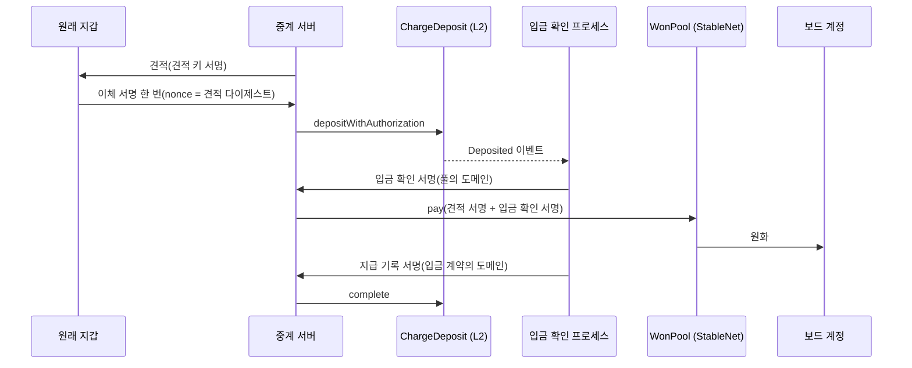

# 충전 계약 설계

2026-11-27 · 상태: **계약과 Foundry 시험만 있다. 어느 체인에도 배포하지 않았다.** 서버, 앱, 배포 스크립트는 없다. 되바꾸기는 만들지 않았다.

[충전과 되바꾸기 규격](traveller-exchange.md)의 충전 부분을 계약으로 옮긴 기록이다. 규격 1장과 2026-11-27 결정을 따랐고, 규격 2~10장에서 아직 확인받지 않은 것은 10장에 모았다. 코드는 [`products/p06-stablenet-contracts/src/charge`](../../../products/p06-stablenet-contracts/src/charge)에 있다.

## 1. 만든 것

| 파일 | 하는 일 |
|---|---|
| `src/charge/ChargeDeposit.sol` | 출발 체인(L2)의 입금 계약. 여행자의 USDC를 받아 지급이 기록될 때까지 든다 |
| `src/charge/WonPool.sol` | StableNet의 원화 풀. 미리 채운 원화에서 보드로 지급한다 |
| `src/charge/ChargeGovernance.sol` | 두 계약이 함께 쓰는 키 일곱 개와 변경 절차 |
| `src/charge/ChargeTypes.sol` | 견적의 칸, 서명 타입, 금액 계산 |
| `src/charge/FixedRateProvider.sol` | 값·시각·이름을 답하는 환율 공급자와 고정 환율 구현 |
| `src/test-token/TestChargeUSDC.sol` | 시험 USDC. 6자리, `version()`은 `"2"`, 거절 기능 없음 |
| `test/vectors/charge.vectors` | 서버와 지갑이 만들어야 하는 서명의 기준값 |

두 계약은 업그레이드할 수 없고 소유자 키가 없다. 체인 번호와 상대 계약 주소는 생성자 값이다. 다른 체인에 배포하면 생성자가 실패한다.

## 2. 한 건의 흐름

견적 다이제스트 하나가 입금 번호, 이체 서명의 nonce, 지급 번호다. 그래서 여행자의 서명 하나에 금액, 입금 계약, 시한, 환율, 받는 보드 주소가 모두 묶인다. 입금 거래는 누구나 보낼 수 있고, 누가 먼저 보내도 같은 입금이 기록된다. 중계 서버는 `AlreadyDeposited`로 실패하면 기록을 읽어 성공으로 다뤄야 한다.

## 3. 입금의 상태

상태는 `None` → `Deposited` → `Completed` → (`Contested`) → `Refunded`다.

| 바뀜 | 함수 | 누가 | 조건 |
|---|---|---|---|
| 없음 → 입금됨 | `depositWithAuthorization` | 누구나 | 견적 키 서명, 지갑의 이체 서명, 입금 정지 아님, 견적 만료 전이고 만료가 10분 안 |
| 입금됨 → 완료 | `complete` | 중계 키 호출 + 입금 확인 키 서명 | 한 번 거절된 입금은 안 됨 |
| 입금됨 → 완료 | `completeBySigners` | 서명자 둘 | 없음 |
| 완료 → 이의 | `contest` | 입금한 지갑의 거래 또는 그 지갑의 서명 | 완료에서 7일 안, 확정되지 않음, 쓰이지 않음 |
| 이의 → 완료(확정) | `confirmPaid` | 서명자 둘 | 이의에서 14일 안 |
| 완료·이의 → 입금됨 | `reject` | 서명자 둘 | 확정되지 않음, 쓰이지 않음, 이의면 14일 안 |
| 입금됨 → 환불됨 | `refundBySigners` | 서명자 둘 | 지급 마감 `D`에서 2시간 뒤 |
| 입금됨 → 환불됨 | `refundSelf` | 누구나 | 입금 7일 뒤와 거절 3일 뒤 가운데 늦은 때 |
| 이의 → 환불됨 | `refundSelf` | 누구나 | 이의에서 14일 동안 답이 없음 |

환불은 입금한 지갑으로만 간다. 토큰이 지갑 잔액에 넣지 않으면 거래가 되돌아가 입금 상태에 남는다. 풀은 `D`가 지나면 지급하지 않고 환불은 `D` 뒤에만 열리므로, 환불된 입금이 나중에 지급되는 길은 없다. 반대 순서(지급 뒤 환불)는 9장의 남는 손실이다.

## 4. 서명

모든 서명은 EIP-712이고 도메인은 이름 `NU54 Charge`, 버전 `1`, 그 계약이 있는 체인 번호, 그 계약 주소다. 이체 서명만 토큰의 도메인을 쓴다.

| 서명 | 타입 | 누가 | 어느 계약의 도메인 | 다시 못 쓰게 하는 것 |
|---|---|---|---|---|
| 견적 | `ChargeQuote(…)` 14칸 | 견적 키 | 입금 계약 | 입금 번호 한 번, 지급 번호 한 번 |
| 이체 | `ReceiveWithAuthorization` | 원래 지갑 | USDC 토큰 | 토큰의 nonce, 받는 계약만 호출 가능 |
| 입금 확인 | `DepositConfirmation(depositId, sourceBlockHash, fast, until)` | 입금 확인 키 | 풀 | 지급 번호 한 번 |
| 지급 기록 | `PaidRecord(depositId, wonBlockHash, round, until)` | 입금 확인 키 | 입금 계약 | 회차 |
| 이의 | `Contest(depositId, round, until)` | 원래 지갑 | 입금 계약 | 회차 |
| 서명자의 일 | `Action(kind, subject, round, until)` | 서명자 셋 중 둘 | 각 계약 | 회차 또는 제안의 세대 |

- `until`은 지금보다 뒤이고 7일 안이어야 한다.
- 입금의 회차는 상태가 바뀔 때마다 1씩 는다. 정지 풀기는 정지 회차, 제안은 계약의 세대를 쓴다.
- `Action`의 `kind`는 이름의 keccak256이다. 입금 계약: `complete`, `confirmPaid`, `reject`, `refund`, `returnStray`, `unpauseDeposits`. 풀: `unpausePays`. 둘 다: `propose`, `cancel`.
- `refund`의 `subject`는 `keccak256(abi.encode(입금 번호, StableNet 블록 해시))`다. 서명자는 `D`가 지난 최종 확정 블록에서 지급이 없음을 읽고 그 해시를 넣는다. 계약은 그 블록을 확인하지 못한다.
- 기준값 파일의 각 줄은 `이름=16진수`다. `quote`, `authorization`, `confirmation`, `paid`, `refund`, `contest` 줄은 `abi.encode(체인 번호, 도메인의 계약 주소)` 뒤에 `abi.encode(타입해시, 칸…)`을 붙인 것이고, `…Preimage` 줄은 `0x1901 ‖ 도메인 ‖ 구조체 해시`다. 시험 키는 `test/ChargeVectors.t.sol`의 상수다.

## 5. 키

| 키 | 하는 일 | 혼자 할 수 없는 것 |
|---|---|---|
| 중계 | 입금 제출, 지급 호출, 지급 기록 호출 | 지급(입금 확인 서명과 견적 서명이 필요), 지급 기록(입금 확인 서명이 필요) |
| 견적 | 견적 서명 | 환율 범위 밖의 견적, 지급 |
| 입금 확인 | 입금 확인 서명, 지급 기록 서명 | 지급과 지급 기록의 호출(중계 키만 부른다) |
| 서명자 1·2·3 | 둘이서 환불, 완료, 거절, 이의 답, 그냥 보낸 코인 돌려주기, 정지 풀기. 둘 + 24시간으로 키 교체, 서명자 교체, 한도 올리기, 환율 범위, 풀 인출, 출발지 더하기, spender | 한 명으로는 대기 중인 변경의 취소만 |
| 정지 | 입금 정지, 지급 정지, 중계·견적·입금 확인 키 끄기, 한도 내리기, 환율 범위 좁히기, 출발지 빼기, 대기 중인 변경 취소 | 올리기와 넓히기 전부, 정지 풀기 |

- 일곱 키는 서로 다른 주소여야 한다. 생성자와 키 교체가 이를 확인하므로 중계 키와 입금 확인 키가 같은 주소가 될 수 없다. 두 키를 다른 프로세스에 두는 것은 서버의 일이다.
- 둘 + 24시간의 변경은 제안 뒤 24시간부터 3일 동안만 적용된다. 취소되거나 지난 제안은 같은 서명으로 다시 올릴 수 없다. 키를 끄거나 서명자를 바꾸면 그전 제안은 모두 무효다.
- 한 사람이 일곱 키를 모두 맡는 동안에는 서명 둘이 실수 하나를 막지 못한다.

## 6. 한도와 시각

금액은 모두 0.01원 단위의 정수다. 아래 값은 생성자 값이고 코드의 상수가 아니다.

| 한도 | 값 | 0.01원 단위 | 확인하는 곳 |
|---|---|---|---|
| 충전 1건 | 1,000~300,000원 | 100000~30000000 | 입금 계약, 풀 |
| 보드 하루 | 1,000,000원 | 100000000 | 풀 |
| 원래 지갑 하루 | 1,000,000원 | 100000000 | 풀 |
| 풀 하루 | 3,000,000원 | 300000000 | 풀 |
| 빠른 경로 1건 | 50,000원 | 5000000 | 풀 |
| 빠른 경로 하루 | 500,000원 | 50000000 | 풀 |
| 환율 | 1 USDC = 1,345.00원 (시험용 고정 환율, 2026-11-27 기준) | 134500 | 입금 계약, 풀 (최소 = 최대) |

- 하루는 시간 칸 25개로 센다. 지급한 시간과 그 뒤 24개 시간에 그 지급을 센다. 어느 24시간에도 한도를 넘지 않고, 한 번 찬 한도는 길면 25시간 뒤에 풀린다.
- 풀의 크기 5,000,000원은 채우는 양이다. 계약은 들어오는 양을 막지 않는다. 풀이 모자라면 지급 거래 전체가 실패하고 기록과 한도에 아무것도 남지 않는다.
- 입금 계약은 하루 한도를 세지 않는다. 한도를 넘는 입금은 견적 서버가 막아야 하고, 그래도 들어온 입금은 환불로 끝난다.
- 수수료는 0만 받는다. 수수료를 켜려면 다시 배포한다.
- 계산: `원화 = USDC × 환율 ÷ 1,000,000`(버림). 원화를 먼저 정하면 `USDC = ⌈원화 × 1,000,000 ÷ 환율⌉`. 두 계약이 같은 식으로 확인한다.

| 시각 | 값 | 어디에 있나 |
|---|---|---|
| 견적 만료 `E` | 발급 + 2분(서버). 계약은 `E`가 블록 시각에서 10분 안일 때만 받는다 | `MAX_QUOTE_LIFE` |
| 지급 마감 `D` | `E` + 2시간. 두 계약이 `D = E + 2시간`을 확인한다 | `PAY_WINDOW` |
| 서명 환불 | `D` + 2시간부터 | `SIGNED_REFUND_DELAY` |
| 스스로 환불 | 입금 + 7일, 거절됐으면 거절 + 3일과 견줘 늦은 때 | `SELF_REFUND_DELAY`, `REJECTED_REFUND_DELAY` |
| 이의 | 완료 + 7일 안 | `CONTEST_WINDOW` |
| 이의의 답 | 이의 + 14일 안 | `ANSWER_WINDOW` |
| 변경 대기 | 24시간, 그 뒤 3일 | `CHANGE_DELAY`, `CHANGE_WINDOW` |

## 7. 원화 자산: 토큰과 코인

풀의 자산과 자릿수는 생성자 값이다. 견적과 한도는 자산이 무엇이든 0.01원 단위이고, 보내는 양만 `10^(자릿수-2)`를 곱한다.

| 자산 | 자릿수 | 배율 | 채우기 | 지급 |
|---|---|---|---|---|
| `tKRW` (`TestKRW3009`) | 2 | 1 | 풀 주소로 토큰을 보낸다 | `transfer(보드, 양)` |
| KRWC, 토큰으로는 `0x…1000`의 `WKRC` | 18 | 10^16 | 풀 주소로 코인을 보내거나 토큰 `transfer` | 같은 `transfer(보드, 양)` |

- 지급 길은 하나다. 풀은 코인을 직접 보내지 않고 자산의 `transfer`만 부른 뒤 보드 잔액이 정확히 그만큼 늘었는지 확인한다.
- `assetIsCoin`이 참일 때만 풀이 그냥 보낸 코인을 받는다. 자산이 토큰이면 거절한다. 받아도 꺼낼 길이 없기 때문이다.
- 거래 금지 목록에 오른 보드나 풀은 지급이 실패한다. 지급 번호는 쓰이지 않고 입금은 환불로 끝난다.
- 풀의 돈은 지급 말고는 생성자에서 정한 금고 주소로만, 서명자 둘 + 24시간으로 나간다.

## 8. 만들지 않은 것과 남긴 자리

| 만들지 않은 것 | 남긴 자리 |
|---|---|
| 되바꾸기(원화 → USDC) | 완료된 USDC는 `spender` 계약 하나만 `spend`로 꺼낸다. 처음에는 비어 있고 서명자 둘 + 24시간으로 정한다. 계약 주소만 될 수 있다. 꺼낼 수 있는 입금은 이의 없이 완료 7일이 지났거나 서명자 둘이 확정한 것이다 |
| 다른 입금 방식(직접 호출) | 견적에 `method` 칸이 있다(지금은 1만 받는다). 검사와 기록은 `_accept` 한 곳에 있다. 새 방식은 새 입금 계약을 배포해 풀의 출발지에 더한다 |
| USDT | 위와 같다. 이체 서명이 없는 토큰은 다른 입금 방식이 필요하다 |
| 둘째 출발 체인 | 풀의 출발지는 (체인 번호, 입금 계약)의 목록이다. 더하기는 서명자 둘 + 24시간, 빼기는 정지 키 |
| 바깥 환율 공급자 | `IRateProvider`의 `latestRate()`가 값, 시각, 이름을 답한다. 계약은 공급자를 읽지 않고 환율 범위만 확인한다 |
| 배포 스크립트, Go·TypeScript 바인딩 | 없음 |

## 9. 남는 손실

- **[치명] 지급은 됐는데 지급 기록이 7일 동안 없으면 같은 입금이 환불로도 나간다.** 두 계약은 서로를 보지 못한다. 지급 기록 지연 경보와 `completeBySigners`가 필요하다. 시험 `testAPayoutNeverRecordedIsAlsoRefunded`가 이 손실을 그대로 보인다.
- **[치명] 중계·견적·입금 확인 키를 함께 쓰는 자는 입금 없이 지급받는다.** 손실은 하루 3,000,000원과 풀에 있는 양까지다. 시험 `testAllThreeKeysTogetherStayInsideTheLimitsAndThePool`.
- 거짓 이의에 서명자가 14일 동안 답하지 않으면 두 번 나간다.
- 서명자 둘이 지급된 입금의 환불에 잘못 서명하면 두 번 나간다.
- 빠른 경로로 지급한 입금이 출발 체인에서 뒤집히면 풀이 손해를 본다. 1건 50,000원, 하루 500,000원까지다.
- 여행자가 남의 견적에 서명하면 남의 보드로 간다. 계약은 막지 못한다.

## 10. 확인받지 않고 정한 것

| 정한 것 | 근거 |
|---|---|
| 계약은 견적 만료가 블록 시각에서 10분 안이면 받는다 | 규격 2장 |
| 거절된 입금의 스스로 환불은 거절 3일 뒤, 거절된 입금은 서명자 둘만 다시 완료 | 규격 3장 |
| 서명의 만료는 최대 7일, 변경은 24시간 뒤 3일 동안, 키를 끄면 그전 제안 무효 | 규격 3장, 6장 |
| 정지 풀기는 서명자 둘이고 24시간을 기다리지 않는다 | 규격 6장 |
| 그냥 보낸 코인은 서명자 둘이 `(거래 해시, 로그 번호)`마다 한 번, 입금의 몫을 건드리지 않는 범위에서 돌려준다 | 규격 7장 |
| 중계·견적·입금 확인 키를 하나씩 따로 끌 수 있다 | 참고 계약은 셋을 한 번에 껐다 |
| 풀 인출의 받는 주소는 배포할 때 정한 금고 하나 | 참고 계약 |
| 입금 계약의 풀 주소는 배포 전에 계산해 생성자에 넣는다 | 참고 계약의 서명 초기화를 없앴다 |
| 서명자 둘이 확정한 입금은 7일을 기다리지 않고 `spender`가 쓸 수 있다 | 구현하며 정함 |
| 시험 USDC의 `version()`은 `"2"` | Circle USDC와 같은 값으로 알고 있으나 체인에서 읽지 않았다 |
| 충전 1건의 최소(1,000원)는 바꿀 수 없는 생성자 값 | 구현하며 정함 |

## 11. 로컬 배포 순서

체인 두 개가 필요하고 체인 번호가 달라야 한다. 번호가 같으면 다른 체인의 서명을 다시 쓰는 결함을 시험이 잡지 못한다.

1. anvil 두 개를 띄운다. 출발 체인 84532, StableNet 대역 8283.
2. 역할 키 일곱 개를 만든다. 서로 다른 주소여야 한다.
3. 출발 체인에 `TestChargeUSDC`를, StableNet 대역에 `TestKRW3009`를 배포한다.
4. StableNet 대역에서 풀을 배포할 계정의 주소와 nonce로 풀 주소를 미리 계산한다.
5. 출발 체인에 `ChargeDeposit`을 배포한다. 값: USDC, 체인 84532, 원화 체인 8283, 4번의 풀 주소, 원화 토큰, 최소·최대 원화, 환율 최소 = 최대 = 134500.
6. StableNet 대역에 `WonPool`을 배포한다. 값: 자산, 자릿수 2, `assetIsCoin` 거짓, 금고, 체인 8283, 한도, 환율, 출발지 (84532, 5번의 주소). 배포된 주소가 4번과 다르면 5번부터 다시 한다.
7. 풀에 `tKRW` 5,000,000원(500000000)을 발행한다.
8. 견적 서버가 읽을 `FixedRateProvider(134500, 이름)`를 배포한다.

시험은 `make -C products/p06-stablenet-contracts test`로 돌린다. 로컬 forge 1.8.3에서는 `FOUNDRY_DYNAMIC_TEST_LINKING=false FOUNDRY_ISOLATE=false`를 붙인다.

## 12. 사용자 승인이 필요한 것

- Base Sepolia와 StableNet 시험망 배포, 시험망용 역할 키 만들기.
- KRWC 확보와 풀 채우기, 공개 시험망에서 `tKRW` 발행.
- Circle의 시험 USDC로 하는 시험.
- 10장의 항목.

## 13. 확인하지 않은 것

- 실제 `0x…1000` 토큰이 계약 계정으로 들어오고 나가는 이체를 받는지, 계약이 그냥 보낸 코인을 받는지. 로컬 대역 두 개로만 시험했다.
- Circle USDC의 서명 도메인(이름, 버전)과 거래 금지 목록의 동작.
- forge 1.5.1에서의 형식 검사, 가스 값, 시험 결과. 로컬 1.8.3에서만 돌렸다.
- 서버를 멈추며 하는 두 체인 종단 시험. 계약 시험은 한 EVM에서 체인 번호를 바꿔 가며 했다.
