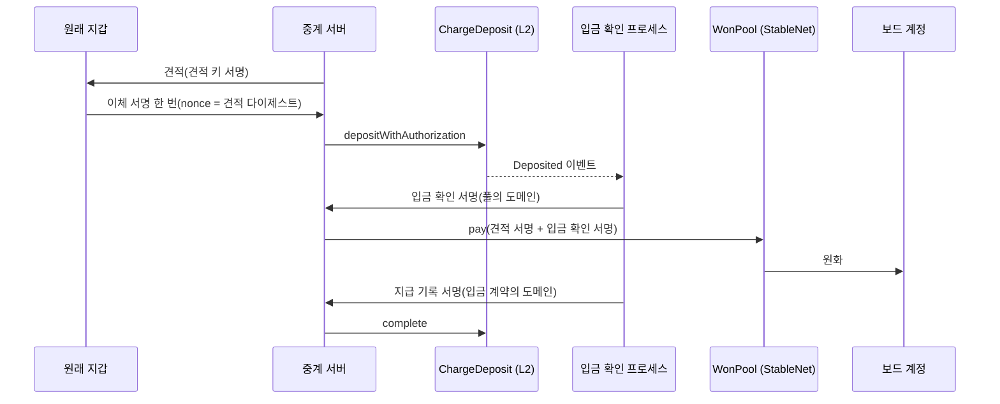

# 충전 계약 설계

2026-11-27 · 상태: **계약과 Foundry 시험만 있다. 어느 체인에도 배포하지 않았다.** 서버, 앱, 배포 스크립트는 없다. 되바꾸기는 만들지 않았다.

[충전과 되바꾸기 규격](traveller-exchange.md)의 충전 부분을 계약으로 옮긴 기록이다. 규격 1장과 2026-11-27 결정을 따랐고, 규격 2~10장에서 아직 확인받지 않은 것은 10장에 모았다. 같은 날 독립 감사와 재감사의 지적을 반영했고, 소유자 결정 두 가지(비상 인출, 정지 키 교체의 일괄 무효)를 넣었다. 2026-11-28에 셋째 감사가 남긴 낮은 등급의 항목을 반영했다. 코드가 바뀐 것은 하나다. 비상 인출이 남은 것이 없는 입금을 건너뛴다(14장). 대기 중인 변경을 멈추는 규칙과 키가 샜을 때의 표는 5장, 남은 위험은 9장, 그대로 둔 기본값은 10장, 비상 인출은 14장, 서버가 쓰는 함수·이벤트·서명은 15장, 배포 점검표는 16장에 있다. 코드는 [`products/p06-stablenet-contracts/src/charge`](../../../products/p06-stablenet-contracts/src/charge)에 있다.

## 1. 만든 것

| 파일 | 하는 일 |
|---|---|
| `src/charge/ChargeDeposit.sol` | 출발 체인(L2)의 입금 계약. 여행자의 USDC를 받아 지급이 기록될 때까지 든다 |
| `src/charge/WonPool.sol` | StableNet의 원화 풀. 미리 채운 원화에서 보드로 지급한다 |
| `src/charge/ChargeGovernance.sol` | 두 계약이 함께 쓰는 키 일곱 개와 변경 절차 |
| `src/charge/ChargeTypes.sol` | 견적의 칸, 서명 타입, 금액 계산 |
| `src/charge/FixedRateProvider.sol` | 값·시각·이름을 답하는 환율 공급자와 고정 환율 구현 |
| `src/test-token/TestChargeUSDC.sol` | 시험 USDC. 6자리, `version()`은 `"2"`, 거절 기능 없음 |
| `test/vectors/charge.vectors` | 서버와 지갑이 만들어야 하는 서명의 기준값 |

두 계약은 업그레이드할 수 없고 소유자 키가 없다. 체인 번호, 상대 계약 주소, 금고 주소는 생성자 값이고 바꿀 수 없다. 다른 체인에 배포하면 생성자가 실패한다. 배포되는 코드는 `ChargeDeposit` 21,409바이트, `WonPool` 18,495바이트이고 한도는 24,576바이트다(solc 0.8.39, 최적화 200회).

## 2. 한 건의 흐름

견적 다이제스트 하나가 입금 번호, 이체 서명의 nonce, 지급 번호다. 그래서 여행자의 서명 하나에 금액, 입금 계약, 시한, 환율, 받는 보드 주소가 모두 묶인다. 입금 거래는 누구나 보낼 수 있고, 누가 먼저 보내도 같은 입금이 기록된다. 중계 서버는 `AlreadyDeposited`로 실패하면 기록을 읽어 성공으로 다뤄야 한다.

## 3. 입금의 상태

상태는 `None` → `Deposited` → `Completed` → (`Contested`) → `Refunded`다.

| 바뀜 | 함수 | 누가 | 조건 |
|---|---|---|---|
| 없음 → 입금됨 | `depositWithAuthorization` | 누구나 | 견적 키 서명, 지갑의 이체 서명, 입금 정지 아님, 견적 만료 전이고 만료가 10분 안 |
| 입금됨 → 완료 | `complete` | 중계 키 호출 + 입금 확인 키 서명 | 한 번 거절된 입금은 안 됨 |
| 입금됨 → 완료 | `completeBySigners` | 서명자 둘 | 없음 |
| 완료 → 이의 | `contest` | 입금한 지갑의 거래 또는 그 지갑의 서명 | 완료에서 7일 안, 확정되지 않음, 쓰이지 않음 |
| 이의 → 완료(확정) | `confirmPaid` | 서명자 둘 | 이의에서 14일 안 |
| 완료·이의 → 입금됨 | `reject` | 서명자 둘 | 확정되지 않음, 쓰이지 않음, 이의면 14일 안 |
| 입금됨 → 환불됨 | `refundBySigners` | 서명자 둘 | 지급 마감 `D`에서 2시간 뒤 |
| 입금됨 → 환불됨 | `refundSelf` | 누구나 | 입금 7일 뒤와 거절 3일 뒤 가운데 늦은 때 |
| 이의 → 환불됨 | `refundSelf` | 누구나 | 이의에서 14일 동안 답이 없음 |

환불은 입금한 지갑으로만 간다. 토큰이 지갑 잔액에 넣지 않으면 거래가 되돌아가 입금 상태에 남는다. 풀은 `D`가 지나면 지급하지 않고 환불은 `D` 뒤에만 열리므로, 환불된 입금이 나중에 지급되는 길은 없다. 반대 순서(지급 뒤 환불)는 9장의 남는 손실이다.

## 4. 서명

모든 서명은 EIP-712이고 도메인은 이름 `NU54 Charge`, 버전 `1`, 그 계약이 있는 체인 번호, 그 계약 주소다. 이체 서명만 토큰의 도메인을 쓴다.

| 서명 | 타입 | 누가 | 어느 계약의 도메인 | 다시 못 쓰게 하는 것 |
|---|---|---|---|---|
| 견적 | `ChargeQuote(…)` 14칸 | 견적 키 | 입금 계약 | 입금 번호 한 번, 지급 번호 한 번 |
| 이체 | `ReceiveWithAuthorization` | 원래 지갑 | USDC 토큰 | 토큰의 nonce, 받는 계약만 호출 가능 |
| 입금 확인 | `DepositConfirmation(depositId, sourceBlockHash, fast, until)` | 입금 확인 키 | 풀 | 지급 번호 한 번 |
| 지급 기록 | `PaidRecord(depositId, wonBlockHash, round, until)` | 입금 확인 키 | 입금 계약 | 회차 |
| 이의 | `Contest(depositId, round, until)` | 원래 지갑 | 입금 계약 | 회차 |
| 서명자의 일 | `Action(kind, subject, round, until)` | 서명자 셋 중 둘. 변경의 취소와 정지 키 교체의 일괄 무효는 한 명 | 각 계약 | 회차(15장의 표) |

- `until`은 서명을 쓰는 블록의 시각보다 뒤이고 그 시각에서 7일 안이어야 한다. 이 값은 서명을 쓰는 순간만 묶는다. 서명을 언제 만들었는지는 묶지 않으며, `until` 전에 올린 제안은 `until`이 지난 뒤에도 대기하고 적용된다. 시험 `testTheEndOfASignatureBindsOnlyTheMomentOfUse`.
- 입금의 회차는 상태가 바뀔 때마다 1씩 는다. 정지 풀기는 정지 회차를 쓴다. 제안과 그 취소는 `proposalRound(kind, arguments)`가 답하는 회차를 쓴다(5장). 정지 키 교체의 일괄 무효는 `pauserRound`, 비상 인출의 제안과 취소는 `exitRound`를 쓴다(15장).
- `Action`의 `kind`는 이름의 keccak256이다. 입금 계약: `complete`, `confirmPaid`, `reject`, `refund`, `returnStray`, `unpauseDeposits`. 풀: `unpausePays`. 둘 다: `propose`, `cancel`, `voidPauserReplacements`, `proposeEmergencyExit`, `cancelEmergencyExit`.
- `refund`의 `subject`는 `keccak256(abi.encode(입금 번호, StableNet 블록 해시))`다. 서명자는 `D`가 지난 최종 확정 블록에서 지급이 없음을 읽고 그 해시를 넣는다. 계약은 그 블록을 확인하지 못한다.
- 기준값 파일의 각 줄은 `이름=16진수`다. `quote`, `authorization`, `confirmation`, `paid`, `refund`, `contest` 줄은 `abi.encode(체인 번호, 도메인의 계약 주소)` 뒤에 `abi.encode(타입해시, 칸…)`을 붙인 것이고, `…Preimage` 줄은 `0x1901 ‖ 도메인 ‖ 구조체 해시`다. 시험 키는 `test/ChargeVectors.t.sol`의 상수다.
- 같은 형식의 줄이 더 있다. `confirmationFinal`은 `fast`가 거짓인 입금 확인이다. `complete`, `reject`, `confirmPaid`, `returnStray`, `unpauseDeposits`, `unpausePays`, `proposePauser`, `proposeWithdraw`는 서명자 1·2가 서명한 `Action`이고 `…Signatures` 줄에 두 서명이 이어져 있다. `cancelPauser`는 서명자 3 혼자의 취소다. `returnStrayArguments`의 keccak256이 `returnStray`의 `subject`다.
- 뒤에 24줄을 붙였고 앞의 63줄은 한 바이트도 바꾸지 않았다. `voidPauser`는 서명자 3 혼자의 일괄 무효다. `exitSubject`는 금고 주소를 32바이트로 쓴 값이고 `proposeExit`·`cancelExit`(입금 계약), `proposeExitPool`·`cancelExitPool`(풀)의 `subject`다. `proposeSpender…` 줄은 `setSpender` 제안의 재료와 결과다. 시험 `testExitVoidAndSpenderVectorsMatchTheFileAndAreAccepted`가 이 서명들을 계약에 넣어 본다.

### 24시간을 기다리는 변경의 제안

변경은 해시가 아니라 종류와 인자를 그대로 올린다. 기다리는 동안 무엇이 바뀌려는지 누구나 읽을 수 있다.

- `propose(kind, arguments, salt, until, 서명 둘)`. `kind`는 바꾸는 함수 이름의 keccak256이고 `arguments`는 그 함수의 인자에서 `salt`를 뺀 `abi.encode`다.
- 변경 번호는 `actionOf(kind, arguments, salt)`이고 `keccak256(abi.encode(kind, 인자…, salt))`와 같다. `propose` 서명의 `subject`가 이 번호다. 기준값 파일의 `propose…Kind`, `…Arguments`, `…Salt`, `…Action` 줄이 재료와 결과다.
- 계약에 없는 종류, 길이가 맞지 않는 인자, 없는 키 번호와 서명자 번호, 주소 칸의 위 12바이트가 0이 아닌 인자는 제안할 때 거절한다. 키 번호와 서명자 번호는 32바이트 전체로 읽는다. 259는 마지막 바이트가 3이어도 키 3이 아니고 제안에서 거절된다. 그래서 대기 중인 제안은 모두 그 종류의 함수 호출 하나로 옮겨진다. 값이 틀린 제안은 거절하지 않는다. 이미 쓰는 주소로의 키 교체, 0인 환율, 최소보다 작은 한도 같은 제안은 대기에 들어가고 적용할 때 실패한다. 시험 `testArgumentsWithAnUncleanAddressAreNotProposed`, `testAKeyOrSignerNumberIsNotReadByItsLastByte`, `testAChangeWithARefusedValueWaitsAndFailsWhenApplied`.
- `setSpender`만은 제안할 때도 값을 본다. 그 주소에 코드가 있고 코드 해시가 인자와 같아야 제안이 들어간다(8장).
- `ChangeProposed(action, kind, arguments, salt, round, readyAt, lapsesAt)` 이벤트가 전부를 싣는다.
- 취소는 `cancelProposal(action, until, signature)`다. 서명자 한 명이 `Action(keccak256("cancel"), action, 제안의 round, until)`에 서명하고 누구나 보낸다. 정지 키는 빈 서명으로 직접 부른다. 제안의 `round`는 `proposals(action)`의 넷째 값이고 `ChangeProposed`의 `round`와 같다. `ChangeCancelled(action, by)`의 `by`는 취소한 자리다(1 정지 키, 2·3·4 서명자 1·2·3).
- `proposals(action)`의 상태는 무효가 됐거나 기간이 지난 제안에도 `Pending`이다. 지금 상태는 `proposalStatus(action)`이 답한다: 0 없음, 1 대기, 2 적용 가능, 3 무효(회차가 지났거나 기간이 지남), 4 적용됨, 5 취소됨.

| 계약 | 종류(`kind`의 이름) | `arguments` |
|---|---|---|
| 둘 다 | `setKey` | 키 번호(0 중계, 1 견적, 2 입금 확인, 3 정지), 새 주소 |
| 둘 다 | `setSigner` | 서명자 번호(0~2), 새 주소 |
| 둘 다 | `setRates` | 최소 환율, 최대 환율 |
| 입금 계약 | `setSpender` | 주소, 그 주소의 코드 해시(`EXTCODEHASH`). 비울 때는 둘 다 0 |
| 입금 계약 | `raiseLimit` | 충전 1건의 최대 |
| 풀 | `withdraw` | 자산 단위의 양 |
| 풀 | `raiseLimits` | 한도 다섯 칸 |
| 풀 | `addOrigin` | 출발 체인 번호, 입금 계약 주소 |
| 풀 | `returnToken` | 토큰 주소, 양 |

## 5. 키

| 키 | 하는 일 | 혼자 할 수 없는 것 |
|---|---|---|
| 중계 | 입금 제출, 지급 호출, 지급 기록 호출 | 지급(입금 확인 서명과 견적 서명이 필요), 지급 기록(입금 확인 서명이 필요) |
| 견적 | 견적 서명 | 환율 범위 밖의 견적, 지급 |
| 입금 확인 | 입금 확인 서명, 지급 기록 서명 | 지급과 지급 기록의 호출(중계 키만 부른다) |
| 서명자 1·2·3 | 둘이서 환불, 완료, 거절, 이의 답, 그냥 보낸 코인 돌려주기, 정지 풀기. 둘 + 24시간으로 키 교체, 서명자 교체, 한도 올리기, 환율 범위, 풀 인출, 잘못 온 토큰 돌려보내기, 출발지 더하기, spender. 둘 + 7일로 비상 인출, 둘이서 그 취소 | 한 명으로는 대기 중인 변경의 취소와 정지 키 교체의 일괄 무효만. 자기 자리를 바꾸는 변경과 비상 인출은 취소하지 못한다 |
| 정지 | 입금 정지, 지급 정지, 중계·견적·입금 확인 키 끄기, 한도 내리기, 환율 범위 좁히기, 출발지 빼기, spender 비우기, 대기 중인 변경 취소 | 올리기와 넓히기 전부, 정지 풀기, 자기를 바꾸는 변경의 취소와 무효화, 비상 인출의 취소 |

- 일곱 키는 서로 다른 주소여야 하고 금고 주소도 일곱 키와 달라야 한다. 생성자와 키 교체가 이를 확인하므로 중계 키와 입금 확인 키가 같은 주소가 될 수 없고, 어떤 키도 금고 주소가 될 수 없다. 두 키를 다른 프로세스에 두는 것은 서버의 일이다.
- 둘 + 24시간의 변경은 제안 뒤 24시간부터 3일 동안만 적용된다. 취소되거나 지난 제안은 같은 서명으로 다시 올릴 수 없다.
- 한 사람이 일곱 키를 모두 맡는 동안에는 서명 둘이 실수 하나를 막지 못한다.

### 대기 중인 변경을 누가 멈추나 (2026-11-27 결정)

변경은 정지 키나 서명자 한 명이 혼자 취소한다. 예외는 하나다. **바뀌는 자리의 키는 그 변경을 멈추지 못한다.** 샌 키 하나가 자기 교체를 끝없이 취소해 자리를 지키고, 그동안 풀 인출과 정지 풀기를 막아 돈을 묶는 것을 없앤다. 비상 인출은 변경이 아니고 표의 마지막 줄처럼 따로 다룬다.

| 대기 중인 것 | 제안 | 대기와 적용 | 정지 키의 취소 | 서명자 한 명의 취소 | 정지 키가 키를 끄면 | 서명자 교체가 적용되면 | 그 밖에 무효가 되는 때 |
|---|---|---|---|---|---|---|---|
| 정지 키 교체(`setKey`, 키 번호 3) | 서명자 둘 | 24시간 뒤부터 3일, 누구나 적용 | 못 한다 | 셋 중 누구나 한다. 서명 하나로 대기 중인 정지 키 교체 전부를 무효로도 만든다 | 그대로 남는다 | 무효 | 다른 정지 키 교체가 적용될 때 |
| 서명자 i 교체(`setSigner`) | 서명자 둘 | 같다 | 한다 | 서명자 i만 못 한다. 다른 둘은 한다 | 무효 | 무효 | 없다 |
| 그 밖의 모든 변경 | 서명자 둘 | 같다 | 한다 | 셋 중 누구나 한다 | 무효 | 무효 | 없다 |
| 비상 인출(14장) | 서명자 둘 | 7일 뒤부터 7일, 누구나 실행 | 못 한다 | 못 한다. 서명자 둘이 함께 서명해야 취소된다 | 그대로 남는다 | 그대로 남는다 | 없다. 기간이 지나면 끝난다 |

- 회차가 셋이다. `generation`은 서명자가 바뀔 때와 키를 끌 때 는다. `pauserRound`는 서명자가 바뀔 때, 정지 키 교체가 적용될 때, 서명자 한 명이 일괄 무효에 서명할 때 는다. `exitRound`는 비상 인출을 제안하거나 취소할 때만 는다. 정지 키 교체 제안은 `pauserRound`로, 나머지 변경은 `generation`으로 센다. 제안의 회차가 지금 값과 다르면 무효다.
- 이미 꺼진 키는 다시 끄지 못한다(`InvalidState`). 정지 키가 키를 꺼서 제안을 무효로 만드는 횟수는 배포 때 켜져 있는 세 키로 세 번이고, 그 뒤로는 서명자 둘이 키를 되살릴 때마다 한 번씩 는다. 시험 `testAKeyThatIsOffIsNotSwitchedOffAgain`.
- 정지 키는 빈 서명으로 부를 때만 정지 키로 판정한다. 서명을 붙인 호출은 서명자의 취소로 판정한다.
- 어떤 키도 혼자서는 변경을 시작하거나 앞당기지 못한다. 제안은 서명자 둘, 적용은 24시간 뒤다. 이 규칙이 없앤 것은 거부권 둘뿐이다.
- 지급 정지를 다시 걸면 정지 회차가 늘어 그전의 정지 풀기 서명은 못 쓴다. 샌 정지 키는 이 방법으로 정지 풀기를 계속 막지만, 교체가 적용되면 더는 부르지 못한다.
- 정지 키 교체가 적용되면 그 자리를 바꾸려던 다른 제안은 모두 무효다(`pauserRound`가 는다). 새 정지 키는 자기 교체를 취소하지 못하므로, 남아 있었다면 서명자만 막을 수 있었다. 시험 `testApplyingAPauserReplacementVoidsTheOthersForThatSeat`.
- 서명자 한 명은 `voidPauserReplacements(until, signature)`로 대기 중인 정지 키 교체를 몇 건이든 한 번에 무효로 만든다. 서명은 `Action(keccak256("voidPauserReplacements"), 0, pauserRound, until)`이고 누구나 보낸다. 서명자 한 명이 한 건씩 취소할 수 있던 것을 묶은 것이고 새 권한이 아니다. 정지 키는 부르지 못한다. 서명은 그 계약, 그 체인, 그 회차에서 한 번만 쓰인다. 다음 제안은 다음 회차로 세므로 서명을 새로 해야 한다. 시험 `testOneSignatureStopsTwentyPauserReplacements`, `testAVoidOfPauserReplacementsIsForOneContractOneChainAndOneRound`.

### 키가 샜을 때

하나가 샜을 때:

| 샌 키 | 할 수 있는 것 | 할 수 없는 것 | 되돌리는 길 |
|---|---|---|---|
| 정지 키 하나 | 교체가 적용될 때까지: 입금·지급 정지, 다시 정지해 정지 풀기 서명을 못 쓰게 하기, 중계·견적·입금 확인 키 끄기, 한도 내리기, 환율 범위 좁히기, 출발지 빼기, spender 비우기, 자기 교체를 뺀 모든 변경의 취소 | 자기 교체의 취소와 무효화, 비상 인출의 취소, 돈을 꺼내기, 올리기와 넓히기, 환불 막기 | 서명자 둘이 정지 키 교체를 제안하고 24시간 뒤 적용한다. 그 뒤 정지는 바로 풀고, 꺼진 키·한도·출발지·spender는 다시 제안해 24시간을 더 기다린다. 길면 48시간이다 |
| 서명자 하나 | 교체될 때까지: 자기 교체를 뺀 모든 변경의 취소, 정지 키 교체의 일괄 무효 | 제안, 둘이 필요한 모든 일, 자기 교체의 취소, 비상 인출의 취소 | 다른 두 서명자가 교체를 제안하고 24시간 뒤 적용한다 |
| 중계 키 하나 | 서명이 갖춰진 입금·지급·지급 기록을 보내거나 보내지 않기 | 지급과 지급 기록(입금 확인 서명이 필요), 돈을 꺼내기 | 정지 키가 끄고, 서명자 둘 + 24시간으로 새 키를 넣는다 |
| 견적 키 하나 | 환율 범위 안의 견적 서명. 범위가 한 값이면 금액과 보드만 고른다 | 지급(중계 호출과 입금 확인 서명이 필요), 범위 밖의 환율, 지갑의 이체 서명 없는 입금 | 위와 같다 |
| 입금 확인 키 하나 | 서명 | 지급과 지급 기록의 호출(중계 키만 부른다) | 위와 같다 |

정지 키나 서명자가 둘 이상 함께 샜을 때. 빼앗긴다는 것은 공격자의 주소로 간다는 뜻이고, 금고로 가는 것은 빼앗기는 것이 아니다:

| 샌 키 | 빼앗기는 것 | 묶이는 것과 기간 | 끝나는 길 | 그래도 잃는 것 |
|---|---|---|---|---|
| 정지 키 + 서명자 하나 | 없다 | 서로의 교체를 취소해 모든 변경이 영원히 막힌다. 풀 인출과 spender 지정이 안 된다. 비상 인출이 열리기까지 7일 동안 풀의 원화와 완료된 USDC가 계약에 남는다. 입금은 묶이지 않는다(서명자 둘의 환불, 7일 뒤 스스로 환불) | 정직한 서명자 둘이 두 계약에 비상 인출을 제안한다. 7일 뒤 누구나 풀의 원화 전부와 확정된 완료 USDC를 금고로 보낸다. 샌 두 키는 취소하지 못한다. 시험 `testTheExitEndsALeakedPauserWithALeakedSigner` | 7일, 그리고 이 두 계약에서의 서비스. 샌 키는 자리를 지키므로 새로 배포한다. 그 7일 동안 샌 정지 키가 지급을 멈추면 들어온 입금은 환불로 끝난다 |
| 서명자 둘 (정직한 정지 키와 셋째 서명자가 남음) | 공격자의 주소로 가는 것은 셋이다. 공격자가 직접 입금하고 지급받은 건의 환불(이중 지급), 입금 없이 입금 계약에 들어온 USDC(`totalHeld`를 넘는 잔액), 입금 계약에 있는 다른 토큰 전부다. 뒤의 둘은 서명자 둘이 `returnStray`로 대기 없이 아무 주소로나 보낸다. 계약은 서명에 적힌 거래 해시와 로그 번호가 실제 로그인지 확인하지 못한다. 입금의 몫(`totalHeld`)은 이 길로 나가지 않는다. 시험 `testStrayCoinsGoBackOnceAndNeverTouchDeposits`, `testAnotherStrayTokenGoesBackTheSameWay`. 그리고 확정되지 않았고 USDC가 아직 계약에 남아 있는 완료 입금은 서명자 둘이 언제든 거절하고 환불할 수 있다. 그 USDC는 입금한 지갑으로 돌아가고 운영자가 그만큼 잃는다. 정지로 막지 못한다. 시험 `testTwoLeakedSignersSendCompletedDepositsBackToTheirPayers`. 취소를 한 번 놓치면 72시간 안에 전부(아래 줄과 같다). 시험 `testOneMissedCancelOutOfTwentyEndsInATakeoverInThreeDays` | 정직한 쪽은 풀의 돈과 완료된 USDC를 꺼낼 길이 없다. 인출도 비상 인출도 서명자 둘이 필요하다. 샌 둘이 비상 인출을 제안하면 정직한 쪽은 막지 못하고, 7일 뒤 돈은 금고로 가며 서비스가 멈춘다 | 계약 안에는 없다. 정지 키가 지급을 멈추고 셋째 서명자 교체를 한 건씩 취소하며, 셋째 서명자가 정지 키 교체를 서명 하나로 전부 무효로 만든다. 이것을 새로 배포할 때까지 24시간마다 빠짐없이 해야 한다 | 서비스. 샌 둘이 지급되지 않은 입금을 완료로 기록하고 이의에 스스로 답하면 그 USDC는 여행자가 아니라 금고로 간다. 시험 `testTwoLeakedSignersForceTheExitButOnlyToTheTreasury` |
| 서명자 둘 + 정지 키 (정직한 셋째 서명자만 남음) | 전부. 24시간 뒤 셋째 서명자가 교체되고, 48시간 뒤 공격자의 중계·견적·입금 확인 키와 올린 한도가 적용돼 풀 전체가 지급으로 나간다. 완료된 USDC는 확정됐거나 이의 기간이 지난 것부터 48시간 뒤 공격자의 spender로 나간다. 나머지와 아직 열려 있는 입금은 공격자가 완료로 기록해 이의 기간이 끝나는 대로 나간다(길면 완료 7일 뒤) | 해당 없다 | 없다. 셋째 서명자는 자기 교체만 빼고 취소할 수 있을 뿐이고, 비상 인출은 서명자 둘이 있어야 제안된다. 시험 `testTwoLeakedSignersWithThePauserTakeThePoolInTwoDays` | 풀의 원화 전부와 입금 계약의 USDC 전부. 풀 인출만은 금고로밖에 못 간다 |

중계·견적·입금 확인 키 셋이 함께 샌 경우와 중계·입금 확인 둘이 함께 샌 경우는 9장에 있다.

## 6. 한도와 시각

금액은 모두 0.01원 단위의 정수다. 아래 값은 생성자 값이고 코드의 상수가 아니다.

| 한도 | 값 | 0.01원 단위 | 확인하는 곳 |
|---|---|---|---|
| 충전 1건 | 1,000~300,000원 | 100000~30000000 | 입금 계약, 풀 |
| 보드 하루 | 1,000,000원 | 100000000 | 풀 |
| 원래 지갑 하루 | 1,000,000원 | 100000000 | 풀 |
| 풀 하루 | 3,000,000원 | 300000000 | 풀 |
| 빠른 경로 1건 | 50,000원 | 5000000 | 풀 |
| 빠른 경로 하루 | 500,000원 | 50000000 | 풀 |
| 환율 | 1 USDC = 1,345.00원 (시험용 고정 환율, 2026-11-27 기준) | 134500 | 입금 계약, 풀 (최소 = 최대) |

- 하루는 시간 칸 25개로 센다. 지급한 시간과 그 뒤 24개 시간에 그 지급을 센다. 어느 24시간에도 한도를 넘지 않고, 한 번 찬 한도는 길면 25시간 뒤에 풀린다.
- 풀의 크기 5,000,000원은 채우는 양이다. 계약은 들어오는 양을 막지 않는다. 풀이 모자라면 지급 거래 전체가 실패하고 기록과 한도에 아무것도 남지 않는다.
- 입금 계약은 하루 한도를 세지 않는다. 한도를 넘는 입금은 견적 서버가 막아야 하고, 그래도 들어온 입금은 환불로 끝난다.
- 수수료는 0만 받는다. 수수료를 켜려면 다시 배포한다.
- 계산: `원화 = USDC × 환율 ÷ 1,000,000`(버림). 원화를 먼저 정하면 `USDC = ⌈원화 × 1,000,000 ÷ 환율⌉`. 두 계약이 같은 식으로 확인한다.

| 시각 | 값 | 어디에 있나 |
|---|---|---|
| 견적 만료 `E` | 발급 + 2분(서버). 계약은 `E`가 블록 시각에서 10분 안일 때만 받는다 | `MAX_QUOTE_LIFE` |
| 지급 마감 `D` | `E` + 2시간. 두 계약이 `D = E + 2시간`을 확인한다 | `PAY_WINDOW` |
| 서명 환불 | `D` + 2시간부터 | `SIGNED_REFUND_DELAY` |
| 스스로 환불 | 입금 + 7일, 거절됐으면 거절 + 3일과 견줘 늦은 때 | `SELF_REFUND_DELAY`, `REJECTED_REFUND_DELAY` |
| 이의 | 완료 + 7일 안 | `CONTEST_WINDOW` |
| 이의의 답 | 이의 + 14일 안 | `ANSWER_WINDOW` |
| 변경 대기 | 24시간, 그 뒤 3일 | `CHANGE_DELAY`, `CHANGE_WINDOW` |

## 7. 원화 자산: 토큰과 코인

풀의 자산과 자릿수는 생성자 값이다. 견적과 한도는 자산이 무엇이든 0.01원 단위이고, 보내는 양만 `10^(자릿수-2)`를 곱한다.

| 자산 | 자릿수 | 배율 | 채우기 | 지급 |
|---|---|---|---|---|
| `tKRW` (`TestKRW3009`) | 2 | 1 | 풀 주소로 토큰을 보낸다 | `transfer(보드, 양)` |
| KRWC, 토큰으로는 `0x…1000`의 `WKRC` | 18 | 10^16 | 풀 주소로 코인을 보내거나 토큰 `transfer` | 같은 `transfer(보드, 양)` |

- 지급 길은 하나다. 풀은 코인을 직접 보내지 않고 자산의 `transfer`만 부른 뒤 보드 잔액이 정확히 그만큼 늘었는지 확인한다.
- `assetIsCoin`이 참일 때만 풀이 그냥 보낸 코인을 받는다. 자산이 토큰이면 거절한다. 받아도 꺼낼 길이 없기 때문이다.
- 거래 금지 목록에 오른 보드나 풀은 지급이 실패한다. 지급 번호는 쓰이지 않고 입금은 환불로 끝난다.
- 풀의 돈은 지급 말고는 생성자에서 정한 금고 주소로만 나간다. 길은 둘이다. 서명자 둘 + 24시간의 인출(양을 정한다), 서명자 둘 + 7일의 비상 인출(전부, 14장).
- 풀은 배포할 때 `assetIsCoin`이 자산과 맞는지 확인한다. 코인의 토큰 주소는 계정의 코인 잔액을 토큰 잔액으로 답하고 따로 만든 토큰은 그렇지 않다. 그래서 배포 계정의 코인 잔액이 0이 아니고 자산이 답하는 잔액과 같을 때만 코인으로 본다. `assetIsCoin`이 이와 다르면 생성자가 실패한다. 코인 풀은 코인을 가진 계정이 배포해야 한다. 이 확인은 정직한 배포자의 설정 실수만 막는다. 코인이 없는 배포자가 코인을 토큰이라고 넣으면 통과하고, 배포자의 코인 잔액과 같은 값을 답하는 토큰은 코인으로 통과한다. 시험 `testDeploymentChecksWhetherTheAssetIsTheCoin`의 "not caught" 두 경우다. 그래서 배포 전에 체인에서 직접 읽어 확인한다(16장).
- 풀에 잘못 들어온 다른 토큰은 `returnToken`으로 금고에만, 서명자 둘 + 24시간으로 보낸다. 풀의 자산은 이 길로 나가지 않는다. 자산 주소는 거절하고, 호출 앞뒤로 풀의 자산 잔액이 달라지면 거래를 되돌린다. 자산이 토큰인 풀에 강제로 들어온 코인은 꺼낼 길이 없다.

## 8. 만들지 않은 것과 남긴 자리

| 만들지 않은 것 | 남긴 자리 |
|---|---|
| 되바꾸기(원화 → USDC) | 완료된 USDC는 `spender` 계약 하나만 `spend`로 꺼낸다(그 밖의 길은 금고로 가는 비상 인출뿐이다, 14장). 처음에는 비어 있고 서명자 둘 + 24시간으로 정한다. 배포된 계약만 될 수 있다. 코드가 없는 계정과, 코드가 `0xef0100`으로 시작하는 계정(EIP-7702로 계약에 계정을 빌려준 키)은 거절한다. 제안에는 주소와 그 주소의 코드 해시가 함께 들어가고, 제안할 때와 적용할 때 둘 다 그 주소의 코드 해시가 제안의 값과 같아야 한다. 코드가 없는 주소는 제안부터 거절되므로 대기 24시간 동안 그 주소에 코드를 새로 넣거나 바꿔 넣을 수 없다. 계약이 확인하는 것은 해시뿐이다. 그 코드가 자기 키에 무엇을 허락하는지, 프록시나 위임 호출처럼 코드를 바꾸지 않고 동작을 바꿀 수 있는지는 확인하지 못한다. 코드를 읽는 것은 서명하는 두 사람과 24시간 안에 취소할 수 있는 정지 키·셋째 서명자의 일이고, 계약은 읽었는지를 강제하지 않는다. 시험 `testTheSpenderMustHoldTheCodeThatWasProposed`. 정지 키는 `clearSpender`로 바로 비운다. 꺼낼 수 있는 입금은 이의 없이 완료 7일이 지났거나 서명자 둘이 확정한 것이다 |
| 다른 입금 방식(직접 호출) | 견적에 `method` 칸이 있다(지금은 1만 받는다). 검사와 기록은 `_accept` 한 곳에 있다. 새 방식은 새 입금 계약을 배포해 풀의 출발지에 더한다 |
| USDT | 위와 같다. 이체 서명이 없는 토큰은 다른 입금 방식이 필요하다 |
| 둘째 출발 체인 | 풀의 출발지는 (체인 번호, 입금 계약)의 목록이다. 더하기는 서명자 둘 + 24시간, 빼기는 정지 키 |
| 바깥 환율 공급자 | `IRateProvider`의 `latestRate()`가 값, 시각, 이름을 답한다. 계약은 공급자를 읽지 않고 환율 범위만 확인한다 |
| 배포 스크립트, Go·TypeScript 바인딩 | 없음 |

## 9. 남는 손실

- **[치명] 지급은 됐는데 지급 기록이 7일 동안 없으면 같은 입금이 환불로도 나간다.** 두 계약은 서로를 보지 못한다. 지급 기록 지연 경보와 `completeBySigners`가 필요하다. 시험 `testAPayoutNeverRecordedIsAlsoRefunded`가 이 손실을 그대로 보인다.
- **[치명] 중계·견적·입금 확인 키를 함께 쓰는 자는 입금 없이 지급받는다.** 손실은 하루 3,000,000원과 풀에 있는 양까지다. 시험 `testAllThreeKeysTogetherStayInsideTheLimitsAndThePool`.
- **[치명] 서명자 둘과 정지 키가 함께 새면 전부 잃는다.** 정직한 셋째 서명자는 자기 교체를 취소하지 못하고 정지 키는 공격자의 것이다. 24시간 뒤 셋째 서명자가 교체되고 48시간 뒤 나머지 변경이 적용된다. 풀은 공격자의 키와 올린 한도로 지급돼 나가고, 완료된 USDC는 공격자의 spender로 나간다. 비상 인출은 서명자 둘이 있어야 제안되므로 이 경우에는 쓸 수 없다. 시험 `testTwoLeakedSignersWithThePauserTakeThePoolInTwoDays`.
- **[중요] 서명자 둘이 새면 정직한 쪽은 돈을 꺼낼 길이 없다.** 인출, spender 지정, 비상 인출 모두 서명자 둘이 필요하다. 정직한 정지 키와 셋째 서명자는 샌 둘의 제안을 24시간마다 빠짐없이 취소해야 하고, 한 번 놓치면 72시간 안에 전부 넘어간다. 정지 키 교체 쪽은 셋째 서명자의 서명 하나로 전부 무효가 되지만(5장), 셋째 서명자 교체 쪽은 정지 키가 한 건씩 취소해야 한다. 정지 키는 자기 교체를, 셋째 서명자는 자기 교체를 취소하지 못한다. 시험 `testTwoLeakedSignersAreStoppedByThePauserAndTheThirdSigner`, `testOneMissedCancelOutOfTwentyEndsInATakeoverInThreeDays`.
- **[중요] 서명자 둘이 새면 비상 인출을 막을 수 없다.** 정직한 정지 키와 셋째 서명자는 취소하지 못한다. 7일 뒤 풀의 원화와 확정된 완료 USDC가 금고로 가고 서비스가 멈춘다. 돈은 금고 밖으로 가지 않는다. 비상 인출을 정한 2026-11-27 결정이 받아들인 값이다(14장).
- **[중요] 비상 인출의 안전은 금고 주소 하나에 달려 있다.** 금고는 바꿀 수 없다. 금고 키와 서명자 둘이 함께 새면 정직한 정지 키와 셋째 서명자가 막을 수 없는 길로 7일 뒤 돈이 공격자에게 간다. 풀의 원화와 확정된 완료 USDC만이 아니고 아직 열려 있는 입금도 간다. 서명자 둘이 지급됐다고 거짓으로 완료 기록하고(`completeBySigners`), 여행자가 이의하면 스스로 답해(`confirmPaid`) 바로 확정하거나 이의 없이 7일을 넘기면, 비상 인출이 그 입금까지 금고로 보낸다. 시험 `testTwoLeakedSignersForceTheExitButOnlyToTheTreasury`가 금고까지 가는 것을 보인다. 결정 전에는 금고로 가는 길이 24시간짜리 인출뿐이었고 그것은 한 명이 취소할 수 있었다. 금고 키를 잃으면 비상 인출로 보낸 돈은 되찾지 못한다(16장).
- 정지 키와 서명자 한 명이 함께 새면 모든 변경이 막힌다. 샌 서명자가 정지 키의 교체를, 샌 정지 키가 그 서명자의 교체를 취소한다. 2026-11-27 결정(바뀌는 자리의 거부권만 없앤다)이 남긴 값이고, 같은 날의 비상 인출 결정이 끝을 냈다. 정직한 서명자 둘이 비상 인출을 제안하면 7일 뒤 풀의 원화와 확정된 완료 USDC가 금고로 간다. 그 7일과 이 계약들에서의 서비스는 잃는다. 입금은 묶이지 않는다. 남은 서명자 둘이 환불하고 7일 뒤에는 누구나 환불한다. 확정되지 않은 완료 입금은 서명자 둘이 거절해(`reject`) 여행자에게 환불할 수도 있다. 시험 `testALeakedPauserWithALeakedSignerBlocksEveryChangeOnBothContracts`, `testTheExitEndsALeakedPauserWithALeakedSigner`.
- 샌 정지 키 하나는 교체가 적용될 때까지 24시간 동안 지급을 멈추고 다른 변경을 취소한다. 꺼진 키와 한도를 되살리는 데 24시간이 더 든다. 그동안의 입금은 환불로 끝난다. 시험 `testALeakedPauserDelaysButCannotLockThePool`.
- 거짓 이의에 서명자가 14일 동안 답하지 않으면 두 번 나간다.
- 서명자 둘이 지급된 입금의 환불에 잘못 서명하면 두 번 나간다. 확정되지 않았고 USDC가 계약에 남아 있는 완료 입금은 기간 제한 없이 거절하고 환불할 수 있으므로, 서명자 둘이 새면 그런 입금 전부가 대상이다. USDC는 입금한 지갑으로만 간다. 시험 `testTwoLeakedSignersSendCompletedDepositsBackToTheirPayers`.
- 빠른 경로로 지급한 입금이 출발 체인에서 뒤집히면 풀이 손해를 본다. 1건 50,000원, 하루 500,000원까지다.
- 여행자가 남의 견적에 서명하면 남의 보드로 간다. 계약은 막지 못한다.

## 10. 확인받지 않고 정한 것

| 정한 것 | 근거 |
|---|---|
| 계약은 견적 만료가 블록 시각에서 10분 안이면 받는다 | 규격 2장 |
| 거절된 입금의 스스로 환불은 거절 3일 뒤, 거절된 입금은 서명자 둘만 다시 완료 | 규격 3장 |
| 서명의 만료는 쓰는 시각에서 최대 7일, 변경은 24시간 뒤 3일 동안, 키를 끄면 그전 제안 무효(정지 키 교체 제안과 비상 인출은 남는다, 5장) | 규격 3장, 6장. 예외는 2026-11-27 결정 |
| 정지 풀기는 서명자 둘이고 24시간을 기다리지 않는다 | 규격 6장 |
| 그냥 보낸 코인은 서명자 둘이 `(거래 해시, 로그 번호)`마다 한 번, 입금의 몫을 건드리지 않는 범위에서 돌려준다 | 규격 7장 |
| 중계·견적·입금 확인 키를 하나씩 따로 끌 수 있다 | 참고 계약은 셋을 한 번에 껐다 |
| 풀 인출의 받는 주소는 배포할 때 정한 금고 하나 | 참고 계약 |
| 입금 계약의 풀 주소는 배포 전에 계산해 생성자에 넣는다 | 참고 계약의 서명 초기화를 없앴다 |
| 서명자 둘이 확정한 입금은 7일을 기다리지 않고 `spender`가 쓸 수 있다 | 구현하며 정함 |
| 시험 USDC의 `version()`은 `"2"` | Circle USDC와 같은 값으로 알고 있으나 체인에서 읽지 않았다 |
| 충전 1건의 최소(1,000원)는 바꿀 수 없는 생성자 값 | 구현하며 정함 |
| 보드가 원화 자산 주소인 견적은 입금에서 거절한다 | 감사 지적. 입금 계약이 자산 주소(`won`)를 이미 알고 있어 풀과 같은 검사를 넣었다. 풀이 거절할 입금을 받지 않는다 |
| 제안은 종류와 인자를 그대로 올리고, 계약에 없는 종류와 맞지 않는 인자는 거절한다 | 감사 지적. 바뀌는 자리를 계약이 알아야 5장의 규칙을 적용할 수 있다 |
| 정지 키는 빈 서명으로 부를 때만 정지 키로 판정한다 | 구현하며 정함 |
| 풀이 코인인지는 배포 계정의 잔액으로 확인한다 | 감사 지적. 계약이 읽을 수 있는 것이 이것뿐이다. 실제 체인에서는 확인하지 않았다(13장) |
| 잘못 온 토큰은 금고로만, 서명자 둘 + 24시간으로 보낸다 | 감사 지적 |
| 정지 키 교체가 적용되면 그 자리의 다른 제안은 무효 | 재감사 지적. 새 정지 키가 취소하지 못하는 제안이 남지 않게 한다 |
| `setSpender` 제안은 주소와 코드 해시를 함께 싣고, 제안할 때와 적용할 때 해시를 비교한다 | 재감사 지적은 적용할 때의 비교였다. 제안할 때도 비교해 대기 중에 코드를 읽을 수 있게 했다 |
| 주소 칸의 위 12바이트가 0이 아닌 인자는 제안에서 거절한다 | 재감사 지적. 그런 제안은 대기만 하고 적용되지 못했다 |
| `ChangeCancelled`에 취소한 자리를 넣고, 지금 상태를 답하는 `proposalStatus`를 더했다 | 재감사 지적 |
| 금고 주소는 일곱 키와 달라야 하고 키 교체로도 같아질 수 없다 | 구현하며 정함. 비상 인출의 돈이 샐 수 있는 키로 가지 않게 한다 |
| 비상 인출의 세부(취소는 서명자 둘, 무효가 되는 일은 없음, 실행은 누구나, 열린 기간 7일) | 2026-11-27 결정이 맡긴 범위 안에서 정했다. 이유는 14장 |

### 감사 뒤에도 그대로 둔 기본값 (2026-11-27)

| 기본값 | 그대로 둔 이유와 따라오는 일 |
|---|---|
| 계약 지갑(ERC-1271)의 서명을 받지 않는다 | 이체 서명은 `v, r, s` 형식의 `receiveWithAuthorization`으로만 받고 이의 서명은 `ecrecover`로만 확인한다. **환전 페이지는 계약 지갑으로는 충전할 수 없다고 알려야 한다** |
| 견적 만료는 블록 시각에서 10분 안이면 받는다 | 서버는 2분으로 발급한다. 10분은 L2 블록 시각과 제출 지연을 받아 주는 폭이고, 견적 키가 새도 먼 만료를 만들지 못한다 |
| 풀 인출과 잘못 온 토큰이 가는 곳은 배포할 때 정한 금고 하나다 | 서명자 둘이 새도 돈이 갈 곳은 금고뿐이다. 금고를 바꾸려면 새로 배포한다 |
| 서명자 둘이 확정한 입금은 7일을 기다리지 않고 `spender`가 쓴다 | 확정은 이의에 대한 마지막 답이고 다시 이의할 수 없다 |
| 입금 계약은 하루 한도를 세지 않는다 | 하루 한도는 풀이 센다. 넘는 입금은 지급되지 않고 환불로 끝난다. 견적 서버가 먼저 막아야 한다 |
| `foundry.toml`에는 `test/vectors` 읽기 권한 한 줄, README에는 충전 계약 세 줄만 더했다 | 컴파일러, 최적화, EVM 판은 그대로다. `main`에 있던 계약과 시험은 한 줄도 바꾸지 않았다 |

환율의 최소 = 최대는 배포 값이고 코드가 강제하지 않는다. 코드는 최소가 0이 아니고 최대 이하인지만 확인한다. 서명자 둘 + 24시간(`setRates`)이면 범위를 넓힐 수 있고, 정지 키는 좁히기만 한다. 같은 값으로 고정하는 코드는 넣지 않았다. 결정이 "계약의 최소와 최대를 같은 값으로 두고 서명자 둘과 24시간 대기로만 바꾼다"이고, 바깥 환율 공급자를 붙일 때 같은 계약에서 범위를 쓰기 때문이다. 범위를 넓히는 제안은 `ChangeProposed`의 인자에 최소와 최대가 그대로 보이므로 정지 키나 서명자 한 명이 24시간 안에 취소할 수 있다.

## 11. 로컬 배포 순서

체인 두 개가 필요하고 체인 번호가 달라야 한다. 번호가 같으면 다른 체인의 서명을 다시 쓰는 결함을 시험이 잡지 못한다.

1. anvil 두 개를 띄운다. 출발 체인 84532, StableNet 대역 8283.
2. 역할 키 일곱 개와 금고 주소를 정한다. 여덟 주소가 모두 달라야 한다.
3. 출발 체인에 `TestChargeUSDC`를, StableNet 대역에 `TestKRW3009`를 배포한다.
4. StableNet 대역에서 풀을 배포할 계정의 주소와 nonce로 풀 주소를 미리 계산한다.
5. 출발 체인에 `ChargeDeposit`을 배포한다. 값: USDC, 체인 84532, 원화 체인 8283, 4번의 풀 주소, 원화 토큰, 출발 체인의 금고 주소, 최소·최대 원화, 환율 최소 = 최대 = 134500.
6. StableNet 대역에 `WonPool`을 배포한다. 값: 자산, 자릿수 2, `assetIsCoin` 거짓, 금고, 체인 8283, 한도, 환율, 출발지 (84532, 5번의 주소). 배포된 주소가 4번과 다르면 5번부터 다시 한다. 자산이 코인이면 배포 계정에 코인이 있어야 한다(7장).
7. 풀에 `tKRW` 5,000,000원(500000000)을 발행한다.
8. 견적 서버가 읽을 `FixedRateProvider(134500, 이름)`를 배포한다.

시험은 `make -C products/p06-stablenet-contracts test`로 돌린다. 로컬 forge 1.8.3에서는 `FOUNDRY_DYNAMIC_TEST_LINKING=false FOUNDRY_ISOLATE=false FOUNDRY_OFFLINE=true`를 붙인다. CI가 고정한 forge 1.5.1과 로컬 1.8.3에서 시험과 형식 검사가 모두 통과한다.

## 12. 사용자 승인이 필요한 것

- Base Sepolia와 StableNet 시험망 배포, 시험망용 역할 키 만들기.
- KRWC 확보와 풀 채우기, 공개 시험망에서 `tKRW` 발행.
- Circle의 시험 USDC로 하는 시험.
- 10장의 항목.
- 두 체인의 금고 주소, 그리고 금고 키를 누가 어느 장치에 둘지(16장). 금고는 배포 뒤에 바꿀 수 없다.
- 14장에서 정한 비상 인출의 세부: 취소는 서명자 둘, 무효가 되는 일은 없음, 실행은 누구나, 열린 기간 7일.
- 서명자 둘이 샜을 때 정직한 정지 키와 셋째 서명자에게 돈을 금고로 보내는 길을 줄지. 지금은 없다(9장). 주면 그 둘이 함께 샜을 때 서비스를 멈출 수 있게 된다.

## 13. 확인하지 않은 것

- 실제 `0x…1000` 토큰이 계약 계정으로 들어오고 나가는 이체를 받는지, 계약이 그냥 보낸 코인을 받는지. 로컬 대역 두 개로만 시험했다.
- 실제 `0x…1000` 토큰의 `balanceOf`가 계정의 코인 잔액과 같은지. 풀의 생성자가 이것으로 코인인지 확인하므로, 다르면 코인 풀의 배포가 실패한다. 시험망에 배포하기 전에 읽어 확인해야 한다.
- EIP-7702로 계정을 빌려준 키의 코드. 시험은 `vm.etch`로 `0xef0100 ‖ 주소`를 넣었고 실제 위임 거래로는 하지 않았다.
- Circle USDC의 서명 도메인(이름, 버전)과 거래 금지 목록의 동작.
- 서버를 멈추며 하는 두 체인 종단 시험. 계약 시험은 한 EVM에서 체인 번호를 바꿔 가며 했다.
- 금고 주소가 출발 체인에서 USDC를, StableNet에서 원화 자산을 받을 수 있는지. 금고가 거래 금지 목록에 오르면 인출과 비상 인출이 실패하고 돈은 계약에 남는다.
- spender로 쓸 계약. 아직 없다. 코드 해시 비교는 `vm.etch`로 코드를 바꿔 가며 시험했고, 자기 파괴 뒤 같은 주소에 다시 배포하는 경우는 체인에서 시험하지 않았다. 적용된 뒤에 코드가 바뀌는 것은 계약이 보지 못한다.
- 비상 인출을 실제 체인의 블록 시각과 가스 한도로 실행하는 것. 한 거래에 넣을 수 있는 입금 수를 재지 않았다.

## 14. 비상 인출 (2026-11-27 결정)

정지 키와 서명자 한 명이 함께 새면 서로의 교체를 취소해 모든 변경이 막힌다(9장). 비상 인출은 그 경우에 돈을 빼는 길이다. 결정이 정한 것은 넷이다. 서명자 둘이 제안한다. 7일을 기다린다(`EMERGENCY_DELAY`, 상수). 그 7일 동안 정지 키도 서명자 한 명도 취소하지 못하고 키 끄기로 무효가 되지 않는다. 돈은 배포할 때 정한 주소로만 간다. 나머지는 이 장에서 정했다.

| 함수 | 누가 | 하는 일 |
|---|---|---|
| `proposeEmergencyExit(until, 서명 둘)` | 서명자 둘의 서명. 누구나 보낸다 | 7일 대기를 시작한다. 계약마다 한 번에 하나다 |
| `cancelEmergencyExit(until, 서명 둘)` | 서명자 둘의 서명. 누구나 보낸다 | 대기 중이거나 열려 있는 비상 인출을 끝낸다 |
| 풀의 `emergencyExit()` | 누구나, 열려 있는 동안 | 풀이 가진 자산 전부를 금고로 보낸다 |
| 입금 계약의 `emergencyExit(ids)` | 누구나, 열려 있는 동안 | 적은 입금들에 남은 USDC를 금고로 보낸다 |
| `emergencyExitStatus()` | 읽기 | 0 없음, 1 대기, 2 열림, 3 기간 지남 |

### 정한 것과 이유

| 정한 것 | 이유 | 단점 |
|---|---|---|
| 돈은 `treasury`로만 간다. 풀에는 이미 있었고 입금 계약에는 생성자 값(`Config.treasury`)으로 더했다. 둘 다 바꿀 수 없고 일곱 키와 달라야 한다 | 받는 곳을 서명이나 인자로 정하게 하면 서명자 둘이 샜을 때 훔치는 길이 된다. 고정하면 가장 나쁜 결과가 "금고로 간다"이다 | 금고를 바꾸려면 새로 배포한다. 금고 키를 잃거나 금고 키가 서명자 둘과 함께 새는 경우는 9장에 있다 |
| 입금 계약에서는 확정된 완료 입금만 가져간다. 완료 상태이고, 서명자 둘이 이의에 답해 확정했거나 완료에서 7일이 지난 것이다. `spend`와 같은 검사(`_checkFinal`)를 쓴다 | 여행자가 아직 스스로 되찾을 수 있는 돈은 건드리지 않는다. 입금됨(거절된 것 포함), 이의, 이의 기간 안의 완료, 환불됨인 입금이 목록에 하나라도 있으면 거래 전체가 실패한다. 환불 함수들은 비상 인출의 상태를 읽지 않으므로 제안 전, 대기 중, 열린 동안, 지난 뒤에 똑같이 동작한다 | 이의 기간이 지난 미확정 완료 입금은 서명자 둘이 거절해(`reject`) 환불할 수 있었다. 비상 인출이 가져간 뒤에는 `spend` 뒤와 마찬가지로 거절하지 못한다. 그런 건은 운영자가 금고에서 돌려줘야 한다 |
| 풀에서는 잔액 전부를 가져간다 | 풀의 돈에는 여행자의 몫이 없다. 양을 고르게 하면 인자와 서명할 것이 늘어난다 | **서비스가 멈춘다.** 지급은 잔액이 없어 실패하고 들어온 입금은 환불로 끝난다. 열려 있는 동안 다시 채운 돈도 누구나 금고로 보낼 수 있다 |
| 취소는 서명자 둘이 함께만 한다 | 정지 키 혼자, 서명자 혼자, 그 둘을 합친 것 어느 것도 서명자 둘이 아니다. 그래서 샌 {정지 키 + 서명자 하나}는 막지 못한다. 제안한 둘이 마음을 바꾸거나, 잘못 서명한 한 명이 다른 서명자와 함께 되돌릴 수 있다 | 서명자 둘이 샌 경우 정직한 정지 키와 셋째 서명자는 막지 못한다. 돈은 금고로만 가므로 잃는 것은 서비스다 |
| 무효로 만드는 일은 없다. 키 끄기, 정지, 서명자 교체, 정지 키 교체, 일괄 무효 모두 비상 인출을 건드리지 않는다. `exitRound`는 비상 인출의 제안과 취소에서만 는다 | 서명자 교체가 무효로 만들게 하면, 정직한 둘이 샌 서명자를 교체하는 순간 자기들이 올린 비상 인출이 사라지고 7일을 다시 기다린다. 샌 정지 키는 그 교체를 취소할지 통과시킬지 고를 수 있으므로 "정지 키와 서명자 하나가 무엇을 해도 남는다"가 깨진다. 서명자가 바뀐 뒤 원치 않는 비상 인출이 남았으면 그때의 서명자 둘이 취소한다 | 서명자가 바뀐 뒤에도 옛 서명자들이 올린 비상 인출이 남는다. 돈은 금고로만 간다 |
| 실행은 누구나 한다 | 실행하는 사람이 고르는 것이 없다. 받는 곳은 금고이고, 풀은 전부이고, 입금 계약은 조건에 맞는 입금만이다. 서명을 한 번 더 받게 하면 7일 사이에 서명자 키를 잃었을 때 막힌다 | 열려 있는 동안 아무나 풀을 비운다. 그것이 목적이다 |
| 열린 기간은 7일이다(`EMERGENCY_WINDOW`). 지나면 끝나고, 다시 하려면 새 서명 둘과 7일이 든다 | 입금 계약의 이의 기간이 7일이다. 비상 인출이 열리기 전에 완료된 입금은 닫히기 전에 모두 확정된다. 끝이 없으면 한 번 올려 두고 아무 때나 쓰는 인출이 된다 | 제안에서 14일 안에 실행하지 않으면 다시 제안한다 |
| 평소의 길보다 싸지 않다 | 대기가 변경의 7배다. 양과 받는 곳을 고르지 못한다. 한 번에 하나이고 `EmergencyExitProposed`로 7일 전에 보인다. `withdraw`와 `spend`의 길은 그대로 서명자 둘 + 24시간이고 한 명이 취소한다 | 한 명의 거부권이 없는 길이 하나 생긴 것은 그대로다. 그것이 결정의 내용이다 |
| 정지와 무관하다 | 두 `emergencyExit`와 제안·취소는 `depositsPaused`, `paysPaused`, 꺼진 키를 읽지도 쓰지도 않는다. 샌 정지 키가 정지로 막지 못하고, 비상 인출이 정지를 풀지도 않는다 | 없다 |

- 서명은 `Action(kind, subject, round, until)`이다. `kind`는 `keccak256("proposeEmergencyExit")` 또는 `keccak256("cancelEmergencyExit")`, `subject`는 금고 주소를 32바이트로 쓴 값, `round`는 보낼 때의 `exitRound`다. 처음 제안을 0회차에 서명했으면 그 취소는 1회차에 서명한다. 도메인이 계약과 체인을 묶으므로 입금 계약과 풀에 따로 서명한다. 시험 `testExitSignaturesAreForOneContractAndOneChain`, `testACancelSignedForOneExitDoesNotStopTheNext`.
- 이벤트는 `EmergencyExitProposed(round, readyAt, lapsesAt)`, `EmergencyExitCancelled(round)`, `EmergencyExitTaken(id, treasury, amount)`다. `id`는 입금 번호이고 풀에서는 0이다.
- 입금 계약의 실행은 입금 번호의 목록을 받는다. 가스 한도 안에서 나눠 부른다. 확정된 완료 입금인데 남은 것이 없으면(이미 가져갔거나 spender가 다 썼다) 이벤트도 이체도 없이 건너뛴다. 그래서 누가 목록의 한 건을 먼저 가져가도 나머지는 그대로 나가고, 같은 번호를 두 번 넣으면 한 번만 나간다. 실패하지 않고 조용히 건너뛰므로 무엇이 나갔는지는 `EmergencyExitTaken`으로 센다. 그 밖에 가져갈 수 없는 입금(없는 번호, 입금됨, 거절됨, 이의, 환불됨, 이의 기간 안의 완료)이 하나라도 있으면 전과 같이 거래 전체가 실패한다. 2026-11-28 전에는 남은 것이 없는 입금도 거래 전체를 실패시켰고, 한 건을 먼저 가져가는 거래 하나로 긴 목록의 호출 전체를 실패시킬 수 있었다. 시험 `testADepositTakenFirstDoesNotFailTheRestOfTheList`, `testADepositNamedTwiceIsPaidOnce`, `testADepositThatCannotBeTakenStillFailsTheWholeList`. 그냥 보낸 코인(`totalHeld` 밖의 USDC)은 가져가지 않는다.
- 토큰이 금고 잔액에 정확히 넣지 않으면 거래가 되돌아가고 돈은 계약에 남는다. 실행 중에 토큰이 되부르면 `Reentered`로 막힌다. 시험 `testAnExitThatDoesNotArriveInFullIsUndone`, `testCallingBackDuringAnExitMovesNothingElse`.

### 정지 키와 서명자 한 명이 샜을 때의 순서

1. 정직한 서명자 둘이 입금 계약과 풀에 각각 `proposeEmergencyExit`를 올린다. 견적 서버를 멈춰 새 입금을 막는다.
2. 7일 동안 샌 두 키는 다른 변경을 취소하고, 정지하고, 키를 끄고, 한도를 내릴 수 있다. 비상 인출은 취소하지 못한다.
3. 그 7일 동안 정직한 서명자 둘은 지급되지 않은 입금을 환불하고(`refundBySigners`), 지급된 입금을 완료로 기록하고(`completeBySigners`), 이의에 답한다. 7일이 지난 입금은 누구나 환불한다.
4. 7일 뒤 누구나 풀의 `emergencyExit()`와 입금 계약의 `emergencyExit(ids)`를 부른다. 그 뒤 7일 안에 이의 기간이 끝나는 완료 입금을 마저 보낸다.
5. 두 계약은 버리고 새로 배포한다. 샌 두 키는 옛 계약의 자리를 그대로 가진다.

시험 `testTheExitEndsALeakedPauserWithALeakedSigner`가 이 순서를 두 계약에서 7일 동안 날마다 모든 취소와 함께 돌린다. `testTheDepositExitTakesOnlyMoneyNoTravellerCanStillClaim`은 입금이 모든 상태에 하나씩 있을 때 실행하고, 환불을 제안 전·대기 중·열린 동안·지난 뒤에 각각 한다. 불변식 `invariant_onlyTwoSignersMoveTheExitAndNoKeyKeepsItsSeat`는 임의의 순서에서 비상 인출의 상태가 서명자 둘의 호출로만 바뀌는지 본다. 정지 키의 호출 여덟 가지(`narrowRates`, `removeOrigin`, `lowerLimit`, `lowerLimits`, `clearSpender`, `disableKey`, `pauseDeposits`, `pausePays`)가 대기 중인 비상 인출을 그대로 두는지는 이름이 `…LeavesTheExitWaiting`으로 끝나는 시험 여덟 개가 하나씩 본다.

## 15. 서버가 쓰는 바깥 인터페이스

재감사 뒤의 최종 모양이다. **(바뀜)** 은 이전 커밋 `63389e1`과 다른 것, **(새로)** 는 더한 것이다.

### 함수

| 계약 | 함수 | 누가 부르나 |
|---|---|---|
| 둘 다 | `propose(kind, arguments, salt, until, signatures[2]) → action` | 누구나. 서명자 둘의 서명 |
| 둘 다 | `cancelProposal(action, until, signature)` | 정지 키(빈 서명), 또는 누구나 + 서명자 한 명의 서명 |
| 둘 다 | **(새로)** `voidPauserReplacements(until, signature)` | 누구나 + 서명자 한 명의 서명 |
| 둘 다 | `setKey(which, to, salt)`, `setSigner(index, to, salt)`, `setRates(min, max, salt)` | 누구나, 제안 24시간 뒤 3일 동안 |
| 둘 다 | `disableKey(which)`, `narrowRates(min, max)` | 정지 키 |
| 둘 다 | **(새로)** `proposeEmergencyExit(until, signatures[2])`, `cancelEmergencyExit(until, signatures[2])` | 누구나. 서명자 둘의 서명 |
| 둘 다, 읽기 | `proposals(action) → (proposedAt, state, replaces, round)`, `proposalRound(kind, arguments)`, `actionOf(kind, arguments, salt)`, `actionDigest(kind, subject, round, until)`, `domainSeparator()`, `generation()` | |
| 둘 다, 읽기 | **(새로)** `proposalStatus(action)`, `emergencyExitStatus()`, `exitProposedAt()`, `exitRound()`, `EMERGENCY_DELAY()`, `EMERGENCY_WINDOW()` | |
| 둘 다, 읽기 | **(바뀜)** `pauserRound()`. 전에는 `signerGeneration()`이었다. 정지 키 교체가 적용될 때와 일괄 무효에서도 는다 | |
| 둘 다, 읽기 | **(바뀜)** `treasury()`. 풀에만 있던 것이 입금 계약에도 있다 | |
| 입금 계약 | **(바뀜)** 생성자의 `Config`에 `treasury`가 `won` 다음 칸으로 들어갔다 | 배포 |
| 입금 계약 | `depositWithAuthorization`, `complete`, `completeBySigners`, `contest`, `confirmPaid`, `reject`, `refundBySigners`, `refundSelf`, `returnStray`, `pauseDeposits`, `unpauseDeposits`, `lowerLimit`, `raiseLimit`, `clearSpender`, `spend` | 3장, 5장 |
| 입금 계약 | **(바뀜)** `setSpender(to, codeHash, salt)`. 전에는 `setSpender(to, salt)`였다 | 누구나, 제안 24시간 뒤 |
| 입금 계약 | **(새로)** `emergencyExit(bytes32[] ids)` | 누구나, 비상 인출이 열려 있는 동안 |
| 풀 | `pay`, `pausePays`, `unpausePays`, `lowerLimits`, `raiseLimits`, `addOrigin`, `removeOrigin`, `withdraw`, `returnToken` | 5장, 7장 |
| 풀 | **(새로)** `emergencyExit()` | 누구나, 비상 인출이 열려 있는 동안 |

### 이벤트

| 이벤트 | 뜻 |
|---|---|
| `ChangeProposed(action indexed, kind indexed, arguments, salt, round, readyAt, lapsesAt)` | 변경이 대기에 들어갔다. `round`는 그 변경을 세는 회차다 |
| **(바뀜)** `ChangeCancelled(action indexed, by)` | `by`: 1 정지 키, 2·3·4 서명자 1·2·3. 전에는 `ChangeCancelled(action indexed)`였고 이벤트 서명 해시가 다르다 |
| `ChangeApplied(action indexed)` | 적용됐다 |
| **(새로)** `PauserReplacementsVoided(round, by)` | 그 회차의 정지 키 교체 제안이 모두 무효다 |
| `KeyChanged(which indexed, account)`, `SignerChanged(index indexed, account)`, `RatesChanged(minRate, maxRate)` | 키를 끄면 `account`가 0이다 |
| **(새로)** `EmergencyExitProposed(round, readyAt, lapsesAt)`, `EmergencyExitCancelled(round)`, `EmergencyExitTaken(id indexed, treasury indexed, amount)` | 14장 |
| 입금 계약: `Deposited`, `Completed`, `Contested`, `ContestAnswered`, `CompletionRejected`, `Refunded`, `Spent`, `StrayReturned`, `DepositsPausedSet`, `LimitChanged`, `SpenderChanged` | 바뀌지 않았다 |
| 풀: `Paid`, `OriginSet`, `LimitsChanged`, `PaysPausedSet`, `Withdrawn`, `TokenReturned`, `CoinReceived` | 바뀌지 않았다 |

정지 키 교체가 적용되거나 서명자가 바뀌어 제안이 무효가 될 때는 제안마다 이벤트가 나오지 않는다. 서버는 `KeyChanged(3, …)`, `SignerChanged`, `KeyChanged(…, 0)`, `PauserReplacementsVoided`를 보고 회차를 다시 읽거나 `proposalStatus(action)`을 부른다.

### 서명 타입

타입은 바뀌지 않았다. 4장의 여섯 타입 그대로이고, 더한 서명은 모두 `Action(bytes32 kind,bytes32 subject,uint256 round,uint256 until)`이다.

| `kind`(이름의 keccak256) | `subject` | `round` | 서명자 수 | 계약 |
|---|---|---|---|---|
| `propose` | `actionOf(kind, arguments, salt)` | `proposalRound(kind, arguments)` | 둘 | 둘 다 |
| `cancel` | 변경 번호 `action` | 그 제안의 `round`(`ChangeProposed.round`) | 하나 | 둘 다 |
| **(새로)** `voidPauserReplacements` | 0 | `pauserRound()` | 하나 | 둘 다 |
| **(새로)** `proposeEmergencyExit` | 금고 주소(32바이트) | `exitRound()` | 둘 | 둘 다 |
| **(새로)** `cancelEmergencyExit` | 금고 주소(32바이트) | `exitRound()` | 둘 | 둘 다 |
| `complete`, `confirmPaid`, `reject` | 입금 번호 | 입금의 회차 | 둘 | 입금 계약 |
| `refund` | `keccak256(abi.encode(입금 번호, StableNet 블록 해시))` | 입금의 회차 | 둘 | 입금 계약 |
| `returnStray` | `keccak256(abi.encode(token, to, amount, txHash, logIndex))` | 0 | 둘 | 입금 계약 |
| `unpauseDeposits`, `unpausePays` | 0 | `pauseRound()` | 둘 | 각각 |

### `arguments` 만들기

- `arguments`는 바꾸는 함수의 인자에서 `salt`를 뺀 `abi.encode`다. 칸마다 32바이트이고 주소는 왼쪽을 0으로 채운다. 채우지 않은 주소는 제안에서 거절된다.
- 변경 번호는 `keccak256(kind ‖ arguments ‖ salt)`이고 `keccak256(abi.encode(kind, 인자…, salt))`와 같다.
- `setKey`: `abi.encode(uint8 키 번호, address)`. `setSigner`: `abi.encode(uint8 서명자 번호, address)`. `setRates`: `abi.encode(uint256, uint256)`.
- **(바뀜)** `setSpender`: `abi.encode(address, bytes32 codeHash)`. `codeHash`는 그 주소의 `EXTCODEHASH`(`eth_getCode`의 keccak256)다. 비울 때는 `abi.encode(address(0), bytes32(0))`.
- `raiseLimit`: `abi.encode(uint256)`. `withdraw`: `abi.encode(uint256)`. `addOrigin`: `abi.encode(uint256, address)`. `returnToken`: `abi.encode(address, uint256)`. `raiseLimits`: 한도 다섯 칸.

### 저장할 때의 키

- 제안 하나를 가리키는 키는 **(계약, `action`, `round`)** 이다. 계약은 체인 번호와 주소다. 같은 `action`은 회차가 바뀌면 같은 `salt`로 다시 제안할 수 있고, 그때 계약의 기록은 새 제안으로 덮인다. `action`만으로 저장하면 무효가 된 옛 제안과 새 제안이 섞인다.
- 취소 서명은 그 제안의 `round`로 만든다. 지금의 `generation`이나 `pauserRound`로 만들면 회차가 바뀐 뒤의 제안에는 맞지만, 그때는 옛 제안이 이미 무효다.
- 비상 인출을 가리키는 키는 (계약, `EmergencyExitProposed.round`)다. `EmergencyExitCancelled(round)`의 `round`는 그 비상 인출의 `EmergencyExitProposed.round`에 1을 더한 값이다. 제안이 회차 하나를 쓰고 취소가 그다음 회차를 쓴다.
- `ChangeApplied(action)`과 `ChangeCancelled(action, by)`에는 회차가 없다. 같은 `action`이 회차가 바뀐 뒤 같은 `salt`로 다시 제안되면 `proposals(action)`은 적용됨·취소됨 기록까지 새 제안으로 덮인다. 그래서 두 이벤트는 같은 계약의 로그 순서에서 그보다 앞선 가장 가까운 같은 `action`의 `ChangeProposed`와 짝지어 회차를 정한다.

### 비상 인출을 읽고 실행할 때

- `exitProposedAt()`은 취소될 때만 0이 된다. 기간이 지난 뒤에도 옛 제안 시각이 그대로 남고 다음 제안이 덮어쓴다. 지금 상태는 `emergencyExitStatus()`로 읽는다(3이 기간 지남).
- 기간이 지났다는 이벤트는 없다. 변경 제안도 비상 인출도 시각만으로 끝난다. 서버는 제안 이벤트의 `lapsesAt`을 저장하거나 `proposalStatus(action)`, `emergencyExitStatus()`를 읽는다.
- 계약은 입금 번호의 목록을 주지 않는다. 번호는 `Deposited` 이벤트로 모은다. 비상 인출이 가져갈 수 있는 입금은 `depositOf(id)`가 `state == 2`(완료)이고 `left > 0`이며, `settled`가 참이거나 블록 시각이 `completedAt + 7일` 이상인 것이다. 견주는 시각은 그 거래가 들어가는 블록의 시각이다. 1초 이르면 아직 확정되지 않은 그 한 건 때문에 거래 전체가 `InvalidTime`으로 실패한다. 서버 시계가 아니라 가장 최근 블록의 시각으로 고르고 여유를 둔다.
- `left`가 0인 완료 입금은 목록에 있어도 실패하지 않고 `EmergencyExitTaken` 없이 지나간다(14장). 거래가 성공했다는 것만으로 목록 전부가 나갔다고 기록하지 않는다.
- 서명만 하고 올리지 않은 비상 인출 제안은 보관하지 않는다. `exitRound`가 그대로이고 서명한 둘이 서명자로 남아 있는 한, 그 서명은 `until` 전 7일 동안 가진 사람 누구나 올릴 수 있다. 키 끄기, 정지, 정지 키 교체, 다른 변경은 그 서명을 못 쓰게 하지 못한다. `until`이 지나기 전에 못 쓰게 하는 길은 서명한 서명자를 교체하거나(24시간), 서명자 둘이 비상 인출을 제안했다가 취소해 `exitRound`를 넘기는 것뿐이다. 서명은 올릴 때 만들고 `until`은 짧게 잡는다.

## 16. 배포 점검표

배포 스크립트는 없다. 배포하는 사람이 아래를 하나씩 확인한다.

| 확인할 것 | 이유 |
|---|---|
| 일곱 키와 금고가 여덟 개의 다른 주소다 | 생성자가 확인한다. 같으면 배포가 실패한다 |
| 금고 주소는 **그 체인에서** 운영자가 쓸 수 있는 계정이다. 다른 체인의 다중 서명 지갑 주소를 그대로 쓰지 않는다 | 금고는 바꿀 수 없다. 출발 체인과 StableNet에 계약이 따로 있고 금고도 따로 넣는다. 쓸 수 없는 주소로 간 돈은 되찾지 못한다 |
| 금고 키는 서명자 셋, 정지 키와 다른 사람·다른 장치에 둔다 | 금고 키와 서명자 둘이 함께 새면 비상 인출이 훔치는 길이 된다(9장) |
| 금고가 출발 체인에서 USDC를, StableNet에서 원화 자산을 받을 수 있다 | 받지 못하면 인출과 비상 인출이 실패한다. 확인하지 않았다(13장) |
| 코인 풀을 배포하기 전에 `0x…1000`의 `balanceOf(배포 계정)`과 배포 계정의 코인 잔액을 체인에서 읽어 같은지 본다. `decimals()`가 18인지 본다 | **확인하지 않았다.** 풀의 생성자는 이 둘을 견줘 코인인지 판정한다. 다르면 코인 풀의 배포가 실패한다. 생성자의 확인은 설정 실수만 막는다(7장) |
| 풀은 배포 계정이 직접 배포한다. 팩토리나 CREATE2 배포 계약을 거치지 않는다 | 생성자가 보는 배포 계정(`msg.sender`)이 팩토리가 된다. 팩토리에 코인이 없으면 코인 풀은 배포되지 않고, 코인을 토큰이라고 넣은 풀은 통과한다. 입금 계약에 넣을 풀 주소도 배포 계정의 주소와 nonce로 계산한 값이어야 한다 |
| 입금 계약의 `pool`, `won`, `wonChainId`와 풀의 출발지 `(체인 번호, 입금 계약 주소)`가 서로를 가리킨다 | 틀리면 견적이 한쪽에서 거절된다. 바꿀 수 없다 |
| 배포 뒤 `relay()`, `quoter()`, `witness()`, `pauser()`, `signers(0…2)`, `treasury()`, 한도, 환율 범위를 두 계약에서 읽어 적어 둔다 | 생성자 값이 그대로 들어갔는지 본다 |
| 서명자 셋이 `voidPauserReplacements`와 `cancel` 서명을 24시간 안에 만들 수 있다. 정지 키가 `cancelProposal`을 24시간 안에 보낼 수 있다 | `ChangeProposed`를 보고 24시간 안에 취소하지 못하면 그 변경은 적용된다(9장) |
| 정지 키 교체가 대기하는 동안 서명자 교체를 대기에 두지 않는다. 둘 다 바꿔야 하면 정지 키 교체를 적용한 뒤에 서명자 교체를 제안한다 | 서명자 교체는 24시간 뒤 누구나 적용할 수 있고, 적용되면 `pauserRound`가 늘어 대기 중인 정지 키 교체가 모두 무효가 된다(5장). 샌 정지 키가 그 적용 거래를 먼저 보내면 자기 교체를 다시 24시간 미룬다 |
| `ChangeProposed`, `EmergencyExitProposed`, `KeyChanged`, `SignerChanged`에 경보를 건다 | 비상 인출은 7일 전에 보이고, 원치 않으면 서명자 둘이 취소한다 |
| spender를 정할 때: 그 계약이 프록시가 아니고, 위임 호출과 자기 파괴가 없고, 제안에 넣은 코드 해시가 읽은 코드의 것이다 | 계약은 해시만 비교한다(8장) |
