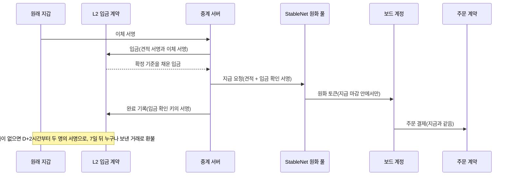
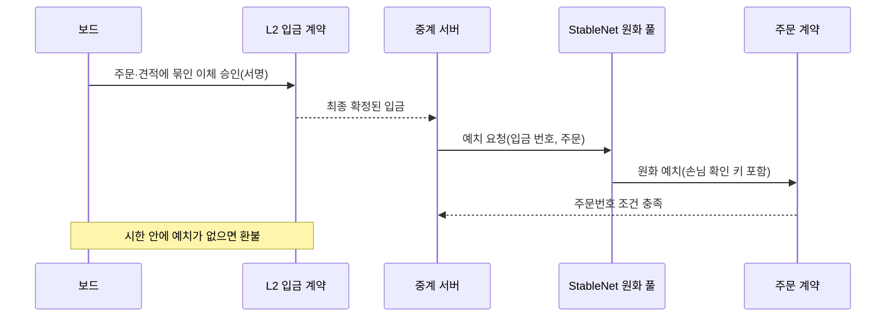

# 충전과 되바꾸기 규격

2026-11-25 · 상태: **초안. 제품 계약 코드가 없다.** 저장소 밖에 만든 참고 계약 2판으로 아래 규칙을 시험했다(26개 통과). 되바꾸기는 구현하지 않는다.

[여행자 주문·환전 결제·여행 도움 기획](traveller-services.md)의 환전 부분이다. 사용자가 고른 것은 1장에 있고, 2장부터는 모두 아직 묻지 않은 제안이다.

## 1. 사용자가 고른 것

- 입금할 때 바꾼다. 원래 지갑의 이체 서명(EIP-3009) 한 번이고 가스는 중계 서버가 낸다.
- 지급은 발행이 아니라 미리 채운 StableNet 원화 풀에서 나간다. 입금 1건에 지급 1건이다.
- L2는 Base Sepolia 하나다. 작은 금액은 safe, 큰 금액은 최종 확정 뒤에 지급한다.
- 한도(시험 원화): 충전 1건 1,000~300,000원, 계정 하루 1,000,000원, 풀 하루 3,000,000원, 풀 5,000,000원, 빠른 경로 1건 50,000원·하루 합 500,000원. 수수료 0.
- 한도를 올리려면 두 사람의 승인과 24시간 대기, 내리기와 멈추기는 한 사람.
- 지급 마감 2시간, 서명 환불 4시간, 스스로 환불 7일. 기록이 6시간 밀리면 풀의 새 지급이 멈추고 알린다. 견적은 2분 유효하고 0.01원 아래는 버린다.
- 바깥 환율 공급자를 쓸 때 둘이 1% 안, 120초 안, 직전 대비 5% 안일 때만 서명한다. 처음은 고정 환율이다.
- 되바꾸기는 원래 지갑으로 반납한 뒤 환전 페이지에서 한다. 규약을 지금 설계하고 구현은 충전 다음이다. 되바꾸기 코인은 완료가 기록되고 24시간이 지난 입금이다.
- 이번에는 한 사람이 시험 키를 모두 맡는다.

## 2. 시각과 번호 (제안)

- `E`는 견적 만료(발급에서 2분)이고 `D`는 지급 마감(`E`에서 2시간)이다. 견적에 서명한 절대 시각이다. "지급 마감 2시간"과 "4시간부터 서명 환불"은 각각 `D`와 `D`에서 2시간 뒤로 맞춘다.
- 입금은 L2 블록 시각이 `E`보다 앞이고 `E`가 10분 안일 때만 받는다. 먼 만료를 막아 환불된 입금을 다시 지급하지 못하게 한다. 풀도 `D = E + 2시간`을 확인한다.
- 만료 뒤에 서명하거나 늦게 보낸 거래는 실패하고 코인은 나가지 않는다.
- 견적은 EIP-712 서명이다. 도메인은 이름 `NU54 Charge`, 버전 `1`, L2 체인 번호, 입금 계약 주소다. 다이제스트가 **입금 번호이자 이체 서명의 nonce이자 지급 번호**다.
- 견적의 칸: USDC, 원래 지갑, USDC 금액, StableNet 체인 번호, 풀, 원화 토큰, 보드, 원화 금액, 환율(1 USDC당 0.01원 정수), 수수료(0만), `E`, `D`, 견적 번호(32바이트).
- 입금 계약은 정해진 풀·토큰·체인만 받고 보드가 0이거나 풀이면 거절한다. 금액 범위를 확인한다. 수수료는 0만 받는다. 수수료를 켜려면 새로 배포한다.
- 계산: 원화를 입력하면 USDC는 올림, 원화는 버림이다. `원화 금액 = USDC 금액 × 환율 ÷ 1,000,000`(버림)을 두 계약이 확인한다.
- 환경(로컬, 시험망)마다 키가 다르다.

## 3. 충전의 상태 (제안)

상태는 없음 → 입금됨 → 완료 → (이의) → 환불됨이다.

| 바뀜 | 누가 | 조건 |
|---|---|---|
| 없음 → 입금됨 | 누구나 거래를 보냄 | 위 조건과 입금 정지 아님 |
| 입금됨 → 완료 | 중계 + 입금 확인 키의 지급 확인 서명, 또는 서명자 둘 | 한 번 거절된 입금은 서명자 둘만 |
| 완료 → 이의 | 입금한 지갑이 직접 거래를 보내거나 그 지갑의 EIP-712 서명 | 완료에서 7일 안, 쓰이지 않음 |
| 이의 → 완료(확정) | 서명자 둘 | 이의에서 14일 안. 그 뒤로는 거절도 이의도 할 수 없다 |
| 완료·이의 → 입금됨 | 서명자 둘 | 확정되지 않았고 쓰이지 않음, 이의면 14일 안 |
| 입금됨 → 환불됨 | 서명자 둘 | `D`에서 2시간 뒤 |
| 입금됨 → 환불됨 | 누구나 거래를 보냄. 돈은 원래 지갑으로만 | 입금 7일 뒤와 거절 3일 뒤 가운데 늦은 때 |
| 이의 → 환불됨 | 누구나 거래를 보냄 | 이의에서 14일 동안 답이 없음 |

- 모든 서명은 EIP-712이고 종류, 대상, 회차, 만료를 담는다. 만료는 최대 7일이다. 상태가 바뀔 때마다 회차가 늘어 예전 서명은 다시 쓸 수 없다. 정지와 제안의 회차는 계약의 번호다.
- 서명자는 `D`가 지난 최종 확정된 StableNet 블록에서 지급되지 않았음을 각자 읽은 뒤에만 서명하고, 환불 서명에 그 블록 해시를 넣는다. 이 확인은 절차이지 계약이 강제하지 못한다.
- 환불한 코인이 지갑에 들어가지 않으면 거래를 되돌려 입금 상태에 남긴다. 새 시험 USDC(`version()` 있음, 거절 기능 없음)를 환전 단계에서 만든다.

## 4. 풀의 지급 (제안)

- 지급은 중계 서버 키만 부르고 입금 확인 키(중계·견적과 다른 키)의 서명이 있어야 한다. 서명에 지급 번호, L2 블록 해시, 빠른 경로인지 최종 확정인지, 만료가 들어간다.
- 풀은 견적 서명, 자기 주소, 원화 토큰, 체인 번호, `D` 전과 `D = E + 2시간`, 환율·금액 범위, 지급 번호 한 번, **보드 잔액이 늘었는지**를 확인한다.
- 24시간 한도는 시간 칸 25개로 세고 어느 24시간에도 한도를 넘지 않는다. 최대 25시간까지 막을 수 있다. 보드, 지갑, 전체를 따로 센다. 빠른 경로는 1건 50,000원과 하루 합 500,000원을 함께 지킨다.

## 5. 완료된 코인이 나가는 길과 되바꾸기 (제안)

완료된 코인은 **되바꾸기 계약 하나(spender)** 만 쓸 수 있다. 처음에는 비어 있고, 서명자 둘 + 24시간으로 정한다. 중계 키 혼자서는 쓸 수 없다. 되바꾸기가 쓰는 입금은 완료에서 7일이 지나고 이의가 없는 것이다. 사용자가 받아들인 "24시간"을 이의 기간과 맞추려 바꾼 제안이다. 되바꾸기의 상태, 원래 지갑의 뜻, 하루 합 한도의 기준, L2 지급 키와 한도, 돌아온 원화의 자리, 거짓 완료의 처리, 시작 전 예약, USDC 반올림은 되바꾸기 감사에서 정하며, **이 규격의 제안은 사용자가 고른 "지금 설계"를 그 감사로 미루는 것**이다. 그때 입금 계약을 다시 배포할 수 있다.

## 6. 권한과 키 (제안)

| 키 | 하는 일 |
|---|---|
| 중계 | 입금 제출, 지급 호출, 완료 기록 |
| 견적 | 환율 견적 서명 |
| 입금 확인 | 입금과 지급을 확인하는 서명 |
| 서명자 1·2·3 | 둘의 서명으로 환불·완료·거절·이의 답·그냥 보낸 코인·정지 풀기, 둘 + 24시간으로 키 교체·서명자 교체·풀 인출·한도 올리기·환율 범위·spender |
| 정지 | 입금 정지, 지급 정지, 중계·견적·입금 확인 키 끄기, 한도와 환율 범위 좁히기, 대기 중인 변경 취소 |

- 업그레이드할 수 없고 소유자 키가 없다. 모든 키는 서로 다른 주소다.
- 둘 + 24시간의 변경은 제안 뒤 24시간에서 3일 안에만 적용된다. 정지 키나 서명자 한 명이 취소할 수 있고, 키를 끄면 그전 제안은 모두 무효다.
- 정지는 입금 정지와 지급 정지가 따로 있다. 입금 정지는 들어온 입금의 지급을 막지 않고, 지급 정지와 키 끄기는 모든 지급을 막는다(들어온 입금은 환불로 끝난다). 둘 다 환불과 이의를 막지 않는다. 입금 확인 키를 끄면 완료 기록은 서명자 둘이 대신 쓴다.
- 기록이 6시간 밀리면 서버가 **견적과 입금을 멈추고 알린다**. 사용자가 받아들인 "풀의 새 지급이 멈춘다"를 바꾸는 제안이다. 들어온 최종 확정 입금은 지급해야 환불이 줄기 때문이다. 지급까지 멈추려면 지급 정지를 누른다.
- 지급 정지를 풀고 풀 인출을 할 수 있어야 한다. 정지 키 하나로 풀이 영원히 잠기지 않는다.
- 원화 발행은 두 사람이다. **로컬 단계에서는 시험 키 하나로 발행하고, 환전 단계 앞에서 토큰·주문 계약을 다시 배포하거나 다중 서명 소유자로 시작한다.**
- 한 사람이 모두 맡는 동안에는 서명 둘이 실수 하나를 막지 못한다.

## 7. 그냥 보낸 코인 (제안)

계약이 들고 있는 양에서 환불되지도 쓰이지도 않은 입금의 합을 뺀 나머지 안에서만 돌려준다. 계약은 누가 보냈는지 모르므로 서명자 둘이 거래 해시와 로그 번호로 확인한 주소로 보내고, 로그는 한 번만 쓴다. 로그를 32바이트로 만드는 방법은 구현할 때 하나로 정한다. 거래소에서 보낸 코인은 공용 지갑으로 갈 수 있어 보장하지 않는다.

## 8. 사람을 속이는 공격 (제안)

남의 충전 링크에 서명하게 하는 공격은 막을 수 없다. 줄이는 방법: 페이지와 앱에 보드 주소 끝자리와 확인 단어를 보이고, 앱이 여는 주소를 고정한다. 처음 쓰는 지갑과 보드의 짝은 첫 충전을 50,000원까지로 묶는다. 이것은 사용자가 고른 1건 300,000원을 좁히는 제안이고 서버가 막는다.

## 9. 남는 손실 (제안)

- 지급은 됐는데 완료 기록이 7일 동안 되지 않으면 두 번 나간다.
- 거짓 이의에 서명자가 14일 동안 답하지 않으면 두 번 나간다. 손실은 풀에 채운 양까지다.
- 서명자 둘이 함께 잘못 서명하는 경우, 빠른 경로의 입금이 뒤집히는 경우, 견적 서명 키가 샌 경우(하루 지급 한도와 환율 범위까지), 중계와 입금 확인 키가 함께 샌 경우(하루 지급 한도까지), 한 사람이나 한 서버의 키가 모두 샌 경우, 보드가 초기화된 경우.
- 완료된 코인은 되바꾸기가 없으면 spender를 정할 때까지 계약에 남는다.
- 환율 변경을 올린 때부터 적용까지 새 견적을 멈추고, 되바꾸기는 변경 뒤 24시간 동안 풀에 유리한 환율을 쓴다.

## 10. 시험 (제안)

참고 계약 2판 시험 26개: 정상, 먼 만료 거절, 풀의 마감 확인, 수수료·보드·금액 범위, 정지 풀기 서명이 한 번만 됨, 키 끄기가 옛 제안을 무효로 함, 지난 제안과 취소, 제안 서명 만료, 지급 정지 풀기와 인출, 키 교체, 완료된 코인이 spender로만 나감, 거절된 입금은 서명자만 완료, 이의를 지갑이나 서명으로 냄, 14일 무응답 환불, 14일 뒤 답 거절, 확정 뒤 다시 열리지 않음, 긴 서명 거절, 거절 서명 재사용 거절, 늦은 거절은 3일 대기, 같은 키 거절, 거절 모드 보드 거절, 한도 내리기·올리기, 그냥 보낸 코인, 완료가 7일 빠지면 두 번 나감(알려진 손실), 마감 경계, 지급에 중계와 입금 확인 키가 필요함.

사용자가 받아들인 시험 다섯 가지(마감 직전·직후 지급, 환불 뒤 지급, 지급 뒤 환불, 지급 뒤 기록 전 서버 끄기와 환불)는 두 로컬 체인에서 서버를 멈추며 구현 단계에 다시 한다. 앞의 네 가지에 가까운 것은 참고 계약에 있고, 서버를 끄는 것은 없다.

## 11. 충전 서명의 검토 (2026-11-24)

앱의 충전 버튼은 지갑 앱의 내부 브라우저에서 정해진 환전 페이지를 연다. 사용자는 거기서 서명만 하고, 가스는 중계 서버가 낸다. 로컬 계약 시험으로 다음을 확인했다(시험 4개 통과, 저장소 밖에서 실행).

| 방식 | 사용자 가스 | 확인한 것 |
|---|---|---|
| 서명한 `approve` 거래를 우리 계약이 대신 실행 | 해당 없음 | 되지 않는다. 계약이 부른 `approve`의 주인은 사용자가 아니라 그 계약이다 |
| 승인 서명(EIP-2612 `permit`) 뒤 바로 가져가기 | 0 | 된다. 그러나 승인 서명만으로는 받는 보드가 묶이지 않아, 서명을 본 사람이 받는 곳을 바꿀 수 있다 |
| 이체 서명(EIP-3009 `receiveWithAuthorization`), nonce를 견적 다이제스트로 | 0 | 된다. 금액·계약·시한·보드·견적이 서명 하나에 묶인다. 받는 곳을 바꾸거나 두 번 쓰면 실패하고 남는 승인 한도가 없다 |

이 거래가 할 수 있는 것은 L2 안의 일(서명 확인, 입금)까지다. StableNet의 지급은 입금이 확정된 뒤 중계 서버가 하는 별도 거래다.

**방식 가. 먼저 바꿔 두기.** 여행자가 원래 지갑에서 이체 서명을 하고 중계 서버가 L2 입금 계약에 넣는다. 환산한 원화 토큰이 보드 계정에 들어온다. 매장 결제는 지금과 같은 원화 토큰 결제다. 남은 원화 토큰은 원래 지갑으로 반납한 뒤 되바꾼다.

## 12. 채택하지 않은 안: 결제할 때 바꾸기

비교를 위해 남긴다. 보드가 주문과 견적에 묶인 L2 이체 승인에 서명하고, 중계 서버가 L2에서 받은 뒤 풀이 주문 계약에 원화를 예치한다.

| 비교 | 먼저 바꿔 두기 | 결제할 때 바꾸기 |
|---|---|---|
| 결제 순간 걸리는 시간 | 지금과 같다 | L2 최종 확정과 StableNet 확정을 모두 기다린다. L2의 최종 확정은 이더리움 확정을 따르며 Base Sepolia에서 잰 값은 최종 확정 약 20분이다. 더 일찍 지급하면 그 차이를 운영자가 위험으로 진다 |
| 보드 펌웨어 | 원화 토큰 이름, 계약 주소, 매장 허가를 다시 만든다. 자릿수는 펌웨어에 없다 | L2 체인·토큰·입금 계약 서명을 새로 만든다 |
| 주문 계약 | 토큰만 바뀐다 | 낸 사람과 예치한 사람이 달라져 환불 받는 곳과 손님 확인 방식을 바꾼다 |
| USDT | 이체 서명이 없어 첫 단계에서 안 된다 | 서명 이체를 지원하지 않는 토큰이면 안 된다(Base의 브리지 USDT는 지원하지 않는다. 기획 문서 11장) |
| 남는 돈 | 원화 토큰이 남아 되바꾸기가 필요하다 | 남지 않는다 |
| 환율 위험 | 바꾸는 순간 사용자가 진다 | 견적 유효 시간 동안 운영자가 진다 |

