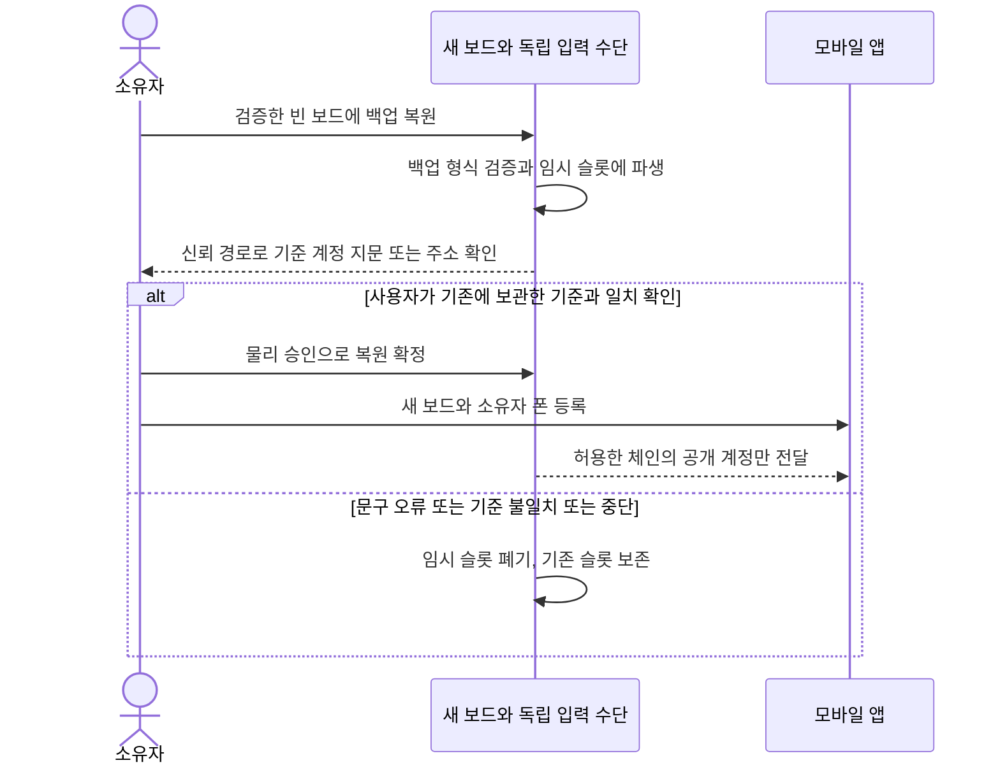
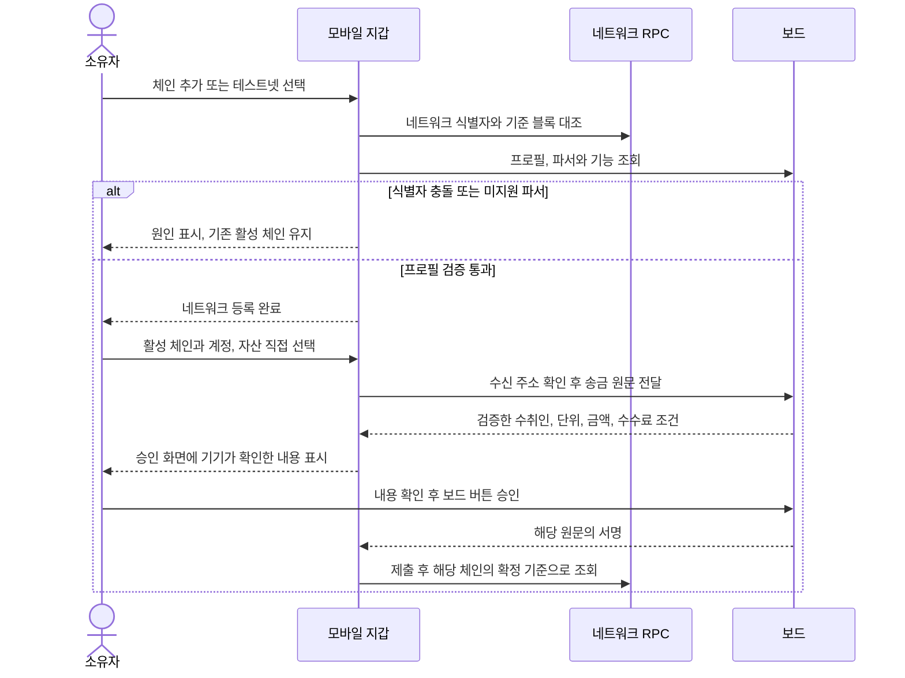
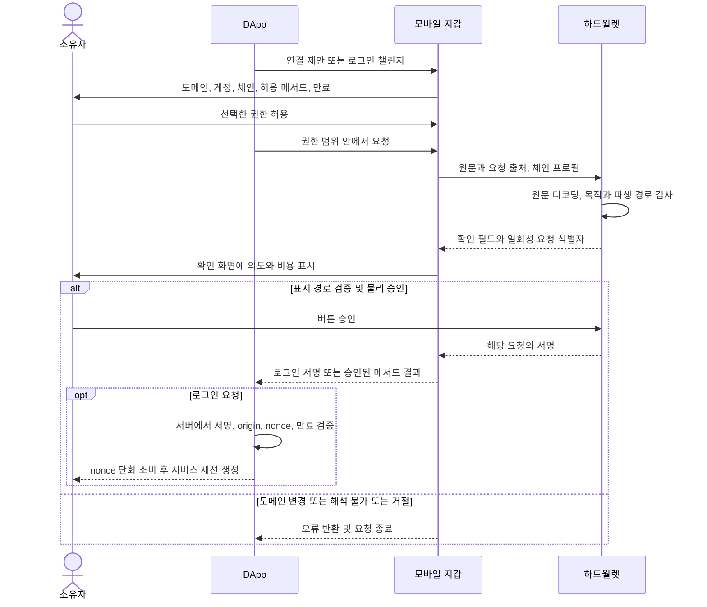
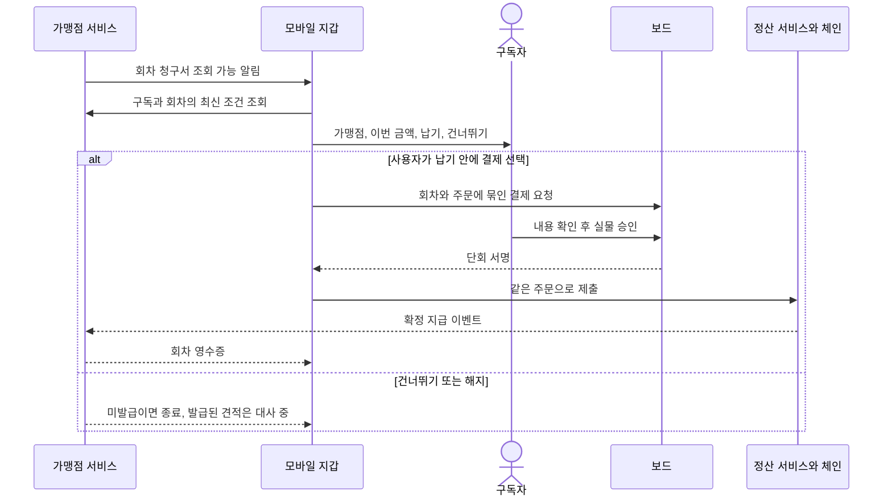
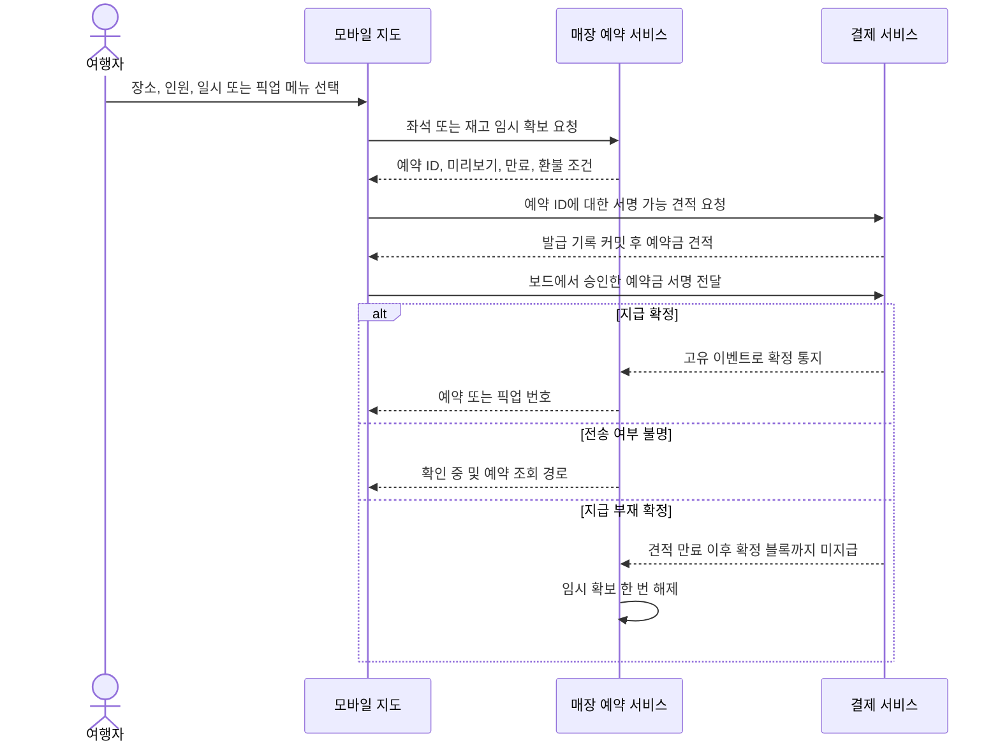

# 개인 하드월렛과 모바일 지갑

[상용화 설계 목차](README.md) · 이 문서의 기능은 목표 사양이다. 현행 펌웨어가 독립적으로 생성한 단일 키는 HD 시드에서 파생된 계정으로 간주할 수 없다. 기존 대여 지갑은 기존 주소에서 잔액과 인출을 마칠 때까지 사용할 수 있어야 한다. [기기 키 생성·서명](../../../products/p01-device-firmware/app/src/device_key.c)

## 소유자, 키와 확인 화면

| 상황 | 기기와 앱의 동작 | 사용자가 확인할 결과 |
|---|---|---|
| 빈 보드 | 앱이 보드 모델·펌웨어 출처·서명 상태·신뢰 프로필을 보여 준다. 사용자가 물리적으로 등록 창을 열고 기기 고유 공개키를 독립 경로로 대조한 후 소유자 폰을 등록한다. DIY 보드는 사용자가 초기 설치 때 확보한 지문을 쓴다. | 주변에 같은 이름의 보드가 두 대 있어도 선택한 실물만 본딩. 이미 소유자가 있는 보드는 원격으로 탈취·초기화할 수 없다. |
| 개인용 지갑 생성 | 기기 내부 엔트로피로 루트를 만들고 체인별 파생 정책과 계정 번호를 결합한다. 운영자 키·반납 명령은 개인용 키 슬롯과 접근 정책을 갖지 않는다. 쓰기 중 전원 차단은 미완료 슬롯에서 복구한다. | 최초 주소를 두 번 확인하고 백업 복원 시험을 끝낸 뒤 입금 가능 상태로 표시. 진단·추적·푸시 데이터에 키, 시드, PIN을 넣지 않는다. |
| PIN과 자동 잠금 | 보드 버튼·LED로 입력. 앱에는 입력 시작과 종료 결과만 보낸다. 버튼 횟수와 각 자리의 진행 시각은 기기 안에 둔다. 실패 카운터는 전원 차단 전 영속화한다. 유휴·분리·앱 잠금 때 승인 대기를 지운다. 생체 인증은 폰 앱을 열 때 사용한다. | 다른 폰이나 BLE 메시지에서 자릿값·버튼 횟수를 재구성할 수 없는지 확인. 최대 실패 후 잠금과 검증된 복구 절차 제공. |
| 수신·송금·권한 승인 | 펌웨어가 체인 원문에서 받는 주소, 보낼 자산, 단위, 금액, 최대 수수료, 승인 대상과 한도를 산출한다. 앱은 기기가 만든 내용을 확인 화면으로 표시한다. 보드의 일회성 버튼 승인은 동일 내용·요청·만료에만 사용한다. | 긴 주소 전체보기, 검증한 주소록, 내 계정 간 이체 구분. 금액·목적지가 수정되면 이전 승인은 폐기. 입금 주소도 확인 경로를 거친다. |
| 백업·복원 | 개인용 후보는 독립된 신뢰 입력/표시 액세서리에서 표준 복구문구를 기록·재입력하는 방식이다. 보드와 액세서리 간 물리적 신뢰·기밀 전송, 초기 펌웨어 측정과 포트 잠금을 검증한다. 표시 액세서리 대신 소유자가 별도 복구 장치를 보관하는 방안은 사전 등록·분실 복구 시험을 거쳐 선택한다. | 액세서리 없는 일반 폰 화면·키보드·클립보드로 시드를 처리하지 않는다. 대안 복구 장치는 암호·키 분리 및 분실 모델을 별도 검증한 뒤 지원. 검증 전에는 복구 보장 표시와 개인용 메인넷 입금을 열지 않는다. |
| 휴대폰 분실·보드 분실 | 폰 분실은 기존 보드와 독립 소유 증명으로 새 폰을 등록하고 이전 본드·세션을 폐기한다. 보드 분실은 새 보드에서 백업을 복원하고 동일 계정/주소를 검증한다. 도난 보드 위험이 있으면 새 루트로 사용자 승인 이체한다. | 새 폰 등록만으로 키가 바뀌지 않는다. 복구한 같은 시드는 구 보드도 계속 서명할 수 있으므로 자산 이전과 기존 DApp 권한 회수를 안내한다. |
| 업데이트·커스터마이징·초기화 | 루트 소유자가 공식 또는 자가 서명 배포를 선택. 부트 신뢰 루트 변경은 물리 조작·데이터 삭제·별도 복구를 거친다. 제품 버전·커스텀 표시를 유지한다. 대여 반납과 개인 지갑 삭제를 다른 명령과 화면으로 제공한다. | 잘못된 모델·다운그레이드 거절, 중단 후 복구, 자산이나 미확정 결제가 있는 상태에서 삭제 전 재확인. |

### 새 보드에서 지갑 복원

소유자는 구 보드가 없어도 백업과 지원되는 독립 입력 수단으로 새 보드를 설정할 수 있어야 한다. 백업은 자산 키와 계정을 복구한다. 폰의 소유권 세션, DApp 허용 목록, 구독 서비스의 계정 및 여행 예약 조회권은 별도 복구 대상이다.

**인수 절차.** 시험용 백업을 별도 보드에 복원한 뒤 여섯 네트워크 각각의 첫 주소·두 번째 계정·시험 거래 서명을 독립 클라이언트로 확인한다. 구 폰 없이 등록하고 구 폰의 요청이 새 보드에서 거절되는지 확인한다. 잘못된 BIP-39 passphrase도 유효한 다른 지갑을 만들 수 있으므로 사전에 독립 보관한 기준 주소와 대조한다. 자금 있는 보드를 초기화해 백업을 시험하지 않는다. 앱이 ‘입금 가능’을 잠그는 것은 주소 공유·안내에 대한 정책이다. 이미 공개된 주소로 제3자가 보내는 온체인 송금까지 차단할 수는 없다. [BIP-39](https://bips.dev/39/)

**화면 없는 보드의 한계.** 본딩된 폰이 정상이라면 금액과 수취인을 보여 줄 수 있다. 폰 OS나 표시 앱이 오염되면 보드 버튼은 누군가 버튼을 눌렀다는 사실만 입증한다. BLE 암호화나 동일 폰에서의 재확인으로 화면 위조를 검출할 수 없다. 일반 표시 프로필은 검증한 가맹점과 낮은 기기 강제 한도를 갖춘 파일럿부터 시작한다. 임의 수취인, 고액, 한도 변경, 토큰 사용 권한 부여에는 독립 표시 장치 또는 지원이 입증된 보호 UI가 필요하다. Android Protected Confirmation을 채택한다면 보드 또는 신뢰 검증자가 키 증명, 표시한 텍스트 전부와 정규화된 거래의 일치, 챌린지와 단회 사용을 검증한다. iOS·미지원 Android에는 별도 기능표를 제공하고 동등성 입증 전에는 해당 작업을 차단한다. [Android Protected Confirmation](https://developer.android.com/privacy-and-security/security-android-protected-confirmation)

## 체인별 자산 지원 표

앱에는 체인별로 조회·수신·전송·메시지 서명·DApp 메서드·지원 자산의 실제 상태를 표시한다. 네이티브 코인과 토큰은 체인 식별자와 계약 주소·mint·issuer 또는 UTXO 네트워크로 식별한다. 같은 심볼, 동명 토큰, 동일한 EVM 주소만으로 자산을 합치지 않는다. 체인별 오프라인 파서와 신뢰 가능한 표시가 통과한 거래 종류만 활성화한다.

| 네트워크 | 파생·직렬화·초기 지원 | 사용자가 보거나 기기가 검사할 값 | 테스트 및 별도 승인 범위 |
|---|---|---|---|
| Ethereum | secp256k1, BIP-32/44 계열. ETH·검증 ERC-20 수신/송금, legacy·EIP-1559. EIP-712 지원은 구조를 표시할 수 있는 타입부터 | chainId, nonce, 받는 주소, value, calldata에서 구한 token/recipient, decimals 출처, 최대 가스비. 승인에는 spender와 한도 표시 | Sepolia에서 독립 클라이언트와 signed bytes·복원 주소 일치. 미해석 호출, 무제한 승인, 복수 호출, 위임 거래 등은 각각 별도 파서·정책 필요. [EIP-1559](https://eips.ethereum.org/EIPS/eip-1559) · [EIP-712](https://eips.ethereum.org/EIPS/eip-712) |
| Base | EVM 엔진 재사용, Base 체인 프로필 분리. ETH 가스, 검증 토큰 | L2 실행 수수료와 L1 데이터 비용·기타 적용 수수료, 네트워크 이름, 포함/안전/최종 상태 구별 | Base Sepolia에서 Ethereum 서명 재사용 거절, 수수료 견적 오차와 재구성 처리 확인. [Base 거래 확정](https://docs.base.org/base-chain/network-information/transaction-finality) |
| StableNet | EVM 프로필, 일반 전송과 가맹점 결제 서명 별도. 데모 자산은 8283 manifest의 TestUSDC | 네이티브 가스와 결제 토큰, 운영자·계약·배포 버전, 소수 단위, 가맹점 수령 주소 | 8283 실기 결제 재시험. 메인넷 프로필은 genesis·체인 ID·가스·토큰·최종성·코드 해시를 검증한 후 별도 배포. [데모 배포 근거](../../../products/p06-stablenet-contracts/deployments/8283.json) |
| Bitcoin | secp256k1 HD. Native SegWit P2WPKH 먼저, Taproot 키 경로는 Schnorr와 별도 벡터. PSBT 입력·서명·완성, UTXO와 change 관리 | 각 prevout 금액·스크립트 검증, 외부 수취 출력 전체, 자기 파생 경로로 검증한 거스름돈, 수수료·수수료율, 허용 sighash | regtest 및 signet. 다중 입력·출력 총액, dust, RBF 교체 시 재승인. PSBT 버전·스크립트·multisig는 지원표에 명시. [PSBT](https://bips.dev/174/) · [BIP-84](https://bips.dev/84/) · [BIP-86](https://bips.dev/86/) |
| Solana | Ed25519·SLIP-0010 hardened 파생. SOL·검증 SPL 토큰 이체. 메시지 버전과 프로그램 ID로 디코더 선택 | fee payer, 지시별 수신자·mint·금액·수수료, 최신 blockhash 유효성. v0 lookup table 주소를 신뢰할 수 있게 대조할 때만 사용 | devnet에서 독립 SDK 검증. legacy·v0·v1 지원표, 모르는 버전/프로그램·미해석 Token-2022 확장은 거절. 유효기간 후 새 메시지로 재승인. [트랜잭션 버전](https://solana.com/docs/core/transactions/versioned-transactions) · [SLIP-0010](https://github.com/satoshilabs/slips/blob/master/slip-0010.md) |
| XRPL | 초기 공개 프로필에 secp256k1과 파생 경로 명시, XRP Payment와 검증 issuer 자산. canonical serialization | Destination·DestinationTag, drops·currency/issuer, Fee, Sequence/Ticket 지원 여부, LastLedgerSequence, reserve·trust line | Testnet에서 validated 성공과 실제 delivered_amount 대조. 초기에는 부분 결제·경로 교환 차단. 발행자·태그가 다르면 새 거래로 확인. [Payment](https://xrpl.org/docs/references/protocol/transactions/types/payment) · [XRPL 수령 검증](https://xrpl.org/docs/use-cases/payments/migrate-a-payments-or-fx-stack-to-the-xrp-ledger) |

각 프로필은 알고리즘, 파생 경로 템플릿·account/index 범위, 주소 포맷, 테스트/메인 구분과 계정 발견 규칙을 버전 관리한다. 예를 들어 Bitcoin BIP-84 mainnet의 첫 외부 주소는 `m/84'/0'/0'/0/0`, 일반 EVM의 대표 첫 주소는 `m/44'/60'/0'/0/0`이다. 기존 지갑 가져오기는 사용한 경로와 주소를 먼저 대조한다. 루트가 같아도 Solana hardened 경로와 XRPL의 알고리즘 선택이 다르면 주소가 달라질 수 있다. 각 조합은 공개 시험 시드로 외부 지갑과 첫 주소·다음 계정·복원 후 주소를 비교한다. [BIP-32](https://bips.dev/32/) · [BIP-39](https://bips.dev/39/)

**체인 설정 모드.** 사용자는 지갑 → 네트워크에서 내장 체인을 켜고 끄거나 같은 엔진의 사용자 정의 체인을 추가한다. 앱은 HTTPS RPC와 체인 ID·genesis, 탐색기 주소, 통화 단위, 수수료·확정 정책을 검사한다. RPC 변경과 활성 체인 전환은 별도 동의를 받고 기존 미서명 요청을 폐기한다. DApp이 임의로 RPC나 토큰 decimals를 덮어쓸 수 없다. 로컬 노드는 개발 프로필에서만 명시 등록한다. 새 합의·서명 포맷은 검토된 펌웨어 어댑터 릴리스가 필요하다. 메인넷·테스트넷은 명칭·아이콘·승인 문구에 모두 표시하고 주소록과 활동도 분리한다. [EIP-3085](https://eips.ethereum.org/EIPS/eip-3085)

### 체인 등록부터 첫 송금까지

**합격 기준.** 위 여섯 체인 표의 각 행에서 테스트 네트워크로 수신 1건, 외부 송금 1건, 보드 거절 1건, 앱 재시작 후 결과 재조회 1건을 기록한다. 명시한 지원 토큰도 자산별로 반복한다. 거절 시 서명·송신 0건, 성공 시 독립 클라이언트가 확인한 수취 주소·정수 금액·거래 ID가 화면과 일치해야 한다. 본문에서 파생할 수 없는 시세·가스 추정값은 출처·시각과 함께 추정으로 표시하고, 거래가 구속하는 수수료 조건은 별도로 표시한다. 같은 chainId인데 기준 블록이 다른 사용자 정의 EVM 체인은 등록을 거절한다. 모르는 어댑터, 동일 심볼·다른 계약, 설정 중 RPC 교체, 숨겼던 자산 재표시를 시험한다. 숨김·체인 비활성화는 키와 잔액·미확정 거래 조회 기록을 삭제하지 않는다.

## 하드월렛 기능 인수 목록

구매자가 비교할 수 있도록 릴리스마다 다음 기능을 체인·단말별로 공개한다. ‘지원’은 새 지갑에서 시작해 해당 기능을 실행하고 복원 또는 취소까지 확인한 조합에 붙인다.

| 기능 묶음 | 제품 동작 | 인수할 때 확인할 것 |
|---|---|---|
| 계정·공개 정보 | 주소 검증, 다계정·계정 이름, 외부/거스름돈 주소, 계정 숨기기·재발견, 읽기 전용 지갑, 공개 주소/선택적 xpub·descriptor 내보내기 | 공개 정보만으로 서명 불가. xpub 공유 시 향후 주소 연결 가능성을 안내. 같은 시드·경로 복원 후 계정 발견과 잔액 일치 |
| 보관·복구 정책 | 검증한 복구 매체로 생성·가져오기·백업 확인. 선택형 BIP-39 passphrase·분할 백업은 조합별 명세와 시험을 거쳐 제공 | 다른 passphrase는 다른 지갑을 만든다는 안내, 독립 구현과 벡터 대조, 잘못된 복구 단어/분할 개수 탐지, 기존 정상 지갑 덮어쓰기 방지 |
| 일상 자산 관리 | 자산 검색·즐겨찾기·숨김, 토큰 계약/issuer 확인 후 수동 추가, 수신 주소 재확인, 송금·수수료 견적·주소록·내역·조회 전용 오프라인 캐시 | 가짜 동명 토큰과 잘못된 decimals 구분. 환산 가격의 통화와 갱신 시각 표시. 통신 단절 후 영수증 재조회 |
| 고급 서명 | Bitcoin coin control, PSBT 파일/QR 반입, 검증된 multisig descriptor 등록과 공동 서명. EVM은 허용한 typed data·토큰 승인 조회/철회. 체인별 staking·NFT·복합 프로그램 호출은 메서드와 표시 필드를 별도 등록 | 공동 서명자·임계치·change를 기기가 확인. 권한 회수는 체인 확정까지 추적. 미해석 호출에는 자산 이동 권한이 생기지 않음 |
| 보호와 지원 | 건별·일별 한도, 주소록·allowlist 변경 확인과 지연, 자동 잠금, 펌웨어 버전 확인·무결성 검사, 선택형 진단 내보내기, 소유권 이전 | 폰 조작만으로 한도 상향 불가. 진단 파일을 사용자가 미리 보고 공유하며 민감 데이터 제외. 기기 판매 전 백업 확인과 안전 삭제 |

## 모바일 화면과 유즈케이스

앱이 재개되면 주문·회차의 현재 상태를 먼저 조회한다. 발행 전 초안, 발행된 견적, 전송 여부가 불분명한 시도, 확정 지급을 각각 다른 행동으로 연결한다. 복원한 계정의 자산 숨김·표시와 시세 캐시는 기존 거래 참조를 보존한다. 태그가 필요한 수신 카드의 화면·공유 데이터에는 주소, 대상 네트워크와 태그가 함께 들어간다. [원거래 재조회](screens/book.html#W11) · [회차 기한 경계](screens/book.html#W19/reconcile) · [XRPL 공유 카드](screens/book.html#W07/xrpcard)

하단 탐색은 **지갑 · 결제 · 둘러보기 · 설정** 네 곳에서 시작한다. 지갑 홈은 선택 계정·네트워크·자산·확정 상태를 먼저 보인다. 둘러보기에는 DApp과 지도 탭이 있다. 결제 확인은 항상 전용 네이티브 화면으로 전환하며 상단에 요청 출처, 하단에 실물 버튼 안내를 고정한다. 글자 확대 시 금액·수취인·취소가 잘리지 않아야 한다. 상태는 색과 함께 텍스트·아이콘으로 전달한다.

첫 화면에서 이용자는 보드 그림에서 눌러야 할 실제 버튼 위치를 보고, ‘연결 중 → 확인 필요 → 완료’를 같은 위치에서 따라간다. 자산 홈은 잔액 숫자를 가장 크게, 자산·네트워크를 그 옆에 표시하고 한 번의 탭으로 잔액을 가릴 수 있게 한다. 결제 화면에서는 수취인·금액을 첫 화면에 고정하고 상세 수수료와 계약 주소를 펼쳐 본다. 햅틱과 짧은 전환은 연결·승인·오류를 구분하며, 동작 줄이기 모드에서는 정적 대체 표시를 쓴다. 파일럿 UX 판정 제안은 초보자·고령자 포함 10명 중 9명이 도움 없이 모의 결제를 마치고, 전원이 틀린 금액을 발견했을 때 취소 경로를 찾는 것이다.

| 사용자와 시작 조건 | 정상 흐름 | 예외와 완료 기준 |
|---|---|---|
| 초보자 · 기기가 없거나 빈 보드 보유 | 연습 지갑 선택 → 모의 매장의 QR → 가상 버튼으로 승인/거절 → 실기기 찾기. 버튼 그림·촉각 신호와 쉬운 용어로 현재 단계 한 개를 안내 | 연습 지갑은 테스트 데이터만 사용. 권한 거부 시 설정 복귀 방법, 중단 지점부터 재개. 고령자·초보자가 안내자 없이 첫 수신과 거절을 마칠 수 있는지 관찰 |
| 소유자 · 등록 기기 보유 | 새 계정 생성, 계정 이름·주소록·토큰 표시 설정, 수신 QR 공유, 잔액·거래 이력·수수료 확인, 보내기→버튼 승인→상태 추적 | 잔액 부족, 수수료 부족, 주소/태그 오류, 연결 끊김, RPC 지연은 원인별 표시. 오프라인에서는 마지막 조회 시각 표시. 거래 ID로 재조회 |
| DApp 이용자 · 새 사이트 | 앱 내 브라우저 또는 외부 WalletConnect 연결 → 출처·체인·계정·메서드·기간 선택 → 로그인 서명 → 서비스 사용 | 계정 공개 전 동의. origin 변경/iframe·만료 세션은 새 승인. 단순 로그인과 자산 이동/권한 부여는 다른 확인 화면. 세션별 철회·모든 연결 끊기와 별도 온체인 allowance 취소 제공 |
| 구독자 · 상점의 구독 조건 확인 | 가맹점·체인·자산·회차당 상한·주기·시간대·기한·취소 조건 확인 → 등록 → 회차별 알림 → 거래 재확인 → 실물 승인 → 영수증 | 알림 꺼짐·오프라인은 앱 내 미결 목록에 남긴다. 가격 인상·자산 변경은 재동의. 건너뛰기·일시정지·해지·만료. 미승인 회차는 과금 0건 |
| 여행자 · 지도 탐색 | 위치 1회 동의 또는 도시 수동 입력 → 맛집/명소·영업시간·현지 시간대·가격·예약 가능 인원 → 예약금/선주문 조건 확인 → 결제 → 예약번호·픽업 안내 | 마지막 좌석 경합, 슬롯 만료, 매장 취소/노쇼, 부분 환불은 예약과 금전 상태를 각각 표시. 지도 사업자에 지갑 주소를 전달하지 않는다. 위치 권한 없이 수동 검색 가능 |
| 보호자 도움 없이 쓰는 사용자 · 접근성 | 큰 글씨, 화면 읽기, 순차 포커스, 대비, 버튼에 텍스트, 동작 줄이기, 한국어·영어, 승인·거절 안내 다시 듣기 | 앱·키오스크 글자 200%, 화면 읽기, 색 구별 없이 결제/거절 재현. 민감한 값은 알림 미리보기에서 숨김. 시간 연장은 견적이 유효할 때만 제공. [WCAG 2.2](https://www.w3.org/TR/WCAG22/) |

**튜토리얼 재개 시험.** 기기 없이 시작한 사용자가 모의 주문 승인과 거절을 각각 연습한 뒤 앱을 종료한다. 재실행하면 연습 모드임을 명시하고 마지막 학습 단계로 돌아온다. 실지갑 전환은 별도 선택이며 실제 기기 검색·등록부터 시작한다. QA는 연습 중 실제 RPC 전송·보드 서명 호출이 모두 0건인지 확인한다. Android/iOS의 화면 읽기로 주문 금액 전체, 매장, 체인, 취소를 순서대로 들을 수 있어야 한다. 보호 UI가 필요한 화면에서는 확인에 필요한 금액·수취인·권한 한도를 인증된 표시 영역에 모두 포함한다.

### DApp 연결과 원문 서명

웹뷰는 HTTPS 최상위 origin별로 최소 provider만 노출한다. 페이지에서 BLE·파일·임의 네이티브 메서드를 호출하는 브리지는 금지한다. 지갑이 직접 확보한 origin과 세션을 대조하고 페이지가 보낸 도메인 문자열은 신뢰하지 않는다. EVM은 EIP-1193 인터페이스와 세션별 체인·메서드 목록, 로그인은 SIWE 도메인·URI·nonce·만료 대조를 적용한다. 서비스가 nonce를 한 번 소비해야 로그인이 끝난다. Solana·XRPL·Bitcoin DApp 연결은 지갑 전송 지원과 별개로 해당 생태계의 메서드별 취소·도메인 바인딩 시험을 통과한 조합만 광고한다. [EIP-1193](https://eips.ethereum.org/EIPS/eip-1193) · [Sign-In with Ethereum](https://eips.ethereum.org/EIPS/eip-4361)

외부 DApp 연결은 WalletConnect 세션 제안의 namespaces에서 허용 체인·계정·메서드·이벤트의 교집합을 구성한다. 필수 권한을 지원하지 않으면 제안을 거절하고, 계정 변경은 이미 허용된 사이트에만 통지한다. 지갑 연결 철회·만료 후 들어온 서명 요청에는 기기 승인 창을 열지 않는다. [WalletConnect 세션 네임스페이스](https://specs.walletconnect.com/2.0/specs/clients/sign/namespaces)

**인수 시나리오.** 참조 DApp에서 계정 공개 → 로그인 → 서비스 기능 호출 → 새로운 금전 요청의 별도 승인 → 연결 해제를 재현한다. 다른 origin의 요청, 소비한 nonce 재사용, 미허용 메서드, 만료된 연결에서는 새 로그인/서명 0건이다. 서비스의 로그인 쿠키, 지갑 연결, 기존 온체인 토큰 권한은 수명이 각각 다르다. 연결 해제는 후속 지갑 요청을 막으며, 서비스 로그아웃과 온체인 철회는 별도 결과로 표시한다.

### 정기구독 한 회차

멱등 키는 `(subscriptionId, billingPeriod)`이며 타임존·서머타임 변경에도 한 회차는 한 주문에 연결한다. 푸시는 청구서 위치만 알려 준다. 지연된 푸시가 와도 서비스의 최신 상태를 다시 읽는다. 구독 생성은 결제 권한을 만들지 않는다. 해지는 이후 회차 생성을 즉시 중단한다. 현재 회차는 서명 가능 견적을 발급하기 전이면 종료하고, 발급 후라면 체인에서 결과가 결정될 때까지 ‘현재 회차 확인 중’으로 둔다. [공통 취소 규칙](merchant-payments.md#발급과-취소의-경계)

**인수 시나리오.** 같은 회차의 알림 2건을 두 폰에서 열어도 유효 주문 1건·확정 지급 최대 1건이다. 앱을 닫고 버튼을 누르지 않은 회차는 지급 0건이다. 가격·통화·가맹점 변경은 새 약관 버전 확인과 그 회차의 실물 승인을 모두 요구한다. 알림 권한을 끄면 미결 목록에서 같은 청구서를 찾을 수 있다. 납기 직전 발급 후 해지한 경우와 납기 후 늦게 도착한 알림을 각각 시험하고, 다음 회차 청구서 0건을 확인한다.

### 여행 예약과 디파짓

디파짓은 예약금으로 즉시 지급하는 정책을 기본 제안으로 둔다. 현장 잔금은 예약금만큼 공제한 별도 주문이다. 위탁 보관·조건부 지급을 원하는 매장에는 별도 에스크로 계약·권한·회계가 필요하다. 확정 뒤 좌석 제공이 불가능하면 같은 예약에 보상 환불을 기록한다. 지도 제공자 장애 중에도 이미 확정한 예약·주소·픽업 번호는 앱에서 볼 수 있어야 한다.

**지도·선주문 인수.** 위치 권한 없이 도시와 날짜를 입력해 음식점과 명소를 각각 찾는다. 30 TestUSDC 예약의 예약금 10을 결제하면 확정 예약 1건, 현장 잔금은 20인 별도 주문 1건이어야 한다. 무예약 픽업 주문은 메뉴·옵션·품절 검사를 거쳐 픽업 번호 1개를 받는다. 좌석 한 개의 동시 예약, 매장 취소, 노쇼 규정에 따른 부분 환불, 중복 이벤트, 지도 서비스 중단을 각각 실행한다. 반환할 금액은 결제 전 표시한 환불 약관 버전으로 계산하며 확정 지급·환불과 예약 상태를 대조한다.
