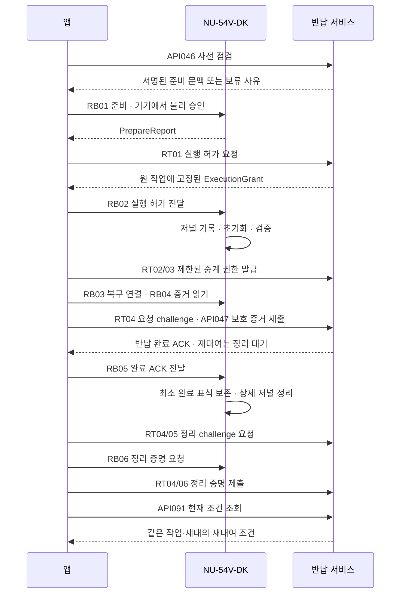

# 반납 HTTP·BLE 경로와 재대여 조건 조회 설계

작성: 2026-09-18. **설계 후보이며 기준 명세에 병합하지 않았다.** 제품 구현, SQL 변경, 암호 검증, 기기 시험은 미수행이다. HTTP 10개 경로(기존 3개·미등록 제안 7개), BLE 6개 메시지 쌍(기존 2개·미등록 제안 4개)을 연결한다. 현재 카탈로그는 API 110개·BLE 34개다.

[계약 목록](return-route-contracts.json) · [JSON Schema](return-route-contracts.schema.json) · [검증 예제](return-route-contracts.examples.json) · [검증 스크립트](validate_return_routes.py)

## 1. 완료의 의미

서버가 유효한 초기화 증거를 접수하면 기존 대여는 반납 완료로 기록할 수 있다. 그러나 **완료 ACK를 기기가 처리하고, 정리 증명까지 서버가 검증해야 재대여 조건을 충족한다.** 앱의 화면 표시 자체는 새 대여를 허가하지 않는다.

위 흐름은 선택되지 않은 복구 정책이나 암호 profile을 대신 결정하지 않는다. 신규 여행 지갑의 필수 복구 조건이 미결정이면 준비 문맥·새 실행 허가를 발급하지 않는다. 기존 import 지갑의 외부 자산 전체 이체를 강제하지 않는다.

## 2. HTTP 경로

HTTP 논리 envelope 버전은 `return-http-v1-draft`다. 요청 ID, 변경 요청의 멱등 키, 인증 정보를 포함하고 응답은 `no-store`다. 표의 RT 이름은 카탈로그 ID가 아니다.

| ID | 메서드·경로 | 권한과 결과 |
| --- | --- | --- |
| API046 | POST `/v1/rentals/{rentalId}/return-checks` | 현재 소유자 점검; 운영자는 안전한 상태 조회만. 준비 문맥은 소유자에게만 조건부 제공 |
| API047 | POST `/v1/rentals/{rentalId}/complete-return` | holder에 결합된 제한 중계 권한으로 원 초기화 증거 제출; ACK 또는 대기/격리 |
| API091 | GET `/v1/rentals/{rentalId}?projection=return` | 원 대여 소유자/허용 운영자에게 반납 projection. 현재 상태의 일관된 조건 조회 |
| RT01 | POST `/v1/return-jobs/{jobId}/commits` | 현재 소유자·기기의 신선한 준비/물리 승인에 결합된 실행 허가 |
| RT02 | POST `/v1/return-jobs/{jobId}/relay-challenges` | 현재 기본 인증으로 holder 공개키와 목적을 제출 |
| RT03 | POST `/v1/return-jobs/{jobId}/relay-authorities` | 일회 challenge 소유 증명을 검증해 제한된 중계 권한 발급 |
| RT04 | POST `/v1/return-jobs/{jobId}/request-challenges` | 현재 중계 권한·sender proof를 검증해 개별 제출용 challenge 발급 |
| RT05 | POST `/v1/return-jobs/{jobId}/cleanup-challenges` | 완료 ACK와 작업에 결합된 정리 challenge |
| RT06 | POST `/v1/return-jobs/{jobId}/cleanup-results` | 정리 증명 검증 후 재대여 gate 판정 |
| RT07 | GET `/v1/return-jobs/{jobId}` | 최소 진행 상태; 별도 ACK 중계 권한이 있을 때만 ACK도 반환 |

API091의 **기본 조회 응답 rental/checklist/lastResetState는 유지**한다. 새 projection은 명시적으로 요청할 때만 사용한다. 반납 작업이 없는 정상 대여는 `view:null`이며 GET으로 작업을 만들지 않는다. 명시한 jobId가 없거나 다른 대여에 속하면 비공개 오류로 처리한다. 이전 대여 소유자에게 새 사용자의 binding이나 지갑 정보를 노출하지 않는다.

API046의 walletOrigin은 클라이언트가 결정하지 않는다. 저장된 대여에서 읽어 일치 여부를 확인한다. externalAccessProof는 기존 `ProofReference`로 유지하며 서버가 원 소유자·대여·유효성·profile에 연결된 증거를 조회한다.

## 3. BLE 메시지와 복구 연결

| ID | 명령 | 입력 → 출력 |
| --- | --- | --- |
| RB01 | `device.reset.prepare` | 서명된 준비 문맥 → PrepareReport. 삭제 없음 |
| RB02 | `device.reset.confirm` | ExecutionGrant → 저널/증거 대기 상태, 준비된 경우 보호 증거 |
| RB03 | `reset.recovery.open` | RelayAuthority·HolderKey·holderProof·기기 challenge → 인증된 복구 세션 |
| RB04 | `reset.evidence.read` | 원 jobId → 보호 증거 또는 대기/없음 |
| RB05 | `reset.completion.ack` | 원 CompletionAck → 반영/이미 반영/정리 대기 |
| RB06 | `reset.cleanup.prove` | 서명된 정리 challenge → 보호된 CleanupProof |

논리 envelope `return-ble-v1-draft`는 command/sessionId/requestId/sequence/payload를 갖는다. 이는 GATT UUID, MTU, fragmentation, AEAD, 실제 byte encoding을 확정한 wire 규격이 아니다.

RB03 전 인증되지 않은 연결에서는 임시 discovery handle과 신선한 기기 challenge만 제공한다. 전달된 HolderKey를 실제 공개키로 해석해 thumbprint를 재계산하고, 서버가 서명한 authority의 holderKeyThumbprint와 대조한 뒤 holder 서명을 검증한다. 서버에 등록했다는 사실이나 keyId 문자열만으로 기기가 키를 신뢰하지 않는다. 서명 transcript에는 기기/서버 신원, 작업, authority, epoch, 세션 nonce가 결합된다. 기기 인증과 암호화된 세션 성립도 필요하며 실제 profile에서 완성해야 한다.

기존 owner 세션을 초기화 후 그대로 연장하지 않는다. evidence_relay는 보존된 원 저널의 previousEpoch에 결합하고, completion_cleanup은 확인된 nextEpoch에 결합한다. 새 대여나 더 최신 세대가 있으면 이전 작업의 BLE 명령을 거절한다.

## 4. 증거와 재시도: 원 후보에서 변경하는 부분

**RR-DELTA-01은 기존 [반납 프로토콜 후보](return-protocol-contracts.md)의 ProtectedEvidence 인증 문맥 서술을 변경하는 미병합 제안이다.** 원 문서는 보존하며 이 변경과 호출 순서를 함께 채택해야 한다.

기기가 만드는 불변 증거 암호문은 원 job/commit/device/previousEpoch/nextEpoch/eraseProfile/verifier 수신자/증거 종류에 결합한다. 매번 바뀌는 relay authority와 HTTP challenge는 이 암호문의 AAD에 넣지 않는다. 매 제출의 holder proof가 현재 authority·requestChallenge·원 암호문 digest·업무 식별자를 함께 보호한다. 따라서 암호문 생성 후 RT04 challenge를 받을 수 있고, 중계 권한 교체 후에도 동일한 원 증거를 재제출할 수 있다.

RT04 자체는 현재 권한에 대한 client nonce·신선성·sender 서명을 검증한다. 그 이전의 서버 challenge를 요구하는 순환을 만들지 않는다. RT04가 발급한 challenge는 실제 API047/RT05/RT06 처리 시 현재 인증과 업무 결과에 함께 소비된다. 정확한 digest 정규화·인코딩·시계 허용 범위는 profile 선정 시 확정한다.

동일한 업무 멱등 키의 재시도는 새 sender proof와 새 challenge를 사용할 수 있다. 업무 digest는 일시적 인증 wrapper를 제외하되 원 증거 bytes/digest와 업무 정체성은 고정한다. 다른 payload로 같은 키를 쓰면 충돌이다. 원 ACK를 다시 읽더라도 현재 권한은 다시 검사한다.

## 5. 원자 처리와 화면 판정

실행 허가 발급은 현재 대여/기기/epoch/checklist/fence 조건을 잠그고, `grantIssued`·불변 grant·멱등 결과·outbox를 함께 기록한다. 기기는 동일한 준비 세션/bootNonce/로컬 경과시간/물리 승인에 맞는 grant만 받는다. 재부팅으로 준비가 사라졌다면 늦게 도착한 grant로 초기화를 새로 시작하지 않는다. 이미 저널에 기록된 작업의 복구는 별도다.

허가가 발급됐거나 수신 여부를 모르면 시간 초과만으로 취소하거나 fence를 해제하지 않는다. 만료된 clearance는 새 허가를 금지하지만, 원 기록과 현재 중계 권한에 따라 기존 유효 증거를 접수하는 복구까지 막지는 않는다.

API047이 증거를 검증하면 반납 완료와 이전 binding 철회를 기록해도 gate는 `awaiting_cleanup`이다. 기기는 ACK에 맞는 최소 완료 표식을 영속 저장한 뒤 상세 저널을 정리하고, 남은 정리 신원으로 새 challenge의 정리 증명을 만든다. 표식이 없다는 이유로 이미 깨끗하다고 판단하지 않는다.

현재 조회의 `Readiness`는 같은 authority 기준 읽기에서 job/gate/binding/device revision을 묶어 만든다. `eligible` 표시에는 다음 모두가 필요하다.

- 같은 jobId/jobRevision이며 phase가 completed
- 서버 반납 완료, 정리 검증 완료, 현재 기기 epoch 일치
- 활성 binding 없음, enrollmentState가 unprovisioned_ready
- job과 현재 gate가 모두 eligible

historical/unknown 조회는 readiness를 null로 준다. relay 조회도 readiness·소유자 점검 정보를 주지 않는다. 이전 화면의 eligible을 봤더라도 API045는 새 대여 시 현재 gate/epoch/binding을 다시 잠그고 revision을 확인해야 한다. 이 **등록 요청 계약의 상세 변경은 다음 설계 대상**이다.

## 6. 기존 화면과 오류

RA01/02/12는 보호된 조회·재연결, RA04는 점검→준비→commit→실행, RA06은 기존 증거 재전달, RA07은 ACK→정리 증명→조회에 연결했다. RA03/08/09/10은 원 외부 접근 확인·지원·기존 도메인/화면 이동이며 포괄적인 초기화 승인으로 취급하지 않는다. RA05 취소는 안전한 grant 발급 전 취소·양측 fence 해제 계약이 없으므로 비활성이다. RA11 재대여는 API045 변경안 채택 전 실행 가능으로 표시하지 않는다. 전체 RP01..08 및 RA01..12 매핑은 JSON에 있다.

오류 envelope는 입력, 현재 인증, 권한, 비공개 대상 부재, revision/멱등 충돌, 증거 검증, 요청 제한, 일시 장애를 구분한다. 오류가 발생했다고 원 실행 허가나 기기의 삭제 상태를 추정하지 않는다. API047/RB02 결과가 불명확하면 원 작업 상태·보호 증거를 조회하고 새로운 초기화를 발급하지 않는다.

## 7. 검증 범위와 다음 작업

로컬 검증은 허용 형태 33개·거절 형태 12개, 재대여 조건 논리 예제 11개, 원본 입력 10개의 SHA-256 일치 및 경로 참조를 확인한다. 런타임 수용 사례 18개는 **모두 not_run**이다. schema 통과는 인증·암호·경쟁 처리·플래시 삭제의 동작 증거가 아니다.

Zephyr는 확정되어 있지만 SDK/board target, 보호 저장/epoch/저널 능력과 proof/profile은 아직 미선정이다. RR-DEC-01의 개인 복구 백업 정책도 미답변 그대로 둔다. 다음은 API045의 초기 등록/반납 후 재등록 분기, grant 발급 전 취소와 fence 해제 계약이다. 반납 물리 저장·이행안도 후속으로 연결한다.

### W12 대여 패스키 사용기한의 증거 경계

현행 P01의 `passkey`는 설치 과정에서 저장하는 BLE 재연결 비밀이다.
P02가 설정에서 한 번 표시하고 재페어링에 사용한다. 보드의 페어링
광고 타이머는 새 결합을 허용하는 창을 닫는다. 이 창의 길이는 보호 슬롯
또는 계정 자격의 기한이 아니다. L4 결합과 그 재사용 가능 여부 역시
해당 대여 세대의 자격 만료 시각을 입증하지 않는다.

P05의 `assignmentUntil`은 고객이 수락한 인도, 등록 증명 및 인도 운영
권한을 조회할 수 있는 공통 상한이다. N54G의 만료는 설치 등록 요청의
기한이고 RFR1의 만료는 동결 증거의 기한이다. 어느 자료도 보호된 대여
자격의 발급 및 사용 만료를 증명하지 않는다. 현행 W12는 인도 기한을
인도 행에만 표시하고 대여 패스키 사용기한은 확인 불가로 표시한다.
대여 담당자가 정확한 기기와 세대의 권위를 확인하도록 안내한다. 앱에서
패스키 원문을 다시 입력하거나 서버로 전송할 필요는 없다.

기한 표시를 지원하려면 보호 슬롯에 실제로 적용되고 재시작 뒤에도
강제되는 기한을 검증할 수 있어야 한다. 정당한 발급자 또는 독립 등록
보드 키가 배포·기기·대여 세대·계정과 보호 슬롯의 현재 credential
개정, 발급 시각·종료 시각 및 정책 버전을 결속한 증거를 제공한다.
P05는 현재 등록키·발급 권한, 기한 및 취소·교체 상태와 현재 고객 인도를
맞춰 검증한다. 보드는 신뢰 시각 없이 기한을 늘리거나 이전 결합을
재사용해 해당 자격을 되살릴 수 없어야 한다. 앱에는 현재 대여 범위의
확인된 종료 시각과 그 증거의 유효기한만 제공한다. 앱이 재시작되거나
증거가 만료·철회·교체됐을 때 다시 검증한다. 비밀 숫자, BLE 식별자,
원서명, 다른 지갑의 권한은 응답이나 로그에 포함하지 않는다.

보드 코어의 최초 자격은 기존 대여 운영자 키가 서명한
`RentalSlotCredential`로 발급한다. v1 파생 규칙은 대여 바인딩 전체의
Keccak-256, 자격 개정 1, 정책 버전 1, 발급·종료 초를 기존 v1 정산
EIP-712 도메인에 결속한다. 보호 프로필에서 새로 인도된 세대임을 보드가 확인한 경우에만
자격을 그 보호 슬롯에 최초 1회 원자적으로 저장한다.
저장이 불명확하면 같은 서명을 재시도하여 실제 슬롯 값을 다시 읽는다.
같은 세대의 기존 자격은 교체하거나 기간을 연장할 수 없다. 운영 자격을
쓴 세대의 재할당은 기존 반납과 슬롯 종료 절차를 따른다.

자격 필요 여부는 등록·측정으로 확인된 펌웨어 프로필에서 매 부팅마다
결정하며 런타임 저장소 연결 여부와 별개다. 자격 필수 프로필은 저장소
연결이 생략되거나 초기화되지 않은 상태에서도 구형 서명 모드로
전환되지 않는다. 자격 적용을 요구하는 보드 프로필은 서명을 하기 전에 매번 보호 저장소
값과 현재 권위를 확인하고, 지급과 한도 변경 승인 모두 자격 종료
이후까지 유효할 수 없다. 자격 종료 시각은 배타적이다. 기존 체인
기준 경과시간 검사를 유지하며 보호 UTC에서도 승인 원기한을 지나면
새 서명이나 이전 서명 응답을 반환하지 않는다. 예약 뒤 서명 시작
직전과 영속 기록을 남긴 뒤 반환 직전에도 보호 UTC를 확인한다.
이미 발행한 원영수증·대사 증거를 읽는 권한에는 이 검사가 적용되지
않는다. 보호 슬롯 읽기 또는
재부팅 후 신뢰할 수 있는 현재 시각이 없으면 자격 적용 프로필은 서명을
거절한다. 기존의 서명된 블록 시각에 가동 시간을 더하는 경로는 이
시계의 대체재로 사용할 수 없다. 과거 슬롯에는 자격을 암묵적으로
추가하지 않는다. 운영에서는 보드가 실제 저장한 자격에 대해 등록 보드
키의 별도 증거를 제시하고 P05가 현재 인도와 대조할 수 있을 때까지
W12의 패스키 기한이 확인 불가다.

보드 코어의 `RentalSlotCredentialReceipt`는 보호 슬롯에서 방금 다시
검증한 자격의 EIP-712 다이제스트, 검증자 난수, 보호 시계의 확인 시각을
등록 보드 키로 서명한다. 난수는 사설 인증 경로의 검증자가 발급하고
최신 결과를 기존 인도 권위에 대조한 뒤 한 번만 사용해야 한다.
P01의 출시 프로필에는 이 새 발급·조회 진입점과 재시작 뒤 시간 권위가
아직 연결되지 않는다. 시간·보호 저장소·보드 증거의 전제 없이 운영에
연결하지 않는다.

P05의 검증기는 사설 수집자 요청 한 번 안에서 이 증거를 확인한다.
기존 N54G와 등록 권위를 확인한 후 별도 256비트 일회 난수를 생성한다.
이 난수는 세대 대사의 수집 난수와 별개다. 검증기는 발급 권위의
자격 서명과 등록 보드 키의 슬롯 증거를 각각 확인한다. 등록 시각
이전 발급, 보호 시각의 미래 확인, 이미 종료된 자격, 변경된 세대나
등록 권위는 거절한다. 수집 응답 다음에 N54G 권위와 등록 자료를 다시
읽어 동일한 범위에서 발급과 조회가 이뤄졌는지 확인한다.

검증기는 확인된 자격의 종료 시각과 이 증거를 사용할 수 있는
시각까지만 내부 호출자에게 반환한다. 종료 시각과 증거 기한은
각각의 의미를 유지한다. 연결된 출처 또는 자격 적용 펌웨어 계측값이
없거나, 권위 확인이나 수집이 실패한 경우 두 시각 모두 확인 불가다.
난수, 서명 및 원증거는 보유하지 않는다. 운영 수집 경로와 현재
대여자 인도 인가가 준비될 때까지 고객 화면은 이 검증기를 사용하지
않는다.

`GET /v2/renter/returns/{assignment}?credential=1` 요청에서만 두 선택
필드를 받을 수 있다. `credentialExpiresAt`은 보드 보호 자격의 종료
UTC 시각이고 `credentialEvidenceUntil`은 현행 인도·등록·수집 권위와
증거를 모두 사용할 수 있는 마지막 시각의 상한이다. 서버는 두 필드를
함께 반환하거나 둘 다 생략한다. 기존 조회와 인도 수락 응답은 그대로
사용한다. 수집 중 인도가 철회·만료되거나 새 세대로 바뀌면 404다.
인도는 현재 유효하지만 수집 권위, 출처 또는 신선한 증거가 없으면
기존 반납 정보만 반환한다. 이 증거는 미결 지급 건수나 슬롯 정리의
증거로 사용하지 않는다.

P02는 대여 조회에서 명시적으로 이 응답을 요청한다. 유효한 시각 두 개가
함께 있으며 증거 기한이 자격 종료·인도 기한 및 조회 시점부터 30초
이내일 때만 따로 표시한다. 근거가 오래되면 기한을 숨기며, 별도의
정산 근거가 살아 있으면 미결 건수와 원거래는 유지한다. 인도를 다시
조회하거나 프로필을 전환하거나 앱이 재시작되면 서버를 통해 다시
확인한다.

### W12 대여 슬롯 열림의 보드 증거

열림은 검사 시각에 같은 등록·대여 세대의 보호 저널이 로드되어
동결되지 않았고, 같은 슬롯의 발급 서명과 자격 사용기한이 유효했다는
관측이다. 검증자가 생성한 일회 난수와 자격 다이제스트, 보호 UTC
검사 시각을 별도의 EIP-712
`RentalSlotOpenReceipt(bytes32 credential,bytes32 challenge,uint64 checkedAt)`
타입으로 등록 보드 신원이 서명한다. 자격 다이제스트에 기존 전체 세대
바인딩이 포함된다. 기존 자격 기한 영수증은 동일한 형식과 의미를
유지한다.

발행 어댑터는 바인딩 교체, 재시작 복원, 저널·자격·동결 쓰기를 모두
직렬화하는 동일 기기 보호 경계를 증거 반환까지 유지해야 한다. 코어는
서명 전후 영속 저널을 읽어 로드된 이미지와 대조하고, 미복구 예약이나
동결, 쓰기 결과를 확인할 수 없는 상태를 거절한다. 이 검사는 저널
복구나 쓰기를 수행하지 않는다. 반환 직전 바인딩·발급자와 현재 자격을
재검증하며 보호 시각 역행과 기한 만료도 거절한다. 경계가 없거나
확보되지 않으면 발행하지 않는다.

이 코어 진입점은 호스트에서 검증한다. 출시 보드 및 고객 API에는 이
발행 경로가 연결되기 전까지 열림 근거가 없다. 추후 소비 경로는
인증된 사설 채널과 현행 등록·인도·적격 계측값 재확인, 일회 난수,
짧은 유효기간을 요구한다. 고객에게는 상태와 확인 시각 및 근거
유효기한만 제공한다. 원서명이나 난수를 새로 보유하지 않는다. 동결,
자격 만료 또는 증거 미수신의 결과는 열림을 확인할 수 없는 상태다.
닫힘과 재대여는 각각 기존 서명된 슬롯 종료와 정리 증명 계약을 따른다.

P05의 내부 읽기 검증기는 현재 고객 인증서와 수락된 대여 인도 범위를
확인하고, 091의 같은 등록·수집자 권위를 조회 전후 다시 대조한다.
수집 권위와 고객의 TLS 주체를 분리하고, 명시적으로 자격 검증된
슬롯 보호 프로필에만 새 일회 난수를 보낸다. 이전 자격 기한 서명은
열림 증거의 타입을 충족하지 않는다. 검증 시각과 신선도 상한만
내부에 반환한다. 인도 철회·교체, 등록·프로필 변경, 응답 지연 또는
동결에 따른 보드 증거 부재는 모두 확인 불가다. 고객 HTTP 응답과
저장 스키마는 이 단계에서 기존 계약을 유지한다.

고객이 `GET /v2/renter/returns/{assignment}?slot=1`로 한 번만
명시 요청한 경우, 확인된 열림은 `slot: "open"`과 UTC 시각
`slotCheckedAt`, `slotEvidenceUntil`로 전달된다. 자격 기한 선택
옵션 `credential=1`과 함께 사용할 수 있다. 슬롯 근거 기한은 확인
시각으로부터 최대 30초이며, 인도·등록·수집·고객 인증 권위 또는 근거
자체가 더 일찍 끝나면 그 기한을 따른다. 반환 직전 현행 인도와 요청된
근거 범위를 다시 확인한다. 인도가 사라지면 404, 근거만 사라지면
`slot: "unconfirmed"`과 시각 필드 생략으로 응답한다. 미설정,
기존 조회, 중복 옵션 및 인도 수락 POST는 기존 슬롯 응답을 유지한다.
앱은 확인 시각과 유효기한을 별도로 표시하고 기한에 열림 표시를
자동으로 내린다. 정산, 원거래, 자격 기한과 슬롯 정리 상태는 각자의
근거를 따른다. 운영용 보드 수집자 설정은 아직 연결되지 않았다.
