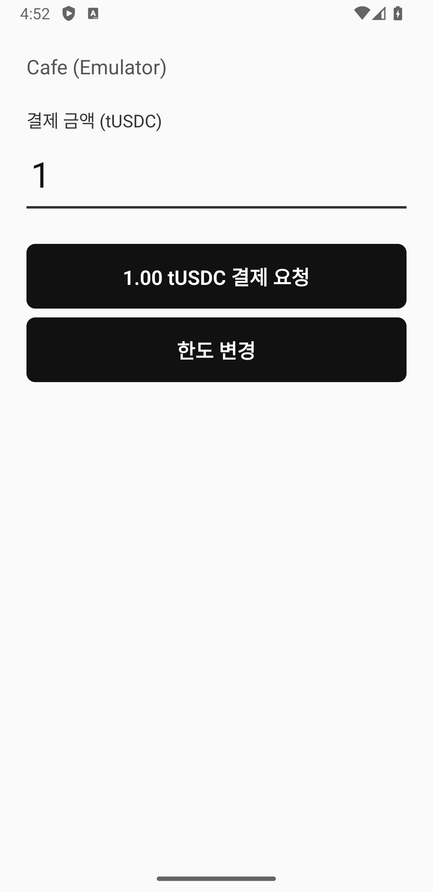
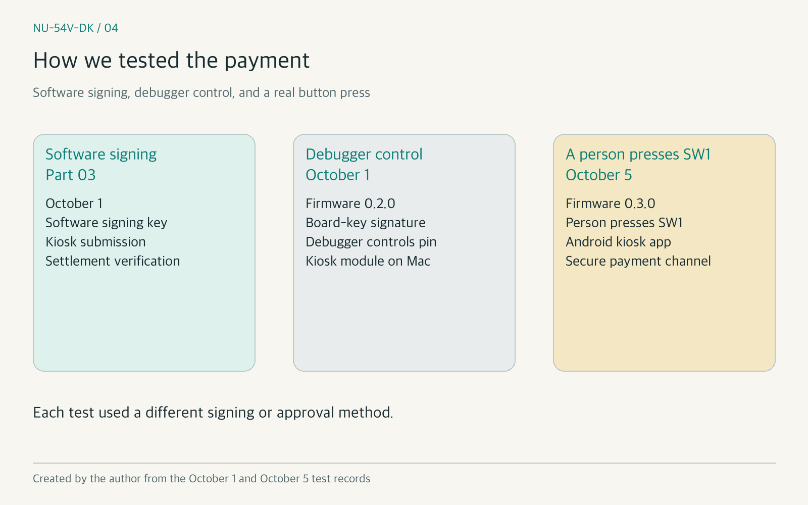
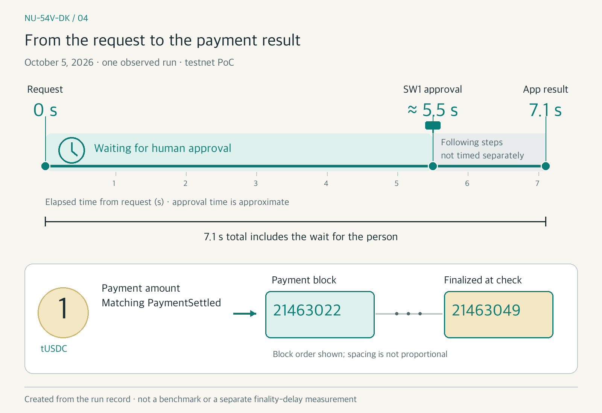
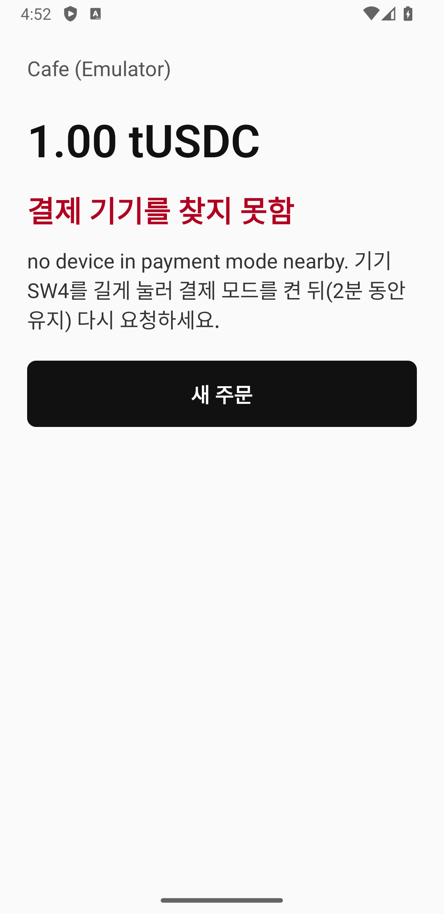

# [NU-54V-DK 04] Paying with a Button Press: Connecting the Board and Android Kiosk

### We pressed the NU-54V-DK board's button and checked the testnet payment in the Android kiosk app

> Building a Stablecoin Payment Device 04 · Previous article: [How Does a Signed Payment Settle? Our First Testnet Payment](https://medium.com/p/7e10dd14ae5a)

In the previous article, we signed a payment in software, submitted it to testnet, and checked the settlement. This time, we moved signing onto the board and tested approval by having a person press its button.

Adding the signing function to the board was only part of the work. The kiosk had to send a wireless request, the board had to wait for a button press and return a signature, and the kiosk then had to submit the payment and check the result. We needed to test that whole sequence together.

On October 5, 2026, our team tested a **1 tUSDC** payment with the NU-54V-DK board and Android kiosk app. After a person pressed the button, the payment settled, and we checked the finalized event. It took **7.1 seconds** from sending the request to seeing the result in the app. That included the wait for the button press.

This article covers that test with the firmware 0.3.0 development build and the problems we fixed while connecting the board and kiosk. It describes a proof of concept (PoC) using a testnet and test tokens, without covering later development.

*Figure 1. We captured the kiosk app in an Android emulator on 2026-10-19, using a fictional merchant and local test settings. This amount-entry screen was not captured during the October 5 payment. The app UI is currently in Korean.*

### INDEX

1. Moving signing from software to the board
2. Connecting the board and kiosk
3. Pressing the button to pay 1 tUSDC
4. What happened during those 7.1 seconds?
5. Problems we found along the way
6. The payment worked. What was still unfinished?

## 1. Moving signing from software to the board

On October 1, we tested signing with the board's key separately from the software-signing test in Part 03. A debugger controlled the approval-button pin, while the kiosk module ran on a Mac. This let us check that a signature produced by the board could be submitted.

On October 5, a person pressed SW1, and we used the Android kiosk app. The app ran as a debug build on a Galaxy S25 Ultra with Android 16. We did not yet have a finished tablet-based product, but we could test the wireless connection and payment screen on a real Android device.

The board and kiosk produce different signatures. The board approves the payment with its private key, using EIP-712, the standard for typed structured data signing. The kiosk uses a separate submission key to sign the transaction it sends to the chain.[1]

*Figure 2. Signing and approval methods used in the three tests. We drew this diagram from the October 1 and October 5 records.*

## 2. Connecting the board and kiosk

The board and kiosk connect over Bluetooth Low Energy (BLE). The board advertises as a peripheral; the kiosk acts as the central, scanning for the board and connecting to it. Once connected, they exchange requests and responses through the Generic Attribute Profile (GATT).[2]

The kiosk does not pair with the board. For the October 5 test, we exchanged payment messages through an application-layer secure channel. The October 1 board test had used a plaintext connection; we added the secure channel between those tests. We will cover the communication design in a later article.

Running the kiosk on a phone can make the app roles confusing. This kiosk app belongs on the merchant's side. The renter's phone app is designed to bond with the board and display payment details. We did not test that phone confirmation screen in this run.

## 3. Pressing the button to pay 1 tUSDC

Before the test, we deposited 10 tUSDC into the device account and prepared the merchant-verification material and a time anchor. We then ran the payment in this order:

1. The kiosk app finds the board, connects, and starts a payment session over the secure channel.
2. The board checks the merchant and payment request, then waits for a button press.
3. A person briefly presses SW1 to approve.
4. The board signs the payment. The kiosk checks that the signature was produced with that board's key.
5. The kiosk submits the payment to the settlement contract and checks the result.

The button press left `approved by the button` in the board log. SW1 was a temporary approval-button assignment for that development build.

## 4. What happened during those 7.1 seconds?

The record shows a button press approximately **5.5 seconds** after the request and a result in the app at **7.1 seconds**. Those times include waiting for the person to press the button. They come from a single run, so they do not establish average payment speed or throughput. Nor can we attribute all 7.1 seconds to blockchain processing.

The payment was included in block **21463022**. When we checked the result, the node reported **21463049** as its **finalized** block. We checked that the merchant, order, and device in `PaymentSettled` matched the request and that the amount was 1 tUSDC. The nonce also matched the value signed by the board. We checked the transaction receipt, block, and event individually.[3]

*Figure 3. We drew this from the October 5 record. The upper timeline shows elapsed time from the request, with the button press at approximately 5.5 seconds. Below it are the 1 tUSDC payment and the two blocks in sequence; block spacing is not proportional. This run does not establish a separate finality delay or a performance guarantee.*

We checked the sequence from signing on the board and human approval through kiosk submission to a matching finalized event. As in the previous article, settlement means moving balances within the contract's internal ledger. Withdrawal to the merchant's external wallet is a separate step.

## 5. Problems we found along the way

The first message arrived successfully, but the second produced `BAD_FRAME`. The firmware had not cleared the previous message's length after reassembly. We fixed it to reset the reassembly state after processing a message and added a test that sends successive valid messages through the same receiver.

An old time anchor also caused rejected payments. Setting the board's clock from an old anchor led to `ATTESTATION_EXPIRED` during validity checks. On October 5, an attempt made roughly two and a half minutes after signing the anchor was rejected. At that stage, we changed the kiosk to stop with `TIME_ANCHOR_STALE` if an anchor was more than 90 seconds behind chain time, and to ask for a fresh one. We also shortened the payment's validity period to fit the allowed range of the board's anchored clock.

`TIME_ANCHOR_MISSING` had a different cause. The development build allowed the kiosk to deliver a time anchor without pairing, but that exception existed only in the connection layer, not in the core rules. We added it to the core rules and limited it to what that development-only delivery path needed.

We also fixed what happened after a failed attempt. The app now kept its saved anchor until the board accepted it. The app could make up to three BLE connection attempts, 0.3 seconds apart. We also gave different explanations when no result arrived and when the board explicitly refused the request.

The LED indications needed work too. We used all four LEDs as one indicator, with a different blinking pattern for each stage. Every indication ended with the LEDs off so that an old signal would not remain on.

*Figure 4. We captured this device-search failure screen in an Android emulator without a connected board on 2026-10-19. We used a fictional merchant and local test settings, without submitting a payment to the chain. The Korean message asks the user to enable payment mode on the device and try again.*

## 6. The payment worked. What was still unfinished?

The October 5 development build used the key in the non-secure world. Moving button approval and signing into a secure-world boundary was still unfinished, and the build used fixed development settings. A successful payment did not mean we had completed key isolation with Trusted Firmware-M (TF-M).

The renter's phone confirmation screen was also missing. The board's confirmation message was only logged, so we could not test someone comparing the merchant name and amount on the phone with the details to be signed. **We checked the button press; we still needed to check whether the person saw the right payment details before approving.**

## Closing

Our team tested the sequence from a person pressing the board's button to checking testnet settlement in the Android kiosk app. Fixing connection errors, retries, and failure messages took work as well. Key isolation and the renter's confirmation screen remained unfinished. In the next article, we will cover moving the payment key and approval button into the secure world.

### References

- [1] [EIP-712: Typed structured data hashing and signing](https://eips.ethereum.org/EIPS/eip-712)
- [2] [Android Developers: Bluetooth Low Energy](https://developer.android.com/develop/connectivity/bluetooth/ble/ble-overview)
- [3] [Ethereum JSON-RPC API: receipts, logs, and block queries](https://ethereum.org/en/developers/docs/apis/json-rpc/)

`#NUCODE` `#누코드` `#NU54VDK` `#누코더스` `#Nucoders`

---

## Publication preparation notes (do not upload to Medium)

- Written on 2026-10-19 using the 2026-10-05 run and firmware 0.3.0 development-build record.
- Sources: the hardware-payment acceptance record, hardware-session procedure, and payment-protocol specification. Specific execution and exception tables take precedence over older plaintext-channel planning sentences still present in those sources.
- The time-anchor section describes the failure and correction recorded at that stage, not a claim that manual preparation remains the current procedure.
- The 7.1 seconds includes human waiting time. No separate finality latency or network delay is derived from it.
- Both editions were published publicly on Medium on 2026-10-19. Private editing links and verification screenshots are retained separately as local working records. No Git commit or push was performed.
- Published article: https://medium.com/@bc.0x4861/nu-54v-dk-04-paying-with-a-button-press-connecting-the-board-and-android-kiosk-08f24d41a38d
- Reveal the repository only in the final installment. Exclude actual keys, addresses, hashes, account names, internal IDs, paths, and key-service implementation details from the public body and images.

### Images

1. `assets/04/01-kiosk-amount.png`: actual app amount-entry screen captured in an Android emulator.
2. `assets/04/02-test-scope-en.png`: three distinct test scopes.
3. `assets/04/03-observed-run-en.png`: observed times and blocks in one run.
4. `assets/04/04-kiosk-no-device.png`: actual app device-search failure screen captured in an Android emulator.

### Pre-publication checks

- [x] Matching facts and numbers, with the previous English article linked.
- [x] INDEX and section headings agree; testnet PoC scope stated.
- [x] Software, debugger-controlled, and human-button tests distinguished.
- [x] October 5 secure channel distinguished from remaining key-isolation and phone-confirmation work.
- [x] Actual addresses, hashes, internal IDs, and repository links excluded from the public body.
- [x] Two emulator app captures and two language-specific diagrams, captions, and sources checked.
- [x] Both Medium drafts' text, four images, and five topics checked after reopening.
- [x] Public publication verified.
