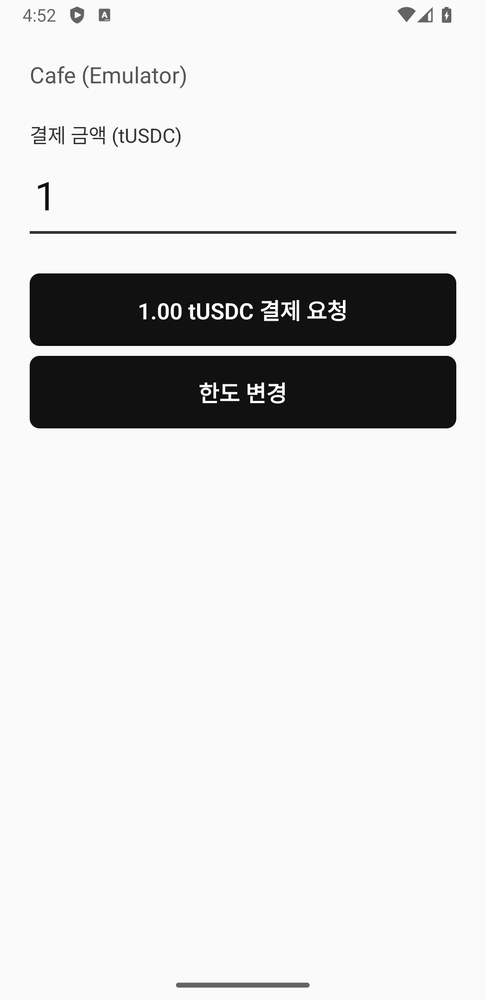
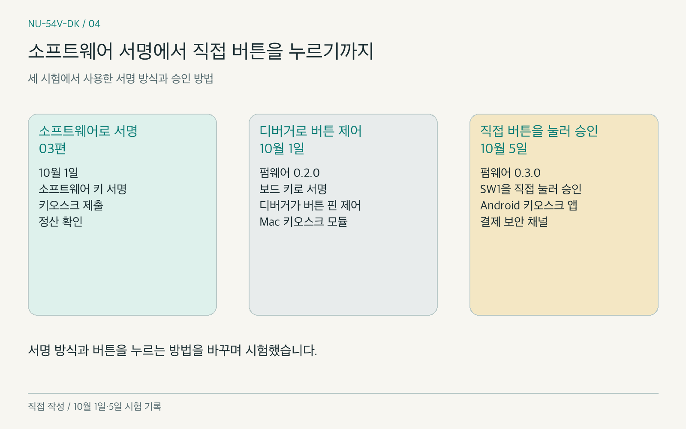
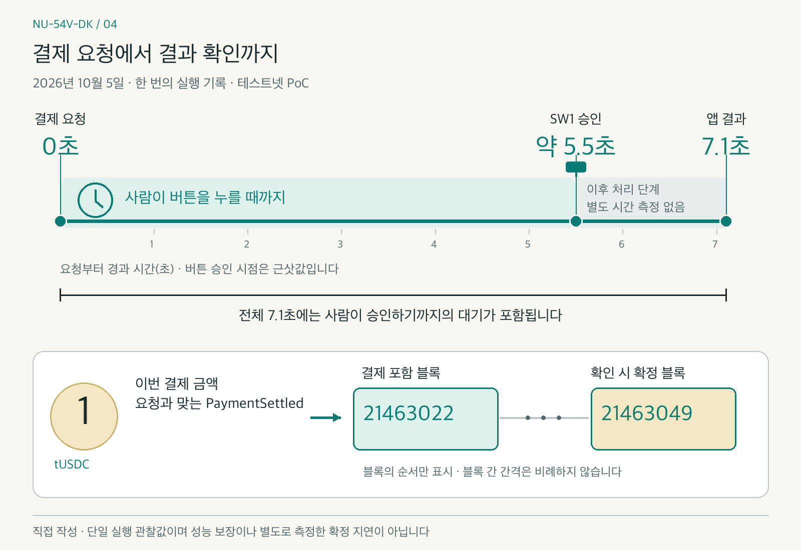
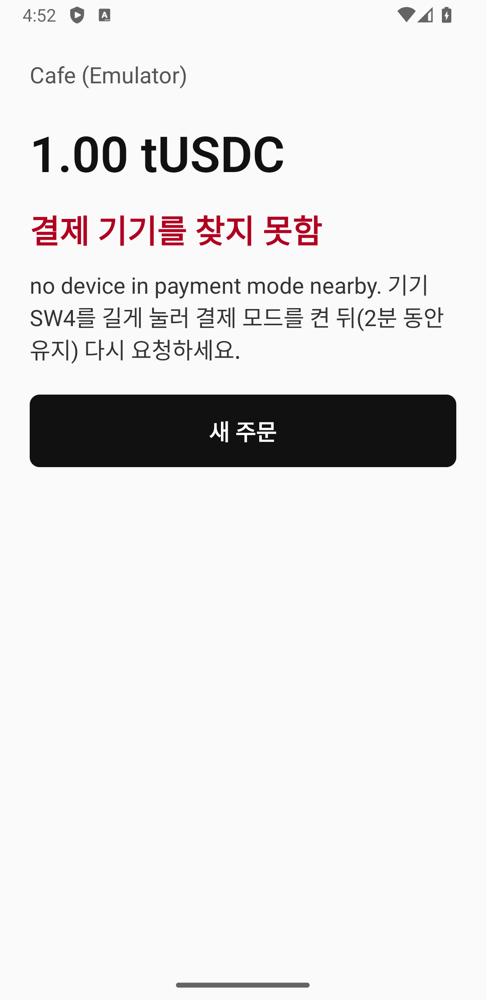

# [NU-54V-DK 04] 보드 버튼을 눌러 결제하기: Android 키오스크 연결기

### NU-54V-DK 보드에서 버튼을 누르고, Android 키오스크 앱으로 테스트넷 결제를 확인했습니다

> 스테이블코인 결제 기기 제작기 04 · 이전 글: [서명한 결제는 어떻게 정산될까: 테스트넷 첫 결제](https://medium.com/p/91a33e9673ae)

지난 글에서는 소프트웨어로 서명한 결제를 테스트넷에 제출하고 정산 결과를 확인했습니다. 이번에는 실제 보드에서 서명하도록 바꿨습니다. 승인도 사람이 보드의 버튼을 직접 누르는 방식으로 시험했습니다.

보드에 서명 기능만 넣는다고 결제가 끝나지는 않았습니다. 키오스크가 무선으로 요청을 보내면 보드는 버튼 입력을 기다렸다가 서명을 돌려줘야 합니다. 키오스크는 그 서명을 받아 체인에 제출하고 결과를 확인해야 합니다. 이 과정이 끊기지 않고 이어지는지 확인하는 것이 이번 작업이었습니다.

저희 팀은 2026년 10월 5일, NU-54V-DK 보드와 Android 키오스크 앱으로 **1 tUSDC** 결제를 시험했습니다. 사람이 버튼을 누른 뒤 결제가 정산됐고, 확정된 이벤트까지 확인했습니다. 요청을 보낸 때부터 앱에 결과가 나올 때까지 **7.1초**가 걸렸습니다. 사람이 버튼을 누르기까지 기다린 시간도 여기에 포함됩니다.

이번 글에는 당시 펌웨어 0.3.0 개발 빌드로 시험한 과정과 연결 중 생긴 문제를 정리했습니다. 테스트넷과 시험용 토큰을 사용한 개념 증명(Proof of Concept, PoC) 단계이며, 이후의 개발 내용은 포함하지 않았습니다.

*그림 1. Android 에뮬레이터에서 키오스크 앱을 실행해 직접 캡처했습니다(2026-10-19). 가상 가게와 로컬 시험 설정을 사용한 금액 입력 화면입니다. 10월 5일 결제 당시의 캡처는 아닙니다.*

### INDEX

1. 소프트웨어에서 보드로 옮기기
2. 보드와 키오스크 연결하기
3. 버튼을 눌러 1 tUSDC 결제하기
4. 7.1초 동안 어떤 일이 있었을까
5. 연결하면서 생긴 문제들
6. 결제는 됐지만, 아직 남은 일

## 1. 소프트웨어에서 보드로 옮기기

10월 1일에는 03편에서 소개한 소프트웨어 서명 시험과 별도로, 보드의 키로 서명하는 시험도 했습니다. 이때는 디버거(debugger)로 승인 버튼의 핀을 제어했고, 키오스크 모듈은 Mac에서 실행했습니다. 보드가 만든 서명을 제출하는 데까지 확인한 시험이었습니다.

10월 5일에는 사람이 SW1을 직접 누르고 Android 키오스크 앱을 사용했습니다. 앱은 Android 16이 설치된 Galaxy S25 Ultra에서 디버그 빌드(debug build)로 실행했습니다. 태블릿 형태의 완제품을 준비한 단계는 아니었지만, 실제 Android 기기에서 무선 연결과 결제 화면을 확인할 수 있었습니다.

보드와 키오스크는 서로 다른 서명을 만듭니다. 보드는 개인 키(private key)로 결제를 승인합니다. 이때 구조화된 데이터 서명(typed structured data signing) 표준인 EIP-712를 사용합니다. 키오스크는 별도의 제출용 키로 트랜잭션(transaction)에 서명해 체인으로 보냅니다.[1]

*그림 2. 세 시험에서 사용한 서명 방식과 승인 방법을 비교했습니다. 10월 1일·5일 기록을 바탕으로 직접 작성한 도식입니다.*

## 2. 보드와 키오스크 연결하기

보드와 키오스크는 저전력 블루투스(Bluetooth Low Energy, BLE)로 연결합니다. 보드는 주변 기기(peripheral)로 자신을 알리는 광고(advertising)를 내보내고, 중앙 기기(central)인 키오스크가 이를 검색해 연결합니다. 연결한 뒤에는 일반 속성 프로파일(Generic Attribute Profile, GATT)을 통해 요청과 응답을 주고받습니다.[2]

키오스크는 보드와 페어링(pairing)하지 않습니다. 대신 10월 5일 시험에서는 응용 계층(application layer)에 보안 채널을 두고 결제 내용을 주고받았습니다. 10월 1일의 보드 시험에서는 평문으로 연결했는데, 그사이 보안 채널을 적용한 것입니다. 자세한 통신 방식은 후속 편에서 다루겠습니다.

키오스크 앱을 폰에서 실행했기 때문에, 사용자의 폰 앱과 헷갈릴 수 있습니다. 여기서 말하는 키오스크 앱은 가게 쪽 앱입니다. 기기를 빌린 사용자의 폰 앱은 보드와 본딩(bonding)한 뒤 결제 내용을 보여 주도록 설계했습니다. 이번 시험에서는 사용자 폰의 확인 화면까지 시험하지는 못했습니다.

## 3. 버튼을 눌러 1 tUSDC 결제하기

시험에 앞서 기기 계정에 10 tUSDC를 입금해 두었습니다. 가맹점 확인 자료와 기준 시각(time anchor)도 준비했습니다. 결제는 다음 순서로 진행했습니다.

1. 키오스크 앱이 보드를 찾아 연결하고, 보안 채널로 결제 세션을 시작합니다.
2. 보드가 가맹점과 결제 요청을 확인한 뒤 버튼 입력을 기다립니다.
3. 사람이 SW1을 짧게 눌러 승인합니다.
4. 보드가 결제에 서명합니다. 키오스크는 이 서명이 해당 보드의 키로 만들어졌는지 확인합니다.
5. 키오스크가 정산 컨트랙트에 결제를 제출하고 결과를 확인합니다.

버튼을 누르자 보드 로그에 `approved by the button`이 남았습니다. 이때 SW1을 승인 버튼으로 쓴 것은 해당 개발 빌드의 임시 설정입니다.

## 4. 7.1초 동안 어떤 일이 있었을까

기록을 보면 요청을 보낸 뒤 약 **5.5초**에 버튼을 눌렀고, **7.1초**에 앱에서 결과를 확인했습니다. 사람이 버튼을 누르는 데 걸린 시간까지 합친 값입니다. 한 번 실행한 기록이므로 평균 결제 속도나 처리량을 나타내지는 않습니다. 7.1초를 전부 블록체인 처리 시간으로 볼 수도 없습니다.

결제는 블록 **21463022**에 포함됐습니다. 결과를 확인할 때 노드가 알려 준 확정 블록(`finalized`)은 **21463049**였습니다. `PaymentSettled` 이벤트에 기록된 가맹점·주문·기기가 요청과 일치하는지, 금액이 1 tUSDC인지 확인했습니다. 재사용 방지 번호(nonce)도 보드가 서명한 값과 맞았습니다. 이때 트랜잭션 영수증(transaction receipt), 블록, 이벤트를 각각 확인했습니다.[3]

*그림 3. 10월 5일 기록을 바탕으로 직접 작성했습니다. 위쪽은 요청 후 경과 시간이며, 버튼을 누른 시점은 약 5.5초입니다. 아래쪽은 1 tUSDC 결제와 두 블록의 순서를 보여 줍니다. 블록 간 간격은 비례하지 않습니다. 이 기록만으로 별도의 확정 소요 시간이나 성능을 판단할 수는 없습니다.*

이번 시험에서는 보드의 서명부터 사람의 승인, 키오스크의 제출, 요청과 일치하는 확정 이벤트까지 확인했습니다. 여기서 정산은 이전 편과 마찬가지로 컨트랙트 내부 장부의 잔액이 이동하는 것을 말합니다. 가맹점의 외부 지갑으로 출금하는 과정은 별도입니다.

## 5. 연결하면서 생긴 문제들

메시지를 한 번 받는 데는 문제가 없었지만, 두 번째부터 `BAD_FRAME`이 발생했습니다. 펌웨어가 메시지를 다 모은 뒤에도 이전 메시지의 길이를 지우지 않은 것이 원인이었습니다. 메시지를 처리한 뒤 재조립 상태를 정리하도록 고쳤습니다. 같은 수신기로 정상 메시지를 연달아 받는 시험도 추가했습니다.

기준 시각이 오래돼 결제가 거절되는 일도 있었습니다. 오래전에 만든 기준 시각으로 보드의 시간을 맞추면 유효 기간 검사에서 `ATTESTATION_EXPIRED`가 발생했습니다. 10월 5일에도 기준 시각에 서명한 뒤 결제까지 약 2분 반이 걸린 시도가 거절됐습니다. 당시에는 체인 시각보다 90초 넘게 지난 기준 시각을 보내려 하면 `TIME_ANCHOR_STALE`로 멈추고 새로 발급받도록 안내했습니다. 결제 유효 기간도 보드에 설정한 시각의 허용 범위 안으로 줄였습니다.

`TIME_ANCHOR_MISSING`은 다른 원인이었습니다. 개발 빌드에서는 페어링 없이 기준 시각을 전달할 수 있도록 예외를 두었는데, 이 처리가 연결 계층에만 있고 핵심 규칙에는 빠져 있었습니다. 핵심 규칙에도 예외를 반영하고, 허용 범위는 이 개발용 전달에 필요한 만큼으로 제한했습니다.

실패한 뒤 다시 시도하는 동작도 손봤습니다. 앱에 저장한 기준 시각은 보드가 받아들였을 때만 지우도록 바꿨습니다. BLE 연결에 실패하면 0.3초 간격으로 세 번까지 시도하도록 했습니다. 응답을 받지 못한 경우와 보드가 명시적으로 거절한 경우도 나눠 안내했습니다.

LED 표시도 수정했습니다. 네 개를 하나의 표시등처럼 사용하되 단계마다 깜빡임을 다르게 했습니다. 안내가 끝나면 모두 꺼지도록 해, 이전 표시가 남아 있지 않게 했습니다.

*그림 4. 보드를 연결하지 않은 Android 에뮬레이터에서 기기 검색 실패 화면을 직접 캡처했습니다(2026-10-19). 가상 가게와 로컬 시험 설정을 사용했으며, 체인에 결제를 제출하지 않았습니다.*

## 6. 결제는 됐지만, 아직 남은 일

10월 5일 개발 빌드에서는 키를 일반 구역(non-secure world)에서 사용했습니다. 보안 구역(secure world) 안에서 버튼 승인과 서명을 처리하도록 분리하는 작업은 남아 있었습니다. 개발용 고정 설정도 사용하고 있었습니다. 따라서 이번 결제 성공만으로 Trusted Firmware-M(TF-M)을 이용한 키 격리까지 끝났다고 할 수는 없습니다.

사용자 폰의 확인 화면도 아직 없었습니다. 보드가 보내는 확인 메시지를 로그로만 남겼기 때문에, 사람이 폰에서 가게 이름과 금액을 보고 서명할 내용과 대조하는 과정은 시험하지 못했습니다. **버튼을 누르는 동작은 확인했지만, 결제 내용을 제대로 보고 승인했는지는 더 확인해야 합니다.**

## 마무리

저희 팀은 사람이 보드의 버튼을 누른 뒤 Android 키오스크 앱에서 테스트넷 정산 결과를 확인하는 데까지 시험했습니다. 연결 과정에서 생긴 오류를 고치고, 실패했을 때 다시 시도하거나 원인을 알 수 있도록 안내를 손보는 데에도 시간이 들었습니다. 키 격리와 사용자 폰의 확인 화면은 다음 과제로 남았습니다. 다음 편에서는 결제 키와 승인 버튼을 보안 구역으로 옮기는 작업을 다루겠습니다.

### 레퍼런스

- [1] [EIP-712: Typed structured data hashing and signing](https://eips.ethereum.org/EIPS/eip-712)
- [2] [Android Developers: Bluetooth Low Energy](https://developer.android.com/develop/connectivity/bluetooth/ble/ble-overview)
- [3] [Ethereum JSON-RPC API: receipts, logs, and block queries](https://ethereum.org/en/developers/docs/apis/json-rpc/)

`#NUCODE` `#누코드` `#NU54VDK` `#누코더스` `#Nucoders`

---

## 발행 준비 메모 (Medium에는 올리지 않습니다)

- 작성일: 2026-10-19. 핵심 실행은 2026-10-05이며 당시 펌웨어 0.3.0 개발 빌드의 상태를 설명합니다.
- 근거: `docs/content/acceptance/gate-w7.md`, `docs/content/acceptance/hardware-session.md`, `docs/content/specifications/protocol/payment-protocol.md`.
- 게이트 기록의 첫 문단과 프로토콜 문서에는 평문으로 통과한다는 과거 계획 문장이 남아 있습니다. 실제 실행 구성·판정 표·예외 표의 구체적인 기록을 따라 10/5 보안 채널 사용, 10/1 개발 실행만 평문으로 구분했습니다. 읽기 전용 근거 문서는 수정하지 않았습니다.
- hardware-session의 기준 시각 자동 취득 안내는 후속 실행 절차입니다. 본문은 게이트 기록의 실패와 당시 수정으로 한정하며 수동 준비 제약이 현재도 그대로라는 주장을 하지 않습니다.
- 7.1초는 사람이 승인하기까지의 시간을 포함한 앱 결과 관찰값입니다. 별도의 블록 확정 소요 시간을 계산하거나 5.5초와의 차이를 네트워크 지연으로 만들지 않았습니다.
- 2026-10-19 한글·영문을 Medium에 공개 발행했습니다. 비공개 편집 URL과 확인 화면은 별도 로컬 작업 기록으로 보관합니다. Git 커밋·push는 수행하지 않았습니다.
- 공개 글: https://medium.com/@bc.0x4861/nu-54v-dk-04-보드-버튼을-눌러-결제하기-android-키오스크-연결기-09aba327a58f
- 저장소 링크는 마지막 편에서 공개합니다. 본문에 키 생성·보관·서명 내부 구현, 실제 키·주소·해시·계정·내부 경로를 넣지 않습니다.

### 이미지 목록

| 번호 | 한글 파일 | 영문 파일 | 내용 |
|---|---|---|---|
| 1 | assets/04/01-kiosk-amount.png | assets/04/01-kiosk-amount.png | 에뮬레이터 실제 앱의 금액 입력 화면 |
| 2 | assets/04/02-test-scope.png | assets/04/02-test-scope-en.png | 세 종류의 시험 범위 |
| 3 | assets/04/03-observed-run.png | assets/04/03-observed-run-en.png | 단일 실행의 시점과 블록 |
| 4 | assets/04/04-kiosk-no-device.png | assets/04/04-kiosk-no-device.png | 에뮬레이터 실제 앱의 기기 검색 실패 안내 |

### 발행 전 확인

- [x] 한글·영문에 같은 사실·수치와 언어별 이전 편 링크를 넣었습니다.
- [x] INDEX와 본문 섹션을 맞추고 테스트넷 PoC 범위를 명시했습니다.
- [x] 소프트웨어 시험, 디버거 시험, 사람이 누른 시험을 구분했습니다.
- [x] 10/5 보안 채널과 당시 남은 키 격리·폰 확인 화면을 구분했습니다.
- [x] 실제 주소·해시·내부 ID·저장소 링크를 공개 본문에서 제외했습니다.
- [x] 실제 앱 에뮬레이터 캡처 2장과 언어별 도식 2장의 캡션·출처를 확인했습니다.
- [x] Medium 두 초안의 본문·이미지·태그 5개 저장을 다시 열어 확인했습니다.
- [x] 공개 발행을 확인했습니다.
