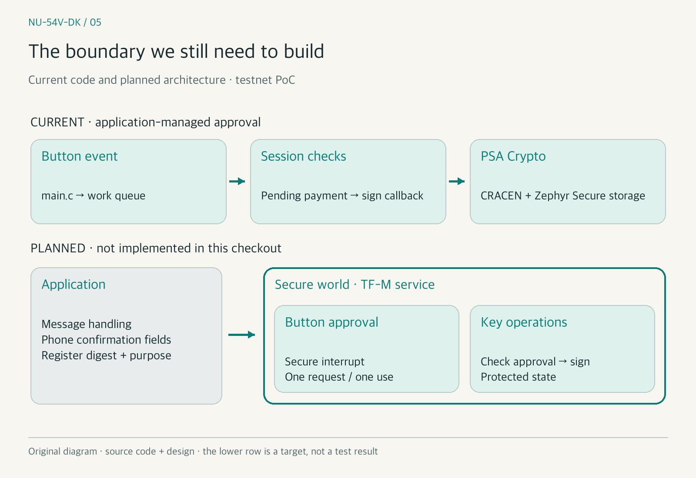
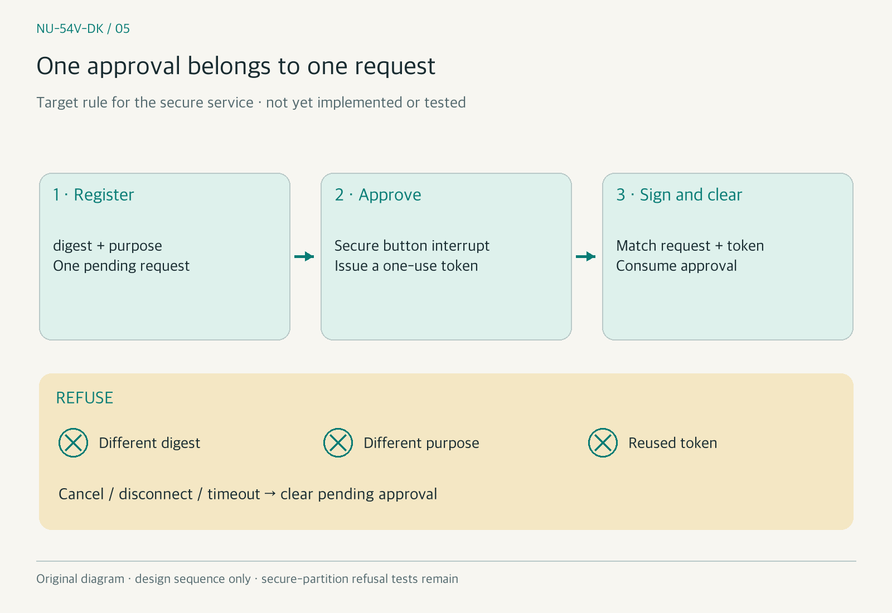
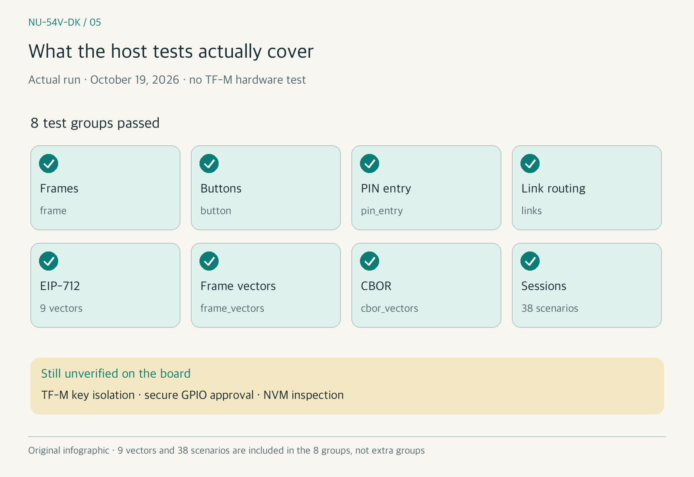

# [NU-54V-DK 05] Moving the Payment Key and Approval Button into the Secure World

We trace the current key policy, button approval, and signing code to see what still needs to move behind the TrustZone boundary

> Building a Stablecoin Payment Device, Part 05 · Previously: [Paying with a Button Press: Connecting the Board and Android Kiosk](https://medium.com/p/08f24d41a38d)

In the previous article, a person pressed the board's button and checked the testnet payment result in the Android kiosk app. The next question is what that button press means in the code. If signing depends on the application telling a service that someone pressed a button, a compromised application could undermine the approval step.

The current firmware uses PSA Crypto to manage the private key. The application requests signatures by key identifier and provides no function that returns the private key bytes. This development path does not yet have a TF-M key service separating the non-secure world from the secure world.

Our next step is to move key operations and approval checks into that service. Each button approval should apply to one request. While preparing this article on October 19, 2026, we reviewed the current code and ran its eight host test groups.

This article follows the existing code, the changes we made during development, and the checks needed for the move. The TrustZone migration is not complete. The project remains a proof of concept (PoC) using a testnet and test tokens.



*Figure 1. Original diagram based on the current code and design documents. The lower half shows the planned structure, not a completed secure-world migration.*

### INDEX

1. What the non-exportable key policy guarantees
2. From a 32-byte digest to a 65-byte signature
3. Where a button press becomes approval
4. What the secure service must check
5. Three things we addressed during development
6. What the tests establish, and what remains

## 1. What the non-exportable key policy guarantees

The key-generation function in `device_key.c` contains these settings. This is an excerpt from the existing function.

```c
psa_set_key_lifetime(&attr, PSA_KEY_LIFETIME_PERSISTENT);
psa_set_key_type(&attr, PSA_KEY_TYPE_ECC_KEY_PAIR(PSA_ECC_FAMILY_SECP_K1));
psa_set_key_bits(&attr, 256);
psa_set_key_usage_flags(&attr, PSA_KEY_USAGE_SIGN_HASH); /* not exportable */
psa_set_key_algorithm(&attr, SIGN_ALG);
```

The key is persistent. It permits signing a hash, without granting `PSA_KEY_USAGE_EXPORT`. The application reads the public key through `psa_export_public_key()`. The PSA specification distinguishes exporting a public key from exporting private key material.[1]

One build option can be confusing: `prj.conf` enables `CONFIG_PSA_WANT_KEY_TYPE_ECC_KEY_PAIR_EXPORT=y`. Its comment explains that the option is needed to read the public key. The build capability and the individual key's usage policy need to be read together.

Likewise, `CONFIG_SECURE_STORAGE=y` does not establish TrustZone isolation by itself. The current key uses Zephyr Secure storage. Verifying a hardware boundary between the application and key service requires checking the build target, storage configuration, and access permissions.[2]

## 2. From a 32-byte digest to a 65-byte signature

The signing function is short. It receives a digest calculated from the payment and returns the two Elliptic Curve Digital Signature Algorithm (ECDSA) values, `r` and `s`.

```c
int device_key_sign(const uint8_t digest[32], uint8_t rs[64])
{
	size_t len;
	psa_status_t st = psa_sign_hash(DEVICE_KEY_ID, SIGN_ALG, digest, 32, rs, 64, &len);
	return st == PSA_SUCCESS && len == 64 ? 0 : (st != PSA_SUCCESS ? st : PSA_ERROR_GENERIC_ERROR);
}
```

`psa_sign_hash()` accepts an already calculated hash.[3] This code passes the 32-byte EIP-712 digest. The `SHA_256` name inside `SIGN_ALG` should not be read as another SHA-256 pass over the payment at this call. It matters whether an API accepts a digest or accepts a message and hashes it.

Next, `nu54_sig_finish()` normalizes `s` to low-s form and adds the recovery ID, `v`, producing a 65-byte signature. It also checks that the recovered address matches the address derived from the device's public key. This processing currently runs in the application. Moving it into the secure world must preserve the digest and signature rules.

## 3. Where a button press becomes approval

In the current `main.c`, a short press of SW1 sends approval, and a short press of SW2 sends refusal.

```c
} else if (ev.button == 0 && ev.event == NU54_BTN_CLICK) {
	pay_link_button(1);
} else if (ev.button == 1 && ev.event == NU54_BTN_CLICK) {
	pay_link_button(0);
```

The event reaches the session through a work queue. The session enters the signing path when it is waiting for payment approval. It does not sign every incoming payment request immediately.

However, `device_key_sign()` itself has no argument representing a button press or payment purpose. The boot-time signing self-test calls it too. The application currently enforces the approval sequence. To keep a compromised application from bypassing button approval, the signing service must enforce that condition itself.

## 4. What the secure service must check

Our design places a dedicated key service in a Trusted Firmware-M (TF-M) secure partition. TF-M's standard crypto service supplies cryptographic operations; our device's button-approval rule still needs to be connected to them.[4]

The intended sequence is below. These are design interfaces, not functions implemented in the current code.

1. `register_digest(digest, purpose)` registers one digest and its purpose.
2. A button interrupt in the secure world creates a one-use approval token for that request.
3. `sign_digest(digest, purpose)` checks the registered values and token, signs, then clears the registration and token.



*Figure 2. Original diagram based on the design's per-request approval rule. It shows the intended refusal of mismatched digests, purposes, and reused tokens. These secure-partition tests have not been run.*

Cancellation, disconnection, and timeout must clear the registration and token too. A button press used for PIN entry or pairing mode must not approve a payment. Moving this code also requires checking GPIO and interrupt ownership, along with input-buffer validation at the secure service boundary.[2][4]

The device still has no display. Even if the secure world checks approval for a digest, matching that digest to the merchant name and amount shown on the phone is a separate problem. The current design assumes the application constructs the confirmation fields and digest correctly. A secure-world button alone cannot remove that assumption.

## 5. Three things we addressed during development

### Persist the next nonce before signing

The payment code stores the next nonce before producing a signature.

```c
memcpy(p.nonce, d->next_nonce, 32);
ss_increment(d->next_nonce); /* sequential: consecutive nonces share one bitmap slot */
if (d->cfg.platform.persist_nonce && d->cfg.platform.persist_nonce(d->cfg.platform.ctx, d->next_nonce) != 0) {
	ss_refused(d, out, "NOT_PERMITTED"); /* the counter must be stored before signing */
	return;
}
```

If storage fails, this path returns without producing the signature. The order is intended to avoid issuing a signature and then losing power before saving the next nonce, which could allow reuse. The board supplies the persistence callback. This code alone does not prove safety at every possible power-loss point. The state and its storage location need to be considered in the secure-world migration as well.

### Clean up an interrupted setup

During setup, the connection can drop after key creation but before PIN entry finishes. The current code cleans up the key left by that unfinished setup.

```c
void ss_abort_pending(nu54_device_t *d)
{
	if (d->pending == NU54_PENDING_PIN && d->cfg.platform.wipe) {
		d->cfg.platform.wipe(d->cfg.platform.ctx);
	}
	d->pending = NU54_PENDING_NONE;
}
```

An October 7 change also addressed cleanup cutting the phone's connection before it could receive the result. We separated resetting a completed rental from cleaning up an unfinished setup. The latter keeps the link needed for the reply. A host test checks that dropping the connection while setup awaits a PIN invokes cleanup and clears the pending operation.

### Give development exceptions separate settings

On the same day, we separated the fixed development setup from the development time-anchor handover exception. Disabling fixed setup in the rental build had also blocked the kiosk's development time-anchor handover.

The release configuration contains the following settings. Having the configuration file does not mean the release build has passed board validation.

```ini
CONFIG_NU54_DEV_SETUP=n
CONFIG_NU54_DEV_UNPAIRED_ANCHOR=n
CONFIG_NU54_REQUIRE_SECURE_SESSION=y
CONFIG_NU54_REQUIRE_PHONE=y
```

Checking which builds include a convenience exception is part of the migration work. The successful payment in the previous article does not establish that these release settings were active in that run.

## 6. What the tests establish, and what remains

While preparing this article, we built the board-independent C code on the host and ran the existing tests. This is the summary line from the October 19, 2026 run.

```text
100% tests passed, 0 tests failed out of 8
```

Running the individual executables also produced:

```text
ok: 9 EIP-712 vectors, 0 failures
ok: 38 session scenarios, 0 failures
```



*Figure 3. Original diagram based on the actual October 19, 2026 host run and test code. The nine vectors and 38 scenarios belong to the eight test groups. These numbers do not establish TF-M isolation or resistance to physical attacks on the board.*

The host tests replace cryptographic and storage operations with test implementations. They check signature formatting and session responses. They cannot establish that the board isolates the key or prevents the application from controlling the GPIO.

The next work is to implement the secure key service, button interrupt, and per-request approval token, then test refusal of changed digests, changed purposes, and reused tokens. Storage configuration, debug access restrictions, and inspection of non-volatile memory from the same image also remain. Preparing this article involved no board flashing or TF-M hardware test.

## Closing

The current code restricts key export and signs after button approval, while the application manages that approval sequence. Moving into the secure world means considering approval checks, nonce state, and cleanup alongside the key. We plan to implement that boundary and verify that requests which should fail are refused. The next article will cover the secure channel used to exchange payment requests with an unpaired kiosk.

### References

- [1] [PSA Certified Crypto API 1.1 — Key policies](https://arm-software.github.io/psa-api/crypto/1.1/api/keys/policy.html)
- [2] [Nordic Developer Academy — Hardware isolation](https://academy.nordicsemi.com/courses/nrf54l-series-express-course/lessons/lesson-4-security-features/topic/hardware-isolation/)
- [3] [PSA Certified Crypto API 1.1 — Asymmetric signature](https://arm-software.github.io/psa-api/crypto/1.1/api/ops/sign.html)
- [4] [Trusted Firmware-M — Crypto Service Integration Guide](https://trustedfirmware-m.readthedocs.io/en/latest/integration_guide/services/tfm_crypto_integration_guide.html)

#NUCODE #누코드 #NU54VDK #누코더스 #Nucoders

---

## Publication preparation notes (do not upload to Medium)

- Drafted, code reviewed, and host tests rerun on 2026-10-19. This is an advance draft; it has not been uploaded to Medium.
- No implemented TF-M key service, secure button handler, or successful hardware validation was found in the current checkout. Update the actual changes, hardware results, and tense after implementation.
- The user's request for a code-focused article takes precedence over the series' general restriction on implementation detail. Excerpts contain no private key bytes, full addresses, hashes, account names, internal absolute paths, or project repository link. Keep repository disclosure for the final installment.
- Code excerpts are contiguous portions of existing source. Proposed interfaces are explicitly labeled as design. Firmware and read-only source documents were not changed.
- Internal source mapping, development history, and test evidence are in `05-source-notes.md`; exclude that file from Medium.
- The previous article links to the English edition of 04. The next article is announced without inventing an unpublished URL.
- Four official references were checked on 2026-10-19. They do not establish successful integration with the current SDK.

### Images

1. `assets/05/01-security-boundary-en.png`: original diagram comparing the existing code path and planned boundary.
2. `assets/05/02-approval-binding-en.png`: original diagram of the intended per-request, one-use approval rule.
3. `assets/05/03-verification-scope-en.png`: original infographic of the actual host run and its limits.

### Pre-publication checks

- [x] Matching facts, code, and numbers, with the previous English article linked.
- [x] Four introduction paragraphs, six matching INDEX sections, and first-person prose.
- [x] Minimal code excerpts checked against source; existing host tests rerun.
- [x] Recorded development changes distinguished from code-derived cautions.
- [x] Three English diagrams, captions, and sources included.
- [x] Testnet PoC, current application path, and unimplemented TF-M boundary stated.
- [x] Actual secrets and project repository link excluded from public text and images.
- [ ] Update with implemented TF-M service, secure button handling, hardware results, and refusal tests.
- [ ] Verify both Medium drafts and five saved topics.
- [ ] Verify public publication after user review.
