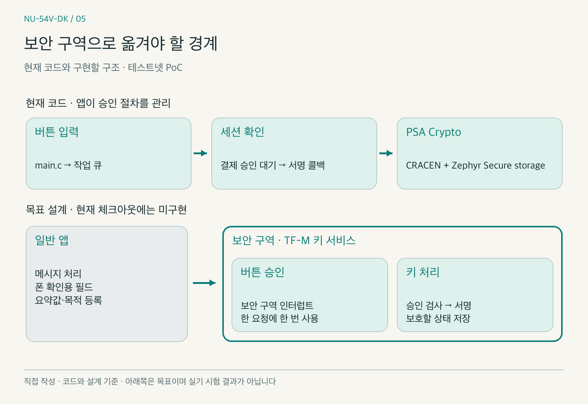
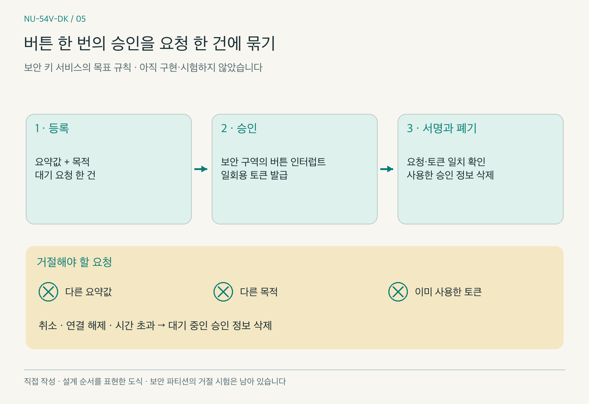
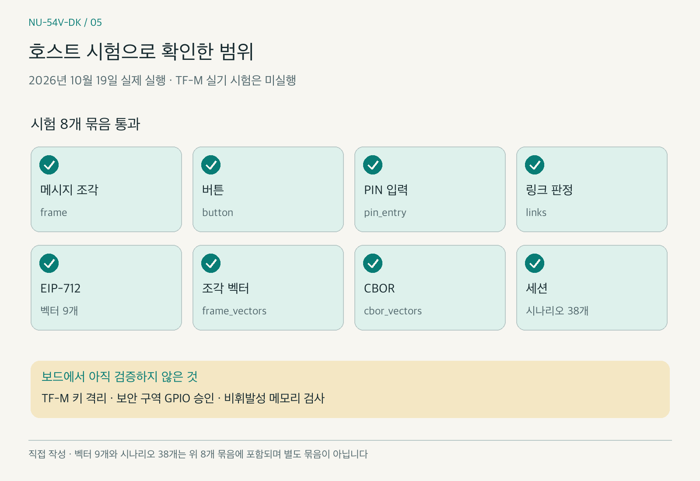

# [NU-54V-DK 05] 결제 키와 승인 버튼을 보안 구역으로 옮기려면

개인키 내보내기 제한부터 버튼 승인과 서명 호출까지, 현재 코드를 읽고 TrustZone으로 옮길 부분을 정리했습니다

> 스테이블코인 결제 기기 제작기 05 · 이전 글: [보드 버튼을 눌러 결제하기: Android 키오스크 연결기](https://medium.com/p/09aba327a58f)

지난 글에서는 보드 버튼을 눌러 Android 키오스크 앱에서 테스트넷 결제를 확인했습니다. 이번에는 코드의 승인 절차를 살펴봅니다. 일반 앱이 버튼을 눌렀다고 알려 주기만 하면 서명이 나온다면, 앱이 변조됐을 때 승인도 우회할 수 있습니다.

현재 펌웨어는 PSA Crypto의 키 식별자로 서명을 요청하며 개인키(private key) 원문은 반환하지 않습니다. 다만 일반 구역(non-secure world)과 보안 구역(secure world)을 나누는 TF-M 키 서비스는 아직 없습니다.

저희 팀이 다음에 옮기려는 것은 키 처리와 승인 판단입니다. 버튼 한 번으로 승인할 수 있는 요청도 한 건으로 묶으려 합니다. 2026년 10월 19일 원고를 준비하며 현재 코드를 다시 읽고, 호스트(host)에서 실행하는 시험 8개 묶음을 확인했습니다.

이번 글은 현재 코드와 개발 중 수정한 내용을 따라 보안 구역 이전에 필요한 일을 정리했습니다. 테스트넷과 시험용 토큰을 사용하는 개념 증명(Proof of Concept, PoC) 단계이며, TrustZone 이전은 아직 완료하지 않았습니다.



*그림 1. 현재 코드와 설계 문서를 바탕으로 직접 작성했습니다. 아래쪽은 구현할 구조이며, 보안 구역 이전을 완료한 결과가 아닙니다.*

### INDEX

1. 개인키 내보내기를 막은 코드가 보장하는 것
2. 32바이트 요약값에서 65바이트 서명까지
3. 버튼 입력은 어디에서 승인이 될까
4. 보안 구역에서 확인해야 할 것
5. 개발하면서 고친 세 가지
6. 시험으로 확인한 범위와 남은 일

## 1. 개인키 내보내기를 막은 코드가 보장하는 것

현재 `device_key.c`의 키 생성 함수에는 다음 설정이 있습니다. 아래 코드는 기존 함수의 일부입니다.

```c
psa_set_key_lifetime(&attr, PSA_KEY_LIFETIME_PERSISTENT);
psa_set_key_type(&attr, PSA_KEY_TYPE_ECC_KEY_PAIR(PSA_ECC_FAMILY_SECP_K1));
psa_set_key_bits(&attr, 256);
psa_set_key_usage_flags(&attr, PSA_KEY_USAGE_SIGN_HASH); /* not exportable */
psa_set_key_algorithm(&attr, SIGN_ALG);
```

영속 키(persistent key)로 만들고, 해시 서명 권한을 주되 `PSA_KEY_USAGE_EXPORT`는 주지 않습니다. 공개키(public key)는 `psa_export_public_key()`로 읽습니다. PSA 규격에서도 공개키를 내보내는 권한과 개인키를 내보내는 권한은 구분합니다.[1]

`prj.conf`의 `CONFIG_PSA_WANT_KEY_TYPE_ECC_KEY_PAIR_EXPORT=y`는 이름 때문에 혼동하기 쉽습니다. 주석에 적힌 용도는 공개키 읽기입니다. 빌드 설정과 개별 키의 내보내기 정책을 함께 봐야 합니다.

또한 `CONFIG_SECURE_STORAGE=y`라는 이름만으로 TrustZone 격리를 확인할 수는 없습니다. 현재 키는 Zephyr Secure storage를 이용합니다. 앱과 키 서비스 사이에 하드웨어로 막힌 경계가 있는지는 빌드 대상, 저장소 구성, 접근 권한을 따로 확인해야 합니다.[2]

## 2. 32바이트 요약값에서 65바이트 서명까지

서명 함수는 결제 요약값(digest)을 받아 타원곡선 전자서명(Elliptic Curve Digital Signature Algorithm, ECDSA)의 `r`, `s`를 반환합니다.

```c
int device_key_sign(const uint8_t digest[32], uint8_t rs[64])
{
	size_t len;
	psa_status_t st = psa_sign_hash(DEVICE_KEY_ID, SIGN_ALG, digest, 32, rs, 64, &len);
	return st == PSA_SUCCESS && len == 64 ? 0 : (st != PSA_SUCCESS ? st : PSA_ERROR_GENERIC_ERROR);
}
```

`psa_sign_hash()`는 이미 계산한 해시를 받습니다.[3] 여기에 EIP-712의 32바이트 요약값을 넘깁니다. `SIGN_ALG`에 `SHA_256`이 들어 있어도, 이 호출에서 결제 내용을 다시 해시하는 것은 아닙니다. 메시지를 받아 해시하는 함수와 구분해야 합니다.

다음으로 `nu54_sig_finish()`가 `s`를 low-s 형태로 정규화하고 복원 식별자(recovery ID) `v`를 붙여 65바이트 서명을 만듭니다. 복원한 주소가 기기의 공개키에서 구한 주소와 맞는지도 확인합니다. 이 처리는 현재 일반 앱 쪽 코드에 있습니다. 보안 구역으로 옮긴 뒤에도 같은 요약값과 서명 규칙을 유지해야 합니다.

## 3. 버튼 입력은 어디에서 승인이 될까

현재 `main.c`는 SW1의 짧은 누름을 승인으로, SW2의 짧은 누름을 거절로 전달합니다.

```c
} else if (ev.button == 0 && ev.event == NU54_BTN_CLICK) {
	pay_link_button(1);
} else if (ev.button == 1 && ev.event == NU54_BTN_CLICK) {
	pay_link_button(0);
```

이벤트는 작업 큐(work queue)를 거쳐 세션으로 갑니다. 세션이 결제 버튼을 기다리는 상태여야 서명 경로로 들어갑니다.

그렇지만 `device_key_sign()` 자체에는 버튼이나 결제 목적을 확인하는 인자가 없습니다. 부팅 시 서명 자체 시험에서도 이 함수를 호출합니다. 현재 앱의 호출 순서가 승인 절차를 지켜 주는 셈입니다. 일반 앱이 변조돼도 버튼 승인을 우회하지 못하게 하려면, 서명 서비스 안에서 승인 조건을 확인해야 합니다.

## 4. 보안 구역에서 확인해야 할 것

저희 설계는 Trusted Firmware-M(TF-M)의 보안 파티션(secure partition)에 별도의 키 서비스를 두는 것입니다. TF-M의 기본 암호 서비스는 암호 연산을 제공하지만, 저희 기기의 버튼 승인 규칙은 별도로 연결해야 합니다.[4]

구상한 순서는 다음과 같습니다. 아래 이름은 설계 인터페이스이며, 현재 구현된 함수가 아닙니다.

1. `register_digest(digest, purpose)`로 서명할 요약값과 목적 한 건을 등록합니다.
2. 보안 구역의 버튼 인터럽트(interrupt)가 그 요청에만 쓸 수 있는 일회용 승인 토큰을 만듭니다.
3. `sign_digest(digest, purpose)`가 등록값과 토큰을 확인하고 서명합니다. 사용한 등록과 토큰은 지웁니다.



*그림 2. 설계 문서의 요청별 승인 규칙을 바탕으로 직접 작성했습니다. 다른 요약값·목적과 토큰 재사용을 거절하는 목표 흐름이며, 해당 보안 파티션 시험은 아직 실행하지 않았습니다.*

취소, 연결 해제, 시간 초과 때도 등록과 토큰을 지워야 합니다. PIN 입력이나 페어링 모드 진입에 쓴 버튼이 결제 승인으로 이어지지 않는지도 확인해야 합니다. 코드를 옮길 때는 GPIO와 인터럽트의 소유권, 보안 서비스의 입력 버퍼 검사도 함께 살펴봐야 합니다.[2][4]

화면이 없는 기기에서는 폰의 가게 이름·금액이 요약값과 일치하는지도 확인해야 합니다. 현재 설계는 일반 앱이 확인용 필드와 요약값을 올바르게 만든다고 가정합니다. 보안 구역의 버튼만으로 이 가정을 없앨 수는 없습니다.

## 5. 개발하면서 고친 세 가지

### 서명 전에 재사용 방지 번호를 저장합니다

현재 결제 코드는 재사용 방지 번호(nonce)의 다음 값을 저장한 뒤 서명합니다.

```c
memcpy(p.nonce, d->next_nonce, 32);
ss_increment(d->next_nonce); /* sequential: consecutive nonces share one bitmap slot */
if (d->cfg.platform.persist_nonce && d->cfg.platform.persist_nonce(d->cfg.platform.ctx, d->next_nonce) != 0) {
	ss_refused(d, out, "NOT_PERMITTED"); /* the counter must be stored before signing */
	return;
}
```

저장에 실패하면 서명을 내보내지 않습니다. 전원이 꺼진 뒤 같은 번호를 다시 쓰지 않도록 잡은 순서입니다. 보드에는 저장 콜백(callback)을 연결했습니다. 모든 전원 차단 시점을 검증한 것은 아니며, 보안 구역 이전 때 이 상태의 저장 위치도 함께 옮겨야 합니다.

### 셋업이 중간에 끊기면 남은 키를 정리합니다

초기 설정(setup) 중 키를 만든 뒤 PIN 입력 전에 연결이 끊길 수 있습니다. 현재 코드는 그 상태에서 만들어진 키를 정리합니다.

```c
void ss_abort_pending(nu54_device_t *d)
{
	if (d->pending == NU54_PENDING_PIN && d->cfg.platform.wipe) {
		d->cfg.platform.wipe(d->cfg.platform.ctx);
	}
	d->pending = NU54_PENDING_NONE;
}
```

10월 7일 수정에서는 중단된 셋업을 정리하면서 폰 연결까지 끊어 결과를 전달하지 못하는 문제도 다뤘습니다. 완료된 대여의 초기화와 아직 완료되지 않은 셋업의 정리를 구분하고, 후자는 응답할 연결을 남기도록 바꿨습니다. 호스트 시험에도 PIN 입력 대기 중 연결이 끊겼을 때 정리 콜백이 불리고 대기가 해제되는 검사가 있습니다.

### 개발용 예외를 한 설정에 묶지 않습니다

같은 날에는 고정 셋업과 기준 시각(time anchor) 전달 예외도 분리했습니다. 고정 셋업을 끈 대여 빌드에서 키오스크의 개발용 기준 시각 전달까지 막히는 문제가 있었기 때문입니다.

출시용 설정 파일에는 다음 값이 있습니다. 설정 파일이 있다는 사실과 출시용 보드 검증이 끝났다는 사실은 구분해야 합니다.

```ini
CONFIG_NU54_DEV_SETUP=n
CONFIG_NU54_DEV_UNPAIRED_ANCHOR=n
CONFIG_NU54_REQUIRE_SECURE_SESSION=y
CONFIG_NU54_REQUIRE_PHONE=y
```

개발용 예외가 어떤 빌드에 들어가는지도 확인해야 합니다. 이전 편의 결제 성공만으로 이 설정의 적용까지 추정할 수는 없습니다.

## 6. 시험으로 확인한 범위와 남은 일

원고를 준비하면서 보드와 무관한 C 코드를 호스트에서 빌드하고 기존 시험을 실행했습니다. 2026년 10월 19일 실행 출력 중 핵심 줄입니다.

```text
100% tests passed, 0 tests failed out of 8
```

개별 실행에서도 다음 결과를 확인했습니다.

```text
ok: 9 EIP-712 vectors, 0 failures
ok: 38 session scenarios, 0 failures
```



*그림 3. 2026년 10월 19일 실제 호스트 시험 결과와 시험 코드를 바탕으로 직접 작성했습니다. 9개 벡터와 38개 시나리오는 8개 시험 묶음에 포함됩니다. 보드의 TF-M 격리나 물리 공격 방어를 검증한 수치는 아닙니다.*

호스트 시험은 암호 연산과 저장을 시험용 구현으로 바꿔 서명 형식과 세션 응답을 확인합니다. 보드의 키 격리나 일반 앱의 GPIO 접근 차단은 확인하지 못합니다.

다음에는 보안 구역의 키 서비스·버튼·승인 토큰을 구현하고, 다른 요약값·목적·재사용 토큰의 거절을 시험해야 합니다. 저장소 구성, 디버그 접근 제한, 같은 이미지의 비휘발성 메모리(non-volatile memory) 검사도 남았습니다. 이번에는 보드 플래시나 TF-M 실기 시험을 하지 않았습니다.

## 마무리

현재 승인 절차는 일반 앱이 관리합니다. 저희 팀은 키와 승인 판단, 재사용 방지 번호, 중단 처리를 보안 구역으로 옮기고 거절 시험을 하려 합니다. 다음 편에서는 페어링하지 않는 키오스크의 결제 보안 채널을 다루겠습니다.

### 레퍼런스

- [1] [PSA Certified Crypto API 1.1 — Key policies](https://arm-software.github.io/psa-api/crypto/1.1/api/keys/policy.html)
- [2] [Nordic Developer Academy — Hardware isolation](https://academy.nordicsemi.com/courses/nrf54l-series-express-course/lessons/lesson-4-security-features/topic/hardware-isolation/)
- [3] [PSA Certified Crypto API 1.1 — Asymmetric signature](https://arm-software.github.io/psa-api/crypto/1.1/api/ops/sign.html)
- [4] [Trusted Firmware-M — Crypto Service Integration Guide](https://trustedfirmware-m.readthedocs.io/en/latest/integration_guide/services/tfm_crypto_integration_guide.html)

#NUCODE #누코드 #NU54VDK #누코더스 #Nucoders

---

## 발행 준비 메모 (Medium에는 올리지 않습니다)

- 작성·코드 확인·호스트 재시험: 2026-10-19. 공개 발행 전 사전 원고입니다. Medium에 업로드하지 않았습니다.
- 현재 체크아웃에서는 TF-M 키 서비스와 secure 버튼 구현·실기 통과 증거를 찾지 못했습니다. 제목은 이전을 위한 질문이며 완료 후기가 아닙니다. 구현 후 실제 변경 코드·로그를 반영하고 시제를 재검토합니다.
- 이번 요청의 실제 코드 중심 집필에 따라 비밀값이 없는 최소 코드 발췌를 넣었습니다. 키 원문·전체 주소·해시·계정·내부 절대 경로·프로젝트 저장소 링크는 제외했습니다. 저장소 공개는 마지막 편까지 보류합니다.
- 본문의 코드는 기존 소스의 연속 부분을 그대로 발췌했습니다. 미구현 설계 인터페이스는 실행 코드와 구분했습니다. 읽기 전용 소스와 펌웨어는 수정하지 않았습니다.
- 코드 출처·변경 이력·재시험 근거: `05-source-notes.md`에 정리했습니다. 내부 검토 자료로 Medium에 올리지 않습니다.
- 이전 글 링크는 04편 한글판입니다. 다음 글은 미발행으로 URL을 넣지 않고 예고만 썼습니다.
- 기술 문서 4개는 2026-10-19 공식 자료로 확인했습니다. 현재 SDK에서의 통합 성공 근거로 사용하지 않습니다.

### 이미지 목록

| 번호 | 한글 파일 | 영문 파일 | 내용·출처 |
|---|---|---|---|
| 1 | assets/05/01-security-boundary.png | assets/05/01-security-boundary-en.png | 현재 개발 경로와 미구현 목표 경계 · 코드와 설계를 바탕으로 직접 작성 |
| 2 | assets/05/02-approval-binding.png | assets/05/02-approval-binding-en.png | 요청별 일회용 승인 목표 · 설계를 바탕으로 직접 작성 |
| 3 | assets/05/03-verification-scope.png | assets/05/03-verification-scope-en.png | 실제 호스트 시험과 미검증 범위 · 실행 결과를 바탕으로 직접 작성 |

### 발행 전 확인

- [x] 한글·영문에 같은 코드·사실·수치와 해당 언어의 이전 편 링크를 넣었습니다.
- [x] 도입 4문단, INDEX와 본문 6개 섹션, 존댓말과 1인칭을 확인했습니다.
- [x] 최소 코드 발췌를 원본과 대조하고 호스트 시험을 다시 실행했습니다.
- [x] 실제 개발 이력과 코드에서 도출한 주의점을 구분했습니다.
- [x] 언어별 도식 3장과 캡션·출처를 넣었습니다.
- [x] 테스트넷 PoC, 현재 일반 앱 경로, 미구현 TF-M 경계를 밝혔습니다.
- [x] 실제 비밀값과 프로젝트 저장소 링크를 공개 본문·이미지에서 제외했습니다.
- [ ] TF-M 키 서비스·secure 버튼 구현 후 실기 결과와 거절 시험을 반영합니다.
- [ ] Medium 한글·영문 초안 및 태그 5개 저장을 확인합니다.
- [ ] 사용자의 발행 검토 후 공개 발행을 확인합니다.
