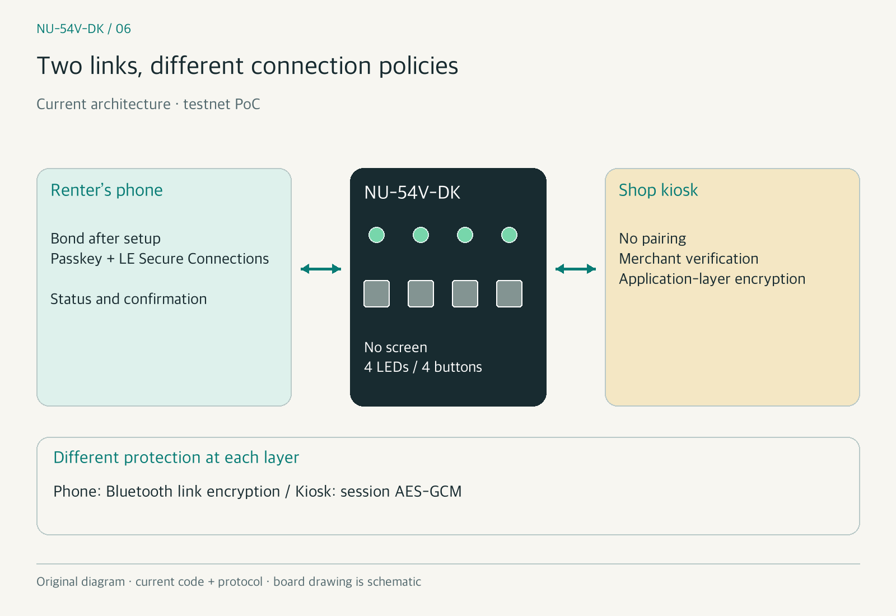
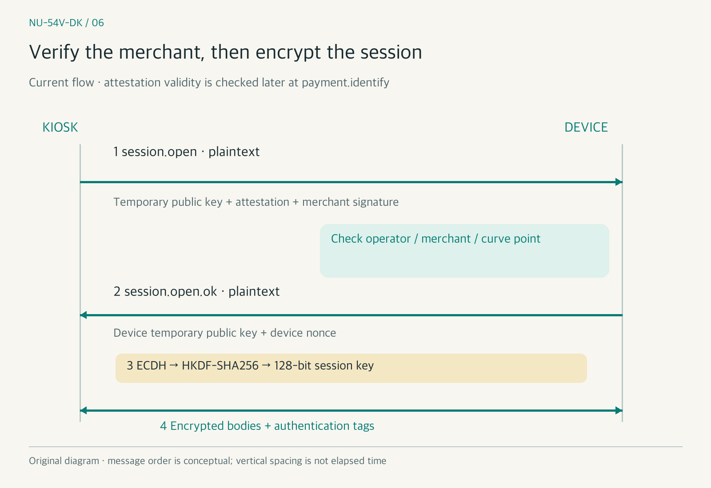
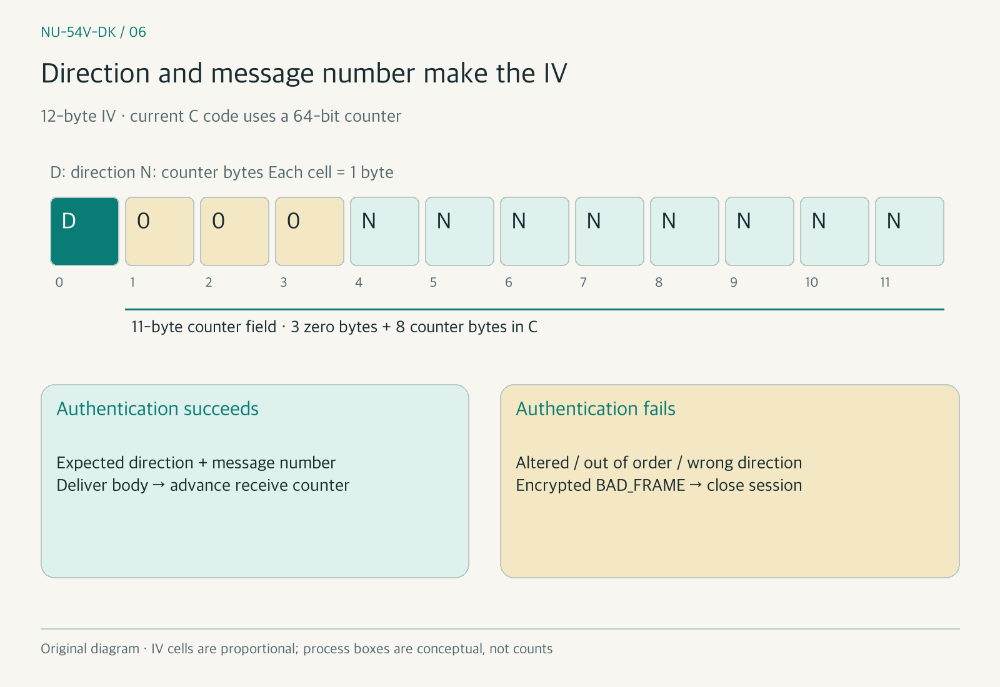

# [NU-54V-DK 06] How Do We Protect Payment Requests Without Pairing?

Separating phone bonding from the kiosk channel, with code for merchant checks, encrypted messages, and tamper rejection

> Building a stablecoin payment device, part 06 · Previous: Moving the Payment Key and Approval Button into the Secure World

Opening Bluetooth settings and registering a new device at every shop would make checkout cumbersome. We decided to bond the renter's phone app with the payment device while letting each shop's kiosk connect without pairing. Bonding saves information established during pairing so that it can be used on subsequent connections.

Allowing a connection does not grant permission to request a payment. If other nearby devices can connect, our device still needs to check that the peer represents a registered merchant and protect the messages they exchange.

We establish a fresh communication key for each payment session and use it to encrypt message bodies. Our October 1 development run used plaintext. On October 5, an Android kiosk and the board completed one testnet payment over the secure channel.

This article follows the code for merchant checks, session key establishment, and rejecting altered messages. This is a proof of concept (PoC) using a testnet and test tokens. The channel is a separate piece of work from the TrustZone migration discussed in part 05.



*Figure 1. Original diagram based on the current connection code and protocol. The phone uses Bluetooth link security; the kiosk uses an application-layer secure channel. The device has no screen.*

### INDEX

1. Why the phone and kiosk use different connection policies
2. Check the merchant before encrypting messages
3. Agreeing on a key and tracking message numbers
4. Close the session when a message fails authentication
5. Problems we encountered and what we changed
6. What the tests cover and what remains

## 1. Why the phone and kiosk use different connection policies

The phone app checks device status and payment details throughout the rental. The kiosk connects for a payment at that shop. Both use Bluetooth Low Energy (BLE), but they serve different purposes.

Once setup is complete, the phone connection requires passkey-authenticated LE Secure Connections. In `ble_links.c`, we check both the connection's security level and its Secure Connections flag. `BT_SECURITY_L4` means authenticated Secure Connections with a 128-bit key.[1] Completing a new bond removes older bonds so that a previous phone cannot keep receiving confirmation messages.

Before initial setup, the device has no passkey. That first setup uses Just Works bonding and confirmation with the device's button. After setup, the phone bonds again using the recorded passkey. The kiosk skips this process and instead uses a secure channel at the application layer.

We do not apply the kiosk channel's encryption to `confirm.show` messages sent to the phone. Calling that body plaintext CBOR does not mean it travels over the air without encryption: the phone connection has Bluetooth link encryption. CBOR, or Concise Binary Object Representation, encodes message fields as bytes.[4]

## 2. Check the merchant before encrypting messages

Encryption alone does not establish who is on the other end. Our device checks a MerchantAttestation signed by the operator, together with a temporary communication public key signed by that merchant.

The kiosk includes the temporary public key, the attestation, and `kioskKeySignature` in `session.open`. That signature binds the merchant identifier, the temporary public key, and the kiosk's random `kioskNonce`. The device checks the operator's signature, the merchant's signature, and whether the public key represents a point on the curve. A failure produces `MERCHANT_FORGED`.

Once the channel is open, the peer cannot switch to a different merchant. This excerpt is from `nu54_session_pay.c`:

```c
if (!ss_operator_attestation(d, m, nu54_msg_find(m, 0, "attestation"), &att) || (d->secure && memcmp(att.merchant, d->secure_merchant, 20) != 0)) {
	ss_refused(d, out, "MERCHANT_FORGED");
	return;
}
```

Even a valid operator-signed attestation for another merchant is refused if it does not match the merchant that opened this session. The attestation's validity period is checked later, during `payment.identify`, using the device's time anchor. Opening the channel does not finish every check required for payment.



*Figure 2. Original diagram based on the current session code. The opening request and reply are plaintext; subsequent bodies on the kiosk link are encrypted. The attestation's validity period is checked during the later identify step.*

## 3. Agreeing on a key and tracking message numbers

Both sides use temporary secp256k1 keys in Elliptic Curve Diffie–Hellman (ECDH) to obtain a shared value. They then apply HKDF, the HMAC-based Extract-and-Expand Key Derivation Function, to derive a 128-bit communication key. HKDF derives usable keys from initial keying material such as a shared value.[2] This communication key serves a different purpose from the device's long-term payment signing key.

We encrypt bodies with AES-GCM, Advanced Encryption Standard in Galois/Counter Mode, and append a 16-byte authentication tag. Verifying the tag detects changes to the ciphertext. An initialization vector (IV) must not be reused to encrypt different messages under the same key.[3]

The protocol defines a 12-byte IV: one direction byte and an 11-byte message number. Kiosk-to-device and device-to-kiosk messages use different direction values, with separate send and receive counters. The C implementation writes a `uint64_t` counter into the last eight bytes and leaves the preceding three bytes zero. It does not use the entire 11-byte counter space.



*Figure 3. Original diagram based on the protocol and current C code. Each equal-width cell represents one byte; the message flow below is conceptual. Transport fragment numbers and GCM message numbers are separate.*

Transport fragments also carry numbers and a digest, which help reassemble messages and detect corruption. A digest that anyone can recalculate without a secret key does not authenticate the sender. The current GCM calls use no additional authenticated data (AAD), so we also cannot describe the outer transport header as GCM-authenticated.

## 4. Close the session when a message fails authentication

In `nu54_session_channel.c`, the receive counter advances only after a message is successfully opened:

```c
make_iv(iv, DIR_KIOSK, d->channel_rx);
if (len < NU54_GCM_TAG_LEN || len - NU54_GCM_TAG_LEN > cap ||
    d->cfg.platform.aead_open(d->cfg.platform.ctx, c->key, iv, body, len, plain) != 0) {
	return -1;
}
d->channel_rx++;
return 0;
```

If this function fails, the calling session code sends `BAD_FRAME` and closes the session. The error reply is encrypted through the channel before it closes. Plaintext sent into that channel, or ciphertext arriving in the wrong order, is not accepted as a normal request.

The kiosk also refuses a reply missing the device's temporary public key instead of falling back to plaintext. When the session ends or the link disconnects, the device clears its channel key. Messages arriving from the phone on its separate link do not consume the kiosk's receive counter.

## 5. Problems we encountered and what we changed

The hardware run also depended on state outside the encryption code. Delivering an old time anchor put the device's clock behind the chain and led to `ATTESTATION_EXPIRED` refusals. The kiosk now checks the anchor against chain time and stops with `TIME_ANCHOR_STALE` if it is more than 90 seconds old. We also adjusted order expiry to account for the anchor delivered to the device.

When we restricted setup sessions to bonded connections, we initially missed the development kiosk's exception for delivering a time anchor. We moved that exception into the session core and limited it to anchor delivery for a device that was already configured. It cannot register a new operator and does not apply to an unprovisioned device.

We also changed the initial BLE connection to retry up to three times at 0.3-second intervals, and changed the app to consume a prepared time anchor when the device accepts it. Connection retries, time checks, and channel establishment were separate causes of failure.

## 6. What the tests cover and what remains

We reran the existing tests on November 9, 2026. The firmware host suite reported:

```text
100% tests passed, 0 tests failed out of 8
```

Running the session test separately reported the following. Its 38 scenarios are included in those eight test groups:

```text
ok: 38 session scenarios, 0 failures
```

Four communication-library tests compare derived keys and ciphertext with Node.js's crypto module and check cases including altered messages, wrong order, and wrong direction. All six kiosk channel tests also passed. They include rejection of an invalid merchant signature, a missing peer temporary public key, a plaintext payment request, and an altered reply.

The firmware host tests use OpenSSL for HKDF and AES-GCM. The kiosk tests use a software device and a fragment transport. We did not perform a new board-to-Android radio test for this article. The October 5 hardware payment and these new host runs are separate evidence.

In this channel, the merchant signs its temporary public key. The device's reply has no long-term-key signature authenticating its own temporary public key, so we do not describe this as mutual authentication of both long-term identities. TrustZone isolation, consistency between the phone display and the payment being signed, handling counter limits, and repeated tests over real radio links need separate attention.

## Closing

We use bonding for the renter's phone and a channel opened for each payment for the kiosk. The code separates merchant verification from ciphertext authentication, while development also required us to account for clocks and connection state. Next, we will look at the order of account closure, fund return, and device reset when a rental ends.

### References

- [1] [Zephyr — Connection management / Security levels](https://docs.zephyrproject.org/latest/doxygen/html/group__bt__conn.html)
- [2] [RFC 5869 — HMAC-based Extract-and-Expand Key Derivation Function](https://www.rfc-editor.org/rfc/rfc5869)
- [3] [NIST SP 800-38D — Galois/Counter Mode (GCM) and GMAC](https://csrc.nist.gov/pubs/sp/800/38/d/final)
- [4] [RFC 8949 — Concise Binary Object Representation (CBOR)](https://www.rfc-editor.org/rfc/rfc8949)

#NUCODE #누코드 #NU54VDK #누코더스 #Nucoders

---

## Publication preparation notes (not for Medium)

- Written, checked against source, and retested on 2026-11-09. Saved both Medium drafts with text, images, captions, and topics on the same day. Both editions were then publicly published at the user’s request. Private links and proof screenshots are kept in local working records outside the repository.
- Part 05 is currently a local advance draft. Add its English URL after publication. Part 07 is also unpublished, so it is introduced without a URL.
- Source mapping, commands, development history, and discrepancies in older design prose are in `06-source-notes.md`, an internal review file that must not be uploaded.
- Excerpts cover validation and receiving messages, not private-key generation, storage, or payment-signing internals. No actual keys, full addresses, transaction hashes, account names, internal absolute paths, or project repository links are included.
- Keep the October 1 plaintext development run, October 5 hardware channel run, and November 9 host retest distinct. Do not turn these results into a claim of completed security auditing or release validation.
- Enter the five Medium topics used for the series: `NUCODE`, `누코드`, `NU54VDK`, `누코더스`, `Nucoders`. Body hashtags do not replace the topic fields.

### Images

| No. | Korean asset | English asset | Content and source |
|---|---|---|---|
| 1 | assets/06/01-two-links.png | assets/06/01-two-links-en.png | Phone bonding and kiosk channel; original diagram based on code and protocol |
| 2 | assets/06/02-channel-handshake.png | assets/06/02-channel-handshake-en.png | Merchant verification, key exchange, and encryption boundary; original diagram based on code |
| 3 | assets/06/03-message-protection.png | assets/06/03-message-protection-en.png | IV layout and receive handling; original diagram based on protocol and C code |

### Before publication

- [x] Prepared both language editions and three diagrams per language.
- [x] Checked four introductory paragraphs, the six-section index, captions, and sources.
- [x] Matched excerpts with source and ran the relevant existing tests.
- [x] Distinguished implementation, historical hardware evidence, host tests, and remaining checks.
- [x] Stated the testnet PoC scope and checked for sensitive information and repository links.
- [ ] Add the English part 05 URL after publication.
- [x] Reopened both drafts and verified complete text, three images, three captions, five topics, and Draft Saved.

### Publication confirmed

- Both editions were publicly published on 2026-11-09. Verified three loaded images, three captions, and five topics on each public article.
- Korean: https://medium.com/@bc.0x4861/nu-54v-dk-06-%ED%8E%98%EC%96%B4%EB%A7%81-%EC%97%86%EB%8A%94-%EA%B2%B0%EC%A0%9C-%EC%9A%94%EC%B2%AD%EC%9D%84-%EC%96%B4%EB%96%BB%EA%B2%8C-%EB%B3%B4%ED%98%B8%ED%95%A0%EA%B9%8C-47fb51c55155
- English: https://medium.com/@bc.0x4861/nu-54v-dk-06-how-do-we-protect-payment-requests-without-pairing-22878f0edd1c
- Removed the inline drafting note about adding the previous link; kept the part 05 title. Its public URL remains pending publication.
