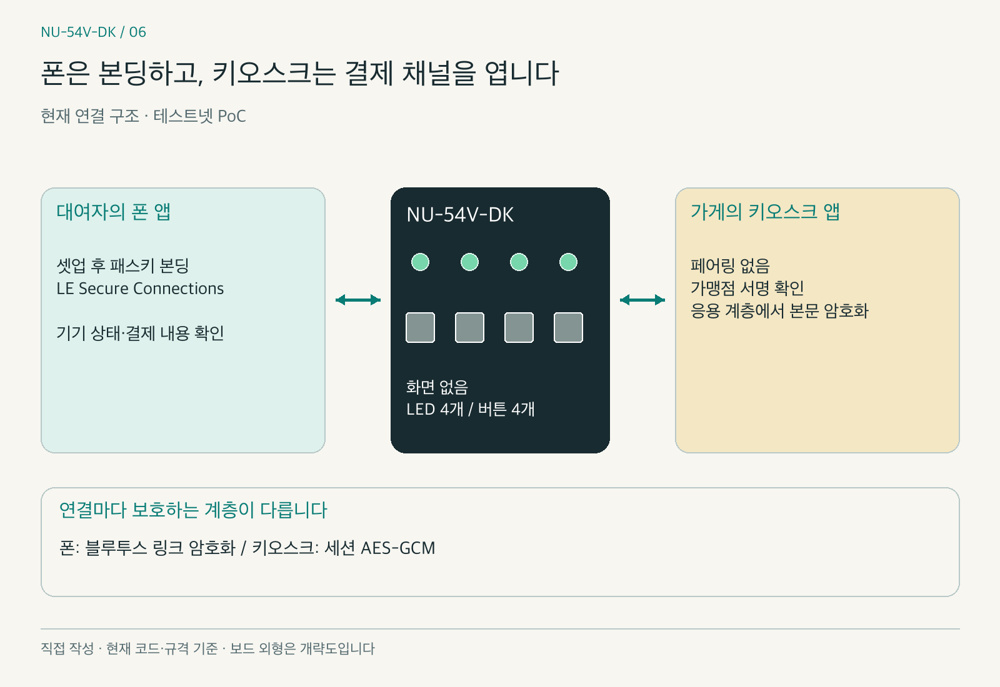
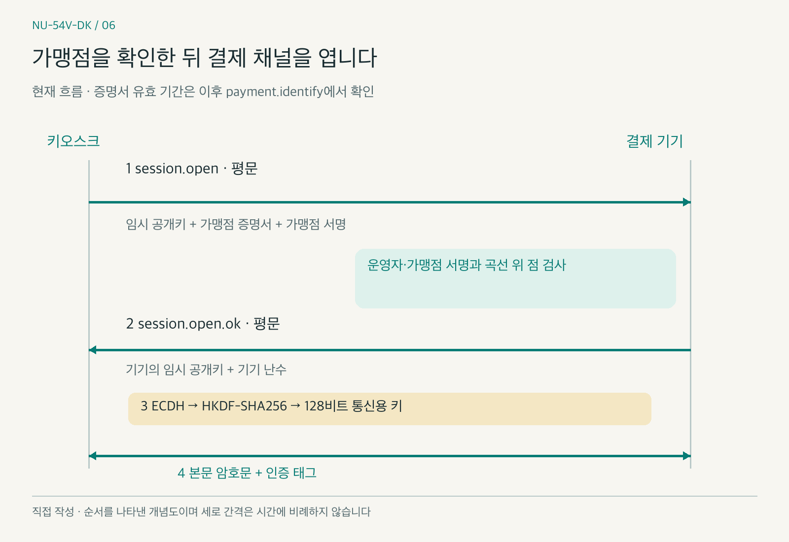
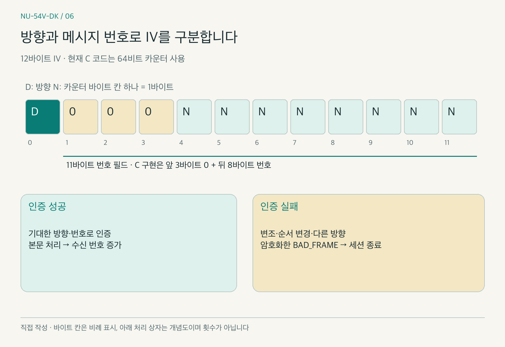

# [NU-54V-DK 06] 페어링 없는 결제 요청을 어떻게 보호할까

폰 앱의 본딩과 키오스크의 보안 채널을 나누고, 가맹점 확인부터 암호문 변조 거절까지 코드로 살펴봅니다

> 스테이블코인 결제 기기 제작기 06 · 이전 글: 결제 키와 승인 버튼을 보안 구역으로 옮기려면

가게마다 블루투스 기기를 등록해야 한다면 결제가 번거롭습니다. 저희 팀은 대여자의 폰 앱은 기기와 본딩(bonding)하고, 키오스크 앱은 페어링(pairing) 없이 연결하도록 정했습니다. 본딩은 페어링 때 만든 연결 정보를 저장해 다음 연결에도 쓰는 방식입니다.

다만 연결을 허용하는 것과 결제를 요청할 자격을 주는 것은 다릅니다. 주변의 다른 기기도 연결할 수 있다면, 결제 기기는 상대가 등록된 가맹점인지 확인하고 주고받는 내용을 보호해야 합니다.

저희는 결제 세션마다 통신용 키를 새로 합의하고, 그 키로 메시지 본문을 암호화했습니다. 10월 1일 개발 실행은 평문이었지만, 10월 5일에는 이 채널을 사용한 Android 키오스크와 보드로 테스트넷 결제 1건을 확인했습니다.

이번에는 가맹점 확인, 세션 키 합의, 메시지 변조를 거절하는 코드를 살펴보겠습니다. 테스트넷과 시험용 토큰을 쓰는 개념 증명(Proof of Concept, PoC)이며, 지난 편의 TrustZone 이전과는 별개의 작업입니다.



*그림 1. 현재 연결 코드와 통신 규격을 바탕으로 직접 작성했습니다. 폰 쪽은 블루투스 링크 보안을, 키오스크 쪽은 응용 계층의 보안 채널을 사용합니다. 기기에는 화면이 없습니다.*

### INDEX

1. 폰 앱과 키오스크를 다르게 연결한 이유
2. 암호화 전에 가맹점부터 확인합니다
3. 통신용 키와 메시지 번호를 맞추는 방법
4. 변조된 메시지를 받으면 세션을 닫습니다
5. 개발 중 막혔던 곳과 고친 내용
6. 시험으로 확인한 범위와 남은 일

## 1. 폰 앱과 키오스크를 다르게 연결한 이유

폰 앱은 대여 기간 동안 기기 상태와 결제 내용을 확인하고, 키오스크는 해당 가게에서 결제할 때 연결합니다. 둘 다 저전력 블루투스(Bluetooth Low Energy, BLE)를 쓰지만 연결 정책은 달리 정했습니다.

셋업 후 폰 연결은 패스키(passkey)로 인증한 LE Secure Connections를 요구합니다. `ble_links.c`는 보안 수준과 Secure Connections 플래그를 확인합니다. `BT_SECURITY_L4`는 인증된 Secure Connections와 128비트 키를 뜻합니다.[1] 새 본딩 후에는 이전 본딩을 지워 예전 폰이 확인 메시지를 받지 않도록 했습니다.

패스키가 없는 첫 셋업에는 Just Works 본딩과 기기 버튼 확인을 씁니다. 셋업 후에는 패스키로 다시 본딩합니다. 키오스크는 이 절차 없이, 앱의 메시지를 보호하는 보안 채널(secure channel)을 따로 씁니다.

폰으로 보내는 `confirm.show`에는 키오스크 채널의 암호화를 덧씌우지 않습니다. 이때 본문이 평문 CBOR이라는 말은 BLE 전파에서도 평문이라는 뜻이 아닙니다. 폰 연결의 링크 암호화가 적용됩니다. CBOR(Concise Binary Object Representation)은 메시지 필드를 바이트로 표현하는 형식입니다.[4]

## 2. 암호화 전에 가맹점부터 확인합니다

암호화만 하면 누구와 통신하는지 알 수 없습니다. 저희 기기는 운영자가 서명한 가맹점 증명서(MerchantAttestation)와, 그 가맹점이 서명한 통신용 임시 공개키를 함께 확인합니다.

키오스크의 `session.open`에는 임시 공개키, 가맹점 증명서, `kioskKeySignature`를 담습니다. 마지막 서명은 가맹점 식별값·임시 공개키·키오스크 난수인 `kioskNonce`를 묶습니다. 기기는 운영자 서명, 가맹점 서명, 공개키가 곡선 위의 점인지를 검사합니다. 실패하면 `MERCHANT_FORGED`로 거절합니다.

채널을 연 뒤 가맹점을 바꿔 끼우는 요청도 막습니다. `nu54_session_pay.c`의 검사 일부입니다.

```c
if (!ss_operator_attestation(d, m, nu54_msg_find(m, 0, "attestation"), &att) || (d->secure && memcmp(att.merchant, d->secure_merchant, 20) != 0)) {
	ss_refused(d, out, "MERCHANT_FORGED");
	return;
}
```

다른 가맹점의 정상 증명서라도 이 세션의 가맹점과 다르면 거절합니다. 증명서 유효 기간은 기기의 기준 시각(time anchor)을 사용하는 `payment.identify`에서 검사합니다. 채널 수립만으로 결제 검사가 끝난 것은 아닙니다.



*그림 2. 현재 세션 코드를 바탕으로 직접 작성했습니다. 최초 요청과 응답은 평문이며, 그다음 키오스크 링크의 본문부터 암호화합니다. 가맹점 증명서의 유효 기간은 이후 identify 단계에서 확인합니다.*

## 3. 통신용 키와 메시지 번호를 맞추는 방법

양쪽은 secp256k1 임시 키를 사용한 타원곡선 디피–헬먼(Elliptic Curve Diffie–Hellman, ECDH)으로 공유값을 구합니다. 여기에 HKDF(HMAC-based Extract-and-Expand Key Derivation Function)를 적용해 128비트 통신용 키를 얻습니다. HKDF는 공유값 같은 초기 키 재료에서 사용할 키를 유도하는 함수입니다.[2] 이 통신용 키는 결제에 서명하는 기기의 장기 키와 용도가 다릅니다.

본문은 AES-GCM(Advanced Encryption Standard in Galois/Counter Mode)으로 암호화하고 16바이트 인증 태그(authentication tag)를 붙입니다. 태그를 검사해 암호문이 바뀌었는지 확인합니다. 같은 키로 서로 다른 메시지를 암호화할 때 초기화 벡터(Initialization Vector, IV)를 재사용하면 안 됩니다.[3]

규격의 IV는 방향 1바이트와 메시지 번호 11바이트입니다. 송수신 방향값을 다르게 두고 번호도 각각 관리합니다. C 구현은 `uint64_t` 번호를 마지막 8바이트에 넣고 앞 3바이트는 0으로 둡니다. 11바이트 전체를 쓰지는 않습니다.



*그림 3. 규격과 현재 C 코드를 바탕으로 직접 작성했습니다. 같은 폭의 칸 하나가 1바이트이며, 아래 메시지 흐름은 개념도입니다. 전송 조각의 번호와 GCM 메시지 번호는 별개입니다.*

전송 조각에도 번호와 요약값이 있지만, 조각을 모으고 손상을 확인하는 용도입니다. 비밀 키 없이 다시 계산할 수 있는 요약값으로 상대를 인증할 수는 없습니다. 현재 GCM 호출은 추가 인증 데이터(Additional Authenticated Data, AAD)를 사용하지 않습니다. 따라서 바깥 전송 헤더까지 GCM으로 인증한다고 설명해서도 안 됩니다.

## 4. 변조된 메시지를 받으면 세션을 닫습니다

`nu54_session_channel.c`는 수신에 성공한 뒤에만 다음 번호로 넘어갑니다.

```c
make_iv(iv, DIR_KIOSK, d->channel_rx);
if (len < NU54_GCM_TAG_LEN || len - NU54_GCM_TAG_LEN > cap ||
    d->cfg.platform.aead_open(d->cfg.platform.ctx, c->key, iv, body, len, plain) != 0) {
	return -1;
}
d->channel_rx++;
return 0;
```

이 함수가 실패하면 호출한 세션 코드가 `BAD_FRAME`을 보내고 세션을 닫습니다. 오류 응답도 닫기 전 채널로 암호화합니다. 현재 채널에서 평문을 다시 보내거나 기대한 순서와 다른 암호문을 보내도 정상 요청으로 처리하지 않습니다.

키오스크도 상대의 임시 공개키가 빠진 응답을 받으면 평문 통신으로 낮춰 재시도하지 않습니다. 세션이 끝났거나 연결이 끊기면 기기 쪽 채널 키를 정리합니다. 폰에서 별도 링크로 들어온 메시지는 키오스크의 수신 번호를 소비하지 않도록 분리했습니다.

## 5. 개발 중 막혔던 곳과 고친 내용

실기 시험에서는 오래된 기준 시각 때문에 기기 시각이 체인보다 늦어져 `ATTESTATION_EXPIRED`로 거절됐습니다. 키오스크는 체인 시각과 대조해 90초 넘게 오래된 기준 시각이면 `TIME_ANCHOR_STALE`로 재발급을 요청하고, 전달한 기준 시각에 맞춰 주문 만료를 좁히도록 바꿨습니다.

본딩한 연결에서만 셋업을 허용하는 규칙을 넣으면서, 개발용 키오스크가 기준 시각을 전달하던 예외가 빠진 일도 있었습니다. 예외를 세션 코어에 반영하되 이미 설정된 기기의 기준 시각 전달로 좁혔습니다. 이 예외로 새 운영자를 등록할 수는 없습니다. 초기화된 기기에는 적용하지 않습니다.

또한 첫 BLE 연결 실패는 0.3초 간격으로 세 번까지 다시 시도하고, 준비한 기준 시각은 기기가 받아들였을 때 소진하도록 고쳤습니다. 연결 재시도, 시각 검사, 보안 채널 수립은 각각 다른 실패 원인이었습니다.

## 6. 시험으로 확인한 범위와 남은 일

2026년 11월 9일 기존 시험을 다시 실행했습니다. 펌웨어 호스트 시험 출력입니다.

```text
100% tests passed, 0 tests failed out of 8
```

세션 시험을 개별 실행한 결과입니다. 38개 시나리오는 위 8개 시험 묶음에 포함됩니다.

```text
ok: 38 session scenarios, 0 failures
```

통신 라이브러리 시험 4개는 Node.js 암호 모듈과 키·암호문을 대조하고, 변조·순서 변경·방향 오류 등을 검사합니다. 키오스크 시험 6개도 통과했습니다. 여기에는 잘못된 가맹점 서명, 상대 임시 공개키 누락, 평문 결제 요청, 변조된 응답을 거절하는 경우가 포함됩니다.

펌웨어 호스트 시험은 HKDF와 AES-GCM에 OpenSSL을 사용하고, 키오스크 시험은 소프트웨어 기기와 조각 전송을 사용합니다. 이번에 보드와 Android 사이의 무선 시험을 새로 한 것은 아닙니다. 10월 5일의 실기 결제와 이번 코드 시험을 구분해야 합니다.

현재 채널은 가맹점이 임시 공개키에 서명하는 구조입니다. 기기의 응답에는 장기 키로 임시 공개키를 인증하는 서명이 없으므로, 이를 양쪽의 장기 신원을 확인한 상호 인증으로 설명하지 않습니다. TrustZone 격리, 폰 화면과 서명할 내용의 일치, 카운터 한계에서의 종료와 실제 무선 환경의 반복 시험도 별도로 살펴야 합니다.

## 마무리

저희 팀은 폰에는 대여자와의 본딩을, 키오스크에는 결제마다 여는 보안 채널을 적용했습니다. 코드에서는 가맹점 확인과 암호문 검사를 나눴고, 개발 과정에서는 시각과 연결 상태까지 함께 맞춰야 했습니다. 다음 편에서는 기기를 반납할 때 계정 종료, 잔액 반환, 기기 초기화의 순서를 다루겠습니다.

### 레퍼런스

- [1] [Zephyr — Connection management / Security levels](https://docs.zephyrproject.org/latest/doxygen/html/group__bt__conn.html)
- [2] [RFC 5869 — HMAC-based Extract-and-Expand Key Derivation Function](https://www.rfc-editor.org/rfc/rfc5869)
- [3] [NIST SP 800-38D — Galois/Counter Mode (GCM) and GMAC](https://csrc.nist.gov/pubs/sp/800/38/d/final)
- [4] [RFC 8949 — Concise Binary Object Representation (CBOR)](https://www.rfc-editor.org/rfc/rfc8949)

#NUCODE #누코드 #NU54VDK #누코더스 #Nucoders

---

## 발행 준비 메모 (Medium에는 올리지 않습니다)

- 작성·코드 대조·호스트 재시험: 2026-11-09. 같은 날 Medium 한글·영문 초안을 작성한 뒤 사용자의 요청으로 두 판본을 공개 발행했습니다. 비공개 링크와 확인 화면은 저장소 밖 로컬 작업 기록에 보관합니다.
- 이전 편인 05편은 현재 로컬 사전 원고입니다. 이전 글 URL은 발행 후 채웁니다. 다음 편도 미발행이므로 예고만 넣었습니다.
- 코드 출처·시험 명령·변경 이력·오래된 설계 문구와의 차이: `06-source-notes.md`. 검토 전용이며 Medium에 올리지 않습니다.
- 개인키 생성·보관·서명 내부 구현을 공개하는 발췌는 넣지 않았습니다. 검사·수신 처리만 원본의 연속 부분을 그대로 사용했습니다. 키·실제 주소·해시·계정·내부 절대 경로와 프로젝트 저장소 링크를 제외했습니다.
- 본문과 그림은 10/1 평문 개발 실행, 10/5 보안 채널 실기 결제, 11/9 호스트 재시험을 구분합니다. 현재 체크아웃의 구현을 보안 감사 완료나 출시 완료로 표현하지 않습니다.
- Medium 주제는 기존 시리즈와 같은 `NUCODE`, `누코드`, `NU54VDK`, `누코더스`, `Nucoders` 5개를 입력합니다. 본문 해시태그만으로 주제 입력을 대신하지 않습니다.

### 이미지 목록

| 번호 | 한글 파일 | 영문 파일 | 내용·출처 |
|---|---|---|---|
| 1 | assets/06/01-two-links.png | assets/06/01-two-links-en.png | 폰 본딩과 키오스크 보안 채널 · 코드와 규격을 바탕으로 직접 작성 |
| 2 | assets/06/02-channel-handshake.png | assets/06/02-channel-handshake-en.png | 가맹점 인증·키 교환·암호화 시작 시점 · 현재 코드를 바탕으로 직접 작성 |
| 3 | assets/06/03-message-protection.png | assets/06/03-message-protection-en.png | IV 바이트 구성과 수신 성공·실패 처리 · 규격과 현재 코드를 바탕으로 직접 작성 |

### 발행 전 확인

- [x] 한글·영문 원고와 언어별 설명 그림 3장을 준비했습니다.
- [x] 도입 4문단, INDEX와 본문 6개 섹션, 캡션·출처를 맞췄습니다.
- [x] 코드 발췌를 원본과 대조하고 관련 기존 시험을 실행했습니다.
- [x] 구현·과거 실기 기록·이번 호스트 시험·남은 검증을 구분했습니다.
- [x] 테스트넷·시험용 토큰의 PoC 범위와 민감정보·저장소 링크 비노출을 확인했습니다.
- [ ] 05편 발행 후 해당 언어의 이전 글 URL을 넣습니다.
- [x] Medium 초안을 다시 열어 본문 전체·이미지 3장·캡션 3개·주제 5개와 Draft Saved를 확인했습니다.

### 공개 발행 확인

- 2026-11-09 한글·영문 공개 발행을 확인했습니다. 각 공개 본문에서 그림 3장 로드·캡션 3개·주제 5개를 확인했습니다.
- 한글: https://medium.com/@bc.0x4861/nu-54v-dk-06-%ED%8E%98%EC%96%B4%EB%A7%81-%EC%97%86%EB%8A%94-%EA%B2%B0%EC%A0%9C-%EC%9A%94%EC%B2%AD%EC%9D%84-%EC%96%B4%EB%96%BB%EA%B2%8C-%EB%B3%B4%ED%98%B8%ED%95%A0%EA%B9%8C-47fb51c55155
- 영문: https://medium.com/@bc.0x4861/nu-54v-dk-06-how-do-we-protect-payment-requests-without-pairing-22878f0edd1c
- 본문의 이전 글 링크 작성 메모는 제거하고 05편 제목만 남겼습니다. 05편 공개 URL은 발행 후 추가합니다.
