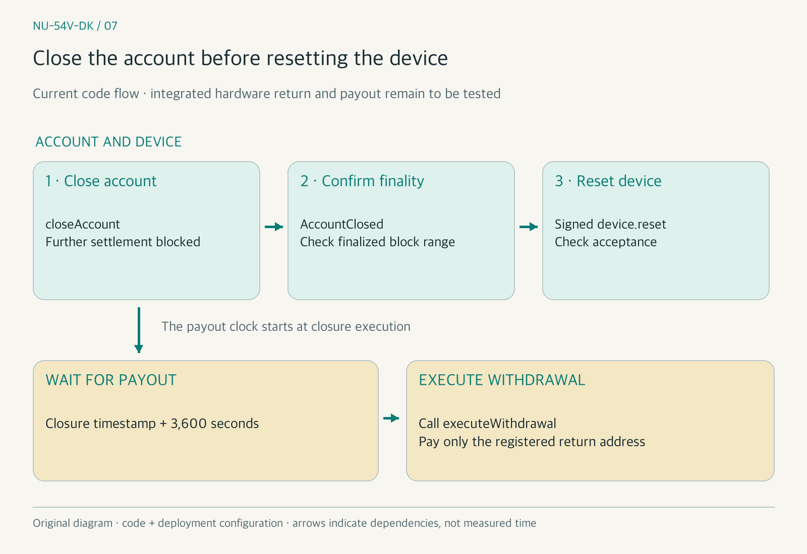
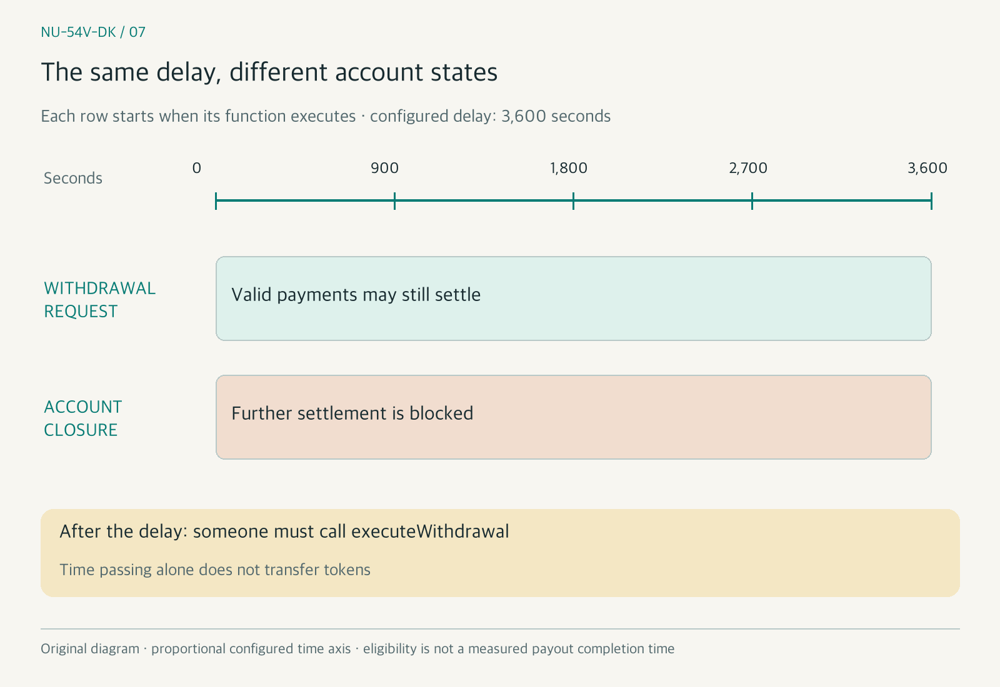
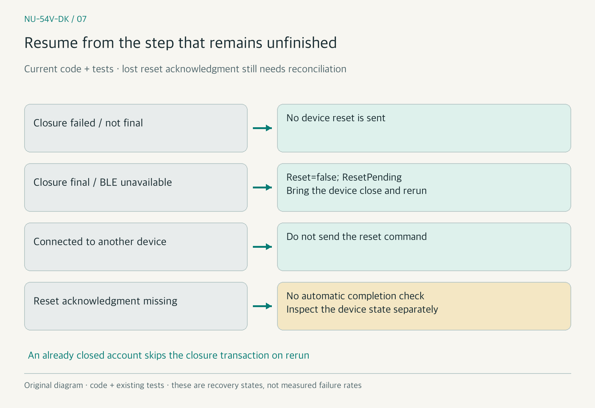

# [NU-54V-DK 07] What Happens to the Remaining Balance When a Payment Device Is Returned?

Following the code for account closure, device reset, fund return, and resuming an interrupted rental return

> Building a stablecoin payment device, part 07 · Previous: [How Do We Protect Payment Requests Without Pairing?](https://medium.com/p/22878f0edd1c)

When a traveler returns a payment device, they should also get the remaining balance back. Resetting the device and handing it to the next renter sounds straightforward, but the funds are held by the settlement contract. We have to account for both the device's local state and its on-chain account.

Deleting a key does not erase payment signatures that have already left the device. Closing the account without resetting the device leaves the previous renter's settings behind. We needed an order for these operations and a way to resume if the connection failed midway.

We decided to finalize account closure before resetting the device. Paying out the balance is a separate step. The current deployment record sets a 3,600-second withdrawal delay, after which someone must call the withdrawal execution function.

This article follows our Go operations tool and Solidity contracts. It is a proof of concept (PoC) using a testnet and test tokens. We distinguish recorded runs from code tests and identify the pieces that still need to be connected.



*Figure 1. Original diagram based on the current return code and contract. Account closure, device reset, and payout require separate confirmation. The withdrawal delay starts at the block timestamp when account closure executes.*

### INDEX

1. Why account closure comes before reset
2. Closing an account differs from requesting a withdrawal
3. Wait for finalized closure before resetting the device
4. Keep completed steps when the device is unavailable
5. A delayed withdrawal is not an automatic transfer
6. What we verified and what still needs connecting

## 1. Why account closure comes before reset

The device signs a payment request; the settlement contract uses the signature to move balances. Deleting the key on the device cannot recall a signature that the kiosk already holds. Preventing payments after a return therefore requires closing the on-chain account as well.

`closeAccount()` records the closure time and queues the entire balance for withdrawal. Subsequent settlement checks reject a closed signer's account with `AccountInactive`. A signature obtained before closure cannot settle afterward. Further deposits and limit changes on that account are also rejected.

In `return.go`, we request closure only if the account is still open:

```go
if acct.ClosedAt == 0 {
	progress("closing the account")
	if res.CloseTx, err = chain.CloseAccount(ctx, p.Device); err != nil {
		return res, fmt.Errorf("closeAccount failed, no reset sent: %w", err)
	}
}
```

If closure fails, no reset command is sent to the device. If the account is already closed, the tool skips that transaction and proceeds to the finality check. A repeated run does not blindly submit another closure transaction.

## 2. Closing an account differs from requesting a withdrawal

`requestWithdrawal()` also schedules a payout after a delay, but it does not deactivate the account. It records the requested amount without immediately removing funds from the balance, so valid payments may still settle while the withdrawal is pending.

| Behavior | Ordinary withdrawal request | Account closure |
|---|---|---|
| Subsequent payment settlement | Allowed while the account remains active | Rejected for the closed account |
| Cancellation during the delay | The operator can cancel | A closed account's withdrawal cannot be cancelled |
| Payout amount | The smaller of the request and the balance at execution | The entire balance at closure is queued |

Confusing these operations could leave a returned device's account able to settle payments. Conversely, `cancelWithdrawal()` cannot undo account closure. The current contract has no path to reopen a closed account.



*Figure 2. Original diagram based on the deployment record and contract. The horizontal axis is proportional to the configured 3,600-second delay. Its end marks withdrawal eligibility, not an automatic transfer or a measured payout completion time.*

## 3. Wait for finalized closure before resetting the device

Submitting a transaction is not enough to trigger a reset. The chain client waits for a transaction receipt and checks whether execution succeeded. The return code then looks for the target device's `AccountClosed` event within the finalized block range.[1]

The event query ends at the node's `finalized` block. The default Remote Procedure Call (RPC) read setting also uses `finalized`. The local test setting that reads `latest` must not be mistaken for hardware validation against finalized chain state.

The tool waits up to 60 seconds by default, polling every two seconds. That is a timeout for this attempt, not a promise that the chain will finalize within 60 seconds. If the event still is not available, the tool sends no reset and returns an error asking the operator to run it again.

The device checks the operator's signature and whether the reset command targets itself. It does not query `AccountClosed`. The ordering—finalized account closure followed by reset—is enforced by the operations tool. An operator signature does not mean the device has independently verified on-chain closure.

## 4. Keep completed steps when the device is unavailable

A Bluetooth Low Energy (BLE) connection can fail after the account has closed. The return code preserves that closure and does not report the whole return as complete. It leaves `Reset` false and records a `ResetPending` reason asking the operator to bring the device within reach and run the return again.

A successful connection might also reach the wrong device. In `return.go`, we compare the connected device's identifier with the requested target:

```go
if got := s.DeviceAddress(); !strings.EqualFold(got, p.Device.Hex()) {
	return res, fmt.Errorf("the connected device is %q, not %s: no reset sent", got, p.Device.Hex())
}
```

On a repeated run, the tool reads the closed account, checks its existing closure event, and resumes the reset. Both the tool's target comparison and the device's own target and signature checks are part of the flow.

A missing reset acknowledgment requires more care than a failed connection: the command might have executed before its reply was lost. The current code does not automatically reconcile this into a completed return. We still need a procedure that checks reset acceptance and the device's state after reboot.



*Figure 3. Original diagram based on the return code and existing tests. A device connection failure after account closure leaves reset pending. Automatic recovery from a lost reset acknowledgment is not shown as implemented.*

## 5. A delayed withdrawal is not an automatic transfer

After 3,600 seconds, someone must call `executeWithdrawal()` to move tokens. Anyone may call it, but it accepts no payout address argument. Funds go only to `withdrawAddress`, fixed at the first deposit. Neither the operator nor a third-party caller can replace it with their own address.

The following excerpt runs after the contract determines the payout amount:

```solidity
acct.balance -= amount; // state first, then transfer
totalOwed -= amount;
acct.pendingWithdrawal = 0;
acct.withdrawAfter = 0;
emit WithdrawalExecuted(device, amount);
if (amount != 0) _push(acct.withdrawAddress, amount);
```

The code updates balances and pending state before calling the external token contract. This follows Checks-Effects-Interactions: validate, update state, then interact externally.[2] If the token call fails, this contract reverts, undoing the state changes and event from this execution.[3]

The event name alone also does not prove that the renter has received spendable tokens. Our test token can hold incoming transfers. Confirming fund return therefore needs to connect finalized withdrawal execution, the settlement contract's balance changes, and the recipient's token state.

## 6. What we verified and what still needs connecting

The October 3 development record describes depositing 1 tUSDC into a disposable device account, then closing the account and confirming finality. Reset was deferred because no device was available. Running the return again skipped closure. That record does not show a completed hardware return and payout.

On November 9, 2026, all four existing Go return tests and all 11 selected withdrawal and account-closure contract tests passed. Separately, the invariant that closed accounts never settle passed 64 runs with 12,800 handler calls. Handler calls are not successful payment counts.

The Go tests replace the chain and replay predefined device messages. The contract tests advance time inside a local virtual machine. Neither replaces an integrated test of board reset and a real delayed payout.

Source review also showed that `withdraw request/cancel/execute` appears in the operations tool's help text but has no command dispatch handlers. The contract's withdrawal implementation and the CLI's completeness are different. A shop management dashboard is also outside this result; it remains an idea for work after the 12-week project.

There is another gap connecting this article to part 06. The current return tool opens a plaintext payment-mode session, which firmware configured to require the secure channel rejects. Completing reset with that configuration requires updating the return tool's connection path. The remaining work includes wiring the withdrawal commands, handling lost reset acknowledgments, and validating the complete hardware-to-payout flow.

## Closing

Returning a device requires separate confirmation that the account is closed, the device is reset, and the funds have arrived. We first finalize closure and keep completed steps when the device is unavailable so the procedure can resume. Next, we will look at whether the phone's payment display and the device's approval and rejection buttons agree throughout the actual payment flow.

### References

- [1] [Ethereum — JSON-RPC API / Block parameter](https://ethereum.org/en/developers/docs/apis/json-rpc/)
- [2] [Solidity — Checks-Effects-Interactions](https://docs.soliditylang.org/en/v0.8.30/security-considerations.html#use-the-checks-effects-interactions-pattern)
- [3] [Solidity — Error handling](https://docs.soliditylang.org/en/v0.8.30/control-structures.html#error-handling-assert-require-revert-and-exceptions)

#NUCODE #누코드 #NU54VDK #누코더스 #Nucoders

---

## Publication preparation notes (not for Medium)

- Published both editions at the user's request on 2026-11-20, preserving all five topics. **Notify your subscribers was off for both publications.** Verified the public titles and three images with captions in each edition.
- Public links: [Korean](https://medium.com/@bc.0x4861/nu-54v-dk-07-%EA%B2%B0%EC%A0%9C-%EA%B8%B0%EA%B8%B0%EB%A5%BC-%EB%B0%98%EB%82%A9%ED%95%98%EB%A9%B4-%EB%82%A8%EC%9D%80-%EC%9E%94%EC%95%A1%EC%9D%80-%EC%96%B4%EB%96%BB%EA%B2%8C-%EB%8F%8C%EB%A0%A4%EC%A4%84%EA%B9%8C-3a73bf020a2a), [English](https://medium.com/@bc.0x4861/nu-54v-dk-07-what-happens-to-the-remaining-balance-when-a-payment-device-is-returned-1aac2d2fe855).

- Written, checked against source, and retested on 2026-11-09.
- Saved Korean and English Medium drafts on 2026-11-19. Verified three images, three captions, three code blocks, and five topics per edition, and matched the body with the local manuscript. Neither story was published or scheduled, and no subscriber email was sent. Private review links and screenshots are kept in local working records.
- Converted the section 2 comparison table into three list items with the same content to avoid losing the table when pasting into Medium. Code, numbers, dates, and stated limitations are unchanged.
- The previous link is the published English part 06. Part 08 is introduced without a URL because it is unpublished.
- Source mapping, exact test commands and outputs, and the distinction between recorded runs and unexecuted procedures are in `07-source-notes.md`, an internal review file.
- Verified `withdrawalDelay=3600` against the parameter register, deployment record, and contract test configuration. It differs from the tool's 60-second finality wait.
- Three excerpts are consecutive passages from the source. No private-key generation, storage, or signing internals are included. Actual keys, full addresses, hashes, account names, internal absolute paths, and project repository links are excluded.
- Remaining gaps: withdrawal CLI commands, the return connection path for firmware requiring the secure channel, reset acknowledgment reconciliation, and integrated hardware return-to-payout evidence.
- Entered all five topics separately: `NUCODE`, `누코드`, `NU54VDK`, `누코더스`, `Nucoders`. **Both editions were published on 2026-11-20 with Notify your subscribers off.**

### Images

| No. | Korean asset | English asset | Content and source |
|---|---|---|---|
| 1 | assets/07/01-return-lifecycle.png | assets/07/01-return-lifecycle-en.png | Closure, reset, and payout; original diagram based on current code |
| 2 | assets/07/02-withdrawal-timeline.png | assets/07/02-withdrawal-timeline-en.png | A proportional 3,600-second withdrawal timeline; original diagram based on configuration and code |
| 3 | assets/07/03-return-recovery.png | assets/07/03-return-recovery-en.png | Handling interruptions and acknowledgment loss; original diagram based on code and tests |

### Before publication

- [x] Matched facts, code, numbers, and language-specific previous links across both editions.
- [x] Prepared four introductory paragraphs, a six-section index, and three diagrams with captions per language.
- [x] Matched excerpts with source and ran four Go tests, 11 contract tests, and one invariant test.
- [x] Distinguished the October 3 partial run, these local tests, and unverified hardware behavior.
- [x] Checked sensitive information and repository links; stated the testnet PoC scope.
- [x] Retained the stated withdrawal CLI, secure-channel connection, and hardware integration gaps without adding any new success claims.
- [x] Verified text, images, captions, code, and topics in both Medium drafts on 2026-11-19.
- [x] Confirmed subscriber email notifications were off immediately before publishing both editions on 2026-11-20.
