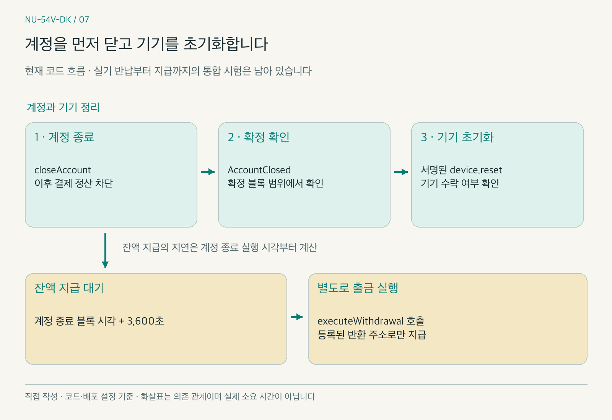
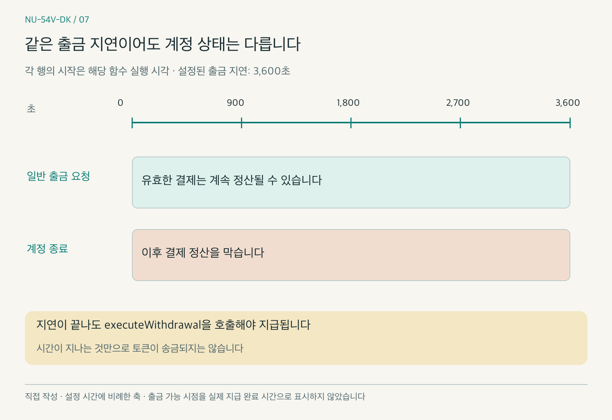
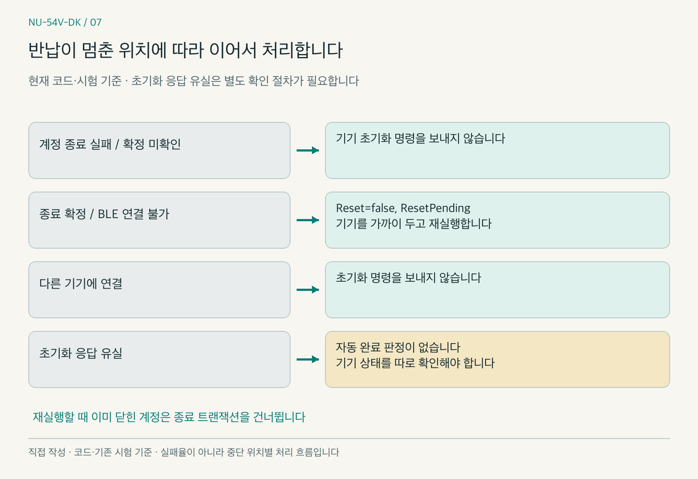

# [NU-54V-DK 07] 결제 기기를 반납하면 남은 잔액은 어떻게 돌려줄까

계정 종료, 기기 초기화, 잔액 지급을 나누고 중간에 끊긴 반납을 이어 가는 코드를 살펴봅니다

> 스테이블코인 결제 기기 제작기 07 · 이전 글: [페어링 없는 결제 요청을 어떻게 보호할까](https://medium.com/p/47fb51c55155)

여행자가 결제 기기를 반납하면 남은 잔액도 돌려받아야 합니다. 기기를 초기화해 다음 사람에게 건네면 끝날 것 같지만, 잔액은 보드가 아니라 정산 컨트랙트에 있습니다. 기기의 정보와 체인의 계정을 함께 정리해야 합니다.

키를 지워도 이미 기기 밖으로 나간 결제 서명은 사라지지 않습니다. 반대로 계정만 닫고 기기를 그대로 두면 이전 대여자의 설정이 남습니다. 어느 쪽을 먼저 처리하고, 도중에 연결이 끊기면 어디서 이어 갈지 정해야 했습니다.

저희 팀은 계정 종료를 확정한 뒤 기기를 초기화하도록 했습니다. 잔액 지급은 별도 단계입니다. 현재 배포 기록의 출금 지연은 3,600초이며, 시간이 지난 뒤 출금 실행을 호출해야 합니다.

이번 글에서는 Go 운영 도구와 Solidity 컨트랙트의 반납 코드를 살펴보겠습니다. 테스트넷과 시험용 토큰을 쓰는 개념 증명(Proof of Concept, PoC)이며, 실제 기록과 코드 시험을 구분해 아직 연결하지 못한 부분도 정리합니다.



*그림 1. 현재 반납 코드와 컨트랙트를 바탕으로 직접 작성했습니다. 계정 종료, 기기 초기화, 잔액 지급은 각각 확인할 단계입니다. 출금 지연은 계정 종료가 실행된 블록 시각부터 계산합니다.*

### INDEX

1. 초기화보다 계정 종료가 먼저인 이유
2. 계정 종료와 일반 출금 요청은 다릅니다
3. 계정 종료가 확정될 때까지 초기화를 미룹니다
4. 기기가 없으면 끝난 단계는 남겨 둡니다
5. 지연 출금은 자동 송금이 아닙니다
6. 확인한 결과와 아직 이어야 할 부분

## 1. 초기화보다 계정 종료가 먼저인 이유

기기는 결제 요청에 서명하고, 정산 컨트랙트는 그 서명을 받아 잔액을 옮깁니다. 기기에서 키를 지워도 키오스크가 이미 받은 서명까지 회수할 수는 없습니다. 따라서 반납 뒤 결제를 막으려면 체인 쪽에서도 계정을 닫아야 합니다.

`closeAccount()`는 종료 시각을 기록하고 전체 잔액을 출금 대기로 잡습니다. 이후 정산에서 서명자 계정을 검사할 때 종료된 계정이면 `AccountInactive`로 거절합니다. 종료 전에 받은 서명도 종료 뒤에는 정산되지 않습니다. 같은 계정에 추가 입금하거나 한도를 바꾸는 것도 막습니다.

`return.go`는 아직 닫히지 않은 계정에만 종료를 요청합니다.

```go
if acct.ClosedAt == 0 {
	progress("closing the account")
	if res.CloseTx, err = chain.CloseAccount(ctx, p.Device); err != nil {
		return res, fmt.Errorf("closeAccount failed, no reset sent: %w", err)
	}
}
```

계정 종료가 실패하면 기기에 초기화 명령을 보내지 않습니다. 이미 닫힌 계정이라면 닫기를 건너뛰고 뒤의 확정 확인부터 진행합니다. 재실행할 때 같은 트랜잭션을 무조건 다시 보내지 않도록 한 부분입니다.

## 2. 계정 종료와 일반 출금 요청은 다릅니다

일반 출금 요청인 `requestWithdrawal()`도 지연 뒤 잔액을 내보냅니다. 그러나 계정을 비활성화하지는 않습니다. 요청한 금액을 기록할 뿐 잔액을 바로 떼어 놓지 않아, 대기 중에도 유효한 결제가 정산될 수 있습니다.

| 동작 | 일반 출금 요청 | 계정 종료 |
|---|---|---|
| 이후 결제 정산 | 계정이 활성 상태면 가능 | 종료된 계정은 거절 |
| 지연 중 취소 | 운영자가 취소 가능 | 닫힌 계정의 출금은 취소 불가 |
| 지급 금액 | 요청액과 실행 시 잔액 중 작은 값 | 종료할 때 전체 잔액을 대기 금액으로 기록 |

둘을 구분하지 않으면 반납 처리 대신 출금만 요청하고, 기기가 계속 결제할 수 있는 상태를 남길 수 있습니다. 반대로 잘못 닫은 계정을 `cancelWithdrawal()`로 되살릴 수도 없습니다. 현재 컨트랙트에는 닫힌 계정을 다시 여는 경로가 없습니다.



*그림 2. 배포 기록과 컨트랙트를 바탕으로 직접 작성했습니다. 가로축은 설정된 3,600초 지연에 비례합니다. 지연 종료는 출금할 수 있는 시점이며 자동 송금 시점이 아닙니다. 실제 지급 완료 시간을 측정한 그림도 아닙니다.*

## 3. 계정 종료가 확정될 때까지 초기화를 미룹니다

트랜잭션을 전송했다는 사실만으로 기기를 지우지는 않습니다. 체인 호출 코드는 실행 영수증(transaction receipt)을 기다리고 성공 여부를 확인합니다. 그다음 반납 코드가 대상 기기의 `AccountClosed` 이벤트를 확정 블록(finalized block) 범위에서 찾습니다.[1]

이벤트 조회의 끝 블록을 노드의 `finalized` 블록으로 제한합니다. 원격 호출(Remote Procedure Call, RPC)의 기본 읽기 설정도 `finalized`입니다. 로컬 시험용 `latest` 설정을 실기 검증과 혼동해서는 안 됩니다.

기본 대기 한도는 60초이고 2초마다 다시 확인합니다. 이는 운영 도구가 이번 시도를 기다리는 한도이지 체인이 반드시 60초 안에 확정된다는 보장은 아닙니다. 시간이 지나도 이벤트가 없으면 초기화를 보내지 않고 다시 실행하라는 오류로 끝납니다.

기기 쪽은 운영자 서명과 명령의 대상이 자기 자신인지를 검사합니다. `AccountClosed`를 직접 조회하는 코드는 없습니다. 따라서 **계정 종료 확정 → 초기화**라는 순서는 현재 운영 도구가 지킵니다. 운영자 서명이 있다는 사실만으로 기기가 체인의 종료까지 확인했다고 설명할 수는 없습니다.

## 4. 기기가 없으면 끝난 단계는 남겨 둡니다

계정을 닫은 뒤 저전력 블루투스(Bluetooth Low Energy, BLE) 연결이 실패할 수 있습니다. 반납 코드는 이때 계정 종료를 되돌리거나 반납 전체를 성공으로 표시하지 않습니다. `Reset`은 거짓으로 두고 `ResetPending`에 기기를 가져와 다시 실행하라는 이유를 남깁니다.

연결이 됐어도 다른 기기를 지우면 안 됩니다. `return.go`는 연결한 기기의 식별값을 요청한 대상과 대조합니다.

```go
if got := s.DeviceAddress(); !strings.EqualFold(got, p.Device.Hex()) {
	return res, fmt.Errorf("the connected device is %q, not %s: no reset sent", got, p.Device.Hex())
}
```

다시 실행하면 닫힌 계정인지 읽고, 기존 종료 이벤트를 확인한 뒤 초기화를 이어 갑니다. 요청 전 대상 대조와 기기 내부의 대상·서명 검사를 모두 둡니다.

초기화 응답을 받지 못한 경우는 더 조심해야 합니다. 연결 불가와 달리, 명령은 처리됐는데 응답만 끊겼을 수도 있습니다. 현재 코드에는 이를 자동으로 판별해 반납 완료로 복구하는 흐름이 없습니다. 초기화 수락 여부와 재부팅 뒤 상태를 따로 확인할 절차가 필요합니다.



*그림 3. 반납 코드와 기존 시험을 바탕으로 직접 작성했습니다. 계정 종료 후 기기에 연결하지 못한 경우에는 초기화 대기를 남깁니다. 초기화 응답 유실의 자동 복구는 현재 완료된 기능으로 표시하지 않았습니다.*

## 5. 지연 출금은 자동 송금이 아닙니다

3,600초가 지나도 누군가 `executeWithdrawal()`을 호출해야 토큰이 이동합니다. 이 함수는 누구나 호출할 수 있지만 지급 주소를 인자로 받지 않습니다. 첫 입금 때 고정한 반환 주소(`withdrawAddress`)로만 지급합니다. 호출자가 운영자나 제삼자여도 자기 주소로 바꿀 수 없습니다.

실행 시 지급할 금액을 정한 다음의 코드입니다.

```solidity
acct.balance -= amount; // state first, then transfer
totalOwed -= amount;
acct.pendingWithdrawal = 0;
acct.withdrawAfter = 0;
emit WithdrawalExecuted(device, amount);
if (amount != 0) _push(acct.withdrawAddress, amount);
```

잔액과 대기 상태를 갱신한 뒤 외부 토큰을 호출합니다. 상태를 먼저 바꾸고 외부 호출을 뒤에 두는 검사·상태 변경·상호작용(Checks-Effects-Interactions) 순서입니다.[2] 토큰 호출이 실패하면 이 컨트랙트가 `revert`하므로, 이 실행에서 바꾼 상태와 이벤트도 되돌아갑니다.[3]

또한 이벤트 이름만으로 대여자가 토큰을 실제로 받았다고 단정하면 안 됩니다. 시험용 토큰에는 수신을 보류하는 기능도 있습니다. 반환 확인에는 출금 실행의 확정, 컨트랙트 잔액 변화, 받는 쪽 토큰 상태까지 연결해야 합니다.

## 6. 확인한 결과와 아직 이어야 할 부분

10월 3일 개발 기록에는 일회용 기기 계정에 1 tUSDC를 넣고 계정 종료와 확정을 확인한 결과가 있습니다. 기기가 없어 초기화는 보류됐고, 재실행하면 닫기를 건너뛰었습니다. 이 기록을 실제 기기 반납과 지급까지 끝낸 결과로 쓰지는 않습니다.

2026년 11월 9일에는 기존 반납 순서 Go 시험 4개와 출금·계정 종료 컨트랙트 시험 11개가 통과했습니다. 별도로 닫힌 계정의 정산을 금지하는 불변식(invariant) 시험도 64회, 총 12,800번의 핸들러 호출에서 통과했습니다. 호출 수는 결제 성공 횟수가 아닙니다.

Go 시험은 체인을 대체하고 정해 둔 기기 메시지를 재생합니다. 컨트랙트 시험은 로컬 가상 머신에서 시간을 이동합니다. 보드 초기화와 실제 지연 지급의 통합 시험을 대신하지 않습니다.

코드를 대조하니 운영 도구의 `withdraw request/cancel/execute`는 도움말에만 있고 명령 실행 표에는 없습니다. 컨트랙트의 출금 기능과 CLI의 완성을 구분해야 합니다. 가게 운영 대시보드도 이번 결과에 포함하지 않으며, 12주 뒤 이어서 만들 구상입니다.

06편과 연결할 일도 남았습니다. 현재 반납 도구는 평문 결제 모드로 세션을 열지만, 보안 채널을 요구하는 펌웨어 설정은 이를 거절합니다. 이 조합에서도 초기화를 마치려면 반납 도구의 연결 경로를 보완해야 합니다. 출금 명령 연결, 초기화 응답 유실 처리, 보드부터 지급 확인까지의 통합 시험을 다음 작업으로 남겼습니다.

## 마무리

반납에서는 계정을 닫는 것, 기기를 지우는 것, 잔액을 받는 것을 각각 확인해야 했습니다. 저희 팀은 먼저 계정 종료를 확정하고, 기기에 연결하지 못하면 완료한 단계를 남겨 다시 이어 가도록 했습니다. 다음 편에서는 폰에 표시한 결제 내용과 버튼 승인·거절이 실제 흐름에서 맞는지 살펴보겠습니다.

### 레퍼런스

- [1] [Ethereum — JSON-RPC API / Block parameter](https://ethereum.org/en/developers/docs/apis/json-rpc/)
- [2] [Solidity — Checks-Effects-Interactions](https://docs.soliditylang.org/en/v0.8.30/security-considerations.html#use-the-checks-effects-interactions-pattern)
- [3] [Solidity — Error handling](https://docs.soliditylang.org/en/v0.8.30/control-structures.html#error-handling-assert-require-revert-and-exceptions)

#NUCODE #누코드 #NU54VDK #누코더스 #Nucoders

---

## 발행 준비 메모 (Medium에는 올리지 않습니다)

- 2026-11-20 사용자 요청으로 한글·영문을 공개 발행했습니다. 태그 5개를 유지하고 두 판본 모두 **Notify your subscribers를 끈 상태로 발행**했습니다. 공개 페이지에서 제목과 언어별 그림·캡션 3개를 확인했습니다.
- 공개 링크: [한글판](https://medium.com/@bc.0x4861/nu-54v-dk-07-%EA%B2%B0%EC%A0%9C-%EA%B8%B0%EA%B8%B0%EB%A5%BC-%EB%B0%98%EB%82%A9%ED%95%98%EB%A9%B4-%EB%82%A8%EC%9D%80-%EC%9E%94%EC%95%A1%EC%9D%80-%EC%96%B4%EB%96%BB%EA%B2%8C-%EB%8F%8C%EB%A0%A4%EC%A4%84%EA%B9%8C-3a73bf020a2a), [영문판](https://medium.com/@bc.0x4861/nu-54v-dk-07-what-happens-to-the-remaining-balance-when-a-payment-device-is-returned-1aac2d2fe855).

- 작성·코드 대조·기존 시험 재실행: 2026-11-09.
- 2026-11-19 한글·영문 Medium 초안을 저장했습니다. 언어별 그림 3장·캡션 3개·코드 블록 3개·주제 5개를 확인했고, 본문을 로컬 원고와 대조했습니다. 공개·예약 발행과 구독자 메일 전송은 하지 않았습니다. 비공개 검토 링크와 확인 화면은 로컬 작업 자료에 보관합니다.
- Medium에서 표가 유실되지 않도록 2절의 비교 표를 같은 내용의 항목 3개로 옮겼습니다. 코드·수치·날짜와 미완료 범위는 그대로 유지했습니다.
- 이전 글은 공개된 06편의 해당 언어 링크입니다. 다음 08편은 미발행으로 예고만 넣었습니다.
- 출처·정확한 시험 명령·출력·실제 기록과 미실행 절차의 구분은 `07-source-notes.md`에 정리했습니다. 검토 전용이며 Medium에 올리지 않습니다.
- `withdrawalDelay=3600`은 레지스터·배포 기록·컨트랙트 시험 설정에서 확인했습니다. 초기화 확정 대기 60초와 출금 지연을 혼동하지 않습니다.
- 코드 3곳은 기존 소스의 연속 발췌이며 개인키 생성·보관·서명 내부 구현은 싣지 않았습니다. 실제 키·전체 주소·해시·계정·내부 절대 경로와 프로젝트 저장소 링크는 제외했습니다.
- 미완료 사항: CLI 출금 명령, 보안 채널 필수 펌웨어와 반납 연결 경로, 초기화 응답 유실 복구, 실기 반납부터 지급 확인까지의 통합 증거. 코드·설계의 일부를 전체 완료로 바꾸지 않습니다.
- Medium 초안에 주제 `NUCODE`, `누코드`, `NU54VDK`, `누코더스`, `Nucoders` 5개를 별도로 입력했습니다. **Notify your subscribers는 끈 상태로 2026-11-20 공개 발행했습니다.**

### 이미지 목록

| 번호 | 한글 파일 | 영문 파일 | 내용·출처 |
|---|---|---|---|
| 1 | assets/07/01-return-lifecycle.png | assets/07/01-return-lifecycle-en.png | 계정 종료·초기화·잔액 지급의 분리 · 현재 코드를 바탕으로 직접 작성 |
| 2 | assets/07/02-withdrawal-timeline.png | assets/07/02-withdrawal-timeline-en.png | 일반 출금과 계정 종료의 3,600초 시간축 · 설정과 코드를 바탕으로 직접 작성 |
| 3 | assets/07/03-return-recovery.png | assets/07/03-return-recovery-en.png | 중단 위치별 처리와 초기화 응답 유실의 한계 · 코드와 시험을 바탕으로 직접 작성 |

### 발행 전 확인

- [x] 한글·영문에 같은 사실·코드·수치와 해당 언어의 이전 편 링크를 넣었습니다.
- [x] 도입 4문단과 INDEX 6개 섹션, 언어별 그림·캡션 3개를 준비했습니다.
- [x] 코드 발췌를 대조하고 Go 시험 4개·컨트랙트 시험 11개·불변식 시험 1개를 실행했습니다.
- [x] 10/3 부분 실행 기록, 이번 로컬 시험, 실기 미검증 범위를 구분했습니다.
- [x] 민감정보와 저장소 링크를 제외하고 테스트넷 PoC 범위를 밝혔습니다.
- [x] 발행본에 출금 CLI·보안 채널 연결·실기 통합의 미완료 범위를 유지했으며 새 성공 결과를 추가하지 않았습니다.
- [x] 2026-11-19 Medium 초안의 본문·이미지·캡션·코드·태그를 확인했습니다.
- [x] 2026-11-20 두 판본의 발행 직전 구독자 메일 알림 해제 상태를 확인했습니다.
