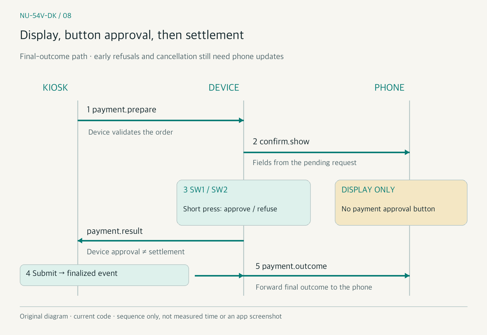
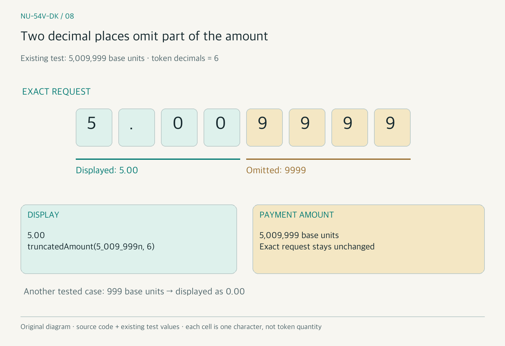
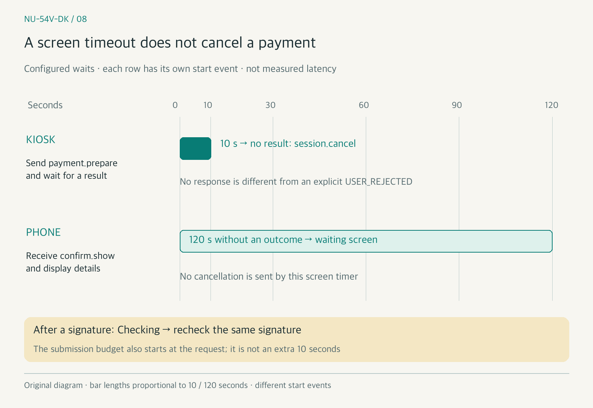

# [NU-54V-DK 08] How Does the Phone's Payment Display Connect to the Approval Button?

Following the code from the device's payment details to the phone display, button approval, refusal, and timeouts

> Building a stablecoin payment device, part 08 · Previous: [What Happens to the Remaining Balance When a Payment Device Is Returned?](https://medium.com/p/1aac2d2fe855)

The phone shows a shop name and an amount, and the traveler presses the board's approval button. Where did those displayed values come from? If the screen stays unchanged afterward, is it safe to pay again? Building a payment device without a screen meant answering these questions together.

Displaying the kiosk's order directly on the phone would be straightforward. But managing the phone's order separately from the one checked by the device could let them diverge. We made the device send the request it is holding for approval to the phone, and kept payment approval off the phone itself.

The kiosk currently waits up to 10 seconds for the button response by default. The phone returns to its waiting screen after 120 seconds without an outcome. These are different time limits: a visible confirmation screen does not mean the device is still waiting for the same request.

This article follows the display code and the handling of approval, refusal, and timeouts. It is a proof of concept (PoC) using a testnet and test tokens. We distinguish what code tests verify from what still needs to be checked with the phone and board together.



*Figure 1. Original diagram based on the current firmware, phone app, and kiosk code. Displaying payment details, approving on the button, and completing settlement are separate steps. This is a flow diagram, not an app screenshot.*

### INDEX

1. The phone displays what the device sends
2. What gets lost when amounts use two decimal places
3. Button approval and payment completion are separate steps
4. Separate the 10-second wait from the 120-second screen timeout
5. Results we misinterpreted during development
6. What the code tests cover and what remains for hardware

## 1. The phone displays what the device sends

After checking the merchant attestation and order, the device sends the merchant name, order identifier, token, payout address, and amount in `confirm.show`. In `nu54_session_pay.c`, the payment request `p` used to build the amount and order fields is also stored for approval.

```c
ss_emit(out, 1, e, 8);
d->pending_auth = p;
d->pending = NU54_PENDING_PAYMENT;
```

The phone's `confirmView()` builds display strings from that message. The merchant name comes from the attestation checked by the device; the phone does not fetch another amount directly from the kiosk. Token symbols and decimal counts, however, come from the app's token table.

The phone updates the screen only from a bonded link, whose stored connection information supports reconnection. When the device's `require_phone` setting is enabled, it rejects the request unless a connected, bonded phone is subscribed to notifications. This is not an acknowledgment that the phone actually rendered the screen. Holding a request for approval and having a person read it are different facts.

## 2. What gets lost when amounts use two decimal places

In `display.ts`, amounts stay in BigInt arithmetic rather than being converted to floating point. Integer division discards the fractional part.[1]

```typescript
export function truncatedAmount(baseUnits: bigint, decimals: number): string {
  if (decimals < 2) return baseUnits.toString();
  const cents = baseUnits / 10n ** BigInt(decimals - 2); // drops the third decimal and below
  return `${cents / 100n}.${(cents % 100n).toString().padStart(2, "0")}`;
}
```

The existing test value `5_009_999`, with six token decimals, displays as `5.00`. The actual request is for 5.009999. The display therefore does not overstate the amount, but it is not identical to it either. A small value of 999 even displays as `0.00`. That omission matters when explaining what the user confirms.

For tokens absent from the table, the app does not guess a symbol or decimal count. It shows the base-unit integer and token address with a warning. The current table contains the test token. Any change to the display policy should also decide how to disclose small amounts and omitted fractional digits.



*Figure 2. Original diagram based on `display.ts` and existing test values. Colored cells distinguish displayed and omitted digits; the code does not reduce the amount being signed. The same test includes 999 displaying as 0.00.*

## 3. Button approval and payment completion are separate steps

With the current board mapping, a short press on SW1 approves and a short press on SW2 refuses. Holding SW1 or SW2 does neither; the firmware logs an instruction to use a short press. SW2 refusal returns `USER_REJECTED`. The phone has no payment approval button.

An `approved` value in the device's `payment.result` means the device approval step has finished. The kiosk checks that result and then submits settlement. It decides final success by matching the device, amount, and nonce in a finalized `PaymentSettled` event. The event query uses the `finalized` block range.[2]

The kiosk then sends `payment.outcome`, which the device forwards to the phone. The phone's payment-complete label corresponds to this final outcome. The phone does not query the chain to verify finality itself, so the screen is not independent proof of settlement.

## 4. Separate the 10-second wait from the 120-second screen timeout

If no device result arrives within the default wait, `session.ts` sends `session.cancel`.

```typescript
const result = (await link.send(msg("payment.prepare", { authorization, merchantSignature }), 1, req.waitMs ?? WAIT_MS))[0];
if (!result) {
  await link.send(msg("session.cancel"), 0, 0);
  return { status: "cancelled", orderId };
}
```

A delayed settlement verdict after receiving a signature is different: the kiosk keeps `Checking` and rechecks using that same signature. Separating this from a timeout before receiving a signature helps avoid duplicate payments. The submission verdict's 10-second budget also starts at the same request's `requestedAt`; it does not grant a fresh 10 seconds after the button wait.

The phone's 120-second timer only restores the waiting screen. It sends no cancellation to the device. The current `pay()` also returns early on device refusal, cancellation before receiving a signature, and `Checking`, without sending `payment.outcome` to the phone on those paths. A missing result also does not prove that the device never produced a signature; the tests include a button press racing cancellation. The board can therefore refuse while the phone keeps showing the old details. Connecting these paths and showing cancellation and checking states clearly remains unfinished.



*Figure 3. Original diagram based on the current kiosk and phone constants. Bar lengths are proportional to 10 and 120 seconds, but each row starts at a different event. These are not measured delays, and the phone's screen reset is not shown as payment cancellation.*

## 5. Results we misinterpreted during development

The first physical-board run in which a person pressed the button ended with `device refused: undefined`. We had not distinguished an explicit device refusal from receiving no result. At the time, the error was changed to ask whether SW1 had been pressed briefly; the current code treats a missing result as cancellation. Assigning an invented refusal reason to silence makes diagnosis harder.

Forwarding the final outcome to the phone was also not there from the start. On October 2, the implementation replaced a comment deferring this work with actual `payment.outcome` forwarding, and tests checked that the same message leads to the phone's result screen. That does not mean all the early-return paths described above have been connected.

The phone currently attaches the previous amount and merchant details only when the result matches the order on screen. A result for another order still produces a result screen, without those details. The order comparison helps avoid attaching the wrong description; it does not discard stale results or manage several orders. Accepting only bonded links also cannot guarantee an honest display in a compromised phone app.

## 6. What the code tests cover and what remains for hardware

We reran existing tests on November 20, 2026. All 15 selected phone tests covering display, link handling, and the initial screen passed, as did 26 kiosk tests covering payment sessions, payment handling, and timing records. Two firmware test groups covering link classification and sessions passed; the session group contains 38 scenarios. The phone test run also warned that a worker had not exited gracefully and was force-exited.

The phone tests replace messages and native modules, while the kiosk tests use a software device. They do not verify the actual display and wireless connection together.[3] The October 5 board payment was performed without the phone confirmation screen. It is not evidence of a completed phone–board–kiosk flow.

The acceptance record also still marks 20 consecutive payments, each successful within 10 seconds of the request, as unexecuted. `timingRows()` selects only the latest 20 payments with a signature and final result. Twenty output rows alone therefore do not prove 20 consecutive successes. Attempts cancelled before receiving a signature must be recorded separately as well.

## Closing

We connected the phone display to the request checked by the device and kept approval on the board's button. Following the code also exposed omitted fractional digits, different time limits, and paths where the final outcome does not reach the phone. The remaining integrated tests need to tie the screen, button, and settlement records to the same order. The final article will review what we actually verified and what remains unfinished.

### References

- [1] [ECMAScript — BigInt::divide](https://tc39.es/ecma262/multipage/ecmascript-data-types-and-values.html#sec-numeric-types-bigint-divide)
- [2] [Ethereum — JSON-RPC API / Block parameter](https://ethereum.org/en/developers/docs/apis/json-rpc/)
- [3] [React Native — Testing overview](https://reactnative.dev/docs/testing-overview)

#NUCODE #누코드 #NU54VDK #누코더스 #Nucoders

---

## Publication preparation notes (not for Medium)

- Written, checked against source, retested, and saved as Korean and English Medium drafts on 2026-11-20. Neither edition was published or scheduled, and no subscriber email was sent.
- Matched the full body and three code blocks against the local manuscripts; verified three loaded images with captions and all five topics per edition. Private review links and screenshots are kept in local working records.
- The previous link points to the published English part 07. Part 09 is introduced without a link because it is unpublished. Reveal the project repository only in that final article.
- Source, history, and test evidence are in `08-source-notes.md`. Neither this section nor that file belongs in Medium.
- These original diagrams explain code flow and numerical relationships. They are not fabricated app UI or app screenshots.
- Topics: `NUCODE`, `누코드`, `NU54VDK`, `누코더스`, `Nucoders`. All five have been entered in Medium, and subscriber email notifications are off.

### Images

| No. | Korean asset | English asset | Content and source |
|---|---|---|---|
| 1 | assets/08/01-display-and-approval.png | assets/08/01-display-and-approval-en.png | Display, button approval, settlement outcome; original diagram based on current code |
| 2 | assets/08/02-amount-precision.png | assets/08/02-amount-precision-en.png | Displayed and omitted decimal places; original diagram based on code and existing test values |
| 3 | assets/08/03-timeout-boundaries.png | assets/08/03-timeout-boundaries-en.png | Proportional 10- and 120-second timelines; original diagram based on current constants |

### Before publication

- [x] Matched facts, code, numbers, and language-specific previous links.
- [x] Distinguished executed code tests from unexecuted hardware and consecutive-payment acceptance conditions.
- [x] Excluded actual keys, full addresses, hashes, account names, internal paths, and project repository links from the body and diagrams.
- [x] Verified three diagrams, captions, and the index in each language.
- [x] Verified text, code, images, and topics in both Medium drafts.
- [x] Subscriber email notifications are off for both drafts; recheck immediately before any future authorized publication.
