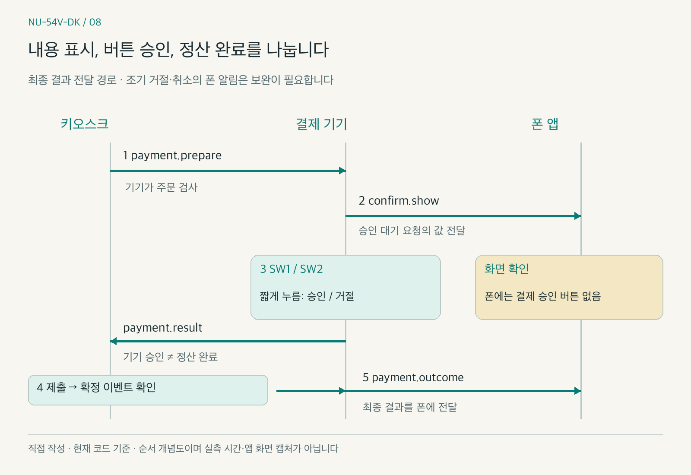
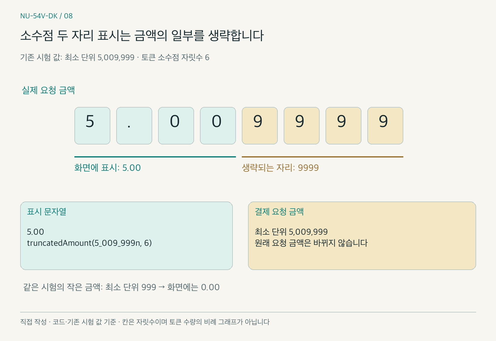
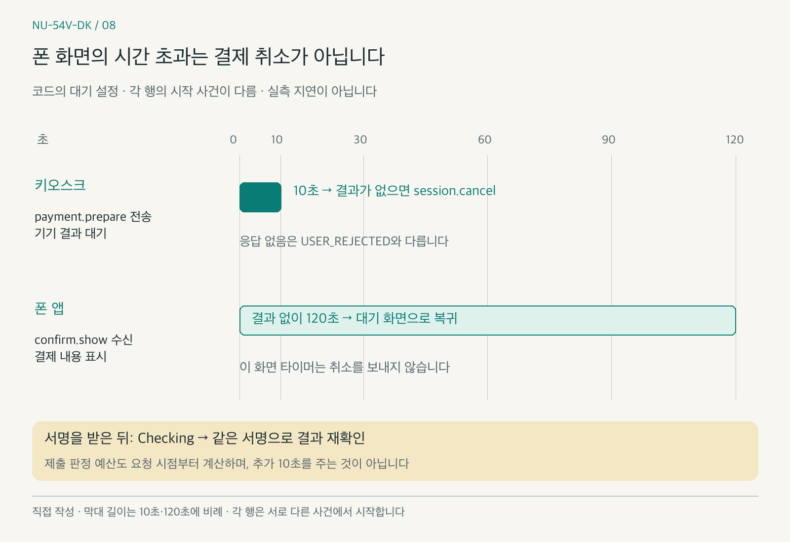

# [NU-54V-DK 08] 폰에 뜬 결제 내용과 승인 버튼은 어떻게 연결될까

기기가 보낸 금액을 폰에 표시하고, 버튼 승인·거절과 시간 초과가 화면에 어떻게 이어지는지 코드로 살펴봅니다

> 스테이블코인 결제 기기 제작기 08 · 이전 글: [결제 기기를 반납하면 남은 잔액은 어떻게 돌려줄까](https://medium.com/p/3a73bf020a2a)

폰에 가게 이름과 금액이 뜨면 여행자는 보드의 승인 버튼을 누릅니다. 그런데 그 화면은 누가 보낸 값일까요? 버튼을 누른 뒤 화면이 그대로라면 결제를 다시 해도 될까요? 화면 없는 결제 기기를 만들면서 함께 정해야 했던 문제입니다.

키오스크가 보낸 주문을 폰에도 그대로 띄우면 간단합니다. 하지만 기기가 검사한 주문과 폰이 받은 주문을 따로 관리하면 둘이 달라질 수 있습니다. 저희 팀은 기기가 승인 대기로 잡은 요청을 폰으로 보내고, 폰에는 결제 승인 버튼을 두지 않았습니다.

현재 키오스크는 버튼 응답을 기본 10초 동안 기다립니다. 폰의 확인 화면은 결과를 받지 못하면 120초 뒤 대기 화면으로 돌아갑니다. 서로 다른 시간 제한이어서, 화면이 떠 있다는 이유만으로 기기도 여전히 같은 요청을 기다린다고 볼 수는 없습니다.

이번 글에서는 표시할 값을 만드는 코드와 승인·거절·시간 초과 처리를 살펴보겠습니다. 테스트넷과 시험용 토큰을 사용하는 개념 증명(Proof of Concept, PoC)입니다. 코드 시험으로 확인한 범위와 폰·보드 통합에서 아직 확인해야 할 부분을 나눠 설명합니다.



*그림 1. 현재 펌웨어·폰 앱·키오스크 코드를 바탕으로 직접 작성했습니다. 결제 내용 표시, 버튼 승인, 정산 완료는 서로 다른 단계입니다. 앱 화면 캡처가 아닌 흐름도입니다.*

### INDEX

1. 폰은 기기가 보낸 내용을 표시합니다
2. 소수점 두 자리로 줄이면 생기는 차이
3. 버튼 승인과 결제 완료는 다른 단계입니다
4. 10초 대기와 120초 화면 제한을 구분합니다
5. 개발 중 잘못 해석했던 결과들
6. 코드 시험으로 확인한 것과 실기에 남은 일

## 1. 폰은 기기가 보낸 내용을 표시합니다

기기는 가맹점 증명서와 주문을 검사한 뒤 `confirm.show`에 가맹점 이름, 주문 식별값, 토큰, 받는 주소, 금액을 담습니다. `nu54_session_pay.c`에서는 이 메시지의 금액·주문 값을 만든 결제 요청 `p`를 그대로 승인 대기에도 보관합니다.

```c
ss_emit(out, 1, e, 8);
d->pending_auth = p;
d->pending = NU54_PENDING_PAYMENT;
```

폰의 `confirmView()`는 이 메시지로 표시 문자열을 만듭니다. 가맹점 이름은 기기가 확인한 증명서에서 가져오며, 폰이 키오스크와 직접 통신해 금액을 덧붙이지 않습니다. 다만 토큰 기호와 소수점 자릿수는 앱의 토큰 표를 사용합니다.

폰 앱은 연결 정보를 저장해 재연결에 쓰는 본딩(bonding)이 된 링크에서 받은 메시지만 화면에 반영합니다. 기기의 `require_phone` 설정도 연결되어 본딩을 마치고 알림을 구독한 폰이 없으면 요청을 거절합니다. 이 검사는 폰이 실제로 화면을 그렸다는 확인 응답은 아닙니다. 승인 대기로 넘어갔다는 사실과 사람이 화면을 읽었다는 사실은 다릅니다.

## 2. 소수점 두 자리로 줄이면 생기는 차이

`display.ts`는 금액을 부동소수점으로 바꾸지 않고 큰 정수(BigInt)로 계산합니다. 정수 나눗셈은 소수 부분을 버립니다.[1]

```typescript
export function truncatedAmount(baseUnits: bigint, decimals: number): string {
  if (decimals < 2) return baseUnits.toString();
  const cents = baseUnits / 10n ** BigInt(decimals - 2); // drops the third decimal and below
  return `${cents / 100n}.${(cents % 100n).toString().padStart(2, "0")}`;
}
```

기존 시험의 `5_009_999`는 소수점 자릿수가 6일 때 `5.00`으로 표시됩니다. 실제 요청은 5.009999이므로, 표시액이 실제 금액보다 커지지는 않아도 둘이 완전히 같지는 않습니다. 999라는 작은 값도 `0.00`으로 보입니다. 금액 확인을 설명하면서 이 생략을 숨기면 안 됩니다.

토큰 표에 없는 토큰은 기호나 소수점 자릿수를 추측하지 않습니다. 정수 최소 단위(base unit)와 토큰 주소를 표시하고 경고합니다. 현재 앱의 표에는 시험용 토큰이 들어 있습니다. 표시 정책을 바꾼다면 작은 금액과 소수점 아래 나머지를 어떻게 알릴지도 함께 정해야 합니다.



*그림 2. `display.ts`와 기존 시험 값을 바탕으로 직접 작성했습니다. 색으로 구분한 칸은 표시하는 자리와 생략하는 자리이며, 서명할 금액 자체를 줄이는 연산이 아닙니다. 999가 0.00으로 표시되는 사례도 같은 시험에 있습니다.*

## 3. 버튼 승인과 결제 완료는 다른 단계입니다

현재 보드 배치에서 SW1을 짧게 누르면 승인하고 SW2를 짧게 누르면 거절합니다. 길게 누른 SW1·SW2는 승인·거절로 처리하지 않고 짧게 누르라는 로그를 남깁니다. SW2 거절은 `USER_REJECTED`로 응답합니다. 폰에는 승인 버튼이 없습니다.

기기의 `payment.result`에 있는 `approved`는 기기 쪽 승인이 끝났다는 뜻입니다. 키오스크는 그 결과를 확인한 뒤 정산을 제출합니다. 최종 성공은 확정된 `PaymentSettled` 이벤트의 기기·금액·일회용 번호(nonce)를 대조해 판정합니다. 이벤트 조회에는 `finalized` 블록 범위를 사용합니다.[2]

그 뒤 키오스크가 보내는 `payment.outcome`을 기기가 폰에 전달합니다. 폰의 ‘결제 완료’는 이 최종 결과에 대응합니다. 폰은 직접 체인을 조회해 확정을 검증하지 않으므로, 이 화면만으로 독립적인 정산 검증을 마쳤다고 설명할 수는 없습니다.

## 4. 10초 대기와 120초 화면 제한을 구분합니다

`session.ts`는 기본 대기 시간 안에 기기 결과가 없으면 세션 취소(`session.cancel`)를 보냅니다.

```typescript
const result = (await link.send(msg("payment.prepare", { authorization, merchantSignature }), 1, req.waitMs ?? WAIT_MS))[0];
if (!result) {
  await link.send(msg("session.cancel"), 0, 0);
  return { status: "cancelled", orderId };
}
```

서명을 이미 받은 뒤 정산 판정이 늦는 경우에는 `Checking`으로 남기고 같은 서명으로 다시 확인합니다. 서명을 받기 전의 시간 초과와 구분해야 중복 결제를 피할 수 있습니다. 제출 판정의 10초 예산도 같은 요청의 `requestedAt`부터 계산하므로, 버튼 대기 뒤 10초를 새로 더 주는 구조가 아닙니다.

폰의 120초 타이머는 화면을 대기로 돌릴 뿐 기기에 취소를 보내지 않습니다. 더구나 현재 `pay()`에는 기기 거절, 서명 수신 전 취소, `Checking`에서 먼저 반환해 폰에 `payment.outcome`을 보내지 않는 경로가 있습니다. 결과가 없다고 기기에 서명이 생기지 않았다고 단정할 수도 없습니다. 기존 시험에는 취소와 버튼 누름이 겹치는 경우도 있습니다. 보드에서 거절했는데 폰은 이전 내용을 계속 보여 줄 수 있습니다. 이 경로를 연결하고 취소·확인 중 상태를 분명히 보여 주는 일이 남았습니다.



*그림 3. 키오스크와 폰의 현재 상수를 바탕으로 직접 작성했습니다. 막대 길이는 10초와 120초에 비례하지만, 각 행의 시작 사건은 다릅니다. 실측 지연이 아니며 폰 화면 복귀를 결제 취소로 표시하지 않았습니다.*

## 5. 개발 중 잘못 해석했던 결과들

실제 보드에서 사람이 버튼을 누르던 첫 실행은 `device refused: undefined`로 끝났습니다. 기기가 거절한 경우와 결과를 받지 못한 경우를 구분하지 않았기 때문입니다. 당시에는 SW1을 짧게 눌렀는지 확인하라는 오류로 바꿨고, 현재 코드는 결과가 없는 요청을 취소로 처리합니다. 응답이 없다는 사실에 임의의 거절 사유를 붙이면 원인을 찾기 어렵습니다.

폰으로 최종 결과를 전달하는 연결도 처음부터 있지는 않았습니다. 10월 2일 변경에서는 ‘나중에 전달’로 남아 있던 자리에 실제 `payment.outcome` 전달을 넣고, 같은 메시지가 폰 시험에서도 결과 화면으로 이어지도록 확인했습니다. 다만 앞 절의 조기 반환 경로까지 모두 연결된 것은 아닙니다.

현재 폰은 화면의 주문과 결과의 주문이 같을 때만 기존 금액·가맹점 정보를 붙입니다. 다른 주문의 결과도 상세 정보 없이 결과 화면에는 표시합니다. 주문 식별값 비교는 이전 결제의 설명을 잘못 붙이는 일을 줄이지만, 오래된 결과를 아예 버리거나 여러 주문을 관리하는 기능은 아닙니다. 본딩된 연결만 받는 규칙도 변조된 폰 앱의 화면까지 보장하지는 않습니다.

## 6. 코드 시험으로 확인한 것과 실기에 남은 일

2026년 11월 20일 기존 시험을 다시 실행했습니다. 폰의 표시·링크·첫 화면 시험 15개, 키오스크의 결제 세션·결제 처리·시간 기록 시험 26개가 통과했습니다. 펌웨어에서는 링크 분류와 세션 시험 2개 묶음이 통과했고, 그중 세션 시험은 38개 시나리오입니다. 폰 시험에는 작업자가 정상 종료하지 않아 강제 종료됐다는 경고가 남았습니다.

폰 시험은 메시지와 네이티브 모듈을 대체하고, 키오스크 시험은 소프트웨어 기기를 사용합니다. 실제 화면 표시와 무선 연결까지 검증한 결과는 아닙니다.[3] 10월 5일 보드 결제 1건은 폰 확인 화면 없이 실행했습니다. 그 기록을 폰·보드·키오스크의 통합 성공으로 바꿔 쓰지 않습니다.

연속 20회, 요청부터 10초 안에 성공한다는 조건도 아직 수용 기록지에서는 미실행입니다. `timingRows()`는 서명을 받고 최종 결과가 있는 최근 20개만 뽑으므로, 출력이 20행이라는 사실만으로 연속 20회 성공을 입증할 수 없습니다. 서명을 받기 전에 취소된 시도까지 별도로 남겨야 합니다.

## 마무리

저희 팀은 기기가 검사한 요청을 폰으로 보내고 보드 버튼으로 승인하도록 연결했습니다. 코드를 따라가 보니 금액의 생략된 자리, 서로 다른 시간 제한, 최종 결과가 폰까지 도착하지 않는 경로도 함께 봐야 했습니다. 남은 통합 시험에서는 화면·버튼·정산 기록을 같은 주문으로 묶어 확인하겠습니다. 마지막 편에서는 실제로 확인한 결과와 끝내지 못한 작업을 정리하겠습니다.

### 레퍼런스

- [1] [ECMAScript — BigInt::divide](https://tc39.es/ecma262/multipage/ecmascript-data-types-and-values.html#sec-numeric-types-bigint-divide)
- [2] [Ethereum — JSON-RPC API / Block parameter](https://ethereum.org/en/developers/docs/apis/json-rpc/)
- [3] [React Native — Testing overview](https://reactnative.dev/docs/testing-overview)

#NUCODE #누코드 #NU54VDK #누코더스 #Nucoders

---

## 발행 준비 메모 (Medium에는 올리지 않습니다)

- 작성·코드 대조·기존 시험 재실행·Medium 초안 저장: 2026-11-20. 한글·영문 모두 초안으로 저장했으며 공개·예약 발행과 메일 전송은 하지 않았습니다.
- 두 초안의 본문·코드 3개를 로컬 원고와 대조했고, 언어별 이미지 3장의 로딩·캡션·태그를 확인했습니다. 비공개 검토 링크와 확인 화면은 로컬 작업 자료에 보관합니다.
- 이전 편 링크는 해당 언어의 공개된 07편입니다. 마지막 09편은 미발행으로 예고만 넣습니다. 프로젝트 저장소 링크는 마지막 편에서 공개합니다.
- 코드·기록·시험 근거는 `08-source-notes.md`에 정리합니다. 이 메모와 근거 파일은 Medium에 올리지 않습니다.
- 폰 앱 UI를 그린 가짜 화면은 사용하지 않습니다. 이번 그림은 코드 흐름과 수치의 관계를 설명하는 직접 작성 도식이며 앱 화면 캡처가 아닙니다.
- 주제: `NUCODE`, `누코드`, `NU54VDK`, `누코더스`, `Nucoders`. Medium에도 각각 입력했습니다. 구독자 메일 알림은 껐습니다.

### 이미지 목록

| 번호 | 한글 파일 | 영문 파일 | 내용·출처 |
|---|---|---|---|
| 1 | assets/08/01-display-and-approval.png | assets/08/01-display-and-approval-en.png | 표시·버튼 승인·정산 결과 · 현재 코드를 바탕으로 직접 작성 |
| 2 | assets/08/02-amount-precision.png | assets/08/02-amount-precision-en.png | 표시하는 소수 두 자리와 생략된 자리 · 코드와 기존 시험 값으로 직접 작성 |
| 3 | assets/08/03-timeout-boundaries.png | assets/08/03-timeout-boundaries-en.png | 10초·120초의 비례 시간축 · 현재 코드 상수로 직접 작성 |

### 발행 전 확인

- [x] 두 언어의 사실·코드·숫자와 이전 편 링크를 맞췄습니다.
- [x] 실행한 코드 시험과 미실행 실기·연속 결제 조건을 구분했습니다.
- [x] 실제 키·전체 주소·해시·계정·내부 경로와 저장소 링크를 본문·도식에서 제외했습니다.
- [x] 언어별 그림 3장과 캡션·INDEX를 최종 확인했습니다.
- [x] Medium 초안의 본문·코드·이미지·태그를 확인했습니다.
- [x] 두 초안의 구독자 메일 알림을 껐습니다. 향후 발행 요청 시 다시 확인합니다.
