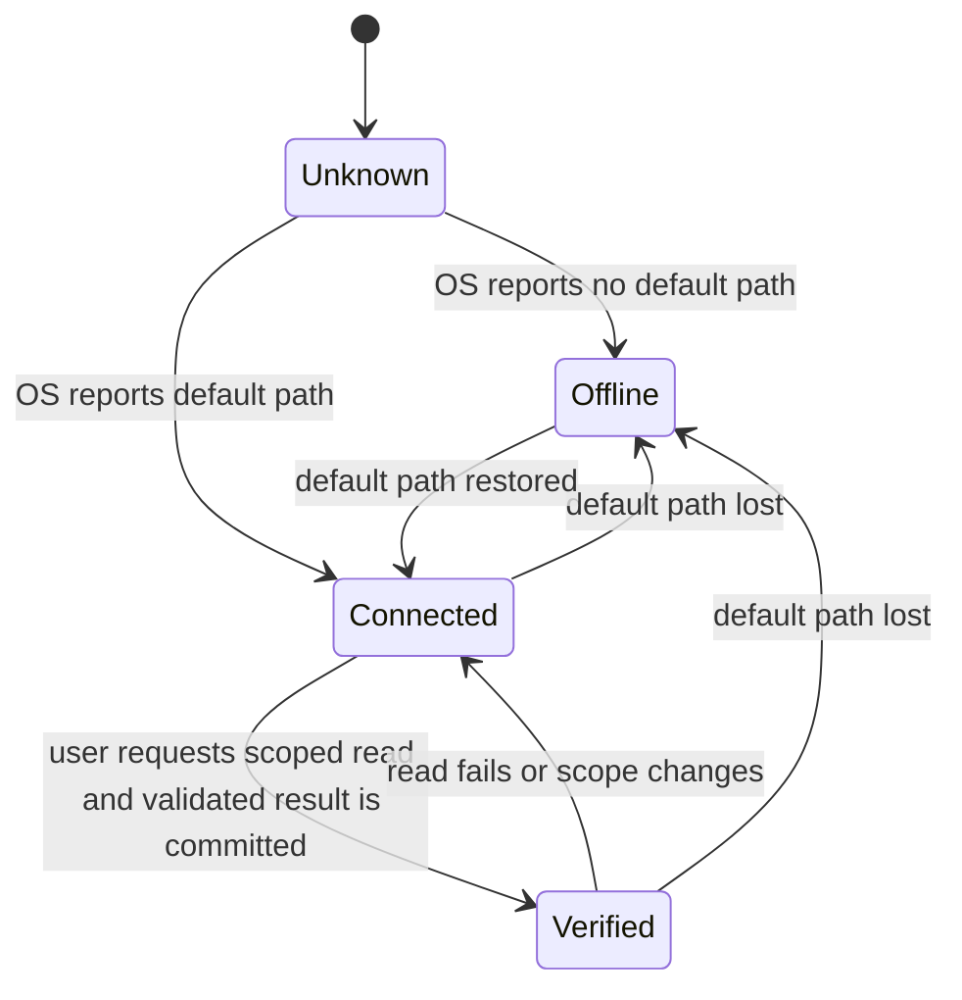

# 모바일 등록과 지갑 · 단계 06

[구현 계획](../../docs/content/commercial/implementation-plan.md) · [P02 기획](../../docs/content/commercial/products/p02-user-app/prd.md) · [화면 명세](../../docs/content/commercial/screens/specs/W.md) · [독립 복구 증거](../../packages/protocol/v2/recovery.md)

| 화면 | 동작 | 거절·중단 |
|---|---|---|
| W02 프로필·연습 | 신규 설치에서 개인 등록, 버튼 연습, 현재 OS가 지원하는 대여 진입점을 고른다. 기존 Android 대여는 기존 주소로 다시 진입하며 프로필 선택으로 돌아갈 수 있다. 연습은 한국어·영어와 기기 내 읽기 보조를 지원한다. | 연습은 BLE·송금·지급 승인 호출을 만들지 않는다. 보호된 개인 기록이 잠기면 새 대여로 자동 전환하지 않는다. |
| W04 개인 등록 | 발급자는 휴대전화의 공개키로 클라이언트 인증서를 발급한다. 사용자는 직접 설치할 때 보관한 기기 식별값과 별도로 신뢰하는 발급 기록의 보드 SPKI 지문을 앱에 입력한다. 앱이 BLE 위 TLS에서 보드와 상호 인증한다. 휴대전화 보호 키로 등록 챌린지에 서명하고 사용자가 보드 버튼으로 확인하면 보드가 새 소유 세대를 보고한다. | 디스플레이 없는 보드의 식별값을 광고에서 복사해 신뢰하지 않는다. 인증서·기기 신원·요청 ID·세대·만료가 일치해야 한다. 응답을 잃으면 다시 인증해 STATUS를 읽는다. |
| W05/W07 독립 복구와 첫 수신 | 두 번째 보드의 활성 소유 세션에서 복구 요청을 연다. 독립 복구 장치에서 동일 요청을 승인하고, 앱은 원본 보드·새 보드·복구 장치의 세 서명과 원래 계정/망/주소를 확인한다. 검증된 수신 주소는 보호 저장과 새 보드의 활성 소유 상태 확인 뒤 보인다. | 형식 2·프로필 1·첫 계정·StableNet 8283만 지원한다. 지원되지 않는 기기, 증거 미도착, 서명 또는 원래 계정 불일치, 세대 변경, 만료 또는 새 TLS 연결 뒤 재사용은 주소 노출을 차단한다. |
| W06 전화 분실 및 권한 철회 | 새 휴대전화에서 별도로 등록한 두 번째 보드의 신원으로 복구한다. 현재 설정된 폰의 철회는 보드에 물리 확인을 요청하고 세대 증가와 소유자 0으로 확인한다. | 통신을 잃으면 철회 상태 미확정으로 표시한다. 잃어버린 원본 보드가 같은 자산 키를 보존할 수 있으므로 원본 폐기·권한 회수는 복구 성공과 별도로 처리한다. 원래 보드를 보유했다면 별도 교체 흐름에서 등록한 독립 복구 장치와 보드 PIN을 사용한다. |

## 플랫폼과 신뢰

- Android BLE는 기존 본딩 대여 어댑터와 개인 기기 검색·연결을 구분한다. 개인 관리 세션은 Conscrypt TLS 1.3, 발급 CA와 보드의 단일 SPKI, 관리 ALPN 및 TLS exporter를 검증한다. Android Keystore의 하드웨어 비추출 P-256 키와 AES-GCM으로 암호화한 앱 전용 no-backup 기록을 사용한다.
- iOS는 `NU54Renter` 독립 타깃의 CoreBluetooth와 Network TLS 1.3을 사용한다. 관리 키는 Secure Enclave P-256에, 보호 기록은 ThisDeviceOnly Keychain에 둔다. Android 본딩이 필수인 기존 대여 경로는 등록에 사용한 Android에서 계속할 수 있다.
- 두 앱은 협상한 관리 ALPN 바이트를 TLS exporter의 컨텍스트로 사용해 P01과 같은 wire2 세션 값을 만든다.
- 지갑 자산 키·복구 단어·보드 PIN은 앱에 유입되지 않는다. 복구 검증자 등록서에는 공개 P-256 SPKI 세 개만 있고, 올바른 소스와 대상 기기 ID 및 원본 세대가 지정된다. 각각의 SPKI 지문은 별도 등록 기록에서 대조한다. 복구 증거가 해석되지 않거나 독립 확인이 없을 때 수신 주소와 고위험 동작을 잠근다. 실제 신규 결제 준비·중계는 단계 11에서 연결한다.

## 로컬 재현

```sh
pnpm --filter @nu54/p02-renter typecheck
pnpm --filter @nu54/p02-renter test --runInBand
bash products/p02-user-app/android/test_owner_tls.sh emulator-5558
make -C products/p02-user-app test-ios-owner-registration SIMULATOR_ID="$SIMULATOR_UUID" EVIDENCE_DIR=/private/tmp/nu54-w04
bash scripts/android/test_release.sh p02
python3 scripts/ios/release.py simulator custom /tmp/nu54-p02-ios --product p02
```

Android 시험은 배포 Kotlin 전송에서 P01 C 호스트와 TLS 1.3으로 상호 인증한다. 관리 ALPN exporter에서 나온 세션 값으로 STATUS를 한 번 받고, 변조된 세션 값과 잘못된 보드 지문이 거절되는지 확인한다. 에뮬레이터용 임시 인증서는 실물 Keystore 하드웨어 증거와 구분한다. 읽기 전용 Android 에뮬레이터의 200% 글자 크기에서 한국어 프로필과 영어 연습 안내의 접근성 역할·레이블을 확인했다.

iOS는 P02 CocoaPods lock과 공통 Ruby lock을 사용한다. 전용 W04 시뮬레이터 시험에서 앱은 임시 Keychain P-256 키로 P01 C 호스트와 상호 인증한다. 실물 CoreBluetooth, Secure Enclave 및 보드 PIN 입력은 현장 검수에 남아 있다. 공식 iOS 아카이브는 P02 별도 인증서·프로파일 등록을 요구한다. [공통 Ruby lock](../p04-merchant-kiosk/Gemfile.lock) · [W04 시험](../../scripts/ios/w0406-smoke/README.md#w04-owner-registration-and-interrupted-result)

W05 원본 백업은 개인 지갑 화면의 독립 백업에서 시작한다. 관리 명령 `[6]`의 공개 요청 번호만 확인하고, 원본 기기의 SW3 및 PIN과 독립 패널에서 사용자 권한을 확인한다. 새 보드 복원 시험 후 원본 기기의 최신 상태가 형식 2·프로필 1·백업 확인을 반환할 때만 완료로 표시한다.


W06 원래 보드 방식은 외부의 새 폰 인증서, 미리 등록한 독립 장치, 보드 PIN이 필요하다. 보드에서 SW3을 길게 누른 뒤 개인 지갑의 **원래 보드에서 분실한 휴대전화 교체**를 선택한다. 앱은 TLS로 조회한 지갑 주소와 소유 세대를 저장하고, 새 휴대전화의 보호 키로 보드 요청에 서명한다. 독립 장치에서 그 요청과 새 키 지문을 확인한 뒤 보드에서 SW1을 누르고 PIN을 입력한다. 결과가 끊겨도 앱은 보호 저장에 남긴 주소·이전 세대·새 키 지문을 읽고 다시 같은 보드에 연결한다. 새 소유 세대가 정확히 1 증가하고 주소가 동일할 때 완료로 표시한다. [원래 보드와 독립 복구 장치 명령](../p01-device-firmware/README.md#replace-a-lost-phone-without-replacing-the-board)


## 14A 개인 EVM 경로

개인 지갑의 **네트워크 및 자산 설정**에서 발급자가 준 서비스 주소와 접근 코드로 서명된 네트워크·자산 목록을 받아 원래 보드에서 검증한다. **EVM 수신**에서 등록된 Ethereum Sepolia, Base Sepolia 또는 StableNet을 고른다. RPC의 체인 ID와 서명된 창세 블록 해시를 맞춘 뒤 보드에서 활성 소유 세대와 복원된 HD 주소를 다시 읽는다. 보드 미연결 시에는 이전에 검증한 주소를 읽기 전용으로 표시한다.

**개인 전송**에서 등록한 네트워크와 자산을 고르고 수취인과 금액을 입력한다. 주소록은 네트워크별로 구분한다. 앱이 서명된 EIP-1559 전송 정책을 받아 입력과 정확히 일치하는지 확인한다. 보드, 독립 화면, 앱이 같은 수취인·자산·정수 금액·체인·수수료 견적을 확인한 뒤 보드에서 승인하고 PIN을 입력한다. 앱은 서명자 주소와 원래 바이트가 일치할 때만 서명을 보호 저장에 남긴다. 명시적으로 전송을 선택한 뒤에는 같은 해시로만 재조회한다. Base의 L1 및 운영자 수수료는 현재 블록에서 조회한 견적이며 최종 확정은 선택한 RPC가 반환하는 정규 블록과 finalized 높이에 근거한다.

**지급 기록 관리**에서는 독립 발급자가 서명한 최종 정산 증거를 원래 보드에서 적용한다. 미확정 결과는 유지한다. 처리 순서와 발급 도구는 [P01 런타임 설치 안내](../p01-device-firmware/README.md#reclaim-archived-payment-receipts)에 있다.

### 개인 지갑 DApp 브라우저

개인 지갑의 **DApp 둘러보기**에서 HTTPS 출처, 계정, 체인, 권한을 검토하고 현재 보드에서 계정을 확인한다. 계정과 체인 조회 권한은 10분간 유지된다. 다른 문서로 이동하거나 앱이 백그라운드로 전환되거나 사용자가 닫으면 현재 권한을 종료한다. iOS WKWebView와 Android WebView는 현재 최상위 문서에만 지갑 요청 통로를 제공한다.

로그인을 지원하는 운영자는 서명된 EVM 레지스트리의 `dapp`에 정확한 HTTPS `origin`, `chain`, `publicKey`를 지정한다. 공개 키는 등록된 개인 HD 주소의 압축되지 않은 secp256k1 점이다. 사이트에서 같은 HTTPS 출처의 RPC로 `nu54_siweChallenge`를 호출해 받은 메시지를 `personal_sign`에 그대로 전달한 뒤, 같은 RPC에서 `nu54_siweVerify`에 계정, nonce, 메시지와 서명을 제출한다. 로그인은 출처, 체인, nonce를 보여 주는 네이티브 확인과 독립 화면, 보드 PIN 및 물리 확인을 요구한다. 서버는 성공한 nonce를 다시 쓸 수 없도록 원자적으로 소비한다. 재시작 시 미처 처리하지 못한 nonce를 폐기한다.

선택해서 허용한 네이티브 자산 송금 요청에는 수취인, 금액, 수수료 확인과 보드 승인이 필요하다. 서명한 거래를 저장한 뒤 전송 의사를 따로 확인한다. 계약 호출이나 사용 권한 부여 요청은 거부한다. 사용 권한을 철회하려면 **온체인 토큰 권한**에서 등록된 토큰의 확정 한도를 조회하고 **토큰 사용 권한 철회 검토**를 누른다. 보드가 승인한 `approve(spender,0)`가 최종 블록에 포함되고 같은 네트워크의 최종 상태에서 `allowance(owner,spender)`가 0일 때 철회를 완료로 표시한다.

개발 시 P02 테스트에서 DApp 권한 범위를 검증한다. `test/dapp-browser/serve.mjs`는 임시 TLS 키와 인증서를 인자로 받아 127.0.0.1:8448에서 실제 브라우저로 EIP-1193 입구를 시험한다.


### 외부 WalletConnect v2

서명된 EVM 레지스트리의 `walletConnect.relay`에 운영자가 접속 권한을 가진 WSS IRN 릴레이를 등록한다. 해당 릴레이가 프로젝트 ID를 요구하면 `walletConnect.projectId`를 함께 등록한다. 연결 URI에서 릴레이 주소를 받지 않는다. 개인 지갑의 **외부 DApp 연결**에서 DApp의 `wc:` v2 주소를 입력한 뒤 기기에서 현재 개인 계정을 다시 확인하고 계정·체인·메서드·출처·기간을 검토한다. 출처 증명이 없는 상대는 사용자가 허용한 계정·체인 조회만 할 수 있다.

로그인과 송금이 필요한 운영자는 커미셔닝한 DApp의 실제 운영자를 인증하고 그 채널에서 받은 페어링 토픽과 X25519 공개키를 `walletconnect_peer.py`에서 승인한다. 출력된 짧은 수명의 증명을 운영자가 관리하는 파일에 원자적으로 교체하고 서비스에 `--wallet-peer-proof`로 지정한다. 앱은 보호된 지갑 서비스에서 현재 제안의 증명을 조회한다. 초기 시험에는 서명된 프로필의 `walletConnect.peer`도 사용할 수 있다. 앱은 보드에서 읽은 권한 공개키로 증명을 확인하고 제안의 출처·토픽·공개키와 정확히 비교한다. 송금은 사용자가 사이트에 허용한 뒤에도 매번 원문·금액·수수료를 검토하고 독립 화면과 보드에서 승인해야 한다. DApp에 반환하는 해시는 사용자가 별도로 전송을 확인한 거래에 해당한다.

만료, 전화 교체, 계정 변경, 사용자 및 상대의 연결 해제는 이전 권한을 제거한다. 앱이 백그라운드로 들어가면 전송을 중지한다. 다시 연결하려면 현재 보드가 필요하며 보호 저장의 세션 범위와 요청 식별자 기록을 이어 쓴다. 종료된 세션에 남긴 요청은 다시 승인하지 않는다.

`python3 products/p02-user-app/test/dapp-browser/wallet_connect_peer.py`는 별도 Python/OpenSSL DApp과 앱 모듈을 신뢰할 수 있는 임시 WSS 릴레이에 연결한다. 테스트는 외부 릴레이 계정이나 공개 체인을 사용하지 않는다. 이 앱은 공개 WalletConnect v2 IRN/Sign 규격으로 연결하며 Reown SDK를 포함하지 않는다.

별도 송금 시험은 `make build P=p01` 뒤 `python3 products/p02-user-app/test/dapp-browser/wallet_connect_spend.py`로 실행한다. 독립 WSS DApp, 앱의 권한·거래 검증 모듈, P01 승인 게이트웨이와 임시 Anvil을 연결한다.

iOS 설치 여정 시험은 동일한 앱 진입점에 별도 번들 식별자와 `BUNDLE_CONFIG`로 `test/dapp-browser/wallet-native.metro.config.js`를 지정한다. 해당 설정은 실물 보드 대신 시험용 광고 검색과 TLS 이후의 관리 프레임을 전달한다. 앱의 화면·WSS·발급자 HTTPS RPC·iOS 보호 저장·전화 키는 그대로 실행한다. 물리 표시와 전원 확인은 호스트 게이트웨이의 시험 대역이 수행한다. `wallet_connect_spend.py --native <cert.pem> <key.pem>`을 구동하고 127.0.0.1 SAN이 든 임시 인증서를 별도 시뮬레이터가 신뢰하게 한 뒤 `WalletConnectNative.swift`의 XCUITest를 실행한다. 정상 설치용 빌드에는 이 Metro 설정을 공급하지 않는다.

#### 공식 SignClient 상호운용 시험

QA 상대는 Apache-2.0이 동봉된 과거 배포본 @walletconnect/sign-client 2.21.8이다. QA 전용 디렉터리의 npm lock이 해당 tarball SHA-512 및 전이 패키지를 고정한다. 설치는 임시 캐시에서 lifecycle 스크립트 없이 실행한다. 실행 중에는 macOS 프로세스 격리로 루프백 외부 연결을 차단하며 앱 배포의 의존성은 바뀌지 않는다. 이 기록은 현재 Reown WalletKit 운영 라이선스나 운영 릴레이 사용을 승인하지 않는다. [공식 버전 아카이브](https://registry.npmjs.org/@walletconnect/sign-client/-/sign-client-2.21.8.tgz)

```sh
cmake --build products/p01-device-firmware/out/host --target test_device_evm
python3 products/p02-user-app/test/dapp-browser/test_reference_lock.py
python3 products/p02-user-app/test/dapp-browser/wallet_connect_reference.py
```

2.17.0 기록은 과거 상호운용 증거로 보관한다. 현재 시험은 2.21.8의 공식 tarball을 사용하는 동안 `elliptic`과 `@stablelib/ed25519`가 없는 의존성 그래프를 사용한다. npm overrides는 `decode-uri-component@0.5.1` 및 Viem의 `ws@8.21.0`을 고정한다. Node 22의 QA 어댑터가 `query-string@7.1.3`의 CommonJS 호출에 패치된 ESM 함수의 기본 내보내기를 전달한다. CI는 lock pin, 독립 `npm audit --audit-level=low`, 정상·잘린 인코딩 파싱을 확인한다. 이후 Community License에는 루프백 릴레이 사용에 적용되는 별도 조건이 있으므로 그 릴리스의 실행은 해당 조건 승인 범위에 속한다. [WalletConnect 라이선스 안내](https://docs.walletconnect.com/license-update)

Node 22.23.5와 Anvil 1.8.3으로 재현했다. 독립 SignClient의 연결·요청·연결 해제와 기존 P02 드라이버를 사용한다. 미확인 출처의 선택 송금 요청은 세션 권한에서 빠지고, 허용한 단일 계정·체인 조회만 가능하다. 연결한 지갑 프로세스를 다시 시작한 뒤 SDK가 원래 세션으로 조회한다. 독립 시험에서는 미승인 수취인을 거절하고 등록한 수취인의 9 wei 지급만 P01 호스트 코어에서 한 번 승인한다. Anvil이 확정 원장에서 수취액 증가를 확인한다. 연결 주소·토픽·인증 정보는 임시 프로세스와 보호된 시험 저장에만 사용하며 출력은 지급액·서명 수와 통과 상태로 제한한다.

iOS에서 같은 실제 상대를 시험하려면 기존 Metro QA 설정의 별도 앱 식별자에 com.nu54renter.walletconnect.reference를 사용한다. 별도 시뮬레이터에 루프백 인증서를 신뢰시켜 wallet_connect_reference.py --native cert.pem key.pem을 실행하고 WalletConnectNativeJourney/testInstalledWalletWithPinnedReferencePeer를 선택한다. 이 설치 시험에는 실제 [WalletConnect 화면](test/dapp-browser/WalletConnectNative.swift), iOS 보호 저장, HTTPS와 WSS를 사용한다. BLE 보드 전송과 물리 승인은 기존 호스트 시험 경계를 쓴다.

2026-11-21 iOS 27 설치 앱에서 2.21.8 공식 상대 두 개를 순차 실행했다. 미확인 상대는 조회만 수행했고, 등록 상대의 허가된 9 wei 건만 P01 호스트 코어의 단일 서명을 통해 격리 원장에서 확정됐다. 앱 재시작 뒤 공식 상대는 기존 세션으로 계정을 조회했고, 앱에서는 같은 원거래 해시와 확정 RPC 관측을 확인했다. [설치 시험 절차](test/dapp-browser/reference/README.md)

## Protected owner profile and transfer checkpoints

The normal owner wallet verifies the previous serialized record on every protected write. An existing v2 Android AES-GCM record and iOS Keychain item remain readable under their current key, associated data and storage identity. The next successful write uses the same atom. No legacy read resets the record or overwrites it on encountering malformed data.

Android serializes access to the protected file within the app process. It writes the authenticated record to an AtomicFile staging file and syncs it before replacing the committed record. It verifies the replacement by decrypting the committed bytes. Android AtomicFile recovers a legacy backup before decrypting it. iOS serializes access to one device-only Keychain item and verifies the item after its atomic update. Neither platform acknowledges a failed or mismatched write. A lost bridge completion counts as successful only when reloading returns exactly the intended record.

The hard profile limit is 32,768 UTF-8 bytes. Finalized balance observations are a replaceable cache with a separate 8,192-byte budget. When needed, the app trims the oldest observation entries first. Contacts, settings, owner identity and pending chain and WalletConnect data consume durable capacity and are retained. If they exceed the hard budget even with an empty balance cache, the update fails and the previous record remains available. A persisted pending approval leaves a further 8,192-byte margin for its exact signed transaction checkpoint.

Concurrent updates across independent sections rebase onto the latest protected record. Concurrent changes to the same section or stale funding updates after a competing funding write fail. A change in the verified owner makes previously signed EVM and non-EVM transfer checkpoints query-only. The exact raw bytes and transaction identifier stay in storage. WalletConnect remains bound to its currently verified owner and trust registry.

Before asking the board to sign, the phone persists the grant digest, board, owner generation and expiration. For a new EVM request it also persists the exact board request ID, unsigned transaction, signer, chain and genesis before sending that same request ID. One approval can be in flight across signing paths. An authenticated refusal releases the reservation; an unknown response retains it after restart and is never re-signed under a new ID. EVM request expiration or the board's time fence cannot invalidate a transaction already signed: neither clears an uncertain EVM request. A matching 8283 original or supported replacement may clear it only after the independently authorized finality evidence is accepted by the same board and the saved scope, request and original match. Older EVM records without that context and other chains remain held until an appropriate verified recovery path exists. Non-EVM expiry recovery retains its separate existing board-fence rules. The app atomically replaces a completed reservation with verified signed bytes and the transaction ID before enabling submission; a lost response or failed local write leaves the unsigned original and request ID available for reconciliation, but does not imply the signature can be re-created. Phone RPC observations never clear board reservations or delete the signed original.

The host regression suite models interruption before replacement, a committed update with a lost completion, conflicting writers, duplicate approvals and non-ASCII capacity boundaries. Android Kotlin and iOS Simulator builds also compile the native storage bridges. Physical power interruption during a hardware run requires separate acceptance.

## Receiving and Bitcoin public export

An authenticated board can confirm a deposit address through the public testnet receive view without contacting a chain RPC. Checking a balance is a separate action that identifies the HTTPS provider receiving the selected public address and asset. System share opens only after the user presses Share. The last observed balance can be displayed offline; the QR and share actions require a live board verification for the active account.

Bitcoin Signet uses a BIP321 `bitcoin:` URI with the network in the label. Native EVM uses an ERC-681 URI with the explicit chain ID. An EVM token card without an amount carries the contract and recipient as deposit instructions. Non-mainnet Solana cards carry the exact named cluster, public address and asset because an address alone cannot identify the cluster. XRPL cards carry the classic address, network, optional destination tag including zero, asset and XLS-5 X-address. QR and system share use the same network and address details. [BIP 321](https://bips.dev/321/) · [ERC-681](https://eips.ethereum.org/EIPS/eip-681) · [XLS-5](https://xls.xrpl.org/xls/XLS-0005-tagged-addresses.html)

The Bitcoin regtest watch-only action requires independent board approval. The phone verifies the first external and change addresses against separate authenticated board reads and exports the two BIP380-checksummed descriptors. The transfer uses the user-selected system share channel. The app does not hand xpub data to any balance provider. [BIP 380](https://bips.dev/380/)

The independent acceptance scripts use Node 22.23.5, ZXing-C++ 2.3.0 and Pillow 12.3.0. Run them from the repository root. The optional Bitcoin Core 32.1 check imports the watch descriptors into an isolated regtest node with external networking disabled.

```sh
node products/p02-user-app/test/receiveQrOracle.mjs |
  python3 products/p02-user-app/test/verify_receive_qr.py
node products/p02-user-app/test/receiveQrOracle.mjs --watch |
  python3 products/p02-user-app/test/verify_watch_export.py /path/to/bitcoin-32.1/bin
```

## W16 Signet watch-only export

Open the Bitcoin Signet account in account management and select the read-only export action. The scope screen identifies Native SegWit, the selected account index and both receiving and change branches. Sharing links past and future addresses in that account. Local scope consent is required before the authenticated board request. The independent display shows the same scope and the device can refuse the request. Cancellation prevents delivery to the share sheet and discards a late reply.

After approval the app checks the returned network and index and derives the first addresses for both branches. It independently reads both addresses and the fingerprint from the board. It saves one protected public receipt scoped to the verified board, owner generation and exact account. The dedicated read-only screen can reopen that receipt after restart and has no signing or sending entry. Sharing requires a separate system share action and contains the two canonical checksummed BIP380 `wpkh` descriptors only.

The isolated Core 32.1 check starts Signet with peer networking disabled. It imports the app's BIP84 receiving and change descriptors into a wallet with private keys disabled, restarts Core and verifies the exact freshly generated receiving and change addresses. Run `receiveQrOracle.mjs --watch --signet` through `verify_watch_export.py /path/to/bitcoin/bin --signet`.

The isolated iOS 27 run canceled before consent with zero exports, approved one synthetic board export, checked both branch addresses, canceled the native share sheet and reopened the stored pair after app restart. Core imported and restored the exact pair from this run. The approved reply is 80 bytes and its SHA-256 is `81c668c36e697a5e699f65e3645a5df350df4a2b9639bdf10b7e369fa8d170db`. The [native fixture and replay command](test/dapp-browser/reference/README.md) regenerate the synthetic reply.

```text
wpkh([5bf9f809/84h/1h/0h]tpubDCBVmvPqwyD5EZfHGe3Sz7ZjM822jrWC2npTFZre9NQKnaRtWz9BtqhXo1HQ4uwc9QcoPE7pD5ZpcQCTig5AMLREB9kQTkvc3rcNTKiKjVF/0/*)#9cj0hwlq
wpkh([5bf9f809/84h/1h/0h]tpubDCBVmvPqwyD5EZfHGe3Sz7ZjM822jrWC2npTFZre9NQKnaRtWz9BtqhXo1HQ4uwc9QcoPE7pD5ZpcQCTig5AMLREB9kQTkvc3rcNTKiKjVF/1/*)#5vhw2m0c
```

The commissioned custom ARM image compiled and passed its MCUboot signature and anti-rollback checks, using 380,128 of 712,560 application flash bytes and 172,980 bytes of RAM. The installed iOS fixture uses a host board substitute. Physical independent display and button approval remain hardware acceptance work. Legacy XRP account lookup and restore still use their original BIP44 indices 0–99 and the validated-ledger checks described above. Commissioned XRP uses indices 100–199 under the same seed, so a read observation from the original namespace is not a balance for the commissioned sender.

## W17 Signet 2-of-3 partial PSBT

The normal Bitcoin account opens its registered joint policy by exact network, account and three fingerprints. Unregistered material needs separate independent display and physical registration. The signed transfer grant binds the registered policy, original PSBTv2, exact prevouts, both input signatures when applicable, validated change path and fee cap. A user-supplied PSBT must match the grant byte for byte. Each accepted input requires the same registered policy and the same counterpart signing state. The phone derives all three public paths before labeling change and verifies that the returned PSBT only adds one valid signature to each input.

The app accepts bounded binary `.psbt` and canonical Base64 `.psbt` or `.txt` documents. On iOS and Android, the system picker also accepts a bounded PNG or JPEG containing one QR with the canonical Base64 text. The preflight limits are 1,780 bytes for the original PSBT and 1,998 bytes for the returned partial. Android uses the pinned Apache-2.0 [ZXing core 3.5.4 release](https://github.com/zxing/zxing/releases/tag/zxing-3.5.4), with a build-time SHA-256 check and bundled license and notices. Before opening board approval the app displays the original ID, each verified prevout and output script and amount, totals, the full registered internal change path, SIGHASH_ALL and the fee. Before the final signatures exist, the maximum native-SegWit signed vsize yields a conservative fee-rate lower bound, rounded down to two decimals in sat/vB. The separate reviewer requires a matching local BIP48 policy and uses a loopback Bitcoin Core instance to independently derive each input and change script before it can issue the display proof. Decline makes zero signing calls. The wallet durably reserves the approval before invoking the board. It keeps the unchanged original and signed partial in the owner-scoped protected record. After restart the user can reopen and share the exact partial or request status for its original transaction ID. This screen provides no broadcast action.

With the Signet approval fixture and disconnected Bitcoin Core regtest, the two-funded-input run validated the real prevouts, rejected duplicate inputs, foreign fingerprints and incomplete counterpart signatures, and independently combined the partials in both orders. A single partial could not finalize. In the installed iOS journey, the app displayed two unique prevouts, registered one policy, recorded zero signatures on decline, and exported one board partial covering both inputs. The separate Core signer combined that same partial and confirmed the original ID at six blocks. The restarted app reloaded and queried that exact ID. The isolated two-input fixture settles on disconnected regtest using Signet approval evidence. The iOS native reader test covers binary, Base64, QR decoding, oversize originals and mismatched formats. Both installed apps selected the same three supported formats through their system providers. Installed iOS runs also opened the exact two-input original through the system Files picker as binary PSBT, a Base64 text document and a single-QR image. Each approved one board operation and then requeried the same independently finalized original after restart. Opening another picker discards the prior import and review immediately. A cancellation or a late result after account, network or screen changes leaves approval unavailable. This evidence covers a host signer and a disconnected ledger.

W28 on iOS uses real independent ledger replies for the original-ID nonterminal state. Each commissioned local fixture restarts the app before that lookup, then requeries the same ID at finality with no second submit. The six built-in routes remain visible in the capability list, and missing registration disables that route before preview.

## W26 refused advanced requests

The wallet identifies a scoped ERC-721 `safeTransferFrom` selector or `multicall(bytes[])` in a live top-level browser or encrypted WalletConnect request for the current account and chain. A structured `wallet_sendCalls` request also returns a refusal. These paths never prepare an intent for the board, prompt to sign, or submit to a chain. The EVM parser refuses the same calls encoded through go-ethereum and creates no signed transaction. The Solana transfer entry identifies a bounded `DelegateStake` message in a grant only after verifying the registered chain, account and authority. It returns the Stake Program refusal and discards the transient review. The board's existing transfer parser also rejects the message before it calls the signer. The authority, wire schema and accepted capabilities remain scoped to existing independently reviewable methods. [ERC-721](https://eips.ethereum.org/EIPS/eip-721) · [Wallet Call API](https://eips.ethereum.org/EIPS/eip-5792) · [Solana core programs](https://solana.com/docs/core/programs/builtin-programs)

## Account catalog and read-network changes

W25 account names and visibility are scoped to the verified board, owner generation, built-in network and account index. Editing requires a freshly confirmed receiving account. The app keeps prior owners' saved rows but only renders rows in the current scope. ERC-20 preferences use the same scope plus the canonical contract address. The app verifies chain ID and genesis, then reads decimals at an exact finalized block before showing a review. This query contains the contract address and no owner address. Registration requires separate confirmation, and a previously registered precision mismatch blocks the wallet balance display. Token favorites and hiding are display preferences; they leave enrollment, grant policy and transaction checkpoints intact. An older selected token without verified metadata needs a review before the app offers a balance or receive QR. The encrypted catalog supports up to 12 named-account rows and 12 asset rows, alongside the existing protected-record and replaceable-cache limits.

W26 shows a capabilities table and requires separate confirmation before changing the active read network. Cancelling retains the previous profile. An RPC replacement is stored only after its pinned network identity matches. Pending approvals and transactions remain bound to their original network; the screen describes unsupported staking, ERC-721 and multicall without invoking a board or RPC. The capability table links public non-EVM observation and authority-registered review. The separate laboratory sender retains its own local signing profiles. Custom EVM remains read-only. This view does not expand board capabilities or merchant authorization.

W25 Bitcoin history recovery starts from a chosen account on the saved private watch-only node. The device and independent display approve the selected account’s public derivation scope once. The phone compares the first receiving and change addresses and master fingerprint with separate authenticated device replies. It holds the public root locally for the duration of the scan, verifies the Signet identity, and queries only the individual derived addresses on the receiving and change branches. The RPC endpoint, requests and diagnostics contain no extended public key. Each branch stops at 20 consecutive unused addresses and fails closed at its scan bound. The common start and end block hash must match. The result displays the two paths and last confirmed use on each branch. The receiving address remains in place until the user separately selects the next address, then verifies it with the board. Named or hidden accounts stay scoped to the same board, owner generation, profile and derivation index. Removing an alias leaves the hidden flag and spending records intact.

## Commissioned non-EVM testnet transfers

An enrolled authority can add `chainNetworks` to its signed N54G wallet registry. Each entry has `chain`, `profile`, `anchor` and `rpc`. Bitcoin Signet binds genesis and Bitcoin Core's default Signet block 321295. Solana Devnet binds the published genesis. XRPL Testnet binds network ID 1 and the validated hash and height 22470370. The installed app can open these routes from the matching enabled W26 profiles. The customer cannot edit the sending endpoint. Public address observation and laboratory transfers keep their existing routes.

The authority must provision a trusted HTTPS hostname with the route `/bitcoin`, `/solana` or `/xrpl`, the receiving client's N54G enrollment and a short expiry. Both native platforms use the system HTTPS trust store, reject redirects and constrain the token-bearing method to the matching route. The phone derives a route credential as lowercase hex HMAC-SHA256 using the decoded 32-byte enrollment credential and the UTF-8 bytes `N54P\n` followed by the exact canonical endpoint. The gateway accepts a mode-0600 JSON file with network keys `"1"`, `"2"`, `"3"` for configured nodes and values set to the SHA-256 of each lowercase derived credential as ASCII. Configure that file with `--commissioned-token-file`, set its scope expiry with `--commissioned-expires` and use a dedicated loopback node for every configured chain. Keep enrollment credentials, the derived credentials and gateway access logs in the service's protected boundary. The gateway validates a node's fixed network evidence before processing requests.

For the enrolled custom image, set `NU54_COMMISSIONED_WALLET_CHAINS=1` using the enrolled install authority and recovery accessory. Firmware binds the same anchor in the signed transfer grant (wire network 2). Existing trusted-time, independent display, physical approval and PIN checks still govern signature release. On submission the app first persists the original ID and marks the attempt. The gateway checks the stored grant, lease, expiry, canonical unsigned transaction and original transaction ID before it invokes the node. App restart uses that same stored ID and exact trusted route. This initial lane permits native BTC, SOL and XRP with optional destination tag. XRPL Testnet uses legacy transaction encoding for network ID 1. Its signed raw bytes carry no network ID, so the board derives separate hardened BIP44 accounts 100–199 for commissioned XRP, while legacy namespaces keep 0–99. A grant supplying the legacy sender fails the board key match. Fund only the commissioned receiving address shown when the send profile is selected. Standard external recovery must inspect BIP44 accounts 100–199 explicitly. Re-discover older XRP addresses by keeping the legacy account range 0–99. Both ranges remain deterministic from the same restored seed and share its compromise boundary. The send form accepts a canonical test X-address or its classic address. It retains embedded tag 0 and rejects wrong-network, malformed and conflicting tags before requesting a grant. The grant and gateway enforce routing for the installed app. Existing local advanced paths remain available in their respective laboratory configurations.

The commissioning tests use synthetic raw vectors and offline node replies. The non-RBF Bitcoin vector came from isolated Bitcoin Core regtest with six confirmations. The app and gateway tests use the same bytes with the commissioned Signet profile evidence and Signet presentation. The tests assert that a foreign identity, changed raw transaction or expired grant cannot submit. They exercise decline with zero submissions, a single approved submission after the protected attempt marker, and recreation of the screen from the persisted original ID. The [installed send QA fixture](test/dapp-browser/reference/README.md) uses an enrolled synthetic registry, test CA, native TLS and three isolated reference ledgers. It supplies published identity evidence through a local adapter. On the iOS 27 simulator each registered route refused once with zero signatures and submissions, then made one approved submission to its local reference ledger. Bitcoin Core regtest confirmed 1,000,000 satoshis at six blocks. Agave finalized 10,000,000 lamports. Standalone xrpld validated 5,000,000 drops with tag 0. After process restart each route reloaded and queried its original transaction ID. These runs do not exercise a deployed testnet gateway or send on public networks. Production onboarding still requires approved DNS and certificates, credential rotation, authenticated funding/indexing infrastructure with retained checkpoints, an approved firmware channel and operational acceptance. Custom Signet, unregistered RPCs, tokens and RBF remain outside this lane.

## Wallet home and settings

The owner home shows only the last observation whose stored scope matches the verified board fingerprint, owner generation, selected built-in network, account and asset. It labels the observation point and time and does not claim a live connection. Hidden balances are removed from the React accessibility tree. Personal-wallet screens that can contain sensitive content wait for native screen protection before rendering; iOS covers the scene synchronously on resignation and Android sets `FLAG_SECURE` and hides the accessibility tree while the protected activity is paused. Protection remains active in settings because device policy can contain sensitive amounts and addresses. It is released when navigating to practice, installation, cloud, wallet selection or another app area. The W01 fixture and simulator evidence are described in `scripts/ios/scene-smoke/fixtures/w01-home/README.md`; real Android and physical-device verification remain outstanding.

The first settings slice exposes OS screen-reader and reduced-motion status, opens device settings on request, persists the existing language preference, links to the non-signing practice and previews the exact minimal OS-version diagnostic before the user invokes the system share sheet. It reads existing subscription notification authorization without requesting permission and opens OS settings for changes. It links saved EVM and other-chain drafts to their original owner screens and store orders to their existing screen; an unresolved signing reservation remains tied to the original device. A locally stored expiry is shown as a deadline, never as proof of completion. Board policy changes and a unified pending-payment list are explicitly unavailable; it does not extend approval deadlines or change notification permissions itself.

## Offline home balances

The owner home derives its link indicator from the operating system's default network state on Android and Network framework path on iOS. This observation sends no network probe or wallet data. A restored link displays a separate request to verify the ledger. Only a freshly committed observation for the exact owner, account, asset, network and approved RPC, during the current link revision, can display a verified ledger indicator. The link indicator never grants spending authority.

On transport failure, the last confirmed observation remains available only under its original scope and acquisition time. Hidden or inactive balances retain their existing presentation semantics. Offline shows that spendable funds await verification. The app will not reauthorize automatic polling after a disconnect until the user requests a fresh network read. A late callback from a previous account, endpoint, owner, foreground session or link revision cannot replace the current cached result or mark the ledger newly verified.



W25 also registers classic SPL mints on Solana Devnet and issuer/currency pairs on XRPL Testnet. Solana checks the network, finalized slot, exact classic Token Program owner and binary mint layout before registering its precision. A separate balance request checks each returned token account against the verified mint and owner and sums exact integer units. XRPL registration verifies an active issuer on the pinned validated ledger. This does not establish an owner trust line. A requested balance checks the exact issuer, currency and owner against the verified ledger hash, and distinguishes an inactive account, a missing trust line, an exact zero and a negative amount. Registration only discloses the typed public mint or issuer. Account disclosures require the existing explicit refresh or foreground watch consent. The non-EVM catalog holds up to twelve scoped entries and opens no new signing or broadcasting methods. [Solana token-account API](https://solana.com/docs/rpc/http/gettokenaccountsbyowner) · [Solana account API](https://solana.com/docs/rpc/http/getaccountinfo) · [XRPL trust-line API](https://xrpl.org/docs/references/http-websocket-apis/public-api-methods/account-methods/account_lines)

An installed iOS 27 wallet exercised all six receive profiles across two runs using C1 host transport. Core Image decoded QR pixels and XCTest matched the visible receiving address, selected network and the XRP zero tag. The XRP test used the explicit numeric-keyboard dismissal and saved the tag before verifying the receive account. Each lane opened the real system sharing sheet. The separate receive tests compare the exact share payload. Firmware host derivation supplies the non-EVM public accounts while the simulator supplies the phone UI. [Native receive procedure](test/dapp-browser/reference/README.md)

### W26 custom network verification

The custom EVM editor begins a cancellable HTTPS chain-ID and genesis check. It shows the in-progress state while the system processes the request. Cancel and Back invalidate the active check before returning. An HTTPS request already in flight can finish, but its result cannot begin the next RPC or replace the saved profile. Once verification begins its protected save, the editor finishes that save with the existing atomic profile CAS. Android QA used a trusted loopback-only certificate and delayed the first RPC. Cancel skipped the second RPC and preserved the original endpoint through app restart. A new check with matching genesis saved the candidate across restart.

### W25 scoped asset search and example conversion

Search filters the locally registered assets within the selected owner, account and network. EVM search accepts a contract or known asset name, while SPL and XRPL search accepts their registered mint and currency or issuer. Results retain the registered units, associated confirmed observation and linked EVM transfer evidence when the original owner, network fingerprint and contract match. Favorite and hidden flags leave observations and the protected transaction record available after restart. The explicit hidden-assets view can open the same original transfer. General wallet surfaces keep hidden values out of view.

The example conversion uses the exact StableNet 8283 v1 TestUSDC contract and verified six-decimal units. It calculates KRW with integer arithmetic at the fixed training rate of 1,300 KRW per TestUSDC, rounded to the nearest won. The rate uses no external price service and only becomes available with an eligible finalized balance observation. It displays the rate source and reference time, and retains the original observation timestamp for offline review. Hidden or unmatched accounts and assets cannot produce a conversion.

### W01 public read-only reconnect check

`node --experimental-transform-types products/p02-user-app/test/w01ReadOnlyOracle.mjs --live` generates disposable receive addresses internally. It first reads each test network, reloads the scoped wallet observation during an injected transport outage, then uses the same production readers for a fresh observation after reconnect. It sends read-only methods to the six configured HTTPS providers and prints profile, latest point and result without addresses, keys or wallet state. The component tests separately exercise real app callbacks and the OS-link revision. This command exercises live ledger transport without a simulator or signing device. It injects the outage at the client transport boundary.

On 2026-11-21 the five active network profiles reported zero balances for the generated addresses. XRPL reported an inactive account anchored to validated ledger 22,477,138. Signet evidence used the known checkpoint and the indexed tip at 331,715. The cache and original timestamp survived the outage in all six cases, and reconnect required a fresh read before updating them. Provider freshness and uptime can change. [W01 oracle](test/w01ReadOnlyOracle.mjs)

## W28 transaction review and resumption

W26 routes to the exact selected approval profile. EVM requires a current signed registry for the selected chain. Public Bitcoin, Solana and XRPL observation is read-only. Sending requires a separate current signed profile for Signet, Devnet or XRPL Testnet, or the explicit local laboratory sender.

W28 shows the verified quote before the customer can request board approval. Bitcoin displays the input total, recipient, verified change address and path, fee and RBF eligibility. The fee rate is shown once the signed witness determines the transaction weight. Solana shows the instruction, fee payer, fee, blockhash and last valid height. XRPL shows the fee, issuer when applicable, destination tag including zero, sequence or ticket, and last valid ledger. EVM shows chain ID, genesis, nonce and execution fee ceiling. Base also shows its dedicated L1/operator estimate. Declining the quote makes no signing or submission call. A profile switch, background transition, authority mismatch or expired grant requires another review before signing. Pending transactions keep their original scope and identifier for requery.

The W28 tests exercise the normal React Native routes with synthetic receipt snapshots captured from disconnected Bitcoin Core 32.1 regtest, Agave 4.4.1 on loopback, pinned xrpld 3.3.0 standalone and three Anvil chain IDs. The app test uses a transport fixture for physical board input and checks returned native bytes against the reviewed grant. It declines before invoking the signer, accepts independently verified signed bytes, then reloads protected state and queries the exact original identifier. No mainnet or public testnet transaction was submitted.

```sh
pnpm --filter @nu54/p02-renter test --runInBand w28LocalWalletUi w28EvmResumeUi evmWalletUi
```

Before a Bitcoin first submission, the app queries the exact signed transaction ID. Bitcoin Core JSON-RPC 2.0 omits the result field when that ID is absent and returns error −5. The wallet accepts that method-specific absence as pending so the existing authority-time and durable-attempt checks can continue. It also accepts the older null-result error envelope. Other methods, mismatched response IDs and contradictory result/error envelopes fail closed.

The ordinary EVM approval host check issues each chain's quote through the P01 wallet authority and runs the production gateway's op 9 review, independent-display proof and completion against test-only board services. The gateway tests invalid, expired and replayed approvals and checks that only the authorized approval invokes its signer. Anvil validates the signed raw transaction and exact receipt hash and reports a 9 wei increase at finality on each of the three isolated chain IDs. The Base lane installs a fixed-return protocol fee predeploy solely in its disposable VM. This lane verifies the application's bound fee-oracle path and the ordinary signed wire independently of mainnet or public testnet, and does not establish Base rollup economics or installed six-chain UI acceptance.

```sh
cmake --build products/p01-device-firmware/out/host --target test_device_evm
python3 products/p02-user-app/test/dapp-browser/w28DirectOracle.py
```

### W05 첫 주소 재개

원본 보드가 독립 장치의 복원 시험과 서명을 확인한 뒤 앱이 관리 세션에서 주소를 읽는다. 주소 응답의 소유자·세대·보드와 백업 상태가 일치해야 보호 프로필이 갱신된다. 저장 전에 앱을 닫았다면 같은 보드의 **등록 상태 확인**에서 다시 읽는다. [격리 iOS와 독립 장치 시험](../../scripts/ios/w0406-smoke/README.md#w05-independent-backup-and-the-first-address)

새 휴대전화에 이전 앱 메타데이터가 없어도, 교체 직전에 보호 저장한 원주소와 기기의 새 소유 세대·주소가 일치하면 확인된 주소를 저장한다. 별도 독립 장치 서명과 보드 승인으로 세대가 바뀌지 않았으면 이전 소유자가 유지됐음을 표시한다. [W06 교체 시험](../../scripts/ios/w0406-smoke/README.md#w06-lost-phone-and-the-retained-address)


The installed iOS ordinary-send journey was exercised against the live isolated Bitcoin, Solana and XRPL ledgers on 2026-11-21. Each lane began with explicit refusal, observed zero signatures and submissions, then requested a fresh review before approving. The app resumed the original identifier from platform-protected storage after process restart. Bitcoin Core regtest confirmed 1,000,000 sat with six confirmations, Agave finalized 10,000,000 lamports, and standalone xrpld validated delivery of 5,000,000 drops with DestinationTag 0. Each lane used one portable P01 host signature and one node submission. The test uses a substitute for BLE and the physical device approval interaction. [Installed send steps](test/dapp-browser/reference/README.md)


### W15 · 사이트 연결과 온체인 권한

개인 지갑의 **온체인 토큰 권한**은 WalletConnect와 DApp 화면에서도 열 수 있다.
등록 계정에서 네트워크·토큰 계약·권한 대상 주소를 선택하면 검증된
체인 ID와 제네시스의 `finalized` 블록에서 사용 한도를 조회한다.
사이트 연결 해제는 그 연결의 새 요청을 막고, 토큰 계약의 사용 한도를 유지한다.

철회 검토에서 계정, 체인, 토큰 계약, 전체 권한 대상 주소, 변경 전 한도에서
0으로의 변경, 수수료 상한을 확인한다. 한도가 검토 뒤 변경되면 다시 검토해야 한다.
취소하면 보드 서명과 제출은 발생하지 않는다. 보드가 승인한 철회 원문과 해시를
보호 저장소에 기록하고, 이후 사용자가 별도로 제출한다. 재시작 뒤 **같은 철회 거래 조회**로
원해시의 확정 영수증과 체인의 현재 확정 한도를 확인한다. 철회 진행 화면에서
확정 한도 0은 성공 영수증과 사용 한도 0을 함께 확인한 뒤 표시한다.
앱이 비활성화되거나 권한 화면을 벗어나면 진행 중인 조회·검토 결과를 폐기한다.
보드 정산은 별도이며 영수증 확인 뒤에도 원래 서명을 보관한다.
사이트 입력은 조회 대상과 0 철회에 한정한다. 양수 권한 부여는 별도 인수 항목이다.

`jest --runInBand test/w15AllowanceUi.test.tsx test/walletConnectPolicy.test.ts`는
등록된 합성 계정과 모의 보드·RPC로 기본 지갑 렌더링, 취소, 보호 저장, 재시작과
영수증 분기를 검증한다. P01의 `test_revoke_anvil.py`는 일회용 Anvil과 C 검증 경로에서
수량 42의 사용 한도를 0으로 철회하는 거래를 실행한다.

### W14 · 등록 사이트의 사용 한도 요청

현재 사이트의 송금 경로는 네이티브 자산만 처리한다. 브라우저와 WalletConnect는
양수 또는 최대값을 담은 ERC-20 `approve`를 송금 요청으로 받지 않는다.
SIWE는 등록 출처에 대한 메시지 서명이며, 송금이나 사용 한도 변경을 제출하지 않는다.

보드의 EIP-1559 파서는 토큰 계약, 정확한 권한 대상과 유한한 정책 상한을 공급받는
경우에만 양수 `approve`를 별도 작업으로 해석할 수 있다. 호스트 교차 검증은
Sepolia, Base Sepolia, StableNet Testnet에서 geth 해시와 서명 원문을 대조한다.
설치판에서 해당 작업을 허용하려면 등록 사이트, 살아 있는 세션, 계정과 보드 세대,
체인·제네시스, 토큰, 권한 대상, 상한, 수수료와 기한을 묶은 승인 경로가 필요하다.
같은 자료를 독립 화면에서 확인하고 보드 승인을 받아야 한다. W15의 추적은
원해시의 성공 영수증과 확정 사용 한도 재조회가 일치할 때 변경 완료를 표시해야 한다.

## 내 결제와 기존 거래 조회

**내 결제**는 현재 등록 지점의 원주문과 구독 회차를 읽는다. **여행 예약**에서는 같은 등록 지점의 기존 예약을 열고, 예약금과 잔금의 원영수증을 각각 조회한다. 주문 링크는 현재 조회 자격과 링크 기한을 확인한 뒤에만 주문 내용을 표시한다. 매장 QR 대조가 필요한 사용자는 연결을 직접 선택한다.

여행 지급 검토는 P05에 저장된 원예약의 정책 버전과 가격 버전, 취소 기한과 노쇼 조건, 네트워크, 총액과 단계별 지급액을 보여 준다. 이전 예약에 남아 있지 않은 조건은 기록 없음으로 표시한다. 예약금과 잔금은 각 원주문을 열고 따로 견적을 요청하며, 확정 전에는 같은 원주문의 마지막 조회 상태를 표시한다. 주소 전체 보기에서 현재 서명 견적의 전체 수취 주소와 이번 지급액을 확인하고 같은 견적으로 돌아온다. 이 화면은 견적을 새로 발행하거나 보드를 호출하지 않는다. 가맹점 릴레이가 수수료를 부담하고, 보드의 독립 표시 장치에서 실제 서명 견적의 전체 수취 주소와 네트워크, 금액을 대조한다.

구독 회차의 결제 검토는 C3 견적에 서명된 비공개 표시 자료에서 원청구서, 회차 날짜, 약관 버전과 보드에 넘기는 견적 원바이트를 대조한다. 독립 표시 장치는 자체 등록된 표시 키와 별도로 확인한 청구서·회차·약관으로 같은 자료를 확인한다. 견적 원문에서 가맹점, 지급자, 수취인, 네트워크, 자산, 금액을 읽고 기존 보드 챌린지에 서명한다. OS 알림은 해당 회차 조회만 연다. 보드 승인 뒤에도 사용자가 지급 요청을 제출해야 한다.

수취인 교체 회귀는 테스트 실행 시 새 합성 키를 생성하여 같은 견적의 수취 주소만 바꾸고 원본과 변경본을 모두 서명한다. 독립 표시는 등록된 수취 주소와 대조해 변경본을 거절하고, C 호스트는 원본 견적의 독립 표시 증명으로 변경본에 서명하지 않는다. P05 구독 통합 시험은 변경 수취인으로 계산한 견적 다이제스트에 원본 승인을 재사용해도 제출과 지급이 0건임을 확인한다.

```sh
cmake -S products/p01-device-firmware/test -B products/p01-device-firmware/out/host
cmake --build products/p01-device-firmware/out/host --target test_install
PYTHONPATH=packages/protocol/python NU54_RECIPIENT_TEST_BOARD="$PWD/products/p01-device-firmware/out/host/test_install" \
  python3 products/p01-device-firmware/recovery-accessory/test_payment_presentation.py
```

Python 환경에는 프로토콜의 `quote-v2` 추가 의존성이 필요하다.

장바구니의 6.50에서 7.00으로 바뀐 게시 가격은 주문을 접수하기 전에 양쪽 합계를 함께 표시한다. 확인을 마친 7.00으로 처음 접수한 주문이 발급과 정산의 원주문이다. 이미 발급한 다른 6.50 견적은 자기 원주문·금액에 묶이며 기존 서명을 새 요청에 사용할 수 없다. 미지급 종료는 서명 견적의 실제 기한이 지난 뒤 해당 원주문에 대한 체인 최종 미소비 근거로 확인한다.

보드에 요청하기 전에 원주문·서명 견적·체인·금액·수취인과 현재 지급자 세대를 대조한다. 다른 원문을 받으면 기존 승인 대기를 닫고 새 견적을 사용자가 직접 확인한다. 물리 승인 요청을 시작하기 전에 보호 저장소에 원요청을 기록한다. 앱이 종료되거나 다른 화면으로 전환된 뒤에는 이전 응답으로 승인하지 않는다.

보드 서명과 지급 요청 제출은 별도 단계다. 제출 결과를 받지 못하면 같은 원주문을 읽는다. 재기동하거나 상태를 새로 조회해도 서명과 제출을 시작하지 않는다. 아직 접수되지 않은 유효한 요청을 사용자가 재제출할 경우 기존 요청 키로 이어간다. 원장과 체인이 대사된 뒤에는 원영수증, 확정 거래 해시와 실제 픽업 진행을 같은 주문에서 조회한다.
