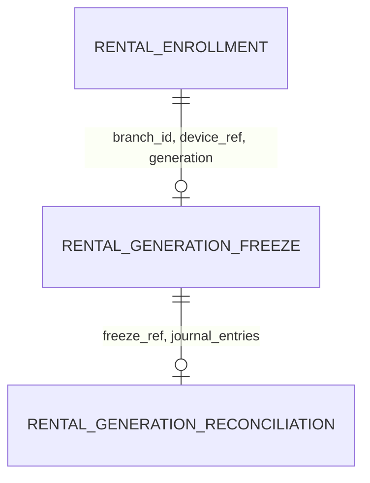

# O09 대여 세대의 미결 지급 증거

기존 등록의 `no_pending_until`은 운영 확인의 유효기한이다. 현재 운용 경로와 앞서 저장한 요청 키는 그 경로의 계약을 유지한다. 조회는 별도 `returnReview.generationPending`으로 세대 전체 증거를 보인다. 운영 확인의 유효기한을 연장하거나 데이터베이스의 관측 주문이 비었다고 해서 이 필드에 0건이 생기지 않는다.

| 상태 | 필요한 근거 |
| --- | --- |
| `unknown` | 현재 등록과 일치하는 신선한 동결 증거가 없거나, 동결 이후 등록이나 세대가 바뀌었다. 기존 세대의 기본값이다. |
| `frozen` | 지점·기기·세대·대여 계정·등록에 결속한 보드 동결 영수증이 신선하다. 대사 결과는 아직 없다. |
| `incomplete` | 동결은 유지되나 대사 범위, 저널 항목 또는 확정 근거가 일부 빠졌거나 결과가 만료됐다. 누락된 항목이 있으면 건수를 반환하지 않는다. |
| `pending` (연결 후) | 전체 저널을 같은 확정 블록까지 검증했고, 그 시점에 유효한 미사용 승인이 남았다. 지급 건수와 한도 변경 건수를 구분해 표시하고 반납 실행을 보류한다. 미확인 항목이 하나라도 있으면 이 상태의 건수를 제공할 수 없다. |
| `verified` | 동일한 동결의 저널 전체가 검증된 확정 기준점까지 조회됐고 모든 항목이 종료됐다. 인증된 P01·P07 검증기 연결 후에만 `pendingCount: 0`을 반환할 수 있다. 현재 조회에는 이 상태와 건수가 나오지 않는다. |

P07의 읽기 검증기는 로컬 통합 시험에서 보드 등록키로 서명한 동결 영수증과 공개 저널을 대조한다. 지급 한 건이 유효하면 미결 지급 1건·미결 한도 0건을 반환하고, 만료 시각과 같은 블록에서도 지급을 미결로 유지했다. 같은 세대의 최종 블록에서 모든 승인이 종료된 경우 0건이 됐다. 권위·체인 조회 뒤 등록을 취소한 시험에서는 응답 직전 권한을 다시 확인해 건수를 생략했다. P01과 P07은 같은 서명 벡터를 사용한다. P05 운영 조회가 이 판정을 사용하려면 실제 기기 등록·도전값 발급 경로와 전용 서비스의 증거 기록이 연결돼야 한다. [P07 통합 시험](../p07-indexer/internal/chainview/generation_integration_test.go) · [P01·P07 공통 동결 영수증](../../packages/protocol/v2/testdata/rfr1.vectors)

[068](internal/store/migrations/068_rental_generation_evidence.sql)은 동결과 대사의 입력을 분리한다. 동결에는 등록 다이제스트, 체인·컨트랙트·배포, 보드 실행 측정, 신선한 챌린지와 영수증, nonce 구간과 저널 커밋을 보관한다. 대사는 같은 동결, P07 수집 세대와 확정 블록, 대사 다이제스트, 대조 및 종료한 총 항목, 범위 충족 여부와 유효기간을 기록한다. 보관된 현재 계정·반환 목적지·등록 버전·다이제스트가 정확히 맞고 최신 세대가 유지되는 경우에만 조회한다. 운영·commerce 경로에는 두 테이블의 쓰기 권한이 없다. 수집기와 증거 검증기는 이 변경의 후속 범위다. DB 소유자로 넣는 합성 행은 판정 회귀에만 사용한다.

저널 전체 항목 수는 256비트 범위 `[first_nonce, next_nonce)`의 길이이며, 지급·한도 변경·서명 발행 전 소각의 합이다. 지급만 세거나 체인에 없는 nonce를 소각으로 가정하면 안 된다. 이 숫자가 맞는 합성 행이나 운영자 진술도 외부 서명 근거를 대신할 수 없다. 현재 조회는 대사 행이 있으면 `incomplete`까지 표시한다.

## P01과 P07이 넘겨야 할 자료

1. 실제 등록할 때 세대와 대여키를 보드 실행 측정 및 해당 v1 체인·정산 계약에 고정한다. 서명 전부터 보드가 각 nonce의 용도, 승인 다이제스트·만료와 서명 발행 여부를 보호 저장소에 원자적으로 남겨야 한다. 지급, 한도 변경, 발행하지 않고 폐기한 nonce를 구별한다. 재부팅이나 발행 결과 유실 뒤 같은 기록에서 재개한다. 기존 v1 보드의 순번 저장은 다음 nonce만 보존한다. 그 값으로 과거 지급 의무와 구멍의 원인을 복원할 수 없다. [현재 지급 서명](../p01-device-firmware/core/src/nu54_session_pay.c)
2. 보드는 추가 승인을 차단하는 영속 동결과 기존 대기 프롬프트 취소를 같은 경계에서 처리한다. 등록된 인증키가 서버의 일회성 챌린지, 보드·세대·계정, 실행 측정, 배포와 저널 시작·끝·루트를 서명해야 한다. 처음부터 빈 세대는 최초 활성화와 같은 순번으로 끝난 저널 및 동결을 함께 검증해야 한다. 재부팅·롤백·업데이트·리셋에서 동결이 우회되지 않아야 한다. 현장 담당자의 입력, 수취자 수기 확인, 만료 시각만으로 동결이나 저널 완전성을 만들 수 없다.
3. P07은 서명 저널의 모든 지급을 해당 배포의 확정 관측과 대조한다. 지급 확정 또는 검증된 만료와 미사용을 원 승인과 정확히 결합한다. 대상 전환, 분기, 수집 공백, 만료 후 확정 범위 부족, 출처 위조 시 전체 판정을 다시 보류한다. 활성 수집 세대와 확정 기준점을 대사 다이제스트에 넣는다. 알려진 한 주문의 부재나 계정 잔액은 세대 전체의 증거를 공급하지 않는다. [P07 주문별 부재 증명](../p07-indexer/internal/chainview/absence.go)
4. 실제 증거 수집·검증이 준비된 뒤에만 전용 서비스 쓰기 역할을 부여한다. 반납 승인을 이 증거로 전환하는 변경은 별도 검토에서 진행한다. 검토·실행 거래에 같은 등록과 증거 다이제스트를 잠그고 신선도와 분기를 재확인해야 한다. 이미 접수한 명령의 동일 키와 동일 본문 결과는 보존한다. 기록이 없는 기존 세대에 소급해서 0건을 부여하지 않는다.

### v1 정산 계약과 P07의 세대 대사

`settle`과 `setLimits`는 같은 기기의 nonce 비트맵을 사용한다. `PaymentSettled`에는 기기·가맹점·주문·금액·nonce가 있고, `LimitsChanged`에는 기기와 새 한도 두 개가 있다. 후자의 이벤트만으로는 같은 값의 한도 요청 두 건을 어느 nonce에 대응시킬지 알 수 없다. `isPaid`는 가맹점·주문 단위이며 `isNonceUsed`는 기기·nonce 단위다. [v1 계약의 승인과 조회](../p06-stablenet-contracts/src/PaymentSettlement.sol) · [한도 이벤트 계약](../p06-stablenet-contracts/src/IPaymentSettlementExtensions.sol)

P07 수집기는 같은 배포·확정 블록의 성공 영수증과 실제 계약 호출에서 원 승인 해시를 복원해, 서명된 저널의 종류·기기·nonce·승인 해시를 대조해야 한다. 중계 호출에서 원 호출을 검증할 자료가 부족하거나, 사용 비트는 있으나 대응하는 승인을 판별할 수 없으면 보류한다. 서명 후 미사용으로 종료할 때에는 만료가 지난 확정 기준점에서 해당 기기의 비트와 연속 수집 범위를 확인한다. 지급은 원 가맹점·주문 상태도 대조한다. 서명 전 소각은 보드의 보호 저널로 입증하며 사용된 비트와 모순되면 세대를 보류한다. 원 승인 내용과 보드 식별자는 운영 화면에 공개하지 않는다. 기존 P07의 주문별 미지급 근거는 독립적인 증거 한 건으로 유지한다. [P07 주문별 조회와 체크포인트 고정](../p07-indexer/internal/chainview/absence.go)

O09의 반납 준비 화면은 검증된 미결 지급이 1건일 때 이를 표시해야 한다. 미사용 비트와 만료 전 서명이 확인된 항목은 확정 시점의 미결이다. 만료 시각과 블록 시각이 **같으면** v1 계약이 여전히 승인을 접수하므로, 미사용 종결에는 만료 시각을 지난 블록이 필요하다. 두 종류의 승인 모두 미결이 0건이고 소각 항목까지 일치한 경우에만 세대 대사가 종결된다. 반환 목적지, 인출 지연, 실행 직전 권한·기준점 확인은 기존 조건을 함께 충족해야 한다. [반납 준비·보류·확인 화면](../../docs/content/commercial/screens/specs/O.md#o09--대여-기기-개설과-반납)

P01은 동결 증거로 외부에 제공할 최소 필드의 순서와 다이제스트를 보드 인증키로 결속한다. P07이 확인할 필드는 세대·배포·계정 결속, 슬롯 순번, 종류, 발행·소각 상태, 승인 만료·다이제스트이며 지급에는 계약에서 사용하는 가맹점과 주문 키 쌍이 추가된다. 저장 이미지에는 다시 지급에 사용할 수 있는 서명이 포함되므로 원본은 보드 안에 둔다. 확인한 건수와 기준 시각만 점주에게 표시하고 서명·전체 저널을 운영 로그에 남기지 않는다. [P01 보호 저장 형식](../p01-device-firmware/RENTAL-JOURNAL-DESIGN.md)

### 비공개 대사 소비자와 쓰기 경계

P05의 전용 클라이언트는 등록된 P07 HTTPS 원점과 루트 CA, 서버 SPKI 및 전용 클라이언트 인증서를 확인한다. 양수·0 응답은 승인한 스트림과 수집 세대, 배포, 보드 동결 영수증 다이제스트, 저널 루트가 모두 맞을 때만 받아들인다. 기준점은 동결 시각 이후이며 응답은 동결 영수증 안에서 만료된다. 대사 상태가 불명확하거나 응답 검증에 실패하면 미결 건수를 제공하지 않는다. 지급과 한도 변경의 승인 수는 각각 보존한다.

향후 증거 기록의 등록 권위는 보호 저널을 활성화한 최초 등록을 인증하고 기기 인증키·측정·계정·배포를 현재 등록에 결속한다. 동일 기기에서 세대 등록 변경, 대사 기록, 보호 증거를 요구하는 신규 반납은 기기 잠금 뒤 세대 잠금 순으로 직렬화한다. 대사 기록은 이미 처리한 요청의 결속 다이제스트와 원결과를 보존하며 새 요청은 동일한 챌린지나 과거 세대의 증거를 재사용할 수 없다. 등록이 바뀌거나 조회 확인의 유효기간이 지나면 공개 수를 보류한다. 새 반납 검토는 현재 권위의 정확한 0건 다이제스트를 제출 시점에 다시 확인하며 이미 접수한 원명령의 재조회를 우선한다. 기존 장부 068의 관측 행과 기존 운용 경로는 현행 계약을 유지한다.

[070](internal/store/migrations/070_rental_generation_source.sql)은 현재 등록에 별도 자격이 설정된 세대에만 적용한다. 영속 플래그는 인증 소스가 회수되어도 기존 수동 대사 경로로 돌아가지 않게 한다. 소스는 P01이 확인한 보호 등록과 현재 발급 챌린지를 P07의 승인된 수집 세대에 결속한다. 증거 쓰기 역할에는 소스 등록과 원시 테이블 쓰기 권한을 주지 않는다. 자격 부여 경로에는 P01의 보호 등록·보드 인증과 채널에 결속한 챌린지 발급을 연결해야 한다.

새 챌린지는 같은 동결 루트와 최초·다음 nonce, 용도별 항목 수, 최초 동결 시각을 재인증한다. 교체 등록과 새 챌린지가 활성화되면 기존 평가를 보류한 채 이전 기록과 정확한 재시도 결과를 유지한다. 같은 P07 수집 세대를 다시 평가하면 P07은 직전 기록의 블록이 현재 연속된 확정 계보에 있는지 확인하고 응답에 그 기준점을 결속한다. P05 기록 함수는 직전 높이·해시가 정확히 일치하고 지급·한도 미결 수가 각각 증가하지 않는 경우만 공개 집계의 후보로 보관한다. 기준점이나 권위가 변경되면 현재 등록에 맞는 대사를 새로 받아야 한다.

시험에서는 전용 역할과 확인된 P01/P07 등록을 합성하여 대사와 반납의 경합을 검증한다. 상용 서비스를 연결하기 전에는 현재 권위 및 P07 활성 확정 기준점을 실제 반납 제출 때 재확인할 운영 인증 경로가 필요하다.

### 수집기 등록 확인과 연결별 발급

[072](internal/store/migrations/072_rental_collector_authority.sql)는 P05 원장 읽기·쓰기 역할과 분리한 등록 확인 및 발급용 DB 역할을 둔다. `P05_RENTAL_AUTHORITY_DATABASE_URL`을 선택하면 현재 배포 파일 지문에 고정된 대여 운영 서비스가 전용 비공개 mTLS 경로를 등록한다. 운영자에게 유효한 지점 대여 권한이 있고 설치 증거와 현 세대가 일치할 때만 요청 본문을 제공한다. 별도 설치 권위의 서명을 받은 요청을 인증된 P01 관리 채널의 `0x74` 작업으로 전달한다. MCUboot가 확인한 이미지의 측정, 활성 보호 저장의 세대·초기 nonce, 설치 보드·동결키·수집 피어가 맞을 때 보드의 설치키로 같은 본문을 서명한다. P05는 합의한 본문과 등록된 설치 공개키로 이 회신을 검증한 뒤 서명 본문과 당시 설치 공개키를 함께 해시한 확인 지문만 보관한다. 재서명한 같은 본문은 같은 확인으로 처리한다.

`N54G` 본문은 ASCII 식별자 4바이트, 서버 챌린지 32, 설치 보드 ID 32, 보호 등록 범위 208, RFR1 서명 주소 20, 수집기 인증서 지문 32, 등록 BLE 피어 7, 초기 nonce 32, big-endian 만료 8 순서다. 요청과 회신은 같은 본문 뒤에 각각 설치 권위와 보드 설치키의 P-256 서명 64바이트를 붙인다. 운영자의 등록 요청은 `/v2/private/rental-registration/{branch}/{device}/{generation}`에서 읽고, 보드 회신을 같은 경로에 바이너리로 제출한다. 등록된 `rental-collector` 인증서로 `/v2/private/rental-collector/{branch}/{device}/{generation}/freeze-challenge`에 현재 BLE 채널의 nonce와 만료를 제공하면 등록된 서버 챌린지와 RFQ2 서명을 받는다. 운영 권한 회수, 기기 회수, 설치·세대·배포 변경 또는 유효기간 경과는 발급을 막는다. RFQ2와 RFR1의 원 형식은 유지한다.

보호 활성화와 수집 피어를 실제 보드에 공급하는 제조·현장 절차, 검증된 설치 범위를 현재 P05 증거 소스로 준비하는 권위, P07 대사 기록까지 호출하는 수집 도구는 상용 연결의 선행 조건이다. 기본 보드는 이 경계를 열지 않는다. 시험의 설치 등록·측정 행과 서명키는 합성 자료이며, 무선·실기 검증을 대체할 수 없다.

### 현장 수집기의 사전 확인

P05의 `make build`로 생성되는 `bin/rental-collect`는 등록된 한 기기의 BLE 연결에서 공개 증거를 수집하고, 등록된 P07에 대사를 요청한다. `P05_RENTAL_COLLECTOR_ENROLLMENT`에는 운영 배포로 설치한 소유자 전용 JSON 파일의 절대 경로를 지정한다. 예시 서명·키로 자격을 만들 수 없다.

설정 파일은 `Binding`(208바이트 등록 범위의 hex), `FirstNonce`(32바이트 hex), `BoardSigner`와 `Operator`(각 20바이트 hex), `Stream`, `StreamGeneration`, 현장 어댑터에 이미 등록된 `RegisteredPeer`, 어댑터에서 사용하는 주소 유형 `RandomPeer`를 받는다. `Issuer`와 `Reconciler`는 각각 `Origin`, `Roots`, `Certificate`, `KeyFile`, `SPKI`를 갖는다. 각 역할은 별도 클라이언트 인증서를 사용하고 개인키 파일은 절대 경로의 일반 파일이며 소유자만 접근할 수 있어야 한다. `Previous`가 필요한 경우 현재 권위의 직전 `height`와 `hash`를 넣는다. 키를 명령 인자에 직접 지정하지 않는다.

한 번의 실행은 등록 기기에만 연결한다. 발급된 RFQ2의 운영자 서명을 확인한 뒤 해당 연결에서만 보드 영수증과 공개 행을 읽는다. 수집기는 RFR1의 보드 서명, 항목 순서와 개수, RJP1 전체의 커밋을 확인한다. 실패하거나 만료되면 불완전한 증거를 버리고 연결을 닫는다. 다음 실행에서 새 채널 nonce가 필요하다. 동일한 동결의 루트와 원 동결 시각은 보드가 보존한다. P07 응답이 범위나 기준점과 다르거나 대사가 완결되지 않으면 확인된 건수를 제공하지 않는다.

이 명령의 검증 결과는 현장 사전 확인용이다. 전용 쓰기 역할의 원장 기록과 반납 직전 최신 권위 확인은 독립 단계다. 현재 설정 입력은 현장 자격 등록이 완료된 환경에만 제공한다.

### 전용 기록과 반납 보류

`P05_RENTAL_WRITER_DATABASE_URL`과 `P05_RENTAL_WRITER_P07_CONFIG`를 설정한 opsd는 인증된 수집기의 `POST /v2/private/rental-collector/{branch}/{device}/{generation}/record`를 받는다. P07 설정에는 전용 클라이언트 인증서와 등록된 원점, 루트, 서버 SPKI를 고정한다. 기록 모드는 `P05_RENTAL_COLLECTOR_RECORD_KEY`에 작업 UUID를 지정하며, 값을 생략하면 기존 사전 확인으로 실행한다. 기록 모드도 승인 원문이나 건수를 표준 출력에 내보내지 않는다.

수집기는 보드 동결 영수증과 공개 투영만 전달한다. 서버는 현재 설치 신원·수집기 등록·직전 확정점을 조회하고 보드 서명을 검증한 뒤 자체 mTLS 권한으로 P07에 대사를 요청한다. 외부 응답 대기에는 P05 행 잠금이 없다. 최종 기록 거래에서 권한·등록·직전 확정점·유효기간을 다시 확인하고 070 증거와 [073](internal/store/migrations/073_rental_proof_runtime.sql)의 제출 지문을 함께 보관한다. 같은 제출의 응답이 유실되면 지문으로 기존 기록을 확인한다. 사후 중복은 새 대사 기록을 만들지 않는다.

P07 실제 서비스의 등록·철회 검증과 반납 직전 확정점 재검증이 연결될 때까지 전용 경로가 제출한 기록은 운영 반납을 보류한다. 검토는 건수 확인 필요로 유지하고 신규 반납을 예약하지 않는다. 이미 접수한 동일 반납은 기존 작업 재조회 경로로 처리한다.

### P07의 현재 등록 권위 조회

`P05_RENTAL_AUTHORITY_READ_DATABASE_URL`에는 `nu54_p05_rental_authority_read` 전용 로그인만 지정한다. [074](internal/store/migrations/074_rental_authority_audience.sql)는 P07 조회자 인증서 지문과 P07에 대사를 요청한 원 서비스 인증서 지문을 각각 현재 권위 소스에 결속한다. 두 지문은 BLE 수집기 자격 및 운영자 권한과 별도로 검증한다. 전용 로그인에는 원본 테이블 읽기나 쓰기 권한과 증거 기록 역할이 없다.

P07은 mTLS로 `POST /v2/private/rental-generation/authority`에 스트림, 수집 세대, 지점, 보드, 대여 세대, 영수증 챌린지, 최초 대사 요청 인증서의 지문을 전달한다. P05는 현재 설치 측정, 운영 권한, 보호 등록 확인, 챌린지, 두 인증서 지문과 만료를 대조한다. 반환값은 계약과 보드·운영 서명 주소, 등록·측정·배포 다이제스트와 검증에 필요한 시간으로 제한한다. 등록 시각은 확인된 등록 행에서 읽고 유효기한은 이미 저장된 등록·권한·챌린지와 인증서 만료의 최솟값이다. 챌린지 발급 시각은 기존 등록에 기록되지 않아 내려보내지 않는다.

동일한 등록을 두 번 확인할 때 응답 범위와 유효기한은 일치해야 한다. 조회 중 철회·교체됐거나 새 권위가 이전 등록 확인과 달라진 경우 현재 증거를 승인할 수 없다. 신규 반납의 최종 기준점 재검증은 별도 경로다.

### 실행 직전 재검증의 인수 조건

새 반납은 073 제출 지문이 연결된 070 검증 결과만 사용한다. 지점·기기·대여
세대·계정·반환 목적지·현재 설치 측정과 등록, 정산 배포, 수집 세대, 동결 영수증·
저널 커밋, 지급과 한도 각각 0건, 부모 확정 블록, 검토 참조와 만료가 같은 기록에
결속돼야 한다. 068 관측이나 전용 기록을 거치지 않은 070 행으로 이 경로를 열 수
없다. 기존 호출과 이미 접수한 원작업의 재조회 경로는 유지한다.

P07의 전용 확인은 074에 같은 현재 등록·챌린지를 다시 조회한다. 저장된 높이와
해시가 승인된 활성 v1 프로필의 연속 확정 범위와 실제 RPC의 현재 정본에 속할 때
확정 근거를 반환한다. 이 확인은 기존 기록을 다시 집계하거나 새로운 건수를 만들지
않는다. 권위와 최신 확정점을 결과 직전에 다시 확인한다.

P05는 서명 전에 위 확인을 하고, 서명된 거래를 전송하지 않은 채 결과와 결속을 다시
확인한다. 기기 잠금과 세대 잠금을 그 순서로 획득하는 짧은 거래에서 검토 참조 및
현재 등록·증거·기한 변경을 차단한다. 네트워크 조회 동안 이 잠금을 유지하지
않는다. 이전 키의 원요청은 신규 반납 검토 및 재서명보다 먼저 복구한다.

체인 접수 전 실패에는 새 반납이 접수됐다는 의미를 부여하지 않는다. 접수 경계에
도달한 전송이 시간 초과되면 같은 서명 거래의 해시로 대사한다. 실패 응답만으로
미제출을 단정하거나 새 순번으로 주문을 재발행하지 않는다. 이 경계를 순서대로
시험한 뒤에만 073 신규 보류를 해제한다.

서명 단계는 기존 v1 계약 바인딩과 운영자 서명자를 사용한다. `closeAccount`의
수신 계약, 체인, 원 대여 계정, 서명자, 순번과 거래 해시를 검증한다. 보내기 전
후보는 공개 API나 운영 로그에 내보내지 않는다. 서명 후 검토 결속·활성 증거·0건·
등록 권한과 확정점이 달라졌으면 후보를 파기하고 접수 기록을 만들지 않는다.
최종 실행 허가와 원후보 보관을 같은 DB 거래에서 처리한다.

허가한 후보를 재시작 뒤 복구하는 경우 저장한 동일 해시로 체인 접수 여부를 먼저
조회한다. 접수가 확인된 요청은 등록이 나중에 철회돼도 기존 거래를 조회할 수 있다.
한번 호출했지만 결과를 확인하지 못한 후보는 다른 거래를 만들지 않는다. 새 전송을
시도하기 전에 현재 권위와 같은 기준점을 다시 확인한다. 다른 거래가 서명자 순번을
소비했으면 별도 보류로 남기고 자동 교체하지 않는다. 확정된 `AccountClosed`와
등록 반환 목적지가 일치한 뒤에만 기존 지연 인출 경로로 진행한다.

[075](internal/store/migrations/075_rental_close_candidate.sql)의 전용 실행 역할은
같은 073 평가·검토 참조와 P07 짧은 확인을 만족한 거래만 준비 기록으로 보관한다.
보호 저장의 상태는 준비, 전송 시도 중, 접수 관측, 확정 성공, 확정 실패, 순번 소진을
구분한다. 멤풀 또는 미확정 영수증으로는 접수 관측까지만 전진한다. 암호문은 정확한
`AccountClosed` 로그를 포함한 정본 확정 성공, 정본 확정 실패 또는 정본 확정
블록에 고정해 확인한 순번 소진에서 제거한다. 원거래의 확정은 정본 헤더의 거래·영수증
트라이 루트를 모두 재계산하고 원해시가 있는 위치의 영수증 상태와 이벤트로 확인한다.
접수 관측이 사라지면 현재 권위와
허용 시간이 다시 성립할 때 동일 원문만 재전송할 수 있다. 설정하지 않은 073 반납 경로는 보류한다. 실행기와 실제 P05·P07 및 Anvil 검증에서는
`products/p07-indexer/test/generation-v1.py --protected-close-p05`를 사용한다.

두 해시 인덱스의 조회가 비어 있고 확정 순번이 늘었으면 실제 소비 블록을 찾는다.
정본 블록 해시와 전체 거래의 transaction root를 검증하고, 거래 서명에서
복원한 보낸 주소와 순번이 둘 다 일치하는 다른 해시가 있을 때만 순번 소진으로
종결한다. 같은 해시가 보이지만 영수증을 아직 읽을 수 없으면 접수 관측 상태를
유지한다. 본문·정본·상태를 읽을 수 없는 동안에도 암호문을 보존하고 재전송하지
않는다. 원해시의 영수증을 다시 읽으면 정본의 성공·실패로 대사한다.

감독형 운영 반납은 인증된 opsd에 `P05_RENTAL_PROTECTED_CLOSE_DATABASE_URL`을
지정한 경우에만 연결한다. 이 로그인에는 [075 실행 역할](internal/store/migrations/075_rental_close_candidate.sql)만 부여한다.
[077](internal/store/migrations/077_rental_close_operator_snapshot.sql)은 같은 지점의 유효한
운영 권한을 확인해 보호된 거래 상태와 원해시를 제공한다. 같은 요청을 복구하는 키와
검토값은 최초 요청 운영자에게만 제공한다. P07 접속은 발급원이 지문을 등록한
`P05_RENTAL_WRITER_P07_CONFIG`의 mTLS 인증서를 사용한다. 감독형 경로에서는 처음
검토한 뒤에도 새 송신 직전에 현재 권위와 P07 기준점 확인이 필요하다. 같은
요청의 재시도는 새 작업을 만들기 전에 원해시를 조회한다. 접수, 정본 확정 성공,
정본 확정 실패, 다른 거래에 의한 순번 소진을 각각 구분한다. 이 경로는 기존 별도
인출·슬롯 소거 권한을 변경하지 않는다. 실제 서비스 통합은
`products/p07-indexer/test/generation-v1.py --supervised-close-p05`에서 검증한다.

[078](internal/store/migrations/078_rental_close_operator_review.sql)은 운영 화면의 새
검토 참조를 075 권위 전체에 연결한다. 유효한 조회 권위의 인증서, 조회 로그인
또는 기한만 바뀌어도 기존 검토를 다시 사용해 서명할 수 없다. 화면에는 불투명한
검토 참조만 보낸다. 기존에 기록한 반납은 당시 요청 키와 검토 참조로 원거래 상태를
조회할 수 있다. 이전 승인과 당시 보존한 권위가 기존 방식으로 자료와 일치하면 마이그레이션 시점의
전체 권위 비교값을 기록한다. 이후에도 이 값이 일치할 때 같은 서명 거래를 복구할 수
있다. 자료가 달라졌다면 현재 권위의 별도 재검토로 같은
동결 저널·계정·반납 해시를 확인한다. 새 원거래는 만들지 않는다.
검증 명령 `--rollover-close-p05 unchanged`와 `--rollover-close-p05 renewed`는 실제
077에서 요청을 저장하고 전송 도중 종료한 뒤 078로 이관하고 재시작한다.

[079](internal/store/migrations/079_rental_protected_withdrawal.sql)의 감독형 인출은
기존 감독형 반납에 `P05_RENTAL_PROTECTED_WITHDRAWAL=1`을 함께 설정한 환경에서
동작한다. 현재 등록의 지점·세대·고정 반환 주소, 원반납 거래, 거래에서 발생한
`WithdrawalRequested`와 현재 P07 확정점이 모두 일치해야 금액과 상태를 표시한다.
원래 요청액 0은 같은 정본 반납 영수증과 현재 잔액·인출 대기액의 0을 확인해야
표시한다. 양수는 지연 중, 인출 가능, 요청 기록, 수령 대기, 정본 수령을 구분한다.
송신 전에 원반납, 요청 키, 거래 해시, 서명 원문의 인증 암호문과 거래 순번을 기록한다.
반납과 인출이 공유하는 서명자·순번은 중복 예약할 수 없다. 응답이 유실되거나
서비스가 재시작하면 먼저 같은 해시를 조회한다. 원거래를 아직 관측할 수 없고 번호가
소비되지 않았으며 현재 권위와 P07 근거가 다시 일치할 때만 같은 서명 원문을 전송할
수 있다. 권위가 갱신됐다면 같은 원반납·계정·금액과 이전 인출 해시를 표시해
재검토받는다. 단순 조회는 거래를 보내지 않는다.

정본 인출 영수증의 `WithdrawalExecuted`와 결제 계약에서 등록 주소로 지급한
토큰 이벤트를 함께 확인한다. 보류 토큰은 보류 식별자와 등록 주소·금액을 대조하고,
실제 수령 영수증과 토큰 계약에서 등록 주소로 보낸 이벤트가 정본에 포함될 때만
수령으로 표시한다. 인출액이 달라졌거나 등록·스트림·정본을 재확인할 수 없으면 현재
금액과 승인 참조를 보류한다. 격리한 운영 API 시험은 `--protected-withdrawal-p05`와
`--zero-withdrawal-p05`를 사용한다. 전송 전 프로세스 중단·재시작 복구는
`--recover-withdrawal-p05`로 검증한다. 기기 소거와 재배정에는 별도 권한과 보드 확인이
필요하다.

O09 운영 화면은 확인한 원반납 거래와 기기 참조·리비전·세대를 인출 상태에 함께
표시한다. 등록 확인 시각과 지연 인출의 가능 시각을 구분한다. 같은 인출 조회는
쓰기 없이 상태를 다시 읽고, 운영자가 금액과 원반납을 검토해 요청한 경우에만
인출을 접수한다. 기기 정리 확인을 기다리는 동안 재배정을 보류한다.
`products/p07-indexer/test/generation-withdrawal-chrome.py`의 기본 모드와
`--zero`, `--held`는 정식 Fleet 웹 빌드를 실제 mTLS opsd에 연결한다.
W12 대여 앱은 대여 슬롯의 인증된 종료 확인을 아직 받지 못한 상태를 표시하며
기존 미결 지급 조회로 돌아갈 수 있다.

[080](internal/store/migrations/080_rental_withdrawal_reconciliation.sql)은
`P05_RENTAL_WITHDRAWAL_RECONCILER_DATABASE_URL`의 전용 역할로 원인출 거래를
백그라운드에서 대사한다. 기존 인출 설정과 같은 v1 배포가 필요하다. 작업자는
서명 원문을 읽지 않고 한 회에 최대 8개의 원해시만 검사한다. 정본에서 원거래
실패, 다른 거래의 해당 순번 소비, 또는 원반납의 인출 실행을 확인한 경우 확정
블록과 거래 참조를 저장하고 암호문을 지운다. 단순 조회, 미확정 응답 및 해시
인덱스 장애는 암호문을 삭제하지 않는다. 사용자는 현재 권위가 있는 경우에만
이 결과를 조회할 수 있다. 기기 정리 승인에는 별도의 인증된 보드 확인이 필요하다.

[081](internal/store/migrations/081_rental_withdrawal_retry.sql)은 080이 원인출의
정본 확정 실패 또는 다른 거래의 순번 소비를 확인한 경우에만 다음 인출 검토를
제공한다. 원반납이 결속한 금액이 아직 지급 의무로 남고, 이전 실패 근거가 현재
P07 확정점의 정본에 포함되어야 한다. 검토는 이전 원해시·실패 근거와 새로운
현재 권위를 결속한다. 새 요청을 저장하는 트랜잭션에서 이전 원요청과 확정 근거를
별도 장부에 보존한다. 이전 요청 키로 다시 호출하면 같은 실패와 원해시를 반환한다.
제3자가 먼저 인출했다면 이전 거래의 실패를 실제 수령과 구분해 기록하고 다음
요청을 보류한다. 이미 지급된 의무에 대해 새 요청을 저장하거나 서명하지 않는다.

격리 API 검증에서 `P05_O09_WITHDRAWAL_RECONCILIATION=1`을 사용하면 실제
대사 작업자가 켜진다. `--recover-withdrawal-p05`와 함께
`P05_O09_RETRY_WITHDRAWAL=1`로 다른 거래가 순번을 소비한 뒤의 새 검토를,
`P05_O09_RETRY_WITHDRAWAL=third-party`로 원요청 실패와 선지급을 검증한다.

[082](internal/store/migrations/082_rental_withdrawal_receipt_attribution.sql)은
다른 거래의 지급을 원인출 실행과 구분한다. 080에서 거래 해시가 다른 지급을
원인출 실행으로 저장했던 행은 기존 거래 참조를 보존하면서 별도 거래 지급
상태로 옮긴다. 원인출이 정본에서 나중에 실패하거나 순번이 다른 거래에
소비된 경우 그 결과를 보존한다. 별도 거래의 지급 여부는 같은 원반납의 실제
정본 인출 영수증에서 확인한다. 080·081의 원래 적용 이력은 유지한다.

### 대여자 인도와 W12 상태

[083](internal/store/migrations/083_renter_return_assignment.sql)은 운영자의 인도 제안과
대여자의 수락을 같은 지점·기기·세대와 기존 계정에 연결한다. 인도 운영자는
지점의 현재 `rental_manage` 권한으로 실제 인도하는 계정, 이미 발급된 C3 고객
자격의 불투명한 주체 참조, 인도 확인 기한을 제시한다. 이 단계는 운영자의 인도
확인 기록이다. 대여자는 인도 때 독립 확인한 계정을 자기 C3 고객 인증서로
명시적으로 수락한다. 운영자, 수집기, 다른 고객에게는 이 조회의 대여자 권한을
주지 않는다. 본인 이름·연락처·개인 보드 자료는 입력하지 않는다.

운영 API의 `POST /v2/operations/renter-handover/{branch}/{device}`는
`customer`, `generation`, `account`, `assignmentUntil`을 받는다. 계정과
세대는 기존 확인된 등록과 일치해야 하고 기한은 등록 만료를 넘을 수 없다.
같은 입력은 같은 인도 참조를 반환한다. 운영자는
`POST /v2/operations/renter-handover/{assignment}/revoke`로 해지한다.
고객은 `POST /v2/renter/returns/{assignment}/accept`에 함께 확인한
`account`를 보낸다. W12는 같은 고객의 mTLS 프로필에서
`GET /v2/renter/returns/{assignment}`를 읽으며 세대·원계정·인도 유효기한만
인증된 값으로 표시한다. 해지·만료·새 세대·현재 등록 변경·인도 권한 철회
후에는 참조를 다시 확인해야 한다. 동일 세대의 만료한 인도는 새 인도를
허용하기 전에 종결한다. 이전 행은 적용 승인된 대여 감사 기간까지 보유하고
등록보다 먼저 삭제한다.

이 장부에는 해당 대여의 원주문 관계나 패스키 기간이 없다. W12에서 두 값과
지급 미결 수는 각 출처를 확인할 수 있을 때만 표시한다. 범위 없는 원주문
탐색은 열지 않는다. `assignmentUntil`은 인도 확인 기한이다. 세대 등록·동결 서명과
인도 수락은 슬롯 종료 확인을 제공하지 않는다. 현재 RT/RB 규격의 별도 서명
정리 증명과 서버 확인이 모두 성립해야 종료 및 재배정 표시에 사용할 수 있다.

실제 HTTP 인수에서 `P05_O09_RENTER_RETURN=1`과
`products/p07-indexer/test/generation-v1.py --combined-p05`를 사용한다.

[084](internal/store/migrations/084_renter_return_live_attestation.sql)은 기존 083의
인도 기록과 이관 이력을 유지한다. 수락 및 조회 때 누락·미래 날짜의 기기 확인은
거절한다. 조회에 표시하는 유효기한은 인도·현재 등록·발급 운영 권한 중 먼저
끝나는 시각이다. 새 수집 필드는 없다.
`P05_O09_RENTER_ATTESTATION_UPGRADE=1`은 실제 083을 적용하고 인도를 제안한 뒤
표준 이관기를 거쳐 같은 인도의 수락과 접근 거절을 재현한다.

[085](internal/store/migrations/085_renter_return_assessment.sql)는 고객 인도가 현재
유효하고 073의 저장 대사와 074의 현재 권위 및 등록이 일치할 때만 미결 근거를
선택한다. P05에서 `P05_RENTAL_RENTER_EVIDENCE=1`과 기존 고정 P07 전용
클라이언트 설정을 사용한다. P07이 동일한 최종 블록의 높이와 해시를 라이브로
확인하면 P05는 응답 직전에 고객 인도와 대사 근거를 다시 확인한다. 성립하면
지급 및 한도 변경의 합계, 최종 기준 시각과 해당 근거의 유효기한을 반환한다.
새 최종 블록, 지연, 현재 권위 철회, 만료 또는 불확실성으로 확인할 수 없으면
고객의 여전히 유효한 인도에는 `settlement: unknown`만 반환한다. 0건도 실제
대사 결과에서만 가져온다. 세대별 원주문, 패스키 기간, 슬롯 종료는 별도 권위가
필요하다. 조회 시 새로운 이력이나 원서명을 저장하지 않는다.

실제 두 데몬, v1 체인 및 PostgreSQL 인수에서
`products/p07-indexer/test/generation-v1.py --combined-p05`를
`P05_O09_RENTER_ASSESSMENT=positive` 및 `P05_O09_RENTER_ASSESSMENT=zero`로
각각 실행한다. 설치 앱 접근성 및 UI 상태 검증은 별도 시험이다.

[086](internal/store/migrations/086_renter_return_typed_assessment.sql)은 085의 이관
이력을 유지한다. `pendingPayments`와 `pendingLimits`를 073의 개별 값에서
가져오며 `pendingCount`는 두 값의 합계다. W12는 두 종류를 각각 표시한다.
세 필드나 근거 시각이 맞지 않으면 수치를 표시하지 않는다. 한도만 미결인
`limit`과 두 종류가 모두 미결인 `mixed` 통합 모드를 별도로 실행한다.
`P05_O09_RENTER_TYPED_UPGRADE=1`은 085의 이관 이력과 실제 대사 행을
보존한 채 086을 적용한다.

설치 인수는 전용 시뮬레이터의 서명된 P02 Release 앱과 SceneSmoke
`build-for-testing` 결과를 준비한 뒤 실행한다. `NU54_W12_SIM`에는 전용
시뮬레이터 UUID, `NU54_W12_APP`에는 설치된 앱의 번들 ID,
`NU54_W12_XCTESTRUN`에는 전용 SceneSmoke 산출물의 절대 경로를 넣는다.
`P05_O09_W12_INSTALLED_RUNNER`를 저장소
`scripts/ios/scene-smoke/run-w12-installed.sh`의 절대 경로로 지정하고
`generation-v1.py --combined-p05`를 실행한다. 해당 릴리스만 재현할 때는
`P05_O09_W12_SCHEMA_086=1`을 추가한다. 시험 발급기는 설치 앱의
P-256 공개키로 시험 CA 고객 인증서를 만들고 실제 운영자 HTTP 인도를
호출한다. 앱 수락 뒤 앱과 P05를 재시작하고 동일 인도 조회 및 운영자의 실제
철회 후 숨김을 확인한다. 원주문, 패스키, 슬롯 ACK는 이 시험의 범위 밖이다.

### W12 미결 지급의 원거래 연결

v1 대여 세대 저널과 P05의 v2 상용 주문은 별개의 원거래 경계다.
v1 원거래의 키는 고정 배포, 체인, 정산 계약, 20바이트 가맹점 주소,
32바이트 체인 주문 키다. 보드 계정, 세대와 EIP-712 지급 승인 다이제스트를
함께 대조한다. v2 상용 주문의 32바이트 가맹점 ID나 동일한 체인 주문 키로
v1 관계를 보충할 수 없다.

P07의 전용 대사 요청은 `includePendingPaymentEntries`를 선택할 수 있다.
응답의 `pendingPaymentEntries`는 이미 확인한 RJP1에서 미결 지급에 해당하는
0부터 시작하는 순번의 8비트 마스크다. 인증된 전체 배포·동결·저널 루트와
확정 기준점 검증을 통과한 대사에만 반환한다. 미결 한도와 소각 항목은
제외하며 현재 권위가 없으면 마스크를 반환하지 않는다. 이전 호출에는
역할이나 응답 필드를 추가하지 않는다. 기본 고객 응답·로그에는 이 마스크,
저널 및 승인 원서명이 없다.

[088](internal/store/migrations/088_renter_v1_order_origin.sql)은 원발급과
현재 미결 대사를 다음 순서로 연결한다.

1. 실제 v1 발급점은 P04 `src/kiosk/pay.ts`의 `runPayment`다. 전용 P05
   mTLS에서 등록 단말 인증서, 지점과 v1 가맹점 권위, 승인된 배포를 대조한다.
   `P05_RENTAL_V1_ORDER_TERMINALS`는 현재 C3 terminal 인증서의 SHA-256
   지문에서 정확한 지점·테넌트·단말·가맹점·정산 대상·만료로 연결한다.
   P05의 읽기는 고정 v1 배포에서 확정된 가맹점과 정산 대상도 확인한다.
   보드가 확인된 뒤 `payment.prepare` 전에 정상 원거래의 정확한
   가맹점 서명과 주문 키, 계정, 기한을 제출한다. 서버는 그 시점에 유효한
   수락 인도 한 건에서 고객·계정·세대를 자체 조회해 결속한다. 고객 식별자
   입력은 소유 증명에 사용하지 않는다.
2. P04는 기존과 같이 지급 서명을 내구 저장하고 기존 정산 경로에 넘긴다.
   연결 수집은 지급 서명 요청 및 송신과 분리하고 각 관측에 350ms를 배정한다. 선행 인도 결속에 실패한
   원발급은 연결 확인 대기로 남긴다. 선행 결속 뒤 수집 응답이 유실되면
   이미 저장한 원서명에서 동일 EIP-712 승인만 다시 보고한다. 별도 수집
   과정에서 새 지급 서명이나 송신은 일어나지 않는다. P05는 검증된 동일
   승인 다이제스트로 멱등 처리한다. 활성 인도 또는 단말 권위 변경 뒤
   연결 범위를 새 고객으로 이동할 수 없다.
3. 서버는 원서명과 RJP1 전체를 영속 자료나 업무 로그에 저장하지 않는다.
   원거래 참조와 서명 검증 다이제스트만 대여 감사 및 원영수증 보유기간
   이내에 보존한다. 원거래의 예전 발급 주체와 귀속 시점을 증명할 수 없으면
   현재 인도만 보고 역으로 개인 주문을 배정하지 않는다.
4. W12에서 링크를 열 때도 현재 고객 프로필, 인도, 동일 대사의 최종 블록과
   기한, 해당 미결 지급의 원거래를 다시 대조한다. 앱 공통 내비게이션의 W09는 입증된 원거래 하나의 읽기 전용 표시를
   연다. 같은 확정 블록 해시에서 고정 v1 토큰의 decimals와 심볼을 모두
   검증한 경우 사용자 금액을 함께 표기한다. 원정수와 전체 토큰 주소는
   유지한다. 화면은 결제나 서명 동작을 실행하지 않는다.
   한도 변경만 미결이면 열 미결 지급이 없음을 표시한다. 지급이 양수이고
   연결을 증명하지 못하면 확인 대기를 유지한다.

두 새 SQL 함수의 단말 수집은 P05 commerce 역할, 대사지급 증인의 추가는
기존 독립 P05 증거 writer 역할에 한정한다. 배포 순서는 088 이관,
P07 지급 순번 응답 지원, P05의 opt-in 단말 설정 순이다. 검수에서
`P05_O09_RENTER_V1_ORIGIN=1 P05_O09_RENTER_ASSESSMENT=mixed`로
`products/p07-indexer/test/generation-v1.py --combined-p05`를 실행한다.

#### 087에서 088로 이관 검증

`P05_O09_RENTER_V1_UPGRADE=1`을 단말·혼합 대사 모드에 더해
`Upgrade087To088RenterV1Origin`을 실행한다. 별도 PostgreSQL DB에
생산 이관기를 087까지 적용한 뒤 종전 운영자와 대여자 HTTP 경로로 인도를
수락하고 실제 P07·Anvil 대사를 073에 커밋한다. 종전 v1 단말이 로컬에만
보존하던 원승인은 전용 시험 보관소에 남긴다. 088 추가 이관은 인도,
운영 단말 권한, 073 증명 행, 087 해시와 최초 적용 시각을 보존한다. 새
원발급 및 지급 증인 테이블은 비어 있어야 한다. 같은 고객은 같은 기존 미결
건수와 기준시각을 조회하며 다른 고객은 기존과 동일하게 거절된다. 기존
원승인은 그대로 복구할 수 있고 088이 원거래를 자동 연결할 근거는 없다.

신규 원발급 인수는 신선한 세대에서 `RenterV1OrderOriginHTTP`로 별도
실행한다. 확정 동결을 이미 가진 과거 세대와 새 발급의 보유·재시도는 서로
다른 경우다.

[089](internal/store/migrations/089_renter_v1_freeze_fence.sql)는 동일 지점·기기·세대·
등록의 신뢰된 073 동결 증거가 저장된 후 처음 생성하는 원발급 연결을 막는다.
판단 기준은 단말 요청 시계나 주문 번호가 아니라 장치 잠금 아래 커밋된 두
원장 기록의 순서다. 동결 증거가 쌓이기 전에 같은 원발급을 이미 예약했다면
동일 예약 복구와 늦게 도착한 같은 원승인의 보고를 계속 허용한다. 이전 088이
동결 후에 받은 원발급과 원서명 기록을 소급해 바꾸지 않으며, 그 기록을 새
대여자에게 표시할 근거로도 사용하지 않는다. 다른 등록이나 새 세대는
이전 세대의 동결을 물려받지 않는다.

`P05_O09_RENTER_V1_FREEZE_FENCE=1`을 이관 모드에 추가하면 087·088 보존
검증 뒤 089를 적용하고 같은 과거 원주문의 최초 예약이 HTTP 404인지
확인한다. `RenterV1OrderOriginHTTP`는 신선한 세대의 사전 예약, 신뢰
동결 이후의 같은 예약 복구 및 정확한 늦은 보고를 검증한다.

### 대여자 자료 보유종료 집행 설계

현재 파기 작업은 보류다. P10의 `privacy_ops.retention_rule`은 검토된
정책의 버전과 기간 참조를 담는 등록부다. 카탈로그의 `period_ref`는
기간 값이 아니며 `access_record`와 `rights_case`의 `keep_until`은
각각 그 행의 기한이다. 현 저장소에는 이 규칙을 P05의 대여 인도·원주문·
대사에 적용한 배포별 기한, 현재 유효한 보존 예외의 완전한 조회 권위,
승인된 P05 처분 실행기 설정이 없다. P05의 지점별
`ledger.command_rule.receipt_window`는 명령 재시도 영수증 기한이다.
082 작업자는 정본 인출 처분을 확인해 암호문을 지우며 그 결과는
대여자 자료의 보유 종료를 뜻하지 않는다. 필드 목적 등록부의 문구는
정책을 찾아가는 참조로만 사용한다.

승인된 입력은 배포 책임자가 P10 보유 규칙에 등록한 목적과 근거,
버전, 시행 시각, 자료별 실제 기산점과 기한을 해석한 결과다. 정책 권위는
정확한 테넌트·지점과 대상 자료 종류, 기존 지점·기기·세대 또는 원거래
참조에 대해 승인된 정책 버전, 적용 기산점, 파기 가능 시각, 현재 보존
예외의 상태와 권위 개정을 제공해야 한다. 예외 응답은 `none`, `held`,
`unknown`으로 구분한다. 명시적인 `none`은 같은 범위에 적용되는
보존명령을 빠짐없이 확인했다는 근거와 결속한다. 인도 만료나 철회는
기산점에 쓰일 수 있으나, 그 자체로 파기 시각을 생성하지 않는다. 원주문과
인도 중 먼저 끝나는 시각을 상관 행에 적용하려면 두 정책의 기한을 모두
해석하고 두 원천의 보존 예외를 모두 확인해야 한다. 기간은 코드에 고정하지
않는다.

집행기는 P05의 정확한 테넌트·지점에 승인된 일회 작업으로 시작한다.
외부 P10 조회가 완료된 뒤에도 그 승인과 예외 개정이 마지막 삭제
트랜잭션에서 유효해야 한다. 같은 PostgreSQL 트랜잭션에서 권위 행을
잠그거나, 보존명령 변경과 삭제를 함께 직렬화하는 승인 펜스가 필요하다.
재확인에 실패하거나 펜스가 없으면 대상 행은 보존한다. P05의
`lock_rental_evidence_device`로 같은 세대의 새 증거와 재시도를 직렬화하고,
동일 등록·배포·정본에서 승인된 종료 증거와 미결·원거래 재시도를 확인한다.
0건 결과의 만료, 누락 또는 다른 세대 증거는 종료 근거가 아니다. 지급·
한도·인출·복구 상태가 미결 또는 미확인이거나 정책이 요구하는 슬롯 종료
근거가 없으면 삭제하지 않는다.

권한은 아래 세 테이블에 대한 검증된 처분 함수만 실행할 수 있는 별도
역할에 부여한다. 함수는 지점별 작은 트랜잭션에서 대상 증인을 먼저
제거하고 기한과 예외를 따로 충족한 원발급 참조를 제거한다. 인도 행은
자체 조건을 충족하고 보존해야 할 하위 원발급 참조가 없을 때 제거한다.
같은 세대에 아직 필요한 대사가 있으면 그 증인은 유지한다. 073 증명 본문,
원 지급·환불 장부, 원래 주문, 정산 상태는 이 처분에서 변경하지 않는다.
감사 영수증은 정책 버전, 실행 시각, 테이블별 삭제·보류 건수와 결과만
기록한다. 행 식별자·계정·원서명은 작업 영수증이나 업무 로그에 남기지
않는다. 승인 키의 재시도는 커밋된 영수증을 조회한다. 트랜잭션 중단은
삭제와 영수증을 함께 롤백하며, 재시도는 현재 보존 예외부터 다시 검증한다.

독립 합성 PostgreSQL 인수는 배포 승인과 예외 조회 권위가 제공된 뒤
실행한다. 두 지점 가운데 정확한 승인 지점의 경과 행만 제거되는지, 인도
조회가 닫혀도 기간 또는 예외가 불명인 행은 남는지, 기간 경계와 예외
해제 후 재실행, 작업 도중 보존명령 추가 및 동일 세대 새 증거, 롤백 뒤
재시도와 커밋 응답 유실, 미결과 다른 지점 및 원장 행의 보존을 확인한다.
권위·기한·예외 중 하나라도 없는 경우의 삭제 건수는 0이어야 한다.

### Protected cleanup request

The existing operator endpoint `POST /v2/operations/rental/{branch}/{device}/cleanup?generation=…` accepts an original request key only after current protected evidence establishes zero pending payments and zero pending limits, the original confirmed close and its exact authenticated freeze, and an exact finalized withdrawal received at the registered route or a verified zero/no-transfer disposition. The financial observation and independently authorized P07 confirmation must agree on the finalized anchor. A refreshed challenge may attest the same immutable enrollment, frozen root, nonce bounds, entry counts and freeze time. A refreshed attestation can renew the zero-pending evidence while the disposition continues to bind the original close's freeze digest. The ledger rechecks the scoped authority under the generation guard. Exact operator/key replay returns the original pending request and never sends a device reset. The same authenticated operator can reread its key using the existing rental GET. Another current rental manager at the same branch receives only the held status. Revoked or out-of-scope credentials cannot read or replay it.

Admission stores the RCI1 disposition commitment and returns `board-receipt-required`. The withdrawal-evidence field in that commitment is Keccak-256 over the ASCII domain `NU54-rental-withdrawal-evidence-v1` plus a NUL byte, the 32-byte payout hash, the 32-byte acceptance hash, the unsigned 32-byte amount and the unsigned 8-byte finalized height. Integer fields are big-endian. Hash slots are all zero only when absent from the independently verified disposition. The operator cleanup endpoint only admits the request. The [qualified station endpoint](#qualified-station-cleanup-intent-issuance) can issue RCI1. A verified RCR1 remains required for retirement, and a generic BLE acknowledgement cannot substitute for it. An existing legacy acknowledgement remains historical evidence of a response. It cannot authorize a successor enrollment or opening. The legacy owner-only proof-of-concept CLI retains its existing device reset command outside this commercial endpoint.

During an ordered opsd and PostgreSQL deployment, a schema without the
protected cleanup guard can still serve authorized historical reads and recover
original open or close requests. It holds new cleanup requests and successor opening
requests until the guard is installed. Generation 1 follows its original opening checks because it has no predecessor. A running opsd recognizes the installed
guard on the next request. Database and authorization errors still fail closed.

### Qualified station cleanup intent issuance

A registered station can call `POST /v2/private/rental-cleanup/{branch}/{device}/{generation}/{key}/issue` with an empty request body and its existing `rental-collector` mTLS identity. The deployment authority must explicitly qualify the exact certificate fingerprint for that generation in `ledger.rental_cleanup_station` and supply its expiration. A freeze registration alone grants no cleanup authority. The station does not register itself, and operators cannot retrieve the signed bytes through the console. This endpoint never dispatches a reset or accepts a completion receipt.

P05 requires the original operator's live branch grant, the current registration and distinct board evidence signer, authenticated zero-pending freeze, and independently confirmed finalized withdrawal evidence. It verifies the original anchor is still canonical, reconstructs the original disposition from that anchor and the current matching withdrawal, and commits one signed RCI1 envelope before disclosure. The request field is Keccak-256 of the NUL-terminated ASCII domain `NU54-rental-cleanup-request-v1`, the 32-byte binding and the original request UUID's 16 bytes in standard network order. The response carries the exact 181 bytes as lowercase hex in `intent`. The intent cannot outlive the live financial witness lease, current registration, station authorization or the authenticated caller. It is never re-signed or extended after expiry. Exact authorized retry within all live bounds returns the persisted bytes. A pre-095 request without stored original anchor remains held. The signed envelope and anchor follow the existing generation reconciliation retention policy.

Issuance leaves the operator state at `board-receipt-required` and the successor gate closed. The station can submit RCR1 through the [receipt endpoint](#authenticated-station-receipt). Protected board retirement, physical station delivery and release-qualified handoff remain separate boundaries.

### Authenticated station receipt

A currently authorized station uses the same private rental scope and original request key at `/v2/private/rental-cleanup/{branch}/{device}/{generation}/{key}/receipt`. POST accepts the exact 109-byte RCR1 as `application/octet-stream`. GET has an empty body and returns the same authenticated bytes as lowercase hex in `receipt`. An exact POST also returns those bytes. Concurrent or later submissions with different bytes cannot replace a committed receipt. Operator reads include the state `receipt-authenticated-handoff-required` and disclose the original request key only to its operator. They do not return the signed envelope, receipt or station identity.

The server authenticates the original issued RCI1, the issuer-time board evidence signer and the original still-canonical disposition anchor. It resolves the immutable `PaymentSettlement.operator()` at the original block hash, independently of the current opsd key; a new issuance requires that key to match the contract authority. It verifies that the board evidence signer signed the digest of that exact issued intent during its validity window and no later than trusted server time. Delayed admission and retries do not require the retired slot to answer a new challenge. Issuance from 097 onwards pins the independent board evidence address with the original envelope. An already issued 095 envelope can use an older signer only when the retained original authenticated freeze still proves the entire enrolled source digest exactly. A mismatch holds the request. The current station qualification and the original operator and registrar grants must remain current during receipt admission and readback.

This receipt establishes signature and scope authentication. The operational return remains held for independently qualified protected retirement and handoff. The endpoint has no reset, key retirement, acknowledgement for reuse or successor authorization. The receipt and signer follow the existing generation reconciliation retention boundary.

Run the existing P07 generation integration with `P05_O09_RCR1_TEST=1` and either `--zero-withdrawal-p05` or `--protected-withdrawal-p05` to exercise historical receipt registration through the actual TLS listeners and a local chain. The zero-disposition scenario also reads the authenticated hold in Fleet when a dedicated console build is supplied with `P05_O09_CHROME_DIST`. The fixture uses a synthetic board evidence key, so its signature demonstrates server authentication only.
