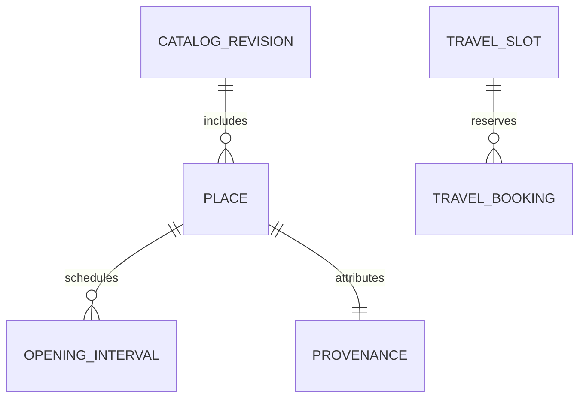

# Public places and booking boundary

P09 owns the public place catalog. An operator publishes a versioned JSON
document signed by an approved Ed25519 authority. The normal service reads
that document from its configured persistent store and answers region
searches over a public API. Each place has a stable ID, visible source and
update date, an optional published coordinate and an optional independently
allocated P05 branch reference with booking/pickup capabilities. The API
and P02 manual region search accept no visitor location or identity. List
and map marker views share the same results and stable IDs. Places without
a commerce reference remain public informational results.

P05 owns slot eligibility, capacity, price, cancellation revision and
customer authorization. The branch reference is only a locator. Booking
requests arrive over the existing pinned customer mTLS transport. The
database independently confirms the certificate actor's active grant in
the tenant and branch. Each hold is idempotent for the same actor, requested
slot and accepted commercial terms. A row lock serializes capacity checks.
A winning hold receives an opaque ID and a bounded expiry. Another actor
cannot read it. Expired unpaid holds stop occupying capacity, including
after restart. The client can reopen the same hold by its customer-scoped
request receipt.

Payment commands link separate original receipts for deposit and balance
to the same P05 booking. Seatless preorders use separate pickup ordering.
Synthetic sources and TestUSDC values are limited to the local acceptance fixtures.

The first acceptance walks from a public region search to a merchant
reference, through two simultaneous customer mTLS requests for the last
seat, then reopens the winner. It covers the unbookable public landmark,
a request with changed terms, a conflicting re-use, cross-customer reads,
expiry and a booking-side disconnect. Public requests never read private
booking state.

## Store ownership and publication



The optional place branch reference is opaque across the P09 and P05
databases. P09 stores public, operator-approved place information, weekly
hours, revision signatures and provenance. P05 stores booking terms,
reserved seat counts, expiry and ownership. Retention and sensitivity for
these stores are recorded in the [field catalog](../p10-platform/database/field-purpose.json).

Run `make -C products/p09-travel-ai migrate` using the local or deployment
migration role. Give the publication process a login in
`nu54_p09_publisher` and the reader a separate login in `nu54_p09_public`.
Supply an independently approved Ed25519 public key as a file containing its
32 raw bytes in hex. The publisher can import an approved provider document
using the command below. Revisions advance monotonically and the signed
document must match the stored rows when the service loads it.

```sh
go run ./products/p09-travel-ai/cmd/placesd -trust-key "$P09_TRUST_KEY" -install catalog.json -signature catalog.sig
make run P=p09
```

Set `P09_DATABASE_URL` to the publication login for import and the read
login for serving. Restart the read process after a new publication so it
loads the new revision. The public HTTPS ingress serves `/v1/regions` and
`/v1/places?region=seoul`. P02 opens 여행지 찾기 from the main screen and loads
the approved HTTPS origin from the signed app deployment for manual region selection. Its booking view
uses the installed customer mTLS enrollment for the selected branch.

Run the isolated database and TLS acceptance with
`make -C products/p09-travel-ai travel-integration`. Set `POSTGRES_BIN` when
the PostgreSQL tools are not on PATH. It creates a private PostgreSQL
cluster, a disposable signing key and synthetic search results. It tests
two simultaneous customer TLS sessions, terms changes, a persistent retry
key, actor-scoped reopen, a booking with no outstanding balance and seat
release before issue. It also verifies that elapsed hold time alone cannot
free seats after issuance is recorded.

## Localized discovery and map archive

The signed app package embeds the approved HTTPS origin from the normal
Metro build input `NU54_P09_PUBLIC_ORIGIN`. An approved distributor
supplies it before bundling without editing a source file. The input
must be an HTTPS origin without a path or credentials. Distinct values
use distinct Metro caches and Android bundle task inputs. A general
candidate without an approved workspace leaves the feature unconfigured. Fresh installs do not ask for a
URL or a customer profile. P02 fetches `/v1/region-options` and filters the
published Korean labels on device. Commerce enrollment and payment policy
are checked only for merchant actions. The signed catalog may include `regionName` and a
`restaurant` or `attraction` category. Place-name search and category filters
run locally. Search requests only send the selected region code. The app asks
for no location permission, and pickup and booking each require their own
published branch capability.

To enable geography, supply `P09_MAP_DIR` containing an approved, pre-rendered
256×256 PNG Web Mercator XYZ archive laid out as `z/x/y.png`. Set
`P09_MAP_ATTRIBUTION` to the approved source and license text, and match
`-map-min-zoom` and `-map-max-zoom` to the archive's coverage. The service
exposes `/v1/map` for these bounds and attribution and serves tiles from the
same public origin. P02 projects published places onto those tiles, with drag,
zoom, scale and source attribution. Missing map data leaves the filtered list
available. Operators must select and license the geography they publish.
The local fixture also exercised tiles derived from version 5.1.2 of
[Natural Earth](https://www.naturalearthdata.com/about/terms-of-use/)
over Seoul. It contains public geography with synthetic merchant and
landmark entries.

## Original payments, cancellation and pickup

P05's slot publishes the per-seat deposit and balance. At hold time P05
locks the slot, checks the accepted terms version and total units for the
party, and records the exact group amounts, asset, policy version, service
time, cancellation deadline and per-leg refund limits. When published by the
merchant, the same hold records the price version, no-show wording and
StableNet testnet chain ID 8283. Later edits to a slot's review terms require
a new terms version. A hold retry and an authenticated reopen return the
original booking's values. Pre-migration fields that lack original evidence
stay absent and the app shows the missing fields as unrecorded.

P02 shows the original booking's total and this leg's payment separately
before the traveler opens the payment order. An independent action requests
a signed quote for the same order. Its asset, amount and enrolled settlement
network must match the original review. The traveler can open the full
receiving address and this quote's amount from the signed review, then
return to the same order and quote. Opening and closing this screen leave
the ledger and board session untouched. The independently registered display
reads the actual quote bytes, shows the merchant, full beneficiary, amount,
network and merchant relay fee payer, and uses their challenge-bound proof
to unlock the board's approval prompt. The chain gas amount is set and
paid by the merchant relay on broadcast.

A separate positive balance order requires finalized, unrefunded deposit
evidence and independently authorized settlement. A checking leg opens
only its existing sale, shows the last observed state and provides an
exact-order status refresh after an uncertain response. Each finalized leg
has its own ledger receipt. A zero balance produces one deposit order.

Cancellation blocks new quote work, preserves any committed quote while its
chain outcome is unresolved and uses the ordinary finance requester,
separate approver, refund reserve and indexer finality path. Accepted refund
limits constrain each original sale separately. Seat reconciliation locks the
slot and booking, checks every existing leg and records one release time.
Issued legs require finalized evidence. Merchant places with the pickup
capability use the ordinary catalog checkout without attaching any slot or
booking. The customer can reopen the original pickup receipt after
reconnecting.

To reproduce the chain gate without unrelated suites, use a new database
named `nu54_settlement_travel` in your disposable local PostgreSQL cluster.
Use the repository-pinned Foundry 1.5.1 and Go 1.26.11. In the commands below
set `SCRATCH_PG_SOCKET` and `SCRATCH_PG_PORT` to that private cluster.

```sh
createdb -h "$SCRATCH_PG_SOCKET" -p "$SCRATCH_PG_PORT" nu54_settlement_travel
export P05_SETTLEMENT_TEST_DATABASE_URL="host=$SCRATCH_PG_SOCKET port=$SCRATCH_PG_PORT dbname=nu54_settlement_travel"
P05_MIGRATION_DATABASE_URL="$P05_SETTLEMENT_TEST_DATABASE_URL" python3 products/p10-platform/database/migrate.py p05
P07_MIGRATION_DATABASE_URL="$P05_SETTLEMENT_TEST_DATABASE_URL" python3 products/p10-platform/database/migrate.py p07
board="$(mktemp -d)"
cmake -S products/p01-device-firmware/test -B "$board" -DCMAKE_BUILD_TYPE=Debug
cmake --build "$board" --target test_install
NU54_P01_INSTALL_TEST="$board/test_install" sh products/p05-operations-backoffice/test/settlement/anvil.sh -run 'TestLoopbackSettlementEvidenceAndRefund/TravelBookingPaymentsAndPickup$' -v
```

This starts real `opsd`, `indexer`, local Anvil, and P05/P07 PostgreSQL
roles. The test checks quote recipient, amount, network and relay mode,
and reads each checking order before finality. It exercises the P01 host
approval executable with disposable credentials, then checks independent
10 and 20 TestUSDC receipts on one booking, a refund of 3 on the original
deposit, a deposit-only booking and a separate 5 TestUSDC pickup order.
Physical board and mobile radio behavior require separate device acceptance.

## Service release candidate

`make build P=p09`, `make test P=p09` and `make lint P=p09` share the root
entry points. Strict commercial CI runs the signed publication against
PostgreSQL and refuses a skipped named test. It also runs the TLS booking
and Anvil payment subtests. Build a static Linux amd64 release candidate
with `make -C products/p09-travel-ai release-candidate PLACES_OUT=/tmp/new-placesd`.
Set `PLACES_ARCH=arm64` for Linux arm64. The output includes the
`placesd` binary, input and binary SHA-256 provenance, a CycloneDX binary
SBOM and `SHA256SUMS`. `make docker P=p09` builds a local non-root image
from pinned base digests. Provide approved catalog and map archives
separately. The runtime serves behind the operator's public HTTPS ingress.

### Reopening payment and refund evidence

A P02 booking reload reads the existing reservation and its payment legs.
Deposit and balance review buttons appear only after the app loads those
legs. Paid legs keep their original receipt references. During cancellation,
P05 projects each leg's policy-based expected refund and the amount confirmed
in the payment ledger. P02 distinguishes an unpaid or unresolved original
leg, a leg with no refund due under the accepted terms, a refund still
pending, and a confirmed refund. When one refund posts before another,
the same booking stays open in partial-refund status until the remaining
eligible refund posts. Reopening or polling the booking does not start
another payment or refund.

Migration 036 adds a customer-scoped `travel_legs_with_refunds` projection
over the existing P05 booking, leg, and payment rows. It uses integer asset
units and the booking's frozen refund policy. It exposes only the owner's
booking legs, receipt references, and the corresponding refund amount and
status. P09 public places acquire no booking or payment fields.

The opt-in iOS acceptance runner is
`bash scripts/ios/scene-smoke/run-travel-booking-refunds.sh SIM DERIVED FIXTURE RESULTS CATALOG_PORT`.
After it publishes `FIXTURE/public-keys.json`, start the existing isolated
settlement integration with `NU54_TRAVEL_NATIVE_LAB=FIXTURE`. The app normally
enrolls via C3. The isolated chain and P05 process lead the test through a
10 TestUSDC deposit, a 20 TestUSDC balance, the policy-limited 3 TestUSDC
deposit refund while the balance refund is pending, and the separately
finalized 20 TestUSDC balance refund. The UI reopens the same booking from
a fresh launch for each state. Signed P09 discovery runs on the dedicated
loopback HTTPS port. The runner uses temporary QA enrollments and retains
only the XCTest result counts and milestones.

The release mobile test verifies a separate balance review after the
deposit receipt, then reads the same checking balance without another
quote. It reopens the original receipts through partial and full refunds.
The local run used a disposable P05/P07 database, Anvil and both signed
published P09 discovery and P05 customer TLS.

For the deposit review and independent-display checks, also pass
`NU54_TRAVEL_DISPLAY_PYTHON` to the settlement process. Use a Python 3
environment with the protocol's `quote-v2` extra installed. The display
verifies the signed P05 presentation and merchant quote against its
independently known original sale, chain, asset, amount and beneficiary.
The P01 host uses a fresh challenge for each decision and verifies the
display proof over the exact staged bytes. A refusal leaves the same
issued original with zero submissions and receipts. A separate approval
permits the authorized payment. The display shows the merchant relay as
the network fee payer.

Set `NU54_TRAVEL_NATIVE_BOARD=1` for both processes to use the
simulator-only owner transport in the installed app. The runner requires a
disposable simulator without an installed `com.nu54renter.w04qa` bundle.
The simulator uses real owner TLS/Wire2 and P01 host decision logic. The
test drives the independent display and local refusal/approval separately.
The app submits only after the separate request action. The simulator
mode compiles under the existing simulator-only owner QA flag. Physical
button and BLE acceptance are separate.

The composed local run passed one installed iOS test with five reopened
states, using governed P05 migration 062 and P07 migration 015. The
travel settlement subtest took 173.90 seconds. It observed the full
signed deposit review, refusal without submission, an independently
approved and explicitly submitted original deposit, the original
checking balance order, and separate refunds on the two original legs.

To exercise both native payment legs and the deposit restart before
finality, set `NU54_TRAVEL_NATIVE_T05=1` for both processes alongside
`NU54_TRAVEL_NATIVE_BOARD=1`. This holds P07 finality while the installed
app restarts and reads the original checking deposit. The fixture
compares the original quote, forwarding command, submission and
receipt counts before and after the read. The app cannot start the
balance during this stage. Once the deposit settles, the installed app
requests a separate balance quote and shows the full receiving address,
20 TestUSDC, StableNet 8283 and the merchant relay fee payer. The
independent display verifies those values against the signed balance
bytes. The test checks that the archived deposit approval cannot
authorize the balance, then uses fresh board challenges for refusal and
approval. The app explicitly submits the separate balance. The ledger
must contain exactly one payment and one original receipt per leg
before the refund stages begin.

To exercise a committed deposit whose reply never reaches the app, also set
`NU54_TRAVEL_LOSE_DEPOSIT_ACK=1` on both processes. The installed app still
uses its original pinned P05 mTLS session through a loopback TCP test proxy.
After the independent display and board approve the deposit and the customer
taps submit, the proxy discards the first server reply following the original
sale's durable submission. XCTest checks the waiting message, restarts the
app, and recovers that sale before finality. The same test completes the
separately approved balance and checks one forward, submission, Paid event
and original receipt for each order.


### T01 공개 탐색과 필터

앱은 승인된 P09 공개 카탈로그의 지역 목록과 `/v1/places?region=…`만 요청한다. 장소 이름·주소 검색, 유형, 영업 중 및 예약 기능 필터는 공개 응답을 받은 뒤 기기에서 조합한다. 필터는 적용할 때 반영되며 취소하면 마지막 적용 조건이 남는다. 모두 해제하면 기존 장소 이름 검색 범위에서 모든 유형과 상태를 표시한다. 지도 핀과 목록은 같은 장소 ID의 같은 24곳 페이지를 사용한다. 좌표가 없는 장소는 목록에서 열 수 있다.

영업 상태는 장소별 게시 주간 일정과 해당 시간대의 요일·시각을 비교한 값이다. 일정이 없으면 `영업시간 미확인`으로 표시한다. `예약 기능 있음`은 유효한 지점 참조와 공개 `booking` 능력에서 확인한다. 남은 자리나 매진 여부는 장소 상세에서 승인된 고객이 P05에 예약 가능 시간을 조회한 이후에만 표시할 수 있다.

명시적으로 다시 조회할 때 공개 캐시 재검증을 요청한다. 앱은 요청한 지역의 장소만 받아들이고 게시 버전을 양의 안전한 정수로 확인한다. 같은 지역과 같은 버전은 공개 내용이 동일해야 한다. 이전 형식의 버전 없는 응답은 게시 버전을 확인하기 전까지 받을 수 있다. 연결 실패, 다른 지역의 응답, 낮은 버전 또는 같은 버전에서 내용이 바뀐 응답이면 마지막으로 확인한 지역·필터·결과 페이지를 유지한다. 다시 시도하면 마지막에 요청한 지역을 조회한다. 다른 지역을 요청하거나 화면을 나가면 이전 요청을 취소한다. 성공한 재조회는 현재 필터에 새 데이터를 적용하고 첫 페이지로 돌아간다. 일반 탐색에는 위치 권한, 고객 등록서 또는 기기 위치가 필요하지 않다.

```bash
pnpm --dir products/p02-user-app exec jest --runInBand TravelHome travelCatalog
bash scripts/ios/scene-smoke/run-travel-discovery.sh <simulator-udid> <p02-derived> <new-result-dir>
```

### T02 예약 시간 경합과 응답 복구

예약 조건 검토에는 선택 시각, 인원, 예약금과 잔금, 취소 조건, 가격과 조건 버전이 결속된다. P05가 같은 요청에 `sold_out` 또는 `terms_changed`를 반환하면 보류가 성립하지 않았으므로 해당 검토를 닫는다. 사용자는 같은 장소의 현재 시간과 조건을 다시 조회한 뒤 새로 선택할 수 있다.

응답 유실이나 연결 오류가 발생하면 고객 등록의 지점·주체 범위에서 보존한 요청만 원래 장소에서 다시 시도할 수 있다. 요청 키, 장소와 선택 시각, 슬롯, 인원, 자산, 금액과 조건 버전은 첫 전송 전에 이 기기의 기존 보안 저장소에 보관한다. 앱 재시작 후 해당 장소에서 예약 시간을 열면 이 요청을 복구하며, 별도 장소 또는 다른 고객 등록에는 제출하지 않는다. 확정된 응답을 받으면 복구용 데이터를 제거한다. 결제는 별도 고객 확인 흐름에서 시작한다.

```bash
pnpm --dir products/p02-user-app exec jest --runInBand T02Seat TravelHome
bash scripts/ios/scene-smoke/run-travel-booking-seats.sh <simulator-udid> <p02-derived> <new-result-dir>
```

iOS 시험은 임시 P05와 서명된 P09 카탈로그로 매진 및 가격·취소 조건 변경을 재현한다. 별도 시험 권한이 로컬 서비스의 보류 응답을 커밋 직후 한 번 끊는다. 앱을 재시작한 뒤 원래 보류를 다시 열고, 고객과 실제 슬롯에 결속된 예약이 한 건인지 확인한다.

### UC1 선택 수집 없이 예치금 지급

선택 수집 화면에서 `동의하지 않음`을 누르면 이전 화면으로 돌아가고 선택 프로필과 동의 기록을 만들지 않는다. 공개 지역 검색과 장소 선택에는 P09 등록이나 기기 위치 권한이 필요하지 않다. 고객은 기존 P05 고객 인증을 사용해 시간과 인원을 선택하고, 예약에서 생성된 예치금 원주문을 연다. 지급 후 같은 예약에서 10 TestUSDC의 원주문과 원영수증을 다시 조회할 수 있다.

```bash
python3 scripts/install_contract_compiler.py <absolute-solc-path>
FOUNDRY_SOLC=<absolute-solc-path> POSTGRES_BIN=<postgres-bin-directory> \
  bash scripts/ios/scene-smoke/run-travel-uc1.sh <dedicated-simulator-udid> <new-absolute-result-dir> <absolute-display-python>
```

디스플레이용 Python에 `coincurve`와 `pycryptodome`이 필요하다. 시험은 서명한 iOS 시뮬레이터 앱, C 펌웨어 호스트, Anvil 및 임시 PostgreSQL을 사용한다. 결과의 `ui/original-receipt.json`은 실제 슬롯 선택 후 생성한 예약·원주문과 지급 후 조회한 원영수증을 기록한다. `ui/privacy-proof.json`은 P05/P07 궤적과 별도의 P09 데이터베이스에서 17개 선택 수집 테이블의 쓰기를 관찰하고, 공개 요청에 고객 인증이나 쿠키가 들어오는지 확인한다.
